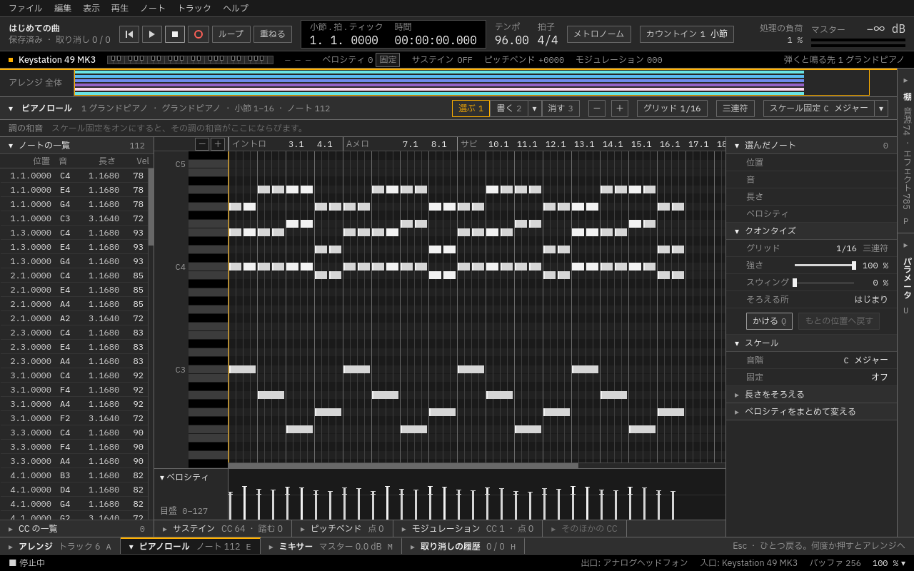

<p align="center"></p>

<h1 align="center">meloet</h1>

<p align="center">MIDI 鍵盤を買ったばかりの人のための DAW です。</p>

<p align="center"><a href="README.md">English</a> | 日本語</p>

<p align="center"></p>

## 概要

meloet は、はじめて MIDI 鍵盤を買った人のための音楽アプリ（DAW）です。鍵盤を USB でつなぎ、音の出口をえらぶと、弾く、録る、ノートを直すことができます。録ったノートは鍵盤を押したときに耳に届いていた位置に置かれ、どの変更も 1 手ずつ取り消せます。

- 画面は、いまは日本語だけです。
- meloet はまだ開発中です。

### 主な機能

- USB の MIDI 鍵盤から録音できます。カウントイン、ループ録音でのテイク、ループが回るたびに同じテイクへ足していく「重ねる」があります。
- ピアノロールではノートを書く、動かす、クオンタイズするほか、ベロシティと CC のレーン（サステイン、ピッチベンド、モジュレーションなど）、スケール固定、和音のスタンプと調の和音の表が使えます。
- アレンジではトラックにクリップをならべ、クリップを切る、つなげることができます。テンポと拍子の変更、マーカー、オートメーションもあります。
- ミキサーには 6 つのエフェクト（4 バンドの EQ、コンプレッサー、リバーブ、ディレイ、コーラス、リミッター）が入っています。
- 31 の音色が入っているほか、VST3 と LV2 のプラグイン、SF2 のファイルが使えます。プラグインは meloet とは別のプロセスで動くので、プラグインが止まっても meloet と曲は無事です。
- 歌のトラックでは音を録る、音のファイル（wav、mp3、flac、ogg）を読み込む、のばす、音の高さを変えることができます。
- 曲を wav のファイルに書き出せます。
- Mackie Control を送る鍵盤なら、鍵盤の再生、停止、録音のボタンとフェーダーが使えます。
- 色のテーマが 6 つあります（ダークとライト、それぞれのピンクとミント）。
- AI と連携できます。Claude などの AI のアプリが曲を読んで助言し、頼めば曲を直します（[AI との連携](#ai-との連携)）。

## サポート環境とインストール

### サポート環境

- Ubuntu 24.04 か 26.04（amd64）。音は PipeWire を通して出します。
- USB の MIDI 鍵盤。鍵盤がなくても、マウスでノートを書けます。
- はじめの 1 回は音の素材の包み（約 240 MB）を取るために、インターネットにつながっている必要があります。

### インストール

1. [Releases のページ](https://github.com/wintermaples/meloet/releases)から `meloet_0.2.0_amd64.deb` を取ります。まだ deb が置かれていないときは、自分で作れます（[deb を作る](docs/development/ubuntu.md#build-the-deb)、英語）。
2. 端末をひらき、取ったファイルのある場所で、次を打ちます。

   ```bash
   sudo apt install ./meloet_0.2.0_amd64.deb
   ```

   `./` を忘れないでください。meloet が使う部品（WebKitGTK、ALSA、PipeWire など）も、いっしょに入ります。

3. アプリの一覧の「meloet」から起動します。端末で `meloet` と打っても起動します。
4. はじめて起動すると、音の素材の包みを取るかを聞かれます。「取りにいく」を押すと取りはじめます。取っている間も鍵盤で弾けて、まだ届いていない音色はサイン波で代わりに鳴ります。

消すときは `sudo apt remove meloet` と打ちます。設定と音の素材の包みは家のフォルダに残ります。残る場所と消しかたは[利用者向けの案内](docs/user/README.ja.md)の「消しかた」にあります。

## かんたんな使いかた

1. 鍵盤をつなぎます。USB でつなぐのは、meloet を起動する前でも後でもかまいません。はじめてのときは「音をどこから鳴らしますか」と聞かれるので、<kbd>↑</kbd> <kbd>↓</kbd> で音の出口をえらび、<kbd>Enter</kbd> で決めます。出口はあとから音の設定（<kbd>Ctrl</kbd> <kbd>,</kbd>）で変えられます。
2. 音色をえらびます。棚（<kbd>P</kbd>）をひらき、<kbd>↑</kbd> <kbd>↓</kbd> で行をえらぶと、その音色を試し聞きできます。<kbd>Enter</kbd> を押すと、えらんでいるトラックにその音色が入ります。
3. 録音します。<kbd>R</kbd>（か ● のボタン）で、えらんでいるトラックに録音し、<kbd>Space</kbd> で止めます。<kbd>L</kbd> でループがオンになり、ループが 1 回まわるごとにテイクが 1 つできます。「重ねる」をオンにしておくと、同じテイクに足していきます。<kbd>C</kbd> でメトロノームをオン ・ オフします。
4. ノートを直します。<kbd>E</kbd> でピアノロールがひらきます。道具は「選ぶ」（<kbd>1</kbd>）、「書く」（<kbd>2</kbd>）、「消す」（<kbd>3</kbd>）の 3 つです。<kbd>Q</kbd> で、えらんだノートをクオンタイズします。
5. 音量などを整えます。<kbd>M</kbd> でミキサーがひらきます。
6. 取り消します。<kbd>Ctrl</kbd> <kbd>Z</kbd> で取り消し、<kbd>Ctrl</kbd> <kbd>Shift</kbd> <kbd>Z</kbd> でやりなおします。<kbd>H</kbd> で取り消しの履歴が出ます。
7. 保存して書き出します。<kbd>Ctrl</kbd> <kbd>S</kbd> で曲を保存し、<kbd>Ctrl</kbd> <kbd>Shift</kbd> <kbd>E</kbd> で wav のファイルに書き出します。

- キーの一覧: [`docs/spec/4-keys.md`](docs/spec/4-keys.md)（英語）
- 鍵盤、音の素材の包み、プラグイン、音が出ないときのこと: [利用者向けの案内](docs/user/README.ja.md)

## AI との連携

MCP という約束で話せる AI のアプリ（Claude Code や Claude Desktop など）から、動いている meloet を使えます。AI にできることは次のとおりです。

- 曲を読んで、助言する。
- 頼まれたら、曲に書く（ノート、ミキサー、エフェクト、音色、オートメーション、トラックやクリップ、保存 ・ ひらく ・ 書き出し）。書いた物は取り消しの履歴に 1 手ずつ出るので、取り消せます。
- 書き出した音を調べて、音の大きさなどを数で伝える。音色を知るために、1 つの音だけを書き出すこともできます。

### オンにして、AI のアプリに登録する

1. meloet で「音の設定 ▸ くわしい設定 ▸ AI とつなぐ」をオンにします（はじめはオフです）。つなげるのは、この PC で同じユーザーが動かしているアプリだけです。ほかの人や、インターネットからはつなげません。
2. AI のアプリに meloet を登録します。Claude Code では端末で次を 1 回打ちます。

   ```bash
   claude mcp add --transport stdio --scope user meloet -- /usr/bin/meloet-mcp
   ```

   Claude Desktop では `~/.config/Claude/claude_desktop_config.json` に次を書き、Claude Desktop を起動しなおします（ほかの物がもう書いてあるときは、`mcpServers` の中に `meloet` の行を足します）。

   ```json
   {"mcpServers": {"meloet": {"command": "/usr/bin/meloet-mcp"}}}
   ```

### 使う前に読んでください

- AI は自分の音楽を作るための道具として使ってください。AI だけで作った音楽はおすすめしません。meloet は、あなたが音楽を作るための道具です。AI には助言や、手間のかかる直しを任せてください。
- 曲のデータは外に送られます。AI が曲から読んだ物（ノート、テンポ、ミキサーの設定、書き出した音から測った数など）は、AI のアプリを通して、その AI を動かしている会社のサーバーに送られます。何が送られ、どう使われるかは、AI のアプリの決まりによります。それでよいときだけ、AI との連携をオンにしてください。
- AI のために書き出した音のファイルは、同じユーザーだけが読める一時フォルダ（`/tmp/meloet-ai-<ユーザーの番号>`）に置かれます。1 時間たつか、「AI とつなぐ」をオフにするか、meloet を終えると消えます。
- 録音中と書き出し中は、AI は曲を変えられません。保存していない変更があるときは、AI は別の曲をひらきません。

くわしくは[利用者向けの案内](docs/user/README.ja.md)の「AI とつなぐ」にあります。

## 開発

開発できる環境は、いまは Ubuntu 24.04 以降だけです。

```bash
(cd ui && npm ci && npm run build)
cargo run --release -p meloet-app
scripts/check-all.sh
```

準備、確かめかた、deb の作りかた、開発用の道具は、[`docs/development/`](docs/development/README.md)（英語。OS ごとの案内は [Ubuntu](docs/development/ubuntu.md)）にあります。

## 不具合の報告と問い合わせ

不具合や質問は、[GitHub の Issues](https://github.com/wintermaples/meloet/issues) に書いてください。次のことを書いてもらえると助かります。

- meloet の版（「ヘルプ ▸ meloet について」）と、Ubuntu の版
- したこと、そうなると思っていたこと、実際に起きたこと
- ログ: 端末で `meloet` と打って起動し、そこに出た文を写してください。

## ライセンス

コードは次のどちらかを選んで使えます。

- MIT（[`LICENSE-MIT`](LICENSE-MIT)）
- Apache License 2.0（[`LICENSE-APACHE`](LICENSE-APACHE)）

フォントの IBM Plex は OFL-1.1 です。音の素材は CC0、CC BY、MIT のどれかです。音の素材の包みと部品の帰属表示は、[`NOTICE`](NOTICE) と、アプリの「meloet について」にあります。

## 免責事項

- meloet は、上のライセンスに書かれているとおり、何の保証もなく「そのまま」提供されます。meloet を使って起きた損害（曲や録音が失われることを含みます）について、作者は責任を負いません。大事な曲は写しをとっておいてください。
- meloet といっしょに使うプラグイン、SF2 のファイル、AI のアプリは、ほかの人や会社が作った物で、それぞれの決まりに従います。それらの動きや、データの扱いについては、提供している人や会社が責任を持ちます。
- AI の助言や直しは、まちがっていることがあります。自分で確かめてください。
- この文書に出てくる会社名や製品名は、それぞれの会社の商標か登録商標です。
