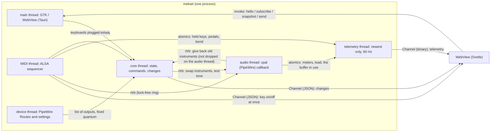
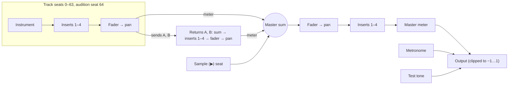

# The structure of meloet

This document explains how meloet is built inside and why it was built that way: what the code does now, the reasons, and where in the code it is.

- The section numbers (`3-2`, `19-7`, `22-18 A1`, `23-10`, …) and their order are the same as in the old Japanese document, because comments in the code point to them by number ("architecture 23-10", "chapter 20"). Some numbers appear twice; they are kept as they were.
- Chapters 1–18 describe the frame of the app. Chapters 19–23 record what was decided in each round of work, with the round in brackets.
- The full Japanese text, with every measurement and the step-by-step story of each round, is in [`history/architecture.ja.md`](history/architecture.ja.md). Measurements are in `docs/history/measurements/`, research notes in `docs/history/research/`.
- The design rules are the spec ([`spec/`](spec/), one file per chapter) and the mocks ([`design/mock/`](design/mock/)). When a mock and the spec disagree, the spec is right. The first study is in [`history/report.md`](history/report.md).

---

## 1. Crates and their jobs

The split follows section 7-1 of the report, with one crate added: `meloet-core`, the owner of the state.

| Crate | Job | What it must not hold |
|---|---|---|
| `crates/meloet-model` | Song, tracks, instrument choice. Pure data and operations | I/O, threads |
| `crates/meloet-protocol` | The contract between Rust and the screen (types, version, the byte layout of the telemetry). The TS types are made from here | Tauri |
| `crates/meloet-engine` | The sound flow, the instrument interface, meters, the cpal output. The audio thread takes no memory and no locks | The screen, plugin formats, locks (Mutex) |
| `crates/meloet-midi` | Keyboard input and plugging in/out (on Linux, the ALSA sequencer) | Sound |
| `crates/meloet-devices` | Human names of the audio outputs and inputs (on Linux, PipeWire Routes); reads the quantum the PC has fixed | Sound processing, changing settings |
| `crates/meloet-core` | Owner of the state. Takes intent commands, changes the state, sends changes with a `rev`. Band rules, status line notices, saved settings | Tauri, how the screen looks |
| `crates/meloet-app` | The Tauri shell. Only passes commands and Channels | Owning state |
| `ui/` | The screen (Svelte 5 + TS). Only `ui/src/bridge/` knows Tauri | Calling the Tauri API directly |

Crates added later: `meloet-sound` (samplers, SF2, built-in effects and synths; 19-6), `meloet-plugin` (keys, shared memory and the wire to plugin hosts) and `meloet-plughost` (the plugin host process, with VST3 and LV2 in `formats/`; chapter 20), `meloet-stretch` (time stretch and pitch; 22-8, 22-19), `meloet-ai` (the AI link: its port and its MCP tools; it depends on `meloet-core`, never the other way round; 24-12, 24-14, 24-16) and `meloet-mcp` (the small stdio bridge an AI app starts; 24-12). There are no separate `meloet-vst3` or `meloet-lv2` crates. Plugins have run in another process from the start (the report's idea of "v1 in the same process" was not used).

**Why**: report 7-1 gives `meloet-app` no state and `meloet-model` no I/O. Then some place must hold the song, the devices and the bands together and take the commands. That is `meloet-core`. It lets us test the contract and the band rules with no screen.

`spikes/` stays in the workspace but is left out of `default-members`. A plain `cargo build` or `cargo test` only works on `crates/`.

---

## 2. Threads and processes



- Key on/off goes from the MIDI thread straight to the screen's Channel, not through the core (to keep key → screen short). The held keys are also in every telemetry message, so if one message is lost, the next one puts it right.
- Plugging a keyboard in or out changes the core state and is sent at once as a change.
- The audio thread takes no memory and waits on no lock. Everything in and out goes through lock-free rings (rtrb) and atomics.
- Paths added in round 2 (not in the picture): core → audio thread, the song's note list (`Sequence`; the old list comes back through a ring) and transport commands. Audio thread → core, a ring of recorded events (with the position the listener was hearing, and the loop pass). The audio thread writes a ring of segments (`TransportClock`: 512 slots, a seqlock per slot, only atomics inside) that the telemetry thread and the core read without waiting on a lock.
- The core thread owns the MIDI thread and the PipeWire watcher. When one stops, the core is told and starts it again after a pause (4-2).
- Plugin hosts are separate processes (chapter 20).
- Added in round 12 (not in the picture): the analysis thread `meloet-analysis` reads a ring of the master's frames the audio thread writes (25-24) and writes the spectrum and loudness into atomics the telemetry thread sends (25-28, 25-29); a second key ring from the core thread to the audio thread carries the PC keyboard's keys (25-17); the update look `meloet-updates` and the picture reader `meloet-picture` are short threads (25-15, 25-25).

---

## 3. The contract between Rust and the screen (report 7-3)

The contract is **version 34** (`PROTOCOL_VERSION` in `crates/meloet-protocol/src/lib.rs`; the versions of round 12: 25-1 to 25-3 and 25-37).

### 3-1. Steps

1. **Hello**: when the screen starts, it calls `hello(protocolVersion)`. If the versions differ, it stops.
2. **Listen first**: `subscribe(messages, telemetry)` hands over two Channels. From here on, no change is missed.
3. **Fetch the whole state**: `snapshot()` returns `{ rev, state }`. Of the changes that came after step 2, those with `rev` ≤ the snapshot's are dropped; the rest are applied in order.
4. **Changes**: `{ rev, changes }`. `rev` goes up by 1. If a change comes whose `rev` is not the screen's `rev` + 1, the screen fetches `snapshot()` again.
5. **Screen → Rust is intents only**: `send(command)`. Rust checks it, changes the state and sends the changes. The screen does not decide state itself (only text being typed and the look during a drag may move first).
6. **Things told at once**: key on/off, pedals, bend and modulation are sent on the messages Channel the moment they arrive.
7. **Telemetry**: binary on the telemetry Channel, 60 Hz, newest only. If the content is the same as last time, nothing is sent (when nothing sounds, it stops).
8. **The content of a take** (round 2): a finished take never changes. The state holds, per clip, only the id and note count of the take it shows. The content is fetched as binary with `take_notes(id)` (3-4). The screen caches it by id.
   - **Edited takes** (round 3): an edit to notes makes a new take (new id) and puts it in the same place in the clip's takes (the place of the shown take). The number of takes does not change; undo goes back to the old id. The screen points to a note by "take id + its index in that take (in order of start, from 0)". If the id is not the shown take, Rust does nothing. A quantized take holds the id of its origin take (the take as recorded) and, for each note, which note of the origin it came from. The screen fetches `take_notes(origin id)` and draws the positions before quantizing as gray.7 outlines.
9. **Notes being recorded** (round 2): on the messages Channel as `liveNotes {seq, recording, notes}`. `seq` goes up by 1 for as long as the app runs. A note with the same `(lap, index)` replaces the old one (no length when pressed, a length when let go). After listening, the screen fetches all of them with `live_notes()` and drops messages with a lower `seq`. If a number is skipped, it fetches everything again.
   - **Why**: ten minutes of recording makes thousands of notes. Under the rule that a section is replaced whole, putting them in the state would send all of them with every change.
10. **Plugin parameters** (round 5, contract 18): when the params panel shows a plugin, the state (`params`) holds only "the table number (`table`) and the count". Names, groups, kinds and current values are fetched once with `plugin_params(table)` (JSON `ParamTable`). After that only changed values come on the messages Channel as `paramValues {table, seq, values}` (at most 30 a second, only changed ones, only for the table the panel shows). `seq` goes up by 1 per table; if one is skipped, the table is fetched again. When the choice changes, the plugin changes its list, or the whole state is put back (undo), the core hands out a new `table` and the screen fetches again. The screen side is `ui/src/bridge/paramTable.ts`.
    - **Why**: Surge XT (VST3) has 2855 parameters, and turning a knob in a plugin window changes values all the time. Under the whole-section rule, every value change and every row choice would send 2855 rows again (the same idea as take content and live notes).

There is one messages Channel. It carries changes (`patch`), things told at once (`event`), notes being recorded (`liveNotes`) and plugin parameter values (`paramValues`), in the order they happen.

### 3-2. The state (units of snapshot and change)

The state is split into sections. A change replaces a changed section whole (no partial changes inside a section). While sections are small, this is the simplest and hardest to get wrong. Sections are split so that something that changes often does not send a large section again.

| Section | Content |
|---|---|
| `song` | Song name; tracks (number, name, color index, instrument name, gain dB, clips [id, range, name, shown take's index, count, id and position, note count]); counts of undo and redo steps; where the keys sound; loop (range in ticks, on/off); the note count of the shown clip (the band tab no longer shows it: it shows the track name, user:2026-11-24); the song file's state (never saved, saved, changed). (Round 4) per track: pan (−100…100), sends A and B (dB; `null` is −∞), four insert slots (an effect kind or empty), mute. `returns` (returns A and B: fader, pan, mute, inserts) and `master` (fader, pan, inserts). All of these change only by hand; the value during a drag (preview) is not in it. Track kinds, inputs, ● and monitor of vocal tracks, `keysTarget`, audio clips: 22-15, 22-17. (Protocol 34) `muteSets`: the mute sets by name, in order, each with `asNow` (25-37) |
| `timeline` | (Contract 20, round 6) the tempo and time signature at the song's start and the ramp from the start, tempo points (tick, tempo, ramp), time signature flags (bar number, signature), markers (id, tick, name), what is selected (a point by tick, a flag by bar, a marker by id), the marker whose name box is open, whether the arrange's 「テンポ ・ 拍子の変更」 row is open. Tempo and time signature live only here (moved from `song`). The screen's tempo map (`ui/src/time/tempoMap.ts`) is made from it (chapter 21) |
| `automation` | (Contract 21) what of the automation lanes is not an undo step: folded, armed, being written, held, selected points (21-15) |
| `history` | (Round 6) the rows of the undo history band (21-12) |
| `transport` | Stopped, count-in, playing or recording; the position when stopped; metronome (and from protocol 31 its volume, sound and when it clicks); count-in bars and beats; whether play and record can be used; while recording: recording number, track, start, which take it will be, the clip it joins, the loop pass. The moving position comes in the telemetry |
| `arrange` | The selected clips, the clip the piano roll shows |
| `pianoRoll` | (Round 3) the take id the piano roll shows, the selected notes and control points (lists of index ranges `[start, end)` in the take), grid, musical scale (root, kind of scale, lock, `highlight` (kept, but the screen no longer shows or changes it, user:2026-11-24)), the quantize panel's settings (grid, triplet, strength, swing, what to align), the count of notes that can be pasted. Selection changes often, so it is apart from `song` |
| `workspace` | Scale, scales that do not fit the screen now (`unfitScales`), window size, which bands are open and their heights (`layout`), the right panel, the sound settings dialog, the output chooser (flow 2), the hint above the arrange, the song dialogs (unsaved, cannot save, broken: id, heading, whether a previous version exists) |
| `shelf`, `library` | (Rounds 4–5) the shelf: its mode, the instruments and effects to choose; `library` is the list of SF2 files and plugins the shelf shows (20-11) |
| `params` | (Round 4) the insert the params panel shows (which strip and slot, effect kind, values, selected row). Choosing an insert or row is not an undo step, so it is apart from `song` (the same idea as `pianoRoll`). (Contract 18) what it shows is a built-in effect or a plugin (an insert, or a track's instrument). For a plugin: where it is, the window kind (can open, cannot open yet, has none), the table number and count, the selected row, and the rows written by automation — not the rows themselves (3-1, item 10) |
| `plugins` | (Round 5) the plugin scan, what it could not read, where it looks. Apart because the count changes with every bundle during a scan |
| `windows` | (Contract 18) the open plugin windows (where, plugin name, size, whether larger than the screen). The status line's 「窓 N」 and the window marks on slots and instrument names are made from it. Windows opening and closing is not an undo step and touches nothing else, so it is apart |
| `keyboards` | The keyboards seen (name, ALSA address), the one in use, the last one pulled out |
| `outputs` | The outputs (real name, kind of easy name, plugged in or not, kind of link), the chosen output and its state |
| `inputs` | The audio inputs (22-15) |
| `audio` | Running or not, sample rate, buffer asked for, buffer in use, the quantum fixed for the whole PC, latency estimate, the name of the sound system, the output device name, the MIDI input name. Later: buffer and sample rate choices, record format, latency (22-15) |
| `audioWork` | (Round 7) audio being made ready, with a percent (apart so a percent does not send the song again) |
| `export` | (Round 7) export (22-11, 22-20) |
| `sounds` | (Round 8) the sound pack as this PC has it, and its fetch (23-7) |
| `recent` | (Protocol 31, round 12 A5) the songs opened lately for 「最近ひらいた曲 ▸」: an id, the name and the place as shown; the full path stays in Rust |
| `updates` | (Protocol 31, round 12 D1) the switch 「新しい版をたしかめる」 and the newer version found |
| `presets` | (Protocol 32, round 12 M1) the names of 「自分で残したもの」 of each built-in effect; the presets themselves stay in Rust |
| `status` | The notice on the left of the status line (kind of text and the values to put in) |

The screen's wording is not kept in Rust. Rust sends only "the kind of text (ID) and the values to put in", and the screen matches it to the text in `ui/src/text/`.

The full list of sections is `AppState` in `crates/meloet-protocol/src/lib.rs`.

### 3-3. The telemetry binary (version 5, little-endian)

| Offset | Type | Content |
|---|---|---|
| 0 | u8 | kind = 1 (telemetry) |
| 1 | u8 | version = 5 |
| 2 | u16 | number of tracks n |
| 4 | u32 | serial number |
| 8 | u64 | the time Rust sent it (CLOCK_MONOTONIC, ns) |
| 16 | u64 | bits of held keys 0–63 |
| 24 | u64 | bits of held keys 64–127 |
| 32 | u8 | last velocity (0 = none yet) |
| 33 | u8 | sustain (value of CC 64) |
| 34 | u8 | modulation (value of CC 1) |
| 35 | u8 | flags (bit0: sound is running, bit1: master clipped, bit2: there is a play position) |
| 36 | i16 | pitch bend (−8192…8191) |
| 38 | u16 | processing load (per mille) |
| 40 | f32 × 2 | master peak left, right (max since the last send; 1.0 = 0 dBFS) |
| 48 | f64 | song position the listener hears at the send time (ticks, with fraction; can be negative during a count-in) |
| 56 | f64 | ticks per µs (0 when stopped) |
| 64 | u8 | state (0 stopped, 1 count-in, 2 playing, 3 recording) |
| 65 | u8 | 0 (spare) |
| 66 | u16 | count-in beats left (the one sounding included; 0 outside a count-in) |
| 68 | u32 | loop pass while recording (first is 0) |
| 72 | f32 × 4 | return A peak left, right; return B peak left, right (after inserts, fader and pan; round 4) |
| 88 | u16 | number of mic meters m (round 7; 0 while no input is open) |
| 90 | u16 | 0 (spare) |
| 92 | i16 | short-term loudness, the last 3 s of the master (0.01 LU; −32768 = none) (round 12 M3) |
| 94 | i16 | integrated loudness since the play started (0.01 LU; −32768 = none) (M3) |
| 96 | i16 | true peak since the play started (0.01 dBTP; −32768 = none) (M3) |
| 98 | u8 | how far the master's limiter holds the sound down, the most since the last send (0.1 dB, 25.5 dB at most; 0 = not at all, or no limiter) (M2) |
| 99 | u8 | 0 (spare) |
| 100 | u8 × 24 | the master's sound from low to high, 40 Hz to 16 kHz in 24 bands, each −72..0 dB as 0..255 (E7) |
| 124 | f32 × 2n | per-track peak left, right (after fader and pan) |
| 124 + 8n | 16 × m | mic meters (one per vocal track, in track order): track id u32; input peak left, right f32 × 2 (before the fader; mono has the same value in both); flags u8 (bit0: reached 0 dB, bit1: stereo); three 0 bytes |

Screen position = `tick + (Rust's now − send time) × ticks per µs`. While bit2 is 0 (sound not running yet), bytes 48–71 are 0 and the screen uses `transport.position`. Version 5 (protocol 32, round 12, 25-2) put bytes 92–123 before the tracks; every reading there is in `same_readings`, so a change in it alone is sent. The screen reads the loudness as LUFS or dBTP (`null` for none) and the reduction as dB (`ui/src/bridge/telemetry.ts`). When stopped, the transport's numbers and the play line use `transport.position` (it comes at once as a change); when moving, the telemetry position (`shownTick` in `ui/src/components/time.ts`). The layout is fixed in one place, `crates/meloet-protocol/src/telemetry.rs`.

### 3-4. The take content binary (version 2, little-endian)

| Offset | Type | Content |
|---|---|---|
| 0 | u8 | kind = 2 (take) |
| 1 | u8 | version = 2 |
| 2 | u16 | 0 (spare) |
| 4 | u32 | take id |
| 8 | u32 | length (ticks) |
| 12 | u32 | number of notes n |
| 16 | u32 | number of controls m |
| 20 | u32 | origin take id (0 = none; ids start at 1) |
| 24 | 16 × n | notes: start u32, length u32, key u8, velocity u8, two 0 bytes, index of the origin note it came from u32 (0xFFFFFFFF = none) |
| 24 + 16n | 8 × m | controls: tick u32, kind u8 (0 CC, 1 pitch bend), CC number u8 (0 for bend), value i16 |

Positions count from the take's 0. With 1920 ticks to a quarter note, u32 ticks last 124 hours at 300 BPM (22-1).

The layout is fixed in one place in `meloet-protocol` (`take.rs`), and a test that writes in Rust and reads in TS watches for differences.

---

- **The song serial** (contract 9, end of round 3): take ids are handed out from 1 per song. `song.serial` goes up by 1 each time the core replaces the `Doc` from outside (new song, open, open the previous version, restore from the recovery file, do not restore), and when undo/redo crosses the "restore from the recovery file" or "do not restore" steps. Normal undo/redo does not change it. When the serial changes, the screen lets go of all cached takes and drops answers still on the way (`TakeStore.clear`). The piano roll also fetches a take with the same id again. Takes are known by (serial, id).

---

## 4. Sound flow

- The output is cpal's PipeWire host. **The buffer in use is read from the frame count the callback receives.** The buffer and sample rate asked for are settings (22-16; at first it was always 256).
- The PC-wide `clock.force-quantum` is **only read** from PipeWire's `settings` metadata. When it is not 0 and the buffer in use differs from the one asked for, the screen says "fixed by the PC-wide setting".
- Latency estimate: from the first study's measurements (mean 13.2 ms with buffer 256, 53.2 ms with 1024, 48 kHz), key → sound ≈ 2.5 × buffer ÷ sample rate. While running, the measured value is used (the mean of the time between receiving a key and the time its sound is due at the DAC). Latency numbers shown in the sound settings: 22-15.
- The instrument interface (`Instrument`): each track has one instrument. An instrument has "prepare (off the audio thread)", "events (notes, CC, bend)", "render (a stereo buffer)" and "stop". To swap, the core makes the new instrument off the audio thread and sends it through a ring. The audio thread swaps and sends the old one back through a ring (dropping it on the audio thread would run code that frees memory).
- The first instrument was a placeholder (a soft synth tone). Superseded by 19-7 and 19-10: sample instruments, built-in synths, SF2 and plugins all sit behind the same interface (plugins hide the talk with another process behind it).
- Meters: per block, the peak is written to an atomic only if larger than before. The telemetry thread sets it back to 0 when reading. There are meters for tracks, returns A and B, and the master (where they measure: 19-11).
- The mixer's sound path (inserts, fader, pan, sends, returns, master): 19-11.
- Processing load = time spent in the callback ÷ the length of that block.
- To change output, the old stream is stopped, instruments are made again from the song, and a new stream is made.

### 4-1. Watching the audio thread

- `meloet-engine` (and `meloet-sound`) use no locks such as `std::sync::Mutex`. `disallowed-types` and `disallowed-methods` in `clippy.toml` stop them by machine.
- Memory use is watched in tests by a counting global allocator. When the audio thread section starts, a flag is set; any allocation or free while it is set fails the test. This runs both in offline render tests and in a test that runs a real stream for 2 seconds (only when a device exists).

### 4-2. When things stop, and connecting again (round 2)

- Output stream errors are counted in three kinds: xrun; the stream ended by itself (PipeWire gone, output gone; once per stream); other. The `DeviceNotAvailable` that cpal gives when we stop the stream ourselves is not counted.
- When PipeWire goes away, cpal gives `StreamInvalidated` once and the callback stops (1.4–37 ms to notice), and the device watcher (pipewire-rs) ends with a core error (0.6–10 ms). Both tell the core. When the stream is closed, the engine comes back through `Carrier`'s Drop. In case it does not, the engine can be made again (`EngineHandle::rebuild`; the MIDI ring and the segment ring are new too, and the core hands them out again).
- The MIDI thread, when it stops by itself, sends `Stopped` last and gives back its sink. The core starts it again with the same sink. Held keys and pedals are taken as let go at the moment it stopped.
- Wait between tries: 0.5, 1, 2, 4 seconds, then every 5 seconds. For PipeWire and MIDI it never gives up (there is no other way back, and one try is cheap; the early tries are fast, so a daemon that comes back quickly is found quickly). When only the stream fell (PipeWire still running), up to 4 tries; after that it waits until the output list changes or the person does something (so it does not keep opening and closing an output that falls every time). If PipeWire is missing at start, it tries quietly at the same pace (it never ran, so 「止まりました」 is not shown).
- If the sound stops while recording, the recording is closed at the last position the listener heard, what was recorded is kept as a take, and a notice is shown. If keyboard input stops, recording does not stop.
- Tests: start a private PipeWire and WirePlumber (`crates/meloet-engine/tests/private_pw/`), kill it, and bring it back (`--devices`). The owner's PipeWire is never touched.

---

## 5. Keyboards

- meloet joins the ALSA sequencer with the name `meloet` and subscribes to System:Announce. At start it counts all keyboards already there, then waits for plug in/out.
- What counts as a keyboard: a client of type HARDWARE with a readable port (READ + SUBS_READ). From one client, only the readable port with the lowest number is heard (the second port of the Keystation 49 MK3, "Transport", is for buttons and could be taken for notes).
- The keyboard's name is the ALSA client name (e.g. 「Keystation 49 MK3」).
- The virtual keyboard for tests (`meloet-vkeys`) counts as a keyboard only with `MELOET_ACCEPT_VIRTUAL=1`. With `MELOET_VKEYS_NAME=name[,name…]`, only virtual keyboards of those names (`meloet-vkeys --name`) are taken (so other tests' virtual keyboards on the same PC do not mix in). With `MELOET_ONLY_VIRTUAL=1`, real keyboards are ignored and only virtual ones are seen (to take pictures of the "no keyboard" screen with a keyboard plugged in).
- When a keyboard is pulled out, a "stop all sound" message goes to the audio thread and the record of held keys and pedals is cleared (so sound and lights do not stay after pulling it out with a key held).
- With two or more keyboards, all keys are heard. The name shown is the keyboard played last (counted only on key presses; before any playing, the one plugged in last), and the input meter adds the count of the others like 「+1」 (spec chapter 3). Which keyboard a key came from comes with the MIDI message. The MIDI thread tells the core only when the keyboard differs from before, after telling the screen.

---

## 6. Names of outputs and inputs

- meloet reads the Routes of PipeWire Devices (`EnumRoute` and `Route`). A Route's `description` is the real name (「アナログヘッドフォン」 etc.), `available` is whether something is plugged in, and `port.type` in `info` is the kind.
- One output = one Sink node + one output Route of its device. A Sink with no Route (Bluetooth etc.) uses the node's description as its name.
- An output's ID is "device name + Route name" (the node name if there is no Route). This is saved in the settings.
- **meloet does not switch a device's Route** (that would change a PC-wide setting). If the chosen Route is not plugged in now, the text for that is shown.
- Easy names are used only when the kind is known (the four in the mocks: headphones → 「ヘッドホンの穴」, HDMI → 「画面のスピーカー」, line out → 「うしろのスピーカーの穴」, rear mic → 「うしろのマイクの穴」).
- The device name is the PipeWire Device's `device.description` as it is (e.g. 「GB206 High Definition Audio Controller」; the owner's decision). It is used on rows of outputs that cannot be chosen, and when two or more outputs have the same name.
- Outputs that cannot be chosen (`unusable`) are of two kinds. The node exists but the PC uses another Route on that device → 「PC が切りかえる」 (`switchedByPc`). There is no node → 「PC の設定で止まっている」 (`stoppedByPc`, even if another jack on the same device has a node).
- Order: outputs that can be chosen first (plugged in → unknown → not plugged in; among plugged in, headphones first), then those that cannot.

---

## 7. The screen

- Svelte 5 + TypeScript + Vite. No SvelteKit (one screen is enough, and the bridge stays thin).
- **Values**: `ui/src/design/tokens.ts` holds them under the spec's table names (`color.gray.4`, `size.meter.slim`, `space.3`, …). Part sizes that are only in the spec's text (a button's height 24, etc.) are `part.*`; sizes only in the mocks are `mock.*`, with their source. Parts use only the CSS variables made from here. A hex color or px written directly in a part fails a test.
- **Scale**: 100, 125 % (150 % was removed, user:2026-11-24; a settings file that holds 150 reads as 125). `tokens.ts` gives the values per scale. `line.hair` is one physical screen pixel at every scale (`1px / devicePixelRatio`). `line.mark` and `line.track` are the table's values. The "weight" column of the text table is read as the set of weights allowed at that size (text.s 400, 500, 600; text.m 400, 500; text.l 600; not changed by scale). Sizes in the spec's text (part.*) are rounded when the scale does not give a whole number.
- **Wording**: one place, `ui/src/text/`: `ja.ts` is the source (Japanese, with sources), `en.ts` follows it key by key (round 12 D4, 25-36); the screen reads them through `index.ts`. The spec's wording is never changed by even one character (a test checks it against text taken from the spec). Text only in a mock is used as in the mock, with its source (the board name).
- **Large surfaces are WebGL (one per region, reused)**: a part puts `use:glSlot={...}` where it draws, and a box around it (it can be the same box) gets `use:glRegion={"name"}`. The WebGL manager (`ui/src/gl/engine.ts`) puts one canvas in each region box (inside the box, `pointer-events: none`). The canvas covers "where the region's slots are ∩ the box ∩ the window", with edges on screen pixels. All slots in a region are drawn on that one canvas, in page order (later on top). Only regions whose list of rectangles changed are drawn. Things that change at 60 Hz (meters, the clip being recorded) are in small regions, not in large regions that do not change (the arrange's lines and clips). Things that only move, like the play line, are not redrawn: an HTML line is moved with CSS `transform`. Text and small parts are HTML. Canvas 2D is not used.
  - Why: on WebKitGTK (NVIDIA), each surface put on screen blocks the web process's main thread for about "0.25 ms + 3.9 ms × megapixels", and key messages wait behind it (2026-11-15, RTX 5060 Ti, WebKitGTK 2.52.6). 16 meters as one surface each took 4.4 ms; on one surface, 1.4 ms. Moving with `transform` only: 0.35 ms. In round 1, a full-window surface at 60 Hz made key → screen p95 8–12 ms for this reason. This formula is for one surface with no HTML under it; in the real screen, the rules of "WebKit that paints on the CPU" below come first.
  - **WebKit's drawing path (2026-11-22)**: WebKitGTK `2.52.6-0ubuntu0.26.04.2` started drawing through the compositing path (ThreadedCompositor, Skia), where the rules below do not work as written. **meloet sets `WEBKIT_DISABLE_COMPOSITING_MODE=1` at the very start** (`JSC_OPTIONS` in `crates/meloet-app/src/main.rs`; a value set from outside wins) and so paints on the CPU. Why: on the compositing path, key → drawn p50 was 8–10 ms longer in every case, and with the mixer open while playing, "within 2 frames" fell to 92.5–95 %. The cost: scrolling and zooming the arrange take 20–24 ms a frame (see 23-13). Details: `docs/history/measurements/2026-11-22-round8-quiet.md`, `2026-11-22-round8-webkit-2.52.6-2.md`.
  - **WebKit that paints on the CPU** (found in round 4; `docs/history/measurements/2026-11-19-round4-mixer.md`, chapters 6–7): with NVIDIA + Ubuntu WebKitGTK on this path, there are no compositing layers and the page is painted on the CPU.
    - When a canvas is shown, the whole canvas becomes a "dirty rectangle". WebKit reads the canvas back from the GPU twice (`readPixels`), paints the HTML inside that rectangle again (background, borders, text), and sends the bitmap to the UI process. So the cost depends on "how many canvases" and "how large the rectangles are and how much HTML is under them". A canvas over a lot of text is expensive.
    - What got dirty in one frame is cut into rectangles of "a y band × an x range". Rectangles whose top and bottom edges do not line up cut each other and grow in number (three numbers and one meter with uneven edges go over 10).
    - **If there are 11 or more rectangles, or their total area is 25 % or more of the rectangle around them all, WebKit repaints that one bounding rectangle whole** (WebKitGTK 2.52.6, `shouldPaintBoundsRect` in `DrawingAreaCoordinatedGraphics.cpp`). If the top band and the mixer at the bottom get dirty in the same frame, the bounding rectangle is most of the window and the main thread is busy for 12–16 ms (5–7 ms each alone).
    - The two rules decided:
      1. **Things that change in the same frame go under one canvas.** `use:glSlot={{ kind: "cover" }}` draws nothing but stretches the region's canvas over that box. In the top band, the boxes of position, time, load and master dB and the master meter are under the one `masterMeter` canvas (1437×36 at 1920 width). However many numbers change, it is one dirty rectangle.
      2. **A frame that shows the mixer meters also shows the master surface** (`SHOWN_WITH` in `ui/src/gl/budget.ts`). The mixer surface is wide and low, so with the top-right master surface always in, the bounding rectangle is the window's width and the 25 % rule does not trigger.
    - **Rules for anyone who adds something that moves at 60 Hz**: (a) in the top band, give its box `cover` (inside the `masterMeter` region). (b) elsewhere, line up its top and bottom edges with nearby things that change in the same frame, or put it under the same canvas. (c) at most 10 rectangles a frame, and total area under 25 % of the bounding rectangle. Check with `tools/measure/webkit-damage.sh` that the rectangles are as expected and not "one rectangle around all". The tool stops gdb only at paints (since 2026-11-24): it gives the paints, the whole-window paints (one painted rectangle of 500 000 px or more, `--whole-px`), the rectangles per paint and the largest count of a paint that was not whole-window. `--per-rect` also stops at every changed rectangle, as before, to see what was changed and to compare with older numbers; where many rectangles change it slows the page (15 to 25 paints a second with E1's 10 000-note song), so a line that moves every frame moves 2 px or more between paints, is cut into more rectangles, and shows whole-window paints the app does not have (B-98-33). (d) do not add text under a canvas. (e) **things that change every frame must not run layout**: move position and length with `transform` only (do not change `top`, `left`, `width`; snap edges with `Math.round(px × dpr) / dpr`). **Do not change text every frame.** Text that must change every frame goes in an out-of-flow box (`position: absolute`, with a size that does not depend on the text). (f) where many small rectangles change in one frame (knobs and text per strip), first ask for one rectangle around them all (`askWhole`). Check with `tools/measure/webkit-layout.sh` how many rectangles one layout asks for, and that it is not "one rectangle around all" (next item).
    - **The Region collected during layout** (found in round 6; `docs/history/measurements/2026-11-20-round6-step2-3.md` chapter 3, `2026-11-20-round6-fix-redraw.md`): another WebKit rule that works **before** the "11 / 25 %" rule above.
      - Repaint rectangles asked for during one style recalculation and layout (one outer `Document::updateLayout`, `resolveStyle`, `performLayout`) are collected in one Region. Each time a rectangle is added, **if the Region's `gridSize()` (number of y edges × number of x edges) goes over 256, everything so far becomes one bounding rectangle**. If that rectangle is 75 % or more of the visible area, the whole window is repainted. (Source: WebKit branch `webkitglib/2.52`, `Source/WebCore/rendering/RenderView.cpp` `accumulateRepaintRect` with `maximumRepaintRegionGridSize = 16 * 16` and `dirtyEntireViewThreshold = 0.75f`, and `Source/WebCore/platform/graphics/Region.h` `gridSize`. Confidence A for the source; that this PC's build runs the same code is only checked by gdb call stacks and by the counts matching the measurements.)
      - Counting: N separate rectangles of different heights give 4N² (**over at 9**). N rectangles side by side at the same height give 4N (up to 64). The top band's numbers (2–4) are in the same frame, so 6–7 small rectangles at different heights are the limit.
      - When it goes over, the bounding rectangle wraps **everything collected so far** (top band numbers, arrange lane headings, mixer), so it is most of the window. `cover` only helps with the later rule (11 / 25 %).
      - Order of collection: repaints from style only (color, background) → text boxes during layout → layers after layout (things moved by `transform`, old and new place). When JavaScript forces layout with `getBoundingClientRect()` etc., what came before goes into a separate Region.
      - A `position: absolute` box has its own layer and asks for its own rectangles (a fader handle and the line in it: 2; old and new place: 4).
      - Layout itself: when `top`, a width or text changes, flex layout runs again up the box's parents, and sibling boxes that did not move also ask for rectangles (376 for 8 mixer strips). Text in an out-of-flow box (`position: absolute`) asks its parent only for a light "positioned children only" layout (`contain: strict`, or `overflow: hidden` with a fixed size on an in-flow box, did not make it light).
      - **The shape decided** (`ui/src/components/automation/coverIf.ts`, `autoState.svelte.ts`):
        1. Handles and bars move by `transform` (`mixer/Fader.svelte`, `SendBar.svelte`, `params/ParamRow.svelte`). Value text is in an out-of-flow box `.live > .in` (the outer box keeps height and baseline with a zero-width character `\200b`; `mixer/Strip.svelte`, `PanKnob.svelte`, `SendBar.svelte`, `automation/LaneHead.svelte`, `params/ParamRow.svelte`).
        2. **Ask first for the rectangle of the box around them** (`askWhole`): switch the `background-position` of the box around what a lane moves between two values that look the same. It is a style-only repaint, so it is collected first, and the handles and text inside fall into it (the Region does not grow). Switching `transform`, `outline-color` or `box-shadow` did not ask for a rectangle (tried on WebKitGTK 2.52.6).
           - Mixer strip (`mixer/Strip.svelte`): while a lane moves anything of that strip, the fader and the value box `.gain-box` go under the canvas (`coverIf`). Both going under the canvas and asking for the rectangle are done by the same empty box that `coverIf` places over the whole box (if the box itself asked, the text that sticks out would be included and go outside the canvas). It is about as tall as the meter, so the canvas does not grow. The pan row `.pan-box` and the two send rows `.sends-box` do not go under the canvas; only the moved row asks for its rectangle (`askIf`). Every empty box reaches the full width of the strip, so neighbors join and there is one rectangle per half.
           - Arrange lane headings (`automation/LaneHead.svelte`): the current value's text box is under the `trackMeters` canvas (`cover`). In a frame where the text changes, the canvas is shown too (`cover`'s `stamp`; `gl/engine.ts`), so the text's rectangle is inside the canvas and does not cut the play line's rectangle. Headings not in view do not read the per-frame value (`IntersectionObserver`).
        3. **Strip handles and text are shown in the frame that draws the canvas above them** (`coverIf`'s mark is `paint`; the WebGL manager calls it while building that canvas's picture, and `showTrack` runs there). The mixer canvas shows its left and right halves on alternate frames. Moving the handles of the half not shown in the same frame goes over 11 rectangles and repaints the whole window (25 ms with 16 tracks). In a frame where no canvas is drawn (no meter message came), it waits for its turn; if no canvas has been drawn for 3 frames, it shows anyway (`MAX_WAIT_FRAMES`). A track whose turn never comes while other canvases are drawn is scrolled out of view, so it waits until seen (in a 64-track song, hidden strips are not rewritten). Two positions are kept: the newest (`livePosition`; lane headings, params panel) and the one shown on the strip (`shownPosition`). Both are re-read by a per-track counter, so places showing a track that did not move are not re-read.
        4. **Pan and sends take turns** (`rowTurn` in `autoState`): the pan row and the send rows are outside the canvas, so adding both in the same frame approaches the "area" limit below. The turn switches every 2 frames, the same for every track (otherwise row rectangles go out of step per strip and approach 11). Pan and send handles move 15 times a second, faders 30.
        5. **Keep layout apart from other changes** (`layoutNow` in `automation/AutoClock.svelte`): before writing positions, and after what was written is on screen, read `scrollTop` to finish layout. Then the rectangles of what lanes moved do not go into the same Region as the top band's numbers (if they did, about 7 lane headings in a column would make the bounding rectangle reach from the top band to the bottom of the arrange). Only while moving.
      - **Area** (the 25 % rule): at 1920×1080 the bounding rectangle is about 1.79 M px; 25 % is about 447 k px. Per frame: master 52 k + heading meters 30 k + half the mixer (948 × 271 = 257 k) + the pan row (23 k) or the two send rows (47 k), at most 384 k px (21.5 %). Putting the send rows under the canvas as well (948 × 356 = 337 k) made 420 k (23.5 %), and some frames went over.
      - Left over: when all meters are still (silence), no canvas is shown, so moved boxes become rectangles as they are. About 8 per frame (master, heading meters, play line 4, half the mixer, a row), 2 away from 10. The params panel (no canvas) with 2 or more rows moving at once is not measured yet. A song with 64 tracks and 4 lanes each moving runs the mixer at 57–59 frames a second.
    - **Ceiling**: the mixer surface is one rectangle of "number of strips × meter height". At 1920×1080 with 8 tracks (11 strips, 1110×264), the total is 21 % of the bounding rectangle. By calculation, 10 tracks (13 strips) give 24 %, 11 tracks 26 %. Over 10 tracks, or with a taller mixer band, it goes over 25 %. This is handled by splitting the mixer meters in halves (next item).
    - **Mixer meters always run at 30 Hz, split into a left and a right half, one half per frame** (`regionHz` in `ui/src/gl/budget.ts`, `Tile` in `engine.ts`; for any number of tracks — the owner: meters need not be seen at 60 Hz, so always 30). Arrange track meters, the master meter, keys and the play line stay at 60 Hz. At most 2 parts (with 3, a part falls below 30 Hz). The split is at the middle of the visible width (which side a slot's middle is on), not by count (the right side, with returns and master, would be wider).
      - With 16 tracks (19 strips) the meter surface was 1807×264, 27 % together with the top band, and every frame repainted the whole bounding rectangle (18–22 ms a frame).
      - Shape: one WebGL context per region as before. That canvas sits off the page; the visible slots are split from the left into 2 groups, and each group gets a "show a copy only" canvas (`bitmaprenderer`; not a WebGL context, so not counted in the budget) in the region box. Each frame, one group is drawn with WebGL, copied with `createImageBitmap(canvas, 0, 0, w, h)` and shown with `transferFromImageBitmap` (a 900×264 copy took 0.9 ms and arrives in the same frame on WebKitGTK 2.52.6). The page repaints only half a rectangle each frame (770×264 or 878×264). The gap between the groups is in neither surface.
      - In a frame where scrolling or size changed (`urgent`), both groups are shown in the same frame so they do not get out of place (only that frame repaints the bounding rectangle). Where `createImageBitmap` or `bitmaprenderer` is missing, it is not split and draws once every 33 ms.
      - Result (1920×1080, playing, 25 s): with 16 tracks busyMs mean 12.2 → 6.1 ms, p95 21 → 7 ms; bounding-rectangle repaints 151 of 151 → 0 of 138. Details: `docs/history/measurements/2026-11-20-round5-step3-app.md` chapter 7.
      - Left over: when half the surface is over 25 % of the bounding rectangle (a very tall mixer band).
    - On PCs with compositing layers (Intel, AMD), a canvas becomes a GPU layer and these rules do not matter (`cover` and `SHOWN_WITH` only make surfaces a little larger or more frequent). Not checked.
  - Limit: WebKitGTK 2.52 allows 16 WebGL contexts per page. At the 17th, the oldest is lost and does not come back. **Contexts of thrown-away canvases count until GC** (even after `loseContext()`). With "make and throw away", switching 「くわしく」 in the sound settings 40 times lost 15 live contexts. So a canvas, once made, is never let go: `ui/src/gl/pool.ts` reuses it for the next region (the same 40 times made 7 and lost 0).
  - Contexts are made when the region box arrives (fixed in round 3): one `getContext("webgl2")` blocks the main thread for 50 or 200 ms (shader compile and link 1 ms, first draw under 1 ms; `docs/history/measurements/2026-11-15-round3-fix-glcontext.md`). So a region takes its canvas when its `use:glRegion` box arrives (start-up, opening a band), not when a slot first comes in, and keeps it while the box exists even with no slot (size 0). Nothing is made at the moment of a key, the start of recording or a drag. So boxes of regions that grow are kept even when unused (`recordingClip` is `.rec-host` over the whole arrange lane area, `pianoRollLive` is `.live-host` over the whole note area). The frame that opens a band is heavier by the contexts it makes (360–410 ms at 1920×1080).
  - Budget: 12 contexts may be made (4 below the limit of 16). Going over fails in development and tests and writes to the console in release. Slots outside a region too. To add a region, add one line to `REGIONS` in `ui/src/gl/budget.ts` (a name not in it does not type-check).

  | Region | Where | Opaque | How often it changes | Contexts |
  |---|---|---|---|---|
  | inputMeter | the input meter's keys and velocity bar (the text part between is not drawn and shows through; the box is the whole input meter) | no | per key | 1 |
  | masterMeter | the transport's master meter. The box is the whole transport band; the surface runs from the position numbers to the master (the number boxes are `cover`; only the meter is drawn, the rest shows through) | no | ~60 Hz | 1 |
  | trackMeters | meters in the track heads (one surface for any number) | no | ~60 Hz | 1 |
  | arrangeLanes | bar lines and clips | no | when the song, size or scroll changes | 1 |
  | overview | the shrunk arrange (instead of trackMeters and arrangeLanes; reused) | no | as above | 0–1 |
  | settings | the meter next to the test tone and the lit keyboard in the sound settings (the box is the whole scrolling content; kept when 「くわしく」 is opened and the slots go) | no | ~60 Hz, per key | 0–1 |
  | (round 2) recordingClip | only the clip being recorded | no | ~60 Hz | 1 |
  | (round 3) pianoRoll | the piano roll's row background, beat and bar lines, notes, outlines of positions before quantizing and of the drag's starting place, the velocity lane | no | when notes, selection or view change | 1 |
  | (round 3) pianoRollKeys | the keyboard column on the left of the piano roll (sounding notes and played keys light up) | yes | per key; every frame while playing (about 42 rectangles) | 1 |
  | (round 3) pianoRollLive | notes being dragged, notes growing while recording (a box around only what moves; dragging notes only moves the box by `transform`) | no | ~60 Hz | 0–1 |
  | (round 4) mixerMeters | mixer meters (two vertical bars each for tracks, returns A and B, master, on one surface; the box scrolls sideways and stays one surface; its copy is shown on two canvases, left and right, one per frame) | no | 30 Hz | 0–1 |
  | play line | HTML (`transform`) | — | 60 Hz | 0 |

  The most is 10 (round 4, 19-5: a tall window with the arrange in track rows, piano roll and mixer open, and the sound settings over them): inputMeter, masterMeter, trackMeters, arrangeLanes, recordingClip, pianoRoll, pianoRollKeys, pianoRollLive, mixerMeters, settings. 2 left before the budget. Only pianoRollKeys is opaque, so however the bands are combined, at most 10 contexts are made (「区画の数」 in `ui/tests/gl.surface.test.ts`).

  Round 12 added no region; still at most 10. New things are slots in existing regions: the slot kind `spectrum` (24 bars; in `masterMeter` for the top band, 25-28, and in `mixerMeters` with `color.meter.ok` for the finishing meters, 25-29), the slot kind `loudness` (the short-term bar, `mixerMeters`, 25-29), the lit notes' box `.glow-box` in `pianoRollLive` (25-19), the repeat frames in `recordingClip` (25-21), the comp band's bars and waves in `arrangeLanes` (25-33), the master's lane row in `arrangeLanes` and `recordingClip` (25-32). Other tracks' notes in the piano roll are drawn inside `pianoRoll` (25-18).
- **The arrange's track rows scroll up and down** (a provisional shape, the owner 2026-11-20; 「トラックの行を縦に送る」 in `ui/src/components/Arrange.svelte`):
  - What scrolls is the `scrollTop` of two boxes: the head column `.heads-view` (holding `TrackHeads`) and the lanes `.lanes-view` (content `.lanes`). Both are `overflow: hidden`; `Arrange` writes the same number to both. The ruler, markers and tempo rows above are outside the boxes and do not move. The scroll position is kept only by the screen (not in the song, not in undo).
  - A plain wheel (`deltaY`) scrolls. Shift + wheel is sideways and Mod + wheel is zoom, as before. No scrolling during a clip drag or a box selection. A vertical scroll bar on the right edge (`mixer/VScrollbar.svelte`, laid over `.lanes-box` with the horizontal one). When the selected track changes or a track is added, it scrolls until that row and its lanes are in view (`revealRange`).
  - The full height of the rows is `rows.height` + the 「＋ トラック」 row (it is at the bottom of the head column, so the lane side leaves the same room).
  - **WebGL**: no new regions or contexts. Clip marks (`.fill`) and lane marks (`AutoLane`) move with the rows in their box. The region box `.lanes-wrap` does not scroll (the tempo lane is in the same region), so **the box whose content scrolls gets `data-gl-clip`**, and the WebGL manager (`measure`, `build`, `place` in `gl/engine.ts`) cuts the marks inside it to "what the box shows" (both the surface size and the drawn rectangles). The bar line mark is on `.lanes-view`, which does not scroll. The `trackMeters` region box moved from `.head` to `.heads-view` (so meters of scrolled rows do not cover the three rows above).
  - A scrolled frame repaints the whole row area (1896×836) (scrolling is a repaint on CPU-painting WebKit). 64 tracks with 4 lanes each: 18 ms a frame; 16 tracks: 13 ms. Sideways scrolling of the arrange: 23-13.
- **WebKitGTK GC and work at 60 Hz** (found in round 3): JavaScriptCore runs Eden GC (young objects only) again and again when idle and moves the objects still alive to the old side. The old side is freed only by a Full GC, but meloet, one page running at 60 Hz, almost never gets one (10 minutes of recording or playing: over 7000 Eden, 0 Full; `docs/history/measurements/2026-11-15-round3-fix-memory.md`). What 60 Hz work holds for a moment keeps piling up. Decided: per-frame work is in proportion to what changes (held keys, growing ends), not to what has piled up. Things made from piled-up data (`LiveNotesBook.notesOf`, key ranges) are made only when something changes and the same object is returned otherwise. The 60 Hz telemetry does not put a new array with the same content into `$state`. That alone does not stop it, so `meloet-app` sets `JSC_useGenerationalGC=0` at the very start (`JSC_OPTIONS` in `main.rs`; a value set from outside wins). The web process inherits it, and JSC runs every idle GC as Full (about 3 a second, usually 1–3 ms pauses). 10 minutes of recording with the piano roll open: 347 → 410 MB, key → screen unchanged. A bigger song makes one Full GC heavier, so pauses should be checked again with big songs. (Memory of the CPU path: 23-12, 23-15.)
- **Band rules are in Rust**: which bands are open, their heights, whether the input meter is 52 or 24, and which band Esc closes are decided by pure functions in `meloet-core` (testable with no screen; `layout.rs`). The screen sends the window size and the scale, and draws the returned heights times the scale. The usable screen area (the work area minus the window frame) is not sent from the screen; only the shell (`meloet-app`) tells it through `Core::set_screen_space`.
- **Term tips**: shown when the mouse stays still for 0.6 s. Width 248, padding 8, background gray.10, text gray.0, corner 1, no shadow. Shape 「用語 — 説明」 (the term in bold).
- **Keys**: single-letter keys do not work while text is being typed. Esc, Enter and keys with Mod do. Esc order: text box → term tip or menu → (from here on Rust's `Back`) dialog → right panel → the newest lower band.

---

## 8. Saved settings

`settings.json` in `$MELOET_CONFIG_DIR` (for tests), else `$XDG_CONFIG_HOME/meloet`, else `~/.config/meloet`.

```json
{ "version": 1, "output": "<output id>", "output_name": "アナログヘッドフォン", "scale": 100, "metronome": false, "count_in_bars": 1 }
```

- If an output has been chosen, the output chooser is not shown from then on.
- Metronome and count-in bars are settings, not part of the song (round 2). A missing field or a value out of range gives the default (off, 1 bar). New fields can be added and version 1 still reads.
- `output_name` is the name when it was chosen. It is kept because, when the remembered output is not in the list at all (started with a USB audio box pulled out, etc.), the status line has no other name to show.
- Written to a temp file and then renamed. If it cannot be read or is broken, start with the defaults.
- Fields added later (still version 1): `velocity_fixed`, `fixed_velocity` (18), shelf favorites and plugin places (20-11), `plugin_formats`, `input`, `buffer`, `sample_rate`, `record_bits`, `manual_latency_us`, `measured_latency` (22-16), and others. The full list is `OnDisk` in `crates/meloet-core/src/settings.rs`. Round 12: `click_volume_db`, `click_sound`, `click_when`, `check_updates` (25-1), `note_glow`, `export_artist` (25-2), `spectrum`, `language` (25-3).
- Other files beside the settings since round 12: `presets.json` (the person's effect presets, 25-22) and `update-check.json` (the day of the last look for a new version, 25-15).

---

## 8-1. Output states

- Ready (open and play): the remembered output exists now, can be chosen (a node exists and the PC uses that Route), and is plugged in.
- NotPlugged (do not open): at start, the remembered output is missing, not plugged in, or cannot be chosen. When it is plugged in, it plays.
- Missing (close): while running, the output in use went away, was pulled out, or can no longer be chosen. This avoids sound coming from a speaker that was not chosen when the PC switches Routes. When it comes back, it opens again.
- The test tone opens an output that is not the chosen one only while the output chooser or sound settings are open. When they close, it goes back to the chosen output.
- Keys while no sound is open are not sent to the audio thread (so they do not all sound later at once). They still light up on the screen.

---

## 9. Tests and watchers

- `scripts/check-all.sh` runs everything: `cargo fmt --check`, `cargo clippy -D warnings`, `cargo test`, `npm run check` (svelte-check and tsc), `npm test` (vitest), `node licenses/check.mjs`.
- Tests with no screen: song data, the contract (including "fetch everything again when `rev` skips"), band rules, status line notices, the sound flow (render offline and check sound and meters), memory use on the audio thread.
- Tests that need devices (a real keyboard, PipeWire) are `#[ignore]` and run with `scripts/check-all.sh --devices`.
- Looks: `tools/design/shoot_ui.py` (takes a fake state in a browser and puts it next to the mock) and `tools/design/shoot_app.py` (runs the real app with development env variables and takes pictures). Pictures go to `docs/screenshots/`.
- Speed: `tools/measure/latency.sh` (runs the app in release with a virtual keyboard, measures key → screen and key → sound into `summary.md`; `--state stopped|playing|recording`). Real keyboard: `tools/measure/real-keys.sh` (the owner plays and closes the window). Results go to `docs/measurements/` (older ones: `docs/history/measurements/`).
- Chords and fast notes (round 3): `latency.sh --pattern mixed` mixes single keys, 2–4 note chords (0–6 ms between keys) and fast runs of 2–4 keys 20–150 ms apart (`meloet-vkeys play --pattern spaced|fast|mixed --chord N --spread-ms N --fast-ms A-B`). `summarize.py` splits key → screen by the gap between presses as Rust received them: "spaced keys" (more than 1 frame after the previous; the line is 2 frames) and "following keys" (within 1 frame; the line is 3 frames), with a table per gap (0–16.7, 16.7–33.3, 33.3–150, 150 ms–). Real keyboard logs read the same way. Check with `python3 -I tools/measure/test_summarize.py`.
- Recorded position (round 2): `tools/measure/record-timing.sh private` (a private PipeWire, quantum 64–1024) and `live <output id>` (a real output). It works out from the telemetry the time a beat reaches the DAC, presses a named virtual key at that time, and compares the take's position with the beat. Recording in a loop: `crates/meloet-core/tests/record_loop_private.rs`.
- Long recording (round 2): `tools/measure/long-record.sh` (plays for 600 s; watches xruns, RSS and GC).
- Killing in the middle of a save (round 2): `crates/meloet-core/src/songfile/tests.rs`. A child process saves and is SIGKILLed at many moments; 120 times it checks that the file reads as either the old or the new one.
- Screen frame time (round 2): with `MELOET_MEASURE_DIR`, the screen writes `frame-profile.json` (WebGL work per frame and how long the main thread was busy in that frame).
- Measuring with a song open (round 3): `MELOET_OPEN_SONG=<song>` opens that song when the page is ready, through the same path as Mod O, instead of the PC file window (the shell's `devhooks.rs`). Test songs: `tools/measure/make_song.py` (notes, bars, tempo, control points). `latency.sh --piano-roll [--song]` and `long-record.sh --piano-roll` measure with the piano roll open.
- Driving the piano roll automatically (round 3): only with `MELOET_MEASURE_DIR` and `MELOET_UI_SCRIPT=pr-scroll:100,pr-zoom:100,pr-drag:1000`, the screen runs `ui/src/dev/` (loaded with `import()`) and sends Shift + wheel, Mod + wheel and note drags (press, 4 moves, let go) to the note area as real DOM events. It writes the time of each step and RSS marks to `ui-script.json`. Run it all with `tools/measure/ui-script.sh` (RSS: `rss_watch.py`, table: `ui_script_summary.py`). `ui/tests/dev.surface.test.ts` checks that it is not loaded when not measuring. These development hooks are only in builds made with `dev-hooks` (23-4, 23-11).

---

## 10. Decisions made where the spec says nothing

These may change with answers from the designer or the owner. Decisions are also written in `docs/progress.md`.

| Where | Decision | Why |
|---|---|---|
| Owner of the state | Added `meloet-core` | To keep both rules of 7-1: "app holds no state" and "model has no I/O" |
| Keyboard ports | Only the readable port with the lowest number, per keyboard | Some keyboards use the second port for buttons |
| Two keyboards | Hear all. The name is the one played last (counted only on key presses) | Spec chapter 3. Only how "played" is counted is not in the spec |
| Smallest window size | 1024×640 times the scale (1280×800 at 125 %). `meloet-app` sets it again at start and when the scale changes | Spec chapter 1; user:2026-11-24 (it was 853×448 times the scale) |
| Output Route | meloet does not switch it | Not to change a PC-wide setting |
| Latency estimate | 2.5 × buffer ÷ sample rate | From two measurements in the first study |
| Key → screen path | Key on/off goes from the MIDI thread straight to the Channel. The lock on the core's state (hub) is used to keep the same order as the sending of changes | Measured p95 about 1 ms |
| WebGL surfaces | One canvas per region, drawn only when changed. Canvases are reused | Chapter 7 |
| Processing load | Not sent if it moved less than 1 % from the last sent value | Load moves a little even in silence; otherwise the telemetry would never stop |
| Status line notices of "what happened" (a band folded, scale) | Shown below 「設定がひらいている」, 「出口が消えた／ささっていない」 and 「鍵盤が抜けた」, above 「鍵盤をさがしている」. Cleared by the person's next action (window size changes do not count) or by a new notice | Notices that need the person to act come first. Changing size does not clear it, so it can still be read while moving the window |
| Two notices at once | When raising the scale widens the window and also folds a band, only the band notice (`bandFoldedScale` from round 3) is shown | The status line is one sentence. Something that was visible going away matters more |
| Two bands folded by one action (round 3) | When a third band folds one, and then another is folded because the height does not fit, the later text (「入りきらない帯をひらいた」) is shown | The status line is one sentence, and it must always say one of the spec's four cases (chapter 3) |
| Window grows with the scale | The core decides the bands at once with the size after the shell has grown the window. After `set_min_size`, the shell also calls `set_size` if the content is smaller than the minimum | Deciding on the small window before it grows makes bands shrink once. When GTK draws the window frame itself (Wayland), `set_min_size` alone is short by the frame |
| Usable screen area | The work area of the screen the window is on, minus what is around the content (outer size − WebView size). Before it is known, every scale is taken to fit. 100 % always fits | On Wayland the work area is the whole screen and the frame includes shadows, so it is rough. 100 % is the smallest scale and must be choosable |
| Frame added to the smallest window size | The shell adds GTK window size − WebView size (measured in the same layout pass) to `set_min_size`. Starts at 0 before the window shows, checked again on every size change and set again when it changes | When GTK draws the frame (Wayland), the minimum includes the title bar and shadow (52×89 on this PC). Without it, the content gets smaller than the smallest window. When the window manager draws the frame, it is 0 |
| What sounds while recording (round 2) | The earlier takes of the track being recorded do not sound. During the count-in the song does not sound (clicks only) | Do not play what is being replaced. For a beginner, a count-in that is only a signal is easier |
| Where play and record start (round 2) | Play from the stop position (if the loop is on and the position is outside it, from the loop start). Record from the loop start if the loop is on, else from the stop position, after the count-in. Record while playing switches to recording at once at the drawn position (the sound does not jump back). The stop position stays. Home goes to 0. Clicking the ruler goes to the start of that bar | Not in the spec. If the sound jumps back, a beginner thinks it is broken |
| Keys in the last half beat of the count-in (round 2) | Taken (the take's start is moved earlier; not before 0) | Do not lose the first note played a little early. Keep it where it was played |
| Actions during recording and count-in (round 2, changed in round 4) | Not taken: tempo, time signature, loop, position, record arm, delete, switch take, undo/redo, save/open/new song, trying out an instrument (all taken while playing). **The mixer is taken** (round 4): fader, pan, send, parameters (preview and step), return mute, adding/removing effects, track mute. Solo too | What is not taken would change the recording position or how passes are counted. The mixer and mute touch neither. Not being able to fix volume while recording makes playing hard |
| A recording with no notes (round 2) | Makes no clip and no step | Matches the spec's "a pass with no notes is not a take" |
| Switching takes (round 2) | T and ▸ go from the last to the first; Shift T and ◂ from the first to the last | Not in the spec |
| Loop lines when the loop is off (round 2) | The range is kept but not shown on the ruler or the heads | B-42 |
| Metronome sound (round 2) | 1760 Hz on the bar, 1046.5 Hz on other beats, 35 ms. Added to the output after the master meter is measured (round 5, 19-11) | Not in the spec. Not in the track meters or the master meter |
| Arrange sideways (round 2) | The scroll position is kept in ticks (the same place after zooming). It is how the screen looks, so it is not sent to Rust | So zooming does not change what is in view |
| Song name and file (round 2) | The song name is not an undo step. Even if the first save makes 「はじめての曲 2」, undo does not change it back. A song opened from the previous version stays "changed" after undo | The name is the file name; undoing it would not match the file |
| Heading of the save dialogs (round 2) | The song name (the file name for a broken file) | The owner's decision |
| The PC file window (round 2) | GTK's `FileChooserNative` (shown by the shell). Titles 「ひらく」, 「場所をえらぶ」 (in English "Open", "Choose a folder", 25-36). The text is a constant in one place in the shell (an exception to "all wording in `ui/src/text/`") | No new dependency. Windows and Mac: round 9 |
| Closing (round 2) | The shell always stops the window's close request and asks the core. Only when it is decided to end does it stop the web process, then the core. The order is always "save → stop the web process → end" | The song's safety does not depend on the web process |
| When the PC shuts down (round 2, changed in round 3) | On SIGTERM, SIGINT, SIGHUP and logind's `PrepareForShutdown(true)`, write the recovery file and end (chapter 15) | There is no time for a dialog. On this PC the app's scope gets SIGKILL 5 s after SIGTERM |

---

## 11. Keeping time (round 2)

Superseded by 22-1 and 22-2: there are now **1920 ticks to a quarter note**, the displayed tick is the tick inside the beat with no conversion (always 4 digits), and the tempo is always **quarter notes per minute**, whatever the time signature. What still holds from the first shape:

- A position in the song is a whole number of ticks (`u64`; `meloet_model::TICKS_PER_QUARTER`). One beat is the note of the time signature's lower number, so a beat is 1920 ticks in 4/4, 960 in 6/8 and 3840 in 2/2.
- The tempo is held as a whole number in steps of 0.01 (`Tempo`; 9600 = 96.00). Range: tempo 30.00–300.00; time signature upper 1–12, lower 2, 4, 8, 16 (the owner's decision). Tempo and time signature changes: chapter 21 (the tempo map).
- A recorded position is the heard position (a fraction) rounded to the nearest tick. The rounding error is at most ± 0.52 ms at any time signature (22-1).

**Why**: with the inner unit tied to the quarter note, changing the time signature's lower number leaves notes in the same musical place, and the meaning of a position does not change when time signature changes are added. MIDI export can use quarter-note resolution. The tempo is a whole number so values in steps of 0.01 do not change on a round trip.

---

## 12. Recorded position (latency correction)

**Rule**: a recorded key is placed at "the song position the listener was hearing at the moment the key was pressed" (the owner's decision; spec chapter 5, 「遅れの補正」). No quantizing.

- **Clocks**: a key's time is CLOCK_MONOTONIC at the moment the MIDI thread read it from the ALSA sequencer (`MidiIn.t_us`). The sound's time is `playback` in cpal's `OutputCallbackInfo` (PipeWire's `pw_time.now + delay`). Both are the same clock.
- **The position the listener was hearing**: per block (split before and after a loop jump), the audio thread puts "the time the first frame reaches the DAC, the number of frames, the song position of the first frame, ticks per frame, state, pass" in a ring of fixed size. From the segment that holds the key's time t, the position at t is worked out. A stop is also made at the position heard at the time of the stop action. The screen's play line also gets "the position heard now" from the same ring. With tempo changes: 21-3, 21-4; after an output falls: 22-26.
- **Count-in**: keys in the last half beat of the count-in are taken (a first note played early). Keys before that are not recorded (getting ready).
- **While recording**: the earlier takes of the track being recorded do not sound (do not play what is being replaced).
- **Latency not included**: PipeWire's `delay` includes the graph's latency and ALSA's headroom, but not the latency inside the DAC, codec or USB audio box (research of the PipeWire 1.4 source, confidence A). By that much, recorded positions come out late (the person hears the sound later than the engine thinks and presses that much later; the direction was corrected on 2026-11-21, `docs/history/research/audio-input-and-latency.md` chapter 5). The latency inside the keyboard and USB MIDI (from pressing to reaching ALSA) is not included either (also late). Neither can be measured by software alone (it needs a cable from an output to an input). The latency settings for vocal recording: 22-5, 22-6.

**Why**: keeping position and time as a pair per segment keeps the calculation the same and correct when the buffer size or PipeWire's latency changes. Since the time the key was read is used, not the time it reached the audio thread, the position does not shift wherever in a block the key arrives.

---

## 13. The shape of undo

- The song (`Song`) is split into `Doc`, which undo covers, and `Session`, which it does not.
  - `Doc`: name, tempo and time signature (`timeline`, chapter 21), tracks (→ clips → takes; from round 4 also fader, pan, sends, inserts; from round 6 automation lanes), returns A and B, master, markers, the loop range (moved here in round 6), the audio table (22-10).
  - `Session`: the selected track (`play_target`), loop on/off, piano roll settings, solo, folded lanes, and for vocal tracks ● and monitor (`armed_vocals`, `monitored`, 22-10). The record arm is the selected track (19-9); the old `Session::armed` is gone.
  - **Why**: so that undoing does not also undo a change of record arm.
- A step (`History`) holds a copy (snapshot) of the `Doc` before that step. Inside `Doc`, tracks → clips → takes are `Arc`, so unchanged parts are shared with the step before. Measured: 1000 steps of recording about 965 KB, take switching about 831 KB, tempo about 205 KB (8 tracks). No limit for now (see also 16, "memory of the undo history").
  - **Why**: copies make "any number of round trips comes back to the same place" harder to get wrong than writing reverse operations. Sharing makes them light enough.
- A take never changes once made (the screen can cache note pictures by take id). Inside a clip, `offset` sets the take's place, so joining clips does not change take content.
- Actions that make a step: one recording (one step however many loop passes), switching takes, deleting a clip, tempo, time signature. An action that changes nothing makes no step. Others are named in `StepKind` (`crates/meloet-model/src/history.rs`).
- **Mixer steps** (round 4): fader (`SetGain`), pan (`SetPan`; the master has one too), send (`SetSend`), parameter (`SetParam`), adding (`AddEffect`) and removing (`RemoveEffect`) an effect, return mute (`MuteReturn`). One drag is one step: values while moving are a "preview" the core keeps outside the song (`Play::mix_previews`) and lays only over the sound. Letting go (`commit`) makes the step. Esc (`CancelMixPreview`), another step, undo, or replacing the song ends the preview. A commit that changes no value makes no step. Tracks, returns and master are `Arc`, so a step for one fader copies only that strip. Taken while recording too (the table in chapter 10).
- The save mark is the `Doc`'s version number. If the saved version and the current one differ, there are unsaved changes. Undoing back to the saved place means no changes.
- **Rule for adding a recording**: all clips on the same track that overlap the range of the new takes are joined into one clip (the range covers them all; takes are the old ones followed by the new; name and id from the earliest clip). If nothing overlaps, a new clip (named after the track; the owner's decision). Edges only touching do not overlap. A recording with no notes makes no clip and no step.
- **Recording in a loop** (spec chapter 3): a new take per pass. A key held across a pass boundary goes into the pass where it was pressed and is cut at the loop end. A pedal still held is written at the start of the next pass (the same for bend and modulation not at 0). A pass with no notes is not a take. When stopped, the last pass with notes is shown. Only the first pass is extended earlier to a key pressed just before recording started (not before 0).
- **How clips play**: nothing outside a clip's range sounds (also for trimmed clips from round 3: a note pressed in the trimmed head and lasting into the range does not sound; pedal, modulation and bend take the last value before the start, placed at the clip start if it is not 0 — the same idea as starting playback in the middle). At the clip end, pedal, bend and modulation still active go back to 0. On stop, loop wrap and list replacement too, the list lets go of the notes it is sounding and puts back what it moved to 0.
- **An id handed out is never handed out again** (end of round 3): undo and redo replace the `Doc` whole, but `next_id` never goes back below the highest it has ever been (`History` remembers it and raises it on every replacement and every new step).
  - **Why**: the screen caches takes by id, and keeps the newest 16 of the ones it let go. The core also relies on "an intent with an old id does nothing". If a new step after an undo got the same id, the screen would draw different content, or an old intent would hit the new take.
  - The saved `next_id` is the raised one, so ids do not collide after opening either. A song put back by undo is the same as before except for `next_id` (tests compare everything but `next_id`, and check a ledger of handed-out ids every time).
  - Step names (`StepKind`) carry counts for clip steps (`MoveClips { count, copy }`, `DuplicateClips`, `PasteClips`, `DeleteClips { count, cut }`). The names shown in the history band: 21-12.

---

## 14. The save format (round 2)

- **Where**: a song is a "song folder": `<music>/<song name>/<song name>.meloet`. `<music>` is `MELOET_SONGS_DIR` (for tests) → `dirs::audio_dir()` (on Linux `XDG_MUSIC_DIR` from `user-dirs.dirs`, 「ミュージック」 on a Japanese desktop; Windows `FOLDERID_Music`; macOS `~/Music`) → `~/Music`. The first save goes here without asking (the owner's decision). If a folder of the same name exists (whatever is in it), 「 2」, 「 3」, … is added and the song name follows. Characters not allowed in folder names (`/ \ : * ? " < > |` and control characters) become `_`. Superseded in part by 22-4: recorded and imported audio goes in the folder `音/` next to the song file; plugin state is inside the song file (base64, from version 4), so there is no `plugins/` folder.
- **Shape**: UTF-8 JSON on one line, with a newline at the end. The shape is fixed in `crates/meloet-core/src/songfile.rs` (no serde in the model).

An example in version 6 (shortened; fields that are empty or default are left out when written; version 7 has the same shape with the fields of round 12 added, 25-1):

```json
{"format": "meloet-song", "version": 6, "app": "meloet 0.1.0",
 "song": {"name": "はじめての曲", "tempo": 9600, "meter": [4, 4], "nextId": 8,
   "tracks": [{"id": 1, "name": "ピアノ", "color": 1, "instrument": {"kind": "builtin", "name": "grandPiano"}, "gainDb": 0.0,
     "clips": [{"id": 3, "name": "ピアノ", "start": 30720, "end": 61440, "active": 1,
                "takes": [{"take": 5, "offset": 0}, {"take": 6, "offset": 1920}]}],
     "plugins": [], "automation": []}],
   "audio": []},
 "takes": [{"id": 5, "length": 30720, "notes": [[0, 120, 60, 100]],
            "controls": [[0, 64, 127], [960, "bend", -8192], [960, 1, 12]]}],
 "session": {"playTarget": 1, "loopOn": false}}
```

  - Takes are a table by id; clips point to them by id and offset. **Why**: takes do not change, and one take may be pointed to by two clips. It is written once and reads back into one shared `Arc`.
  - A note is `[start, length, key, velocity]`. **Why**: there are thousands, so field names are not repeated.
  - CC and bend are one `controls` list (CC `[tick, number, value]`, bend `[tick, "bend", value]`). **Why**: in separate arrays, the order of a CC and a bend at the same tick would change after reading (a round trip would not give the same song).
  - The tempo is a whole number in 0.01 steps (quarter notes per minute); the time signature is `[upper, lower]`. The same as the model.
  - Unknown fields are skipped (a newer meloet can add fields, and an older one of the same version still opens it). A file with a `version` newer than this meloet does not read.
  - Quantized takes (from version 2): a take has `"origin": {"take": 8, "division": 16, "triplet": false, "strength": 75, "swing": 0, "align": "start"}` (the origin take's id and the last settings used). The origin take is written in the take table even if no clip points to it (before the take that uses it). Notes that came from the origin have a 5th item, their index in the origin: `[start, length, key, velocity, origin index]`. Does not read (in addition): a missing origin take; an origin take that has an origin; an origin index past the origin's note count; an origin index on a note of a take with no origin; settings out of range.
  - A clip's `offset` is signed. Negative means the take's head is tucked before the clip start (after trimming). A clip end above `MAX_TICK` (`i64::MAX / 2`) does not read.
  - Versions: 3 (round 4) instrument names, songs with no tracks, the mixer (19-4); 4 (round 5) plugins and SF2 (20-6); 5 (round 6) tempo points, time signature flags, markers, the loop range moved from session to song (21-13); 6 (round 7) 1920 ticks and quarter-note tempo, track kinds and inputs, the audio table and audio clips, stretch and pitch (22-3, 22-10). **Since 22-3, only version 6 reads; versions 1–5 take the "does not read" path.** From version 6 on, versions are kept readable. 7 (round 12, 25-1): written now; 6 still reads (every field added is optional), and an older meloet does not open 7 ("too new") instead of dropping fields it does not know when it saves.
  - Fields added in round 12 (all left out at their default, so a song that uses none of them is the same as before but for the version): the session scale's `highlight` (missing: on) and the nine scale kinds (25-9); track `arp` (25-26) and `knobs` (25-27); vocal clip `comp` (`[[from, take index]]`, 25-33); the audio shape's `tune` (25-34); `mixer.master.automation` (lanes of `{"kind": "volume"}`, 25-32) with a master entry in the session's `foldedLanes` (`{"master": true, "target": {"kind": "volume"}}`); and the three effect kinds `gate`, `deEsser`, `saturation` by name (25-23). Details of how they read: 25-1 and 25-3.
  - Does not read: a different `format`, a newer version, a break of a model rule (tempo or time signature out of range, repeated ids, overlapping clips, a take that does not exist, a note of length 0, etc.). Only when the record arm or the selected track points to a missing track is the song fixed instead of thrown away.
- **How it is written** (whatever moment it crashes, `<name>.meloet` is either the old or the new one, not broken):
  1. Write a temp file in the same folder and `sync_all`.
  2. Only if the current file exists and reads as a song, copy it to a `.prev` temp file, `sync_all`, and rename to `<name>.meloet.prev` (this is the spec's 「自動で残してある 1 つ前の状態」).
  3. Rename the temp file to `<name>.meloet`.
  4. `sync_all` the folder (Unix). On failure, remove the temp file.
  - **Why**: rename is atomic inside one folder. The previous version is a copy, not a hard link (FAT and exFAT USB sticks have no hard links). An unreadable file is not made `.prev`, so saving over a broken file does not push out a good `.prev`.
  - Checked: a child process saves and is SIGKILLed 120 times; each time both `<name>.meloet` and `.prev` read and match one of the saved songs. For a power cut, only the order of `sync_all` and rename helps; it is not tested (software alone cannot).
- **Flow**:
  - New song, open, close: if there are changes, 「保存していない変更があります」 (save / don't save / cancel). If saving fails, go to 「保存できない」.
  - Cannot save: choose a place → folder window → save to `<chosen>/<name>/<name>.meloet`, then go on with what was waiting (close, new song, open).
  - Broken: if `.prev` reads, 「1 つ前を開く」. The opened song is "changed" (the next save rewrites `<name>.meloet`). If there is no `.prev`, only the spec's first sentence and 「やめる」.
  - During recording and count-in, save, open and new song are not taken. A close request stops recording, puts what was recorded into the song, and then decides.
  - After opening or a new song: clear the steps, position to 0, clear selections, send everything to the engine again.
  - Answers to a dialog carry that dialog's id (when dialogs replace each other in a row, like "don't save → file window → broken", a late answer to the earlier dialog must not hit the next one).

---

## 15. The recovery file (round 3, design no. 48, 7-B)

**Rule**: unsaved changes are written to a recovery file. At the next start, the song is opened restored without asking, and a hint is shown above the arrange (spec chapters 3 and 6, mocks F-Recover1–3).

- **Written at two times** (the owner's decision):
  - When the PC shuts down: SIGTERM, SIGINT, SIGHUP (the shell's `webprocess.rs` has the core write it on another thread and waits up to 3 s for it to finish before ending), and logind's `PrepareForShutdown(true)` (the shell's `logind.rs`: at start it takes a delay lock `Inhibit("shutdown", "meloet", …, "delay")`, writes on the signal and then lets the lock go; takes it again on `false`. On a PC without logind, it runs without).
  - Normally: 2 seconds after the song changed, once the hands stop (`QUIET_US` in `state/recovery.rs`). Not during recording or count-in; after what was recorded is in the song. Not written if the content is the same as last written.
  - **Why**: on this PC (Ubuntu 26.04, GNOME 50) an app's scope gets SIGKILL 5 s after SIGTERM. GTK3 on Wayland calls `_exit(1)` if the compositor goes first, so SIGTERM may never come (a guess). A long press of the power button or a power cut sends nothing. Other apps (GNOME Text Editor every 3 s, Ardour, LibreOffice, Inkscape) all write as they go.
- **Place and shape**: `recovery.json` in `$MELOET_STATE_DIR` (for tests) → `$XDG_STATE_HOME/meloet` → `~/.local/state/meloet`. `{"format":"meloet-recovery","version":3,"writtenMs":…,"cause":"pcEnding|sudden","path":<the original song file>|null,"song":<the song file's shape as it is>}`. The song is last, so the head reads even if the song does not. Written the same way as chapter 14 (temp file → sync_all → rename → folder sync_all). Written by a thread outside the core (`recovery::Writer`; the core only copies the Doc and hands it over, so it is not blocked). Version 2 holds a version 6 song (22-3); version 1 takes the "cannot read" path. Version 3 (round 12, 25-1) holds a version 7 song and is what is written; 2 still reads.
- **Removed when**: a save succeeds; the app closes normally (including 「保存しない」 in the close dialog, since the person chose to throw it away); the song is replaced by a new or opened song. Not removed when the PC shuts down.
- **Restoring**: the original song (an empty new song if it was never saved) becomes the Doc before the steps, and the restored Doc goes in as the first undo step (「なおすためのファイルから戻す」). The save mark is before the steps (same as the file), so right after restoring it is "changed", band tab 1 / 1 (how mocks F-Recover1 and F-Recover2 read). 「戻さない」 is a second step, after which it counts as "saved" (there is one save mark, so a second mark is kept). The `next_id` of the Doc before the steps is set to the larger of it and the restored song's (the screen caches takes by id). The hint stays until the person saves or presses 「戻さない」 or close. While the output chooser (flow 2) is up, the hint waits (they would be in the same place).
- **When it cannot be read**: open the last saved song (or a new song), and rename the file to `recovery-unreadable-<date>.json` (so it does not come up again at the next start). 「ファイルの場所をひらく」 uses `org.freedesktop.FileManager1.ShowItems`, else `xdg-open` (the shell's `pcwindow.rs`).
- Checked: core tests; a child process writes and is SIGKILLed 60 times (each time it reads and matches one of the written songs; 33 times it was in the middle of writing). In the real app, SIGTERM to end takes 76–119 ms (debug); writing a song of 10,000 notes takes 4.6–5.2 ms (debug). A real power-off test has not been done.

---

## 16. The piano roll and edited takes (round 3)

- **An edit makes a new take**: intents that edit notes (draw, move, duplicate, length, delete, cut, velocity, paste) turn the shown take into a new take with a new id and put it in the same place in the clip's `takes` (`notes.rs` in `meloet-model`). The number of takes does not grow (editing 「2/3」 is still 「2/3」). Undo goes back to the earlier Doc, so to the earlier id. "A take never changes once made" still holds.
  - **Why**: the screen caches take content by id (3-1, item 8). Changing the id without changing content keeps the cache correct. Only the take in that place is replaced, so the number of takes the person sees does not change.
- **Note order and how notes are pointed to**: a take's notes are ordered "start → key → earlier first" (stable sort). An intent points by take id and index in that take. If the id is not the shown take, Rust does nothing (so an old index does not edit another note, e.g. when a key is pressed right after letting go of a drag).
- **Where a note can move**: within the clip range [start, end) and keys 0–127. A move stops where the whole group still fits. Length is at least 1 tick per note and up to the clip end. When a note goes outside the take, the new take's 0 and length are widened, and offset and control positions are adjusted (never shrunk).
- **Drawing with no clip** (the owner's decision): `AddNote { take: None }`. On the track where keys sound, a clip is made from the start of the bar (or from the end of the previous clip if later) for 4 bars (up to the next clip if there is one), and the note is written there. Making and writing is one step.
- **The core owns the selection** (`PianoRollView.selectedNotes`, a list of index ranges). After an edit, the edited notes are selected. Undo and redo put back the selection before or after that step (`Play` keeps a list of selections as long as the undo steps). It is cleared when the shown clip or take changes.
  - **Why**: each edit changes the take id and indices. Only Rust, which made the edit, can renumber. The status line's 「選択 3 ノート ・ D4 E4 F4」 also comes from Rust.
- **A drag moves only the screen first; letting go is one step**: during a drag, the screen leaves a gray.7 outline at the starting place and draws the moving notes in a small region (`pianoRollLive`). Nothing is sent to Rust. On letting go, one intent is sent, and the drag's look stays until the answer's new take is visible (so it does not flicker). Esc stops the drag, first in the key order (`cancelDrag` in `view.svelte.ts`).
  - **Why**: rebuilding and sending the song every frame would add undo steps for the length of the drag and new take ids every frame. One drag = one step matches how the person feels undo.
- **The screen's take cache** (`keepOnly` in `ui/src/bridge/take.ts`): each time the `song` state changes, only the takes the current clips show and their origins are kept; others are let go. Of those let go, only the newest 16 are kept in a small cache (undo often goes straight back). Older ones are fetched from Rust again when needed. A test switches 1000 times and checks the count stays the same.
  - **Why**: the takes undo can go back to are held by Rust's undo history. The screen need not keep them all.
- **Memory of the undo history** (the owner's decision: no limit on the number of steps; share what did not change): take notes, control points and automation lane points (21-5) are `ChunkedVec` (`crates/meloet-model/src/chunked.rs`). The content is cut into chunks of plain `Arc<[T]>`. Cut points are chosen by content (after 64 items, where the low bits of an item's hash have a set pattern; 192 on average, at most 512), so the same run is cut the same way wherever it is in the list. When an edited take is made, chunks of the previous take with the same content are reused (`ChunkedVec::sharing`; even when hashes match, the full content is compared first). Chunks are still found when later indices shift after a draw or delete. From outside, takes still never change, and undo just goes back to the earlier Doc. In a take of 10,000 notes, one step moving one note is about 8.3 KB (it was about 240 KB; `crates/meloet-model/tests/note_memory.rs`, release). Making views also got a little faster (`Clip::note_count` by binary search; this relies on notes being in start order).
  - **Why**: a shape that keeps differences from the previous one gets slower to read the more steps there are. A shape cut at fixed indices copies everything after an edit that shifts indices (draw, delete, a move that changes order). Cutting by content uses only standard `Arc`, and only the changed part is new for any edit.
  - **Exception**: an edit that moves a note before the take's 0 shifts every note's position, so only that step is a whole copy (`put_take` in `notes.rs`). Saving and the take binary (3-4) are whole as before.
- **Rebuilding views** (left from round 2): measured and left as it is. With 16 tracks × 100 clips (one with 10,000 notes), making a view takes about 41 µs and comparing two about 4 µs. Even every 15 ms, about 0.3 % of one core.
- **Grid, musical scale and quantize settings**: kept in the song's `Session` (outside undo) and saved in the song file's session. A missing field, an unknown value or a value out of range gives the default for that setting only (1/16, no triplet, C major, lock off); the song is not thrown away. Changing them is not an "unsaved change" (like the loop range was then). Grids: 0 (1 bar), 2, 4, 8, 16, 32 (the owner's decision).
- **Quantize** (`quantize.rs` in `meloet-model`; the recorded position is not changed — quantizing is an edit that makes a new take):
  - Grid g: division 0 is 1 bar (from the time signature); otherwise a whole note (4 quarter notes, 7680 ticks) ÷ division (`roll.rs`). A triplet is 2/3 of that. The target is the nearest multiple of g from the song's start (exactly half goes later). Odd multiples move later by g × s / 300 for swing s % (100 % is a triplet swing). With strength p %, the note moves from its origin position by (target − origin) × p / 100 (to ticks, rounded away from 0). "Start and end" uses the same formula for the end; if the length is less than 1 tick, it is g.
  - The origin position is that note in the origin take if the note has an origin index ("quantize again" always starts from the recorded position, even after a hand move); otherwise the current position (drawn, duplicated or pasted notes).
  - The new take's origin is the current take's origin if it has one; otherwise the current take (then every note uses its own index as origin index). An origin take never has an origin (it is always recorded material).
  - An origin take's 0 is always at the same place as the take's 0 (the screen draws both from the same place; 3-1, item 8). When an edit widens a take earlier, the origin take is copied shifted by the same amount (new id). **Why**: note positions inside a take are 0 or more, so when a note moves before the take's 0, the take's 0 must move earlier (a signed offset does not change this). A copy keeps the promise to the screen that the origin's 0 lines up with the take's 0 (the binary of 3-4) unchanged.
  - Notes stay inside the clip (start only: moved to where it fits keeping its length; start and end: the end is cut at the clip end). Each note has its own target, so there is no "stop as a group".
  - If no position or length changes, no step (and nothing in the status line). When notes are given, the quantized notes are selected. When none are given (all), nothing is selected.
  - 「もとの位置へ戻す」 puts back only start and length of notes with an origin index (key and velocity stay). If after that every note with an origin index matches its origin, the origin take is removed and the origin indices cleared.
  - Edits (move, length, velocity, delete, fields, control points) carry over the origin take and origin indices.
- **Control points** (`controls.rs`): a point is an index in the take's `controls` (in tick order; at the same tick, earlier first; an added point goes last at its tick). Points stay inside the clip and move as a group. Values: CC 0–127, bend −8192…8191; on/off CCs 64–69 become 127 at 64 or more, else 0. The selection is owned by the core like notes and comes back with undo. Editing notes keeps the point selection (the point order does not change), and editing points keeps the note selection.
- **Typing in fields** (`set_notes_field` in `notes.rs`): length and velocity set all to the same value; position moves the earliest note to the value; key moves the lowest note to the value; the others keep their distance. Out of range stops (position and key stop as a group, like a move).
- **Scale lock**: works only for the draw tool (`AddNote`) (spec chapter 3 says "with the draw tool"). Major is 0, 2, 4, 5, 7, 9, 11; minor is natural minor 0, 2, 3, 5, 7, 8, 10. Move and ↑↓ ignore the lock. Since round 12 there are nine kinds and a highlight without the lock (25-9).
- **Audition** (sounds the moment the draw tool presses; mock R3-PRMouse): core → audio thread ring with `Audition` and `AuditionOff`. The audio thread remembers the last key it sounded and stops it. It does not go through the keyboard path, so it is not recorded. (Chords: 18.)
- **The view range** is kept only by the screen (`view.svelte.ts`; like the arrange's sideways scroll). Horizontal zoom steps are √2 apart (piano roll: 10–320 px per quarter note; arrange: 8–256 px per bar; both in px at 100 % scale). On opening, the largest step that fits the clip is used, scrolled to the clip start, and vertically to where the notes are. Mod + and Mod − act on the piano roll if the last place clicked (`prView.focus`) was the piano roll, else on the arrange. The overview's "visible range" frame shows the piano roll's visible range when the piano roll is open.
- **Lit sounding notes**: the screen works them out from the shown clip's notes and the heard position (not sent from Rust). Played keys come from the held keys in the telemetry. Since round 12 the sounding notes themselves light up in the note area too, in the track's color (25-19), and the notes of other keys tracks can be shown faintly behind the shown clip (25-18); both are screen-only.

---

## 17. Moving clips in the arrange (round 3, step 3)

- **Intents**: `MoveClip { clip, ticks, track, copy }` (a drag; the screen sends an amount snapped to the grid — normally 1 bar, no snapping with Shift), `DuplicateClip { clip }` (Mod D, right after it), `TrimClip { clip, edge, ticks }` (the left or right 6 px edge). Each is one step. Not taken during recording or count-in. Taken while playing, and the song's list is sent again.
- **No overlap**: clips on the same track still must not overlap (chapter 13). If a move, copy or duplicate would overlap, nothing happens (the screen shows a "not allowed" cursor). Edges only touching do not overlap. A clip cannot go before the song start (stops at 0). Trimming and extending stop before the neighbor clip, and at 1 tick or more.
- **Copy** (Alt + drag, Mod D): a new clip id. Takes share the same `Arc<Take>` (takes do not change, so sharing is safe; editing notes in one makes a new take only there). The save format also writes the take table once and points by id (chapter 14).
- **Trimming**: moving the start moves every take's offset by the same amount, so notes stay at the same place in the song. The trimmed part is not deleted (the takes stay; outside the range they do not sound and are not shown). Extending brings it back. A clip may be extended past its take content (empty space).
- **A take's 0 before the song start**: moving a head-trimmed clip to the song start puts the take's 0 before the song's 0. The allowed area is not narrowed (trimming the gap before a recording and moving it to bar 1 is common). Note edits work on a copy of that clip shifted later by the amount before the song start (`lift`), and `lift` is added to song positions coming from outside (the quantize grid still counts from the song start).
- The moved clip (or the copy) is selected and the piano roll shows it. Trimming does not change the selection (the screen selects on press).

**End of round 3 (B-61, 71)**
- **Selecting many**: the core holds "the set of selected clips" and "the last one clicked" (`selected_clip`). Click and Shift + click (`SelectClips` with `Add` or `Toggle` for one) show that clip in the piano roll and select its track (= where keys sound). Box selection and Mod A change neither the piano roll nor the track (Shift + a box around exactly one clip cannot be told apart in the contract and acts like a click).
- **Moving, duplicating, cutting and pasting many**: each is one step. The group keeps its distances and row differences and stops together at the song start. If it would overlap a clip outside the group (for a copy, the originals too), nothing happens and the status line says so (the three texts of B-71; for an overlapping Alt + drag copy, 「複製できませんでした」). If it would go outside the tracks, nothing happens and nothing is said (the screen shows a "not allowed" cursor). The placed clips are selected. During recording and count-in, only copy is taken.
- **Paste**: Rust remembers the clips (with rows and distances; takes are only shared by `Arc`). Mod V pastes on the selected track at the start of the bar where the play line is (while playing, the heard position). Right-click pastes where clicked (the screen snaps). Replacing the song drops what was remembered.
- **Undoing selection**: clip selection, like note selection, goes back to the one before or after the step (undoing a delete brings the clips back selected). The clip the piano roll shows is not moved by undo (only removed when it disappears).
- **Play position** (B-61): `Locate` uses the sent tick as it is. Snapping is done by the screen (the arrange to visible ruler lines, the piano roll to the grid, no snapping with Shift).

---

## 18. Mute and solo, fixed velocity, save as (end of round 3)

**Mute and solo** (`docs/history/design-notes.ja.md` B-70)
- Mute is a track's `muted`. Saved in the song, one undo step (`StepKind::Mute`). Taken during recording and count-in too (changed in round 4: it touches neither the recording position nor the passes; the table in chapter 10). Solo is `Session::soloed`: not saved, not a step (a switch for listening; taken while recording). Cleared by new song, open and restore.
- What plays is `!muted && (no track is soloed || soloed)` (one place, `Doc::plays`). If both, mute wins (the owner's decision).
- The engine gets the set of tracks that must not sound (`EngineCommand::SetSilentTracks`; `TrackSet` is a `Copy` of four u64). The audio thread takes no memory. When a track stops sounding, its list lets go of notes and puts back pedal, wheel and bend (`lane.silence`). When it sounds again, it is moved to the current position (`seek_lane`). Played notes and auditions do not look at this set, so they sound. `Engine::prepare` empties it.
- At the end of `Model::handle`, the core compares with the set it sent last and sends it if different (`sync_silent`). It is always sent when the output opens and when the song is replaced. So after undo, open or restore, the engine matches the song.
- `muted` is written only when true, so a song with no mutes has the same bytes as before. Older readers skip it as an unknown field (chapter 14).

**Fixed velocity** (B-66)
- A meloet setting (`velocity_fixed` and `fixed_velocity` in `settings.json`; settings stay version 1; missing means off and 100). The value is kept in 1–127.
- The core thread writes `Shared::fixed_velocity` (`AtomicU8`, 0 = off), and the MIDI thread replaces a NoteOn's velocity at the very first place a key is received (`Links::midi_sink`). NoteOff is left as it is. So the sound, the recorded take, the input meter's reading and the screen's `Event::Note` all show the same value. The extra work on key → sound is reading one atomic.
- Notes from the draw tool and the auditions of the piano roll keyboard get the fixed value from the screen.

**Audition** (B-62)
- `Audition { keys }` is a chord of up to 16 keys (the engine's `Chord` is `[u8; 16]` and a length; no memory taken). The earlier chord is let go before sounding. Empty only stops. Keys outside a scale lock also sound (for the keyboard column and note audition; the draw tool cannot press outside the scale). How long it sounds is timed by the screen.

**Save as** (B-59)
- The shell shows GTK's save window (title 「名前をつけて保存」 is a constant in `pcwindow.rs`; the current song name is filled in; no overwrite check). The parent of the returned path is the place, and the last part (without `.meloet`) is the name.
- The same `save_new` as the first save makes `<name>/<name>.meloet` (characters not allowed become `_`; the same name gets 「 2」…, and so does the song name). How it is written, "cannot save", and removing the recovery file are as for a normal save. Later saves go to the new file. In 「保存できない」 → choose a place, the typed name is used too. Cancelling the window does nothing. Not taken during recording or count-in.
- Superseded in part by 22-4: save as also copies the audio the saved `Doc` points to into the new folder's `音/` (the old folder is not touched).

---

## 19. Sound, effects, sampler and mixer (round 4)

### 19-1. Where the sound material lives

> Superseded by 23-1 and 23-9: the sound pack is one tar per sound plus a catalog, stored in `$XDG_DATA_HOME/meloet/sounds/` and fetched by meloet itself; `scripts/fetch-sounds.sh` is gone. The reasons below still hold.

- The repository holds only **how to build** the sounds (`tools/sounds/`: source URLs and sha256, what to take, the scripts, the attribution text in `licenses/sounds.json`). The built sound pack goes on a GitHub Release. `cargo build` never uses the network. Sounds that are not found are not shown on the shelf (spec: 「素材がなかった音色は、棚に出さない」).
- **Why not elsewhere**: Git LFS takes the owner's free transfer quota on every clone and soon stops on a public repository. In the repository itself it stays heavy for ever (and files of 100 MB cannot be pushed). Fetching from the original sites loads them and breaks when they change. Release assets allow up to 2 GiB per file with no stated total limit (`docs/history/research/effects-decoders-hosting.md`). A download in `build.rs` breaks offline builds (docs.rs, Nix, Debian).

### 19-2. The built-in effects are our own code

- 4-band EQ, compressor, reverb, delay, chorus, limiter, and since round 12 gate, de-esser and saturation (25-23) live in `crates/meloet-sound/src/effects/`, built from public designs (RBJ "Audio EQ Cookbook" or Simper's SVF, Giannoulis et al. JAES 2012, FDN or Freeverb, Lambert's continued fraction for tanh). No code is copied from GPL parts (synfx-dsp, nih-plug's `plugins/`).
- **Why**: the borrowable crates (fundsp, freeverb, …) each lack smoothing, denormal guards, or no-allocation on the audio thread; adding those costs as much as writing the effect, and we keep full control of licenses and audio-thread rules.
- Rules: no allocation while processing (delay lines are allocated at full length up front). Parameters move to their target over 10–30 ms on the audio thread. Each effect and instrument guards denormals itself (values below 1e-18 in feedback and filter state become 0; envelopes stop at −80 dB). If a block ends with NaN or infinity, the effect resets to 0 and that block is silent; the audio thread goes on.
- **FTZ/DAZ is not set**: the Rust docs call changing MXCSR denormals-are-zero immediate undefined behaviour (`core::arch::x86_64::_mm_setcsr`; rust-lang/rust #123123 is open). The guards alone pass the denormal tests at the same speed.
  - **The one exception** (round 12; the lead accepted it on 2026-11-24): the crate `ebur128` sets FTZ inside its own filter call and restores the old value afterwards. It is used only on threads that are not the audio thread (the export job for the true peak, 25-13; the analysis thread for the finishing meters, 25-29), and the calls are `#[inline(never)]` with tests that denormals are kept after a call. meloet's own code still never sets FTZ or DAZ.
- **The limiter does not look ahead**: look-ahead would delay everything through the master, and so key → sound. It attacks at once, releases smoothly and finally clips at the ceiling.

### 19-3. Effect parameters (four effects not in the spec; the owner's decision)

Names follow the spec's naming rules; reverb and delay are as in spec chapter 3 (`docs/spec/3-bands.md`). Code: `meloet_model::effects`.

| Effect | Heading | Name | Range | Default | Common name |
|---|---|---|---|---|---|
| 4-band EQ | 低い音 | 高さ | 20–1000 Hz | 100 Hz | frequency |
| | | 上げ下げ | −18.0–+18.0 dB | 0.0 dB | gain |
| | 中の低い音 | 高さ | 100–5000 Hz | 500 Hz | |
| | | 上げ下げ | −18.0–+18.0 dB | 0.0 dB | |
| | | 幅 | 0.2–4.0 oct | 1.0 oct | Q |
| | 中の高い音 | 高さ | 500–16000 Hz | 3000 Hz | |
| | | 上げ下げ | −18.0–+18.0 dB | 0.0 dB | |
| | | 幅 | 0.2–4.0 oct | 1.0 oct | |
| | 高い音 | 高さ | 1000–20000 Hz | 8000 Hz | |
| | | 上げ下げ | −18.0–+18.0 dB | 0.0 dB | |
| Compressor | — | おさえはじめ | −60.0–0.0 dB | −18.0 dB | threshold |
| | | おさえる強さ | 1.0–20.0 : 1 | 4.0 : 1 | ratio |
| | | おさえるまで | 0.1–100.0 ms | 10.0 ms | attack |
| | | もどるまで | 10–1000 ms | 100 ms | release |
| | | 持ち上げ | 0.0–24.0 dB | 0.0 dB | makeup gain |
| Chorus | — | ゆれの速さ | 0.05–5.00 Hz | 0.80 Hz | rate |
| | | ゆれの深さ | 0–100 % | 50 % | depth |
| | | 広がり | 0–100 % | 100 % | |
| | | ミックス | 0–100 % | 50 % | |
| Limiter | — | 上限 | −12.0–0.0 dB | −0.3 dB | ceiling |
| | | 持ち上げ | 0.0–12.0 dB | 0.0 dB | gain |
| | | もどるまで | 1–1000 ms | 100 ms | release |

### 19-4. Song file version 3: the mixer

> Superseded by 20-6, 21-13 and 22-3: the file is now version 6, and versions 1–5 can no longer be read. The mixer shape and reading rules below are still those of version 6.

```json
{"song": {
   "tracks": [{"id": 1, "gainDb": -4.8, "pan": -20, "sends": {"a": -15.0, "b": null},
     "inserts": [{"effect": "compressor", "params": {"threshold": -18.0, "…": 0}}, null, null, null], "…": "…"}],
   "mixer": {
     "returns": {"a": {"gainDb": 0.0, "pan": 0, "inserts": [{"effect": "reverb", "params": {"decay": 2.4, "…": 0}}, null, null, null]},
                 "b": {"gainDb": 0.0, "pan": 0, "muted": true, "inserts": [{"effect": "delay", "params": {"…": 0}}, null, null, null]}},
     "master": {"gainDb": 0.0, "pan": 0, "inserts": [{"effect": "limiter", "params": {"ceiling": -0.3, "…": 0}}, null, null, null]}}}}
```

- Faders and sends in dB (`null` = −∞), pan −100…100. One entry per insert slot, `null` when empty. Parameters are written by **name** (so the table can grow or be reordered); steps by step name, switches as `true`/`false`. `muted` only when true.
- Reading: missing or unreadable fields take defaults; out-of-range values are clamped; an unknown effect leaves its slot empty; no readable `mixer` gives a new song's returns and master; a bad master pan becomes centre. An unknown instrument name becomes the sine stand-in (the song is kept).

### 19-5. WebGL budget before the mixer

- One more context for the mixer meters would have filled the budget of 12. So: the input meter's keys and velocity bar share area `inputMeter`; the sound settings' meter and keys share `settings`; all mixer strip meters are one canvas `mixerMeters` (even when scrolled). Today's count: chapter 7.
- A merged area is not opaque (HTML text sits between its slots): it paints only the slots and is clear elsewhere.
- Vertical mixer meters use the same `paintMeter` (with `vertical`) as horizontal ones. Return A/B levels come from `returnPeaks` and sit in `Levels` between master and tracks (`ui/src/gl/levels.ts`).
- **Why**: each merged pair are neighbours that change at the same moment, so one canvas means one surface shown per key instead of two (chapter 7: each one blocks the main thread). Far-apart areas are not merged: a bigger canvas sends more pixels at 60 Hz.

### 19-6. The `meloet-sound` crate

- Sampler, material loading, synth sounds, electro kit and built-in effects. It implements the engine's `Instrument` and `Effect` and owns no threads (core owns the loading thread).
- **Why**: the engine keeps routing and time; sound makers live apart, and the same audio-thread allocator watch runs on both.

### 19-7. The sampler

Numbers: `docs/history/measurements/2026-11-18-round4-sample-load.md` (spike `spikes/sample-load/`). Today's memory picture: 23-12.

- **All samples are kept in memory as i16** and turned into f32 while playing; the audio thread only reads arrays (no files, no mmap). **Why**: loading is fast (the grand piano, 281 FLAC files, in 0.12 s on 8 threads); memory (341 MiB) is the only cost. Streaming would need late-voice handling, a separate offline-render path and per-voice rings, which are hard to watch by machine. Tracks with the same sound share one `Arc`. If memory runs short: 3 layers, then no resonance, and only then streaming. Cutting sample tails was rejected by the owner after listening (only −50 dB sounds right, saving 28 MiB).
- **Grand piano**: 4 velocity layers (v2, v8, v12, v16; split 1–34, 35–64, 65–96, 97–127, never louder than recorded) + 88 release + 69 resonance + 4 pedal samples. A 5th layer costs +74 MiB.
- **The pack is FLAC 16-bit**: bit-exact with the i16 in memory. Vorbis is smaller but changes the sound and loads 1.5× slower.
- **Leading silence is cut** when the pack is built (19-8); it would add straight to key → sound (median 8.9 ms on the piano).
- **Loading is off the core thread** on 2–4 threads (not every core while someone plays). Unused sounds load only when chosen on the shelf. While loading: 「（名前）を読みこんでいます…」 (spec chapter 6).
- Open issue: if the OS swaps samples out, the audio thread waits on the disk. `mlock` would prevent it; not done for samples.

### 19-8. The sound pack format (tools ↔ sampler)

> Superseded in part by 23-1 and 23-9: shipped packs are one tar per sound plus `common-<version>.tar` and `catalog.json`. The folder below is what `tools/sounds/build.py` makes for development (`target/sounds/dev`), and each sound's tar holds the same `instrument.json` and `samples/`.

```
meloet-sounds-<pack version>/
  pack.json          {"format": "meloet-sounds", "version": 1, "pack": "…",
                      "instruments": {"grandPiano": "grand-piano/instrument.json", …}, "credits": "credits.json"}
  credits.json       [{"id", "title", "authors", "source", "license", "licenseUrl", "changes" (one English sentence for NOTICE)}, …]
  licenses/<id>/     license texts that came with the material
  grand-piano/instrument.json, grand-piano/samples/*.flac
```

**instrument.json** (version 1): `{"format": "meloet-instrument", "version": 1, "kind", "credits", "gainDb", "polyphony", "sustainPedal", "regions": [ … ]}`. Region fields (`crates/meloet-sound/src/sampler/bank.rs`):

| Field | Meaning | Default |
|---|---|---|
| `sample` | Path to a FLAC 16-bit file, mono or stereo, any sample rate | required |
| `keyLo` `keyHi` `root` `tuneCents` | Key range; the key the file sounds at (**key number = pitch heard**); fine tune | required; 0 |
| `velLo` `velHi` | Velocity range | 1, 127 |
| `trigger` | `attack`, `release`, `pedalDown`, `pedalUp` (CC 64) | `attack` |
| `gainDb` | File level (files are raised to −1 dBFS before 16-bit, lowered here, so quiet samples gain no noise) | 0 |
| `ampVeltrack`, `pitchKeytrack` | As in SFZ (%) | 100 |
| `attackMs` `releaseMs` | Volume envelope | 0, 200 ms |
| `rtDecayDbPerS` | Release sample quieter the longer the key was held (SFZ `rt_decay`) | 0 |
| `loopStart` `loopEnd` | Loop in frames, crossfade baked in; `loopEnd` is one past the last frame, at least 8 frames; also loops during release | none |
| `loopDecayDbPerS` | Fade while looping | 0 |
| `oneShot` | Plays to the end after key up | false |
| `rrIndex` `rrCount` | Round robin, 1…`rrCount` (SFZ `seq_position`) | none |
| `chokeGroup` (0–63) `chokedBy` (array) | Sounds that cannot ring together (hi-hats) | none |
| `pan` | −1…1 | 0 |

- An unknown region field is an error (catches typos); unknown top-level fields are skipped. Velocity → level follows SFZ `amp_veltrack`; pitch uses Catmull-Rom interpolation. When voices run out, the oldest voice nobody holds fades over 3 ms and the new note plays at once.
- Building the pack: every file starts 2 ms before it first passes −50 dB from peak, with a 1 ms fade-in. Each sound's `gainDb` makes C4 (kick for drums) at velocity 100 peak near −12 dBFS, as the synth sounds do. Per-sound handling (missing loops made by crossfade, the finger bass's octave shift of `root`, the drum kit's 16 mics mixed to stereo, round-robin counts) lives in `tools/sounds/build.py`; sources in `tools/sounds/sources.json` and `docs/history/measurements/2026-11-18-round4-sources.md`.

### 19-9. Tracks and engine seats

- **Tracks are pointed to by id**; the number shown is only order.
- **The record-armed track is the selected track** (spec 12-A). It cannot change during recording or count-in.
- **Engine seats are per track id** (`crates/meloet-core/src/play/seats.rs`): 0–63 are tracks (`MAX_TRACKS`), 64 is the audition seat (`AUDITION_SEAT`). A track keeps its seat; a new one takes the lowest free seat; reordering sends nothing. A seat is rebuilt only when its instrument kind changes, an undo brings back a deleted track, or the song is replaced. **Why**: rebuilding on reorder or delete would cut notes and reverb tails.
- **The keyboard plays into the selected track's seat** (`EngineCommand::SetPlayTarget`; `ClearPlayTarget` when there are no tracks).
- **Audition**: for a new track the instrument goes into the audition seat; Enter moves it, still sounding, to the new seat (`MoveInstrument`: held chords survive, nothing is built twice). For replace, the engine sets the track's instrument aside (`TryInstrument`); Enter keeps the new one (`EndTrial { keep: true }`, one undo step); cancel, Esc, closing the shelf, replacing the song or an output change restore it (`keep: false`). Setting aside happens inside the engine so a quick cancel never waits for the return ring. No recording during audition.
- **Meters**: read per seat, sent in track order. The core thread writes the order → seat table; the meter thread reads it under a `Mutex` (not the audio thread).
- **A track id is never reused**: new id = `max(next_id, highest id + 1)`, and deleting moves `next_id` past the deleted id.
- At most 64 tracks; the 65th is not added (the spec has no text for it).

### 19-10. Sounds in core

> Pack locations and the loading thread setup are superseded by 23-1 and 23-9. `MELOET_SOUNDS_DIR` exists only in dev-hooks builds (23-11).

- **Sounds are made in one place** (`crates/meloet-core/src/instruments.rs`). Sine, synth lead, synth bass, warm pad and electro kit always exist; sample sounds only when present. A track whose sound is missing plays the sine stand-in and keeps its name, so no notes are lost.
- **Loading** (`crates/meloet-core/src/sounds.rs`, `play/sounds.rs`): one thread outside core, one sound at a time, 2–4 threads inside `load_instrument`. A loading seat gets a silent instrument and is rebuilt when the sound is ready (one path, no separate waiting state). Kept sounds: the song's, the audition row, the previous row while the shelf is open, and sample ▶ sounds. The last `Arc` is dropped on the core thread, never on the audio thread (tests count them). A sound that fails to load leaves the shelf and its tracks play sine.
- **A key on a track whose sound is loading** shows a status line text (the owner's decision; `StatusMessage::InstrumentLoading`). While loading, core sets `wants_loading_key` and the MIDI thread reports only the first key (`Input::KeyWhileLoading`); piano roll keys (`Command::Audition`) too. Not during audition (the shelf row says it). **Why**: the status line table lives in one place in core (`Model::status`); the screen has no status texts of its own.
- **The sample ▶**: one extra engine seat holding a `meloet_sound::phrases::PhrasePlayer` (it sends the phrase's notes at frame positions it counts itself). It feeds only the master sum and has nothing to do with meters, keys, lanes, mute, solo or recording. It plays only while the shelf and output are open; 4 s + 2 s tail.
- **Replacing an instrument fades**: the old one ramps down over 10 ms on top of the new one, then returns through the return ring (`SwapInstrument`, `TryInstrument`, `EndTrial`, sample).
- **Drums**: when the target track's instrument is in the drums group, the draw tool does not apply scale lock (spec chapter 3).

### 19-11. The mixer signal path



- **Track**: instrument → inserts → fader → pan → master sum; the meter is after the pan.
- **Sends are post-fader** (spec: 「フェーダーを下げると、響きも下がる」) **and post-pan** (the send carries what you hear; a reverb of a left-panned part leans left).
- **Mute and solo** stop the seat's lane (chapter 18), so sends go quiet too, at one check per seat. Returns ignore solo. A muted return is sent as fader 0; its effects keep running, so the tail is there when unmuted.
- **Returns A/B**: sends → inserts → fader → pan → master sum; meters at the return output.
- **Only the master puts its inserts after fader and pan**, so the limiter still holds the ceiling when the master fader is at +6 dB. The master meter shows the output before clipping.
- **Audition seat**: a normal strip. During new-track audition core sends the sends a new track of that group gets (`meloet_model::mixer::new_track_sends`). On Enter the step is sent before `MoveInstrument`; an empty seat takes values at once, so nothing changes across Enter.
- **Sample seat**: master sum only. **Metronome**: added after the master meter (skips master fader and limiter; the meter shows only the song). **Test tone**: added after the master strip, so 「音が出るか」 works with the master down.
- **Pan law** (`meloet_engine::pan_gains`): balance; centre is 1.0 both sides, panning lowers only the far side along a quarter cosine. **Why**: no level change at centre (older songs sound the same), no side above 1.0, stereo sides never mixed. A −3 dB law would change older songs.
- **Smoothing**: fader, pan and send gains ramp linearly over exactly 20 ms (`RAMP_S`, `crates/meloet-engine/src/mixer.rs`). Seats with no instrument and an engine with no stream (`Engine::settle`) jump at once.
- **Adding, removing, replacing effects**: core builds them off the audio thread (`meloet_sound::effects::create`, `set_param`); `EngineHandle::set_effect` calls `prepare` and sends them through the ring. The slot crossfades old → new over 10 ms (`FADE_S`). The old effect goes back through the effects return ring (seats × 8) and core drops it. Parameters: `SetEffectParam` → `Effect::set_param` (the effect smooths).
- **Bypass** (spec 13-A, 86-1): `EngineCommand::SetBypass`, a 10 ms swap between processed and dry. **The effect keeps running while bypassed.** **Why**: bypass is for comparing, so on return the reverb tail and compressor state are where they would be had it stayed on. Plugins too (blocks still go to the plugin host). The mark belongs to the slot, so an effect that arrives later (engine rebuilt, plugin loading) starts bypassed. A bypassed slot's latency is not counted.
- **Reordering inserts** (86-2): `EngineCommand::MoveEffect {from, to}` rotates slots with their effects and marks (no rebuild). One effect cannot sound in two places, so **the moving effect fades out over 10 ms, the slots rotate while it is out, and it fades back in at its new place**. If the move cannot change what is heard (moving slot empty or bypassed, or every slot passed is silent), it rotates at once. Values arriving during the move use the new index; a new move or replace finishes the old one on the spot.
  - Open issue: at the rotation the moved effect's input jumps; its output is 0 then, but long-memory effects (reverb) carry a little of the jump into the tail.
- **Core side of reordering** (`inserts_follow` in `play/mixsync.rs`, 21-12): at the start of `after_change`, each strip compares "what the engine was last told" with the song by `InsertId` (`meloet_model::mixer::insert_moves`), rotates its own records (told values, bypass marks, plugin ledger places, selected slot, shelf slot) and sends `EngineOp::MoveInsert`. Steps, undo, redo and history jumps all use this path; `sync_mix` then finds the same ids in place, so nothing is rebuilt.
- **What core sends** (`play/mixsync.rs`): song values with `mix_previews()` on top, compared per strip with what the engine was last told; only differences go out (`EngineOp::Strip`, `Sends`, `Insert`, `Param`, `Bypass`). Every change (step, undo, redo, song replace, preview, `CancelMixPreview`) takes this one path. An effect is rebuilt only when its kind in a slot changes (also kept across song replacement). A deleted track's seat is emptied with `ClearSeat`. Mixer commands reach the engine even with no stream. A track's lane is resent only when its clips change (resending on every change cut notes when a fader moved).
- **Output or sample rate change**: `Engine::prepare` re-prepares every effect (tails cut, values kept). If the engine was rebuilt, core resends from its ledger (`crates/meloet-core/src/mixbook.rs`).
- **NaN and infinity at the sums**: a track or return that is not a number after its fader is left out of the sums and meters for that block, and the output zeroes non-number frames. **Why**: otherwise one NaN instrument makes the master sum NaN and the limiter silences the whole song. One extra check per frame.
- **Default mix of reverb and delay** (the owner's decision): 30 % on track or master inserts, 100 % on returns. One place: `meloet_model::mixer::Insert::new_on`.
- **Watches**: `crates/meloet-engine/tests/mixer.rs` (routing, frame by frame, fake effects) and `crates/meloet-sound/tests/mixer_rt.rs` (no allocation with real effects on 16 tracks while editing).
- **Cost**: 16 synth tracks with EQ + compressor each, reverb, delay and limiter: 450 µs per 256-frame block at 48 kHz (8.4 %) against 316 µs without the mixer (busy PC; `docs/history/measurements/2026-11-18-round4-mixer-cpu.md`).

---

## 20. Plugins and SF2 (round 5)

Research: `docs/history/research/plugin-formats.md`, `plugin-ipc.md`, `sf2-playback.md`. Measurements: `docs/history/measurements/2026-11-19-round5-ipc.md` (spike `spikes/plugins/ipcbench/`).

### 20-1. One plugin host process per plugin

- **Instances with the same key (format + ID) share one `meloet-plughost` process.** DSP and window live in the same process (LV2 instance-access; `docs/history/report.md` 3-4).
- **Why**: memory (80 instances: 688 MB PSS one per process, 385 MB grouped by plugin, 380 MB all in one); real-time limits (rtkit allows 15 processes and 25 threads per user by default, and children do not inherit real-time; grouping makes the count the number of plugin kinds); heavy LV2 bundles are read once per world (an LSP bundle: 1 s, 119 MB); and a crash takes down one plugin's instances, which matches the spec's per-name 「（名前）が止まりました…」.
- meloet's own audio thread priority: 23-10. More busy instances than audio threads in one process: 23-14.
- Possible later: a separate process for a plugin that crashed or that the user picks. Not built.

### 20-2. Audio between processes

- **Shared memory (memfd sealed with `F_SEAL_SHRINK`/`F_SEAL_GROW`) and futexes in it (no `FUTEX_PRIVATE_FLAG`), round-tripping inside the same block.** The audio thread writes input and events (MIDI, parameter changes, position) and wakes the child; the child marks the block serial as done and wakes it back. No spinning.
- **Why**: with both sides SCHED_FIFO a round trip is p50 8–13 µs and 80 in a row p99 under 0.75 ms. Delaying a block per process would add 5.33 ms per crossing (27 ms for an instrument with 4 effect plugins). Carla and yabridge do the same. Futex vs eventfd was within noise; a futex needs no fd. Spinning was worse without real-time.
- **Audio-thread rules**: still no allocation (memory and rings are made on the core thread). **The only wait is a futex wait with a timeout** for the child's answer: not a lock, not something another thread holds, and never longer than a limit taken from the time left in the block. If the previous block's answer is missing, the slot is skipped without waiting.
- **Missed deadline**: that block is silent (instrument) or dry (effect); the next block waits again. A slot is **stopped** only when nobody took the request and the host's progress counter did not move across two deadlines (and no host thread is inside a plugin, 23-14), or one thread held the request longer than `HANG_MS` (5 s, `crates/meloet-plugin/src/ipc/ends.rs`, 20-14). Progress still moving means "busy", not stopped. All slots of one host stop together through a mark in the shared header. **Why**: 16 Surge XTs starting a chord together take 4 blocks; that is only slow, and a stopped plugin stays silent until reloaded.
- A watcher learns of a child's exit by pidfd and kills an unresponsive child with `pidfd_send_signal`. Lengths and positions written by the child are range-checked. Non-number frames stop at the sums (19-11).
- **Instances in one process run in parallel** on `min(slots, CPUs / 2, 4)` audio threads that take slots without waiting; a thread that cannot get real-time ends. The engine first asks every plugin instrument in a slice (`Instrument::ask`), then runs tracks in order and waits only where the sound is needed. `PLUGIN_WAIT_SHARE` is 0.9. (16 Surge XT + compressor: block p99 1.7–1.8 ms; `docs/history/measurements/2026-11-19-round5-plughost.md`.)
- **The engine sums latencies** (`Instrument::latency()`, `Effect::latency()`) per track every block for read-ahead (20-8), without core.
- Children's stdout and stderr go to `/dev/null` or a log before start and are never used to talk.
- A child's audio threads get real-time themselves (`sched_setscheduler` with `RLIMIT_RTPRIO`, else rtkit); failure is logged only.

### 20-3. Cost of copying plugin state (15-C)

- Getting state takes 1.2 ms on Surge XT (50–67 KB), under 0.1 ms on LSP and Zam, on the plugin host's main thread; a visit takes it twice without freezing anything.
- Restoring: Surge XT reloads its patch in the next `process` (up to 38 % of a block). So restores to one process are spaced one block apart (`space_states`, 20-13).

### 20-4. Scanning

- **One child process per bundle**, 30 s timeout per bundle (spec Y13). VST3 `moduleinfo.json` gives the class list without loading the module.
- Results are remembered by path, modified time and size; later scans look only at changed bundles.
- The scan child unloads each plugin after probing: slower (38 s vs 17 s for 309 bundles) but at most 0.33 GB per child instead of 1.5 GB (LSP). Memory won. (With an X display it is slower still: 20-14.)
- A cache with another `SCAN_CACHE_VERSION` (now 2, `crates/meloet-plugin/src/scan.rs`) is dropped and everything is rescanned.

### 20-5. Keys for one plugin in several formats

- **The key stored in songs is exact per format**: `vst3:<Audio Module Class cid>` or `lv2:<URI>`. Parameters and state differ between formats (Surge XT: 2855 VST3 vs 775 LV2 parameters).
- **The shelf merges rows by a display-only key** (`MergeKey`, `crates/meloet-plugin/src/key.rs`): instrument-or-effect + name + vendor, lower-cased, with format names and tails like "(Stereo)", "VST3", "LV2" removed. Both name and vendor must match; prefixes or different kinds never merge ("Surge XT" vs "Surge XT Effects").
- **Why**: no format has a cross-format ID, and real plugins disagree (LSP's names and vendors differ by format). A wrong merge mixes different plugins, so failing to merge (two rows) is the safer error.

### 20-6. Song file version 4

> The file is now version 6 (22-3; versions 1–5 cannot be read) and the protocol version 27. The shapes below are still those of version 6.

- A track's instrument: `{"kind": "builtin" | "plugin" | "sf2", …}`. Plugin: key (it names the format), name, vendor, **path** (for 「前はここにありました: （場所）」, spec chapter 6) and state. SF2: file name, sha256, bank, program, sound name. An insert: `{"effect": …}` or `{"plugin": …}`, plus `bypassed` when true.
- Plugin state is base64 inside the song JSON (Surge XT: 50–67 KB); the song stays one file with the safe write and `.prev` (chapter 14).
- **Entries for plugins and SF2s that are not found are kept as read and written back** (spec 「曲の中の設定は消さずに残す」); unknown fields inside them go into `kept`. A plugin without a key, an SF2 without a file name, or an impossible bank/program becomes the sine stand-in.
- The shelf's 「あとから入れたもの」 (hundreds of rows, rarely changing) is sent in its own protocol section `library`, apart from `shelf`.

### 20-7. SF2

- **Our own reader** (`crates/meloet-sound/src/sf2/`, ported from `tools/sounds/sf2.py`): user files must never crash us, so damaged files are tested. Only the chosen preset's samples are read.
- **Playback extends the sampler**: 6-stage volume envelope (decay and release linear in dB over 96 dB), key-scaled hold and decay, mod envelope, two LFOs, 2-pole low-pass, exclusiveClass, loop modes 0/1/3. SF2 data becomes `Region`s at load; the audio thread never sees SF2.
- **Why**: most FluidR3 presets use the filter, mod envelope and sustain; without decay → sustain, pianos ring for ever. `rustysynth` (MIT) drops modulators, has an 80 dB range and keeps the whole file in memory (reference only). `oxisynth`, `xsynth`, `fluidlite` are LGPL.
- **Matching FluidSynth** (how FluidR3 is usually heard on Linux): initialAttenuation × 0.4 (one constant), no default velocity → filter modulator, 96 dB range. FluidSynth (LGPL) source is only read; comparisons run `/usr/bin/fluidsynth -F` as a separate process.
- Not built: general modulators, sm24, SF3 (reported as 「…読めませんでした」).
- Added files are copied to `$XDG_DATA_HOME/meloet/sf2/` (spec 「meloet の中にうつす」). Songs link to files by **name**, bank and program (spec 「同じ名前の SF2 を足すと、つながる」); a new file with the same name replaces the old. sha256 is computed on copy and kept in `<name>.sf2.sha256` (hex and length) so big files are not hashed on every start; it is only recorded (a mismatch still plays).

### 20-8. Plugin latency compensation (the owner's decision)

- **Notes are sent early instead of delaying audio**: track t with latency L_t (instrument + inserts, as reported by VST3 `getLatencySamples` or the LV2 `lv2:latency` port) reads its notes and CCs L_t frames ahead, so its audio reaches the master sum in time.
- **Why**: delaying audio (the usual DAW way) aligns everything to the slowest track, so the track being played would also be late by the others' latency. Early notes make live playing late only by its own track, with no delay lines. (Audio clips are read ahead the same way: 22-8.)
- Master insert latency is the same for everything: not compensated, but added to the position at the ear (chapter 11). Return insert latency only delays tails: not compensated.
- The first L_t frames after play starts cannot be early. A latency change applies from the next block.

### 20-9. CLAP (the owner's decision)

- **Not supported**; VST3 and LV2 only. Every CLAP plugin on this PC also exists as VST3 or LV2. The shelf's format mark, 「＋数」 and format order leave room for CLAP; the scan ignores `.clap`.

### 20-10. Scanner and plugin host manager (`crates/meloet-core/src/plugins/`)

- **Scanner** (`scanner.rs`): one `meloet-plughost scan` child per bundle, at most half the CPUs and 4 at once, at nice 19. Not SCHED_IDLE: the 30 s timeout is wall-clock and a busy PC would make slow plugins look hung.
  - Timeout: 30 s since the last `Probing`. If the child dies or goes silent after `Probing`, only that plugin is marked stopped and the rest of the bundle is scanned with `--skip`.
  - The cache (`$XDG_CACHE_HOME/meloet/plugins/scan.json`) is written every 2 s and at the end by its own thread `meloet-scan-save` (newest request only). No cache = first scan (everything, with the band); otherwise changed bundles only, without the band, and the status line speaks only about new plugins.
  - **The scan starts after the screen's hello (`subscribe`)**, or after 10 s (`PluginOptions::wait_for_screen`). **Child processes are started one at a time, app-wide** (`meloet_plugin::launch::spawn`). **Why**: under VS Code's CodeLLDB, concurrent spawns left meloet stopped with no window, and spawns overlapping WebKit's library loading showed as pauses; the window also comes up sooner.
  - One scan at a time; 「もう一度ためす」 and 「場所を足す」 wait for the running scan. 「もう一度スキャン」 skips stopped plugins (spec Y13). Retrying a bundle says 「今度は入りました」 if anything got in or nothing stopped.
- **Plugin host manager** (`Hosts`, `hosts.rs`): one long-lived thread `meloet-plugins` spawns, talks to and watches every child (`PR_SET_PDEATHSIG` fires when the spawning thread ends). Up to 16 slots of one `PluginKey` per process; the 17th opens a new process. Calls answer by callback; the core thread never waits.
  - Every 10 ms it checks pidfds and `PluginWatch::stopped()`; a stopped host gets `SIGKILL` → wait → all its slots stopped. No socket answer in 5 s (30 s for Load) also means stopped. Detection takes about 1–11 ms. Recording goes on when a plugin stops.
  - Reload: a new process, restoring the last known state plus parameters moved since. Remove: the effect slot empties, the instrument becomes sine (one undo step).
  - Removal order: take the `PluginSlot` out of the engine and drop it first, then `Hosts::unload` (the other order makes the slot look stopped).
- **Children start with posix_spawn, not `pre_exec`**: fds are passed as stdio and moved by the child, which also sets nice and `PR_SET_PDEATHSIG` itself. **Why**: forking a large meloet slowed first start by 0.6–0.8 s and could cause copy-on-write faults on the audio thread when a plugin is added during playback. The fd copies held by `Command` must be dropped after spawn, or a crashed child's socket never looks closed.
- Only scan children get `QT_QPA_PLATFORM=offscreen`.
- `meloet-plughost` sits next to the meloet executable; without it meloet runs with no plugins. `unsafe` stays in `meloet-plugin` (`ipc`, `launch.rs`), not core.

### 20-11. Shelf, plugin and SF2 instruments, saving (`crates/meloet-core/src/{catalog.rs,sf2store.rs,play/plugs.rs,plugins/housed.rs}`)

- **The shelf's 「あとから入れたもの」** (`catalog.rs`): scan results merged by `MergeKey`. Format used: the user's choice (kept in settings) → used in the song → can open a window → VST3 → LV2. The shelf re-reads the scan cache only at start, at scan end, and on the 2 s cache writes. Favourites live in settings (reverb and delay by default).
- **Adding an SF2** (`sf2store.rs`): from the PC file window or the first file dropped. A background thread checks it (`Sf2File::open`), then copies it with temp file → sync → rename → folder sync. Unreadable files and SF3 are refused; not accepted while recording.
- **Plugin loading by ticket** (`play/plugs.rs`): a ledger per place (track instrument, insert slot). `Effect::LoadPlugin` → `Hosts::load_with` (load + state in one go) → `Input::PluginLoaded` / `PluginUnreadable` → `EngineOp::Plug`. A load counter tells stale answers apart. A seat is silent while loading.
- **Unload when the engine gives the slot back** (`plugins/housed.rs`): dropping the wrapper on the core thread calls `Hosts::unload`.
- **Saving**: only if the song has plugins, all states are requested and the thread `meloet-save` waits up to 3 s, then writes; late or stopped plugins keep the state the song knows. The core thread never stops. A change during the save leaves the song "changed". **The recovery file never asks plugins**; it uses the last known state (window changes reach the song as 15-C steps).
- **Missing things**: no pack → sine stand-in. No SF2 → sine; adding one with the same name links it; 「曲から外す」 is one step. No plugin → instrument sine, effect slot empty, settings kept; a later scan that finds it loads it automatically.
- Real-plugin test: `cargo test -p meloet-core --lib -- --ignored surge_xt_sounds` (Surge XT VST3 saves and reopens with the same sound).

### 20-12. Protocol version 18: windows, plugin parameters, the rest of design item 86

> The protocol is now version 27 (`crates/meloet-protocol/src/lib.rs`, 22-12, 23-7). The rules below still hold.

- Version 18 removed the builtin-only copies (`TrackView::instrument`, the old `inserts`/`InsertsView`, `ShelfView`'s `favorites`, `selected`, `current`, `loading`, `sample`, `selected_effect`, `SampleView`). Open: the builtin-only intents (`ShelfSelect`, `PlaySample`, `ToggleFavorite`, `ShelfSelectEffect`) and status texts (`AuditionNewTrack`, …) are still in the protocol.
- **A window is pointed to by its place** (`Option<PluginSlotRef>`; `None` = the plugin on audition): one plugin has at most one window. Opening, bringing to front and the list row are all `OpenPluginWindow`. Reordering moves the window's place and the selection with the content.
- **Screen-only**: opening and closing the status line's window list (it closes with menus, spec chapter 3), its 「プラグインの窓が N つひらいています」, parameter search, folding groups (all names are in `ParamTable`), the search status text, and starting folded above 40 items.
- **Values are 0–1** for every plugin parameter (VST3 normalized; the host scales LV2 by range); steps are n / (steps − 1). Value text comes from the plugin. Value and text may be unknown (`None`).
- **Moving a parameter**: `SetPluginParam {slot, table, param, value, commit}`, with `commit` as for built-in effects (`false` sound only, `true` one step, Esc `CancelMixPreview`). Even `false` returns value and text in `paramValues` (the plugin writes the dragged row's text).
- **Typing** (86-6): `TypeParam {param, text}`; core reads numbers for built-in effects, the plugin for plugins. Clamped input says `StatusMessage::ParamClamped`.
- **Keys on faders, pan, sends** (86-7): each press sends `commit: false`; one second after the last key is released (or focus leaves) the screen sends `commit: true`. `TrackView::send_defaults` serves Home on sends.
- **Master with no output** (86-8): 「出口なし ▸」 when `outputs.chosen` is `null` or `outputs.chosen_state` is `missing`.
- **15-C** (a window visit = one step) needs no protocol change: `song.undo_count` goes up by one.
- Open issue: `ui/src/bridge/fake.ts` still builds scenes from builtin-only fields with its own types (`FakeState`, `FakeTrack`, `FakeShelf`); it should use protocol fields only.

### 20-13. Bypass, reorder, replace, typing; windows and parameters in core

- **Steps**: `StepKind::Bypass`, `MoveInsert`, `ReplaceEffect`. A replaced-in effect starts unbypassed; undo brings back the old effect with its settings and mark. Replacing with the same kind or plugin key is not a step.
- **What is picked** (`Picked`, `play/mixer.rs`): a built-in effect slot or a plugin (by key); it follows reorders, undo, redo and history jumps (`inserts_follow`). Window kind comes from the scan cache (`EditorKind`).
- **The shelf's 「入れかえる」** (`Mode::ReplaceEffect`): the 「空き ＋」 path ending in `replace_effect`; works while recording.
- **Typing for built-in effects**: `meloet_model::effects::ParamSpec::read` reads the leading number (full-width digits and 「−」 too) in the parameter's unit, converting 「500 ms」, 「1.5 s」, 「2 kHz」. No leading number → `ParamRejected`, no change. Out of range → clamped and `ParamClamped`, even when the value is unchanged.
- **Status line**: add, remove, reorder, replace, bypass, restore (86-9) are core notices. `MixerPassesBy` shows only when `ToggleBand` opens the mixer; a slot both bypassed and stopped is listed as stopped.
- **Stopped notices vs. "show me" answers**: `PluginStopped` stays until reload or removal and ranks above ordinary notices (chapter 10). But `MixerPassesBy`, `PluginWindowsOpen` and `PluginWindowLarge` — answers to what the user just asked to see — show once above it (`asked_to_see` in `state.rs`); a newly stopped plugin still wins. **Why**: the mixer summary names stopped slots itself (the owner's decision) and would otherwise never be seen.
- **Rules ↔ plugin host** (`play/{windows.rs,params.rs,plugs.rs}`, `service.rs`): rules emit `Effect::AskPlugin {ticket, ask}`; answers and the plugin's own news return as `Input::PluginSaid {ticket, said}`. Rules never wait; answers to one plugin come in order (one hosts thread).
- **Windows are kept by ticket** (`windows.rs`) and turned into places when shown, so reorders and audition → track need nothing. `sync_windows` drops rows of plugins that went away, stopped or reloaded. Unrequested "opened" news is ignored. Window kind: from the loaded plugin (`PluginSaid::Editor`), before that from the scan cache.
- **The 0.2 s** for 「ひらくのに時間がかかる」 counts from the intent; core wakes at `Model::wake_at_us` and feeds a `Tick`.
- **A 15-C visit**: state is asked on `WindowEntered` and again on `WindowLeft`, × or `ClosePluginWindow`; different bytes make one step `set_plugin_state(…, PluginChange::Window)`. The plugin already has that state, so the ledger (`Plug::plugin`) is updated first and nothing is restored. Undo/redo use `Effect::SetPluginState`. Plugins on audition make no visits.
- **Undo to "as first loaded"**: before the first change, the plugin's state is asked once and kept (`Plug::base`), and restored when the song state goes back to empty; if unknown, the plugin is reloaded.
- **Late answers** (a random test, 300 seeds × 800 actions, checks that song and plugin agree): answers asked before a restore are not used (`visit_overtaken`; panel steps matched by `StateAsk::Param::puts`). Before the panel changes the plugin, the visit is cut (`cut_visit`), giving "window step, then panel step"; the ongoing visit continues from the new state (`visit_goes_on_from`). One panel drag at a time; others end it and restore its value. A visit interrupted by a stopped process ends as one step when 「もう一度読みこむ」 brings the plugin back with its window changes (`Hosts` remembers them).
- **Spacing restores** (20-3) lives in `Hosts::space_states`: `set_state` to one process waits one longest block (1024 frames) between calls, keeping order.
- **Parameter lists** (`params.rs`): requested for the picked, sounding plugin; the new list replaces the old only on arrival (no empty panel on undo). Stale after re-picking, `ParamsChanged`, a restore, or a reload. Groups follow first appearance of their names.
- **Values out**: changed rows are sent together as `Effect::ParamValues` at most every 33.334 ms (`wake_at_us` names the next time). Window moves, `SetPluginParam` answers and typing share the path.
- **Typing for plugins**: `ReadText`, then the clamped value is set and state asked; the status text comes with the answer. With no text from the plugin, the 0–1 value with two decimals is shown.
- **`ClosePluginWindow`** is not sent by the screen (the owner's decision); it stays for the fake, and core treats it like the window's ×.
- Real-plugin test: `cargo test -p meloet-core --lib -- --ignored surge_xt_a_visit` (needs `DISPLAY`). Surge XT returns restored stepped values just inside the step (1 → 0.995).

### 20-14. Windows and parameters in the plugin host (`crates/meloet-plughost/src/{window.rs,control.rs,formats/}`, `crates/meloet-core/src/plugins/hosts.rs`)

- **Windows live on the plughost main thread**, which makes its own X11 top window (Xwayland under Wayland) and embeds the plugin view (VST3 `IPlugView::attached` with `kPlatformTypeX11EmbedWindowID`; LV2 X11UI with `ui:parent`). One `poll` waits on the socket, the X connection, and VST3 `IRunLoop` fds and timers; LV2 `ui:idleInterface` runs every 16 ms. Audio threads (`rt.rs`) never wait on it, so a frozen window does not stop sound.
  - X via x11rb over libxcb (`docs/history/report.md` 3-1), connected at the first window. One `IRunLoop` per process (`formats/vst3/runloop.rs`). Title = plugin name; front via `_NET_ACTIVE_WINDOW` (source 2) and raise.
- **`Opening` and `EditorOpened` are separate**: `Opening` is written before the window is made; `EditorOpened` on our MapNotify (or after 0.5 s). **Why**: making the view blocks in the plugin for 10–200 ms.
- **Size**: VST3 `getSize`, `IPlugFrame::resizeView`, and `checkSizeConstraint` → `onSize` for resizable views. LV2 `ui:resize`, or follow the plugin's child window (`SubstructureNotify`, e.g. Dragonfly); LV2 windows are not user-resizable. "Larger than the screen" uses the monitor (RandR) of the window's top-left.
- **Enter and leave**: on FocusIn/FocusOut, X is asked where focus is. Menus and dialogs of the same X client count as inside, re-checked every 0.1 s.
- **Closing**: the plugin detaches first (`removed`; LV2 `cleanup`), then the top window is destroyed (the other order crashes the process in Xlib). `EditorClosed` only when the user presses × (after `EditorLeft` if inside).
- **Parameter list** (`Params`): names, groups, types, step texts, defaults, current values and texts in one reply (2854 Surge XT parameters in 33 ms).
  - VST3: hidden, read-only and bypass parameters are left out; `stepCount` 1 = switch, 2–128 = steps, else continuous. Groups = top level of the `IUnitInfo` tree, except that **a single unit under the root with its own children (JUCE's "Root") is read as the root**.
  - LV2: control input ports and `patch:writable`, without `notOnGUI` and host switches (`lv2:enabled`, `lv2:freeWheeling`). Groups = the level under the root via `pg:subGroupOf`. Text from scale points or number + `units:unit`.
  - LV2 `patch` values stay `None` until set or reported (Surge XT's LV2 ignores `patch:Get`). State includes only known values.
- **Text → value** (`ReadText`): VST3 `getParamValueByString` (with and without the unit); LV2 by scale points, on/off, numbers and the known range.
- **Checking typed text for VST3** (`formats::judge_typed`): JUCE's VST3 (Surge XT) accepts any text and silently moves bad input to an end (「3 dB」 became −48 dB), so meloet reads the text first. A number with no unit or the ends' unit is compared with the numbers in `getParamStringByValue(0)` and `(1)`: outside → nearest end, "clamped"; inside → the plugin's value. A number with another unit (「2 kHz」) → the plugin's value. Text without a number counts only if the plugin's value turned back into text equals it, ignoring case (「Hall」, 「On」); else unreadable. LV2 skips this.
- **Full-width input** is turned to ASCII for every plugin first (`formats::half_width`, the same characters as `ParamSpec::read`).
- **Values moved in the window**: VST3 `beginEdit`/`performEdit`/`endEdit`; LV2 `write_function` (control ports, `patch:Set`) and `ui:touch`. They reach the audio thread next block, unthinned; core hears at most one per parameter per 33 ms, always including the last value, with the plugin's text. Automation-moved values are reported only for watched slots (`Request::Watch`, `Notice::ParamAutomated`; 21-8).
- **LV2 window ↔ DSP**: atom messages and control outputs travel in two byte rings; the audio thread writes only while the window is open, without allocation.
- **Hosts** reads each child's socket every 10 ms even with nothing pending (`HostNews::Window…`, `HostNews::Notice`) and remembers window-moved values for reloads.
- **Re-syncing the VST3 controller** (`Vst3Controller::resync`): JUCE controllers copy processor values only in `setComponentState`, and Surge XT loads state in the next audio block, so the panel lagged one undo behind; patch changes in the window send only `restartComponent(kParamTitlesChanged)`. After a restore, `kParamTitlesChanged`, or the user leaving the window, once the audio thread has gone 2 blocks further (0.2 s when stopped), the component's `getState` is fed again to the controller. If listed values changed (always for `kParamTitlesChanged`), `ParamsChanged` makes core fetch the list again. Waiting 2 blocks lets window-moved values reach the component first. `kParamValuesChanged` raised inside our own `setComponentState` is ignored.
- **Scanning with an X display** is slower (LSP's 194 VST3 plugins: 8 s → 38 s, as each `createView` connects to X) but `DISPLAY` is kept: without it every one is recorded as having no window.
- **A plugin that takes many blocks is slow, not stopped**: Surge XT loads wavetable patches inside the audio callback (112 ms in one block). The old 1.5-block rule made meloet kill healthy processes. Now: hung = one thread held a request for `HANG_MS` (5 s); until then the slot is silent or dry and plays again after the answer. A request held over 1.5 blocks is no longer slept on (the engine only checks it), so other tracks are not delayed. Crashes are still found by pidfd within 10 ms. Extended by 23-14. Real tests: `real_windows`, `surge_xt_{vst3,lv2}_patch_that_takes_many_blocks_to_read`.
- Measurements: `docs/history/measurements/2026-11-19-round5-windows.md`.

---

## 21. Tempo map, markers, automation and the undo history band (round 6)

Research: `docs/history/research/automation-vst3.md`, `automation-lv2.md`, `tempo-and-automation.md`. What shows on the screen but is not in the spec is listed in `docs/history/design-notes.ja.md` (A-19, B-92).

Round 12 builds on this chapter: whole sections (copy, take out, empty bars) move tempo points, meter changes, markers, the loop and every lane with one splice rule (25-30), and the master has a volume lane (25-32).

The first rule: **a recorded key is never off by 1 ms, even after 10 minutes of recording, even when the tempo moves.** So every position is worked out by a formula from the head of its stretch, never by adding block after block.

### 21-1. The tempo map (`crates/meloet-model/src/tempo_map.rs`)

- **What the song keeps** (inside `Doc`):

```rust
pub struct TempoPoint { pub tick: u64, pub tempo: Tempo, pub ramp: bool } // ramp: straight line to the next point
pub struct MeterChange { pub bar: u32, pub meter: Meter }                 // bar counts from 0; always 1 or more
pub struct Timeline {
    pub tempo: Tempo,                    // at the head of the song
    pub meter: Meter,                    // at the head of the song
    pub head_ramp: bool,                 // ramp from the head to the first point
    pub tempo_points: Vec<TempoPoint>,   // in tick order; tick >= 1; one per tick
    pub meter_changes: Vec<MeterChange>, // in bar order; one per bar
}
// Doc { timeline: Arc<Timeline>, markers: Arc<Vec<Marker>>, loop_range: Option<TickRange>, … }
```

  - The head's tempo and time signature are kept apart from the lists. Reason: this counts changes the way the spec does ("the head is not counted"), and code that read the old `doc.tempo` / `doc.meter` changed little. `Timeline::check` says what is well formed; `TempoMap::new` still makes the same map from a timeline that is not.
- ~~The tempo number is beats of the time signature's lower note per minute.~~ **Superseded by 22-2**: a tempo is always quarter notes per minute, whatever the time signature, and a quarter note is 1920 ticks (22-1).
- **A ramp is a straight line over ticks** (as Ardour does; it is the only form that gives the spec's example: 104 at bar 5 → 120 at bar 9 gives 112.00 at bar 7). `ramp` on the last point does nothing.
- **The built map** (`TempoMap`, made from a `Timeline` and never changed; the engine, the core and the meter thread share one): a list of **pieces**, each the overlap of a tempo stretch and a time signature stretch. A piece has its first tick `tick0`, its first time `sec0`, its tempo at the head `a` (the value on the line if inside a ramp) and its slope `s` (tempo per tick; 0 without a ramp).
- **Formulas** (u ticks from the head of the piece; time in minutes, × 60 for seconds; `Q = TICKS_PER_QUARTER` since 22-2):
  - tick → time: `t(u) = u / (Q·a) · L(s·u/a)`, `L(x) = ln_1p(x) / x`, `L(0) = 1`
  - time → tick: `u(t) = a·Q·t · E(s·Q·t)`, `E(y) = exp_m1(y) / y`, `E(0) = 1`
  - tempo there: `a + s·u`.
  - Check by hand: 104 → 120 over four 4/4 bars takes `ln(120/104)` min = 8.586 s.
- **No threshold for "almost flat" pieces.** In the `ln_1p(x)/x` and `exp_m1(y)/y` form the answer is right however small x or y is; only exactly 0 is split off. Reason: a threshold makes a small step in the line where the formula changes, and a form without steps is easier to test.
- **`sec0`** is summed from the front once, when the map is made (f64). With hundreds of pieces the error is about 1e-13 s, far under one frame (2e-5 s). Everybody reads the same `sec0`, so there is nobody to drift from.
- **Before tick 0** (count-in, keys just before recording starts) the head's tempo and time signature go on backwards; a ramp is not carried back.
- **Functions** (none allocates; pieces are found by binary search): `new`, `seconds_at`, `tick_at`, `tempo_at` (the transport's number, 112.00 at bar 7), `meter_at`, `tick_of_bar`, `bar_beat_tick`, `nearest_beat`, `bar_at_or_after`, `next_beat` (next beat and whether it is beat 1), `next_click` (the metronome's beat, 22-2), `next_change`, and
  - `frame_of(tick, from_seconds, sample_rate)` = `ceil((seconds_at(tick) − from_seconds) · sample_rate − 1e-6)`: the first frame at or past `tick`. The **1e-6 frame guard** stops a position that is exactly on a frame (one beat at 96.00 and 48 kHz = 30000 frames) from coming out one frame late from the last bit of the f64. If the guard is ever wrong, the error is one frame (21 µs) and does not add up.
- **Where it lives**: `meloet-model`. **`meloet-engine` depends on `meloet-model`** (new in round 6). It does not break report 7-1 (no I/O or threads in model; no screen or plugin formats in engine). Reason: one place for the maths. If the engine had its own copy, the two would drift.
- **Screen side** (`ui/src/time/tempoMap.ts`; outside the bridge since it knows nothing of Tauri): time display, grid times and the transport's tempo (60 Hz, no diff) need the same formulas. A Rust test writes a table (several maps × ticks, seconds, bar and beat) to `ui/src/time/tempoMap.table.json`; a TS test checks against it to a relative 1e-9 (JS `Math.log1p` / `Math.expm1` can differ in the last bit). The Rust test also fails if the committed table is out of date.
- **Tests**: the spec's example; at a constant tempo `frame_of` equals the old integer formula for every tempo, at 44.1 / 48 / 96 kHz, over 2 hours; ramps agree with a fine f64 sum to 1e-9 s and stay smooth as `s` → 0; `tick_at(seconds_at(k))` rounds back to k; `frame_of` never goes back.

### 21-2. Adding a time signature change earlier in the song

- Notes, clips, automation points, markers, tempo points and the loop range **keep their ticks**. A time signature change is kept by bar number and always sits on a bar line, so adding one earlier moves later changes in ticks but not in bar number.
  - Reason: chapter 11, "the meaning of a position does not change". A recorded key's tick is never rewritten.
- In x/8 a beat is the lower note (6/8 has 6 beats).
- Note: "a tempo point is on a beat" is a **snapping rule for placing and moving**, not something always true. After adding a 7/8 or 1/16 bar earlier, an old tempo point can sit inside a beat (shown as「12. 3. 240」). The formulas are right wherever a point is. Markers are the same. Points are not moved back onto beats, since that would change their distance to the notes.
- Bar number → tick (`tick_of_bar`) is integer arithmetic adding bars from the front. Changes are always on bar lines, so there are no part bars.
- Tests: before and after adding, deleting or moving an earlier change, the ticks of notes, clips, points and markers are the same, and the bar numbers of later changes are the same.

### 21-3. The engine's position (`crates/meloet-engine/src/{engine.rs,clock.rs}`)

- **Anchor**: where play started, where the loop went back, where the position was set, where the count-in ended, where the map changed, where the sample rate changed. `Transport` (in `engine.rs`) keeps `anchor_tick`, `anchor_sec` (the anchor in the map's seconds) and `frames` since the anchor (an integer). The position is always `map.tick_at(anchor_sec + frames / sample_rate)`. **Only frames are added, never ticks.**
- **The frame of a note, a beat or the loop end** is `map.frame_of(tick, anchor_sec, sample_rate)`: one step from the anchor, so the answer is the same however many minutes have passed. Track look-ahead (20-8) compares in frames: `frame_of(tick) ≤ frames + L_t`.
- **Handing over the map**: the core sends an `Arc<TempoMap>` (`EngineCommand::SetTempoMap { map, map_gen }`) through a ring, and old maps come back through a ring (nothing is freed on the audio thread). The engine and its readers (the core, the meter thread) share the one `Arc`. The core sends `EngineOp::Timeline { timeline: Arc<Timeline> }` whenever the `Doc`'s timeline changes, and `service.rs` builds the `TempoMap`. `map_gen` is given out by `EngineHandle::set_tempo_map`, and goes on counting in a rebuilt engine. At the swap, the current tick (a fraction) is turned into seconds on the new map and becomes the new anchor, so ticks run on without a jump. A position within 1e-6 ticks of an integer is snapped to it, so a note or beat at exactly that frame is not "already past" from the last bit of the f64; a beat due in the frame of the swap is played in that frame.
- **Loop**: the end is `frame_of(loop_end)`. Going back makes "the loop start, exactly" the new anchor (each turn drops less than one frame, as before; the real position is written to the clock stretch, so recorded keys do not drift).
- **Metronome**: the next beat is `map.next_click` (22-2). The strong click counts from the head of the bar in the current time signature stretch.
- **Count-in**: the tempo and time signature **at `record_from`**, with a constant tempo (inside a ramp, the value at that point). It is not put on the map; it is a straight stretch of "end tick, ticks per second". The last-half-beat key (chapter 12) uses this straight formula too.
- **Clock stretches (`Segment` in `clock.rs`)** carry `sec0` (the map seconds of their first frame) and `map_gen`. A reader uses `map.tick_at(sec0 + (t − start_us) / 1e6)`. `tick` and `ticks_per_frame` stay.
  - **The straight formula (`tick + elapsed × speed`) is used only for**: the count-in, stopped stretches, and when the reader's `map_gen` differs from the stretch's (1–2 blocks right after a tempo edit).
  - Reason: stretches follow blocks and are not cut at tempo points. Reading a 256-frame stretch across a 96 → 192 point with the straight formula is 4 ticks (3 ms) off; inside a strong ramp (30 → 240 in one beat) a 1024-frame block is up to 0.8 tick off.
  - The meter thread also holds the map (`Arc` from the core at each swap; a lock is fine there). The position and "ticks per µs" in the meter data are exact for the send time. The screen still extends them straight for one frame (16 ms, the error does not show). The meter binary did not change.
  - The engine cannot keep the readers' map (`crates/meloet-engine/clippy.toml` bans Mutex). `TransportClock::heard_at(t_us, map, map_gen)` takes the map as an argument; the core keeps it under a lock (`Shared::tempo_map`).
- **Render cuts** (the split points inside one render) also fall on tempo points and time signature changes (not inside ramps). They are rare, so they cost nothing, and plugins and the delay hear the new tempo exactly at the point.
- **To plugins** (`PluginTransport`): the values at the head of the cut: `tempo_bpm = tempo_at`, `position_quarters = tick / TICKS_PER_QUARTER`, `bar_start_quarters` = head of that bar / `TICKS_PER_QUARTER`, time signature as written (6/8 is 6 and 8), `bar` (the spare field became the bar number, because LV2 `time:bar` cannot be found from the bar's start position when the time signature changes), `position_frames = round(seconds_at(tick) × sample rate)` (the real frame position). No averaging inside ramps (as Ardour; Surge XT runs on from the head value).
- **LV2 `time:Position`**: sent to plugins that support it (`atom:supports time:Position`), **every block, once at time 0** (the JUCE LV2 wrapper forgets the position at the head of each block), and once at the head of each cut when a block is split. All fields: `frame`, `speed`, `bar`, `barBeat`, `beat`, `beatUnit`, `beatsPerBar`, `beatsPerMinute`. Control ports with `lv2:designation time:beatsPerMinute` / `time:speed` are written every block (as jalv and Ardour). These ports belong to the host: not shown in the parameter list, not automated (meloet writes them each block, so a hand change would jump back). Knobs such as the BPM of qmidiarp or gx_digital_delay are no longer shown in the panel.
  - ~~Beats are counted in `beatUnit` notes as the LV2 spec says.~~ **Superseded by 22-2**: `beatsPerMinute` and `beat` are in quarter notes (as JUCE and Ardour read them).
- **Built-in delay**: `EffectContext::tempo_bpm` = `tempo_at` at the head of the cut. Returns and the master are not split by cuts, so they get the value at the head of the render (at most 1024 frames).
- When the sample rate changes, a position before 0 becomes 0.
- **Tests** (`crates/meloet-engine/tests/`): 10 minutes with ramps and time signature changes; every note and click is on the frame `frame_of` gives, for any block size. 1000 loop turns. Map swaps during play do not jump the tick and do not allocate.

### 21-4. The position of recorded keys

- The rule of chapter 12 holds. **Frame → tick uses the map**: `stamp()` finds the clock stretch with the key's time and returns `map.tick_at(sec0 + (t − start_us) / 1e6)`, across tempo points and inside ramps alike.
- The audio thread compares its map's `map_gen` with the stretch's; if they differ, it uses the straight formula (21-3).
- The stop position (the core's `heard_at`) uses the same path.
- Tests: a fake clock with keys around tempo points, inside ramps, around time signature changes and around the loop turn, all within 0.01 tick of the formula, also at 10 minutes. `tools/measure/record-timing.sh` also runs on a song with a ramp.
- ~~Tick rounding goes over 1 ms at slow tempos and in x/16.~~ **Superseded by 22-1**: with 1920 ticks per quarter and quarter-note tempos, rounding is within ±0.52 ms in every time signature.

### 21-5. Automation data (`crates/meloet-model/src/automation.rs`)

```rust
pub struct InsertId(pub u32);            // id of what was put in a slot; from next_id
pub enum AutoTarget {
    Volume, Pan, Send(Bus), Mute,
    Instrument { param: u32 },                    // plugin instrument: the plugin's own id
    Insert { insert: InsertId, param: u32 },      // built-in: table index; plugin: its own id
}
pub struct AutoPoint { pub tick: u64, pub value: f32 }   // value: knob position 0–1
pub struct LaneId(pub u32);
pub struct Lane {
    pub id: LaneId,             // new id whenever the points change (like a take)
    pub target: AutoTarget,
    pub step: bool,             // steps (stepped values, on/off, mute)
    pub points: ChunkedVec<AutoPoint>, // tick order; one per tick
    pub resting: bool,
}
// Track { automation: Vec<Arc<Lane>>, … } in the order added
```

- **Keys**: the track by `TrackId`; an insert by **`InsertId`, not by slot number** (given when put in, kept when reordered, new when replaced); a parameter by table index for built-in effects (by name in the file) and the plugin's own id for plugins (as `SetPluginParam`).
  - Reason: slot numbers change on reordering; with `InsertId` the lane just follows.
  - Removing or replacing an effect, or replacing the instrument, removes that parameter's lanes **in the same undo step** (undo brings them back). `remove_effect`, `replace_effect`, `set_instrument` and `RemoveMissing` in model do this, and a `Doc` test checks "every lane has its target". Lanes of plugins that are not found are kept as read.
- **Every value is the knob position the user sees, 0–1.** The line is straight in that position, and straight in ticks across (the lane's x axis is ticks, so it is the line on the screen).
  - Volume and send: the fader scale of spec chapter 2 (+6 = 1.0, 0 dB = 0.8, −60 = 0; position 0 is −∞).
  - Pan: `(pan + 100) / 200`. Plugins: as is.
  - Built-in effects: the bar position in the params panel. These formulas were only in TS (`ui/src/components/params/paramRows.ts` `fractionOf` / `valueAt`, `ui/src/components/mixer/scale.ts` `dbToFrac` / `fracToDb`); the same formulas are in model (`ParamSpec::position` / `value_at`, `Gain::position` / `from_position`), and a Rust table tests the TS (as in 21-1).
  - Steps: a stepped value is n / (steps − 1); on/off and mute are 0 and 1. The value is that of the nearest point at or before the position.
  - Before the first point: the first value. After the last: the last value.
- **The hand-set value stays where it always was** (`Channel` fader, `Insert` values, plugin state …).
  - A lane that is not resting → the lane's value sounds (**also when stopped**, at the play line).
  - Resting → the hand-set value (spec: "the value stays where it was set by hand").
  - A lane with no points → the hand-set value (a flat line).
  - Reason: resting needs no new place for values, and hand intents (`SetGain` …) write the same place as before.
- **A jump is two points one tick apart** (never two points on one tick). Reason: one point per tick keeps order and index ranges clear. Sound is smoothed over 20 ms, so a 1-tick slope cannot be heard.
- **"● write" is not in the song** (outside undo, not saved, off on stop; the core's `Play` keeps it). **Resting is in the song** (spec: one undo step, saved). Folding a lane is in `Session`.
- **Point selection is kept by the core** (like notes, chapter 16: editing changes the `LaneId`). Intents name a `LaneId` and index ranges; an intent with an old `LaneId` does nothing.
- **No lanes for returns A/B or the master.** Lanes live only on `Track`. Changed in round 12 (25-32): the master has one lane, of its volume (`LaneHome::Master`, `Doc::master_lanes`); the returns, the master's pan and the master's inserts still have none.
- **Undo steps**: `StepKind::{AddLane, DeleteLane, AddAutoPoint, MoveAutoPoints, DeleteAutoPoints, WriteAutomation, RestLane, RestoreLane}` (all with `track` and `target`, and `count` where there is a number).
- **Song file**: each track has `"automation": [{ "target": {…}, "step": false, "resting": false, "points": [[tick, value], …] }]`, each insert an `"id"`. `LaneId` is not written (given out on load). (Added in version 5; **now version 6, 22-3**.)
- **Points are a `ChunkedVec`** like notes (chapter 16). Copying the list per step made 10 minutes of written volume hold 53.9 MiB of history; sharing chunks makes it 1.34 MB. Every step that changes points goes through `with_points`, which shares unchanged chunks (`ChunkedVec::sharing`); lane add / delete / rest / restore share the `Arc<Lane>` or chunks. `AutoPoint`'s `Eq` relies on "values are never NaN" (`clamp_value`, `check_lanes`, file loading); `Hash` treats 0.0 and −0.0 alike. See `crates/meloet-model/tests/lane_memory.rs` and `docs/history/measurements/2026-11-20-round6-step2-3.md`.

### 21-6. How far ahead each slot reads

- Instrument parameters: `L_t` (the sum of instrument and insert latencies), as far ahead as notes.
- A parameter of insert k: the sum of the latencies of that slot and every slot after it, because the sound entering that slot is that far ahead of the song position. This is the same as a usual DAW (which delays the sound) reading the parameter at "the position of the sound entering the slot".
- Fader, pan, send: not read ahead.
- **Mute is read ahead by `L_t`.** meloet's mute stops the seat's notes (chapter 18, 19-11), so it acts at the **instrument's input**. Notes are sent `L_t` early, so mute must be read at the same place or the change is heard `L_t` late. The engine reads the steps at the note lane position (`lane_pos`).
- **Bypassed slots**: their latency is not in the sum (19-11). A bypassed slot's own parameters are read with only the later slots' sum. From the block after un-bypass, the normal sum.
- A latency change takes effect from the next block (20-8). Inside a loop, the read-ahead position wraps too. The first `L` frames of play cannot be read ahead (20-8).
- Tests: two fake effects with 100 frames of latency each; parameter steps land exactly on the matching sound, frame by frame. Mute steps on a track with latency land at the right output frame.

### 21-7. How finely values move

- **What the engine holds**: the core packs each track's non-resting lane points into one box (`AutoSet`), sends it through a ring, and old boxes come back through a ring (as with `Sequence`; no allocation on the audio thread). Insert parameter lanes are kept with their slot and move with it on `MoveEffect`. A lane the user is holding is paused with `HoldLane {track, target, on}` (21-9; up to `HOLDS` = 16).
- **Render cuts are not made finer for automation.** One set of cuts serves all tracks, and finer cuts would add round trips to plugin instruments (20-2). The only extra cuts are mute steps and the tempo points and time signature changes of 21-3.
- **Volume, pan, send**: the cut is split into steps of `MIX_STEP` = 32 frames; at the end of each step the exact value (map → line → gain) is found, and the gain ramps straight to it (the existing `Ramp`). The ticks of these steps are worked out once per cut (33 values) and shared by all lanes that are not read ahead (`crates/meloet-engine/src/automation.rs`).
  - **Jumps** are limited by speed: at most "end to end in 20 ms" per step (`RAMP_S` of 19-11). A 1-tick slope, a step, and the start and end of writing all become 20 ms ramps.
- **Built-in effects**: only slots with lanes have their `process` split every `EFFECT_STEP` = 64 frames with `set_param` at the head (same process, so no extra round trips). Effects glide 30 ms to a new value themselves (the `Effect` contract), so the sound follows the line a little late. **Open**: measure that delay and read ahead by it if it matters.
- **VST3**: points with their place in the block (`ToPlugin::Param {frame, id, value}`; the buffer in `com.rs` holds 16 points per parameter and 128 parameters per block; on overflow the last point is overwritten, so the final value is kept).
  - Smooth lines: one point at the **last frame** of the cut with that frame's value (JUCE uses only the last point; it also suits plugins that read between points), plus a point at any bend of the line inside the cut. A jump is two points.
  - A value equal to the last one sent is not sent. On a new anchor (play start, loop, locate) and after a plugin's state is restored, the "last sent" values are forgotten and sent again.
- **LV2**: the same points come from the parent; only plughost differs.
  - Control ports: `run` is split only in blocks with points, each piece at least `SHORTEST_PIECE` = 32 frames, with the line's value at the middle frame of the piece. Plugins that want blocks of their own length (`bufsz:coarseBlockLength` and the like) are not split; they get the value at the middle of the block (`crates/meloet-plughost/src/formats/lv2.rs`).
  - `patch:Set`: with time; one per parameter per block, the last (JUCE ignores the time).
- **Limits**: the ring to a plugin holds 256 events per slot (`to_plugin_events` in `hosts.rs`). Automation points: at most `PLUGIN_POINTS` = 128 per plugin per cut. On overflow, middle points are dropped first, keeping each parameter's last point; lanes that still do not fit go to the next cut (starting from a different lane each time so no lane waits forever).
- Tests: the no-allocation guard with 200 lanes and 10000 points; a fake plugin for point places and overflow; fader line against output gain, frame by frame.

### 21-8. Values on the screen

- **Built-in values (volume, pan, send, mute, effect parameters) are worked out by the screen**: lane points + meter position → value on the line → knob. No values flow in diffs or meters.
- **Points are not in the state; they are fetched by `LaneId` like takes** (binary; same idea as 3-4). `song` has only each track's lane headers (target, `LaneId`, point count, steps, resting). The screen keeps points only for lanes that exist (`keepOnly`). The volume / pan / send / mute lanes of tracks the mixer shows are fetched even when folded.
  - Reason: written lanes have thousands of points, and `song` is resent whole on every step.
- **Plugin value text comes in `paramValues` (one per 33 ms)**, also for values moved by automation, but **only for the plugin the params panel shows** (so 100 lanes' worth is not sent every time).
  - The core says `PluginAsk::Watch { on: true }` to that plugin while it is running (`sync_panel` in `play/params.rs`; `on: false` when the panel shows something else or the plugin stops). `Hosts::watch` sends `Request::Watch { slot, on }` to the plugin host and remembers it for `reload`.
  - On plughost's audio thread, only watched slots put engine parameter points (= automation; points for parameters the user is holding in the window were already dropped, 21-10) into a per-slot ring (`Moved` in `rt.rs`, 512, newest dropped on overflow). No seat lock is taken (if the main thread held it, the audio thread would skip that slot's block). Every 33 ms the main thread empties the ring and sends the last value per parameter with the plugin's text (`Controller::text`) as `Notice::ParamAutomated { slot, id, value, text }`.
  - `ParamChanged` is not used for this: it means "the user moved it in the window", which makes the core rest or write (21-10). `ParamAutomated` becomes `PluginSaid::Param` in the core and joins the `paramValues` path. It is not stored as a value for reload (`Hosts::params`); the lane sends it again.
  - `WIRE_VERSION` went to 4 here (**now 7**: 5 in 22-12, 6 and 7 in 24-16). meloet and `meloet-plughost` are always built together, so there is no version negotiation: a child with a different version in the greeting is not used.
  - **`params.selected.automated`**: the parameters of the shown plugin that have a lane on that track (resting lanes too, like the mark on the screen), in list order (`automated_rows` in `play/params.rs`).
- **Names of plugin parameters in lanes**: the lane heading, the status line and history rows need the parameter name. The core remembers names **only for parameters with lanes** (`LaneNames` in `play/automation.rs`, keyed by plugin key and parameter id).
  - Two sources: the panel's table if it has the same plugin key; otherwise one running plugin with that key is asked once for its list (`PluginAsk::Params { ask: NAMES_ASK }`; panel requests count from 1, so the answer is told apart by number). Only the needed names are kept; a parameter not in the list is remembered as "no name" and not asked again.
  - Reason: before, only the table of the plugin the panel **currently** showed was used, so other plugins' names were null. Keeping every plugin's table would be 45 000 rows for 16 Surge XT. Keying by plugin key means 16 copies of one plugin need one request. Names are not forgotten when the song changes or a lane is deleted (history rows can still name a deleted lane).
  - Headings and the status line are built from this table each time, so `song` is resent with the next diff after a name arrives. History rows (`history_rows`) read the table when made (`play/history.rs`).
- **Plugin windows**: VST3 uses `setParamNormalized` on the main thread; only **the last value per parameter per block** goes into the `to_controller` ring (1024). LV2 uses `port_event`.
- The transport's tempo and time signature numbers are also worked out by the screen from the map (TS) and the meter position.
- The `rec` border of a lane being written: the core gives "the lane being written and the tick writing started" in `automation`, and the screen draws up to the play line.
- Tests: TS line values against the Rust table. A new moving fader needs `tools/measure/webkit-damage.sh`. Core to plugins: `crates/meloet-core/src/service/window_tests.rs` (`lanes_move_the_parameters_of_plugins_through_the_core` with fake plugins, always run; `surge_xt_and_zamcomp_{vst3,lv2}_follow_their_lanes_through_the_core`, `--ignored`, needs X). A core without a stream sends nothing to the engine, so these tests hand the lanes (`send_automation`), map and Play/Locate to the engine themselves. They fail if the `housed.rs` wrapper drops `set_param_at` / `takes_points`.

### 21-9. Where written points go (`crates/meloet-core/src/play/automation.rs`)

- **Rule**: a value written with "● write" goes to the position that was reaching the ear at the moment it was moved (as with keys).
- **The core places it from the time; the engine does not record it.** The core turns the move time (CLOCK_MONOTONIC) into the heard position with `TransportClock` and the map.
  - Mixer and params panel: the time the core received the intent.
  - Plugin windows: plughost stamps the time at `performEdit` (LV2: a write from the window) and sends it with the notice.
  - Reason 1: the engine's own position is the frame it is making now, ahead of the ear by the output latency (10–20 ms or more), and the value reaches the engine only in the next block. Placing it right in the engine would need the move time and `TransportClock` anyway, and the core has them.
  - Reason 2: it is the same formula as keys (21-4); no new ring from the audio thread to the core.
  - Reason 3: the core makes the undo step.
  - The clock ring keeps 512 stretches (2.7 s at 256 frames); the core handles input at once, so that is enough. A value too old to find is dropped.
- **While writing**: the core pauses the lane with `HoldLane` and plays values through the existing "sound only" preview path. The core collects value/position pairs (not the audio thread, so allocating is fine).
- **On release (one step, `WriteAutomation`)**: points in [first position, last position] are removed and the written ones put in. Both ends are jumps: one tick before the first position, the old line's value; one tick after the last, the old line's value (spec: "on release, it goes back to the line").
- **Across a loop turn**: the range is split per turn and put in from the oldest turn (the newer turn wins where they overlap). Still one step.
- **Thinning**: once, on release (`thin` in `crates/meloet-model/src/automation.rs`). Ramer–Douglas–Peucker on the value (0–1) with `THIN_TOLERANCE` = 0.005 (0.5 % of the knob; provisional). Step lanes keep only the points where the value changes. Input rate: the mixer gives one value per frame (existing rule), plugin windows one per 33 ms (existing notice; Ardour uses 30 ms).
- **On stop**: what was written so far becomes one step and write turns off. Moves while still holding are not put in the song; on release the value goes back to the line (provisional, B-92).
- Tests: with a fake clock, "a value moved at time t goes to the position heard at t" (also with other output latencies and across tempo points); the thinned line stays within the tolerance; across a loop; undo after writing gives back the old `LaneId`.

### 21-10. 15-C with write and rest (`play/windows.rs`, `crates/meloet-plughost/src/`)

- **The undo step for "time in the window" is made only if the user did something**: plughost counts user actions (VST3 `performEdit`, LV2 writes from the window, and in both the preset-loaded notices `kParamValuesChanged` / `kParamTitlesChanged`) and tells the core when the window is left. With 0 actions there is no step even if the state bytes differ. Reason: automation moving values always changes the bytes.
- When there is a step, its state also holds the automation values of that moment. That is harmless: lanes that are not resting resend their values in the next block. **For that**: after a plugin's state is restored (undo, redo, history jump, reload), the engine forgets the "last sent" values of that plugin's lanes and sends them again (21-7).
- **Moving a parameter with a lane by hand in the window**:
  - While it is held (VST3 `beginEdit` … `endEdit`; LV2 control `ui:touch`, or 0.5 s after the last write without it; `patch` 0.5 s; provisional numbers), plughost **drops automation points for that parameter itself**. It does not wait for the core, so hand and automation do not fight.
  - Write off, or stopped → **rest**. On the notice the core at once holds the lane in the engine (a "temporary rest" outside the song, like the mixer preview), and **puts the rest into the same step as leaving the window** (not two steps).
  - Write on and playing → **write**. From touch to release is one step (`WriteAutomation`, 21-9), made at once, separate from the window step. These moves are not counted as user actions (so leaving the window does not make another step).
- Dragging in the params panel (`SetPluginParam`, `SetParam`) follows the mixer table in 21-11.
- Tests: the random test of 20-13 (song and plugin agree) with lanes, write and rest. Lanes moving values while the window is open make 0 steps. A hand move gives one rest + window step; undo brings both back.

### 21-11. Mixer drags and writing (`play/mixer.rs`, `ui/src/components/mixer/mixDrag.ts`)

Built on the existing "sound only (`commit: false`) → commit on release (`commit: true`) → Esc sends `CancelMixPreview`". **No new intents**: the core decides from whether there is a lane, whether write is on, and whether it is playing.

| Lane | Write | First `commit: false` | `commit: true` | Esc |
|---|---|---|---|---|
| none | — | as before | as before (one `SetGain`-like step) | as before |
| yes, not resting | off, or stopped | hold the lane, preview | **value + rest in one step** (`SetGain {…, rested: true}`) | lane runs again; no step |
| yes, not resting | on and playing | hold the lane, preview; collect values and positions | **the written points as one step** (`WriteAutomation`); hand-set value unchanged | drop what was collected; no step |
| yes, resting | — | as before | as before (one step) | as before |

- 「もどす」 is `RestoreLane` (one step). A lane that went to rest also loses its armed write (spec: when resting, the button becomes 「もどす」).
- Typing a value (`TypeParam`, the fader number) has no release, so it **rests** even with write on.
- Key moves (86-7: `commit: false` per key, `commit: true` after 1 s) follow the same table.
- Tests: per table row, the step count and the song after undo.

### 21-12. The undo history band (`meloet-model/src/history.rs`, `play.rs`, `play/mixsync.rs`)

- **Jumping N steps**: `History::jump(&mut doc, to)` swaps N times inside (only `Arc` swaps, through the same `swap` path and `next_id` rule as one step), changes `Doc` once and returns the number of steps. Undo, redo and history jump all go through one path (`travel` in `play/history.rs`). **After it, once**:
  - Engine sync: `sync_mix` sends only the difference from "what the engine was last told", so one call. Sequences only for tracks whose clips changed. The map once.
  - **Insert reordering matches by `InsertId`, not slot number**: if the same `InsertId` is in another slot, rotate; if it is missing, create or return. (The old per-step `insert_moved` could not do N steps.) One path for one step and for N. Windows, the chosen slot and the slot the shelf is open for are remapped by `InsertId` too. See also the core's reorder in 19-11 (`inserts_follow` in `play/mixsync.rs`).
  - **An effect in the same slot of the same kind with only a different `InsertId` is kept, not rebuilt** (as in 19-11; values are sent as differences, so the sound is the same).
  - Plugin state: `SetPluginState` once, only for plugins present before and after whose bytes differ. The visit cut (`visit_overtaken`) once. "One per block" (20-3) stays inside `Hosts`.
  - Automation boxes: at most twice per seat (a seat whose plugin state was restored gets the resend of 21-10).
  - Selection: the selection of the step jumped to.
- **What each row says**: `StepKind` carries the numbers and names it needs. Names (track, clip, plugin, marker) are taken by the core from **the `Doc` before and after the step** (`History` keeps the `Doc` before each step; the one after is the next step's "before" or the current song). The screen gets "kind of text + values to fill in" (rule of 3-2). Names of plugin parameter steps (「（パラメータ）を変える」) are remembered by the core by step number from the list at the time (`StepKind` cannot hold names); they are not in the song file, so after reopening they have no name.
- **Rows are fetched**: the `history` part has only counts. Rows come from `history_rows(from, to)` for what is visible. New steps always go at the end and only cut what follows, so the screen refetches only "from the last row on". Undo, redo and jump do not change rows, only the current index. Reason: 1000 rows are not resent on every step (arrow keys on notes make 30 steps a second). 100 rows of a 5000-step song take 6–8 µs; a 500-step jump including engine sync about 75 µs.
- **The loop range is in `Doc` (step `SetLoop`); on/off stays in `Session`.** 「ここから次のマーカーまでをループに」 is one range step + on (not a step). Turning loop on with no range makes one (`DEFAULT_LOOP_BARS` = 4 in `play.rs`), which is a range step.
- **Solo is not a step** (stays in `Session`). The spec's step name 「ソロ」 went back to the design as B-92.
- **"End of song"**: the end of the last clip, rounded up to a bar line. If a marker is later, 4 bars after the marker.
- Status line: undo, redo and jump use the chapter 6 texts. With nothing to redo:「やりなおせる手がありません。」 (first provisional; now the spec's text, `msg.nothingToRedo` in `ja.ts`).
- Tests: random step lists; "undo N times" and "jump N" give the same song, engine state and plugin states; a jump does `SetPluginState` at most once per plugin and rebuilds no effect when only the order changed.

### 21-13. Song file and data

- **Song file** (`songfile.rs`; safe writes and `.prev` as chapter 14; the recovery file has the same form):
  - `headRamp`, `tempoPoints: [{tick, tempo (integer, 0.01 units), ramp}]`, `meterChanges: [{bar (from 0), meter: [top, bottom]}]` (`tempo` / `meter` stay as the head's values)
  - `markers: [{id, tick, name}]`
  - `loop: {start, end} | null` moved out of `session` into the undoable song; `loop_on` stays where it was
  - each track's `automation` (21-5) and each insert's `id`
  - Not readable: a point at tick 0, points out of order or on the same tick, out of range; a change at bar 0, out of order or on the same bar; repeated marker ids; an empty loop.
  - This was version 5. ~~Reading versions 1–4~~ **Superseded by 22-3**: the file is now version 6 and versions 1–5 are not read.
- **`Doc`**: `timeline: Arc<Timeline>`, `markers: Arc<Vec<Marker>>` (each step copies the `Doc`, so the `Arc` avoids copying name strings), `loop_range`. The old `doc.tempo`, `doc.meter`, `TempoChange` and `Session::loop_range` are gone. Steps: `crates/meloet-model/src/timeline.rs`; intents: `crates/meloet-core/src/play/timeline.rs`.
- `StepKind` has 14 timeline steps (tempo point add / move / value / ramp / delete; time signature change add / move / value / delete; marker add / rename / move / delete; loop range). Head values use the old `Tempo` / `Meter` steps.
- **The quantize grid counts from the head of the time signature stretch** (not from each bar). A song without changes gives the same answer as before (so a half-note grid in 3/4 does not change). A step that would cross the next change stops at that change's bar line.
- **A point added inside a ramp takes on the ramp** (the screen sends the value on the line; without that, the second half of the line would change).
- **If undo removes the loop range, loop turns off.** L with no range is "range step + on".
- **Adding a marker and typing its name in the open box is one step** (`History::amend`: only while the box from K is still open and no other step or undo came between).
- The count-in counts beats in the time signature at the record start.

### 21-14. Parameters that only take keyboard knobs (91-3; `crates/meloet-plughost/src/formats/{vst3.rs,mod.rs,lv2.rs}`, `crates/meloet-core/src/play/params.rs`)

- On VST3, each time the parameter list is built, the controller's `IMidiMapping` is asked which parameter each of 16 channels × 130 controllers (CC 0–127, aftertouch, pitch bend) on MIDI input 0 maps to. Those mapped **and** not automatable (no `kCanAutomate`) are "keyboard knobs only". Names of the form "MIDI CC n|n" are treated the same (for plugins without `IMidiMapping`, and LV2).
  - Reason: names alone miss non-JUCE plugins. `IMidiMapping` also points at real sound parameters mapped to a CC (CC 7 → volume), so automatable ones are shown as usual (no such plugin on this PC; not checked with a real one).
- Surge XT VST3: both ways find the same 2080 (`MIDI CC 0|0` … `MIDI CC 15|129`), leaving 774. Surge XT LV2 (775), LSP and ZamComp have none. Asking takes 0.87 ms (debug).
- plughost sets `ParamInfo::midi_cc`; the core puts those rows in `ParamTable::keyboard_knobs` (not in `groups` nor `SelectedPlugin::count`). In the core's table they can still be chosen and moved like other rows (for rows found by search).

### 21-15. Protocol versions 20 and 21

The `timeline` part, tempo / time signature / marker intents and their status line texts came in version 20 (`crates/meloet-protocol/src/timeline.rs`, `lib.rs`); `lanes`, `automation`, `history` and their intents and texts in **version 21** (`crates/meloet-protocol/src/{automation.rs,history.rs,lib.rs}`). (The protocol is now version 27: 22-12, 23-7.)

**State parts**

| Part | Holds |
|---|---|
| `song` | each track's `lanes: [{ target, name, laneId, points (count), step, resting }]` in the order added (`name` is the lane heading / the "what" of texts: `volume` / `pan` / `send {bus}` / `mute` / `builtin {effect, param}` / `plugin {plugin, param?}`); each insert's `id` (`InsertId`). `tempoBpm`, `meterNum`, `meterDen`, `tempoChanges` moved to `timeline` |
| `timeline` | the head's `tempoBpm` / `meterNum` / `meterDen`, `headRamp`, `tempoPoints: [{tick, tempoBpm, ramp}]` (tick order, ≥ 1), `meterChanges: [{bar, meterNum, meterDen}]` (bar from 0, ≥ 1), `markers: [{id, tick, name}]` (tick order, then id), `selected` (at most one of: `{kind: "tempoPoint", tick}`, `{kind: "meterChange", bar}`, `{kind: "marker", id}`), `renaming` (id of the marker whose name box is open), `open` (whether the arrange's 「テンポ ・ 拍子の変更」 row is open). The screen's map (`ui/src/time/tempoMap.ts`) is built from this |
| `automation` (not undoable) | `folded: LaneRef[]`, `armed: LaneRef[]` (「● 書く」 on), `writing: [{lane, fromTick}]`, `held: LaneRef[]` (temporary rest while moved in a plugin window, 21-10), `selected: {laneId, points: IndexRange[]} \| null` (one lane only). `LaneRef` is `{track, target}`. A lane in no list is open, not armed and not writing |
| `history` | `total`, `redo`, `current` (`total − redo`; 0 with no steps or all undone), `newest` (step number of row `total`, or 0). No rows. Rows the screen keeps are fixed by `index` and `step`; if `newest` changes only the last row is refetched, rows after `total` are dropped |
| `transport` | unchanged (tempo and time signature numbers come from `timeline` and the meter position) |
| `params` | uses the existing `automated` field of the plugin view |

**Fetched (invoke, not diffs)**

- `lane(laneId)` → binary points, version 1, little endian (`LanePoints`; read by `ui/src/bridge/lane.ts`; a TS test reads `ui/tests/fixtures/lane-v1.bin` written by Rust). 16-byte head: `u8` type = 3, `u8` version = 1, `u8` flags (1 = steps), `u8` 0, `u32` laneId, `u32` point count, 4 bytes 0. 16 bytes per point: `u64` tick, `f32` value (0–1), 4 bytes 0. Not read if the length does not match the count. No answer unless it is a current `laneId`. The screen keeps lanes in the song plus the newest 16 (`LaneStore.keepOnly`).
  - The head carries `laneId` and the step flag so the answer alone says which lane and which line shape (no mix-up if the lane changes while fetching). Points are 16 bytes so `u64` positions are 8-byte aligned.
- `history_rows(from, to)` → rows `from..=to` (as many as exist, oldest first): `{index (from 1), step (step number, not 0), name: StepName, what: StepWhat, place: StepPlace | null}`. `name` is the kind of step name (spec chapter 3 and B-92; only `SetParam {effect, param}`, `SetPluginParam {plugin, param?}`, `PluginWindow {plugin}` carry values); `what` holds the values for 「何を」 (note count, clip count, take, track, strip, place, name, tempo / time signature before and after, loop bars, dB before and after, pan, send, effect, sound, lane and point count, count removed); `place` is the right column (arrange / piano roll / mixer / track / plugin window). Texts are on the screen (`ui/src/components/history/stepText.ts`, `ja.ts`).
  - Step names are in one place, `StepName::every_kind()`. Rust checks "every `StepKind` maps to a `StepName`", TS checks "every `StepName` has a name in `ja.ts`"; one missing fails.

**Intents**

- Tempo and time signature: `SetTimelineOpen {open}`, `AddTempoPoint {tick, bpm}`, `MoveTempoPoint {tick, toTick, bpm}` (one drag moves place and value; typing a value sends `toTick = tick`), `SetTempoRamp {tick, on}`, `AddMeterChange {bar, num, den}`, `MoveMeterChange {bar, toBar}`, `SetMeterChange {bar, num, den}`, `SelectTimeline {target?}`, `DeleteTimeline {target}` (`target` has the same form as `selected`; markers are chosen and deleted with these too). The transport's `SetTempo` / `SetMeter` change the point or change in effect at the play line (the start point inside a ramp, else the head).
- Markers: `AddMarker {name}` (at the play line; the core snaps to the nearest beat), `OpenMarkerName {id}`, `RenameMarker {id, name}`, `CloseMarkerName`, `MoveMarker {id, tick}`, `GoToMarker {id}`, `StepMarker {forward}` (Alt → / ←), `LoopFromMarker {id}`.
- **Tempo points are named by tick and time signature changes by bar number**, not by index or id. There is one per place, so the place is the name. Tick 0 / bar 0 is the head (always there; can be chosen and changed, not moved or deleted). If nothing is there, the intent does nothing (as "an intent with an old id does nothing", chapter 16).
  - Reason: indexes shift with undo or other points coming and going, so an intent just sent could hit the neighbour. Ids would add an id field to `Timeline` (21-1) and the file, and the map (held by the engine and meters too) would carry a field used only for choosing. With tick and bar, an old intent either hits the point now at the place the user aimed at, or does nothing; never a point elsewhere.
  - Moving a point changes its name (tick). The core reselects the moved point; the screen reads `selected` after release.
- **Tempos are f64 BPM on a 0.01 grid everywhere**: in the part (`tempoBpm`), intents (`bpm`) and status line (`tempoBpm`). Reason: the existing protocol (`SetTempo {bpm}`, `NewSong {tempoBpm}`) and the answer table (`tempoMap.table.json`) use this form and the screen's map puts the f64 straight into the formulas. Rust `Tempo::bpm()` (integer ÷ 100) and the JS number read from JSON are the same f64. Only the core turns it into a 0.01 integer (`Tempo::from_bpm`).
- **Snapping to beats is done by both**: the screen snaps with the map (`nextBeat`) for the look while dragging, and the core snaps again by the same rule (nearest beat; at exactly half, the later). K for a marker sends no position (only the core knows the heard position while playing).
- **The name 「マーカー 4」 is made by the screen** (`AddMarker {name}`; text `marker.newName` in `ui/src/text/ja.ts`; number = current marker count + 1). Reason: screen text is not kept in Rust (3-2).
- **The core owns the name box** (`renaming`): only the core knows to open it right after adding, so double-click, F2 and the context menu all go the same way (`OpenMarkerName`). The text being typed is only on the screen.
- Automation: `AddLane {track, target}`, `DeleteLane {track, target}`, `FoldLane {track, target, folded}`, `AddAutoPoint {lane, tick, value?}` (no `value` = the value on the line), `MoveAutoPoints {lane, points, dTick, dValue}`, `DeleteAutoPoints {lane, points}`, `SelectAutoPoints {lane, points}`, `SetLaneWrite {track, target, on}`, `RestoreLane {track, target}`.
- History: `HistoryJump {index, step}` (`step` is the step number; does nothing if stale, or during count-in / recording, like undo).
- Loop: existing intents (now steps). Mixer and params intents unchanged (21-11).
- Status line texts (`StatusMessage` in `crates/meloet-protocol/src/lib.rs`): tempo / time signature / marker selections and edits, `Undone` / `Redone` (Mod Z / Mod Shift Z name the step), `HistoryJumped`, `NothingToUndo`, `AutomationWriting` / `Rested` / `Restored` (spec chapter 6), `AutomationMoving` (mock F6-MixerAuto). `bar` and `beat` are shown numbers (from 1). A ramp on the last point does nothing, so it is told with `TempoPointSelected`.

`target` is `{kind: "volume" | "pan" | "send" | "mute" | "instrument" | "insert", bus?, insert?, param?}` (`insert` is `InsertView.id`; `param` is the table index for built-ins and `ParamRow.id` for plugins). `points` in point intents are indexes in the lane (tick order, from 0); chosen points are index ranges.

**Model steps added in version 21**: the 8 of 21-5, plus `RemoveInstrument {track}` (「外す」 a stopped plugin instrument; made in `crates/meloet-model/src/edit.rs`), and `field` on `SetNotesField` (start / key / length / velocity, to tell step names apart).

---

## 22. Ticks of 1920, quarter-note tempo, audio clips, stretch and export (round 7)

Research: `docs/history/research/audio-input-and-latency.md`, `audio-files-and-export.md`, `stretch-and-pitch.md`, `drop-and-tempo-x8.md`. Many points were first written as temporary shapes while the spec (version 10) could not be read yet; the ones that stayed temporary are listed as B-94 in `docs/history/design-notes.ja.md`.

The main rule of chapter 21 also covers the voice: **a recorded voice is placed where it was heard at the moment it was sung. Ten minutes of recording do not move it by one frame. The audio thread does not take memory, does not wait on locks, and does not touch files.**

### 22-1. Ticks of 1920 (32-B)

- **Now**: `meloet_model::TICKS_PER_QUARTER` is 1920 (`crates/meloet-model/src/time.rs`). `DISPLAY_TICKS_PER_BEAT` is gone. The shown tick is the tick inside the beat as it is, always 4 digits with zeros («5. 2. 0960»). A beat is still the note of the lower number of the time signature: 4/4 shows 0–1919, 6/8 0–0959, x/16 0–0479, 2/2 0–3839.
  - **Why**: no more change of scale for display (×2 in 6/8, ÷2 in 2/2); the number seen is the number inside. 1920 divides into triplets and 64ths (a 64th triplet is 80).
- **Rounding**: one tick is `60 ÷ (tempo × 1920)` s: 1.04 ms at tempo 30.00 (±0.52 ms). Since the tempo no longer depends on the time signature (22-2), the error is within ±0.52 ms in every signature.
- **How it was changed**: first give every tick number in tests, tools and UI a name built from the constant (still 480), so all tests pass unchanged; then change the constant. Why: over 500 lines of 480-derived numbers mixed with frame counts (480 = 10 ms at 48 kHz) and px widths; one big ×4 edit would hide mistakes. Watch out for numbers that are not written as 480: `TICKS_PER_S_PER_BPM` in the engine and `WHOLE` in `ui/src/time/bars.ts`.
- **Overflow check** of places that hold ticks in 32 bits or less:
  - Take binary (`meloet-protocol/src/take.rs`: `TakeNote.start`/`length`, `TakeControl.tick`, `TakeNotes.length`; UI `bridge/take.ts` `Uint32Array`): `u32` ticks **from the head of the take**. 2³² ÷ 1920 is 124 hours at tempo 300. A longer take gives `None` from `u32::try_from` in core and is not shown.
  - `BarBeatTick.tick`, `Segment.ticks_per_beat` (`clock.rs`): ticks inside one beat (at most 7680).
  - Song positions (notes, clips, `LanePoint.tick`, markers, meter `tick`): `u64`/`i64`/`f64`; `MAX_TICK` is `i64::MAX / 2`. JSON and JS numbers are exact to 2⁵³.
  - No `f32` holds ticks (WebGL vertices are px).
  - `TAKE_VERSION` (2) and `LANE_VERSION` (1) were not raised: the layout is the same. The new meaning is told apart by the protocol version (22-12).

### 22-2. Tempo is always quarter notes per minute (22-B)

- **Now**: `Tempo` is quarter notes per minute (an integer in steps of 0.01), whatever the time signature. Range 30.00–300.00.
- **Map formulas** (21-1 with `tpb` replaced by the constant `Q = 1920`):
  - tick → time: `t(u) = u / (Q·a) · L(s·u/a)`, `L(x) = ln_1p(x) / x`
  - time → tick: `u(t) = a·Q·t · E(s·Q·t)`, `E(y) = exp_m1(y) / y`
  - Ramps are straight in ticks, i.e. straight in quarter notes, so a ramp does not bend at a time-signature flag.
  - Pieces are still "tempo span ∩ signature span" (used to find bars and beats); `tpb` of a piece is only used to count beats.
  - `quarter_bpm_at` is gone (it equals `tempo_at`; plugins and the delay read `tempo_at`).
- **Answer table** `ui/src/time/tempoMap.table.json`, written by `crates/meloet-model/tests/tempo_map.rs`, now has 6/8, 9/8, 12/8, 5/8, 7/8, 2/2, signature flags inside ramps, and a "clicking beat" column. `ui/src/time/tempoMap.ts` uses the same formulas.
- **Metronome** (clicking beat): with lower number 8 and upper 6, 9 or 12, one click per dotted quarter (2880 ticks). All other signatures (5/8, 7/8, x/4, x/2, x/16, also 3/8, 6/16, 12/16) click on the note of the lower number. The strong click is on the bar head. `TempoMap::next_click(tick) -> Beat` gives clicks; `next_beat` (snapping and display) is unchanged.
- **Count-in**: length is N bars of the signature where recording starts, tempo fixed at that point (21-3). **The number of squares is the number of clicks** (6/8 shows 2, 5/8 shows 5). `count_in_beats_left` counts clicking beats; `Segment.ticks_per_beat` holds the clicking-beat length. Why: the squares light with the sound; 2 clicks and 6 squares would leave squares that never light. The "last half beat" key rule (12) still uses half the note of the lower number.
- **Tempo to plugins** (follows `drop-and-tempo-x8.md` 7-3; this cancels the 21-3 rule "LV2 beats count in `beatUnit`"):
  - VST3: `tempo`, `projectTimeMusic`, `barPositionMusic` in quarter notes; the real time signature.
  - LV2 `time:Position`: `beatsPerMinute` and `beat` in quarter notes; `beatUnit`/`beatsPerBar` are the real signature; `barBeat` counts in `beatUnit` notes inside the bar. The control port `time:beatsPerMinute` is also quarter notes.
  - **This is not what the LV2 text says** for signatures whose lower number is not 4 (it says `beatUnit` notes), and units mix in one message. Why: JUCE's LV2 wrapper (Surge XT) and Ardour's default treat these as quarter notes; no plugin was found that follows the text. The old ×2/÷2 drift of Surge XT LV2 in x/8 is gone.
- The built-in delay's `EffectContext::tempo_bpm` is `tempo_at` (always meant quarter notes).

### 22-3. Song file version 6

- **Versions 1–5 cannot be read**; they take the normal unreadable-file path (14). Why: no one had made songs yet (the owner agreed), and converting x/8 and x/2 songs would also need the tempo meaning changed; removing was smaller. Side effect: an old `recovery.json` gives a one-time "could not read" hint at start.
- **From version 6 on, files stay readable** (round 8 ships). During round 7 the shape grew while staying version 6 (a mid-round version-6 song did not have to open at the end of the round).
- Contents: version-5 shape with 1920 ticks and quarter-note tempo; then track kind and input (step 2), audio table and audio clips (step 3, 22-10/22-15), stretch and pitch (step 4).
- Recovery file (15): version 2 (its `song` is version 6). Version 1 takes the unreadable path.
- `tools/measure/make_song.py` always writes version 6.

### 22-4. The song folder (26-A)

- **Shape**: `<Music>/はじめての曲/はじめての曲.meloet` with `音/` next to it (read `audio/` in chapter 14 as `音/`). Plugin states are inside the song file (base64), so there is no `plugins/`.
- **The song names audio files by name only** (no path). A folder can be moved or copied and still opens.
- **Work place**: `work/音/` under `$MELOET_STATE_DIR` → `$XDG_STATE_HOME/meloet` → `~/.local/state/meloet` (same parent as the recovery file). **Recorded audio and copies of imported audio are always written here first**, even for a saved song.
- **Two places are searched**: the song folder's `音/`, then the work place (22-18 A2 adds the earlier folder after "save as"). Not found → F7-AudioMissing.
- **Save** (before the steps of 14): (1) move each sound the saved `Doc` uses and that is not yet in `音/` from the work place (rename; across file systems: copy to a temp file in `音/`, `sync_all`, rename, delete the source); (2) `sync_all` the `音/` folder; (3) write `.meloet` as in 14.
  - **Why**: at any moment of a crash, (a) what the old `.meloet` and `.prev` point to is in `音/` (meloet never deletes files in `音/`), (b) a new sound is whole in one of the two places, (c) the recovery file also names by name.
  - Rejected: recording straight into `音/` for saved songs. Faster saves, but undone or unsaved recordings would stay in the person's folder, and meloet would need a rule to delete files there automatically. We do not want that.
  - Weak point: a song on another file system (USB stick) needs a copy on the first save after recording (173 MB for 10 min, 48 kHz, 24-bit stereo).
- **Save as**: make the new folder, **copy** the used sounds into its `音/` (the old folder is not touched; work-place files are moved), then write `.meloet`. Unused sounds of the old folder are not copied.
- **Cleaning the work place**: at the same times the recovery file is deleted (saved and closed normally, closed with "don't save", replaced by a new or opened song). Not at PC shutdown. At start, if there is neither a recovery file nor a half-recorded note (22-7), anything in the work place is deleted.
- While a song is open, no audio file is deleted (undo history points to them by name).
- Unused files in `音/` are only cleaned when the person asks (not built yet).
- **File names**: recorded audio is `<track name> <audio id>.wav` (ids are never given twice). Imported audio keeps its name and contents (an mp3 stays mp3); a different file with the same name gets « 2».
- Two meloet processes at once fight over the work place, as with the recovery file (open issue).

### 22-5. Input and output times

cpal opens the input stream on its own thread (`pw_in`) and connection, but gives both streams the same `node.group = cpal-<pid>`, so they run in the same cycle of the same driver. `capture = now − delay` and `playback = now + delay` share `now` on `CLOCK_MONOTONIC`, the same clock as key times (`MidiIn.t_us`).

- **Opening**: `crates/meloet-engine/src/input.rs` (same shape as `output.rs`: rebuild the `Host`, `build_input_stream`, `play()`). Same sample rate as the output, device channel count, F32. The list shows only `direction() == Input` (no output monitors).
- **The input callback is an audio thread**: no memory, no locks, same allocation watch. It only puts the capture time, frame count and samples into pre-made rings (rtrb): one for the monitor (→ output callback), one for recording (→ disk writer, 22-7). Frame counts per call vary (0 is possible).
- **When the input is open**: see 22-16 (while a vocal track is selected or armed, and while the latency dialog is open).
- **Sync**: nothing to do; PipeWire puts both in one driver. meloet writes no PipeWire settings (only asks `node.latency`).
- **Drift**: the recording position is **set once from a time at the head, then frames are counted** (22-6). Setting each block from its time would add the device clock vs `CLOCK_MONOTONIC` drift (+6.5 to 6.9 ppm measured, 3.9 ms in 10 min). Missing input cycles are found and filled (22-16, 22-18 D, 22-21, 22-26).
- **"PC-reported latency"**: already in cpal's times (input `callback − capture`, output `playback − callback`). Exact formula: 22-16, corrected by 22-26.
- **Measured latency `X`**: the total outside delay PipeWire does not know (DAC, ADC, USB box): `X = D_in_ext + D_out_ext`. A click goes out and comes back through a cable; `X = c − p` (`p` = `playback` time of the sent frame, `c` = `capture` time of the returning frame). Only cpal times, no other subtraction.
  - Method: 5 short clicks, peak of correlation with the sent wave, read finer than a frame with a parabola, median of 5; spread over 1 frame → "again". **The first click waits 1 s after the input starts sending frames** (sent anyway after 3 s): a just-opened input often lost the first click (`CLICK_SETTLE` in `crates/meloet-core/src/service/input.rs`). Written by us (Ardour and jack_delay are GPL, not copied).
  - **Stored** in `settings.json` (belongs to the PC, not the song). **Key: (output id, input id, sample rate)**, value: `X` in µs and the time measured. Field name is now `measured_latency_2` (22-26).
  - Quantum is not in the key: `X` is the outside box's delay. A quantum-dependent error would be a formula error, fixed in the formula (22-16, 22-26).
  - No matching value → `X = 0` and the settings say "not measured yet". The manual offset (33-A) adds to `X`.
- **Keys (MIDI) do not use `X`**. Keys need only `D_out_ext`, but a loop measurement only gives the sum; halving it is a guess, and the time from keyboard to ALSA is unknown anyway. Key measurements of rounds 2–6 stay valid.

### 22-6. Position of a recorded voice

- **Formula** (same "heard position" as keys; `heard_at` is 21-3's `TransportClock`):
  - With `c0` = time of the first frame of the first recorded block, frame 0 of the file was heard at map second `S0 = heard_at(c0 − X)`.
  - Frame k of the file is at `S0 + k ÷ rate`. **Only the head uses a time**; after that frames are counted (the engine position is also "anchor second + frames", on the same device clock, so no drift).
  - The clip head tick `T` is the nearest whole tick after the record start. The take stores `first_frame = round((seconds_at(T) − S0) × rate)` (22-10). **Error is at most half a frame** (10 µs at 48 kHz); tick rounding (±0.52 ms) does not touch audio.
  - A single `c0` has tens of µs of jitter, so a median over blocks is used. Superseded by 22-16 (`DiskWriter::mark`, newest 32 blocks) and 22-26 (read from the file ↔ engine frame line).
- Same ring, map and clock as keys: with `X = 0`, a key and a voice at the same moment get the same position.
- **Loop recording**: one file is written the whole time; each lap's take points to another part of the same file. Lap borders come from the engine (end-of-loop frame), mapped through the head's file-frame ↔ engine-frame offset. For this, `Segment` and engine messages (start, lap, stop) carry a running frame number from the stream head.
- **Stop**: cut where the stop was heard, as with keys.
- **Before the start**: the file is written from the head of the last half beat of the count-in (same length as the key rule of 12). The clip starts at the record start; an early start of singing appears when the left edge is pulled out (temporary, B).
- Whether cpal's `capture` is the first or last frame of a block was checked in 22-16 (and fixed for real inputs in 22-26).

### 22-7. Recording flow

- **Path**: input callback → ring (4 s, 1.5 MB for 48 kHz stereo) → **disk writer** (one normal-priority thread, started by core before recording; the file is made there) → `work/音/<name>.wav`.
  - Ring full (disk stalled): the callback drops the block without waiting and counts it; the writer writes the same length of silence to keep positions, and the status line is told.
  - Several vocal tracks at once: one input stream (all device channels); the writer splits per track's chosen channels.
- **Format: wav**, written by us (44-byte header, no extra part).
  - 16 and 24 bits are integers; **32 bits is float**. Why: PipeWire gives F32, so 32-bit float is what was received (no rounding, no clipping). 32-bit integer has no gain with a 24-bit ADC.
  - 16 bits gets TPDF dither (±1 LSB); 24 and 32 do not.
- **Readable even if cut short**:
  - The header is written first with both length fields `0xFFFFFFFF` ("streaming, length unknown"; symphonia 0.6.1 reads this to the end of the file: `symphonia-format-riff-0.6.1/src/wave/chunks.rs` 613–615, `wave/mod.rs` 91).
  - Data is written as soon as it comes, `fdatasync` every second. After SIGKILL or a crash, what was `write`n stays (about 0.1 s in the ring is lost); after power loss, up to the last `fdatasync`.
  - A normal stop writes the true length and `sync_all`.
  - **Half-recorded note** `work/rec.json` (written the safe way of 14 at record start, deleted when the recording enters the song). Contents and recovery flow: 22-16.
- **4 GB limit** (32-bit size field; 4 h 8 min at 48 kHz/24-bit/stereo, 93 min at 96 kHz/32-bit/stereo): stop recording before the limit and keep what was recorded (same path as "the sound stopped", 4-2). RF64 is not used (symphonia 0.6.1 does not read it).
- Waveform peaks are made by the writer while writing (22-9, 22-18 A1).

### 22-8. Playing audio clips

- **The audio thread never reads files**. One **read-ahead thread** (normal priority) fills a ring per vocal track (rtrb, 2 s; refilled under 1 s) with **that track's sound in play order**. Each block, the engine takes the frames it needs.
  - Silence between clips; one stream per track is enough because clips do not overlap ([82]).
  - **Clip gain and fades are applied by the engine**, not by the reader. The reader only lays out source audio (or rendered audio, 22-19) and silence. The engine gets a per-track clip table from core (song-frame start/end, fade lengths in frames, gain) and rebuilds it when the map or clips change.
    - **Why**: changing gain or fades while playing does not need the 2 s in the ring to be refilled (a new generation drops that track for tens of ms). The audio thread work is one or two multiplies per frame. Export uses the same engine code (22-11), so it matches the output.
    - Rejected: the reader applies gain and fades and refills on each edit (a gap on every edit).
  - Frames are counted with the engine's functions (same anchor); the reader gets `Arc<TempoMap>`.
- **Loop**: the reader knows the loop range and lays out the wrap ahead (end → start in the ring). The engine does nothing at the wrap. The rule of dropping a sub-frame remainder per lap (21-3) is followed with the same formula.
- **Jumps** (locate, play from stop, loop on/off, map or clip change): the engine raises a **generation**; the reader refills from the new place and old-generation data is dropped. **While stopped, the 2 s from the current place are always in the ring**, so play starts without waiting. A jump while playing silences only that track until the reader catches up (tens of ms; then a 10 ms fade-in).
- **Underrun**: empty ring → silence for that track, missing frames counted; the reader skips ahead by that many (positions stay right). Count in the meters (and since 23-7, status `DiskTooSlow`).
- **Plugin delay** (20-8 tracks read ahead): the reader fills that many frames further ahead (the engine says so with the generation).
- **Budget**: 288 KB/s per 24-bit stereo track at 48 kHz, 4.6 MB/s for 16 tracks: about 1 % of an SSD. Rings: 12 MB for 16 tracks. Even 64 tracks should fit (18 MB/s).
- **What is played is always PCM at the engine sample rate**:
  - A wav in `音/` at the engine rate is read as it is.
  - mp3, ogg, flac and wav at another rate are **decoded whole** (symphonia 0.6.1 with `mp3`, `ogg`, `vorbis`; MPL-2.0, files not changed), resampled with rubato 5.1.0 (MIT OR Apache-2.0, `Fft`), and kept as F32 wav in the cache (`$XDG_CACHE_HOME/meloet/audio/`). Meanwhile the clip is placed and shows «読みこんでいます 40 %» (not played). Details: 22-18 A2.
  - Cache key: the audio table `uid` (22-10) and sample rate. It can be rebuilt; a new output device with another rate rebuilds it.
  - **Why**: one play path; no decoding or resampling in the audio or read-ahead threads; long mp3s are not kept in memory.
  - Opus is not read.
- **Stretch and pitch** (step 4): **Signalsmith Stretch (MIT), rendered ahead and kept**, not live.
  - A render thread makes one clip's sound as F32 wav in the cache; the reader reads it when ready.
  - **While rendering, the source sound plays** (no stretch, no pitch). Changing over: superseded by 22-19 (core) — the reader cross-fades 10 ms inside the ring, without a new generation.
  - **Following a ramped tempo**: output frame j's time → tick on the current map → file frame `p(j)` through the take's own tempo (`sync`, 22-10). Each block passes `p(j1) − p(j0)` in and `j1 − j0` out to `process()`. The remainder is kept as a summed position (never sum rounded lengths; same idea as 21).
  - **Clips that need nothing are not rendered** (exact rule: 22-19 core). A recorded voice stays bit-exact unless the map changes.
  - Key, render order (near the play line first), cancel, and the cache limit: 22-19 (core).
  - Keep the voice character: `setFormantFactor(1.0, true)`.
  - Wrapping: the Rust crate `signalsmith-stretch` 0.1.3 carries an old upstream commit, so it is not used. **The header (unchanged) and a small C interface built with `cc`** live in the new crate `crates/meloet-stretch` (C++ build and `unsafe` closed in one place). Building meloet now needs a C++ compiler.
  - No live (in the audio thread) stretch: the author does not say it is real-time safe, and there are no cost numbers.
  - Source tempo guessing: from the file length, the tempos of 1, 2, 4, 8 bars that fall in 60–180 (22-19). Beat detection does not work on voice alone.

#### Step 4, first pass: meloet-stretch

The crate `crates/meloet-stretch` wraps the stretch part. C++ and `unsafe` exist only here.

- **Vendored** (`vendor/`, unchanged; see `vendor/VENDOR.md`): Signalsmith Stretch **tag 1.4.0** (commit `a670068`): `signalsmith-stretch.h`, `LICENSE.txt`. Signalsmith Linear **tag 0.6.4** (commit `de55e6a`, the version Stretch 1.4.0 points to): `stft.h`, `fft.h`, `include/signalsmith-linear/stft.h`, `LICENSE.txt` — following the `#include`s, this is all that is needed unless `SIGNALSMITH_USE_*` is set. Both MIT.
- **Build**: `build.rs` builds `src/shim.cpp` with `cc` 1.11.2. C++17, always `-O3` (also in debug), no `-ffast-math`, no bindgen (`src/ffi.rs` is hand-written).
- **C interface**: every function is `noexcept` and catches all exceptions (−1 on failure). The stretcher is **made with a fixed seed** (by default it uses `std::random_device`, so phases above ×2 change each run; kept audio must be the same for the same input). Split computation is always off (it only evens out the load for an audio thread and adds one interval of latency).
- **Rust interface** (`src/lib.rs`): `Stretcher` (`Send`, `!Sync`) with `new(channels, rate, Preset)`, `configure`, latency getters, `set_transpose_semitones`, `set_formant_factor`, `set_formant_base`, `reset`, `seek`, `output_seek`, `process(in, out)` (lengths may differ), `flush`.
  - `Preset`: `Default` (block 0.12 s, interval 0.03 s), `Cheaper` (0.1 s, 0.04 s), `Blocks { block, interval }`. **`Cheaper` is used** (the owner's listening test; `PRESET` in `crates/meloet-core/src/made.rs`).
  - `STRETCH_VERSION` ("1.4.0") goes into the cache key.
  - Memory: `new` and `configure` allocate; `process`, `seek`, `output_seek`, `flush`, `reset` only `resize`/`assign` within that size. Not watched by tests (the crate is not used on the audio thread).
- **Following** (`src/follow.rs` `Follower`, numbers only): the stretcher treats the **middle** of its block as "now". The input runs `input_latency` frames ahead, the output comes `output_latency` frames late (2880 frames = 60 ms each with `Default` at 48 kHz).
  - So to output file frame `p(j)` at out frame `j`, **before reading out frame `j`, input up to `round(p(j + output_latency)) + input_latency`**, computed fresh from `p` each time.
  - **Head**: start `block + output_latency` frames before the clip head and throw away that output, reading real file audio before the clip (silence before the file head). No fade-in at the head. **Tail** likewise reads `output_latency + input_latency` frames past the clip end. So the real neighbouring audio shows at a split point. `outputSeek` and `flush` are not used in `render` (a clip cut in the middle should not start "from silence").
  - `p` is only called inside the clip (`0..=out_frames`); outside, it is extended straight with the edge slope.
- **Render one clip** (`src/render.rs`): `render(stretcher, out_frames, p, read, write, progress, cancel)`. `read(start, channels)` may go below 0 or past the end (zeros), only forward. `write` gets up to `RENDER_STEP` (256) frames at a time. `cancel` is an `AtomicBool` checked each step.
  - **The step is fixed at 256** because a different step moves block borders by a frame and changes the output waveform. The same input always gives bit-identical output.
- **Measured** (details: `docs/history/measurements/`): click positions within **40.5 frames (0.84 ms)** at worst, test limit 1 ms. Pitch accuracy: a shifted sine can miss its target by up to 23.8 cents at 220 Hz with `Cheaper` (0–3 cents at 1000 Hz); fine ±50 cent changes may be affected. Formant keeping works much better when the fundamental is given. No NaN/Inf. Speed: `Cheaper` 127–167× real time in release.
- **Watch out**: faster than ×2 is capped at ×2 inside the phase calculation (positions stay right). Two blocks of silence make the part pass input straight through. Use within ×0.75–×1.5. Tested on Linux g++ 15 only.
- **Licenses**: `licenses/upstream.json` lists both (with vendored files and sha256); `licenses/check.mjs` also checks that the vendored files are unchanged byte for byte. `NOTICE` comes from `tools/licenses/inventory.mjs`. About: 22-19 (screen).
- **Listening set**: `python3 -I crates/meloet-stretch/listen/fetch.py` then `cargo run -p meloet-stretch --release --example listen -- ~/.cache/meloet/listen-src/wav target/listen/round7-stretch`.

### 22-9. Waveforms

- **Peaks**: min and max per channel (i16 each) in **5 levels**: one peak per 256, 1024, 4096, 16384, 65536 frames. 10 min of 48 kHz stereo: 0.9 MB for the finest level, 1.2 MB for all five. Nothing finer than 256 frames; when zoomed further, the same peaks are stretched.
- **When made**: recorded audio by the disk writer while writing (also the live waveform); imported audio while decoding (22-8), or by one read for wav. Missing cache files are rebuilt.
- **Where**: `$XDG_CACHE_HOME/meloet/peaks/<uid>.peaks` (exact path from `CoreOptions::cache_dir`, 22-18 A2). Not in the song folder. Why: it can be rebuilt, and the song folder should hold only the song and `音/`, which a beginner can understand.
- **To the screen**: a binary answer like take notes (`peaks` invoke, kind 4, version 1; layout in 22-17). Audio files never change, so the screen caches by (audio id, level) with a limit.
- **Drawn** inside the arrange `arrangeLanes` slot; **no new slot or context** (max 10, budget 12). The recording clip's waveform is in the `recordingClip` slot.
  - **One quad per clip; peaks in a texture**, read by a second shader in the same context. Why: per-frame work while scrolling stays proportional to visible clips (7). A quad per px column would rebuild 30 000 quads per frame for 16 tracks. Texture format: superseded by 22-18 B (RG16I / RGBA16I).
  - Clip gain changes only a shader factor. Stretched clips stretch the source peaks (no peaks of rendered audio).

### 22-10. Audio clip data (`meloet-model`)

The model holds only names and numbers; no I/O, no threads. Current types (after 22-15 and 22-17):

```rust
pub enum TrackKind { Keys, Vocal { input: VocalInput } }   // 23-A

/// One audio file. Held in the Doc's audio table by Arc. Never changes.
pub struct AudioSource {
    pub id: AudioId,          // number in the song (from next_id, never given twice)
    pub uid: [u8; 16],        // cache key (peaks, rendered audio)
    pub file: String,         // name inside 「音/」
    pub frames: u64, pub sample_rate: u32, pub channels: u8,
    pub bits: Option<u8>,     // 22-17
    pub sha256: Option<[u8; 32]>, // imported audio only
}

/// The tempo this audio was played at: tempo points from tick 0 of the take.
pub struct SourceTempo { pub tempo: Tempo, pub head_ramp: bool, pub points: Vec<TempoPoint> }

/// A vocal take. Never changes once made.
pub struct AudioTake {
    pub id: TakeId,
    pub source: Arc<AudioSource>,
    pub first_frame: u64,     // file frame at tick 0 of the take (22-6)
    pub frames: u64,
    pub sync: Option<SourceTempo>, // recorded: the map when recorded; imported: None (「—」) or one tempo set by the person
}

/// What only an audio clip has. Changing any of these is one step.
pub struct AudioShape {
    pub fade_in: u64, pub fade_out: u64, // ticks; one curve (22-17)
    pub gain: ClipGain,                  // −60.00..+12.00 dB (22-15)
    pub follow: bool,                    // follow the song tempo (recorded: on, imported: off)
    pub semitones: i8, pub cents: i8,    // ±12, ±50
    pub keep_formant: bool,              // keep voice character (on at first)
}
```

- **Clips keep their present shape** (start/end ticks, take list, active take, signed per-take `offset`); the take list is either key takes or audio takes, and an audio clip has an `AudioShape`. Why: move, resize, copy, delete (`arrange.rs`, 17), take switching, per-lap loop takes and the no-overlap rule all work for voice unchanged.
- **Why the source tempo is a list of points**: a voice recorded inside a ramp must remember the whole map of that time, or "follow" would not give a ratio of 1 with an unchanged map. Imported audio has one tempo with no points. The screen shows the head value.
- **The source file is never changed**. Cut, move, resize, fades, gain, stretch, pitch only change clip numbers.
- **Steps** (16; each is one step, one drag is one step):
  - Recording: one R is one step (keys and voice together too).
  - **Split (S)**: two clips. Audio clips point to the same take (same `Arc`), no new take; fades stay on the outer sides. Key clips shorten notes across the cut, so **only the left gets a new take id**. Any number of splits is one step (`SplitClips { count }`).
  - Fade, clip gain, follow, source tempo, semitones/cents, voice character: one step each. Changing the source tempo puts a new-id take with another `sync` in the same place (22-19).
  - Importing any number of files: one step (`ImportAudio { count }`). "曲から外す" is one step. "さがす…" is not a step (the song does not change).
- **Record arm** (24-C): `Session` holds "one keys track (the selected one) + a set of vocal tracks". Monitor on/off is also `Session` (not undoable). Details: 22-15.
- Song file form: 22-15.

### 22-11. Export

- **Shape: a second engine for export**. From a copy (`Arc`) of the `Doc`, another engine is built the same way a song is opened; an export thread (normal priority) calls `render` without pause. It is not connected to the output (not heard). The playing engine keeps running untouched.
  - The export engine has its own transport, map, automation lanes and instrument objects; sample sounds share `Arc` samples, so memory hardly grows.
  - Audio clips: superseded by 22-20 (second pass, engine and core): the same ring is kept, filled by an inline read-ahead between blocks. **If a stretch render is not ready, export waits** (it never uses the source sound).
  - Tempo map, automation and stretch use the same code as play (same frame functions, same blocks). **Why**: "the exported file equals what the output played" is kept without a second path.
  - The no-allocation watch also runs on the export engine.
- **Plugins: separate plugin host processes for export** (one per plugin kind, as usual; started apart from the playing ones). States of the playing plugins are copied (as when saving) and loaded there.
  - Rejected: a second instance in the playing process. Less memory, but the heavy export work would compete with that process's real-time threads (4) and break the played sound, and one crash would stop both.
  - Cost: memory doubles during export (about 290 MB for 16 Surge XT), a few seconds to start. Children start one at a time with `meloet_plugin::launch::spawn`.
- **Faster than real time**: the engine asks for a block and **waits** for the child; the next block comes after the answer.
  - No deadline (block length × 0.9). **A late block never becomes silence** (results must be the same every run). Only `HANG_MS` (5 s) is watched; past it the export fails and the partial file is deleted.
  - Export children take no real-time priority (and since 22-24 run at nice 19).
  - VST3 runs in `kOffline` from the start (`setupProcessing` and each `ProcessData::processMode`; JUCE looks at both). LV2: `lv2:freeWheeling` port = 1 every block; worker: 22-20 (plugins).
  - Block size as in play (not above `maxSamplesPerBlock`).
- **Real-time export**: the same export engine, sleeping per block to follow the clock (same path, also silent). No DAW can detect plugins that break when run fast; only LV2 `lv2:isLive` says so (0 on this PC). **An `isLive` plugin forces real time**; otherwise the person can choose it under "くわしく".
- **Head and tail**: plugin delay between tracks is already aligned (20-8). The master inserts' delay is cut from the head. The tail runs after the range until blocks under −90 dBFS last 0.5 s, at most 10 s (exact rule: 22-20 second pass).
- **Sample rate and bits**: rendered at the engine rate; another chosen rate is converted at the end with rubato. Why: same path as what was heard (another engine rate would re-render instruments and stretch). TPDF dither only for 16 bits, once at the end.
- **Per track**: each track soloed in turn (sends and master included), one pass per track.
- **Files**: written to a temp file in the work place, then moved to the chosen place; deleted on cancel or failure. wav: our own writer (no `hound`). flac: `flacenc` 0.5.1 (Apache-2.0, pure Rust, 8–24 bit); 32 bits only as wav.
  - **mp3** (round 12 F2, 25-25): `rusty_mp3` 1.2.2 (Apache-2.0, pure Rust, no C), at a constant 128, 192, 256 or 320 kbps, 44100 or 48000 Hz, stereo. The owner takes it as it sounds (user:2026-11-24): at 192 kbps pink noise comes back 14.4 dB (44100 Hz) and 13.4 dB (48000 Hz) below the source, not the 20 dB the round 12 request asked (LAME 3.101 gives 13.7 and 12.8 dB on the same signal); a 1 kHz tone comes back more than 60 dB below. Before round 12 the only non-LGPL encoder (`rusty_mp3` 1.1.0) was new and unproven.
  - **Song information** (round 12, 25-25): after a file is brought into its form in the work place and before it is moved, `export/tags.rs` writes the title, the artist and the picture with lofty 0.25.5 (ID3v2 with the picture in mp3; Vorbis comments and a PICTURE block in flac; a RIFF `LIST INFO` with `INAM` and `IART` after the data of a wav).
  - Round 12 also added the loudness match (25-13) and the 「書き出しました」 dialog (25-14).
- **Check before export** (peak, "−0.6 dB"): the peak is known only after rendering, so **rendering to a temp file starts when the dialog opens**, and «書き出す» uses that file (22-14). Since 23-16 the peak is taken before the output clip.
- Song changes during export are not in it (it runs on a copy of the `Doc`).

### 22-12. Version numbers

What changed in round 7 (current values: protocol 27 since 23-7; others below are still current):

| Item | Before | Round 7 |
|---|---|---|
| Protocol (`PROTOCOL_VERSION`) | 21 | 22 (meaning of ticks and tempo), 23 (vocal tracks, inputs, arm, monitor, advanced sound settings, latency), 24 (audio clips, audio table, peaks, drop, missing audio, song folder), 25 (stretch and pitch), 26 (export). Superseded by 23-7: 27. |
| Meter binary | — | header version +1 for the mic meter (22-15) |
| Take binary (`TAKE_VERSION`) | 2 | not raised (same layout, 22-1) |
| Lane point binary (`LANE_VERSION`) | 1 | not raised |
| Peaks binary | — | version 1, kind 4 |
| Plugin host wire (`WIRE_VERSION`) | 4 | 5 (export flag, wait without deadline, `kOffline`, `freeWheeling`) |
| Song file | 5 | 6, kept through round 7 (22-3) |
| Recovery file | 1 | 2 |
| `settings.json` | 1 | not raised (new fields; missing fields read as defaults) |

Steps that change the protocol were done in two passes, as usual (shape, TS types and fake scenes first; then core and screen at the same time).

### 22-13. Work plan of step 1

Done in this order: name every tick number (constant still 480) → model (1920, formulas, `next_click`, display, answer table) → engine, plughost LV2, core (song file 6, recovery 2), protocol 22, tools, and the screen in parallel → measure. The model came first because everything else rests on it.

### 22-14. Questions to the owner and the lead's decisions

- **Owner's answers**: no mp3 export (mp3 came in round 12, 22-11); OK to warn once about old recovery files; the owner tries real-mic latency measurement and Nautilus drag once; OK that a C++ compiler is now needed for Signalsmith Stretch.
- **Lead's decisions**:
  - Keys (MIDI) do not use `X` (22-5).
  - Stretch goes into a new crate `crates/meloet-stretch` (C++ and `unsafe` closed in).
  - **Check before export**: opening the dialog starts writing the chosen range to a temp file in the work place; peak and clipping are shown from what is done so far; «書き出す» uses that file. Changing the range rebuilds it; sample rate and bits do not (they are the last conversion). Closing deletes the file and stops the export plugin host. Why: the spec shows this "before export", and using the pre-render avoids running twice.
  - With a vocal track selected, the keyboard keeps playing the last selected keys track ("弾くと鳴る先" shows it); with no keys track, nothing plays («—»). Temporary, B.
  - The file is written from the count-in's last half beat (22-6). Temporary, B.
- Spec-version-10 items that were open (2/2 display, tempo range, 3/8 and x/16 clicks, folder and file names, cleaning unused audio, save progress, when the input meter runs, latency texts and ranges, default record format, recovery hint, waveform look, fade curve, gain range, step names, ramp source tempo, non-fast plugins, tail threshold, per-track contents) were settled later in the spec or listed in `docs/history/design-notes.ja.md` B-94.

### 22-15. Protocol 23 (step 2, first pass)

The shared starting point for engine, core and screen of step 2.

**Model** (`crates/meloet-model/src/audio.rs`, `song.rs`)

- `Track.kind: TrackKind` (`Keys` or `Vocal { input }`). `VocalInput` is `Mono1`, `Mono2` or `Stereo12`, saved in the song (changing it is one step `StepKind::SetVocalInput`). "No input" is a PC state, not saved.
  - Vocal tracks still have an `instrument` (sine, never read). Why: about 200 places read `Track.instrument`; making it `Option` would have meant rewriting all of them first. Vocal tracks are told apart by `kind`.
- `Clip.takes: ClipTakes` (`Keys(Vec<ClipTake>)` or `Vocal { takes: Vec<ClipTake<AudioTake>>, shape: AudioShape }`). All takes of one clip are of one kind; `active` and `offset` unchanged.
  - Note editing (`notes.rs`, `quantize.rs`, `controls.rs`) and `add_recording` return `EditError::NotKeys` for audio clips and vocal tracks. Moving or pasting a clip to a track of the other kind returns `EditError::WrongKind`. Move, edge move, take switch and delete work for both.
  - `Clip::active_take()` is keys only (panics on an audio clip). For both kinds: `active_take_id()`, `active_zero()`, `takes.len()`, `keys()` (empty for audio), `active_audio()`. The piano roll's `shown()` never returns audio clips.
- `Doc.audio` (audio table, `Arc<Vec<Arc<AudioSource>>>`), `AudioTake`, `SourceTempo`, `AudioShape` as in 22-10. **Clip gain is `ClipGain` (−60.00 to +12.00 dB, 0.01 steps)**: the mixer `Gain` stops at +6 and has −∞, which does not match the spec's "−60 to +12 dB".
- `Session`: `armed_vocals`, `monitored`, `last_keys` (the keys track selected before a vocal track). Not saved. `Song::keys_target()` is "弾くと鳴る先" (B-94-1): the selected track if it is keys, else `last_keys`, else `None`.
- `edit::add_vocal_track` (names «歌», «歌 2», input 1 mono, sends at −∞), `edit::set_vocal_input`.

**Song file** (version 6, `songfile.rs`)

- Tracks: `"kind": "vocal"` and `"input": "mono1" | "mono2" | "stereo12"` (not written for keys tracks).
- `song.audio: [{id, uid, file, frames, rate, channels, bits?, sha256?}]` (`uid` 32 hex digits, `sha256` 64; `file` is a name only — `/` or `..` makes the file unreadable).
- Audio takes are a separate top-level table **`audioTakes`** (`{id, audio, firstFrame, frames, sync?}`, `sync` = `{tempo, headRamp, points}`). Why separate: mixing two shapes in one table is easy to misread. Ids do not clash with key takes, clips, markers, inserts or audio.
- Audio clips have `shape: {fadeIn, fadeOut, gainDb, follow, semitones, cents, keepFormant}` and their `takes` are `audioTakes` ids. A `shape` on a keys track, an audio clip without `shape`, out-of-range values or a take past the file length make the file unreadable.

**Protocol 23** (`crates/meloet-protocol/src/vocal.rs` and others)

- Tracks: `TrackView.kind` (`{kind: "keys"}` or `{kind: "vocal", input, inputReady, armed, monitor}`). `SongView.keysTarget` ("弾くと鳴る先"; `playTarget` now only means the selected track).
- Recording: `TransportView.recording` keeps its shape for the keys part (`null` when only voice is recorded); the voice part is `recordingVocals: [{track, from, take, clip}]`. Why: many screen parts read `recording.track`; voice is added without changing it.
- Intents: `addVocalTrack`, `setVocalInput` (one step), `toggleVocalArm`, `toggleMonitor`, `settingsSelectInput`, `settingsSetBuffer`, `settingsSetSampleRate`, `settingsSetRecordFormat`, `settingsSetManualLatency`, `openLatencyMeasure`, `startLatencyMeasure`, `stopLatencyMeasure`, `useMeasuredLatency`, `closeLatencyMeasure`.
- Inputs: `EndpointView.channels`, `InputsView.chosen` and `open`.
- Advanced sound settings: `AudioView` has `bufferChoices`, `requestedSampleRate`, `sampleRateChoices`, `recordFormat` (`bits16`, `bits24`, `bits32`), `latency` (`reportedMs`, `measuredMs`, `manualMs`, `used`, `usedMs`). All are round-trip ms (output → input). `X` = `measuredMs − reportedMs`.
- Latency dialog: `WorkspaceView.latencyDialog: {measure}` with `idle`, `measuring {done, of, meanMs}`, `done {measuredMs}`, `failed {reason}` (`tooQuiet`, `unsteady`, `noInput`).
- Status line: `noParams`, `vocalTrackAdded`, `noInput`, `monitorFirstOn`, `micTooLoud`, `vocalHasNoPianoRoll`, `recordingVocals {keys, vocals, monitor}`, `latencyMeasureOpen`; `lanesRemoved` added to `effectRemoved`, `insertReplaced`, `instrumentReplaced`, `instrumentReplacedSound`.
- Recovery hint: `RecoveryView::Recovered.vocals: {count, until}`.
- Leftovers of 92: `SelectedParams::Sound {track, sound}` (19-A); `StepWhat` gets `note`, `quantized`, `velocity`, `controlPoints`, `color`, `soundReplaced`, `vocalInput` (92-3). Core finds values by comparing the `Doc` before and after a step (`play/history.rs`); no new `StepKind`.
- Step name `setVocalInput` («歌の入口を変える»). Adding a vocal track uses the existing `addTrack`.

**Meter binary (version 4)**: see the table in 3-3. Header 92 bytes; after the tracks, 16 bytes per vocal track (track id, left/right peak, flags: bit0 reached 0 dB, bit1 stereo). None while the input is closed.

**Engine input** (`crates/meloet-engine/src/input.rs`)

- `input_ends(channels, sample_rate)` makes the callback's `InputTap`, two ring readers (monitor 0.5 s, recording 4 s) and `InputMeters`. `InputTap::block(data, capture_us, callback_us)` is the whole callback (no memory, no waiting; `tests/input.rs` watches).
- Each ring is a pair: frames and headers. `InputBlock {first_frame, frames, capture_us, callback_us, dropped}` per call; frame counts vary (0 too). A full ring gets only a `dropped` header; the reader fills silence. `first_frame` is the running number from the stream head.
- `InputMeters::set_monitoring` / `set_recording` switch filling; while off, nothing is filled or counted.
- cpal 0.18.2 sources read: `build_input_stream` (`src/traits.rs` 261), `InputStreamTimestamp {callback, capture}` (`src/timestamp.rs` 45; on PipeWire `capture = now − delay`, `src/host/pipewire/stream.rs` 329–348).

### 22-16. Engine and core of step 2 (second pass)

**Result of the 22-6 check** (`crates/meloet-engine/tests/input_loop.rs`, private PipeWire, sink monitor as input)

- Using cpal's `capture` as the time of the block's first frame gave `X_sw = c − p` of **exactly one quantum** at quantum 64–1024. No non-proportional error.
- Fix: the first frame's time is `capture − block frames ÷ rate` (`InputBlock::first_frame_us`, the only place). After it, 0.00–0.02 frames; the test watches ±0.5 frames. **Superseded by 22-26 (2)**: this is right only for a sink monitor; real ALSA sources need no subtraction.

**Engine** (`crates/meloet-engine/src/{input.rs,engine.rs,clock.rs,probe.rs}`)

- `AudioInput::open(target, sample_rate, request_frames)`. `InputTarget.sink_monitor` opens a sink's monitor (for measuring and tests; the list for people shows only sources).
- Vocal track seats: `EngineCommand::SetVoice { track, voice }`. The seat reads its chosen channels from an `InputFeed` (monitor ring reader, given with `SetInput`) instead of an instrument. On/off is a 20 ms straight ramp. The engine asks the callback to fill the monitor ring only while a voice needs it.
  - Input and output callbacks have no fixed order, so `InputFeed` outputs silence and takes nothing when not enough is there; it then settles one block behind. If it has been one extra block behind for 64 blocks, or more than 3 blocks behind, it drops old data to catch up.
- Messages: `Recorded::Started`, `LapChanged`, `Stopped` carry `frame` (running engine frame). **`Recorded::Rolling { frame, tick }`** is the frame where the song starts being recorded (end of count-in, no count-in, or R while playing). `Segment` has `frame0`.
- `TransportClock::frame_at(t)` / `time_of_frame(frame)`: a single block time jitters by tens of µs, so the answer is the median of what the nearby segments (up to 33) each give by counting frames; answers more than half a block off (across a lost cycle) are not counted.
- Latency click (`probe.rs`): 4 ms sweep 1 kHz → 6 kHz, peak **−12 dBFS (0.25)** — a bit louder than the metronome, just a "tick" in headphones. Found even when it returns at −50 dB. More than half of 5 not found → `tooQuiet`; any answer more than 1 frame from the median → `unsteady`.

**Core**

- **The input is open** while a vocal track is selected or armed (and while the latency dialog is open) — shorter than 22-5's first plan, to keep the mic indicator off more. Same condition as the spec's input meter band.
- **Disk writer** (`vocalrec.rs` `DiskWriter`, thread `meloet-disk`): owns the recording ring reader while the input is open. `start` makes the file (length `0xFFFFFFFF`); blocks are kept in memory until `from(t)`, then blocks before that time are dropped and writing starts (from the count-in's last half beat; at most one block early). `fdatasync` every second.
  - Overflowed blocks become silence (`dropped`). **Lost input cycles** (a block later than the end of the previous one by more than half a block) are filled with silence (`gaps`), so frame counting stays right after the loss. Rules refined in 22-18 D, 22-21, 22-26.
- **Recorded position**: only the start and lap heads use a time. The time the engine frame (`Rolling`, `LapChanged`) was heard (`time_of_frame` + `X`) is given to the writer, which answers "which file frame was sung then" (`DiskWriter::mark`, median of the newest 32 blocks). Between them, frames are counted (`vocalrec::takes_from`). Superseded in part by 22-26 (marks read from the engine-frame line).
  - Checked (`crates/meloet-core/tests/vocal_private.rs`): metronome recorded from the sink monitor, buffers 64/256/1024 with 16/24/32 bits: **0.0 frames** off on all 6 beats.
- **One recording = one step**: stop → `StopVocalRecording` → writer finishes and writes the length → `VocalsWritten` → voice (`meloet_model::add_vocal_recordings`) first, key takes on top, all as one step. File ids come from `Doc.next_id` at record start (same as the audio table ids); a taken name gets « (2)». Files of a recording that left nothing (stopped in count-in) are deleted.
- **Half-recorded note** `work/rec.json` (version 1): file, track, rate, bits, start, loop, marks (file frames). Rewritten when the file is made, when recording starts, and each lap. At the next start, the voice is put as audio clips into the recovered song (else the saved song, else a new song) with `RecoveryView::Recovered.vocals`; a missing track gets a new vocal track. More rules: 22-18 A1.
- **PC-reported latency** (`LatencyView.reportedMs`): output `playback − callback` + input `callback − capture` + one input block. Superseded by 22-26 (2): the extra block is added only for a sink monitor. The monitor latency («いまは 13 ms») adds one block waiting in the ring (computed, not measured).
- `settings.json`: `input`, `buffer`, `sample_rate`, `record_bits`, `manual_latency_us`, `measured_latency` (output id, input id, rate, `x_us`, time) — renamed `measured_latency_2` in 22-26. Changing buffer or rate reopens output and input. A rate is asked for only if the device supports it (`supported_output_configs`); otherwise the device rate is used.
- Dev variable `MELOET_INPUT_SINK_MONITOR=<sink node.name>` (dev builds only, 23-11).

### 22-17. Protocol 24 (step 3, first pass)

The shared start for four parallel jobs (A1 engine playback, A2 core audio files, B screen WebGL, C screen HTML).

**Model** (`crates/meloet-model/src/audio.rs`, `audio/fade.rs`, `history.rs`)

- `AudioSource.bits: Option<u8>` (`None` for mp3/ogg). In the song file `bits` (missing → `None`; anything but 8, 16, 24, 32, 64 is unreadable).
- **Fade curve**: `fade_gain(x) = sin(x · π/2)`, fade-out `fade_gain(1 − x)`; `clip_fade_gain(at, length, fade_in, fade_out)` multiplies both. Why: the spec asks for one curve that does not dip; where a fade-out meets a fade-in the sum of squares is always 1 (constant power), whereas two straight lines dip 3 dB in the middle; it is always above the straight line, so the fade-in is heard from its start. Engine, waveform and screen lines all use this one function. Screen copy `ui/src/components/arrange/fade.ts`, checked against `fade.table.json` written by `crates/meloet-model/tests/fade.rs`.
- `StepKind`: `SplitClips { count }`, `ImportAudio { count }`, `SetClipGain { clip }`, `SetClipFade { clip }`, `RemoveAudio { audio, clips }`.

**Protocol 24** (`crates/meloet-protocol/src/audio.rs` and others)

- **Audio clips**: `ClipView.audio: AudioClipView | null` with audio id (the `peaks` key), file name, rate, bits, channels, `resampled` («（曲に合わせて鳴らします）»), `firstFrame`, `frames`, `fadeIn`/`fadeOut` (ticks), `gainDb`, `state` (`ready`, `loading`, `missing`), `stretch` (22-19).
  - Where the waveform goes: tick 0 of the take is `start + takeOffset`; the file frame at song tick `t` is `firstFrame + (sec(t) − sec(tick 0)) × sampleRate` for a clip that does not follow (follow formula: 22-19).
- **Progress** is a separate section **`audioWork`** (`jobs: [{kind: loading | rendering, audio, clip, percent}]`). Why: `song` is sent whole, and must not be resent for each percent. Core sends a few times a second.
- **Selected clip panel**: `SelectedParams` gets `clip` (`{track, clip, missing}`) when exactly one audio clip is selected. Missing audio: `missing: {audio, file, wasAt}`.
- **The 160 row**: `ArrangeView.tallTrack`, held by core (`Command::SetTallTrack`; the same track again or `null` goes back; not a step, not saved). Why: row height is read in three places (track heads, clip area, automation lanes), and measuring and screenshot tools must drive it by intent. Opening the piano roll by double click is also a core intent.
- **Intents**: `splitClips` (S; core picks the clip: a selected clip under the play line, else the one under the line on the selected track), `setClipField {clip, field, value}` (`start`, `length`, `gainDb`, `fadeIn`, `fadeOut`; on drag end, double click for gain 0, or typed value; one step each, named by field), `setTallTrack`, `importAudio {track}` (core opens the PC window), `dropAudio {drop, track, tick, mode}`, `findAudio {audio}` (not a step), `removeMissing` with `{kind: "audio", audio}` (one step).
- **Drag from outside**: `FileDropView.audio` (number of audio files), and immediate events `fileDrag {x, y}`, `fileDrop {drop, x, y}`.
- **Recording voice**: `VocalRecordingView` has `audio`, `sampleRate`, `firstFrame`. The live waveform polls the same `peaks` while `growing` (`moreAudioPeaks`). Why: no separate path for recording audio; the screen fetches at its own pace (about 10 Hz).
- `TransportView.recordingFaults: {gaps, dropped} | null` (see 22-26; status line since 23-7 `RecordingGaps`).
- Status line: `audioMissing {count}`, `clipSplit {name, tick, count}`, `audioImported {file, track, tick, count, skipped}`, `audioUnreadable {file}` (23-7/23-8 add `AudioBroken`, `AudioTooManyChannels`), `audioDragging {audio, sf2}`.
- Step names: `splitClips` («クリップを切る»), `importAudio`, `setClipGain`, `setClipFade`. Mod X `cutClips` is «クリップを切り取る». "What" gets `clipGain {name, fromDb, toDb}`.

**Drag contract** (`crates/meloet-app/src/main.rs`, `crates/meloet-core/src/{service.rs,state.rs}`)

- Core keeps the paths and never gives them to the screen (like SF2). The screen only decides where it was dropped.
  1. Shell: `Enter` → `files_over(paths)` and `files_at(x, y)`; `Over` → `files_at`; `Drop` → `files_at` and `files_dropped(paths)`; `Leave` → `files_left`.
  2. Core: if any file ends in wav/mp3/flac/ogg, each `files_at` sends `Event::FileDrag {x, y}` on the Channel (immediate, not a diff). On drop, core keeps the paths with a serial number and sends `Event::FileDrop {drop, x, y}`. SF2 is added at once as before.
  3. Screen: finds track, tick (snapped to beats) and the left/right mode (30-C), shows the frame, and on `fileDrop` sends one `Command::DropAudio {drop, track, tick, mode}`. Answers with another number do nothing. Unclaimed paths are dropped when the next file enters the window.
  - Rejected: the screen streams "current target" while hovering and core uses the last one at drop. The order of the shell's drop event and the screen's last target is not fixed.
- **Coordinates** (sources read: wry 0.57.2 `src/webkitgtk/drag_drop.rs` 78–119; tauri-runtime-wry 2.12.3 `src/lib.rs` 4786–4807; tauri-runtime 2.12.2 `src/window.rs` 99–121): GTK `drag-motion`/`drag-drop` x, y are logical px from the WebView's top left, and Tauri wraps them in `PhysicalPosition` without scaling. So **on Linux they are logical px**, despite the type name. meloet scales with CSS variables, not WebView zoom, so **widget logical px = page CSS px**, no division even on HiDPI (`page_px` in `main.rs`). `Enter`'s position is the last motion before files are known (else (0, 0)). Not yet checked with a real Nautilus drag or on HiDPI.

**Peaks** (`crates/meloet-core/src/peaks.rs`, `crates/meloet-protocol/src/audio.rs`, `ui/src/bridge/peaks.ts`)

- `PeakBuilder` (`push(frames)` builds all 5 levels bit by bit; the same answer live or from a whole file; the last unfinished peak is shown). File `<cache>/peaks/<uid hex>.peaks`: 36-byte header (`mlpk`, version 1, channels, frames, 5 level counts), then levels 0.. as i16 min/max. Temp file → rename.
- `peaks(audio, level, first, count)` answer (little-endian):

| Offset | Type | Contents |
|---|---|---|
| 0 | u8 | kind = 4 (peaks) |
| 1 | u8 | version = 1 |
| 2 | u8 | level (0–4: 256, 1024, 4096, 16384, 65536 frames) |
| 3 | u8 | channel count c (1 or 2) |
| 4 | u8 | flags (bit0: still growing — recording or loading) |
| 5 | 3 | 0 (unused) |
| 8 | u32 | audio id |
| 12 | u32 | index of the first peak |
| 16 | u32 | peaks in this answer n |
| 20 | u32 | peaks this level has now |
| 24 | 4c × n | per peak, per channel: min i16, max i16 |

- At most 65536 per answer. The core thread only says where they are (`PeaksPlace::File` or `Growing`); the invoke thread reads the file (core never touches the disk).
- Screen `PeakStore`: cached by (audio id, level), dropped when the song serial changes; audio not used by any clip is kept newest-first up to 4 MiB. `levelFor(frames per px)` picks the level.

**Engine interface** (`crates/meloet-engine/src/{clips.rs,stream.rs}`)

- **Song frames**: frame 0 is song tick 0; tick `t` is `song_frame(map, t, rate) = round(sec(t) × rate)`; the engine position is `song_frame_at(anchor_sec, frames, rate)`. Clip tables and read-ahead place audio with this one function. Notes and beats are placed from the anchor with `frame_of`, so they can differ by one frame (22-18 A1).
- **Clip table** `ClipTable` of `ClipRegion {start, end, fade_in, fade_out, gain}` (song frames, fade frames, linear gain); `ClipRegion::of` builds from ticks and dB; `gain_at(frame)` = fade × gain, no allocation. Core rebuilds it when map, clips or rate change and sends a `Box`; old ones come back through a ring.
- **Read-ahead ring** `stream_ring(rate)` → `StreamWriter`/`StreamReader` (2 s, always stereo; frame ring + header ring; header `StreamChunk {generation, first_frame, frames}`). `StreamReader::read(generation, frame, out)` is all the audio thread does: drop old generations and past frames, fill silence for skipped or missing frames and count it (`tests/stream.rs` watches memory).
- **What the engine asks** `StreamWant {track, generation, map_gen, anchor_sec, frame, loop_ticks}` (`want_ring`); `frame` is from the anchor and already includes the read-ahead for delayed tracks.
- **Read-ahead ↔ files** (`crates/meloet-core/src/pcm.rs`): `PcmStore::open(uid, rate)` → `PcmFile` (PCM at the engine rate). `feed_clip(map, rate, clip)` → `FeedClip {start, end, uid, file_frame, file_end}` is the one place that says which part of the file a clip plays.

**Screen joins**

- `ui/src/components/arrange/audioClipGeom.ts`: wave area (below the name row, above the bottom border, center line), gain line ↔ dB (`gainLineY`, `gainAtY`; top +12, bottom −60, straight in dB), fade handles and lines, `fileFrameAt`, 160 rows (`rowHeights`), drop targets (`dropTarget`, `dropFrameBox`, `dropModeAt`: the left half of the window is "separate tracks").
- Fake scenes: `audioEdit`, `audioTall`, `audioDropOne`, `audioDrop`, `audioDropRight`, `audioDropMixed`, `audioMissing`, `audioLoading`, `audioKinds`; fake peaks from `fakeAudio.ts`.

**Lead's decisions after the first pass**

- **The read-ahead thread lives in core** (`crates/meloet-core/src/readahead.rs`). Why: clippy forbids Mutex in the engine crate, and the disk writer (22-7) is in core too. The engine only reads rings.
- **`crate::audiofiles::AudioStore`** (holds the `PcmStore`; one per `Worker.audio_store`, shared with read-ahead) is the one place that knows where audio is. Song folder set on open/save/save-as (`set_song_dir`), audio table set when the song goes to the engine (`set_sources`). Why: two people did not have to edit the same part of `service.rs`.

### 22-18 C. Screen HTML parts (step 3, second pass)

- **160 rows**: row heights are decided in one place, `arrangeRows` in `automation/autoGeom.ts` (`RowDims.tall` with `ArrangeView.tallTrack` and `part.track.vocal`; result has `heights`). Track heads (`TrackHeads`) and the clip area (`Arrange`'s `LaneDims.heights`) read the same answer. Why: automation lane positions are summed there too; counting rows elsewhere would shift the lanes. Double clicking an audio clip sends `setTallTrack`.
- **Handles and gain line** (`arrange/AudioClipHandles.svelte`): HTML over the clip area. Handles are `part.audioclip.handle` (6×6), the line is accent `line.hair`. During a drag only `audioDrag.now` changes; release sends one `setClipField`. `audioDrag.now` stays until the answering rev arrives (like `clipPending`). Fades do not snap (ticks as they are; temporary). The gain reading shows at the cursor and on the status line (`dragReading`) only while dragging. Fade handles became WebGL later (22-18, arrange zoom).
- **Drag from outside** (`arrange/fileDrag.svelte.ts`): `fileDrag`/`fileDrop` are listened to from load time with `onEvent` (not lost before the part exists). The arrange's `DropFrame` registers the target math; the notice box and `dropAudio` use the same math. One audio file: `mode` is `inRow` (onto the vocal track under the pointer); two or more: window left/right (B-94-21). The count of the last `fileDrag` is remembered in case the box is already closed at drop.
- **Selected clip panel** (`params/ClipPanel.svelte`, texts `params/clipFields.ts`): double click a value to type (same `ValueField` as parameter rows). Fades have separate "before" and "after" numbers. Unreadable position, length or fade → `rejectValue`; unreadable gain does nothing. Out-of-range values are clamped silently by Rust (B-94-29).

### 22-18 B. Screen WebGL: waveforms and redraws while recording (step 3, second pass)

**Waveforms** (`ui/src/gl/{wave.ts,batch.ts,renderer.ts,paint.ts}`, `ui/src/components/arrange/{wave.ts,wavePeaks.svelte.ts}`)

- **Texture: RG16I (1 channel) or RGBA16I (2 channels)**, not 22-9's RG8/RG16F. Why: peaks arrive as i16 min/max, so the `Int16Array` becomes texels as it is (`texSubImage2D` with array and offset). RG8 has 256 steps, and at +12 dB gain in a 160 row the steps show (2–3 px). RG16F needs half-float conversion. Integer textures are core WebGL2 (no extension) and cannot be filtered, so the shader uses `texelFetch` (no filtering wanted anyway).
- **Folding**: rows of 2048 texels (`(i % 2048, i / 2048)`; WebGL2 always supports 2048), up to 2048 rows (6 h at the finest level; more is not drawn). Growing audio doubles rows ahead and adds from the last known peak.
- **Limits**: textures are per context (`arrangeLanes`, `recordingClip`); textures not used by the current picture are kept newest-first up to 16 MiB (`WAVE_TEX_KEEP_BYTES`). JS peaks follow the bridge `PeakStore` limit (4 MiB); `WaveBook` drops what the bridge dropped when the song changes.
- **Draw order**: the `rects` slot has `waves` with `after` (after which quad). The painter draws quads → waves → later quads with the second shader of the same context (waves above the clip face, below later clips and the recording clip). No new slot or context. The wave shader is built when the context is built (a first waveform during recording does not stall).
- **Shader**: one quad (vertices from the index, no buffer). Per pixel: which bar → min/max of up to 16 peaks in that bar → color if inside. **Bars are 1 px wide, every 3 px, at least 2 px tall** (mock F7-AudioEdit, `mock.wave.*`). Bars count from the clip head, so scrolling shows the same bar for the same audio. The level is the coarsest one finer than one bar (`waveLevel`; 1–4 peaks per bar). Two channels are merged into one shape (temporary; the spec does not say).
- **Gain and fades**: clip gain is a uniform; fades get clip edge x and px lengths and the shader applies the `fade.ts` formula. The fade line (gray.10) and the 160-row center line (gray.5) are drawn by the same shader (they change with the waveform).
- **Tempo changes**: frames count in seconds, so tick → frame bends where the tempo changes. The visible part is split into nearly straight parts (within half a px; `straightParts`, one if the tempo is steady, up to 64).
- **Per-frame work** while scrolling or zooming: one quad per visible clip (and 13 uniforms), independent of peak or px counts.
- **During a drag** (`audioDrag.now`): the big area is not redrawn; only that clip is drawn with the drag values in a small box of the `recordingClip` slot, kept until the answer arrives (or 100 ms). The move/close-up picture (`dragPicture`) includes waveforms.
- **Recording clip**: finished bars in the big area, the next 2 bars in `recordingClip` (same split as keys). `moreAudioPeaks` every 100 ms while used. The big area counts "nothing beyond the last shown peak" as the same picture (`Batch.wave` `fresh`), so it redraws only when a bar is finished.
- **Missing audio**: background gray.2, top line gray.7, no waveform (no peaks asked). Selected: border and top line accent (temporary). **Loading**: drawn up to what has arrived; refused requests are retried from 0.5 s, doubling, up to 8 s.

**Redraw while recording** (`ui/src/gl/{engine.ts,slot.ts}`)

- Cause: two canvases that change in the same frame (track meters y 249–324, recording clip y 199–320) had different top and bottom edges, so they cut each other and the play line into 10 rectangles.
- **Fix**: the `rects` slot can say `alignY: "trackMeters"` (only the recording clip's head part uses it). While it exists, both slots' canvases share the union top and bottom (placing one re-places the other; size goes back when the slot goes). Rectangles become **7** (position, time, input meter, line above, track meters, recording clip, line below), independent of the number of recorded tracks or waveforms. Measured with `tools/measure/webkit-damage.sh` (details: `docs/history/measurements/2026-11-21-round7-step2.md` 8).
- Rejected: stretching the recording canvas to the play line height (7 times the area), stretching the meter canvas (more text below), combining the top band numbers in the master canvas (5 × 10⁴ px every frame).
- Remaining ceiling: area is "2 bars wide × aligned height"; at the widest zoom with many tracks it may near the 25 % rule (not measured). Frames where the load numbers change can still exceed 11 rectangles (old issue).

### 22-18 A2. Core audio files (step 3, second pass)

**Places and the decoder** (`crates/meloet-core/src/audiofiles.rs`, `audiofiles/`)

- `AudioStore` is the one place that knows where audio is: the song folder's `音/` → the folder the song was in before "save as" (for audio only the undo history points to) → `work/音/`. Cache under `CoreOptions::cache_dir` (`$XDG_CACHE_HOME/meloet`): `audio/<uid hex>-<rate>.wav`, `peaks/<uid>.peaks`, and later `stretch/` (22-19). **Peaks paths also come from here** (`Model::with_cache_dir`).
- **Keeper** (thread `meloet-audio`, one): copy and inspect (`bring`), watch the song's audio table (`watch`), search (`find`). While decoding a long file it checks for new requests after every packet, so imports do not wait. The core thread does not touch the disk (except clearing the work place, below).
- **Play form** (`PcmStore::open`): a plain wav (1–2 channels; 8/16/24/32-bit integer or 32/64-bit float) at the engine rate is read directly (`wav.rs` `WavPcm`, seeking only what is asked). Others use the cached F32 wav; if not ready, `None` (`Loading`).
- **`AudioStore::generation()`** goes up when a sound that gave `None` might now open (decoding done, found by search, song folder changed, audio table changed). Read-ahead retries unopened sounds when it changes.
- **Resampling** (`resample.rs`): rubato 5.1.0 `Fft` (`FixedSync::Input`, 1024 frames), the same steps as `process_all_into_buffer` (`rubato-5.1.0/src/lib.rs` 325–393) **but one chunk at a time**. Why: `process_all_into_buffer` needs whole input and output in memory (200 MB of input alone for 10 min of 44.1 kHz stereo). Output length is the integer `ceil(frames × out ÷ in)` (rubato's float count sometimes gave 48001 for one second). 44.1 → 48 kHz moves a click by 0 frames (tested).
- **Decoding** (`decode.rs`, symphonia 0.6.1 + `mp3`, `ogg`, `vorbis`; `id3v2` since round 12, 25-25): lengths are counted; wav and flac from the header, mp3 and ogg by decoding once (a tagless mp3 header only estimates). 3+ channels and opus are unreadable.
- **uid** of imported audio comes from the SHA-256 of its contents: the same contents share cache and peaks across songs. Recorded audio gets a fresh uid each time.
- **Names**: copied to the work place under the original name (temp name, `sync_all`, rename). Same name in `音/` or the work place with the same SHA-256 → reused; different → « 2», « 3»…. Names of missing table entries are not reused.

**Silence at the head of mp3** (lame 3.101 and ffmpeg 8.0.1 libmp3lame; `crates/meloet-core/tests/fixtures/make.sh`): wav, flac, tagged mp3 (both encoders) and ogg all decode to the same frames and click position. **A tagless mp3 (`lame -t`) starts 1105 frames (25.1 ms) late**.

- **Not corrected** (lead's decision). Why: without a tag the encoder is unknown, and the delay depends on it (1105 is LAME's 576 + 529). Cutting a fixed amount could cut the start of other mp3s. ffmpeg decodes the same files the same way. People can shorten the left edge. lame and ffmpeg normally write the tag.

**Song folder** (22-4; `AudioStore::settle`, `service.rs` `save_song`, `songfile::save_new_with`)

- Save: audio to `音/` → `sync_all` `音/` → `.meloet` (14). Work-place files are moved (rename; `CrossesDevices`: temp copy in `音/`, `sync_all`, rename, `sync_all` the folder, delete the source). Files from the earlier folder (save as) are copied. Missing ones are skipped.
- Cut short at any point, every sound is whole in one of the two places (tested by `a_save_moves_the_audio_into_the_folder_and_a_save_cut_short_loses_nothing`). Nothing in `音/` is ever deleted.
- **"Audio the saved `Doc` uses" = audio played by any take (active or not) of any clip** (`songfile::used_audio`). Only these go into the file's audio table and into `音/`. The open song's in-memory table keeps the others (undoing a delete brings the clip back). So a deleted clip's audio stays in the work place and goes when the work place is cleared. Audio already in `音/` that is no longer used is only removed from the table, not deleted.
  - **The recovery file does the same** (same `songfile::encode`). Why: it has no undo history, so unused audio could never come back there.
- **Clearing the work place**: `Effect::ClearWorkAudio` (close, new song, another song opened) and at start (no recovery file, no half-recorded note). Done on the core thread at once. Why: at close meloet ends right after, so another thread might not finish; it is only a few deletes.
- `Worker::tell_song_dir` tells the store about the song folder (compared before effects run after each input). New serial → another song (`set_song_dir`); same serial → the same song moved (`song_moved`, the old folder stays searched).

**Intents and views** (`state/audio.rs`, `play/audio.rs`; model `arrange.rs`, `audio/clips.rs`)

- Import: intent (`importAudio` → PC window, or `dropAudio`) → `Effect::BringAudio` → keeper copies and inspects → `AudioNews::Brought` → **one step here** (`import_audio`) → the table changed → `Effect::WatchAudio` → keeper answers present / missing / decoding and decodes what is needed (`Progress` at most every 250 ms). Clips are placed before decoding. Imports arriving during recording wait until it ends.
- The keeper re-watches when the song changes, the table `Arc` changes, or the stream rate changes (so a new device rate rebuilds caches automatically).
- "In one row": files that would overlap existing clips go to one new vocal track (shared). Order by byte order of file names (temporary). An import that would go over 64 tracks does nothing (no text).
- "さがす…" accepts a file with the same rate and channel count, even with another SHA-256 (maybe the same song saved again by another app); otherwise `audioUnreadable` (temporary, B-94-30). The found file goes to the work place and moves to `音/` on the next save.
- `Model::params_view` decides the clip panel: exactly one audio clip selected, and no insert or instrument selected after it.
- Fades shrink to the clip length when a clip gets shorter (resize, split); the fade-out gives way first.

**Open**: in debug builds, decoding a 5-min mp3 to 48 kHz took about 13 s (per-frame work inside `meloet-core` is not optimized there). Release not measured.

### 22-18 A1. Playing audio clips in the engine (step 3, second pass)

**Engine** (`crates/meloet-engine/src/{clipplay.rs,engine.rs,stream.rs}`)

- Two commands: `SetStream {track, reader}` and `SetClips {track, table, refeed}`. Old readers and tables go back to core through rings (`retired_clips`, `retired_streams`); nothing is dropped on the audio thread.
  - `refeed` means "clip audio or position changed": new generation, the reader refills. Without it (gain and fade only) the ring is kept.
- **One place decides generations** (`aim_streams` at the block head). Commands that jump (play, record, stop, locate, loop change, map) and read-ahead changes (20-8) set a mark; at the next block head a `StreamWant` is made. **If it equals what is already in the ring, no new generation**: the 2 s filled while stopped become the head of play.
  - In count-in, the want is for the record start (`record_from`), so the ring is full when count-in ends.
  - Loop wraps raise no generation (the reader laid them out). For delayed tracks across a wrap, only the clip-table position is switched.
- **Gain and fades**: each frame the clip table (`ClipRegion::gain_at`, model `clip_fade_gain`) is looked up and multiplied. At clip borders the table gives the next value at once. **Only when the table is replaced, the gain moves straight from the old table's answer to the new one over 20 ms** (the old table is kept 20 ms, then returned). Why: one mechanism for gain and fades; no smoother per value kind.
- **Jumps**: while sounding, the old generation fades out in 10 ms (`tail`), then the new fades in over 10 ms. Play from stop has no fades (starts at full level from the first frame). Mute/solo keep reading the ring and open/close over 10 ms (position stays right).
- **Empty ring**: that slice is silent and missing frames are counted (`EngineMeters::stream_missing`; core logs the increase; since 23-7/23-8 also status `DiskTooSlow`); fades in over 10 ms when data returns; positions stay right. **Frames right after a jump that the reader has not filled yet are not counted** (not a delay). In an empty block the engine states "now" (same-generation `StreamWant`), so the reader skips ahead instead of reading past frames.
- While stopped, the engine calls `StreamReader::settle` every block to drop old generations (otherwise old data blocks the new 2 s).
- **Audio vs notes at the same tick**: they may be one frame apart (never more; `audio_and_notes_of_one_tick_are_at_most_a_frame_apart` in `tests/clips.rs`). Why: notes count frames from where play started (`frame_of`), audio from the song head (`song_frame`). Counting audio per play head would make two clips cut with S overlap or gap by a frame; a clean join was chosen. 0 when beats fall on frames (e.g. 120).
- All `tests/clips.rs` tests see (0, 0) allocations on the audio thread.

**Read-ahead thread** (`crates/meloet-core/src/readahead.rs`, thread `meloet-readahead`)

- One, normal priority. Per track: when under 1 s, fill to 2 s; new generations at once. At most 4096 frames per read, checking engine wants in between (one track at a time).
- `meloet_engine::StreamLayout` is the one place for "which song frame is which frame of the generation" (loop wrap and 21-3 remainder rule, same as the engine).
- **Order**: core tells the reader the clips **before** letting the engine raise a generation; the reader reads "engine wants → core news" in that order, so the clip is known when the want is seen. Maps are matched by `map_gen`.
- Files are opened only by `PcmStore::open`; `None` gives silence, retried when clips change and on `store_changed`. Read errors give silence and are counted.
- Wakes every 5 ms (200 ms without vocal tracks). The engine never wakes it (no syscalls from the audio thread).

**Core → engine and reader** (`crates/meloet-core/src/play/audiosync.rs`, `service.rs`)

- `Play` sends each seat's audio clips in song form (`EngineOp::Clips {seat, clips}`; audio table `EngineOp::AudioSources`) at the same times as notes.
- The audio side (`service.rs` `Audio`), which knows the rate and map, keeps per-seat clips and rebuilds tables and `FeedClip`s **when the output opens (new rings) and when the map changes (everything refilled)**. An unchanged `FeedClip` sets no `refeed` (gain/fade edits do not touch the ring).
- `AudioStore::set_sources` is called at `EngineOp::AudioSources`.
- **When `AudioStore::generation()` changes**, only seats with a file that failed to open (`ReadStats::unopened`) are refilled. Why: the number also rises on `set_sources` and saves; refilling all seats would cut unrelated tracks for 10 ms.
- `Core::set_pcm_store` (tests) and `Worker::audio_files_changed` refill all seats.

**Live peaks** (`vocalrec.rs`, `service/input.rs`)

- The writer feeds `PeakBuilder` with exactly what it writes (filled silence too); `DiskWriter::start` returns a per-file `SharedPeaks`.
- `peaks` answers `PeaksPlace::Growing` while recording and until the peak file exists (held by audio number in `service/input.rs`, not in `Play::peaks_place`, because the uid is not in the table yet). When the recording enters the song the writer thread writes `.peaks` and lets go. Recordings that do not enter the song within 10 s are dropped.
- Peaks go under `CoreOptions::cache_dir`; nothing is written without one.
- **Recorded peaks are made by the writer**; the keeper makes peaks only for files that have none. To avoid doing it twice, **the recorded peaks are written just before the keeper is shown the song's audio** (`Worker::keep_recorded_peaks`, a short wait for a small file). The keeper rebuilds lost peak files.
- **`VocalRecordingView.from` and `firstFrame` always point to the same place: the head of the current lap** (lap 1: record start tick and its frame; later laps: loop head tick and that lap's head frame). Why: lap takes start at the loop head, so the live waveform is where the final clip will be.
- After stop, the next core round writes `.peaks`; then answers come from the file and the "still growing" flag drops (within 3 s in the private PipeWire test).

**Faults while recording**: `Written` has `gap_count` and `dropped_blocks`. `TransportView.recordingFaults` is "times the input skipped" and "blocks that did not fit in the ring" (not frames); shown while recording and after stop until the next recording. On stop, any faults go to stderr and the dev-only `vocal-faults.log`.

**Fixes from the step 2 measurement**

- **At record start, pending changes are written at once** (`state/recovery.rs`): the first input that becomes `busy` writes the recovery file if a 2 s wait is pending. Why: the voice is placed on "the song at that time"; a crash must not recover an older song.
- **Recovered voice**: after restoring from `rec.json` at start, the recovery file is written **at once**; `rec.json` is deleted only after that write is confirmed (a second crash recovers again). A file already in the song is not added twice. Choosing "don't restore" deletes the note.
- **Output lost during recording**: with voice, takes enter the song after the writer finishes; the stop reason is kept and «テイク n を残しました» shows then.
- A 44-byte header-only wav (crash in count-in) is deleted at next start.

**Checked** (private PipeWire, `crates/meloet-core/tests/vocal_play_private.rs`): record the metronome, then play that clip while recording a second vocal track from the monitor; clicks are **0.0 frames** off at buffers 64/256/1024. Runs with input skips are retried, not counted.

### 22-18 D. Step 3 fixes (sound side)

Protocol (24) and texts unchanged.

**1. A track being recorded does not play its existing clips (B-94-50)**

- `EngineOp::Record` / `RecordHere` `muted` became a set (`meloet_engine::TrackSet`) of **tracks this recording really records**: the keys target and every armed vocal track with an input (`vocals` from `Play::record`, same as `recording_vocals`).
- Armed tracks that cannot record (no input, too few channels) are not included. Why: losing the old voice without recording anything would suggest it is recording.
- Engine unchanged: `Transport::lane_plays` already gated both key lanes and audio clips (`ClipPlayer::render` `plays`); the ring keeps being read, so no refill.
- Start from stop: silent from the first frame. R while playing (`RecordHere`): fades out in 10 ms (same path as `SetSilentTracks`). Play after stop: sounds from the first frame. `muted` stays the same for all laps; arming cannot change while `busy()`.
- Tests: `a_track_that_records_does_not_play_its_clips_and_the_other_tracks_do` (engine `tests/clips.rs`), `every_track_that_records_is_told_to_the_engine_as_not_playing` (core `state/vocal_tests.rs`).

**2. Rule to fill input gaps (`Gaps` in `vocalrec.rs`)**

- Seen: on a busy PC at buffer 64, sometimes one block's time is one quantum late and the next is back on the line (no frames lost). A real loss leaves all later blocks equally late. Jitter is under 1 µs between blocks.
- Rule: a late block (more than half a block after the line) is **held, not filled at once** (up to 2, `HELD_BLOCKS`). If later blocks return to the line, the held ones were "late in time only" → written without filling. If more than 2 are held and still late, a loss happened before the first → fill (lateness ÷ frame time), then check the rest from the new line. Blocks still held at the end are written as losses. Amount filled: refined in 22-21 (2).
- Why: option (b) "fill only if the next is late too". (a) comparing with a long line cannot tell at arrival time; (c) rounding to quantum multiples fails because frames per call vary. 2 instead of 1 because two late blocks in a row could not be ruled out.
- Cost: after a loss, writing is 2 blocks late (43 ms at 1024); waveform and `mark` answers lag that much then.
- Tests in `vocalrec/tests.rs` with real block lists in `tests/fixtures/input-blocks.txt`; the ignored tool `the_rule_fills_what_the_clock_says_is_missing_in_a_measured_run` (`MELOET_GAPS_BLOCKS`, output of `input_gaps_private.rs` `MELOET_GAPS_OUT`).

**3. Search window of the latency click (`ProbeHeard::way_round` in `probe.rs`)**

- The search runs from "when the engine wrote the click (= left time − PC-reported output latency) − 2 ms" to "left time + 200 ms". `way_round` takes `Meters::out_delay_us`. Nothing before the write can be a return.
- If the PC overstates the output latency (a monitor is 1 quantum; Bluetooth), the answer `X` is negative. That is allowed: settings `x_us` is `i32`, `latency_x_us` `i64`, the record position is `heard_us + x_us`, median and spread only use differences. The shown measured value cannot go below input latency + 1 block (except within the 2 ms margin).
- Test: `a_click_back_before_the_pc_says_it_left_is_measured` (64/256/1024).

### 22-18 Step 3 fix (arrange zoom)

The finding "audio clips make arrange zoom heavy" (`docs/history/measurements/2026-11-21-round7-step3.md` 7) was split and fixed. Measured with `tools/measure/arrange_parts.py` (192 audio clips all visible).

- **Not the waveform texture** (uploaded once per level change, under 1 ms; GL calls 0.8 ms per frame).
- **Per-clip HTML was heavy**: fade handles (2 per clip) and name labels. With the CPU WebKit path (7), a frame that changes the clip canvas repaints all HTML above it, and each `left`/`width` write costs style work. Hiding labels and handles: 22.3 → 13.2 ms per frame (labels 7 ms, handles 2.5 ms).
- **4.4–4.7 ms of the labels' 7 ms is text drawing**: almost all in `GlyphDisplayListCache::get` → `FontCascade::isLoadingCustomFonts` → `FontRanges::isLoading` (`tools/measure/webkit-stacks.sh`). Every text draw asks every `@font-face` "loading?"; @fontsource's `400.css` splits one weight into 123 unicode-ranges. **This affects all text on screen** (about 20 µs a time).
- The other 9–10 ms is the fixed cost of repainting the 1676×904 clip area; the same for keys-only songs.
- busyMs "max 54 ms" was not one 54 ms frame: busyMs is "frame head → its posted message arrives", which adds 2–3 frames when frames run over 16.7 ms.

**Fix**

- **Fade handles are WebGL quads** (`handleRects` in `arrange/audioClipGeom.ts`, emitted by `Arrange.svelte` `paintAudioClip`), the last quads of the same `arrangeLanes` picture (no new slot or context). Why: two gray.10 squares with no text do not need HTML per clip.
  - They are drawn after all clips and waveforms (not hidden under overlapping clips, as with HTML).
  - Hit testing is computed from shapes (`handleAt` in `AudioClipHandles.svelte`): the clip area's `pointerdown` is caught in capture and stopped if on a handle. Parts above the handles (e.g. take switch labels) set `data-over-clips`.
  - Only the handle under the pointer has HTML (`.grip`, transparent, for the `ew-resize` cursor; it follows the value while dragging).
  - `livePicture` and `dragPicture` include handles.
- **Labels stay HTML** (text is HTML by rule).
- Small visible changes: handles are now under the name text (differs only where descenders meet the handle), and follow the moving picture during a clip drag.
- "Drawing only every other frame while scrolling" was the tool's fault: `audio_app.py arrange` sent wheel events inside a rAF callback. Sending them in a task after the frame (`arrange_parts.py --how task`) draws every frame. The product was not changed.
- **Open**: with 192 visible audio clips a frame is still about 18 ms (label text 4.4 ms). **Fewer `@font-face` would lighten all text**: a test build with `@fontsource/ibm-plex-sans-jp/japanese-{400,500,600}.css` (one unsplit woff2 per weight, 895 KB) gave 18.1 → 13.7 ms; look and start time not checked. Drawing labels in WebGL would break "text is HTML". See also 23-13.

### 22-19. Step 4, first pass: protocol 25 (stretch and pitch)

The shared start for core (renderer, intents) and screen (panel, marks, progress, waveform).

**Follow formula** (`FileClock` in `crates/meloet-model/src/audio/follow.rs`)

- Tick 0 of the take is `clip.start + offset` (`Clip::active_zero`), which is file frame `first_frame`. After that:
  - Not following: `first_frame + (song_sec(t) − song_sec(tick 0)) × rate`.
  - **Following: `first_frame + source_sec(t − tick 0) × rate`**, where source seconds come from a map built only from the take's `sync` (`SourceTempo::map`; ticks from take tick 0 → seconds; before 0 the head tempo continues). **The song tempo is not in the formula**: whatever the song tempo, the same tick gets the same frame (audio is stuck to song ticks). Clip length in ticks does not change.
- **Following needs `AudioShape::follow` on and a `sync` on the take**. With «—», follow does nothing (no tempo to compare), but the switch is kept and works once a tempo is set.
- 22-8's `p(j)` = `frame_at(song map, song map.tick_at(sec of out frame j))`. The renderer, counting in the engine-rate copy, passes that copy's frames and rate to `FileClock::new`.
- The ratio mark: `ratio_at(song map, t)` = song tempo(t) ÷ source tempo(t − tick 0).
- **Why in the model**: three places must agree (renderer and clip tables in core, waveform on screen), like the tempo map.
- **Screen copy** `ui/src/components/arrange/follow.ts` (`sourceMapOf`, `clipFrameAt`, `stretchRatioAt`), checked by `ui/tests/arrange.follow.test.ts` against `follow.table.json` written by `crates/meloet-model/tests/follow.rs` (6 scenes, ramps on both sides, tick 0 before the song head; frames to 1/1000, ratios to 1e-12). The screen builds the source map by giving `SourceTempoView` to `TempoMap` (4/4, no flags).

**Model edits** (`crates/meloet-model/src/audio/stretch.rs`; each one step; `WrongKind` for non-audio clips, `Unchanged` for the same value)

- `set_clip_follow` → `SetClipFollow`.
- `set_clip_semitones` (clamped ±12), `set_clip_cents` (±50), `set_clip_keep_formant` → `SetClipPitch`.
- `set_source_tempo` → `SetSourceTempo`: **only the shown take is replaced by a new-id take with the same audio, range and offset** and a single-tempo `sync` (`SourceTempo::steady`). The take count does not change. The other clip of an S split keeps the old take. Typing a tempo into a ramp-recorded voice removes its points (undo restores).
- Guessing: `source_tempo_guesses(frames, rate, signature)` (tempos for 1, 2, 4, 8 bars that fall in 60.00–180.00 after rounding to 0.01; at most 2, since doubling bars doubles tempo), `pick_guess(candidates, song tempo)` (nearest by ratio; the slower on a tie), `guess_source_tempo(doc, clip)`.
  - **Why ratio**: candidates are ×2/÷2 of each other; a ratio (middle 84.85 between 60 and 120) splits "double or half" better than a difference (middle 90).

**Protocol 25** (`crates/meloet-protocol/src/audio.rs`, `lib.rs`, `history.rs`)

- Intents:
  - `setClipStretch {clip, change}`, `change` = `{kind: "follow", on}` | `{kind: "sourceBpm", bpm}` | `{kind: "semitones", semitones}` | `{kind: "cents", cents}` | `{kind: "keepFormant", on}`. One step each. Rust rounds (nearest integer within range; tempo to 0.01 within 30–300). Non-numbers, same values, non-audio ids, count-in and recording do nothing.
    - **Why not in `SetClipField`**: on/off stays a bool; the panel's two groups («クリップ», «のび縮み ・ 音の高さ») map to two intents; adding to `ClipField` would break `ClipPanel.svelte`'s `Record<ClipField, …>`.
  - `findSourceTempo {clip}` («さがす»): sets the source tempo if found (one step, new take). **Follow is not changed** (the person decides). Nothing changes if not found.
- Views:
  - `StretchView.ratio: number | null`: song tempo ÷ source tempo **at the clip head**; `null` if not following. Not rounded (the screen shows 2 decimals and hides 1.00). In a ramp the mark shows only the head value. When the ratio changes, `song` is resent (22-19 core).
  - `AudioClipView.sourceTempo: {tempoBpm, headRamp, tempoPoints} | null`: **only for following clips**; the tempo points for placing the waveform (field names as in the `timeline` section). The screen uses the follow formula when it is not null. Why here and not in `StretchView`: `StretchView` is the panel's four values (`Copy`); waveform placement sits next to `firstFrame`/`frames`.
  - Render progress uses `audioWork.jobs` `{kind: "rendering", audio, clip, percent}` as is. **The status-line text «… の音を作っています 34 % ・ …» is made by the screen from `audioWork`** (a Rust status message would resend `status` per percent).
  - Status: `sourceTempoFound {name, bpm, bars}`, `sourceTempoNotFound {name}`.
- Step names: `setClipFollow`, `setSourceTempo`, `setClipPitch` ("what" is the clip name).
- Ranges are exported to `ui/src/bridge/generated/audio.ts` (`CLIP_SEMITONES_MAX`, `CLIP_CENTS_MAX`, `SOURCE_BPM_MIN`, `SOURCE_BPM_MAX`).

**Song file**: version 6, no new fields: semitones, cents, follow, voice character are in `shape`; the source tempo is the take's `sync` (a new take in `audioTakes`). Tests: `songfile/vocal_tests.rs`.

**Fake scenes** (`ui/src/bridge/fake.ts`, `fakeStretch` in `fakeAudio.ts`): `stretch`, `stretchRendering` (F7-Stretch, 34 %), `stretchPitch`, `stretchNoTempo`, `stretchRamp`. Fake recorded voice uses tempo 96.00 like the song.

### 22-19 Step 4, second pass (screen)

**Selected clip panel: «のび縮み ・ 音の高さ»** (`params/ClipPanel.svelte`, `params/clipFields.ts`, `params/StretchNumber.svelte`)

- On/off (follow, voice character) uses the 12×12 square mark of parameter rows left of the value text; a press sends one `setClipStretch`. Why: that is the on/off form of spec chapter 2 "parameter row"; parts in the panel look alike. (Mock F7-Stretch shows text only.)
- «この音のテンポ» is typed after a double click (`ValueField`); unreadable → `rejectValue` (`tempo`; same range 30.00–300.00). **«さがす» shows only with «—»** (spec 3 pairs them; with a number, retyping is enough). Finding does not change follow (B-94-52).
- Pitch («+2 半音 0 セント»): two numbers, each dragged up/down (up is plus, 1 per `space.2` px, stopping at the ends) or typed. During a drag only the text moves; release is one step; Esc (`onDragCancel`) restores. Unreadable text does nothing; out-of-range is sent and clamped by Rust.
- While rendering, a progress row under the name/file rows (mock F7-Stretch: 24 high, «音を作っています», gray.4 bar with accent, «34 %»), only for this clip's `rendering` job. Bar thickness uses `mock.latency.progress` (4).
- Nothing can be pressed during recording or count-in.

**Clip marks and the note under the clip** (`Arrange.svelte` labels, `arrange/AudioClipNotes.svelte`)

- Marks «×1.25», «+2», «−1 ・ 30» are **spans inside the existing name label** (`.clip-label`), pushed right (`margin-left: auto`). Clips without marks share the empty `NO_MARKS`, so `{#each}` makes nothing. Why: the step 3 fix showed per-clip HTML and per-item `left`/`width` writes are the cost; no new positioned boxes. In narrow clips the name gets «…» first.
- Ratio text: `toFixed(2)`, hidden at «1.00». Pitch: «+2» for semitones only, «semitones ・ cents» with cents (B-94-59: cents signed, no «+»); hidden when both are 0.
- «音を作っています 34 %» under the clip uses the same place and form as «読みこんでいます 40 %»; loading of the same file shows first.

**Status line** (`StatusLine.svelte`): «… の音を作っています 34 % ・ できるまでは、もとの音で鳴らします» is made from `audioWork` and **shows only when core's message is the usual summary**; any other message (find result, recording, drag reading, dialogs, window list, parameter search) wins. Why: progress is already in the panel and under the clip; the answer to what the person just did must not be hidden. With several jobs, the earliest started. `sourceTempoFound`/`NotFound` use `msg.sourceTempoFound`/`msg.sourceTempoNotFound` (tempo by `tempoText`).

**Context menu**: audio clips only get a separator and «逆にする», «ノーマライズ» at the bottom, disabled (spec 3 "later round").

**Waveform of following clips** (`arrange/wave.ts`, `arrange/audioClipGeom.ts`, `arrange/follow.ts`)

- `WaveTiming` is `FollowClip` (`start`, `takeOffset`, `firstFrame`, `sampleRate`) plus `source` (source map or null). `frameAtTick` and `fileFrameAt` both go through `clipFrameAt`. Recording voice has `source: null`.
- `cachedSourceMap`: a WeakMap keyed by `SourceTempoView`, built once per object (the same object comes until the next `song` section; then rebuilt per clip, old ones GC'd).
- A following clip has frames straight in ticks even across song tempo changes, so one quad suffices (split only at source-tempo ramps).
- `livePicture` and `dragPicture` use `waveClipOf(clip)`, so they follow too.

**About: vendored sources** (`tools/licenses/inventory.mjs`, `about/licenses.ts`): `vendored` entries of `licenses/upstream.json` (Signalsmith Stretch 1.4.0, Linear 0.6.4) are not Rust parts, so they go to `upstream` with name and version (`vendoredPart`, read from the head of `title`). About merges them with `parts` (`allParts`) under the MIT heading; full texts by `name@version` (`makeTexts`). NOTICE already listed them. Why: About's second level is one list of parts by license, and vendored C++ ships with meloet; a separate heading would need text the spec does not have.

### 22-19 Step 4, second pass (core and engine)

Protocol 25 unchanged. Added: intent bodies, the render rule, the renderer, changing over to rendered audio, the cache limit.

**Intents** (`set_clip_stretch`, `find_source_tempo` in `play/audio.rs`)

- `setClipStretch` calls one model function: one step. Rust rounds (semitones/cents to the nearest integer, then the model clamps; tempo clamped to 30–300, then 0.01 steps). Non-numbers, same values, non-audio ids, `busy()` do nothing.
- `findSourceTempo` → `guess_source_tempo` → `set_source_tempo`. Found → `sourceTempoFound` (also when already equal; then no step); none → `sourceTempoNotFound`. Follow unchanged.
- **`StretchView.ratio`**: views (`AppState`) are rebuilt after every input and compared per section, so tempo edits, clip moves and source tempo edits all resend `song`. No new mechanism (test `the_rows_of_stretching_and_pitch_are_steps_and_the_tempo_is_found`).

**When to render** (`plan` in `crates/meloet-core/src/made.rs`)

- Render if either: semitones or cents ≠ 0; or follow on, take has `sync`, and **that `sync` is not equal to "the current song map copied from the take's tick 0"**. Otherwise the source file plays with the non-follow formula.
- **Keeping recordings bit-exact**: compare shapes, not formula results (`SourceTempo::is_the_songs`). Build what `sync` recording at that place would give now, with **the same function** recording uses (`SourceTempo::from_timeline(map, tick-0 place)`), and compare. Equal → "this audio was played on the song's map" → no render.
  - **Why**: same function, same input, same answer — including the 0.01 rounding of a ramp's head tempo. Comparing frame differences would need a threshold for that rounding (about 24 frames per 10 s), which long clips exceed. `from_timeline`'s rounding was not changed (`SourceTempo`'s head is a 0.01-step `Tempo`; holding the true mid-ramp value would change the song file and `sourceTempo`).
  - Compared **only up to the clip end** (`SourceTempo::until`); map changes after the clip do not render. A ramp crossing the clip end is compared up to its target point. Points that do not change the tempo are ignored.
  - Moving a clip to a place with the same map shape does not render (in a one-tempo song, never). S halves and left-trimmed clips likewise (tick 0 does not move). A tick 0 before the song head assumes the head tempo continues backwards.
  - **Cost**: changing the map only between tick 0 and the clip head (e.g. the trimmed part) renders even though the ratio stays 1 (no "read the source shifted" path). Ramp-recorded voice, once rendered, uses the rounded head tempo (at worst 0.005 off).
- Keep-formant does nothing at pitch 0 (the stretcher skips the formant stage then, `signalsmith-stretch.h` 310), so the switch alone does not render and is not in the key.
- **Until ready**, the source plays with the non-follow formula. The waveform uses the follow formula, so picture and sound differ only while the progress bar shows.

**Key** (`made::plan`; SHA-256; cache `stretch/<key hex>.wav`)

- Always: recipe number (`RECIPE`, now 1), `STRETCH_VERSION`, preset name (now `cheaper`, from `PRESET`), `RENDER_STEP`, formant base (none = −1), audio `uid`, engine rate, clip frames, take end frame, semitones, cents, voice character (off at pitch 0).
- Pitch only (not following, or on the song map): a "straight" mark and the file frame at the clip head (the same integer the reader uses). **No map**.
- Following: take `first_frame`, file rate, the whole `sync`, the clip head's tick within the take, the clip length in ticks, and **the map piece over the clip** (`meloet_model::tempo_piece`: tempo points in ticks from the clip head; a ramp at the head reaches back to its start, a ramp over the end goes to its target).
  - **Why**: written "as seen from the clip head", so clips moved to the same tempo, copied clips, and map edits outside the clip keep the same key and are not rendered again. So `p(j)` counts from "clip head second + j ÷ rate" (the half-frame rounding of the clip head frame, 10 µs, is ignored).
- Changing preset or formant base after listening: the two lines `PRESET` and `FORMANT_BASE_HZ` at the top of `made.rs` (they are in the key, so old renders are not reused).

**Renderer** (`crates/meloet-core/src/maker.rs`, thread `meloet-render`, one)

- The audio side builds a render table (`MadePlan`) from all seats' clips and **sends it whole only when it changes** (`Maker::want`); jobs not in the table are cancelled. Nothing is rendered without an output stream (no rate yet).
- Already cached results are answered at once (`MadeNews::Ready`), so undo/redo to an old value is instant.
- Missing ones start **300 ms after the last table change** (`SETTLE`). Why: do not render every middle value while a person keeps changing a field; drags send one intent on release, so a short wait is enough. A job still in the new table continues.
- **Order**: clips ahead of the play position (heard position tick, given every 100 ms) nearest first, then clips behind, nearest first; re-chosen after each one.
- Rendering: `meloet_stretch::render` with `MadePlan::file_frame_at` (the `FileClock` formula in engine-rate frames). Input through `AudioStore` (`PcmStore::open`, same as read-ahead); silence before the file head and after the take end. Output `CacheWav` (`.part`, renamed when done).
- **Cancel**: at each `write` (256 frames) new requests are checked; if the current key is not in the new table, `cancel` is set and the `.part` deleted. Closing or replacing a song empties the table, so the same path cancels. At quit, the renderer is stopped and waited for.
- **Progress**: the renderer reports all running and waiting jobs when they change (`MadeNews::Work`, percent at most every 250 ms). Core shows them as `audioWork.jobs` `rendering`; **waiting jobs show 0 %**; one key used by two clips shows twice; clips no longer in the song are not shown.
- Clips whose source cannot open yet (decoding, missing) are set aside and retried when `AudioStore::generation()` changes (`Maker::retry`).
- Without a cache dir (`cache_dir` `None`), nothing is rendered and the source plays.

**Playing rendered audio** (`readahead.rs`, engine `clipplay.rs`, `send_clips` in `service.rs`)

- A render is one wav from clip head to clip end (engine frames). The reader is told with the usual `FeedClip`: `made` = key, `file_frame` 0, `file_end` = frames. **Song frame → rendered frame is "song frame − clip head frame"**, exactly how the reader already counts, so loops and jumps work unchanged. The engine clip table (place, fades, gain) is the same for source and rendered audio.
  - Why no position mapping in the table: the reader lays out audio; the engine only multiplies (22-8). Position is already in `FeedClip`.
- **Changing over (source ⇄ rendered, rendered → another render) is a 10 ms cross-fade made by the reader inside the ring** (`ReadAhead::splice_clips`). From the next frames it puts into the ring, for 480 frames (48 kHz) it reads both old and new layouts and mixes them in a straight line. The engine gets `EngineCommand::SpliceClips`.
  - Track sounding: the engine does nothing (no new generation). No break; what is in the ring (1–2 s) plays, then the cross-fade.
  - Track not sounding (stopped, count-in, muted, mid-jump): the engine starts a new generation. Why: while stopped, the ring holds "2 s from here", which would otherwise play old audio at the next start; nothing is heard, so refilling is fine.
  - **Why not a new generation (22-8's first plan)**: it fades out 10 ms and leaves the track silent until the reader catches up (tens of ms). A cross-fade needs old and new at once, and the engine can read only one ring stream; the reader has both files.
  - The audio side treats it as a change-over only when the seat's clip places are exactly the same and only `made` differs (`made::only_audio_differs`). Other changes raise a generation as before.
  - A second change-over before the first cross-fade starts cross-fades directly from what is in the ring to the newest.
- If rendered audio is gone when it should play (someone emptied the cache), the reader sets `ReadStats::made_lost`; the audio side forgets "ready", refills with the source and has the renderer check again.
- The audio thread touches no memory or locks (`SpliceClips` only checks a flag and calls `jump`; test `other_audio_for_the_same_clips_keeps_the_ring_while_it_sounds`).

**Cache limit** (`trim_cache`, `remove_left_parts` in `maker.rs`)

- Size: engine-rate F32; 48 kHz stereo **23.0 MB per minute**. Source copies (`audio/`: mp3, ogg, flac and other-rate wav only) and renders (`stretch/`) are the same size; peaks 1.2 MB per 10 min.
- **Limit: 4 GiB for all three** (`CACHE_LIMIT`). Over it, delete **by oldest use time**. **Never delete what the open song uses** (copies and peaks of uids in its audio table, renders of keys in the current table); files in use get their mtime set to now. If the used files alone exceed the limit, nothing more is deleted.
  - **Why**: fits one big song (16 stereo 4-min tracks, all stretched: 1.5 + 1.5 GB) plus some undo leftovers. It can all be rebuilt; the limit only keeps the disk from silently filling.
  - Checked when the render table changes (at most every 30 s, `TRIM_EVERY`) and after each render, on the renderer thread. When use times are set: 22-21 (1).
- **At start**, leftover `.part` files in `audio/`, `stretch/`, `peaks/` older than 10 min are deleted (newer ones may belong to another meloet running at the same time).

**Tests**: model `audio/follow.rs` (recorded `sync` is "the song's" from any tick incl. ramps; changes inside the clip break it; later points do not; map pieces are place-independent); core `made/tests.rs`, `maker/tests.rs`, `readahead/tests.rs`, `state/audio/tests.rs`; engine `tests/clips.rs` (`SpliceClips`). **End to end** through real core (private PipeWire, `tests/stretch_play_private.rs`, `--ignored`): record a metronome at 120 → no job, ratio 1.0 → song to 96 → render appears and ends → play it into a second track: clicks on the 96 beats → back to 120 → undo → pitch +2 while playing (cross-fade count `Core::made_counts().splices` rises) → undo while playing. Passed at buffers 256 and 1024.

- **Not checked**: that the real output has no break at a cross-fade (only the parts: 480-frame mix in the reader, engine unchanged frames). A normal `cargo test` cannot drive core end to end, because without an output stream no render table is made.

**Measured** (details in `docs/history/measurements/`): positions within **0.47 ms** at worst (test limit 48 frames = 1 ms); onsets 1.0–1.5 ms early because stretch blocks smear a little sound before a click. Render speed in release: about 86–110× real time (a 4-min song takes 2–3 s); debug 30–47×. A 3.3 s clip was ready 350 ms after the request (300 ms of it waiting). Not measured: audio-thread load while rendering during play of 16 tracks.

**Open**

- "While rendering, keep playing the previous render" (e.g. +2 → +3 stays +2 until +3 is ready) is not done; it goes back to the source.
- `meloet-core` points to `meloet-stretch` by path; to be changed to `{ workspace = true }` when added to `[workspace.dependencies]`.
- Export waits on `Maker::waiting()` (22-20, second pass).

### 22-20. Step 5, first pass: protocol 26 and joins (export)

Only shapes; the bodies came in the second passes.

- **Protocol 26** (`crates/meloet-protocol/src/export.rs`)
  - New section `AppState::export` (`Change::Export`) = `{ dialog, run }`. Why: check values and percent change a few times a second; inside `workspace` they would resend band layout each time (same idea as `audioWork`).
  - `dialog` (`ExportDialogView`): range (`song`, `loop`, `tracks`), loop range (not selectable without one), track count, ticks to write, format and list (`wav`, `flac`; mp3 from round 12, 25-25), save place (display text only; the path stays in core), check (`ExportCheck`: `waiting`, `counting { percent, peakDb, clips }`, `done { peakDb, clips }`, `failed { reason }`), stopped plugins, «くわしく» (open, rate and choices, bits and choices, tail, real time), `canExport`. 23-7 adds `over` and `solo`.
  - `run` (`ExportRunView`): `running { percent, file, remainingS, realtime, lengthS }` (22-24 adds `realtimeForced`), `done { file, files, place, lengthS, sampleRate, bits }`, `cancelled`, `failed { reason }`. **The finished state is in `run`**, not a status message. Why: spec chapter 2 "export progress" describes exporting, real time and finished as states of one part. It stays until the person does something next («フォルダをひらく» does not clear it).
  - Intents (none are steps): `openExport`, `closeExport`, `setExport { change }` (`range`, `format`, `advancedOpen`, `sampleRate`, `bits`, `tail`, `realtime`), `chooseExportPlace`, `startExport`, `cancelExport`, `showExported`.
  - Status: `exportDialogOpen` only.
  - Bits use `RecordFormat` (16, 24, 32; 32 is float, wav only). `clips` is decided by core: over 0 dB **and** not 32-bit (float does not clip). Superseded by 23-8 (counted `over > 0`) and 23-16 (peak before the output clip).
  - TS: 10 types and `generated/export.ts` (`EXPORT_FORMATS`, `EXPORT_TAIL_MAX_S`).
- **Core rules** (`Exporting` in `crates/meloet-core/src/export.rs`, pure like `state`)
  - In: intents and `ExportNews` (`Input::Export`). Out: `ExportAsk` (`Effect::Export`). `state/export.rs` turns the model into a `Scene`.
  - **One job = audio of one range** (`ExportJob`: `Doc` copy, range, per track or not, tail, real time, plugins to skip, engine rate). Opening the dialog → `Render`; changing range, tail or real time → `Drop` + new `Render`; changing format, rate or bits keeps the job (22-14). «書き出す» → `Finish { job, target }`. Close/cancel → `Drop`.
  - `ExportNews`: `Counted { job, percent, peak_db, length_s, remaining_s, done }` (23-8 adds `over`), `MustBeRealtime { job }`, `Finished { job, files }`, `Failed { job, reason }`, `PlacePicked(path)`. News of old jobs is ignored.
  - Choices (range, format, advanced, place) are remembered while meloet runs (not in settings).
- **Plugin join** (`crates/meloet-core/src/plugins/export.rs`): `export_seats(&HostOptions, ExportWant, Arc<PluginBlock>) -> Result<ExportSeats, ExportPluginError>`. `ExportWant` lists the plugins (place, name, key, bundle, state), rate and longest block. `ExportSeats` gives instrument and effect seats (`Box<dyn Instrument>`, `Box<dyn Effect>`, each with its `PluginPlace`), `realtime` (`lv2:isLive`), and `watches`/`stopped()`.
  - Rules: call on the export thread before the first block (it waits, so not on core or audio threads); `block` is the export engine's; seats wait for each answer with no deadline (only `HANG_MS`; past it `stopped()` says so and the export fails); states are gathered first on the core thread (`Hosts::state` for playing plugins, else `PluginRef::state` of the `Doc`).
  - **Why seats by place**: seat numbers are decided by the engine side (`Seats::for_song`); the plugin side need not know them.
- **File writer** (`crates/meloet-core/src/export/sink.rs`): `trait AudioSink { write(&[f32]) / finish() -> frames / abandon() }` and `create(path, SinkSpec { format, sample_rate, channels, bits })`. **Why a trait**: the export thread writes the same way whatever the format; float in, and integer conversion (with 16-bit dither) in one place inside, so wav and flac hold the same samples.
- **Temporary decisions** (not in the spec; B-94): (1) default place: the song folder for a saved song, else the PC music folder; name = song name. (2) Per-track export saves to a folder; «えらぶ…» opens a folder window. (3) «書き出す» can be pressed during counting once a value has arrived; not before, not on failure, not for an empty song. (4) Tail: «音が消えるまで» or «なし»; «実時間で書き出す» is a toggle in «くわしく». (5) The dialog does not open during count-in, recording or export; it opens while playing. (6) «ループ» and «曲ぜんぶ» both use the song name.
- **Fake scenes**: `exportDialog`, `exportWaiting`, `exportCounting`, `exportClips`, `exportStopped`, `exportAdvanced`, `exportCheckFailed`, `exporting`, `exportingRealtime`, `exportDone`, `exportCancelled`, `exportFailed`.

### 22-21. Remaining fixes of steps 3 and 4 (core and engine)

Protocol and texts unchanged.

**1. Cache: what enters or leaves the table counts as "used" at that moment** (`Work::mark_changed` in `maker.rs`)

- Problem: use times were only set when trimming ran (at most every 30 s), on the table of that moment. A sound used a moment ago but changed away within 30 s kept yesterday's time and was deleted first.
- Rule: on every table change (`Ask::Want`), set now on the files of **keys that entered or left**, and on copies and peaks of **uids that entered or left**. Trimming itself is as before. Why: only the difference, so repeated edits stay light.
- Test: `what_left_the_table_since_the_cache_was_looked_through_is_not_the_oldest`.

**2. Gap fill size = the smallest lateness among held blocks** (`Gaps::settle_first` in `vocalrec.rs`)

- Seen: over-filling came from one shape: **one cycle lost, and the next cycle delivers two blocks with the same time** (the first one cycle late) — a loss and a late-time block together. The old rule filled the first block's lateness (2 cycles) instead of 1.
- Rule: fill the **smallest** lateness of the held blocks and the new block (each from the line of its previous block). `HELD_BLOCKS` stays 2. Why: a block time can be late but never early (it is when the cycle ran), so any block near the line shows the true line.
- Tests in `vocalrec/tests.rs` with cuts of `tests/fixtures/input-blocks.txt`; whole runs now match the clock's count within one frame.

**3. A busy PC put a second recording one block late: the output alone drops cycles.** Superseded by 22-26 (1).

- On a busy PC the engine's output callback misses far more cycles than the input (at 256, 1–7 per 20 s). When the output drops a cycle, the song is heard one block later, but the recorder (head from time, then counting input frames) places the rest of the voice one block late. Filling input gaps does not help; it even moves the other way if the output dropped the same cycle.
- `TransportClock` knows these losses (`frame0` and DAC time per segment); `EngineMeters::late_callbacks` only counts them; cpal's `xruns` was 0.
- Options were (a) compare each block with `clock.frame_at(time + X)` and drop input frames for output-only losses, (b) only tell the person, (c) nothing. (a) was chosen (22-26).

**4. "Half a click" at the head after turning off the metronome: not the metronome; nothing to fix**

- The engine metronome is a switch (`EngineCommand::SetMetronome` sets `Transport::metronome` at once; `click_audible()` is checked on the beat frame). Turned off while stopped, it is silent from the first frame.
- The sound at −256 in the second recording matched the first clip's head (correlation 1.0000): the first recording's click cut at frame 0 of the clip. It only happens when the metronome is recorded from the monitor.
- Other 20 ms smoothed values (fader, pan, send) arrive within 20 ms even while stopped (the engine renders every block for keys).
- Test: `a_metronome_turned_off_while_stopped_is_silent_from_the_first_frame` (engine `tests/transport.rs`).

**5. Measuring tool `Recorder`** (`tools/measure/remote.py`): `pw-record` writes into a temp folder under `$XDG_RUNTIME_DIR` (or `/run/user/<uid>`, i.e. memory), and `stop()` moves the file to the asked place. Callers unchanged. Falls back to direct recording when no writable folder.

### 22-20 Step 5, second pass (plugins in export)

The plugin part of 22-11, built as planned.

- **`export_seats`** (`crates/meloet-core/src/plugins/export.rs`)
  - Starts one export-only `Hosts` (`Hosts::start_offline`): the same code and threads as the playing `Hosts` (children one at a time with `launch::spawn`, one process per plugin key, a new process over 16, pidfd watch). Only two things differ: the export flag and how seats wait. **Why**: start, load, set state, clean up after a stop are not written twice.
  - Loads each `ExportPlugin` (`StartState::Bytes(state)`, `Fresh` if empty); `PluginPlace::Instrument` becomes `PluginInstrument`, inserts `PluginEffect`, returned with places.
  - `ExportSeats` has a private last field `hosts` (seats drop first). Dropping it ends the export `Hosts` thread, sends `Quit` to children and kills them after 0.3 s. Seats taken out should be dropped before (doc comment); dropping later does no harm (shared memory is `Arc`; seats just become "stopped").
  - `ExportSeats::pids()` for tests and logs.
  - Errors: process does not start → `Start`; plugin not loadable, state refused, or crash during load → `Load { place, name }`; children started so far are ended.
  - `ExportWant::max_frames` is unused; plugins are prepared with the playing `HostOptions::geometry.max_frames` (1024, VST3 `maxSamplesPerBlock`); longer blocks are cut by the seat, as in play.
- **`WIRE_VERSION` 5** (`crates/meloet-plugin/src/wire.rs`, `launch.rs`; now 7, 24-16)
  - The export flag is **the command line `--offline`** (`launch::host_command(.., offline)`). The hello answer `Reply::Hello { version, offline }` lets the child say "I am an export child"; a mismatch means the child is not used.
  - **Why not in the hello**: the child's audio threads start before the hello and ask for real-time priority there; the flag must be known at process start.
  - `LoadedPlugin::live` (LV2 `lv2:isLive`; VST3 always false).
- **Export child** (`crates/meloet-plughost`)
  - Audio threads ask for no real-time priority (no rtkit, no log line). Thread count rule unchanged (plugins, half the CPUs, at most 4). Runs at nice 19 (22-24).
  - VST3: `setupProcessing` `processMode` and each `ProcessData::processMode` are `kOffline` (`process_mode` in `formats/vst3.rs`, one function for both). Prepared offline from the start.
  - LV2: control input with `lv2:designation lv2:freeWheeling` set to 1 every block (untouched when playing).
  - LV2 worker: livi 0.9 polls worker jobs on its own thread every 0.1 s (`features/mod.rs`), clock-driven, so results would change per run. The export child calls `WorkerManager::run_workers()` right after each `run`; work finishes before the next `run` and replies arrive in it. **One block later than the spec's "at once inside schedule_work"** (livi's `schedule_work` cannot be replaced), but always the same block. Checked with the Guitarix cabinet.
  - `lv2:isLive` is checked with `lilv_plugin_has_feature` (required and optional).
- **Waiting without a deadline** (`EngineEnd::wait_through` in `crates/meloet-plugin/src/ipc/ends.rs`, `PluginSlot::for_export` in `crates/meloet-engine/src/plugin.rs`)
  - Export seats sleep on a futex until the answer, ignoring the `PluginBlock` deadline, waking every 0.05 s to see if an answer can still come.
  - They give up only when: a child thread has held the block for `HANG_MS` (5 s); nobody took it and the child made no progress for `HANG_MS`; or shared memory is marked "stopped" (the `Hosts` thread marks it within 10 ms of the process ending). Then all seats of that process stop and `PluginWatch::stopped` is set (`ExportSeats::stopped()` tells the place).
  - The playing form (`PluginSlot::new`) is unchanged. `Instrument::ask` (ask first) works in export too. Export seats take no memory (watched by engine tests).
- **State copy**: no new interface. States gathered with the playing `Hosts::state(id)` (as for saving: `Model::plugin_tickets()` → `Hosts::state`) go into `ExportPlugin::state`; plugins that do not answer use `PluginRef::state` of the `Doc`.
- **Checked** (this PC, debug):
  - Effects (LSP compressor VST3/LV2, ZamComp VST3/LV2, Dragonfly Hall LV2): two export runs are identical, and equal to the playing child with the same block size.
  - **Surge XT is never identical** (VST3 and LV2), even between two playing runs (its oscillators start at random phases). RMS per 0.1 s within 2 %. Sample-by-sample export-vs-output tests cannot use Surge XT.
  - Exporting 2 Surge XT + Dragonfly while Surge XT plays live: 120 s in 2.6 s (46×), no missed answers on the playing side.
  - Slow child (30 ms per block): waits, every block has sound, same twice. Stopped child: `stopped()` after 5.0 s, no process left. Crashed child: `stopped()` within 1 s.
- **For the export engine**: take seats from `ExportSeats::instruments`/`effects` and insert with the playing interface (`swap_instrument`, `set_effect`); `block` is the export engine's `plugin_block()`; no `set_deadline`. **Check `ExportSeats::stopped()` after every block** (stopped instruments give silence and effects pass through, so it would go unnoticed). Drop order: engine (and seats returned from it) → `ExportSeats`. `realtime` true → follow the clock. Worker-using LV2 plugins (LSP, Dragonfly, Guitarix) may differ from the playing side for the first blocks after load (the playing side's worker timing depends on the clock).
- **Open**: no test sees `processMode` from the plugin side (no fake VST3). Plugins that make `lv2:isLive` **required** may be rejected by livi before loading (none on this PC). Export children compete with the UI threads (they have normal scheduling, now nice 19).

### 22-22 Step 4 fix (screen: render percent)

Fixes of `docs/history/measurements/2026-11-21-round7-step4.md` findings 1, 2 and 5. Text unchanged.

- **The shown percent comes from one place** (`shownWork` in `ui/src/state/audioWork.svelte.ts`), read by the note under the clip (`arrange/AudioClipNotes.svelte`), the panel bar (`params/ClipPanel.svelte`) and the status line (`StatusLine.svelte`).
  - When only percents change, the old value stays until 500 ms after the last change (at most twice a second); one timer bumps a `$state` counter so all three re-read in the same frame. Jobs starting or ending (kind, audio or clip changes) show at once.
  - Tables are built once per shown value: `rendering` (clip id → job), `loading` (audio number → job), `firstRendering`. Unchanged results return the same object, so `$derived` readers stop.
  - **Why**: Rust sends percents 5 times a second; three parts changing in different frames triple the redraws; 0.5 s steps are enough.
- **Notes under clips**: invisible clips are skipped before looking up tables; with no jobs, only clips of missing audio are checked.
- **While playing, ask for a column rectangle** (`askColumn` in `AudioClipNotes.svelte`): when the percent text changes while not stopped, `askWhole` an invisible column box from the top to the bottom of `.time` (the play line's box); left = text left, width = the widest percent text (measured with hidden «11, 22 … 99» and «10, 20 … 90» texts). Made on first use, removed with the note.
  - **Why**: a text-only rectangle (143×18) cut the track meter and play line rectangles into three bands; with the status line and input meter it reached 11 and WebKit repainted the whole bounding box (7, "CPU WebKit"). A column with the same top and bottom as the play line cuts nothing.
  - Not done while stopped: with nothing else moving, column + status line pass 25 % of the bounding box and trigger a full repaint. Stopped, the text box alone gives 2–3 rectangles.
- **Panel progress row**: the percent text is out of flow (`.percent > .in`, width from a hidden «99 %» in `data-size`); a change asks for the whole row's rectangle (`askRow`).
  - Cause of dirt at the bottom of the panel: the in-flow text relayouted the row and the flex column panel (`aside.panel`), and WebKit repainted the empty space below the last child. Moving the text out of flow removed it.
  - With a one-digit percent the gap between bar and text is one digit wider (the bar length does not depend on the text width).
- **Result** (details in the measurement document): changing percents while playing went from near full-page repaints (23 of 24 frames) to 7–10 rectangles; stopped, 2–3. busyMs p95 12–14 → 11 ms.
- **Open**: playing with the panel open and the selected clip rendering, the panel row cuts the column and play line → 11–13 rectangles → full repaint every 0.5 s. A percent frame while rendering is still about 19 ms (probably the renderer using a core). With 192 clips stopped, a frame of 11 ms comes 5 times a second (each state arrival) for an unknown reason (not `jobs.find`).

### 22-20 Step 5, second pass (export engine and core)

Protocol 26 unchanged. Added: the export engine, the job thread, file writers, PC windows, the `service.rs` receiver.

**Export engine** (`crates/meloet-core/src/export/told.rs`, `render.rs`)

- **Keeping one path: make another `Play` and let it open the song**. `Told::of(doc, solo, known, skip)` builds a throwaway `Play`, runs it in startup order (`engine_seats()` → `replace_song` → `sync_*` after input) and collects the `EngineOp`s it emits. There is no export-only "song → engine" code.
  - **Why**: with one place that says what a song becomes in the engine (seats, sounds, mixer, notes, lanes, audio clips, mute, solo), export cannot sound different.
  - **Why `engine_seats()` first**: `Play::new` counts the new song's returns (reverb, delay) and master (limiter) as "already told"; without the startup part, the export engine would miss them (found by the sample-exact test).
  - The session (outside undo) is export's: no loop, no solo (per-track: that one track), metronome off. **The current solo is not applied to "whole song"** (`ExportJob` carries only the `Doc`; solo is `Session`). Mute is in the `Doc`, so it applies.
  - Plugins: `Effect::LoadPlugin` becomes `ToldPlugin` (place, name, key, bundle, state); `plugin_loaded` is called and the resulting `EngineOp::Plug` and lane resends are kept in `Told::plugged`. Stopped plugins (`ExportJob::skip`) are removed with their `Plug` (instrument: silence; insert: empty). Plugins missing on this PC become the sine, as when playing.
- `ExportEngine::tell` turns `EngineOp`s into engine commands like the playing `Audio::op`, sharing `mixbook::command`, `mixbook::make`, `instruments::make`, `sequence_event`, `auto_lanes`, `made::seat_audio`. The `match` has no `_`, so a new `EngineOp` arm stops the build.
- **Audio clips: same ring, other filler** (supersedes 22-11's "read directly"). `ReadAhead::inline(store)` is a read-ahead with no thread; the export thread calls `pump()` between blocks. Ring, `StreamWant`, generations, `FeedClip` reading and the engine's `ClipPlayer` are identical to play.
  - **Why**: a "read directly" path in the engine would repeat fades, generations and loop wraps. With the ring kept, only "when it is filled" differs. The ring holds 2 s and is filled under 1 s, and blocks are shorter than 1 s, so it never runs dry (`ExportEngine::missing()` is always 0).
  - All files are opened before the first block (`open_all`); later song changes or cache clearing do not affect the export.
- **Start**: `Stop` → `Locate(head)` → 0.25 s of blocks while stopped (`REST_S`, thrown away) → `Play(head)`. Why: faders and lanes settle (20 ms), inserted effects finish their cross-fade (10 ms), rings fill at the head — like "open the song, wait a little, press play".
- **Block size**: the playing stream's (`EngineMeters::last_frames`); without a stream, the settings buffer, else 256. Engine settings (`max_frames` 1024, 64 seats) as in play.
- **Range end**: engine frame `frame_of(end, head sec)`; the last block is cut there and `Stop` sent (notes released, audio clips fade 10 ms). What follows is the tail.
- **Head**: frames of `Engine::master_latency()` (sum of unbypassed master insert delays) are thrown away.
- **Tail** (`Taker` in `job.rs`): blocks after the range whose peak is under −90 dBFS are held, not written; a louder block writes them all. 0.5 s of quiet blocks ends it, **and those 0.5 s are not written**; stops at 10 s. «なし» = exactly the range. Why: a song without reverb tail should not get 0.5 s of silence.
- **Per track**: one engine, one pass per track: `Stop` → `Engine::prepare` (stop sounds and tails) → `SilentTracks` soloing that track (`Told::of(doc, Some(track), …).silent()`) → start. Why: plugin host processes are not restarted per track. A muted track stays silent when soloed (as in play).
- **Real time**: after each block, sleep until the clock reaches "frames rendered ÷ rate". Same path.

**Job thread** (`export/job.rs`, thread `meloet-export`, normal priority then nice 19 (22-24), one per job)

1. The core thread makes a `Setup` (`service/export.rs`): `ExportJob`, block size, `AudioStore`, the song's samples (`Arc`), this PC's plugin list, `HostOptions`, a way to get playing plugin states (`Hosts::state`, as for saving), the renderer's waiting count. **If sounds are still loading, the job waits** (up to 30 s, `Worker::export_tick`).
2. Thread: build the engine and tell `Told::ops` → wait for loading audio files (`Playable::NeedsCache`, up to 5 min) → **wait for stretch renders** → plugins (`export_seats`; states waited up to 3 s, else the `Doc`'s) → `Told::plugged` → run → `Counted { done }` → wait for «書き出す» (`Finish`) → convert → move → `Finished`.
- **Stretch renders** (`wait_made`): the first block waits until every needed key (`plans` of `seat_audio`) is in the cache. While the renderer works (`Maker::waiting() > 0`) it waits. What the renderer will not make (no output stream, the song changed), **the export thread renders itself** (`maker::make_now`, same `render_plan`, written to `<key>.export-<pid>.wav` then renamed, so it never clashes with the renderer's `.part`; contents identical). No `Counted` meanwhile, so the check stays `waiting`. Sources that cannot open are not waited for (silent in play too).
- **Check**: `Counted` at most every 250 ms, and once right after the first block (so «書き出す» becomes pressable). Percent over range frames (tail not counted; per-track over all passes); peak = largest absolute sample written, in dB (since 23-16 before the output clip; 23-8 adds the count of places over 0 dB); remaining time after 1 s = elapsed × left ÷ done. `done`'s `length_s` = longest file in seconds incl. tail.
- **Temp files**: `<state>/export/<pid>-<job number>/pass-<n>.wav` (F32, engine rate, stereo, `CacheWav`); the PC temp folder without `state_dir`. The folder is deleted when the job ends (done, cancelled, failed). At start, folders of pids no longer running are deleted.
- **Cancel**: `Drop` only sets a flag (core does not wait). The thread checks it each block, each 4096 converted frames, and every 50 ms while waiting. At quit, all are cancelled and waited for (`Exports::end`).
- **Failure**: anything unwritable is `cannotWrite` (work place, conversion, target). Plugins: `plugin { name }` (not loadable, not startable, `ExportSeats::stopped()` while running). Files already moved are deleted.

**Files** (`export/sink.rs`; `convert`, `move_to` in `job.rs`)

- After «書き出す», the temp file is read 4096 frames at a time: resampled if the rate differs (rubato, `audiofiles::resample::Resample`, the same FFT conversion as import; length `ceil(frames × target ÷ source)`) → `AudioSink`.
- Float → integer happens only in `Whole` in `sink.rs` (wav and flac): 24 bits `round(clamp(s) × 8388607)`, 16 bits `round(clamp(s) × 32767 + TPDF)`; TPDF is the difference of two xorshift32 values (fixed seed), ±1 step. **Each file starts from the same seed, so the same audio gives the same file.** Same formula as the recorder (`vocalrec::WavFile`). 32 bits stays float (values over 1.0 kept, non-numbers → 0).
- wav: 44-byte header (same form as the recorder); length rewritten at the end and `sync_all`. Over 4 GiB the length fields say "to end of file" (0xFFFFFFFF).
- flac: `flacenc` 0.5.1 (`default-features = false`: no threads, serde, log). **Encoded and written one 4096-frame frame at a time** (`encode_fixed_size_frame`; `encode_with_fixed_block_size` holds the whole song in memory). STREAMINFO is rewritten at the end with frames, MD5 and frame sizes.
- **Moving**: all files are finished in the work place (`out-<n>`, synced), then `rename`d to the chosen place. Across file systems (`CrossesDevices`): copy to `<name>.part` next to the target, `sync_all`, `rename`, delete the source. A half-written file is never seen under the chosen name. The folder is synced at the end. Existing files are overwritten (the PC save window asks for single files; per-track folders do not ask).
- Per-track file names: track name with `/`, `\` and control characters removed and leading/trailing spaces and `.` trimmed (`_` if empty) + extension; « 2», « 3» for repeats.

**PC windows and opening the folder**

- `ShellRequest::PickExportPlace { folder, name, folder_only }` → `Core::export_place_picked`. The shell (`pcwindow.rs`) has `Pick::ExportFile` (save window; title reuses «名前をつけて保存»; the window asks about overwriting) and `Pick::ExportFolder` (folder window, «場所をえらぶ»). Temporary (titles are not in the spec).
- «フォルダをひらく» uses the existing path (`Effect::ShowFile` → `ShellRequest::ShowFile` → `pcwindow::show_file`): `org.freedesktop.FileManager1.ShowItems` with the file selected, else `xdg-open <folder>`. Why: the same interface as "show place" for recordings and songs.

**Tests**

- `service/export_tests.rs`: **sample-exact with play**. Play side: real `Play` + `Audio::op` + read-ahead and renderer threads, with the test calling blocks (256) instead of a stream (`Audio::open_by_hand`, test-only). Song `export/fixture.rs`: 96 → 120 ramp, a tempo point, lead (fader lane, delay, send to reverb), drums (pan), 3 audio clips (as recorded + fade + gain, +3 semitones, a stretched clip), master limiter. Whole song, from mid-note/clip/ramp, the stretched clip only, and a range with tail: identical to the bit.
- `export/job/tests.rs`: tail rules, per track (sum of 3 ≈ master within 1e-4; names), formats (32-bit unchanged, 24-bit values, flac = wav, 16-bit twice gives the same bytes, lengths at 44.1 k/96 k), stretch wait/self-render/same result, cancel, unwritable, overwrite, plugin not loadable/stopped/missing.
- `export/sink/tests.rs`; engine `tests/mixer.rs` (`master_latency`).
- `tests/export_whole.rs`: through real core (open → check → bits change keeps the job → tail change rebuilds → PC window → export → read file → open folder → cancel in real time). **This test binary has the counting allocator and sees (0, 0) allocations in export engine blocks** (dev-dependency on `meloet-engine` with `rt-check`).
- "Range change rebuilds, format change does not": `export/tests.rs`.

**Measured**: 16 vocal tracks, 5 min, 48 kHz, block 256: about 2.8 s, **about 105× real time**, allocations (0, 0). Command: `MELOET_EXPORT_SONG=<song>.meloet cargo test -p meloet-core --release --test export_whole -- how_fast --ignored --nocapture`.

**Open**

- Lead/pad wave starts, electro-kit metal and noise, and sample round robin now depend on the note's place in the song (22-25), so play is repeatable and equals export (`what_is_exported_is_what_plays_sample_for_sample`).
- Comparison with audio recorded from the real output (22-11) is not done; only "test calls blocks instead of the stream".
- Saving during export (audio moving into the song folder) does not disturb it (files already open). Replacing the song before the job starts (waiting for sounds) makes it look up the new song's table, so audio clips become silent.
- The 44-byte wav header exists in three places (recorder, cache, export).

### 22-23 Step 5, second pass (screen: export)

- **Parts**: `ui/src/components/export/ExportDialog.svelte`, `exportText.ts` (text pieces, no DOM), progress inside the left snippet of `StatusLine.svelte`. `App.svelte` places the dialog only when `state.export.dialog` exists.
- **Shown numbers from one place** (`exportShown` in `ui/src/state/exportShown.svelte.ts`), read by dialog and status line. When only `counting` percent/peak or `running` percent/remaining change, it updates at most every 500 ms like `audioWork`; other changes (format, range, state) show at once. Why: as 22-22.
  - The status-line percent text is out of flow (width from a hidden «99 %»); the bar uses `transform: scaleX`. Neither relayouts the row.
- **Status line order**: while exporting (`run.state = running`), progress replaces the tag («■ 停止中» etc.) and text, ahead of drag readings and other messages. Done/cancelled/failed keep the tag and come after screen-only things (drag reading, About, song dialogs, panel row drags) and before core messages. «フォルダをひらく» is underlined text like other message buttons; «やめる» is a boxed button (20 high, mock F7-Exporting).
- **Keys**: Mod Shift E → `openExport` (not during recording, count-in, export, or when open; the menu «書き出し…» uses the same path). Esc → `closeExport`, not core `back` (core `Back` does not close this dialog). Enter → `startExport` only when `canExport`. While the dialog is open it comes before shelf audition and the undo history band.
- **Dialog**: centered vertically in the window (spec 3: "from the middle of the current window each time"; the mock puts it 72 from the top). Contents in a `ScrollArea`, heading and bottom row outside (R11-Fit). Opened «くわしく» uses the advanced sound settings rows (name 120, ▾ list); real time is a check mark (on and disabled when `realtimeForced`).
- **Added values**: `part.exporting.bar` (160, spec 2 "export progress"), `mock.exporting.bar` (4), `mock.exporting.stop` (20) (F7-Exporting).

### 22-24 Step 5 fixes (priority, real-time text, save place field)

Fixes of `docs/history/measurements/2026-11-21-round7-step5.md` findings 1, 3, 5. Protocol stays 26.

- **Export runs at a yielding priority (nice 19)**
  - The export plugin host (`meloet-plughost host --offline`) calls `launch::low_priority()` at the very start of `main` (before any thread). The core thread `meloet-export` calls the same at its start. Same function as scan children (`setpriority(PRIO_PROCESS, 0, 19)`).
  - On Linux, nice is **per thread** and new threads and processes inherit it (setpriority(2) BUGS, sched(7)). So only `meloet-export` and what it creates (the export `Hosts` thread, `make_now` renders) get 19; other meloet threads are unchanged. The child calls it itself, so plugin-created threads (JUCE etc.) are 19 too. Tests: `a_low_priority_is_the_calling_threads_and_of_what_it_starts` (`launch.rs`), `a_host_for_an_export_asks_for_no_priority_and_gives_way` (`meloet-plughost/tests/host.rs`).
  - **Why nice 19**: (1) one function shared with scan; (2) not `SCHED_IDLE`: the hang watch (`HANG_MS`) uses wall-clock time, and a thread never scheduled on a busy PC would look like a hung plugin; nice 19 always gets a turn; (3) not `SCHED_BATCH` too: no measured reason for it.
  - Real-time threads of play (meloet's audio threads since 23-10, the playing hosts' `plughost-audio-*`) and the renderer (`meloet-render`, for the playing song) are untouched.
  - nice works between normal threads in the same cgroup (the app scope); real-time threads already beat export. So it helps UI, core and playing hosts that could not get real time. SMT neighbours and cache sharing are not affected.
  - Measured: too noisy to show an effect either way (details in the measurement document); export speed unchanged on an idle PC.
- **Real time chosen by the person is not blamed on plugins**
  - `ExportRunView::Running` gets `realtimeForced` (same pair as the dialog). `realtime` = running in real time (chosen or forced); `realtimeForced` = a plugin cannot export fast (`ExportNews::MustBeRealtime`).
  - Screen (`runShown` in `exportText.ts`): `realtimeForced` → spec chapter 6 text (`msg.exportingRealtime`); `realtime` only → `msg.exportingRealtimeChosen` «実時間で書き出しています（{length}）。» (temporary text, `builder:2026-11-21`); both → the plugin text (it gives the reason).
- **The save place field cuts the head and shows the end**
  - `ui/src/components/export/cutHead.ts` (`use:cutHead`): compares text width with the field's inner width and sets `data-cut` while it does not fit. Watched with `ResizeObserver` (path change, font arrival, resize); never measured per frame.
  - CSS: a `data-cut` field shows «…» (`::before`) and aligns the text box to the end (`justify-content: flex-end`); the text stays whole in the DOM (the head is hidden outside the box).
  - **Why not `direction: rtl` + `text-overflow: ellipsis`**: bidi rules can move «/» and «~» in a path, and WebKit behaviour would need checking. Measuring and marking can be tested in jsdom. Checked in the real app (WebKitGTK).
  - No color, size or space added. «…» is CSS `content` (like `text-overflow`'s «…»), not a wording in `ja.ts`.

### 22-25 Song notes always sound the same (round robin and randomness from the song place)

The owner's decision (option C): round robin and randomness for song notes are decided by the note's place in the song. Keys played now continue as before.

- **The engine gives the instrument a place**: `Instrument::song_note_on(note, velocity, place: SongPlace)` (`crates/meloet-engine/src/instrument.rs`). Only note-ons from a track's sequence (`Sequence`) arrive this way, from `Lane::fire_next`. Other events (note-offs, CCs other than 64, bends, other chased controls, releases on stop) and keyboard, audition, shelf ▶ phrases and keys while recording still use `event`. The default forwards to `event(NoteOn)`, so plugins (`PluginInstrument`, `HousedInstrument`), SF2 (`Sampler`, no round robin or randomness in its packs) and test instruments are unchanged. `InstrumentEvent` is unchanged. CC64 from the sequence (chased too) arrives as `song_pedal` (below).
- **`SongPlace`** (built in `Sequence::new`, outside the audio thread):
  - **Seed** (`seed()`): a u32 mixed from the note's tick, key, and its index among same-tick same-key notes. Adding or removing other notes does not change it; two notes at the same tick and key differ; loop lap 2 equals lap 1. The track number is not in it (the same sound on the same notes in two tracks starts with the same wave).
  - **Earlier note-ons of the same key in a velocity range** (`earlier(lo, hi)`): per key, the note-on velocities in song order, and every 64 notes a tally of "how many at velocity ≤ v" (128 entries). Answer = tally difference + counting at most 63, so the audio thread never counts from the song head. About 17 bytes per note-on (velocity 1, tally 8, seed and index 8; other events 8).
- **Round robin** (`trigger` in `sampler/player.rs`): a song note-on plays a region if `place.earlier(region velLo, velHi) % rrCount == rrIndex`. A group (`RoundRobinId`) is (trigger, keyLo, keyHi, velLo, velHi, rrCount), so counting by velocity range gives a per-group running number. With 16th hi-hats loud only on beats, loud ones and soft ones each go 0, 1, 2, 3 (neighbours in a group always differ).
  - **Pack changes do not shift counts**: only pack-independent things (key, velocity) are counted; the group is chosen by the instrument from its own pack at play time. Swapping sounds, finishing loading, trials and moving tracks never rebuild the sequence.
  - A group spanning several keys (none in current packs) counts only earlier notes of its own key; neighbouring keys may hit the same sample.
  - Keys played now go round by the per-group counter (`turns`) as before; song note-ons also advance it ("continue" for live play is unchanged).
- **Pedal and release sounds** (the owner's decision: same rule)
  - **Pedal**: `Instrument::song_pedal(value, place)`; only sequence CC64 arrives this way (default forwards to `event(Control 64)`). `Sequence::new` counts for each CC64 the earlier moves in the same direction (`SongPlace::pedal`), counting only when 64 is crossed (recorded pedals have runs like 100 → 127, which are not moves). The sampler picks the pedal round robin by `place.earlier_moves() % rrCount` (the grand piano has rrCount 2: alternating).
  - **Release sounds**: decided by the note-on's place. On a song note-on, for each release group with round robin that fits the key and velocity, `place.earlier(velLo, velHi)` is counted once and kept per key (`release_turns`, up to 4 groups; more continue as live). The release sound, whether at once or after the pedal lifts, uses that count. Live notes clear it (continue as before). Current packs have no round-robin release groups (only the 4 pedal sounds have round robin); it is there for SFZ.
  - **Chased pedal**: when starting mid-song, `Lane::seek` sends the chased pedal through `song_pedal` with `chased()`, and the sampler **only sets the pedal down without a sound**. Before, it sounded a pedal-down at the start. Playing from the head would not sound one there either (it sounded earlier), so silence matches. Starting inside a still-ringing pedal sound differs by that sound (like other old reverb).
  - Live pedal (`event` CC64) and the pedal-up the lane sends on stop and loop wrap (`Lane::silence`) continue as before.
- **Randomness**: lead and pad (`synth/poly.rs`) use `Rng::new(seed)` for wave starts of song notes (including voices that start later after stealing). The electro kit (`synth/kit.rs`) starts the voice's random state from the seed, so metal waves and kick, snare and clap noise are all decided by it. Live keys keep the per-instance, per-voice running randomness.
- **What still differs**: starting where earlier notes still ring (pad releases, effect tails) differs by those sounds; voice stealing also depends on what is already sounding. "Same" is checked from a point where earlier sounds have died.
- **Tests**: `transport::tests` in `meloet-engine` (700 note-ons on 2 keys: `earlier` equals a count from the head for any range; seeds stable; `a_pedal_move_knows_the_earlier_moves_the_same_way`); `meloet-sound/tests/song_places.rs` (hi-hat round robin; replaying from bar 3 gives the same samples; sample pack, lead, pad and electro kit in one engine played from the head twice and from bar 9 differ by no frame; pedal and release round robin by place, also starting with the pedal down; live pedal continues; allocations (0, 0)); `sampler_rt.rs`, `synth_voices.rs` allocation watches cover `song_note_on` and `song_pedal`; `what_is_exported_is_what_plays_sample_for_sample` in `service/export_tests.rs` (two plays with the same engine, waiting 2 s of silence in between, then export: no frame differs).
- **Pedal at the loop border** (the owner's decision): when the loop wraps, a pedal the song holds down is released silently by `Lane::silence_at_loop` (`song_pedal(0, chased)`), since playing on the pedal would not move there. Release sounds of waiting notes do sound. `Lane::silence` on stop still sounds the pedal-up.

### 22-26 Voice position after output losses, and output times (round 8, step 1)

Measured numbers: `docs/history/measurements/2026-11-22-round8-step1-timing.md`.

**1. When only the output drops cycles, the matching input frames are dropped** (option (a) of 22-21 (3))

- Rule: the recorder's line (`Gaps` in `vocalrec.rs`) is no longer the input's own time but **the engine frame that was being heard when the block was sung**: for block start time `c`, `TransportClock::kept_frame_at(c − X)` (`X` from 22-5, often 0). The difference "file frame − engine frame" is kept constant.
  - Input-only loss (more than half a block late): held as before, then fill the smallest lateness (22-21 (2)).
  - Output-only loss (more than half a block early): drop the early amount of frames from the start of that block (the voice is cut there). No holding (times can be late but never early, so early means the output really dropped). More than a block carries into the next blocks.
  - Both lose the same moment: still on the line, nothing done. "Same moment" means the output cycle n that should have played 2 blocks ahead and the input cycle n+3 that should have captured 1 block before — not the same cycle number. If both lose the same cycle number, those are two different moments: one fill and one drop (length unchanged).
  - Fill and drop amounts within 1/8 block of a multiple of the block length are snapped to it (`snap`): cycles are lost whole, so time jitter (tens of µs) does not go into the file.
  - When the clock has no record (engine has output nothing yet, or older than 512 segments: 0.68 s at 64), the old rule (input time) is used; at the next block the clock knows, the line is taken again there (no fill or drop at that point).
- **Roll and lap marks use the same line**: "the file frame sung at engine frame E" is read from the written blocks' file ↔ engine frame pairs (median of 32 blocks in `heard_frames`). Before, marks came from input times; a mark answered before a later output drop stayed on the old line (once, 5 blocks off under a 40-track load).
- Messages: `Written` gets `cut` (dropped frames) and `cut_count` (places; consecutive blocks count once). Protocol `RecordingFaults` keeps its shape; `gaps` = input losses + drop places ("times the recording moved to keep positions"). Shown on the status line since 23-7 (`RecordingGaps`). The dev `vocal-faults.log` includes dropped frames.
- **Why**: the rule is "the position that was heard". At an output loss the person also heard a break, so cutting one block there is better than leaving the rest of the voice a block late (the lead's decision). Comparing engine frames also keeps device-clock drift (ppm) out.
- Tests: `the_frames_of_the_file_stay_where_the_song_was_heard_whichever_side_misses_cycles` (`vocalrec/tests.rs`; a fake engine and input on one clock with all loss shapes), `the_clock_says_nothing_of_a_moment_it_no_longer_keeps` (engine `transport.rs`). Old `Gaps` tests still pass. Under load, `vocal_private` went from drifting hundreds to 10 000 frames per beat to 0 (except one beat whose click head fell on a cut). The pass line of `vocal_private` and `vocal_timing_private` now only counts single isolated clicks (under 1000 frames off with both neighbours right); a drifting tail still fails.

**2. On real devices the PC-reported latency was one block too large** (the owner's step (b))

- Cause: `InputBlock::first_frame_us` subtracted one block from cpal's `capture` for every input. That is only right for a sink monitor (where it was measured in round 7). For an ALSA source, PipeWire's `delay` is the source's `Latency` (1 quantum + 32 frames headroom; as a driver it adds no async cycle: PipeWire 1.6.2 `impl-port.c` `pw_impl_port_recalc_latency`), so `capture = now − delay` is already the time of the block's first frame. For a monitor, `delay` is 0 while the frames return one quantum late.
  - Read on this PC at quantum 256 and 512: output 2 quanta, input 1 quantum + 32 frames, monitor 0 (same as `pw-dump` port `Latency`). After the fix the reported values are 16.7/32.7 ms; the owner's measured 19/35 ms give `X` = +2.3 ms at both quanta.
- Fix: `InputBlock` has `sink_monitor` (`InputMeters::set_sink_monitor` from `InputTarget::sink_monitor` at open). One block is subtracted only for a monitor (`crates/meloet-engine/src/input.rs`). The reported latency (`delays` in `service/input.rs`) also adds a block only for a monitor.
- Stored `X`: values measured with the old formula are off by one block on real inputs. The `settings.json` field is now `measured_latency_2`; old values are not read ("not measured yet"). Quantum is still not in the key (the formula is right now).
- Key (MIDI) positions use only output times and do not change.

**3. A key → DAC of 10.4 ms in two runs** (end of round 7): not reproduced. Guess (reasoning, C): those runs were exactly 1 quantum for all 120 keys, which matches cpal 0.18.2's fallback when `pw_stream_get_time_n` gives nothing (`callback` = now, `playback = callback + frames ÷ rate`); it returns −EIO unless the stream is STREAMING. Not fixed (inside cpal; meloet cannot see the state).

---

## 23. Finishing and shipping (round 8): sound pack download, development hooks, audio thread priority, memory, the WebKit CPU path

Research: `docs/history/research/distribution-formats.md`, `webkitgtk-2404-2604.md`, `sound-pack-download.md`, `dev-hooks-release.md`. Design: spec edition 12 (43-B, 44-A, 45-A).

### 23-1. The form of the sound pack (changes 19-1 and 19-8)

- **One file per sound** (so 45-A "sounds play as they arrive" works, and a new pack only refetches the sounds that changed). One sound = one tar, `<id>-<version>.tar`, holding `instrument.json` and `samples/*.flac` at the top (no folder above). FLAC is already compressed, so the tar is not. Credits and license texts (`credits.json`, `licenses/<id>/…`) are in a small shared `common-<version>.tar`.
- **Catalog** `catalog.json` (versioned JSON): `{"format": "meloet-sounds-catalog", "version": 1, "pack": "2026.12.0", "common": {id, version, file, url, bytes, sha256}, "instruments": [{…, "credits": […]}]}`. `id` is the sound name used in song files (`grandPiano`). A sound's version is the first 16 hex digits of a sha256 over its files' paths and sha256s, so the same content gives the same version and rebuilding the pack does not refetch unchanged sounds.
- **No signature during v0.x** (the owner's decision). Instead, a catalog may only point under `https://github.com/wintermaples/meloet/releases/download/` (`RELEASES` in `crates/meloet-core/src/sounds/catalog.rs`); a catalog with any other URL is not used. What this protects: TLS (the other end is GitHub), the catalog's sha256 (broken or changed bytes on the way), immutable releases (uploaded files cannot be replaced), and the built-in catalog (the first 240 MB are right). What it does not: someone who takes over the account or a token and rewrites the catalog on `main` (they can only make meloet fetch sound files; no program runs). Catalog checking is in one place (`check` in `catalog.rs`) so a minisign signature (`minisign-verify`, MIT) can be added there later.
- **Where**: `$XDG_DATA_HOME/meloet/sounds/<id>/<version>/` (`~/.local/share` if unset; `XDG_DATA_HOME` is used only if absolute). The kept catalog is `…/sounds/catalog.json`. Reason: it can be fetched again but is 240 MB and cannot be fetched offline, and `~/.cache` is expected to be cleaned by tools. Copies of audio files (`audiofiles/`) can be rebuilt, so they stay in `XDG_CACHE_HOME`.
- **Search order** (changes 19-1): see 23-9.
- **Building**: `tools/sounds/build.py` makes one folder as before; `tools/sounds/split.py` makes the per-sound tars and the catalog (23-9). One GitHub Release per pack version (tag `sounds-<pack version>`, immutable). If an earlier Release has the same version of a sound, the catalog uses its URL and the file is not uploaded again. Ask the owner before uploading.
- **The built-in catalog** is put into the executable at build time (`include_str!` of `tools/sounds/catalog.json`), so the first fetch does not wait for the catalog on the net.

### 23-2. The fetcher (43-B, 44-A, 45-A)

- One thread in the core (`crates/meloet-core/src/sounds/fetch.rs`), far from the audio thread. HTTP is `ureq` 3 (MIT OR Apache-2.0, blocking), TLS is rustls + ring, certificates from the PC (`rustls-platform-verifier`), falling back to `webpki-roots`. `https_only`, up to 10 redirects, User-Agent only `meloet/<version>` (no OS, no name). Proxies from environment variables.
- **Nothing is fetched until the user answers** (43-B). The answer is kept in settings (per PC). 「あとで」 asks again at the next start.
- **Order**: as 45-A, grand piano and studio kit first, then B-95-1 of `docs/history/design-notes.ja.md`. One at a time (not in parallel, so the grand piano arrives sooner).
- **Resume**: write to `<file>.part`; after a cut, ask for the rest with `Range`. **Always check size and sha256 at the end**; on a mismatch, delete and silently fetch once more; a second mismatch is "broken" (chapter 6 text). `If-Range` is not relied on. Details in 23-9.
- **Placing**: after the check, unpack into a work folder on the same file system and `rename` into `<id>/<version>/` (safe write, same idea as chapter 14).
- **Free space**: checked with `statvfs` before starting (rustix, already in Cargo.lock), and `ENOSPC` while writing means the same "disk full". The exact amount is in 23-9.
- **Sounds play as they arrive**: once placed, the core loads it (the existing "when it loads, rebuild every seat with that sound" flow in `play/sounds.rs`) and swaps the seats; engine swaps still overlap 10 ms. **Seats before that use the sine stand-in** (chapter 3, 「取れるまで鳴らす音」). The song file holds the real sound name.
- **Stop**: the file being fetched stays as `.part` and the next fetch resumes.
- **This is the only place that goes on the net.** The page (WebView) cannot go out because of CSP `connect-src`.

### 23-3. The check at start

- Whether there is a new pack is checked **without holding up start** (after the screen's greeting, on the fetcher thread) by **fetching one catalog** (one `GET`; nothing about the user is sent).
- **At most once per 24 hours.** The time of the last check is written in the normal state folder, and no check is made until 24 hours have passed. Reason: the pack changes less than once a month; checking more only leaves more IP logs at GitHub. Sparkle (macOS updates) also defaults to one day.
- **Offline, it says nothing** (no notice, no log line; next start follows the 24-hour rule).
- No check for people who have no sounds yet (people who said 「あとで」); the question comes first.
- The catalog on the net needs a fixed URL outside Releases (Releases are immutable per version): `https://raw.githubusercontent.com/wintermaples/meloet/main/tools/sounds/catalog.json` (`ONLINE` in `catalog.rs`). It is the same file as the built-in catalog; to ship a new pack, rewrite this file on `main` and older meloet versions find it. There is no `.minisig` (23-1). Details in 23-9.

### 23-4. Release builds versus development builds

- Rust: feature **`dev-hooks`** on `meloet-app`, passed on to `meloet-core/dev-hooks` and others, not in `default`. Hooks are removed with `#[cfg(feature = "dev-hooks")]` attributes on modules, items and statements (also on `generate_handler!` entries). `cfg!(…)` is not used (its strings stay in the binary); `cfg(debug_assertions)` is not used (release could not be measured). The full list is in 23-11.
- Screen: the `__DEV_HOOKS__` `define` (true only with `MELOET_DEV_HOOKS=1`); `ui/src/dev/` is loaded only inside `if (__DEV_HOOKS__)`. (The planned `resolve.alias` fallback was not needed, 23-11.)
- Measuring tools (`tools/measure/`) are built with `--features dev-hooks` and `MELOET_DEV_HOOKS=1` (`tools/measure/build-dev.sh`).
- **Guard test** `scripts/check-release.sh` (23-11). A shipping build names `-p meloet-app` alone (`--workspace` would unite features and pull hooks in).

### 23-5. Package form and version names

- **Form: deb** (the owner's decision). Built on Ubuntu 24.04 (in a container, `packaging/Dockerfile`, `scripts/build-deb.sh`) with hand-written dependencies that work on both 24.04 and 26.04. The current list is in `crates/meloet-app/tauri.conf.json` (`bundle.linux.deb.depends`: `libc6 (>= 2.39)`, `libasound2t64 | libasound2`, `libpipewire-0.3-0t64 | libpipewire-0.3-0`, `liblilv-0-0`, `libdbus-1-3`, `libxcb1`, `libstdc++6`; `recommends: pipewire, wireplumber`), which replaces the first plan. `meloet-plughost` goes next to the main binary in `/usr/bin/` (`bundle.externalBin`, passed by `build-deb.sh`) and is found next to `current_exe()` (`launch::spawn`). `LICENSE-MIT`, `LICENSE-APACHE` and `NOTICE` go to `/usr/share/doc/meloet/`.
  - No AppImage (it breaks when the host's Mesa / NVIDIA differ). No Flatpak (host plugins are not visible). Changed in round 12 (25-35): an AppImage is built as a **trial** (`scripts/build-appimage.sh`, [`development/appimage.md`](development/appimage.md)), checked only on Ubuntu 26.04. Not settled: the LGPL source offer for the libraries inside and the binary-patched `libwebkit2gtk-4.1.so.0`; it must not be distributed until the owner decides (B-98-2). The deb stays the main form.
  - An apt repository can be made (`scripts/make-apt-repo.sh`, [`development/apt-repo.md`](development/apt-repo.md); round 12 D1); publishing it is the owner's.
- **Version**: the first shipped version is `0.1.0` (as in `Cargo.toml`), shown in 「meloet について」. It is a different number from the song file version and the protocol version. The pack version (`2026.12.0` …) is date-shaped and separate again.
- **WebKitGTK**: 24.04 also has 2.52.6, so the behaviour meloet relies on (redraw, GC, the WebGL limit of 16) is the same in source. The WebKitGTK on this PC went from `.1` to `.2` on 2026-11-21, which changed the drawing path (see chapter 7 and 23-13).

### 23-6. Decisions with reasons (summary)

- No signature in v0.x; the fetch URLs are limited instead (23-1, the owner's decision).
- Once per 24 hours (23-3).
- Sounds in DATA, not cache (23-1).
- `ureq`: no tokio; one thread is enough. `reqwest` 0.13 defaults to aws-lc (many C parts).
- One file at a time: the simplest form that keeps 45-A (grand piano first). Parallel fetches do not make the line faster.

### 23-7 Protocol 27: the shape

This step only added the shapes, TS types and fake scenes; 23-8 and 23-9 made the core do it.

**1. Two or more audio clips chosen (39-B, 40-A)**

- `ParamsView::clips: Option<SelectedClips>` (`crates/meloet-protocol/src/audio.rs`). `Some` when two or more clips are chosen and **all** are audio clips (a keyboard clip in the mix gives `None`); then `selected` is `None`. Choosing an insert or instrument takes over the panel as with `selected`, and choosing clips again brings it back.
  - `SelectedClips { clips, tracks, gain_db, follow, semitones, cents, keep_formant }`. `clips` in the order of `ArrangeView::selected_clips`; `tracks` are their track ids (once each, in track order: 「6 歌 ・ 7 歌 2」). Each value is the shared value, or `None` if they differ (the panel shows 「—」).
  - Not a new arm of `SelectedParams`: that would break the screen's type checks (`selected.kind` in `RightRail.svelte`), and this step did not touch screen parts.
- Intents (each one step; step names `SetClipGain` / `SetClipFollow` / `SetClipPitch`, `StepWhat::Clips { count }`):
  - `ShiftClipGains { clips, by_db }`: on release of a gain-line drag; all move by the same dB, each stopped at −60…+12. 0, a non-number, or no audio clips: nothing.
  - `SetClipGains { clips, db }`: the value typed in 「まとめて変える」's 「音量」, for all.
  - `SetClipsStretch { clips, change: StretchChange }`: 「ついていく」, 「音の高さ」 (semitones and cents apart), 「声の感じを保つ」. `SourceBpm` does nothing. Clips already at the value stay; if all are, no step.
  - Drags move only the screen and send one intent on release. A single clip still uses `SetClipField` / `SetClipStretch`.
- The mock status line for F8-MultiClip is made by the screen from `params.clips` (no new notice).

**2. The check before export (41-A, 42-C)**

- `ExportCheck::Counting` and `Done` carry `over: u32`: the number of places so far above 0 dB (counted as B-95-2: a run of frames over is one place; after 100 ms not over, the next one is a new place). `peak_db` is the highest point (inside an over place if there is one). `over` is counted for every bit depth. `clips` (whether the chosen format will clip) is as before: `false` for 32-bit even with `over` ≥ 1.
  - 「用意をしています」 is the existing `Waiting`; 「たしかめています 38 %」 and the peak so far are `Counting`.
- `ExportDialogView::solo: Option<ExportSolo { first: TrackRef, others }>`: the soloed tracks (first in track order and how many others), for 「いま 2 ベース をソロにしています。…」. Solo is not applied to exports (as before).
- The status line parts 「 ・ たしかめています 38 %」 and 「 ・ 0 dB をこえる所があります」 (F8-ExportCheck, F8-ExportClip) are made by the screen from `ExportDialogOpen` and `export.dialog.check`.

**3. Notices from the core (chapter 6, edition 12)** (`StatusMessage`; texts in `ui/src/text/ja.ts`, made into text by `message` in `StatusLine.svelte`): `InputLost { input, device }`, `RecordingGaps { count }`, `AudioFound { file, clips }`, `AudioFoundMismatch`, `AudioBroken { file }` / `AudioTooManyChannels { file }` (instead of `AudioUnreadable`), `SavingAudio { done, total, done_bytes, total_bytes }`, `DiskTooSlow`, and `same` on `SourceTempoFound`. When each is sent: 23-8.

- 「遅れを測れない ・ ばらつき」 and 「… ・ 入口がない」 are dialog texts on the existing `LatencyFailure::Unsteady` / `NoInput` (`latency.failedUnsteady`, `latency.failedNoInput`).
- `msg.sourceTempoFound` is joined with `msg.sourceTempoSet` or `msg.sourceTempoSame`, because chapter 6 writes the first half of the "same" text as 「…」.

**4. Sound pack (43-B, 44-A, 45-A, 23-1 to 23-3)** (`crates/meloet-protocol/src/pack.rs`)

- A new part `AppState::sounds` (`Change::Sounds`) = `SoundsView`. Reason: the numbers change many times a second while fetching; inside `shelf` or `workspace` they would resend the shelf or bands each time (same idea as `audioWork` and `export`). The core sends it at most 4 times a second.
- `SoundsView`:
  - `ask`: the band asks 「音の素材（約 240 MB）を取りにいきます」. True when something is missing and there is no answer yet (first start, and every start after 「あとで」). While the flow 1–4 hints are shown (no keyboard, no output yet, sound came out …), the screen waits; it can tell from `keyboards`, `outputs`, `workspace.chooser`, `workspace.hint`, so nothing was added to the protocol.
  - `fetch: PackFetchView` = `Idle` / `Fetching { instrument, done_bytes, total_bytes, remaining_s }` / `Failed { failure, done_bytes, total_bytes }`. % is `done_bytes / total_bytes`; `instrument` is the sound being fetched (`None` for the common file); `done_bytes` includes earlier runs and `.part`; `remaining_s` is `None` until there is an estimate. The band (44-A) shows unless `Idle`; while flow hints show, it moves to the status line (44-B; the screen decides).
  - `PackFailure` = `Offline` / `CutOff` / `DiskFull { needed_bytes, free_bytes }` / `Corrupt` (after one silent refetch).
  - `have` / `total`: shelf sounds that play with their own samples (the 5 computed ones count) and all (31). Advanced settings row: 「ぜんぶあります ・ 240 MB」 when equal, else 「まだ 12 / 31」.
  - `pack_bytes`, `new_pack_bytes` (size of a new pack found at start; `None` once fetched), `place` (the folder, for advanced settings and 「meloet について」).
- `ShelfView::not_yet: Vec<InstrumentKind>`: sounds not yet fetched (shelf order), not in `available`. The shelf lists both in shelf order; `not_yet` rows have the name in gray.8 and 「まだ」 (「取ってきています」 when it is `fetch.instrument`), no star, ▶ or audition.
- A track on the sine stand-in is the existing `StandIn::PackMissing`; whether it is not fetched yet or broken is told by `sounds` (no new `StandIn` arm, since `standInTip` in `sounds.ts` switches on it).
- Intents (not steps): `FetchPack` (「取りにいく」, 「もう一度」, 「続きから」 and the other fetch buttons; stores the answer; nothing while fetching or with nothing to fetch), `PackLater` (「あとで」; `ask` false, `fetch` `Idle`; asks again next start), `StopPackFetch` (「やめる」; what arrived stays, the next `FetchPack` resumes).
- Notices: `PackAsking` (mock F8-PackAsk, while `ask`), `SoundReady { instrument }` (45-A, when more are still coming), `PackFetched { count }`, `PackFailed { failure, done_bytes, total_bytes }` (button 「もう一度」, or 「続きから」 for `CutOff`; both `FetchPack`), `NewPack { bytes }` (once, when the start check finds one).
- Screen texts are under `pack.*`, `shelf.pack*`, `settings.pack*` and `button.fetchPack` / `resumeFetch` / `packLater` in `ja.ts`. MB is 1000 × 1000 bytes.

**5. TS and fakes**: types are written by `cargo test -p meloet-protocol` (exported from `ui/src/bridge/types.ts`); fakes and scenes (`packAsk`, `packGet`, `packFail*`, `packSettings`, `packNew`, `multiClip`, `exportCheck`, `exportClip`) are in `ui/src/bridge/fakeRound8.ts`; tests in `crates/meloet-protocol/src/tests27.rs` and `ui/tests/bridge.protocol27.test.ts`.

### 23-8 Protocol 27: the core

The protocol shapes are those of 23-7. The sound pack is in 23-9.

**1. Two or more audio clips**

- Model: `meloet_model::set_clips_shape(doc, clips, change, step)` (`crates/meloet-model/src/audio/clips.rs`) changes the `AudioShape` of the chosen audio clips in one `Edit`, skipping keyboard clips, missing ids and clips that do not change. If none changes: `Unchanged` (no step).
- Steps: `StepKind::SetClipsGain { count }`, `SetClipsFollow { count }`, `SetClipsPitch { count }` (`count` = clips that really changed). Rows use `StepName::SetClipGain` / `SetClipFollow` / `SetClipPitch`, `StepWhat::Clips { count }`, place `StepPlace::Arrange` (the clips may span tracks, so no track name).
- Core (`crates/meloet-core/src/play/audio.rs`): `Play::set_clip_gains` (`ClipGains::By` for the line drag, `To` for a typed value; both clamp to −60…+12 through `ClipGain::from_db`), `Play::set_clips_stretch` (semitones ±12, cents ±50; `SourceBpm` does nothing). Nothing during recording or count-in.
- Panel: `Play::selected_vocal_clips` makes the `SelectedClips`; `params_view` in `state/audio.rs` puts it in `ParamsView::clips` by the same rule as one clip, with `selected` `None`.

**2. The check before export**

- Counting (B-95-2): `OverPlaces` in `export/job.rs`. It looks at the frames that go into the file (the head latency is not in it, the tail is). A frame where either channel is above 1.0 is over (exactly 1.0 is not). After 4800 frames not over (100 ms at 48 kHz), the next over frame starts a new place.
- Per-track export sums the counts of the files. `ExportNews::Counted` carries `over`. `clips` = `over > 0` and not 32-bit. What is counted is the master before the final cut: 23-16.
- Solo: `ExportDialogView::solo` from `export::Scene::soloed`. Solo is not in `Asked`, so changing it does not restart the export job.

**3. Notices from the core**

| Notice | Where |
|---|---|
| `InputLost` | `Input::InputLost` while recording vocals (`state.rs`). `input` is the input of the first vocal track being recorded; `device` is the input name remembered when opened (`EndpointView::name`; works even after it left the list; `wanted_name` in `state/vocal.rs`) |
| `RecordingGaps` | `Input::VocalsWritten` (after stop, when the disk worker has finished), if `gap_count + dropped_blocks` ≥ 1. The output-gone notice and `InputLost` come first |
| `AudioFound` / `AudioFoundMismatch` | `found: Finding` of `AudioNews::Found` (`Taken` / `Mismatch` / `Unreadable`). `Mismatch`: readable but sample rate or channel count differ (also 3+ channels). `file` is the name the song is looking for; `clips` counts clips in the shown takes that use it |
| `AudioBroken` / `AudioTooManyChannels` | `Brought::Unreadable(name, Unread)`. `ReadError { why: Unread }` in `audiofiles/decode.rs`: 3+ channels → `TooManyChannels`; else a name ending in wav / mp3 / flac / ogg (`AUDIO_EXTENSIONS`) → `Broken`, otherwise `NotAudio` (the old `AudioUnreadable`) |
| `SavingAudio` | while a save brings audio into the song folder (`Settling` of `AudioStore::settle`): silent for the first 250 ms, then at most once per 250 ms. Files that are renamed add their size when done. Gone when the save ends |
| `DiskTooSlow` | when frames the vocal read-ahead missed go up (`EngineMeters::stream_missing`, `log_missing` in `service.rs`), `Input::DiskTooSlow`. Once while running; can be said again after stop |

- **One change to saving**: a song that uses audio is written on its own thread even without plugins (`save_song` in `service.rs`); on the core thread it could not send `SavingAudio` while copying. The answer comes back later as `Msg::Input`, as for songs with plugins.

### 23-9 The sound pack fetcher (built)

This is how 23-1 to 23-3 were built. No signature (23-1); catalog checking is in one place, `check` in `sounds/catalog.rs`.

**The pack (tool)**

- `tools/sounds/split.py <build.py output> --out <dir> --pack 2026.12.0 [--previous <older catalog>] [--catalog tools/sounds/catalog.json]` makes the per-sound tars, the common tar and `catalog.json` (form in 23-1). The tars are ustar, uncompressed, in name order, with no owner or time, so the same folder gives the same bytes. With `--previous`, a sound with the same version keeps its old URL (not uploaded again). URLs are `https://github.com/wintermaples/meloet/releases/download/sounds-<pack version>/<file>`.
- The catalog built from `target/sounds/dev` (26 sounds + common, 238,909,440 bytes) is `tools/sounds/catalog.json`, built into the executable. Whether the dev pack is the shipped pack, and uploading the Release, are decisions for the lead / the owner.
- Removed: `tools/sounds/pack.json`, `tools/sounds/pack.py` (the one-tar form), `scripts/fetch-sounds.sh` (meloet fetches by itself). Development stays `build.py` → `target/sounds/dev` → `ln -sfn ../sounds/dev target/debug/sounds`. The old Release `sounds-2026.11.1` remains.

**Search order and places** (`crates/meloet-core/src/sounds.rs`, `sounds/fetch.rs`)

- `MELOET_SOUNDS_DIR` (development only; if set, only it, and no fetching) → `sounds/` beside the executable when it has a `pack.json` (the `target/*/sounds` of a development build; does nothing in a deb) → `$XDG_DATA_HOME/meloet/sounds/<id>/<version>/`. Per sound: sounds in the development folder are not fetched (`Disk::covered`); others come from DATA (the catalog's version first, else any other version, so an old version plays until the new one arrives). The old `~/.cache/meloet/sounds/<pack version>/` is not read.
- The catalog used is whichever of the built-in one and the one kept from the net (`…/sounds/catalog.json`) has the higher pack version. A kept one is not used unless it passes `check`.
- While fetching: `…/sounds/<file>.part`, unpacked in `…/sounds/.work-<file>/` (same file system), then `rename` to `<id>/<version>/`. At the start of the fetcher thread, leftover `.work-*`, `.part` files not in the catalog, and other versions of sounds whose catalog version is present are deleted (not while running, since they may be in use).

**The fetcher** (`Fetcher` in `sounds/fetch.rs`; one thread `meloet-pack`; the only code that goes on the net)

- ureq 3.5.2 (rustls + ring, `platform-verifier`, no gzip). `https_only`, 10 redirects, User-Agent `meloet/<version>` only, `http_status_as_error(false)`. 15 s for connect and response head, 30 s per read (then "cut off"). Only if the PC has no readable CA certificates at all (`rustls-platform-verifier`'s "No CA certificates") is `webpki-roots` used. Proxies: ureq's defaults (`ALL_PROXY`, `HTTPS_PROXY`, `NO_PROXY` …).
- Order: common → B-95-1 (grand piano, studio kit, finger bass, strings, electric piano, organ → shelf order). One at a time.
- One file: `Range: bytes=N-` from the `.part` size. 206 with `Content-Range` starting at N: append (otherwise delete and start over). 200: start over. 416: delete and start over. 403 / 410 (expired signed URL): follow the catalog URL again (twice at most, then `CutOff`). Any other answer (404, 5xx …): `CutOff` (the net is there, so do not say 「つながっていません」). A cut in the middle: wait 1 s and silently resume (twice at most, then `CutOff`, keeping `.part`). At the end, always size and sha256. Mismatch, cannot unpack, or no `instrument.json` (`credits.json` for common) → delete `.part`, silently fetch once more; again → `Corrupt`. The unpacker (`sounds/untar.rs`) accepts only ustar files and folders; links, pax, names that leave the folder, and `\` are refused per file.
- Free space: before starting, `statvfs` (rustix) `f_bavail × f_frsize` is compared with "what is left + the largest file left (two copies exist while unpacking) + 64 MiB" (`ROOM_BYTES`). `StorageFull` / `QuotaExceeded` while writing or unpacking also give `DiskFull { needed_bytes: same formula, free_bytes: free now }`.
- Numbers: `total` is the whole pack (minus what the dev folder covers) if any sound is missing, or only what changed for a new pack. `done` = `total` − what is left (`.part` counts as arrived). Notices at most every 250 ms (to the screen at most 4 a second). `remaining_s` from 3 s on, at this run's speed.
- 「やめる」: `stop(round)` stops that run's read (`.part` stays). The core bumps the run number and ignores late news from a stopped run (sounds already placed are taken).

**Check at start** (23-3): on the screen's greeting (`Core::subscribe` → `Input::ScreenUp`, once), `Job::Check`. No check if DATA has nothing fetched, or if `sounds-checked` (Unix ms) in the normal `MELOET_STATE_DIR` place is less than 24 hours old. Once it decides to check, it first writes the time (also when offline). One `GET` (up to 1 MiB); offline, not 200, or unreadable → silent. If the catalog passes `check` and is newer, it is kept in `catalog.json` and used. If an older version of a sound is here: `NewPack { bytes: what changed }`.

**Core rules** (`state/pack.rs`)

- The answer is `pack_fetch` in `settings.json`: true on 「取りにいく」; false on 「あとで」, 「やめる」 or when all have arrived. At start, if true and something is missing, it silently resumes after the greeting (after the check). If false and some sound is missing (not just a new pack's difference): `ask`. After `Failed` it stays true (resume next start).
- During `ask` the status line says `PackAsking` (after the flow 1–4 lines, no keyboard, no output; before the new song line). `SoundReady` when a sound that was not here arrives (not for a new version of one), then `PackFetched { count: have }`, `PackFailed`, `NewPack` (cleared by the next action).
- An arriving sound: the service calls `Library::add` (new path) → `Play::sound_installed` → `LoadSound` if the song or shelf uses it → when loaded, rebuild every seat (existing flow; engine swaps overlap 10 ms). Until then seats keep the sine. A new version is `DropSound` then `LoadSound`.
- New song: the first track is grand piano even before fetching (if the catalog has it and the last fetch was not `Corrupt`; otherwise the sine 「シンセ」 as before), and the file says `grandPiano`. The untouched new song at start is rebuilt once the catalog is known (`Play::start_pack`).
- Shelf: `available` = the 5 computed sounds + sounds here; `not_yet` = in the catalog but not here (shelf order). Only with no catalog and no pack is it sine only. `LibraryView::pack_missing` as before.
- `SoundsView`: `have` = number of `available` (with the 5 computed), `total` 31, `place` like `~/.local/share/meloet/sounds` (home shown as `~`). Without a fetcher (tests, `MELOET_SOUNDS_DIR`, no home): "all there" (31 / 31).

**Numbers**: 64 MiB spare, 24 h between checks, 15 s connect, 30 s read, 2 silent resumes (1 s apart), 2 re-follows on 403/410, 1 refetch when broken, notices every 250 ms, remaining time from 3 s, net catalog up to 1 MiB, versions of 16 hex digits.

**Test hooks** (removed in release, 23-11): `MELOET_PACK_ORIGIN` (e.g. `http://127.0.0.1:<port>/`; replaces the allowed URL prefix and the net catalog `<origin>catalog.json`, and drops `https_only` for `http://`), `MELOET_PACK_CATALOG` (a file instead of the built-in catalog), and `MELOET_SOUNDS_DIR` / `MELOET_STATE_DIR`. Free space, `ENOSPC` and time are replaced only through `cfg(test)` `fetch::Hooks` (no env vars).

**Tests**: `sounds/fetch_tests.rs` with a small local HTTP server (never the real net) covers each answer above, cuts, broken files, disk full, offline, stop, the net catalog and catalogs with URLs outside the rule; `state/pack_tests.rs` the core rules; `sounds/untar.rs` the unpacker. In the real app, stop and fetch again resumed with `Range`, and key → DAC while fetching stayed 11.4–15.4 ms.

### 23-11 Development hooks removed from release builds

How 23-4 was built. Research: `docs/history/research/dev-hooks-release.md`.

**Features**

- `meloet-app/dev-hooks` = `meloet-core/dev-hooks` + `dep:cairo-rs` (used only by `MELOET_SNAPSHOT`). `meloet-core/dev-hooks` = `meloet-midi/dev-hooks` (and `meloet-engine/dev-hooks` for `MELOET_ENGINE_RT`, 23-10). `meloet-plughost/dev-hooks` is a separate binary and is turned on by itself. None is in `default`.
- Everything removed uses `#[cfg(feature = "dev-hooks")]` (modules, functions, statements, struct fields, `generate_handler!` entries). No `cfg!(…)` or `cfg(debug_assertions)`. plughost uses `#[cfg(any(test, feature = "dev-hooks"))]` (its own tests use the fake plugin).
- Tests: `meloet-core` lists itself with the feature in `[dev-dependencies]` (like `rt-check` in `meloet-engine`). Binary-only crates (`meloet-app`, `meloet-plughost`) cannot (Cargo warns that a dependency without a lib is ignored), so plughost's integration tests and `meloet-core`'s tests run `cargo build -p meloet-plughost --features dev-hooks` themselves (`exe()` in `tests/common/mod.rs`, `meloet-core/tests/plughost/mod.rs`). `devhooks.rs` tests in `meloet-app` run only with `--features dev-hooks`. `scripts/check-all.sh` runs `cargo clippy --all-targets --features dev-hooks`, `cargo clippy` (no feature, the shipped form) and `cargo test --features dev-hooks` (on the workspace, the feature is set only on crates that have it).
- Screen: `__DEV_HOOKS__` in `define` of `ui/vite.config.ts` (true with `MELOET_DEV_HOOKS=1` or under vitest; type in `ui/src/dev/flag.d.ts`). Only the measuring part of `gl/Surface.svelte` (`measureEnabled` → `KeyToScreen`, `FrameProfile`, `uiScript` → `import("../dev/start")`) is inside `if (__DEV_HOOKS__)`. With that alone the production `vite build` (Vite 8.3.8 / Rolldown 1.2.19) drops the `start-*.js` chunk and the strings `measure_enabled`, `measure_report`, `ui_script`, `__meloetMeasure`, `key-to-screen` (unused bridge functions and `gl/measure.ts` / `profile.ts` are tree-shaken). `resolve.alias` was not needed. `bridge/tauri.ts` was not changed.
- Measuring tools are built by `tools/measure/build-dev.sh` (`MELOET_DEV_HOOKS=1 npm run build` and `cargo build --release -p meloet-app -p meloet-midi -p meloet-plughost --features dev-hooks`). `latency.sh`, `long-record.sh`, `ui-script.sh` and `tools/design/shoot_app.py` call it; other tools use the `target/release` it made.

**Removed names** (not in the shipped `meloet` / `meloet-plughost`)

- `meloet-app`: all of `devhooks.rs` (`MELOET_WINDOW`, `MELOET_SNAPSHOT`, `MELOET_SNAPSHOT_AFTER_MS`, `MELOET_COMMANDS`, `MELOET_EVAL`, `MELOET_PIPE`, `MELOET_EXIT_AFTER_MS`, `MELOET_CLOSE_AFTER_MS`, `MELOET_PCWINDOW_SHOT`, `MELOET_OPEN_SONG`, `MELOET_UI_SCRIPT`), commands `measure_enabled`, `measure_report`, `ui_script`, and `MELOET_DEBUG_SCREEN`.
- `meloet-core`: the whole `measure` module (`MELOET_MEASURE_DIR`, writing `key-to-sound.json`, `plugins.json`, `vocal-faults.log`, `CoreOptions::measure_dir`, sound load timing), the place overrides `MELOET_STATE_DIR`, `MELOET_CONFIG_DIR`, `MELOET_SF2_DIR`, `MELOET_SONGS_DIR`, `MELOET_SOUNDS_DIR`, the pack test hooks `MELOET_PACK_ORIGIN`, `MELOET_PACK_CATALOG`, `MELOET_INPUT_SINK_MONITOR`, and (added later) `MELOET_PLUGHOST_LOG_DIR` (23-14).
- `meloet-midi`: `MELOET_ACCEPT_VIRTUAL`, `MELOET_ONLY_VIRTUAL`, `MELOET_VKEYS_NAME`, `MELOET_MIDI_FAIL_AFTER` read by `MidiOptions::from_env` (without the feature: `MidiOptions::default()`, real keyboards only).
- `meloet-engine`: `MELOET_ENGINE_RT` (23-10).
- `meloet-plughost`: the fake plugin (`formats/fake.rs`, `MELOET_PLUGHOST_FAKE`, `urn:meloet:fake:`), `MELOET_PLUGHOST_RT`, `MELOET_PLUGHOST_NO_DUMP`, and the crash log (`crashlog.rs`, 23-14).
- Screen: the `ui/src/dev/` chunk, `gl/measure.ts`, `gl/profile.ts`, and calls to the measuring commands.

**Kept, and why**

- `JSC_useGenerationalGC` and `WEBKIT_DISABLE_COMPOSITING_MODE`: they are how the shipped meloet behaves (memory and drawing path). That a value set from outside wins is kept for comparisons.
- The `MidiOptions` fields (`accept_virtual` …) and spotting virtual keyboards by the `meloet-vkeys` name (`meloet-midi/src/rules.rs`): tests set the fields directly. Without the feature nothing can set them from the environment, so they are always off.
- `sounds/` beside the executable (with `pack.json`): not an env var; it finds `target/*/sounds` of development builds. In a deb there is no `/usr/bin/sounds/pack.json`, so it does nothing.
- `XDG_*`, `HOME` and proxy variables: normal PC rules.
- Test-only names (`cfg(test)`, `MELOET_TIMING_*` / `MELOET_VTIMING_*` in `tests/` …) never reach the shipped binary.

**Guard test** `scripts/check-release.sh` (`--no-dev` skips the reverse test)

1. Reverse test (first): the `MELOET_DEV_HOOKS=1` `ui/dist` and the `--features dev-hooks` release **do** contain the names (so the search list is not stale): in `meloet`, `MELOET_PIPE`, `MELOET_UI_SCRIPT`, `MELOET_MEASURE_DIR`, `MELOET_STATE_DIR`, `MELOET_ACCEPT_VIRTUAL`, `MELOET_PACK_ORIGIN`, `devhooks`, `measure_report`; in `meloet-plughost`, `MELOET_PLUGHOST_FAKE`, `MELOET_PLUGHOST_RT`, `urn:meloet:fake`; in the page, `measure_report`, `ui_script`, `pr-scroll`.
2. Shipped form (after, so `ui/dist` and `target/release` are left in the shipped form): `npm run build` without `MELOET_DEV_HOOKS`, and `cargo build --release` without features for `-p meloet-app` and `-p meloet-plughost` **one at a time** (together, features would unite). `strings` finds none of `MELOET_` (every `MELOET_` name is a hook), `devhooks`, `measure_enabled`, `measure_report`, `ui_script`, `key-to-sound.json`, `vocal-faults.log`, `urn:meloet:fake`. `ui/dist` has no `start-*.js` and none of `MELOET_`, the command names, `uiScript`, `__meloetMeasure`, `key-to-screen`, `frame-times`, `pr-scroll`.
3. The page inside the executable: the `meloet-app` test `embedded_page::write_the_embedded_page` (`#[ignore]`) decodes the brotli `assets()` of `tauri::generate_context!()` into `MELOET_ASSETS_OUT`, which is searched as in 2 (closes the hole of a stale `ui/dist`).
- It takes about 3 minutes the first time and 44 s after, so `scripts/check-all.sh` runs it only with `--release`.

### 23-10 Audio thread priority

- **Form**: the engine raises it itself (`crates/meloet-engine/src/priority.rs`). The output and input callbacks write their own thread id (`gettid`) to an atomic once, on the first call. A helper thread per stream, `meloet-rt-ask` (started when the stream opens), looks every 10 ms, raises the thread when it sees the id, writes one log line and ends. The callback never makes calls that may wait (D-Bus, rlimit). If the stream closes before the first callback, the helper ends quietly (it watches the count of the `Arc` the callback holds).
- **How**: the same order as the plugin host (chapter 20). If `RLIMIT_RTPRIO` ≥ 1, `sched_setscheduler(tid, SCHED_FIFO | SCHED_RESET_ON_FORK, 20)` (or the limit if lower). Otherwise rtkit `MakeThreadRealtime(tid, 20)` (setting `RLIMIT_RTTIME` to rtkit's `RTTimeUSecMax` first, or rtkit refuses). If both fail, it runs at normal priority. Log lines: `meloet: the audio output thread runs at real-time priority 20 (limit)` / `… (rtkit)` / `meloet: no real-time priority for the audio output thread: <reason>` (`audio input` for input). No protocol change.
- **Why 20**: the same as the audio threads of the plugin hosts that play. The engine waits for their answers, so it must not be below them (it would wait its turn to wake). Above them gains nothing, since it sleeps while waiting. rtkit's maximum is also 20. It stays below PipeWire's own threads (88 with limits).
- **Why not cpal's `realtime` feature** (read: cpal 0.18.2 `Cargo.toml`, `src/host/pipewire/stream.rs`, `rt_promote.rs`; audio_thread_priority 0.35.1 `src/lib.rs`, `src/rt_linux.rs`): (1) `realtime` alone does nothing on Linux (audio_thread_priority uses `rt_linux` only with its `dbus` feature); `realtime-dbus` would add a second dbus (0.6; meloet has 0.9.12). (2) rtkit only, no `RLIMIT_RTPRIO` path, and the priority is fixed at 10. (3) audio_thread_priority is MPL-2.0 (usable unchanged, but one more part). (4) Failure arrives at cpal's error callback and would mix into meloet's xrun counts. Doing it ourselves adds no parts (dbus 0.9.12 and libc are already there), matches the plugin host, and needs one log line.
- **On a normal Ubuntu**: the `pipewire-bin` package ships `/etc/security/limits.d/25-pw-rlimits.conf` (`@pipewire - rtprio 95`), but normally nobody is in the `pipewire` group. On this PC the `audio` group's rtprio 95 comes from `30-ubuntustudio-audio.conf` (not checked whether a normal Ubuntu has it; confidence C), so other PCs will usually take the rtkit path. rtkit's polkit rule (`org.freedesktop.RealtimeKit1.acquire-real-time`) says yes for active and inactive seat sessions and no otherwise; a meloet started from the desktop should pass (confidence C). The agent user on this PC has no seat and is refused by rtkit, so **the rtkit path has not been checked for real**.
- **Test hook**: `MELOET_ENGINE_RT` (only with `meloet-engine`'s `dev-hooks`, passed from `meloet-core/dev-hooks`): `off` asks nothing; `rtkit` asks rtkit even with limits. Same form as `MELOET_PLUGHOST_RT`. Tests: two in `priority.rs` (raised; helper ends if the stream closes before the first callback). The no-allocation callback guard in `tests/device.rs` (`--ignored`) still passes.
- **Measured** (`docs/history/measurements/2026-11-22-round8-rt.md`): `pw_out` runs FIFO 20 in the real app. With 16 Surge XT + compressor on a busy PC, blocks that missed the plugin answer went from 1458 (without) to 0–20 (with). Key → DAC did not change (p95 15.88 ms).

### 23-14 The Surge XT host stopping at the start of play

- **Found** (`docs/history/measurements/2026-11-22-round8-surge.md`): it did not crash; the engine was stopping a live host. The engine's watch (20-2, `EngineEnd::await_overdue` in `meloet-plugin`) took "no request picked up and the host's `progress` unmoved over two deadlines" as "stopped or gone". A freshly loaded Surge XT (1.3.4) takes 4–5 ms for its first block; with 16 in one host (the grouping rule of 20-1) all making their first sound in the same block, the host's 4 audio threads are all inside Surge XT and `progress` stops. With short blocks (always at 128 frames in tests) all 16 were stopped at the start of play. That this was the cause of the two earlier quiet-PC cases is not proven (no logs), but Surge XT never crashed in 59 real-app and 100+ test runs (confidence C).
- **Decided**: "dead" also requires that no slot of the host has a thread inside the plugin (`taken` ≠ `done`) for less than `HANG_MS`. A host with a thread inside a plugin is slow, not dead. Reason: more heavy work than the host's threads (at most 4) is normal under the grouping rule. A stopped host whose thread happened to be inside a plugin is found after `HANG_MS` (5 s, `crates/meloet-plugin/src/ipc/ends.rs`), like a hanging plugin. Gone hosts are still caught by the core's pidfd.
- **Not taken**: at most 4 plugins per host (more hosts and memory; breaks 20-1). Moving `progress` from the host's main thread too (useless if the audio threads are the ones stuck).
- **Logs**: `MELOET_PLUGHOST_LOG_DIR` (core `dev-hooks`) writes each host's stderr to a file; the host then writes a stack on fatal signals (`crates/meloet-plughost/src/crashlog.rs`, `dev-hooks`). If a host did not end by the core's SIGKILL, the core always logs `meloet: the process of <key> ended: <how>`.
- **Left**: Surge XT's heavy first block still drops a few blocks of the first chord (as before; it just no longer stops). On rtkit PCs the host's `RLIMIT_RTTIME` becomes 200 ms, and a long patch-loading block might get the host SIGKILLed (not checked).

### 23-12 Memory

Numbers: `docs/history/measurements/2026-11-22-round8-memory.md`; tool `tools/measure/memory.py`.

- **meloet's memory is mostly samples.** Started without samples: RSS 238 MB (PSS 99 MB; shared libraries and the NVIDIA mapping count in RSS but are shared). One grand piano adds 333 MB; 8 tracks of mixed sounds reach 908 MB (674 MiB of samples). 16 Surge XT weigh in the plugin host (290 MB, Surge's own); 16 vocal tracks add 18 MB (read-ahead rings).
- **Freed sample memory goes back to the PC** (fixed). The sample loading thread puts samples in its glibc malloc arena; memory freed there was kept by malloc, so RSS did not drop (closing an 8-track song left 1051 MB).
  - Form: `SampleBank`'s `Drop` counts freed bytes (`meloet_sound::memory`). The core's 100 ms `housekeeping` checks: at 4 MiB or more, a separate thread `meloet-give-back` calls `malloc_trim(0)` once (glibc; every arena, including free pages in the middle). Never two at once.
  - Reason: samples are freed in many places (closing a song, replacing a sound, deleting a track, ending a shelf audition, reloading an SF2, a new sound version arriving), and where the last `Arc` drops (core, an instrument back from the engine, the shelf) is not fixed. Counting in `Drop` works on every path. `malloc_trim` takes 0.2–25 ms (24.8 ms for 334 MiB) and holds arena locks in turn, so it runs off the core thread. The audio thread does not allocate, so it never waits for those locks.
  - When samples are held and let go (not kept for undo; the shelf's "one before" only while open, etc.) is unchanged (`sync_sounds` in `play/sounds.rs`). Only "RSS goes down after freeing" changed.
  - Not taken: (1) `mallopt(M_MMAP_THRESHOLD)` to keep big samples outside malloc: changes malloc for the whole process, set at `meloet-app` start. (2) Our own mmap container: more unsafe in meloet-sound. (3) `M_ARENA_MAX`: does not change whether memory is returned.
- **"10 minutes of recording grows meloet from 102 to 232 MB" was not growth**: 102 MB is the 0 s sample before the page shows; from 30 s to 600 s it is flat (231.7 → 232.4 MB).
- ~~WebKitWebProcess grows on the CPU path even when stopped (+130 MB in 10 minutes of recording).~~ **Superseded by 23-15**: not reproduced; both paths grow alike and level off.

### 23-13 Arrange scrolling on the CPU path

Numbers: `docs/history/measurements/2026-11-22-round8-scroll.md`.

- **Where the cost is**: a scroll frame makes the whole time side (1676×904 at 1920×1080) one bounding rectangle. Everything moves, so fewer rectangles do not mean less area. Nearly half the drawing is canvases (WebKit reads the WebGL picture to the CPU, puts it into a GPU ImageBuffer, then reads it back to draw) and filling the background (new shared memory each time). On the page side, what could be cut was the wheel JS (3–4.5 ms each) and rewriting HTML on each scroll.
- **Form**:
  1. **Clip face rectangles are not rebuilt on each scroll** (`lanePicture` in `Arrange.svelte`). They are built for a window 3 view-widths wide (1 left, 2 right), and the offset from the window's left edge is applied with the `rects` slot's `shiftX` (`gl/slot.ts`; the engine draws rectangles and waveforms shifted left). The window is rebuilt when the view's left edge has moved one width, and on zoom or content change. Clips outside the window are not built, so zoom costs about the same as before.
  2. **Only waveforms are built each scroll** (`laneWaves`): their level (`framesPerPx`) and cut points (`straightParts`) depend on the visible part, so building them for the window would change the picture. They are drawn with the same `shiftX`.
  3. **Note shapes are remembered per take** (`laneShapesOf`): takes never change, so shapes are keyed by take and clip placement (start, end, offset), and only notes touching the window are taken by binary search (`notesNear`, starting back by the longest note). `keyRange` is over all the clip's notes, as before.
  4. **Ruler numbers move as one strip with `transform`** (`.bar-strip`); each number's `left` is from the song head and is not rewritten.
  5. **Labels at the left edge do not change width each scroll**: a label of a clip that reaches past two view-widths to the right is cut there (no name is longer). A width change ran layout inside the label every frame.
- **Not taken**: two label sets each moved by `transform` (crossing the left edge rebuilt elements and was slower); showing clip faces through a `bitmaprenderer` copy (no change).
- **Reading busyMs**: on the CPU path a frame comes as soon as the last one is drawn (it does not wait 16.7 ms on a 144 Hz screen). busyMs is "until this frame's picture is drawn" and can cover two frames' drawing. Whether 60 Hz holds is read from `frameGapMs` (mean and p95) in `arrange_parts.py`.
- **Result**: side scroll busyMs 20 → 13 ms mean, frame gap p95 15–16 → 12–13 ms; most zoomed-out scroll 24 → 14–16 ms. Zoom is 19–20 ms, **not inside 16.7 ms** (mean frame gap 11 ms). A song with 192 audio clips did not change (label text cost; the font task of 22-18). Key → screen while playing did not change.
- **Left**: zoom and scrolling songs with many audio clips still pay for canvas and text drawing. (`set_enable_accelerated_2d_canvas(false)` was thought of here; **23-15 found it does nothing in WebKitGTK 2.52.6**.)

### 23-15 WebKit memory on the CPU path

Numbers: `docs/history/measurements/2026-11-22-round8-webkit-memory.md`; tool `tools/measure/webkit_memory.py`.

- **Decision: keep the CPU path (`WEBKIT_DISABLE_COMPOSITING_MODE=1`) and add nothing.** It keeps key → drawn at p50 0.4–0.7 ms. The "+130 MB in 10 minutes even when stopped" of 23-12 did not appear in the current version. The CPU path and the compositing path grow about the same in the same scene (play 25 min: +18 / +16 MB; record 13 min: +20 / +17 MB) and level off after 20–25 minutes; both are flat when stopped. CPU-path play for 60 minutes: +38 MB (in steps). RSS is 40–170 MB lower on the CPU path. The memory target "10 minutes of recording: WebKit within +40 MB" is met.
- What grows is WebKitWebProcess's libpas (`fastMalloc` and JavaScriptCore) in-use memory, not memory freed and kept. Shared memory (`memfd` of each frame's `ShareableBitmap`) does not pile up. meloet itself (the UI process) does not grow.
- **Tried, no effect**: glibc malloc tunables (`GLIBC_TUNABLES` `trim_threshold` / `arena_max` / `mmap_threshold`); `Malloc=1` (no bmalloc; worse); the CPU path by setting (`set_hardware_acceleration_policy(Never)`: same path as the env var, same growth and time, and since it changes after the WebView is made a `Core: Scrolling` thread is left); `enable-2d-canvas-acceleration` false (in 2.52.6 a WebGL canvas on the CPU path always goes through `createImageBufferForWebGLContextReads`, which ignores this setting). `set_enable_accelerated_2d_canvas` of `webkit2gtk` 2.0.2 does nothing in 2.52.6.
- WebKitWebProcess disappearing after about 280 s did not happen again in about 4 hours of CPU-path runs.
- Note: on the CPU path, play keeps drawing 60+ frames a second even when the window is hidden or the screen is off (the compositing path stops). When measuring the compositing path, check from the page's frame count (`frames` in `frame-profile.json`) that the screen did not go off. Open: whether to stop drawing while hidden; memory beyond 2 hours of play.

### 23-16 The export check uses the sound before the final cut

Fixes "F8-ExportClip cannot be made" from `docs/history/measurements/2026-11-22-round8-end.md`.

- **Why**: the export engine (`ExportEngine` in `export/render.rs`) calls the same `Engine::process` as playback. At its end (after the master in `engine.rs`, where the output is written) the sound was cut to ±1.0. The check (`peak_of` and `OverPlaces` of `Taker` in `export/job.rs`) and the 32-bit work file got the cut sound, so the peak stopped at 0.0 dB and `over` was always 0. The cut had been there since round 1 and export since round 7 (the bug was old).
- **Fix**: `Engine::keep_overs()` (do not cut where the output is written; non-numbers still become 0). Only the export engine calls it; the playing engine still cuts (to protect ears and speakers).
  - The check's peak and `over` are from the master before the cut (after the master inserts; the metronome does not play in exports), after the limiter if there is one.
  - The work file (32-bit float) is not cut. The final 32-bit file is written as is (B-95-10, "32-bit does not clip"). 16 / 24-bit (and FLAC) are cut to ±1.0 where the file is written (`Whole::of` in `export/sink.rs`), as before.
  - No protocol change (`peak_db`, `over`, `clips` of `ExportCheck` mean the same; `clips` stays `false` for 32-bit).
- **"The same as the output, bit for bit", read again**: a song that never goes over 0 dB is still identical (`what_is_exported_is_what_plays_sample_for_sample`). A song that goes over is identical once the export is cut to ±1.0 (`what_goes_over_0_db_is_exported_as_it_is_and_cut_as_it_plays`). 16 / 24-bit values are cut before turning into integers, so they equal what would be made from the output.
- **Real app**: `shoot_app.py exportClipApp` (limiter removed, all faders +6 dB) shows 「いちばん大きい所 +11.7 dB」 and 「0 dB をこえる所が 1 か所あります（いちばん大きい所 +11.7 dB）。音が割れます。」 (a dense song never has 100 ms below 0 dB, so one place).

---

## 24. The owner's improvement notes (round 10)

The owner's answers are in `docs/progress.md` (chapter 6) and in the spec (`docs/spec/3-bands.md`, "Rules added in round 10"; `docs/spec/7-readings.md`, A-25 to A-27). This chapter says how they are built and why. Protocol versions: 28 (clip steps, overdub, chord stamp), 29 (opening the piano roll from a track head, the AI link switch).

### 24-1 Keyboard buttons and the fader
- `meloet-midi` listens to every readable hardware port of a keyboard client: the lowest port is the keys port, every later port is a **button port** (`rules.rs` `keyboard_ports`). The keyboard's id and name still come from the keys port, so plugging in again keeps the id.
- On a button port only Mackie Control note-ons are read (`Button::from_mcu_note`: 86 cycle, 91 rewind, 92 fast forward, 93 stop, 94 play, 95 record, 96–99 up/down/left/right, 100 middle). They come out as `MidiMessage::Button`, never as `MidiMessage::Event`, so they never sound and are never recorded. Other notes, CCs and note-offs from a button port are dropped. Ports that cannot be subscribed are skipped; keys still work.
- In core, a button becomes an ordinary `Command` (`state/buttons.rs`): play only when stopped (`PlayStop`), stop only when not stopped, `Record`, `Locate` one bar back/forward (`play/buttons.rs` `bar_step`; the start of the bar when in the middle; never before the song start), `ToggleLoop`, `SelectTrack { from_arm: false }` for up/down (stops at the ends). So buttons behave exactly like keys and screen buttons; the tests compare the whole `view()` of the two ways.
- **Fader (CC 7 on the keys port)**: not sent to the sound, not recorded, not shown. The MIDI thread keeps only the newest value in `Shared::fader` (an `AtomicU16`, `NO_FADER` when none) and sends `Msg::Fader` only when no older one is waiting, so a fast fader becomes one message while core is busy. Core reads 0–127 as a fader position with the mixer's scale (`Gain::from_position(v / 127)`, `FADER_SCALE`). **Pick-up**: nothing happens until the fader passes the current volume (or comes within half a step); a new selected track, or a volume changed on the screen or by undo, starts the pick-up again. While moving it sends `SetGain { commit: false }`; 0.5 s (`FADER_REST_US`) after it stops, `commit: true` (one step 「音量を変える」). Moving on another track first commits the earlier one. `Input::Tick` and `wake_at_us` watch the deadline.
- **CC 123 / CC 121**: `service/keys.rs` (`keys::Hands`) remembers, per keyboard on the MIDI thread, the held keys, sustain, modulation and bend. On CC 123 or 121 it makes the key-ups (121 also bend 0, modulation 0, sustain up) and sends them the normal way, so a take never keeps a note or the pedal held (spec 7, A-26). The CC messages themselves are not recorded.
- `meloet-vkeys appear --buttons 1` adds a second port 「<name> buttons」; `meloet-vkeys button --note N` presses a button (tests).
- Not done: HUI and plain MIDI modes; separate pick-up per keyboard.

### 24-2 Pasting notes
- `meloet_model::notes::paste_notes` no longer drops notes outside the clip. It passes the reach (earliest start, latest end) to `put_notes`, and the clip grows in whole bars like writing outside the clip (82). Where it would hit the next clip: `EditError::Overlap`, nothing changes, and core says `StatusMessage::ClipsNotPasted` (「ほかのクリップと重なるので、貼りつけませんでした。」). Notes past `MAX_TICK` are dropped, notes reaching it are cut. Growing and pasting are one step (`PasteNotes`). The owner's decision (spec 3, 82).
- **What Mod V pastes**: the screen remembers the kind of the last copy or cut (`ui/src/state/copied.ts`, set by `send` in `app.svelte.ts` for `copyNotes`/`cutNotes`/`copyClips`/`cutClips`). Last copy was notes and the piano roll is open → notes go into the shown clip even when the keys point at the arrange (`ui/src/keys/attach.ts`). Last copy was clips → clips, as before. Nothing copied yet, or the piano roll closed → the key focus decides, as before. Context menus paste the kind of the pressed place.
- **Where Mod V puts notes** (`ui/src/components/pianoroll/commands.ts`): at the play line (snapped to the grid) when it is inside the shown clip; otherwise at the start of the clip. No shown clip: nothing.
- The bug the owner hit had both causes: notes outside the clip were dropped, and after pressing a clip in the arrange the keys pointed at the arrange, so Mod V pasted (empty) clips.

### 24-3 Home with the loop on
- `Play::go_to_start` (from `Command::GoToStart`): loop off → the song start. Loop on → the loop start; when already there, the song start.
- "Already there" while stopped means the play position equals the loop start. While playing the line moves, so a flag `homed` means "the last move while playing was a Home to the loop start"; `locate` and starting playback clear it. So while playing, two Homes in a row go to the song start. Recording and count-in: nothing (as `locate`).

### 24-4 The piano roll opens on the loop
- `openSpan(clip, loop)` in `ui/src/components/pianoroll/geom.ts`: when the loop is on and overlaps the clip (touching ends do not count), the loop range; otherwise the clip. `Roll.svelte` picks the zoom step with `fitQuarterPx` over that span and scrolls to its start. A clip made by writing where there was none keeps the view as before.

### 24-5 Protocol 28
- New commands: `RenameClip { clip, name }`, `SplitClipAt { clip, tick }`, `JoinClips { clips }`, `CreateClip { track, tick }`, `AddMarker { name, tick: Option }` (a missing `tick` reads as `None`, for old senders such as `tools/design/shoot_app.py`), `SetOverdub { on }`, `AddNotes { take, start, length, keys, velocity }`. `TransportView::overdub`, `RecordingView::overdub`.
- New step names: `RenameClip` 「クリップの名前を変える」, `JoinClips` 「クリップをつなげる」 (both `user:2026-11-23`), `WriteClip` 「クリップを書く」 (spec 3, Y19; it existed in the spec list but no step used it before). `StepKind::WriteNote` has a `count`: one note shows its key name, more show the number of notes.
- The first pass made the shapes, TS types and fake scenes (`ui/src/bridge/fakeRound10.ts`, which answers like core), with core arms that did nothing; the second pass filled core and the screen at the same time (CLAUDE.md's two-pass rule).

### 24-6 Clip steps in core
- `meloet_model::arrange::rename_clip`: trims spaces; empty, only spaces or the same name → `Unchanged` (no step). Keys and audio clips. History: `StepWhat::Renamed { from, to }`, place 「アレンジ」.
- `SplitClipAt` goes the same way as S: `Play::split_clips` was split so that both call `split_at(clips, at)` (`StepName::SplitClips`, `ClipSplit`, the right half chosen). Not at an edge, not outside, not during count-in or recording.
- `meloet_model::arrange::join_clips(doc, clips) -> (Edit, ClipId)`: from the start of the first to the end of the last; the first clip's id and name; one new take (new id) made of each clip's shown take, only the notes and CC points whose start is inside that clip's range, notes cut at the clip's end; other takes and the quantize origins are not kept (undo brings them back). Nothing happens with an audio clip (`NotKeys`), fewer than two, different tracks, or a clip that is not chosen lying between (`Unchanged`), or an id that does not exist (`NoSuchClip`). The joined clip is chosen (`ClipPick::one`).
- `meloet_model::notes::create_clip(doc, track, tick)`: the place rule of `write_in_new_clip` was split out (`new_clip_place`, `with_new_clip`): from the start of the bar, 4 bars, up to the next clip, never past `MAX_TICK`. Inside a clip → `Overlap`, audio track → `NotKeys`. Core chooses the clip, shows it in the piano roll, makes its track the play target (as a click on a clip does), and opens the piano roll band through `toggle_band` when it is closed. Step `StepKind::CreateClip` → `WriteClip`, what: the clip name.
- `Play::add_marker(name, tick: Option<u64>)` snaps `tick` (or the play line) to the beat.
- `Play::add_notes` (from `write_notes`, shared with `add_note`): keys over 127 are dropped, the same key is written once; **keys outside a fixed scale are written** (the owner's decision); all new notes are chosen; outside the clip it grows, `take: None` makes a clip.

### 24-7 Overdub
- `meloet_model::record::overdub::overdub_recording(doc, track, NewTake)`: the recorded notes are added to the **shown take** of the clip that holds their starts, as an edited take (new id in the same place, the take count stays, origin and `from` carried over when one clip is involved). Clips between such clips are included. A note whose tail only reaches into the next clip does not join the two clips (it would surprise). Recording past the clip grows it in whole bars, stopping at the next clip (the hidden tail stays in the take, as with a trimmed clip). When note starts fall in two or more clips, they are merged like `add_recording` (first id and name kept, every take kept, the shown takes joined into one in the place of the first clip's shown take, notes cut at each clip's end). The same CC point is not written twice.
- No clip there: `add_recording` makes a new clip, but only over the empty gap around the notes (it does not swallow a neighbouring clip, which would hide its notes in another take). Later passes add to it.
- Vocal tracks always record takes (`NotKeys`).
- **Loop passes**: `Recorder::close_laps(upto)` hands over each finished pass once (keys held over the end are cut at the loop end, as before). A pass ends when the heard position enters the next pass (checked on every `Input::Tick`, 15 ms). A pass with notes becomes one step 「録音」. Because the engine plays ahead of the heard position, 0.15 s before the end of a pass core sends the sequence with that pass's notes so far (`EngineOp::GrowSequence` → `EngineCommand::GrowSequence`, which keeps sounding notes and does not resend what was already sent, also inside the lookahead); at the pass boundary the step is made and the sequence is sent again only if it changed. The 0.15 s is meant for quanta up to about 1024 frames; not measured.
- While overdubbing, the recorded keys track plays its clip (`EngineOp::RecordMuted` / `EngineCommand::SetRecordMuted`); without overdub it is still muted while recording, as before. Both engine commands stay off the allocator (`every_transport_path_stays_off_the_allocator`).
- Turning the switch while recording works from the next pass (from the next recording without a loop). Off → on: the passes so far go in as takes in one step, then later passes add to the last take. On → off: later passes are takes again.
- History "（何を）" of a recording: 「テイク N」 with N the shown take number (`active + 1`); for a normal recording this is the same as before.
- The switch is a meloet setting (`settings.json` `overdub`, not written when off), read at start, not an undoable step.
- Not done yet: measuring key → sound and key → screen while overdubbing, and recording the output to hear the head of the next pass.

### 24-8 Chord help
- All screen-side; the core only receives `AddNotes`. `ui/src/components/pianoroll/chords.ts` (no DOM): the nine shapes, chords of a key (`keyChords`: stack every other note of the scale three times; keep only major, minor, dim and aug, in order from the tonic; unnamed stacks are not shown, so a pentatonic scale has none and a whole-tone scale only aug; `ScaleMode` has only major and minor today), `nearestRoot` (the nearest row with the chord's root name; the lower one on a tie), `stampKeys` (no key over 127).
- `chordPick.svelte.ts`: one screen-only choice shared by the stamp shape and the table chord (the last one chosen); it stays when the band folds.
- `ChordRow.svelte`: the row under the tool row (`size.row`). Pressing a chord auditions it while pressed (root placed in C4–B4); the keyboard column does not light up for it (separate auditioner).
- `drag.ts`: the write drag carries `keys`; with two or more keys it sends one `AddNotes` on release. The shadow is drawn on the existing live region (`paintLive` with `outline`, a 1px accent border), so no new WebGL context.
- The piano roll band got 24 taller at both ends to keep "at least 10 rows, at most 49 keys": `PIANO_ROLL_MIN` 268 → 292, `PIANO_ROLL_MAX` 736 → 760 (`crates/meloet-core/src/layout.rs`; spec 3 tables updated).
- Drum piano roll: the ▾ and the chord row are disabled.

### 24-9 Arrange, menus and names on the screen
- `ui/src/components/clipEdits.ts` (no DOM): `joinable`, `joinTarget`, `splitTick` (null at a clip edge), `renameClipTarget` (F2: the clip pressed last, else the first chosen), `overdubClipName`. `rulerLine()` in `Arrange.svelte` is shared by ruler drags and 「ここで切る」.
- `ui/src/components/clipName.svelte.ts`: the screen-only state of the clip name box (`arrange` or `params`). The box is HTML over the WebGL clips; it closes when recording starts or the clip goes away.
- Double click: the name strip → name box; an audio clip's waveform → row 160 (as before); an empty place of a keyboard track → `CreateClip`; an empty place of a vocal track → nothing; an empty place of the marker row → `AddMarker { tick }`.
- `transportWithOverdub` in `ui/src/components/fit.ts`: the other folding parts fold first; 「重ねる」 hides last.
- The overdub status line is made on the screen from `TransportView`/`RecordingView` (no new `StatusMessage`).

### 24-10 The studio kit crash
- The owner's report (the crash cut at the note end) did not reproduce on any path (sampler, engine, core rules, the real app); the owner later said it was a mistake. The tests that were written stay as guards: `crates/meloet-sound/tests/kit_tails.rs` and `crates/meloet-core/src/export/kit_tests.rs` (one-shot cymbals ring past short notes, also among other drums).
- Found on the way, not changed: the studio kit's crash loses about 12 dB in its first 0.3 s (the FluidR3 SF2 crash loses 3 dB), so it sounds short by nature; the master limiter turns both stereo sides down by the same amount.

### 24-11 Protocol 29: opening the piano roll from a track head, the AI link switch
- `Command::OpenPianoRoll { track }` (`Play::open_piano_roll` in `play/clips.rs`): selects the track (as `SelectTrack`), shows the clip of that track under the play line (`play_line()`, `start <= line < end`) or no clip, so the piano roll shows 「ここにはクリップがありません。」 instead of another track's clip; opens the band when closed. Not on vocal tracks, not a step. During count-in and recording the track is not changed (as `SelectTrack`), and with no clip there the piano roll keeps what it shows. `trackMenu.ts` sends only this intent.
- `Command::SetAiLink { on }` and a section of its own, `AppState::ai_link` (`AiLinkView { on, port: AiPort }`, `AiPort` = `closed` / `waiting` / `connected`; `Change::AiLink`). A separate section because the port changes from outside at any time, and `workspace.settings` exists only while the dialog is open. The setting is `settings.json` `ai_link` (not written when false), read at start, not a step.
- Core side: `state/ai.rs` `AiSide`. Until the port exists, `on` shows `Waiting` and `off` shows `Closed`. The port thread will report its state with `Input::AiPort(AiPort)` → `AiSide::port_said`.

### 24-12 The AI link (MCP)
- Research: `docs/research/2026-11-23-mcp.md`; spike: `spikes/s10-mcp/` (rmcp 3.11 answers both the old `initialize` and the new `server/discover` handshakes; Claude Code 2.1.330 speaks `2026-07-28` and starts the server twice).
- **Two crates.** `meloet-mcp` (the program `/usr/bin/meloet-mcp`, std and serde_json only) is a bridge that the AI app starts as a stdio MCP server: it copies lines between stdio and the port. When the port is missing it is a **stub**: it answers `initialize` and `server/discover` itself (the discover fields as rmcp 3.11; -32602 for a discover without `_meta`), offers one tool `meloet_status`, and every call answers `isError` with 「meloet で「音の設定 ▸ くわしい設定 ▸ AI とつなぐ」をオンにしてください。」, and after those words a report of the last try (`place.rs`): the step that failed (finding the socket, connecting, handshake, waiting for the answer), each path tried with the error and what is at the path, and how the bridge was started (uid, cwd, `XDG_RUNTIME_DIR`, HOME, USER, PATH, signs of a sandbox). The port is looked for in `$XDG_RUNTIME_DIR/meloet/`, and in `/run/user/<uid>/meloet/` when the variable is not set or names a folder under `/run/user/<uid>`: Claude Desktop starts MCP servers with only HOME, PATH and the like, without `XDG_RUNTIME_DIR` (0.2.0 never found meloet from it). The uid is the owner of `/proc/self` (no libc). While meloet is there the bridge still answers `meloet_status` itself (meloet has no such tool, and an AI app may hold the stub's list). It looks for the port again on every request; when meloet appears it greets it with the saved `initialize` (old handshake only), sends `notifications/tools/list_changed`, and from then only copies. If meloet goes away in the middle of an answer, the bridge answers the open requests itself and becomes the stub again. Lines are read with a 16 MiB limit by one reader per stream for the whole connection (the spike lost buffered lines with a throw-away reader).
- `meloet-ai` (rmcp `=3.11.0`, features `server`, `macros`, `schemars`, `transport-async-rw`; tokio) owns the port and the tools and depends on `meloet-core`, not the other way round, so core and its tests carry no rmcp or tokio. It runs its own thread with a current-thread tokio runtime. The trait `Meloet` (`song`, `ask`, `measure`, `port`) is what it needs from meloet; `CoreLink(Weak<Core>)` implements it for the real core, so the AI side never keeps core alive. `meloet-app` only calls `start_ai_link(&core)`; the `AiLink` lives in the switch closure given to core, so the port closes when core ends.
- **The port**: `$XDG_RUNTIME_DIR/meloet/ai.sock`. The directory is made 0700 (an existing one must be ours and not a symlink, and is narrowed to 0700); the umask is not touched (it is process-wide): the socket is `chmod 0600` right after `bind`, while the 0700 directory keeps others out. A stale socket is removed only when `connect` gets ConnectionRefused; if another meloet answers, this one does not open a port (Closed). On close the file is removed only if its dev and inode are ours. The peer uid is checked with tokio's `peer_cred()` (`SO_PEERCRED`); a different uid is dropped without a word. Up to 8 connections. No `XDG_RUNTIME_DIR`, a port that cannot open, or another meloet → Closed. The port reports Closed / Waiting / Connected through `Input::AiPort`; after the switch turns on it shows Closed until the thread says Waiting.
- **Writes go through `Input::Ai(AiAsk)`**, not the screen `Command`: AI writes have shapes the screen does not use (notes at different places in one step, tracks by number, no change of the selection), and adding them to `Command` would add TS types and fake scenes for nothing. Each write is one undo step with an existing step name (`WriteNote { count }`, `DeleteNotes`, `CreateClip` → `WriteClip`, `RenameClip`, tempo steps, `AddMarker`, `AddTrack`); the answer carries the history row. `undo` goes through `Play::undo` (the status line says so) and undoes the last step, whoever made it. While recording, counting in or exporting, writes answer `isError` with the reason.
- **Core is never blocked**: on the core thread only a copy of the song (shared `Arc`s) or one step is computed; every tool call runs in tokio's blocking pool; the audio thread is not involved.
- **Tools** (all `openWorldHint: false`; the read ones `readOnlyHint: true`; results as text and `structuredContent`; places as 「小節.拍.ティック」 or ticks; key and velocity are taken as u32 with JSON Schema ranges 0–127 / 1–127 and checked again): read `song_overview`, `get_notes` (up to 2000 per call), `list_sounds` (the 31 built-in sounds); write `write_notes` (up to 2000 notes), `delete_notes` (by take id and index; an old take id does nothing), `create_clip`, `rename_clip`, `set_tempo` (30–300), `add_marker`, `add_track` (built-in sounds only), `undo`; listen `measure_mix` (bars, up to 600 s; optional tracks; progress notifications when a `progressToken` comes).
- **measure_mix** is `ExportJob::measure`: the mix and then each track alone are exported without a tail into a 0700 work folder; for each pass the peak (before the output cut), RMS (`Taker` sums squares), places over 0 dB and the frame count are taken and the file is deleted at once; the answer comes back as `ExportNews::Measured` without asking for a place. AI job ids start at `1 << 48`; one at a time. Mute counts, solo does not (round 11 added `alone`, `ignore_mute` and LUFS: 24-16 D).
- **Limits**: 30 calls in a burst over all connections, then 10 per second.
- **Shipping**: `scripts/build-deb.sh` builds `meloet-mcp` and adds it to `bundle.externalBin` through `--config` (not in `tauri.conf.json`, for the same reason as `meloet-plughost`: tauri-build copies external binaries on every normal build). `scripts/check-release.sh` builds it in release and checks it for development hooks. `tools/licenses/inventory.mjs` lists it; NOTICE and the about dialog list were rebuilt (262 crates).
- Tests: `crates/meloet-ai/tests/link.rs` (two connections at once, port states, switching off drops connections, a wrong uid is dropped, every write is one step and seven undos bring the song back, measure with progress, busy while recording, rate limit, both handshakes through the real `meloet-mcp`), `crates/meloet-mcp/tests/bridge.rs`, `tools/ai/mcp_client.py` (a standard-library client).
- Not done: building the deb with it, Claude Desktop, a connection from another real user (needs sudo), SF2 and plugin sounds in `add_track`, `tools/measure/build-dev.sh` does not build `meloet-mcp`.

### 24-13 One meloet per user, songs handed over by the PC, the .meloet file type
- **One per user** (`crates/meloet-app/src/single.rs`, Linux only): `$XDG_RUNTIME_DIR/meloet/` (0700, ours, not a symlink); the first meloet is the one that gets `flock(LOCK_EX | LOCK_NB)` on `app.lock` (0600, `O_NOFOLLOW`); the kernel drops the lock when the process dies, so a stale socket never confuses it. The first binds `app.sock` (chmod 0600 right after `bind`; the umask is not touched). A second meloet runs `first_or_hand_over()` **before `Core::start`** (so it never opens the output, MIDI, the recovery file or the AI port), connects for up to 5 s, sends `meloet-open 1\0<token>\0<full path>`, waits for `ok` and exits 0 (exit 1 with a note if nobody answers). The first checks the peer uid (`SO_PEERCRED`; others are dropped without a word), reads at most 64 KiB, waits at most 2 s, opens the song and brings the window to the front (unminimize, `gtk_window.set_startup_id(token)`, `present()`; the token is `XDG_ACTIVATION_TOKEN` or `DESKTOP_STARTUP_ID`). Without `XDG_RUNTIME_DIR`, or with a folder that is not ours, meloet says so and runs without the check. `tauri-plugin-single-instance` was not used because it checks inside Tauri's setup, after `Core::start` has already opened devices.
- **A song handed over by the PC** (`meloet song.meloet`, the .desktop `%f`, or the second meloet): `Input::OpenGiven(PathBuf)` in core (not a screen `Command`: the path comes from the shell, like `song_file_picked`). A path that comes before the screen's greeting is kept until `Input::ScreenUp`. Then it goes the way of 「ひらく」 without the PC file window: unsaved changes → `SongDialog` Unsaved first, then `Effect::ReadSong`; a missing or broken file → the same Broken notice. The song already open → nothing. Another dialog on screen is replaced. During recording, count-in, waiting for a save or a window answer, or quitting → dropped (the window still comes to the front).
- At start the recovery file is restored first (`Worker::run`), so a handed-over song then asks 「保存していない変更があります」; saving writes the restored changes first, 「保存しない」 also drops the recovery file. If the restored song is the handed-over file, nothing more happens.
- **The file type in the deb**: `packaging/linux/meloet.xml` → `/usr/share/mime/packages/meloet.xml` (`application/x-meloet`, glob `*.meloet`, comment `meloet song` / ja 「meloet の曲」, icon `meloet`), and `packaging/linux/meloet.desktop.hbs` as `bundle.linux.deb.desktopTemplate` (the bundler's template plus `Exec={{exec}} %f` and `MimeType=application/x-meloet;`). `bundle.fileAssociations` was not used: the bundler of CLI 2.12.6 writes no MIME XML. No postinst: shared-mime-info and desktop-file-utils have dpkg triggers on `/usr/share/mime/packages` and `/usr/share/applications`, which also run on removal (checked on this PC; Ubuntu 24.04 assumed the same, not checked). As the only handler of the type, meloet becomes the default app (`xdg-mime query default application/x-meloet` → `meloet.desktop` in a test tree).
- Two meloets started at the same time by development tools: the later one hands over and exits; give them different `XDG_RUNTIME_DIR` to measure side by side.
- Not checked yet: the window really coming to the front on GNOME Wayland (in `docs/install-check.md` for the owner), install and removal on a real PC.

### 24-14 The larger AI tool set (70 tools in round 10; 94 after round 11, 24-16)
- The owner asked for the mixer, plugin and SF2 sounds, the sound of vocal tracks, note edits and quantize, automation, meters, deleting / splitting / joining tracks and clips, saving / opening / exporting (user:2026-11-23). Everything still enters through `Input::Ai`; no screen `Command` was added.
- `AiAsk::Screen(Command)` reuses an existing screen intent for 33 allowed kinds (`screen_allowed`), so those go exactly the screen's way (status line notices and the timeline selection may follow). The others are AI-only asks that apply model functions without changing the selection: `EditNotes`, `DeleteClips`, `SwitchTake`, `SetInstrument`, `PutEffect`, `Write/Move/DeleteAutomation` (`meloet_model::automation::put_points` writes many points as one `WriteAutomation` step), `SetPluginParam`, `PluginParams`, `Save`, `SaveAs`, `Open`, `NewSong`, `ImportAudio`. `AddTrack` takes an `AiInstrument` (built-in, plugin key or SF2 preset).
- Tool groups in `crates/meloet-ai/src/tools/` (`mixer.rs`, `notes.rs`, `automation.rs`, `timing.rs`, `arrange.rs`, `files.rs`, `render.rs`), each a `#[tool_router(router = …)]` joined with `+`. Destructive tools (7 deletes, `replace_effect`, `delete_tempo_change`, `delete_meter_change`) have `destructiveHint: true`; rendering tools are `readOnlyHint: true`. Solo and loop on/off are not steps (as on the screen).
- **Tickets**: saving, opening, importing and plugin parameter changes finish later; the ask returns a ticket and the tool polls `AiSong.outcomes` (every 50 ms, up to 30 s; up to 16 kept). A save or open asked by the AI never puts up a dialog.
- **Unsaved changes**: `open_song` and `new_song` refuse with 「保存していない変更があります。先に save_song するか、人に聞いてください。」. `save_song` on a song never saved points to `save_song_as`, which makes the 「名前をつけて保存」 folder.
- **export_song**: song, loop or tracks; wav 16/24/32 and flac 16/24 (mp3 refused: only the export dialog writes it); an existing file only with `overwrite: true`; absolute paths only, no `..`, the folder must exist.
- **Audio for the AI** (`crates/meloet-ai/src/scratch.rs`): `std::env::temp_dir()/meloet-ai-<uid>` (0700; an existing one must be ours and not a symlink, then narrowed to 0700; otherwise the render tools answer `isError` "cannot be used"). WAV, 16-bit, the song's sample rate, names like `20261123-143859-note-track2-A4-v100-0.wav`. Cleaned when the AI link turns off, when meloet ends, and every 10 minutes and before each render (files older than 1 hour). `render_audio` (bars, optional tracks, optional one file per track), `get_clip_audio` (an audio clip as it plays), `render_note` (one note through a track's instrument: a `Doc` holding only that track, the song's first tempo and meter, no lanes, no mute; with `effects: false` no inserts, 0 dB, no sends, a plain master; the plugin keeps its state because the track id is the same; the tail runs until the sound ends, up to 10 s). All go through `export_render` / `ExportAsk::Finish`, never the audio thread.
- **Plugin parameters**: read through `AI_PARAMS_ASK` (asked again after 2 s), written the way a value typed in the panel goes; refused where an automation lane drives the parameter. ~~Known issue: with ZamComp (VST3) a parameter change is heard but sometimes produces no step.~~ **Fixed in round 11 (24-16 H)**: the cause was that DPF plugins take a value on their next audio block, and core asked for the state right after the set, so it was still the old one; the plugin host's `GetState` now waits for the block, and the tool no longer guesses from the undo count (tickets with five ends). The step's parameter name is null for AI changes.
- Tests in `crates/meloet-ai/tests/link.rs` give every core its own state dir (AI export job ids from several cores in one test process used to share a work folder name).
- Not checked: SF2 sounds (no SF2 on this PC; round 11 used `/usr/share/sounds/sf2/FluidR3_GM.sf2` for key names only), plugin windows, `switch_take` with several takes, `set_tempo_ramp` contents. 94 tools (round 11) use a lot of an AI app's context; fewer tools may be worth it later.

### 24-15 Themes (protocol 30)
- Six themes (the owner's request, user:2026-11-23): 「ダーク」 `dark`, 「ライト」 `light`, 「桜 ・ ダーク」 `pinkDark`, 「桜 ・ ライト」 `pinkLight`, 「ライム ・ ダーク」 `mintDark`, 「ライム ・ ライト」 `mintLight` (sakura and lime since 2026-11-24, with the same ids); chosen from 「表示 ▸ テーマ ▸」; dark at first; no "follow the PC" mode.
- `Command::SetTheme { theme }` and `WorkspaceView.theme` (`crates/meloet-protocol/src/theme.rs`), the same place and way as the scale: a meloet setting (`settings.json` `"theme"`, an unknown name reads as dark), not in the song, not a step; one `Change::Workspace` on a change.
- Colors: `ui/src/design/themes.ts` holds one palette per theme with a value for every color name of spec 1 (`dark` is `tokens.ts` `colors`). `App.svelte` writes the CSS variables from `palettes[theme]` when the scale, the pixel ratio or the theme changes (not on every state). WebGL reads colors by name through `gl/color.ts` `rgb()`; `setColorTheme` empties its cache on a change and `Engine.setTheme` marks every region and tile `mustDraw` and invalidates once, so the next frame redraws everything once with the existing contexts (no new contexts). The pencil and eraser cursors take the theme. `color-scheme` of the two dialogs follows the brightness of gray.1. Components may name colors only through `var(--color-*)` (a lint test forbids `rgb(`, `rgba(`, `hsl(`, fixed `color-scheme`, `#RRGGBB` and reading `colors` directly).
- Contrast: since 2026-11-24 no longer WCAG AA (the owner's decision): body text 4.5:1, weak text (gray.8) 3:1, meaningful marks and on/off states 3:1, disabled text 2:1, scale-lock rows 1.2:1, neighbouring faces 1.08:1; lines and borders are not checked (spec 1 “Contrast”; `contrast.py --low` prints the lowest ratio of each kind). Before that: WCAG AA. `tools/design/contrast.py` and `contrast-pairs.json` list which color is used on which (119 pairs) and fail when a theme misses one; the dark table was changed where it missed (spec 1 keeps the old values in a note).
- Keys and rows have their own names (`color.key.white/black`, `color.key.meter.white/black`, `color.row.white/black/out`), so white keys stay light and black keys dark in every theme (the owner); the dark themes keep their old values. Drum rows alternate `row.white` / `row.black` so the fine grid lines show on every row.
- Unwritable rows under scale fixing get a thin hatch ("/", every `part.row.hatch` = 6, 3:1 against `row.out`; the owner). Drawing it with rectangles would be 20 000 to 50 000 quads a picture, so `Batch.hatch` puts one quad per row and a third small shader program (`renderer.ts`, linked in `setUp` like the wave program) paints a pixel when `(x + y + shift) % pitch == 0` in picture coordinates (`v_px`), lined up with tick 0 and the row top so the hatch moves with the notes. Rows are drawn first, then all hatch quads, then the grid lines and notes; a picture with no hatch draws as before (one draw call). Same region, no new context.
- Lines have their own names (the owner's "B plan 2"): `color.line.bar` 3:1, `color.line.beat` 1.5:1, `color.line.grid` 1.2:1 (piano roll, drum rows, CC lanes, arrange grid; the arrange's bar-only view uses line.beat to stay as quiet as the mock), `color.line.thin` 1.5:1 (weak dividers), `color.line.row` 1.2:1 (row lines). gray.6 is a little stronger in the dark themes (button borders and strong dividers); the M / S / ● off borders stay on gray.5 (spec 7). Arrange loop edges are gray.8 so they stay apart from bar lines.
- The hatch uses `color.row.hatch` (exactly 3:1), 12 apart; the shader blends it by coverage (`cover = clamp(w/2 + 0.5 − d, 0, 1)`, `d` the distance to the nearest line, w = 1 device px; `hatchCover` in TS mirrors it for tests), with blending on only for the hatch.
- Meters draw on `color.meter.ground` / `color.meter.ground.mic` (dark gray on the light themes, so the dark meter colors show; the owner), and the clip mark and the mic peak line use `color.meter.clip` / `color.meter.peak` (the dark values on the light themes).
- The owner's color choices (2026-11-23): no brownish colors (a yellow or amber dark enough for a light ground turns brown, so the light accent is blue and the light pink / mint yellow tracks became green / orange); pink and mint are softer and pastel. The dependent names (keys, rows, lines, hatch, meters, tips, gray.6) are recomputed from the grays by the spec 1 rules, so a new palette only has to choose the grays, the accent and the track colors, then pass `contrast.py`.
- `contrast-pairs.json` can mark a pair with `except` (themes and the owner's reason); `contrast.py` then shows it as `OWN` instead of failing.
- The accent has three names (2026-11-24): `color.accent` (the bright accent, for fills: on buttons and toggles, piano roll notes and drum squares, pressed keys of the piano roll keyboard, hovered scrollbar thumbs), `color.accent.ink` (text, lines, borders, small marks, thin fills such as progress bars, slider fills, send bars and the velocity lane), `color.accent.fg` (text on an accent fill). A bright fill always has an accent.ink border, frame or mark, so in the light sakura and lime themes, where the bright accent is close to the ground, the thing is still seen. Piano roll notes are drawn in `paint.ts` (`NoteLook`: a velocity is accent mixed over gray.1 by `velocityStrength`, "selected" is gray.10, both with a 1px accent.ink frame; a color name is a flat face, as lit notes and notes being recorded). Sakura and lime share every gray, key, row and line value with dark and light; only accent, rec, track colors and meter.clip are their own.
- Scenes take `?theme=<id>`; `tools/design/shoot_ui.py --theme=<id>` shoots them.
- Known: before the first state arrives `main.ts` writes the dark variables, so a light theme shows dark for a moment at start.

### 24-16 The AI link grows (round 11)

The owner let an AI work in meloet through the MCP tools and wrote down 13 things that went badly (round 11, 2026-11-23; the list with what was done is in `docs/progress.md`). Everything still enters core through `Input::Ai`; no screen `Command` and no protocol change. The tool list with arguments and answers is [`development/ai-tools.md`](development/ai-tools.md). 94 tools now. Research: [`research/2026-11-23-plugin-presets-state.md`](research/2026-11-23-plugin-presets-state.md).

**A. Batches: several writes as one undo step** (`batch`; `crates/meloet-ai/src/tools/batch.rs`, `crates/meloet-core/src/state/ai.rs`, `play/ai.rs`, `meloet_model::History`)
- Not one big ask: a tool reads the song before it builds its ask (track number → id, "bar.beat.tick" → tick, the present value of a toggle), and a later operation must read what the earlier ones did. So `batch` calls each operation by name through rmcp's `ToolRouter::call`, the same code and the same argument checks as a call of its own; a tool added later works in a batch with nothing to add. The tool gets `InBatch`, a `Meloet` that reads as usual and wraps every write in `AiAsk::InBatch { batch, ask }`.
- Core: `AiAsk::Begin` → `InBatch`… → `Commit` or `Rollback`. Begin keeps a `History::mark`, the solo marks and the loop switch, and calls `tl.forget_fresh()` (so renaming a marker just made with K is not an `amend` that slips out of the batch). Steps are made as usual, so take ids stay the same through undo and redo. `Commit` → `History::merge`: the steps since the mark become one, only when they are the newest, nothing can be redone and the `Doc` is still the one of the last operation; the merged step is `StepKind::Batch { count }` (decided in round 12, 25-37), the same `Doc` and a new number (as `amend`, so the screen fetches its history rows again); a saved mark on the present `Doc` moves to the new number. Selection: before the first step, after the last (chapter 16). `Rollback` → `History::rewind` (the steps, the `Doc`, the number and everything that could be redone go back to the mark; ids given out are never given again), solo and loop set back by hand, then one `after_change` as a history jump (engine, plugins, selection). A failed batch gives back **every** step that could be redone before it; the screen's `follow` in `ui/src/bridge/historyRows.ts` drops rows from `min(next.total + 1, before.current + 1, next.current + 1, next.total)` when `newest` changes.
- **While a batch is open, the person's intents wait** (`hold_of`, `ai_hold`, `take_held`, `ai_end_batch`; `Model::handle`, `service.rs` `handle` / `handle_now`), in one queue in the order they came: every `Command` (split queues would break "choose → delete → choose"), `KeyboardButton`, `KeyboardFader`, `OpenGiven`, `Audio(news)`, and what a plugin says that can end in a step (its window, `ParamTouch`, `ParamMoved`, `WindowTouches`, `State` except `StateAsk::Ai`, `StatePut`, `TextRead`). Not held: devices, MIDI and recording news, `Tick`, `ScreenUp`, `AiPort`, AI asks, and plugin answers and values (`Editor`, `Param`, `ParamsChanged`, `Params`, `KeyNames`, `Texts`, `State{Ai}`; holding them would make tools in the batch run into their time limit). Played keys do not go through core, so they always sound. After the batch closes the held inputs run one by one, each with its own rev (an undo and a new step in one patch would break the history row rule); the screen's answer to a held intent comes when it has run, so the thread that called `core.send` waits (a few ms; at most 2 s when the AI goes away).
- A batch idle for **2 s** after its last ask (`BATCH_IDLE_US`; `wake_at_us` brings a `Tick`) is taken back and closed before any other input. At most **256** held inputs (`HELD`): one more takes the batch back and closes it; no intent is ever dropped. `CloseRequested` and `PcEnding` take the batch back at once and queue behind the held inputs (take back → held intents → quit). A `Rollback` of a batch meloet already closed answers done (`taken_back`), so the tool does not say "could not take back". `Begin` is refused with `FilesBusy` while saving, opening or a dialog is up. AI `measure` and `render` during a batch are refused with `BatchOpen`. Keyboard fader steps and recovery file writes wait while a batch is open, so the recovery file never holds half a batch.
- Other AI writes while a batch is open are refused (`BatchOpen`; reads are fine). After each ask the batch keeps `Play::ai_place` (song serial, history number) and compares before the next one. What can still give `BatchLost` (nothing more is merged or taken back, the earlier operations stay as separate steps, and the tool says so with `taken_back: false`): a wrong or already closed batch number, and inputs that are not held but make a step: an automation write while playing (「● 書く」) that ends in `sync_automation`, and a song handed over at start that opens on `ScreenUp`. `Busy` in the middle should no longer happen (the code stays; a test reaches it by going round the hold).
- Not in a batch: refused before anything runs by name (`NOT_IN_A_BATCH`: `batch`, `undo`, saving, opening, new song, `import_audio`, `export_song`, plugin states, presets, the Surge XT writes) or by `readOnlyHint`; refused by core when their turn comes (then all is taken back) by `batchable()`: asks that end later (tickets, plugin parameters). Values sent to a plugin before such a refusal cannot be taken back. A later tool that ends later should be added to both lists.
- Solo and loop on/off are no steps but can be in a batch. The rate limit counts a batch as one call; each operation inside gets a full bucket. `{"result_of": N, "field": "clip"}` in an argument takes a field (`clip`, `take`, `track`, `track_id`) of operation N's result. **Decided** (the owner, 2026-11-24, B-97-1; 25-37): a batch's history row is 「まとめて変える（N 個）」, N the number of steps it made one; a batch that made one step keeps that step's row.

**B. "No change" is a success**
- `AiRefusal::Unchanged` now means only "the song is so already"; `Tools::ask` answers it as a success: text "No change: the song already is like that.", `{changed: false, step: null, undo_steps}`. Every successful write answers `changed: true`. Tools that turn a value into a toggle (`set_mute`, `set_solo`, `bypass_effect`, `set_loop_on`, `add_lane` when the lane is there) answer "so already" the same way. In a batch, "no change" is not a failure.
- Everything else that cannot be done is `AiRefusal::Cannot(text)` (`refusal()` in `play/ai.rs`: only `EditError::Unchanged` is `Unchanged`). A screen intent (`AiAsk::Screen`) that made no step and changed nothing is tried again on the model by `Play::ai_why_not` (an arm for all 33 kinds) to tell "so already" from a wrong id (`NoSuchTrack`, `NoSuchClip`, `SlotEmpty`, `NoSuchLane`), an overlap, a lane that holds the control (`HasLane`), a stopped plugin, or a split at an edge.
- Fixed on the way: the status line text of an earlier intent was taken as the answer to this one (now cleared before the intent); `ToggleSolo` with a missing track did nothing and answered done (now `NoSuchTrack`); `set_loop` with the same range turning the loop on is a change with no step.

**C. Notes in bulk, MIDI files** (`write_notes`, `create_clip`, `copy_notes`, `import_midi`, `export_midi`)
- The 266 → 265 notes of the owner: the model never drops a note because it overlaps one of its key. The only silent losses were notes at or after the end of the 4-bar clip that `write_notes` into a track made, and notes cut at that end or at `MAX_TICK`. `meloet_model::notes::write_notes_told` (the rule of `write_notes` is the same; `write_notes` calls it) tells what became of each note: `AiDone.notes` (`AiNotesDone`: the clip, its track, whether it was made, its range before and after, `written`, and up to `MAX_TOLD` = 200 notes not written or cut, with counts).
- **`write_notes` into a track** (`ai_in_new_clip`, AI path only): the clip that holds the first note grows by bars; with no clip there, a new clip from the head of that note's bar, 4 bars (or up to the next clip) and longer when the notes need it (to the end of the bar that holds the last note's end). Not exactly as long as the notes: an AI that writes a bar at a time would line up 1-bar clips. When another clip of the track is in the way, the whole call is refused naming it (`AiRefusal::OverlapsClip`): all notes or none, as growing into a clip and `import_midi` / `copy_notes` already did, so a batch never "succeeds" with part of a write. `past_new_clip_end` and `cut_at_new_clip_end` no longer come from `write_notes` (`AiNoteWhy::PastClipEnd` is left unused).
- `AiAsk::PutNotes` (`ai_put_notes`) is the bulk write of `import_midi` and `copy_notes`: notes that cannot be in the song are left out and told (`key_out_of_range`, `before_song_start`, `past_song_end`); into a track, the clip holding the first note, else a new clip exactly as long as the notes need (`create_clip_to`, then `write_notes_told` on that `Doc`, one `WriteNote` step); a clip in the way refuses. `AiAsk::CopyNotes` reads the source on the core thread (an old take id does nothing) and copies only notes that sound, as long as they sound (the rule of `playback.rs`); `at` is where the source clip's start (or `from`) goes, so rests before the first note stay.
- A note is an object or `[start, length, key, velocity]` (velocity 100 when left out; start in ticks or "bar.beat.tick"; `NoteForm`, a hand-written `anyOf` schema that keeps `$defs.NoteArgs`); `origin` makes starts relative. `create_clip` takes `bars` or `end` (`AiAsk::CreateClipTo`) and names the clip in the way. Note writes answer a list `cut` of notes that were cut.
- `crates/meloet-ai/src/smf.rs` is our own standard MIDI file reader and writer (no dependency): formats 0 and 1, ticks per quarter note only (format 2, SMPTE and RIFF `.rmi` are refused with the reason), running status (kept over meta events, more lenient than the standard), note-on of velocity 0, sysex, unknown chunks, no End of Track, notes left hanging end at the track's end (`hanging_notes`); of several notes of one key the earliest ends first (a note fully inside another of the same key swaps ends on a round trip; the format cannot say which note-off is whose). Ticks: `tick × 1920 / division` in 128-bit integers to the nearest (half up), start and end separately, length at least 1. Up to 8 MiB and 50 000 notes. Files are read and written on the blocking pool; core only gets notes. The file's tempo and meter are told, not applied. Track names are read as UTF-8.
- `export_midi` works from the read copy of the song (no ask): format 1, **1920 ticks a quarter note by default** (meloet's own ticks, so export then import gives the same notes; recorded notes sit on any tick, and 960 would move them half a tick; 480 and 960 on request), a first track with the song name, tempos and meters (a ramp becomes a step each sixteenth note), then a named track per meloet track; drum kits on channel 10, others on 1. Without `path` it goes to the private temporary folder.
- Measured: one step of 50 000 notes takes core 7.9–8.5 ms in release (62–64 ms debug), offline core, busy PC (load 13); sending the take to the screen was not measured.

**D. Measuring** (`measure_mix`, `analyze_bands`; `crates/meloet-core/src/export/analysis.rs`, `crates/meloet-ai/src/tools/analyze.rs`)
- `measure_mix` keeps `tracks` (the mix holds only those, each measured alone) and gains `alone` (those tracks alone, the mix stays every track with the song's mutes) and `ignore_mute` (a track measured alone sounds even when muted: a `Doc` copy with `muted = false` for that pass only, `unmute()` in `job.rs`; the mix keeps the song's mutes; no step). `ignore_mute` ignores the mute button only; a moving mute lane is still followed. `tracks` with `alone` is refused. Answers add `mix`, `solo_ignored: true`, `ignore_mute`, `muted` per track, `lufs` and `short_term_max_lufs`.
- Every measuring pass is heard by `export::analysis::Listener` inside `Taker::take` on the export thread (only the frames of the range; nothing on the core or audio thread). One rendering per track feeds levels, bands, overlap and sections. LUFS: ITU-R BS.1770-4, written by us; the K-weighting biquads are computed for the real sample rate as libebur128 does (within 1e-9 of the standard's table at 48 kHz); 400 ms blocks, 75 % overlap, gates −70 LUFS and −10 LU; the loudest 3 s as `short_term_max_lufs`. No true peak.
- `analyze_bands`: the range and track arguments of `measure_mix` (shared `analyze::measure_ask`), `bands` "five" (low < 120 Hz, low_mid 120–500, mid 500–2k, high_mid 2k–6k, high 6k up to Nyquist; shares add to 100 %) or "octave" (centres 1000·10^(0.3x), 31.5 Hz to 16 kHz, edges ×10^(±0.15), cut at Nyquist, so shares can add to a little under 100 %). Welch: Hann windows of the power of two at or above 0.15 s (8192 frames, 0.171 s at 48 kHz), half overlapping; a range shorter than one window is one Hann window of its length. Our own radix-2 FFT (`export/analysis/fft.rs`, no new dependency); one complex FFT of L + iR gives both channels, power averaged per channel, so a band's dBFS is on the scale of `rms_dbfs`.
- Overlap (`compare`, 2 to 8 tracks; by default the tracks measured alone when they are 2 to 8): for each window and band the smaller of the two tracks' powers is summed; `shared_dbfs` is that as an average level over the range, `score` (0 to 1) that over the louder track's band power. A band below −90 dBFS in a window is silence (else numeric noise near −170 dB gave a score of 0.7). `top_band` is the band with the highest `shared_dbfs` at −60 dBFS or above (the highest score did not decide for two tracks of the same sound). Left and right are summed, so panning is not seen; it is no model of hearing (`how_to_read` says both).
- Sections: `sections` cuts at markers, `every_bars` every N bars, both together join both cuts; each with peak, RMS, LUFS gated inside the section and the loudest 3 s, and the last marker at or before its start. At most 32 sections and 256 rows (sections × (1 + tracks)). Limits as before: 600 s, 64 tracks, one at a time, progress and cancel.
- Measured (16 bars × 6 tracks, 40 s at 96 BPM, 7 passes; load 13 on 16 cores): release 1.58 s five bands, 1.56 s octaves, 1.55 s `measure_mix`; debug 10.3 / 10.6 / 7.1 s. Answers about 11.7 KB (five) and 17 KB (octave).
- Still: each measuring pass writes a temporary WAV and deletes it (600 s × 65 passes would write about 15 GB).

**E. Key names** (`get_key_names`; `AiAsk::KeyNames` → `Play::ai_key_names`, `crates/meloet-core/src/play/keynames.rs`, `crates/meloet-ai/src/tools/keynames.rs`)
- Three stages, each answer whole on its own: the rule stage (built-in kits from their definitions, SF2 keys of the catalog with GM names as a guess, plugins from their kept midnam), the core thread stage (`keynames::heard`: the keys of a loaded sample bank, `SampleBank::keys()`, and the SF2 file's place, `Sf2Store::path_of`), and the tool stage (on the blocking pool, `Sf2File::key_names` replaces the guess with sample names).
- Sources, best first: `builtin` (the names the drum roll shows, `drum.*` of `ja.ts`, in Japanese, plus the model id such as `kick`; a Rust copy of the name table is checked against `ja.ts` by a test; the electro kit sounds its 12 keys, sampled kits the keys of the loaded bank, and without the pack a note says they sound as a sine), `sf2_sample_name` (bank 128 only; zones of 3 keys or fewer, chosen by counting the kits on this PC; stereo marks such as "(L)" taken out; the same name once, different names joined with " / "; other banks give only `range`; an unreadable file keeps the guess with a note; the full path is never given), `lv2_midnam`, `general_midi_guess` (35–81 with the `gmDrum.*` names, `certain: false`, for a plugin the scan calls drums or a bank 128 SF2 that cannot be read), `none` (a normal instrument: `kit: false` and `range`).
- LV2 midnam: the plugin host calls the midnam extension at load (right after `instantiate`, before the audio thread has it) and inside `load_state` (after `restore_state`, inside the gate it holds already), copies the text and gives it back with the plugin's `free`; the XML is parsed after the gate by our own small parser (`formats/lv2/midnam.rs`) and kept in the controller. `Request::KeyNames` (wire 6) is answered from what is kept, so the request never enters the plugin and the sound never stops. With several name lists, the first `UsesNoteNameList` (else the first list with names). The update feature is not offered: a plugin that renames keys while running keeps the old names until its state is restored again. VST3 answers `None` (`IUnitInfo::getProgramPitchName` exists but needs the program list and is not built).
- The plugin flow is that of `AiAsk::PluginParams`: `Effect::AskPlugin`, `Waiting` until `PluginSaid::KeyNames`, answers kept per ticket; the tool asks every 50 ms for up to 5 s. Read only, no step. Checked with the real Black Pearl (avldrums 0.7.3, LV2): 26 keys from 36 Kick Drum to 61 Maracas, also after a state restore.

**F. Mute sets and recent songs** (`crates/meloet-model/src/mute_sets.rs`, `crates/meloet-core/src/play/mute_sets.rs`, `recent.rs`)
- `Doc.mute_sets: Arc<Vec<MuteSet>>`; a `MuteSet` has `name`, `tracks` (the ids of every track when saved), `muted`, `muted_returns: [bool; 2]`, `soloed`. At most 64 a song (`MAX_MUTE_SETS`). Saving, recalling and deleting are one step each (`StepKind::SaveMuteSet` / `RecallMuteSet` / `DeleteMuteSet`). Saving the same contents again is no change. **Decided** (the owner, 2026-11-24, B-97-2, B-97-3, B-97-5; 25-37): the rows are 「ミュートのセットを保存する」, 「ミュートのセットを呼び出す」, 「ミュートのセットを消す」 with the set's name, place 「ミキサー」; a set can be renamed (`StepKind::RenameMuteSet`, 「ミュートのセットの名前を変える」, the AI tool `rename_mute_set`); the screen has them in the menu at the head of the mixer band (protocol 34).
- Solo stays a session thing: a set remembers solo and a recall sets it, but solo is not in the step (undo does not bring it back). Deleted tracks are skipped (`deleted_track_ids`); tracks added after saving are left as they are (`not_in_set`). A recall rests, in the same step, a moving mute lane of each track whose mute changes, as the M button does; without it the step and "done" would come with no change in the sound. A set does not remember whether a lane was resting.
- Song file: `song.muteSets` after the markers, left out when empty (a song with none is written byte for byte as before), still **version 6**. Reading: a set that cannot be read is skipped, not the song; ids are sorted and duplicates removed; duplicate names, empty names and sets past 64 are dropped; ids the song has not given out yet (`next_id` or more, not in the song) are dropped, because a later track would get that id. meloet 0.2.x opens such a song (its `DocFile` has no `deny_unknown_fields`) but **saving it there drops the sets without a word**.
- `recent-songs.json` in the state dir: `{"version":1,"songs":[…]}`, not part of the song and no step; written as the settings are (temp file, sync, rename) on the core thread (20 entries are small); at most 20, newest first; added when a song is read (`SongRead`) or saved (`SongSaved`) through `Effect::SaveRecentSongs`; missing files are dropped when read at start and in `list_songs`. A song restored from the recovery file is not added. The file menu shows it since round 12 (25-7).
- `list_songs` (read only): without `folder`, the song open now, the recent songs and the songs folder (`songs_dir`: `MELOET_SONGS_DIR` with development hooks → the music folder → `~/Music`; also where 「名前をつけて保存」 starts for a song never saved); with `folder`, that folder and the folders right under it. Only `<name>.meloet` (no `.prev`, temporary or hidden files, no symlinks followed), newest first, metadata only, read on the blocking pool; at most 500 songs and 20 000 entries, then `complete: false`.

**G. Plugin state** (`get_plugin_state`, `set_plugin_state`, `set_plugin_state_text`; `crates/meloet-core/src/play/plugs/aistate.rs`, `crates/meloet-ai/src/tools/plugstate.rs`)
- `AiAsk::PluginState { place }` asks the plugin now (`StateAsk::Ai`), not what the song last kept; the answer is kept 1 s, asked again after 2 s; the tool polls every 50 ms for up to 10 s. `AiAsk::SetPluginState { place, state: Arc<[u8]> }` (a ticket; `Arc` so the copy of up to 64 MiB happens on the tool's blocking pool, not the core thread) → `PluginAsk::PutState` → `Hosts::set_state` and then `Hosts::state`, answered in that order → `PluginSaid::StatePut(Result<state now, HostError>)`.
- Before sending, as the params panel does: drags end, `want_base`, a window visit ends as a step of its own (it goes on after). Taken → one step (`StepKind::PluginWindow`, 「プラグインの窓」, question B-97-6) holding **what the plugin says after taking it**, as for every other plugin step; then `table_stale` and `lanes_anew`. An empty state is an error (`Cannot`); the same bytes as the song's state are "no change" (`Unchanged`). Taken but the plugin says the state it had → no step and an error ("…says it has the state it had"; lilv took a Turtle text cut in half this way). An undo or redo that restored the plugin in between (`Plug::puts`) or a reload for a sample rate change → no step; `load_again` does not carry the put state.
- Refused (VST3 `IComponent::setState` not `kResultOk` or a bad `MV3S` container; LV2 not `ML2S`, not UTF-8, Turtle lilv cannot read, wrong URI; `lilv_state_restore` returns nothing, so the plugin's own `LV2_State_Status` is not seen) → the song's state (or its base; else a new load from the song) goes back, no step. The process stops (`Gone`) → `ReloadPlugin` with the state `Hosts` kept (a failed set does not replace it), or a new load from the song when an undo or redo came in between; plugins of the same key told stopped within 2 s (the same process) are reloaded too. Refusals came as `Reply::Error` already, so the state put needed no wire change.
- Containers (`crates/meloet-plughost/src/formats/`): VST3 `b"MV3S"`, the component state's length (u64 LE), `IComponent::getState` bytes, then to the end `IEditController::getState` bytes (restored with component `setState`, `setComponentState`, controller `setState`; only the first result is looked at). LV2 `b"ML2S"`, n (u32 LE), n pairs (parameter id u32, value 0..=1 f64, LE), then to the end the Turtle lilv wrote (subject `urn:meloet:state`). The two formats of one plugin cannot take each other's state.
- The tool: at most 64 MiB, checked before core; the bytes go to a new 0600 file in the private temporary folder (deleted after an hour), or as base64 with `inline` when that is at most 256 KiB; `readable` (`plugstate/readable.rs`) gives Surge XT's patch as XML (J). `set_plugin_state` answers `step: null` (the step comes later through a ticket), `given` and `now` (size, sha256).
- Seen with real plugins (no sound running): Surge XT VST3 and LV2 and ZamComp LV2 and VST3 go back to the first state and its sha256 through set, undo, redo and save-and-open. A Surge XT VST3 state with the component part cut in half makes the plugin host crash (SIGSEGV); it is reloaded and the song is safe. Garbage inside a valid Surge XT VST3 container is taken by JUCE as another state (a step; undo takes it back); meloet cannot tell.
- **A state put while the sound runs.** While the engine runs a plugin's blocks, Surge XT (VST3 and LV2) takes a state put with `SetState` only in its next block; a state read right after says the old one (0 of 40 right, measured at 256 frames / 48 kHz), and one read while the block loads it can be a patch half loaded (8 of 20, VST3). So the plugin host counts the blocks of every slot (`rt::Handle::blocks`) and, after a state was put into a plugin that has run blocks, makes every later request to that slot (also the next `SetState` and `SetParam`) wait until 3 blocks have ended, at most 250 ms per request; not while the slot's blocks do not run (the mark stays until they do). A plugin that never ran a block (load, reload, export) takes a state at once and is not waited for. With the wait: Surge XT VST3 / LV2 and ZamComp VST3 / LV2 20 of 20 right, the first read 12 to 18 ms. Without it, AI puts ended as "no step" (VST3) or as a step that kept the old patch (LV2: meloet's head of known `patch` values changed at once, the patch a block later), and undo / redo gave a window visit a wrong "before". The wire did not change. `cargo test -p meloet-plughost --features dev-hooks --test state_put -- --ignored`.
- **A put's end is typed**: `AiAsk::StatePut { ticket }` answers `AiState::Put { end, undo_count }` with `end` = `Step(row)`, `Same`, `Refused`, `Stopped`, `Overtaken`, `Gone` or `Failed`. `Same` (the plugin says the song's state after taking the given one) is "no change", not a failure; the tools answer the step's history row; `load_preset` keeps no memory of what it loaded. An LV2 state whose Turtle names no plugin, or another plugin, is refused before livi (lilv 0.3.1 panics on it and the host would die). A broken read or write on a host process's socket kills the process, so the watch tells it as stopped and the plugin is loaded again (`plugins/hosts.rs`).

**H. Plugin parameters** (`list_effects`, `get_plugin_params`, `get_param_choices`, `set_param`, `set_params`; `crates/meloet-ai/src/tools/params.rs`, `crates/meloet-core/src/play/params.rs`)
- **Why "no step came within 5 s"**: DPF plugins (ZamComp VST3) take a value on their next audio block, and core asked for the state right after the set, so the state was the old one: 50 of 50 in the plugin host alone, 3 of 50 through meloet (core's round trip often let one block pass). Now the plugin host's `GetState` waits until the audio block has taken the values set last (`wait_for_params`, `Handle::params_taken`), at most 100 ms after the last set (`PARAMS_WAIT`): 0 of 50. Without sound (no output) the first state ask after a set waits those 100 ms.
- No more guessing from the undo count: each set gets a ticket, and `state_said` (the `StateAsk::Param { ai: Some(ticket) }` arm) ends it in one of five ways once it knows whether a step was made: `Step(row)`, `Same` (the state did not change), `NoState`, `Overtaken` (an undo or similar put the song's state back first), `Gone`. The tool waits with `AiAsk::ParamsSet { ticket }` up to 30 s, and compares with the value before: no change is a success (`changed: false`; also a value rounded to the same step); a text that changed while the state did not means the plugin does not keep that value (or no sound runs), and the tool says the song does not hold it (not in undo or the file). `pending_step` of round 10 is gone.
- `AiAsk::SetPluginParams`: all values are set, then the state is asked once (one step, named after the first parameter: `SetPluginParam`; question B-97-7). Built-in effects: `SetEffectParams`, `mixer::set_param` in a row as one `Edit`. Everything is checked first; one unknown, out of range or lane-held parameter refuses the whole call.
- **Choices**: parameters with steps answer `choices` from their labels. Others are probed only when asked (`choices: true`, `get_param_choices`): the plugin is asked for the text of 1001 values from 0 to 1 (up to 4001) through `PluginAsk::Texts` (the wire had `Request::Texts` already), cut where the text changes; the value of a choice is the middle of its span (0 for the first, 1 for the last); more than 64 (up to 256) different texts means no list of names. Surge XT VST3: all 2854 parameters have `stepCount` 0, but `getParamStringByValue` names the values (12 oscillator types, 34 filter types); 1001 probes take 1.4–2.1 ms. Surge XT LV2 declares every parameter a 0..1 float with no scale points, so LV2 gives no names (a note says so). `set_param` / `set_params` take `text` ("Sine") and answer `value`, `text`, `before`, `changed`, `in_song`.
- Pages: `get_plugin_params` and `list_effects` give 50 a page by default (at most 500) with `total`, `count`, `next_offset`, and filters (`name`, `group`, `changed_only`: more than half a percent from the default or another step, `ids`, `brief`, `groups_only`; `list_effects`: `name`, `kind`, `format`, `effect`, `brief`; the six built-in effects only on the first page). MIDI CC parameters are left out unless `midi_cc: true` (Surge XT VST3: 2854 → 774). Sizes: Surge XT VST3 parameters were about 500 000 characters, now 19 K a default page (0.8 K by name, 0.7 K brief); `list_effects` was 194 443 characters (779 effect plugins on this PC), now 16.2 K (6.2 K brief). Each plugin set reads the list once for names and old values (about 100 ms for Surge XT).
- Checked with the sound running (no notes): 50 sets in a row on Surge XT and ZamComp, VST3 and LV2, 0 wrong errors (5.3 s for Surge XT VST3); helpers may have been building at the same time.

**I. Presets** (`list_presets`, `load_preset`, `save_preset`; `crates/meloet-ai/src/tools/presets.rs`, `crates/meloet-ai/src/presets/`, `crates/meloet-plughost/src/formats/lv2/presets.rs`)
- Three sources: Surge XT patches (`surge::presets`, J), VST3 `.vstpreset` files (the person's `$HOME/.vst3/presets/<vendor>/<plugin>/`, shared `/usr/share/vst3/presets` and `/usr/local/share/vst3/presets`; a subfolder is a category; its `Comp` + `Cont` chunks make an `MV3S`), and LV2 presets listed by the plugin host with lilv. ids: `surge:…`, `vstpreset:<absolute path>`, `lv2:<URI>`. Filters by name and category (any case), `kind` factory / user / all, pages of 50 (at most 500); categories counted after the filters (at most 100); `sources` says what each source found.
- `load_preset` makes a state from the preset and puts it in with `put_plugin_state` (G): one step, kept in the song file. "Already loaded" = the same id and the same sha256 of the song's state since the last load, kept in memory; then no change. (After the song is opened again that memory is gone, so loading the same LV2 preset again ends in "says it has the state it had"; a typed outcome would fix it.) `save_preset` makes no step; name 1–64 characters, no `/`, `\`, control characters or only dots; characters a file name cannot take become `_` (the answer lists them); an existing name only with `overwrite`.
- **`AiAsk::Preset` goes past the Model**: `service.rs` takes it from `Msg::Ai` and hands it to `Hosts::preset` (`PresetAsk { List, State, Save }`), and the hosts' thread answers the AI directly (no Model, Effect, Input or polling). Wire **7**: `Request::Presets`, `PresetState`, `SavePreset`, `Reply::Presets`, `PresetInfo`; requests wait up to 15 s (`PRESET_WAIT`; the usual 5 s would stop the host).
- LV2: a preset's state is made from the world without touching the running plugin: its data is loaded into the world only while used (`load_resource`, `state_from_uri`, then unloaded; files that describe the plugin are not unloaded), giving an `ML2S` with no kept values. (`state_from_file` was not used: the data files of ZamComp and ZynAddSubFX have no `appliesTo`.) Preset bundles in the LV2 folders whose manifest names the plugin and no plugin are read into the plugin's world once; bundles that hold a plugin binary are not read (lilv might drop the running plugin); symlinked bundles are skipped; at most 4096 entries a folder, 4 MiB manifests, 256 bundles; labels of presets with none in their manifest (lilv's own saves) are read from their data, at most 64 a list; lilv's order changes each time, so the host sorts. User presets are written as jalv does, `~/.lv2/<Plugin>_<Name>.preset.lv2/<Name>.ttl` (non-alphanumerics → `_`), with `lilv_state_save` on the state taken from the instance inside the gate, not the song's state: lilv 0.26.2 crashed (SIGSEGV) saving a state made from text (guess C: its abs2rel is NULL). LV2 has no banks, so `category` is not used there.
- VST3 user presets: `$HOME/.vst3/presets/<vendor>/<plugin>/[<category>/]<name>.vstpreset` (`\*?:<>|` and a leading `.` → `_`); new files with `create_new`, overwriting through a temporary file and rename. The class id's letter form was checked only against our own round trip and vst3-host 0.11.1 (MIT) (B).
- Folders can be given (`Options.presets: PresetDirs`, `from_env()` or `home(dir)` for tests), so tests never touch the real `~/.vst3` or `~/.lv2`. VST3 listing follows no symlinks (at most 5000 files, depth 4); loading and saving check that no symlink is on the way inside the plugin's folder (`presets::inside`).
- **VST3 program lists are not read**: on this PC the Zam (DPF) plugins have an empty `IUnitInfo` program list and keep their presets as a hidden `kIsProgramChange` parameter, and Surge XT has one program with an empty name; reading them needs a new request and a way to set hidden parameters as steps. The same Zam presets come through their LV2 versions.
- Measured: ZynAddSubFX 1150 presets (32 banks) listed in 17–20 ms in the host, 25–29 ms through the tool (first page 9810 characters), a preset state made in 4 ms and loaded in 67 ms through the tool.

**J. Surge XT** (`crates/meloet-ai/src/surge/`, `crates/meloet-ai/src/tools/surge.rs`)
- `is_surge`: the keys `vst3:ABCDEF019182FAEB566D624153675854` and `lv2:https://surge-synthesizer.github.io/lv2/surge-xt` (from this PC's scan; Surge XT Effects is another plugin). The patch inside the state (pure functions, learnt from the real states and the research; no Surge code is copied, it is GPL-3): VST3 `MV3S` holds a `sub3` chunk plus JUCE's 31-byte tail, the controller part is 0 bytes; LV2 Turtle holds `<…/surge-xt:StateString>` in JUCE's own base64, no `:Program`, no `@prefix` lines. The `ML2S` value pairs are only values meloet keeps to show (the plugin is asked again after a load), so a new patch is put with 0 pairs (the new patch wins: measured on LV2).
- `get_plugin_state` gives the patch as XML (`readable`, kind "xml"; a file, or `readable_inline`); `set_plugin_state_text` puts edited XML back (wavetables and the rest stay). The modulation tools read the patch with our own small strict XML reader (`surge/xml.rs`) and write by replacing only the bytes of the places they change; values are compared as f32 (Surge keeps f32; else the same value would be "changed" and then "the plugin says the state it had"). Every write: read the state now → change the XML → check → `put_plugin_state` (one step) → read back for the answer; nothing changed → `changed: false`, no step. `surge_set_modulation` takes `params` to change the LFO in the same step (a vibrato is one call).
- Routings Surge itself refuses are refused first: a per-voice source on a parameter of the patch as a whole; an LFO moving its own parameters; scene LFO parameters only from scene sources; the two envelopes on envelope parameters; Keytrack on the scene pitch. Readable names: the parameter id is computed from the patch name (VST3: JUCE's paramID, a 31× string hash & 0x7fffffff; LV2: the plugin host's `patch_id`, FNV-1a of `…/surge-xt:<name>` | 1 << 31), checked with 4 real ids; the parameter list is asked once.
- **Depth is in the target's own units, as measured**: for `a_pitch`, semitones (×12 with `extend_range`). Init Sine at 440 Hz, LFO 1 → `a_pitch` depth 0.5, 5 Hz, delay 0.5 s, 3 s, VST3 and LV2: 0.05–0.45 s ±0.001 semitone, 0.9–2.9 s ±0.493 semitone at 5.00 Hz; without the routing ±0.001.
- **Effect types**: changing `fxN_type` in the XML keeps the old effect's values (some clamped; an int got the bits of the f32 0.5, 1056964608), while `set_param` on "FX … FX Type" (by `text`, such as "Delay") gives that effect's defaults. So `surge_set_patch_params` refuses `fxN_type` and points to `set_param`; `set_plugin_state_text` warns. Without sound, `set_param` on an effect type does not change the state (Surge does it on the audio thread).
- Patches as presets: factory `SURGE_DATA_HOME` (or `PIPELINE_OVERRIDE_DATA_HOME`) → `<XDG_DATA_HOME or ~/.local/share>/Surge XT`, `…/surge-xt` → `/usr/share/surge-xt`; the person's from `<user data>/SurgeXTUserDefaults.xml` `userDataPath`, else `XDG_DOCUMENTS_DIR` of `user-dirs.dirs` → `<documents>/Surge XT`, then `~/.Surge XT`, `~/Documents/Surge XT`; `Patches` under it (the `XDG_DOCUMENTS_DIR` variable and `SurgeXTData` beside the binary are not read, as Surge does not). ids `surge:factory/…/X.fxp`, `surge:3rdparty/…`, `surge:user/…`; the folder is the category, third party ones start with `3rd party/`. `..`, `.`, empty parts and symlinks leading out are refused (canonicalized and compared). Saving rewrites `<meta name>`, writes a temporary file, then rename (overwrite) or hard link (new; an existing one is an error). 3008 factory patches listed in 6.3–7.3 ms (contents not read); all 3008 read and parsed in 3.5 s (debug). Real patches differ from the research in small ways (depth written shortest, such as "0.5"; wavetable blocks start with 4 zero bytes; samples with more than 512 waves; one old patch not UTF-8; one `.fxp` with an extra byte, skipped as Surge does).
- With the sound running, Surge XT takes a put state on its next audio block: the plugin host waits for it (G).

**K. Track ids** (`crates/meloet-ai/src/trackref.rs`)
- Every track argument (40 of them: `track`, `tracks`, `to_track`, `alone`, `compare`, and those of `import_midi`, `export_midi`, `render_audio`, `render_note`, `import_audio`) is a `TrackRef`: the number from 1 as before, or the stable id as `"id:<n>"` (schema `anyOf` integer ≥ 1 / string `^id:[0-9]+$`, hand-written; optional ones add `null`). Other forms are a reading error that names both forms; a missing id says it may have been deleted. Not changed: `move_clips` `tracks` (rows to move), `move_track` `to`, `import_midi` `midi_track`. The old `max = 64` on track numbers is gone.
- It is resolved against the song the tool has just read (no second read); core asks keep what they took (many take numbers), so a change in that short time can still move a number. Answers give the id beside each number: `id` in track objects, `track_id` beside `track`, `<key>_ids` beside lists (`tracks` → `track_ids`). An id never names another track; a number read earlier can, after tracks are added, moved or deleted. `add_track` reads the song again after the write to give its `track_id`. `deleted_track_ids` of mute sets are still plain integers.

**L. Tests and what is still being finished**
- Socket tests per part in `crates/meloet-ai/tests/` (`batch.rs`, `notes_io.rs`, `analyze.rs`, `keynames.rs`, `sets.rs`, `plugstate.rs`, `params.rs`, `presets.rs`, `surge.rs`, `track_ids.rs`), core tests next to the code (`state/ai/batch_tests.rs`, `play/plugs/aistate/tests.rs`, `play/params/ai_tests.rs`, `play/keynames/tests.rs`, `play/mute_sets/tests.rs`, `export/analysis/tests.rs`), plugin host tests `crates/meloet-plughost/tests/{real_keynames,real_params,presets}.rs`. The `--ignored` ones need real plugins (commands in `CLAUDE.md`).
- The owner's completion conditions with the sound running, Surge XT VST3 and LV2: `crates/meloet-ai/tests/conditions.rs` (ignored; requirement 1: 3008 factory patches listed in 9 to 11 ms, one loaded as one step, undo and redo, saved as a user patch, the song saved and opened again with the same state; requirement 2: the delayed vibrato measured from `render_note`, ±0.001 semitone before the delay and ±0.493 at 5.00 Hz after it; and six patches put in a row are six steps with the song equal to the plugin). Requirement 3's conditions are `tests/notes_io.rs`.

## 25. Round 12

The owner's request of 2026-11-23 for four waves of features (`docs/history/round12-spec.ja.html`, which calls itself round 11; that number was the AI link). Each wave first gets its shapes in one commit, then the features in parallel.

### 25-1 Protocol 31 and song file 7 (wave 1, first pass)
- Song file **7**, recovery file **3**; 6 and 2 still read (`OLDEST_VERSION` in `songfile.rs` and `recovery.rs`). The session's scale gains `highlight` (missing: on) and the nine kinds of P1.
- Protocol **31** holds every shape of wave 1; the behaviour behind each new intent is a stub in core, marked `// round12 stub: <ID>` (`grep -rn "round12 stub"`), which changes nothing as an intent with an old id does. New sections `recent` and `updates` (D1's notice and A5's list change apart from everything else). New step names: 「ベロシティを割合で変える」「ベロシティをだんだん変える」「ベロシティをばらつかせる」「次の音までのばす」「トラックを複製」「ノーマライズ」「逆にする」 (84 kinds). Numbers and lists for the screen in `ui/src/bridge/generated/round12.ts`.
- Settings (still version 1): `click_volume_db` (−24..+6, put into range), `click_sound`, `click_when` (an unknown name gives the default), `check_updates` (missing: on).
- The shell opens an `https://` address in the browser and a file with the PC's app for it (`ShellRequest::OpenUrl` / `OpenFile`, `xdg-open` in `pcwindow.rs`).

### 25-2 Protocol 32 and telemetry 5 (wave 2, first pass)
- Protocol **32** holds every shape of wave 2 (R1, R2, P2, E1, P4, A1, M1, M6, M2, F2); stubs as in 25-1 (`// round12 stub: <ID>`). P2 needs none (it draws takes the screen has).
- **Intents**: `KeepPlayed` (R1); `TypedKeys {on}`, `TypedKey {note, down, tUs}` (R2; the PC keyboard is a keyboard of the list with the id `TYPED_KEYBOARD_ID` while on, at `TYPED_KEY_VELOCITY` unless the velocity is fixed); `SetNoteGlow {on}` (E1); `ShelfSelectPattern {id}`, `PlayPattern {id}`, `PlacePattern {id}` (P4; `PlayPattern` is new because `PlaySample` names an instrument); `RepeatClips {clips, count}` (A1, 1..=`REPEAT_COUNT_MAX`); `ApplyPreset {insert, preset}`, `SavePreset {insert, name}`, `DeletePreset {effect, name}` with `PresetRef::Factory {id}` / `User {name}` (M1); `LowerAllTracks {db}`, `DismissTooLoud` (M2); `SetExport` with `mp3Kbps`, `title`, `artist`, `choosePicture`, `removePicture` (F2; `ExportChange` is no longer `Copy`).
- **State**: `transport.canKeepPlayed` (changes only when it turns), `keyboards.typedKeys`, `workspace.noteGlow`, `shelf.patterns` / `selectedPattern` / `patternSample`, `params.selected.preset` (the preset the values equal, for the name on 「プリセット ▾」), the new section `presets` (user preset names), the export dialog's `mp3Kbps`, `mp3KbpsChoices`, `title`, `artist`, `picture`, `pictureUsable`, and `Done.mp3Kbps`. `ExportFormat::Mp3` is in `formats` (25-25).
- **Status lines**: `nothingToKeep`, `typedKeysOn`, `patternNeedsFourFour`, `presetOverwritten`, `presetLanesKept`, `tooManyPresets`, `tooLoud {byDb, lowerDb, limiter}` (the measured dB and the one 「下げる」 uses, rounded up into 1..12; the spec's example 「2.1 dB 越えています」 shows the measured one), `exportPictureTooLarge`, `exportPictureUnreadable`. Overlaps of P4 and A1 use the overlap notices there are.
- **Found missing by wave 1** (added in this pass): `clipWorkFailed {count}` (A9: the audio of clips could not be read or written) and `ValueField::Percent` / `Amount` (P3: 「割合」 10..300 and 「ばらつき」 1..32 typed out of range).
- **Step names** (89 kinds): 「さっきの演奏を残す」「パターンを置く」「クリップをくり返す」「プリセットを使う」「全部のトラックを下げる」; the rows say a take, the track, the clips, the effect and nothing.
- **Effects**: `gate`, `deEsser`, `saturation` with the tables of the spec (model `effects.rs`, protocol `EffectKind`, the song file by these names). Until M6 they pass the sound through (`meloet-sound/src/effects/pass.rs`). The song file stays at 7: a meloet that does not know a name reads the slot as empty, and 0.3.x does not open 7 at all. 「はじめから入っているもの」 of M1 are `meloet_model::presets` (empty until M1), written for the screen as `ui/src/bridge/generated/presets.ts`.
- **Telemetry 5** (3-3): short-term and integrated loudness and true peak (i16, 0.01, −32768 none), the master limiter's reduction (u8, 0.1 dB), 24 bands (u8). The core sends "none" and 0 until M2, E7 and M3.
- **Settings** (still version 1): `note_glow` (missing: on), `export_artist` (missing: empty). `Effect::SaveSettings` holds a `Box<Settings>` (`Model::settings` returns one): the settings had grown past what clippy lets an enum variant be next to the others.
- Numbers for the screen in `ui/src/bridge/generated/round12wave2.ts`.

### 25-3 Protocol 33 (waves 3 and 4, first pass)
- Protocol **33** holds every shape of waves 3 and 4 (E2, E3, E7, M3, A2, A7, M5, A8, M7, D4) in one bump (the spec planned 33 and 34; the lead merged them). Telemetry stays 5 (it has the spectrum and the loudness already). Stubs as in 25-1 (`// round12 stub: <ID>`): the new arms of `Model::command` are at the end of its match, one feature apart from the next; views and conversions in `crates/meloet-core/src/play/wave3.rs`; the fake's in `ui/src/bridge/fakeWave3.ts`. D2 needs no shape.
- **Intents**: `SetArp {track, arp}` (E2; the whole settings); `SetSoundKnob {track, instrument, knob, value, commit}` (E3; as the mixer's knobs: `commit: false` while dragging, `CancelMixPreview`; `instrument` drops a command aimed at a sound the track no longer has; typed values are put into 0..100 by Rust); `SetSpectrum {on}` (E7); `SetMonoListen {on}` (M3); `DuplicateSection {marker}`, `DeleteSection {marker}`, `InsertSpace {marker, bars}` (A2); `BounceToAudio {clips}`, `BounceTrack {track}`, `CancelBounce` (A7); `AddFadeOut {bars}` (M5); `SetComp {clip, span, pieces}`, `ClearComp {clip}` (A8; `span` is the clip's start and end as drawn, and a clip that has another does nothing); `SetLanguage {language}` (D4). M7 goes through `SetClipStretch` with `StretchChange::TuneStrength {percent}` and `TuneScale` (not `SetClipField` as the spec says: the strength is sent once when the drag ends, its change makes the audio again as the other rows of the group do, and 「いまのスケールにする」 carries no value); in `SetClipsStretch` they do nothing.
- **Lanes of the master** (M5): `LaneHome { Track {track}, Master }`. `AddLane`, `DeleteLane`, `FoldLane`, `SetLaneWrite` and `RestoreLane` take `home` in place of `track`, and so does `LaneRef` (the lists of `AutomationView`). The master has a lane of `Volume` only; `MasterView::lanes` holds it, and the arrange's row 「マスター」 is there while it is not empty. Points keep being named by `lane_id`.
- **State**: `TrackView::arp`; `SelectedSound::knobs` (`SoundKnobsView`: values, `usable` per knob, the chosen row by `SelectParam`; `None` for SF2, and for every sound until E3); `LaneName::Knob` (a knob is `AutoTarget::Instrument {param}` of a built-in sound, its place in `SoundKnob::ALL`); `WorkspaceView::spectrum`, `mono_listen`, `language`; `MarkerView::section` (`SectionUse`: `usable`, `notOnBars`, `empty`; computed now); `AudioWorkView::bounce` (`BounceView {track, percent}`); `MasterView::lanes`; `ClipView::comp` (pieces naming takes by id, `from` in ticks from the clip's start); `AudioClipView::takes` (every take of a vocal clip for the rows of the band, filled now); `StretchView::tune` (`TuneView {root, mode, strength}`); `SelectedClip::tune_usable` (the row 「音程を寄せる」 can be shown disabled without a new protocol); `HelloReply::language` (decided before the first paint; how it is used: 25-36).
- **Status lines**: `soundKnobSelected`, `monoListening`, `songTooLong` (A2 past `MAX_TICK`), `bounced`, `bounceCancelled`, `bounceFailed {reason}`, `bounceGone`, `bounceBusy`, `nothingToBounce`, `exportWaitsForBounce`, `masterAutomationWriting`, `masterAutomationRested`, `masterAutomationRestored`, `fadeOutNoClips`; `automationMoving` has `master`. `ValueField::Bars` is the box of A2 and M5 (the range comes with the message).
- **Step names** (99 kinds): 「アルペジオを変える」「音のつまみを変える」「区間を複製」「区間を消して詰める」「空きを入れる」「音のクリップにする」「フェードアウトをつける」「いいとこ取り」「いいとこ取りを外す」 (a provisional name) 「音程を寄せる」. New 「（何を）」: `soundKnob {track, knob, from, to}` and `section {name, bars}`; new place `master`.
- **Song file** (still 7; `crates/meloet-core/src/songfile/wave3.rs`): track `arp` and `knobs`, vocal clip `comp` (`[[from, take index]]`), shape `tune`, `mixer.master.automation` (lanes of `{"kind": "volume"}`). Each is left out at its default, and a song without them reads with the defaults, which sound as before. An arpeggio setting, a knob, a comp or a tune that is not understood reads as the default; a master lane breaks the song as a track's lane does. The model has `Track::arp` and `knobs`, `Clip::comp` (`CompPiece {from, take}`, the take by its place), `AudioShape::tune` and `Doc::master_lanes`; none holds an id, so `duplicate_track` copies them as they are.
- **Settings** (still version 1): `spectrum` (missing: on) and `language` (`"ja"`/`"en"`; missing or unknown: not chosen, the PC's language decides).
- Numbers for the screen in `ui/src/bridge/generated/round12wave3.ts`.
- `ExportRunView::Done::wave` is empty for 「トラックごと」 however many files it wrote (one track too).

The sections below say how each feature of the round is built (from the helpers' notes, merged at the end of the round). Spec rules are in spec 3, "Rules added in round 12"; readings and made-up wording are in spec 7, A-29; open questions are B-98 of `docs/spec/open-questions.md`. Unless a section says so, nothing was checked in the real app by hand or by ear; the measurements of the round are in [`measurements/2026-11-24-round12.md`](measurements/2026-11-24-round12.md).

### 25-4 D3 Windows and macOS port (documents only)
- No code. The research and the plan are [`research/2026-11-23-windows-macos-port.md`](research/2026-11-23-windows-macos-port.md) with its sources [`research/2026-11-23-windows-macos-port-sources.md`](research/2026-11-23-windows-macos-port-sources.md) (each line with its confidence). Chapter 7 of `progress.md` ("Notes for Windows and Mac") still lists the Linux-only parts.

### 25-5 G1 The key list and the user guide (`ui/src/keys/keyList.ts`, `ui/src/components/keylist/`)
- `Command::OpenUserGuide` → `Effect::OpenUrl(USER_GUIDE_URL)` → `ShellRequest::OpenUrl` → `pcwindow::open_url` (`xdg-open` on its own thread, `https://` only). The address lives only in `meloet_core::state::USER_GUIDE_URL`; the screen never sends one. `Effect::OpenUrl` is shared with D1.
- `keyList.ts` writes spec 4 by hand: `ACTION_ROWS` is a `Record<KeyAction["kind"], …>`, so a new `KeyAction` without a row fails `npm run check`; an empty list means "not shown". `OTHER_ROWS` holds keys taken outside `keys.ts` (markers, tempo box, mixer focus keys, parameters panel, drags, Tab); nothing checks those. Nothing checks the table against `docs/spec/4-keys.md` row by row (a test only counts 60 rows or more): **when spec 4 changes, change both**.
- The dialog is screen-only like 「meloet について」 (`keyList.svelte.ts`, `KeyListDialog.svelte`; `keyListBack()` after `aboutBack()` in the Esc branch of `keys/attach.ts`). The two are never open together (each row is disabled while the other is open), so the Esc order stays single.
- Trap: Help menu rows count separators in `data-row`; 「meloet について」 is row 3 (`tools/design/shoot_ui.py`).

### 25-6 A3 Duplicate a track (`meloet-model/src/edit.rs` `duplicate_track`, `meloet-core/src/play/tracks.rs`, `play/plugs/copies.rs`)
- The model clones the whole `Track`, so fields added later come along, then gives new ids from `next_id` in this order: the track, every clip (takes shared by `Arc`), every insert (old → new kept), every lane; lane targets `AutoTarget::Insert` follow the copy's inserts; `Duplicated::folded` turns the source's folded lanes into the copy's (the session is not in the `Doc`). **Trap for later fields: a field of `Track` that holds an id or names an insert or a lane must get a new id here.**
- Core: refused while `busy()` or while another duplicate waits; 64 tracks → `StatusMessage::TooManyTracks`. Every other way of adding a track says it too (B-98-27): `Play::add_vocal_track`, the shelf's `NewTrack` confirm (the row stays auditioned), `Play::import_audio` when the files need a new track (the clip panel does not open), patterns, bounce, and the AI link's `AddTrack` (refused with `AiRefusal::TooManyTracks`, and the status line says it; the AI's `AddVocalTrack` goes through the screen's intent). Recovered audio whose track is gone (`service/input.rs`) makes its vocal track without the check. With no sounding plugin the step is made at once. With plugins (`Phase::Ready`), each is first asked for its state (`StateAsk::Copy(serial)`); when all have answered, `make_copy` makes the one step from the `Doc` as it is then, with those states, and the copies load the usual way. `None`, or an answer that comes after a state was put back (`Plug::puts` changed), means the song's state; a plugin "as it starts" whose answer equals its `base` stays "as it starts". The waiting duplicate is forgotten on undo, redo, history jumps and a new song; `busy()`, the track and 64 are checked again at the end.
- Why ask first and not copy `PlugState::Of` (the spec's way): the copy's live state could then differ from the song for ever (a duplicate during a 15-C window visit), breaking "once settled, every plugin has the song's state" (`Mini::check_states`). Cost: the step comes a few ms later; a plugin that hangs delays it until the stop watcher (5 s).
- Undo is the delete path (`ClearSeat`, plugins unloaded); redo loads the copy with the song's state. The copy becomes `play_target` (a vocal copy gets its ● by 24-C).

### 25-7 A5 Recently opened songs (`meloet-core/src/recent.rs`, `state/songs.rs`, `ui/src/components/menu/menus.ts`)
- The list file is unchanged (`recent-songs.json`, 20 paths, 24-16 F). `Files::recent_ids` runs beside it: a path keeps its id while it stays in the list; new paths get the next number of the run (never given twice), so an old id names the same song or nothing. Ids start from 1 at each start and are not saved.
- `Model::recent_view`: the newest 10, `name` = the file name without `.meloet`, `place` = the folder with `~` (`plugins::shown_path`); the absolute path never leaves Rust.
- `Command::OpenRecent` takes the way of a file the PC hands over (`Then::OpenGiven`): refused unless `song_free()`, asks about unsaved changes first. When the read fails and the file is gone (`!path.exists()` at that time; the check sits in the `SongUnreadable` arm, so it covers every way of opening), the path leaves the list. `ClearRecent` empties and writes it. Screen: `ListRow.detail` (thin text after the name).

### 25-8 R3 Metronome settings and tap tempo (`meloet-engine/src/transport.rs`, `engine.rs`; `meloet-core/src/service.rs` `click_command`; `ui/src/components/MetronomeWindow.svelte`, `metronome.ts`)
- The engine has its own `ClickSound` (`Beep`, `Tick`, `Cowbell`); core maps the protocol's and turns dB into a gain. `EngineCommand::SetClick { sound, gain, recording_only }`, read only in `Click::start`, so a change is heard from the next click. `click_audible`: count-in always; playing only when on and not 「録音のときだけ」; recording when on (also `RecordHere`).
- A click is a sum of up to 6 cosines that start at phase 0 and only decay, so the first sample is the loudest and positive for every sound; the bar head is higher and louder (0.17 against 0.13 at 0 dB), which `tools/measure/click-check.py` uses (`BAR_LEVEL`, `BEAT_LEVEL`). 「ピッ」 is exactly the old click; 「カチ」 and 「カウベル」 were designed by the helper (numbers in the code) and not heard by the owner yet.
- Core: `EngineOp::Click`; `commit: false` changes only what is heard (`Play::click_heard`), `commit: true` keeps it (`SaveSettings`). Not a step, taken while busy, sent again at every stream open, ignored by `ExportEngine::tell`.
- Screen trap: the window lives in `body`, outside `#app`, so Svelte's listener and the key handler both sit on `document`; `stopPropagation` does not stop another listener on the same node. The window uses `stopImmediatePropagation` (else Space on 「タップ」 also plays the song). Other lists moved to `body` (`ChoiceMenu`, zoom lists) still use `stopPropagation` (not checked whether that matters).

### 25-9 P1 Scale highlight and nine scales (`meloet-model/src/roll.rs`, `ui/src/components/pianoroll/geom.ts`, `chords.ts`)
- The steps live in Rust (`ScaleMode::steps`); the screen's copy `SCALE_STEPS` is held equal to `ui/src/components/pianoroll/scaleSteps.table.json`, which a core test writes (`write_the_scale_steps_for_the_screen`, as `tempoMap.table.json`).
- `rowColor`: a row outside the scale is `color.row.out` when the lock **or** `highlight` is on; the hatch and "cannot write" still come only with the lock. Drums never use it. The scale stays session data (no step). Chords of the key: 5- and 6-note scales use their parent (`PARENT_MODE`: major pentatonic → major; minor pentatonic and blues → minor). Song file: `ScaleFile.highlight`, missing = on.

### 25-10 P3 Velocity and length tools (`meloet-model/src/notes/bulk.rs`, `meloet-core/src/play/bulk.rs`, `ui/src/components/pianoroll/bulkTools.ts`)
- `change_picked` gives a tool all picked notes at once with their indexes. `scale_velocity` (integers, half up, percent put into 10..=300), `ramp_velocity` (by start, from the earliest to the latest, `i128`), `random_velocity` (`splitmix64((seed << 32) ^ index)`, the index in the shown take, so a note gets the same number picked alone or with others; the seed comes from the screen per press), `legato` (each picked note to the next picked start). All results 1..=127; no change → no step, but the notice is said, as for 「そろえる」.
- Out of range, every box is put at the nearest end and sends `ClampValue` after the tool's intent (`ValueField::Percent` for 「割合」, `Amount` for 「ばらつき」, `Velocity` for 「だんだん」; `TOOL_FIELDS[f].field` in `bulkTools.ts`); a text that does not read sends `RejectValue` with the value last used, and the box stays red (B-98-22).

### 25-11 P6 Chord progressions (`meloet-core/src/play/progression.rs`, `ui/src/components/pianoroll/chords.ts`, `progression.ts`, `ProgressionMenu.svelte`)
- `Command::AddNotesAt` goes the way of the chord stamp (`write_at` → `notes::write_notes`, the clip grows by bars as `PasteNotes`, one `WriteNote` step, the notes selected). `write_notes` refuses the whole write when the grown clip would meet the next clip, so `add_notes_at` tries again without the latest chord until it fits (at most 8 tries): chords from the one that would hit the next clip on are left out, silently.
- The six progressions are degrees of the major scale (`chords.ts`). Minor, harmonic and melodic minor are read in their relative major (+3); Dorian in the major with the same notes (+10), Mixolydian too (+5); pentatonics and blues through `parentScale` (the lead's reading, spec 7 A-29). ▶ is `Audition` from a screen timer, one chord per two quarter notes.

### 25-12 A9 Reverse and normalize (`meloet-model/src/audio/reverse.rs`, `meloet-core/src/audiofiles/clips.rs`, `audiofiles/keeper.rs`, `play/reverse.rs`)
- `played_frames`: of the shown take, the file frames the clip plays (`from`, `to`, `audio_end`), each tick rounded to a frame on its own as `pcm::feed_clip` does (rounding the difference made "reverse twice" differ). Equal `PlayedFrames` = the same frames of the same file of the same take; that is how a late answer is checked.
- Both go to the keeper thread (asks `Measure`, `Reverse`; news `Measured`, `Reversed`); the core thread reads no files. A long clip keeps the keeper busy (imports wait).
- Normalize reads the frames (not the peaks file: a peak covers 256 frames and i16 stops at full scale). Volume = `−1 − 20·log10(peak)` dB, put into −60..+12, rounded to 0.01 dB.
- Reverse writes a new file in the work place, never touching the source: `R[i] = S[to − 1 − i]`, silence where `S` has none. A wav keeps its sample kind and is reversed as bytes in 32768-frame blocks (reversing twice gives the same bytes); mp3, ogg and flac are first decoded to a temporary float wav (the new file is 32-bit float). Temporary name, sync, hard link to the name (a recording's name is never taken), folder sync; peaks made while writing.
- The step comes with the answer (held while counting in or recording); a clip whose `PlayedFrames` changed meanwhile is passed over; a clip already waiting is left out of the next ask. The new take replaces the shown take at the same index, from frame 0 at the clip's start. A take of one tempo along the clip keeps following with it; a changing tempo turns following off (`ReverseFollowOff`). Undo keeps the file in the work place (redo needs it); a save moves it to `音/` only while used.
- With a comp (A8) both pass the clip by. A file that cannot be read (`Measured` with `None`) or a new file that cannot be written (`Reversed` with `None`; a full disk, a work place that takes no files) leaves the clip as it is; `normalize_measured` / `reverse_made` count those whose clip still plays the same frames and say `StatusMessage::ClipWorkFailed { count }` before their other notices, while the other clips of the same ask are done (B-98-29). The reason goes to stderr.

### 25-13 F1 Loudness of the export (`meloet-core/src/export/job.rs`, `export/loudness.rs`, `export.rs`)
- One-file jobs of the dialog hear what they render twice besides the file: the loudness through the AI link's `analysis::Listener` (BS.1770-4, gated; only the range, `Taker::take`) and the true peak through `TruePeak`, a thin wrapper of `ebur128` 0.1.11 (`Mode::TRUE_PEAK` only; fed in `Taker::write`, so the tail counts). Both go out in `ExportNews::Counted`.
- `match_gain(lufs, true_peak)`: `−14 − lufs`, at most `−1 − true_peak`; `None` when not measured or under −70 LUFS. The same function decides the dialog's line, the gain on the file and `Done`'s numbers. The job decides the gain itself from its final numbers and applies it in `convert()` after reading the float file and before rate conversion, dither and writing; without a gain `convert()` is unchanged (「そのまま」 is bit-identical to before).
- With 「公開先に合わせる」 in force the check's `clips` is false (the file ends at −1 dBTP or lower).
- **FTZ, the one exception to 19-2**: `ebur128`'s `Filter::process` sets FTZ in MXCSR while it filters and restores the old value (always on x86_64). It happens only inside the crate's own call on non-audio threads (the export job here, the analysis thread in M3). `TruePeak::feed` and M3's `Loudness::feed` are `#[inline(never)]` so no other float work moves into that stretch; tests check that denormals are kept after a feed. The lead accepted this on 2026-11-24; the way out, if ever needed, is our own BS.1770 Annex 2 interpolator. `ebur128` is `opt-level = 3` in the dev profile.

### 25-14 E9 The 「書き出しました」 dialog (`meloet-core/src/export/wave.rs`, `export.rs`, `ui/src/components/export/ExportedDialog.svelte`, `exported.ts`)
- No flag of its own: the dialog is open while `ExportView::run` is `Done`, and closes as the status line's 「書き出しました」 always did (`Exporting::saw_command` clears an ended run on any command). `PlayExported` is added to the commands that keep the run (with `ShowExported`, `SetViewport`, `Audition…`), or the dialog would close the moment the file is played. A reconnect shows the same thing.
- `WaveBars` is fed by `convert()` after F1's gain and before rate conversion: 200 parts, the largest absolute sample of both channels, `round(min(|s|,1)·255)`, non-finite as 0. 「トラックごと」 has an empty `wave` whatever the count; the screen and core use that (no waveform, no loudness, no 「PC のプレーヤーで聞く」).
- `PlayExported` → `Effect::OpenFile` → `ShellRequest::OpenFile` → `pcwindow::open_file`. Not shown for a cancelled or failed run, nor for the AI link's exports (they never set `Exporting::run`).

### 25-15 D1 The notice of a new version (`meloet-core/src/updates.rs`, `state/updates.rs`; the apt half: `scripts/make-apt-repo.sh`, `docs/development/apt-repo.md`)
- One thread per look (`meloet-updates`), `ureq` 3.5.2 with rustls as the sound pack fetcher, 5 s for the whole read, 1 MiB at most; only `GET` with `Host` and `User-Agent: meloet/<version>` (no `Accept`, no `Accept-Encoding`; a test checks the server saw exactly those two). Any failure is `None`, silently. A version is exactly three numbers (`vX.Y.Z`); `v0.4.0-rc1` is none.
- Once a day: `update-check.json` beside `settings.json` (`{checkedMs, latest}`), written before the read, so a failed or hung read also counts; within 24 h only `latest` is compared again. A stamp in the future counts as none.
- Dev hooks: without `MELOET_UPDATE_URL` nothing goes out; with it, `http://` is allowed and no stamp is kept. The release binary has no `MELOET_UPDATE_URL` string (`scripts/check-release.sh`).
- `UpdatesSide`: at most one look a run, after `ScreenUp`, only while `check_updates` is on. The status line (`StatusMessage::NewVersion`, a lasting line before the keyboard lines) shows only while the song is not moving; it goes for the run with 「あとで」, 「ページをひらく」, or when the song moves after it was shown. The release page address is a Rust constant.

### 25-16 R1 Keep what was just played (`meloet-engine/src/engine.rs`, `clock.rs`; `meloet-core/src/play/recent.rs`)
- The transport counts **runs** (`Transport::run`: a new run at play, stop, a jump or `Play` while moving, record, a loop change while playing, a moving transport stopped by `prepare`) and `run_lap`; both are in every clock segment (11 words now) and in `HeardPosition`. `HeardPosition::lap` is still the recording's lap.
- Two new `Recorded` kinds in the same ring: `Recent { event, t_us, run, at }` (keys while stopped or playing; `at` = the heard tick and lap in a playing run) and `RecentEnd { run, t_us, at }`. A key belongs to the run the engine was in when it read the key (a key read after `Play` lands just before the start); only a stop splits by time. Nothing while counting in or recording. `Recent` is dropped while fewer than 256 of 4096 slots are free (`RECORDED_HEADROOM`), so a recording's `Started` / `Stopped` are never lost. Readers of `Recorded` must skip the two kinds.
- Core keeps one `Phrase` (up to 4096 events and 10 minutes; whole notes dropped from the old side). It is closed only by the engine's `RecentEnd` (so the two cannot disagree); a closed phrase stays until the next key press. Standing still, a press after nothing (keys or CC 64) was held for two bars starts a new phrase. Forgotten after keeping, when a recording ends, when the keys target changes, with another song. What is held is taken anew from the MIDI thread (`HeldNow`) after a recording or a stream opening (else a pedal released during a recording would stay down for ever).
- `keep_played`: placed (playing: heard ticks and laps, each lap a take; stopped: the first key at the head of the play line's bar, the rest by time at the tempo there), fed to the model's `Recorder`, put in as a recording (or `overdub_recording`), one step `StepKind::KeepPlayed`, clip selected; the transport is not touched. The ring is read once more before the command, so the last 100 ms count. `poll_engine` hands `Played` items over in batches (one `handle` per batch).
- The seam used by R2 and E2: every played event goes `key_in` (sound) → `stamp_played` (recording or `Recent`).

### 25-17 R2 Play with the PC keyboard (`ui/src/keys/typed.svelte.ts`; `meloet-core/src/service/typed.rs`, `state/typed.rs`; `meloet-engine/src/engine.rs`)
- Screen: while on and no text is typed, a key without Ctrl, Meta, Alt or Shift whose `code` is a note key, Z, X, or any letter or digit belongs to the PC keyboard (default prevented; repeats dropped; held keys kept by code with their note, so keyup ends that note whatever the octave is now). `tUs` = the event's `timeStamp` on Rust's clock (`clockOffsetUs()`), "now" if more than 1 s off.
- **Not waiting**: a new Tauri command `post` → `Core::post` puts `Input::Command` on the core channel with no reply. `send` and `post` are both sync commands on the main thread, in IPC order, so a key and `playStop` keep their order. That WebKitGTK hands the scheme's requests over in order is read, not proven.
- Core thread: `Command::TypedKey` is taken before `handle` (no view per key, not held by an AI batch, the notice stays). `TypedHands` (a `u128`) drops a press of a held note and a release of one not held. Time: never later than now, older than 250 ms → now, never before the last typed event. Then the MIDI thread's own `play_key` (fixed velocity, `Held`, `Event::Note`, `KeyWhileLoading`) into the engine's typed ring.
- Engine: a second `MidiIn` ring (`TYPED_RING` 256) whose producer is in the `EngineHandle` (the MIDI ring keeps its one producer; `rebuild` makes a new ring); `read_midi` merges both by `t_us`. `LatencyRecord` stays the MIDI ring's only (a typed key's time would add the webview's delay to the settings' latency).
- The switch: the model lists the PC keyboard as a `Keyboard` with `TYPED_KEYBOARD_ID` after those plugged in; the view gives it an empty name (the screen names it). Off lets go twice: the screen sends its releases first, and the worker lets go of every note it still holds (`follow_typed`). `Shared::typed_played` makes the MIDI thread say its keyboard again at its next NoteOn.
- Input meter: `meterFit` fits everything else first; the switch and the octave take only what is left (`MeterFit.typed`), and E2's arpeggio button comes before them.

### 25-18 P2 Other tracks' notes, faintly (screen only: `ui/src/components/pianoroll/ghosts.ts`, `view.svelte.ts` `ghostView`, `Roll.svelte`, `paint.ts`)
- No shape, nothing in Rust. Takes come from the take cache (`takeNotes`); a clip's shown take is kept by `keepOnly`. `ghostView` (`on`, `hidden`, `serial`) lives in the module: kept while the app runs, not saved; `hidden` counts only for the song it was made in.
- Candidates: keys tracks that are not drums, other than the shown track. A window three visible widths wide (its index changes only per whole width), clips overlapping it, a `Shown` per clip (only notes that start inside the clip). `paintGhosts`: one `gray.6` rectangle per note, at most 20 000 (past it, the notes farthest from the play line at the moment the picture is made are left out). Drawn in `paintRoll` after the grid lines and before the shown notes; never per frame (only when a take arrives, on scroll, zoom, a choice, on / off).
- Fit: `toolbarWithGhost` hides the label first (the lead's decision, 2026-11-24), then the tool keys and the clip text as before; with the label hidden the switch is the first row of the ▾'s list. Dev: `MELOET_UI_SCRIPT` part `pr-ghosts`.

### 25-19 E1 Sounding notes light up (`ui/src/components/pianoroll/sounding.ts`, `glow.ts`, `Roll.svelte`)
- `soundingNotes(take, clip, tick, out)` follows the rules of `soundingKeys` (which is now `keysOf(soundingNotes(…))`). `frame()` in `Roll.svelte` (the `everyGlFrame` callback that already moves the play line) fills one kept array and compares it with the last set; only a change makes new arrays, so a frame with no change allocates nothing.
- `glowShows`: setting on, `playing` or `recording` (not the count-in), not while the clip being recorded is shown, not during a note drag (until its answer), the track heard (`trackPlays`: mute button and solo; mute lanes are not read).
- One slot `.glow-box` in the existing `pianoRollLive` region (no new region), painted by `paintLive` with `paintNote` in `trackColor(track)`. The box is **the note area's full height** (the same top and bottom as the key column and the play line, so one y band; a box around the lit rows alone could pass 10 rectangles, chapter 7 rule (b)). The lit notes fit in `GLOW_AREA` (0.15) × window area ÷ note-area height (about 530 px at 1920×1080): wider sets drop the widest notes.
- **The box stays put** (`glowPlace`, `glowNext`): a new box starts at the lit notes' left edge and leaves one to two steps (`GLOW_STEP`, 32 px) of room to their right, its width a whole number of steps (at most the cap). It stays while the lit notes stay inside it and are not more than a step narrower than a new box would be, and while nothing is lit during play (a rest). So most changes only draw the canvas again: no layout, no new canvas size, 2 changed rectangles from WebKit. (A box as wide as the lit notes moved and resized the box and the canvas on every change: 4 to 6 changed rectangles, and in the 10 000-note song about 0.7 ms more page work a frame, in the engine's paint and measure parts.) A change whose old and new boxes together are wider than the cap is shown over two frames (first the notes that stay lit, in a box around them). A page turn, a zoom or a new take places a new box at once (the note area is drawn again then anyway).
- Measured (`docs/measurements/2026-11-24-round12.md`, "E1 after the fix"): the lit notes are one Region rectangle (the piano roll's play line is inside it), in nearly every frame of a dense song. The whole-window paints `webkit-damage.sh` showed are frames where the arrange's play line moved 2 px or more (its old and new place cut into 3 bands each by a track-head meter, 7 rectangles); gdb's stops at every changed rectangle slow the page to 15 to 25 paints a second and make such frames common (in the app at 60 Hz that line moves about 0.4 px a frame in this song). With gdb stopping only at paints, on and off are alike.
- Setting `note_glow` (settings.json, missing: on), `Command::SetNoteGlow` like `SetTheme`. Contrast pairs for `track.1`–`5` on the rows were added (`contrast.py`: 191 pairs, 0 under).

### 25-20 P4 Drum patterns on the shelf (`tools/patterns/drums.json`, `meloet-core/src/patterns.rs`, `play/patterns.rs`, `ui/src/components/shelfPatterns.ts`)
- Data: `meloet-drum-patterns` version 1, our own, built in with `include_str!`; notes by `DrumPiece` id, so a pattern sits on the same keys in the three kits and in an SF2 (GM) kit. A data test checks the rules (one 4/4 bar, the grid, at most 2 hands and 2 feet, velocities).
- Shown only in the shelf's `NewTrack` mode. `PlacePattern`: refused while busy, outside that mode or with the shelf closed; at the head of the play line's bar; every bar must be 4/4 (`PatternNeedsFourFour`). Target: the selected track when its instrument's group is `Drums` (meloet kits, SF2 kits; never a plugin), else a new studio kit track right below. `create_clip_to` + `write_notes` (+ `add_track`) as one `Edit`, `StepKind::PlacePattern`; the clip is selected and shown; the play line goes to its end.
- ▶: the sample ▶'s path with a `pattern` field; `EngineOp::PlayPattern { instrument, hits }` (`PhrasePlayer::hits`, a velocity per note) to the sample seat (master sum only; not recorded; ignored by the export).

### 25-21 A1 Repeat clips (`meloet-model/src/arrange.rs` `repeat_clips`, `Play::repeat_clips`, `ui/src/components/arrange/arrangeDrag.ts`, `repeatBox.svelte.ts`)
- The clips given are one block (earliest start to latest end); copy `k` goes `k × length` later on its own track, through `place` (ids in order copy 1, copy 2 …; takes shared; name, shown take, fades, volume and pitch go along; lanes stay on the track). All or nothing: `Overlap` when a copy would overlap (only the copies count), `OffTheSong` past `MAX_TICK` (checked with `checked_mul` first). Core turns `OffTheSong` into the overlap notice, applies as Mod D (`apply_placed`); `StepKind::RepeatClips { count }` = clips made.
- Screen: `clipHit` returns `repeat` on the right end of the name strip (`repeatGripBox`), before the edges. On an audio clip the fade handle is caught first in the capture phase, and `hitAt` drops `repeat` on a fade handle box. Test trap: a `pointerdown` sent to `.lanes` itself reaches both its capture and bubble listeners; send it to a child.
- The drag is a third `ClipDrag` kind; `room` is worked out once; the count is the move over the block length, rounded, in `0..room`. Copies are drawn in the `recordingClip` slot (`G.paintRepeats`) in a box as wide as the visible rows, so a new count changes only rectangles. ⟳ is one HTML element shown only on a handle.
- Mod R is in `WITH_MOD` (also while typing); wry 0.57.2 binds no key to reload, and the default is prevented anyway.

### 25-22 M1 Presets of the built-in effects (`meloet-model/src/presets.rs`, `meloet-core/src/presets.rs`, `play/presets.rs`, `ui/src/components/params/PresetMenu.svelte`)
- Factory presets: one table (`factory(kind)`), written for the screen as `ui/src/bridge/generated/presets.ts` by `cargo test -p meloet-protocol`; names are `preset.<effect>.<id>` in `ja.ts`. The values are in the table (24 presets with M6's; chosen by the helpers, not heard yet). `presets::left_as_is`: a factory preset of the reverb or the delay does not change the mix (it depends on the strip: 100 % on a return, 30 % elsewhere).
- User presets belong to the PC: `presets.json` beside the settings, version 1, `{"version": 1, "effects": {"compressor": [{"name": …, "params": {…}}]}}`, params in the song file's `InsertFile.params` form (shared helpers `songfile::param_file` / `param_value`). Broken entries, empty or repeated names and entries past 100 are left out; unknown effects are kept as raw JSON and written back. In memory: `UserPresets` in `Play`; written by `Effect::SavePresets`.
- Applying: refused while busy; parameters whose lane moves are left and counted (`PresetLanesKept`); the rest go through `Play::effect_params_edit` (shared with the AI link), and the step becomes `StepKind::ApplyPreset`. The name on the button (`Play::preset_of`): the first factory preset whose values are equal (but `left_as_is`), else the first user preset whose kept values are all equal (tolerance 1e-6 relative). Keeping: the name is trimmed and cut to 40 characters, the same name is written over in its place, 100 per effect; not a step.

### 25-23 M6 Gate, de-esser, saturation (`meloet-sound/src/effects/gate.rs`, `de_esser.rs`, `saturation.rs`, `dsp.rs`)
- The same promises as the first six: no latency, no allocation, 20 ms ramps, NaN clears the state, `dsp::flush`, no FTZ. `dsp::Svf` (Simper's SVF; the EQ keeps its own copy) is shared. Each is the input bit for bit at its neutral settings (tested at five rates).
- Gate: one gain for both sides from `max(|L|, |R|)` per frame; opens in 1 ms (a straight line, stops at exactly 1.0), holds 30 ms after the **last** frame above the closing level (threshold − 3 dB), falls 60 dB per release time down to the range.
- De-esser: watches a 24 dB/oct high-pass at the frequency with a peak follower; cut = `clamp(level − threshold, 0, reduction)`, 1 ms up and 50 ms down; a high shelf (Q 0.707) at the frequency does the cut (a band split added back made a 1 dB bump below). At the frequency itself the cut is half (in dB).
- Saturation: `y = R·tanh(z·x/R)/tanh(z)` with `R` = −18 dBFS (`REFERENCE`; a sample at `R` stays), the drive is the lift of quiet sound in dB (`bend_for`, Newton in `set_param`); `tanh` by a 7-term continued fraction; the tone low-pass is off at 20 kHz; mix and output last. No oversampling (aliasing at high drive on high notes). The reference was chosen by numbers (loudness within about −4 … +6 dB on the built-in sounds); one constant to change.
- No read-back meter; `Gate::gain` and `DeEsser::cut_db` are there for M2's mechanism if wanted.

### 25-24 M2 「音が大きすぎます」 and the analysis tap (`meloet-engine/src/effect.rs`, `mixer.rs`, `analysis.rs`; `meloet-core/src/tooloud.rs`, `analysis.rs`)
- Effects say how far they hold the sound down: `Effect::reduction_db()` and `is_limiter()` (the effect answers for itself, so the answer moves with its slot through moves, replaces and rebuilds). The engine reads the master's unbypassed limiters right after its inserts into `EngineMeters` (`master_reduction` with `fetch_max`, `master_limited`, `aside` for the test tone and the latency click). Telemetry 5 carries the reduction × 10.
- `tooloud::Watch` on the telemetry thread (60 Hz): a tick with no new block is skipped and the next stands for the time since (capped at 100 ms); ticks with the test tone or click, and the one after, are left out. A: the limiter at 3 dB or more for 2 s or more of the last 4 s (amount = the mean over that time); B: 3 readings or more over 0 dBFS in 4 s (amount = the largest). Once a play → `Input::TooLoud`. The core holds it as a **lasting line** for its song (`Play::serial`), not as a notice.
- `lower_all_tracks` (model): one `Edit`; a track whose volume lane moves gets every point lowered N dB on the fader scale (a new lane id), else its fader; −∞ stays, nothing below −60 dB; returns and the master untouched. `StepKind::LowerAll { count }`.
- **The analysis tap** (used by E7 and M3): an rtrb ring of `[f32; 2]`, 16384 frames, written by `Engine::render` with the master after its inserts and before the test tone, click and metronome, also while stopped, only while the reader is taken (an export engine copies nothing); a piece that does not fit is dropped and counted; non-numbers go in as silence. `EngineHandle::take_analysis()` (again after `rebuild`). The thread `meloet-analysis` (`Analysis`, usual priority) wakes every 10 ms and writes `Readings` (atomics), which the telemetry thread sends. Allocate only in `Side::new` / `afresh`.

### 25-25 F2 Song information and mp3 in the export (`meloet-core/src/export/tags.rs`, `export/sink.rs`, `export.rs`, `meloet-app/src/pcwindow.rs`)
- `Exporting` keeps the title (`None` = the song's name) and the picture per song (back to the defaults when the dialog opens for another song, `Play::serial`); the artist is a setting (`export_artist`). The picture: `ExportChange::ChoosePicture` → the GTK window (`Pick::Picture`, png and jpg) → read on a short thread (`meloet-picture`) by `tags::read_picture` (at most 5 MiB + 1 byte read; png or jpeg decided by the bytes with lofty's header readers; not decoded). Problems are `ExportPictureTooLarge` / `ExportPictureUnreadable` (the file name only), shown over the open dialog.
- Writing (lofty 0.25.5 with its default feature; it does not build without it, and brings flate2): in the job, after `convert()` and before the move. flac: Vorbis comments and a PICTURE block (`save_to_path`, 64 KiB copies). wav: a RIFF `LIST INFO` (`INAM`, `IART`) whose bytes lofty makes and meloet appends after the data (lofty's own wav writer reads the whole file into memory); not written when the RIFF size does not match or would pass `u32::MAX`. 「トラックごと」: 「題名 - トラックの名前」. The AI link's files have none. Trap: `Model::with_export_dirs` dropped the artist read from the settings; fixed.
- **mp3** (`export/sink.rs` `Mp3Sink`; 22-11): `Mp3Encoder::new(Mp3EncoderConfig { bitrate_kbps, vbr_quality: None })`, `push_pcm_f32` for each block, `finish()`, then `next_packet()` until `Again` or `Eof`. The samples go in within ±1 and a non-number as 0 (the crate lets up to 8 times full scale through), with no dither. The first frame is the Info tag (the length and the delays, LAME's convention); it is known only after `finish()`, so `lame_tag_frame()` is written again over the head of the file (it must be as long as the first frame written). An export of nothing still writes a whole file. `Exporting` keeps `mp3_kbps` (192 at first, `EXPORT_MP3_KBPS`); for mp3 the rates are `EXPORT_MP3_SAMPLE_RATES`, and another rate gives 44100 when it is a multiple of 11025, else 48000 (`mp3_rate`); the bits stay for wav and flac. `Done.mp3_kbps` gives the bitrate to 「書き出しました」 and the status line. The ID3v2 tag is written by lofty after the encode, as for flac. symphonia has its `id3v2` feature, so meloet reads an mp3 whose tag (a picture of up to 5 MiB) is over 1 MB. The AI link still refuses mp3.
- `rusty_mp3` 1.2.2 reads 11 environment variables in a normal build (`MP3_ENCODER_ENV` in `sink.rs`). The shell removes them first thing in `main`, before any thread exists (next to the WebKit variables), so a person's environment cannot change the files. With another version of the crate, look for `env::var` in its `src/` again.
- Tests: `export/mp3_tests.rs` (the dialog's rules) and `export/mp3_gate_tests.rs` (read back with symphonia: a real song as long as it plays, within one frame, at 44100 and 48000; every frame whole for silence, one sample, nothing, full scale, over full scale with NaN and infinity, ten minutes and cancel; the same file whatever the block size; the tags read by lofty and symphonia; the residual at 192 kbps: a 1 kHz tone 20 dB, pink noise printed and held at 13 dB). Ignored: `files_for_the_ear` writes the test song at 192 and 320 kbps and as a 24-bit wav into `target/r12-f2-ear/`; `the_same_signals_through_lame` compares with `/usr/bin/lame`.

### 25-26 E2 Arpeggio and note repeat (`meloet-engine/src/engine/arp.rs`, `meloet-core/src/play/arp.rs`, `meloet-model/src/arp.rs`, `ui/src/components/ArpWindow.svelte`)
- **On the audio thread**, inside the engine: fixed arrays (16 keys, 48 notes), `Track::arp` a `Copy` value per seat, one `ArpPlayer` for the play target. `key_in` asks `arp_key` first: it always follows the keys physically down; with the target's arpeggio on, NoteOn / NoteOff only change the pattern (not sounded, not written); controllers, pedal and bend pass. CC 121 / 123 and `AllNotesOff` let go of it.
- Pattern: every pitch once over the octaves, none past 127; one step counter that runs on while keys come and go. Clock: `Clock::Grid` while the transport moves (steps from each bar's head, `Transport::frame_of(tick)`; "still to come" is asked by frames, not ticks — `arp_grid_from`); `Clock::Free` while standing still (the first key at once, then steps at the tempo of the play line). `arp_frames_left` cuts the stretch at the next note edge. A note is 80 % of a step or ends at the next step. A change of `Transport::serial` ends the sounding note and finds the next step.
- **What is written down** is what sounded, at the grid's ticks: while recording `Recorded::Event` with the step's tick; while playing and stopped `Recent` (R1). The held keys are in no item, so a take is not arpeggiated twice. Because the engine says notes before they are heard: `Recorder::drop_after(tick, lap)` drops notes after the heard stop (called at `RecordReport::Stopped`, not at `stream_gone`); `Recorder::control` puts a controller move into the pass it names while that pass is open (and fixes later heads); `Play::played` (R1) does not take over the MIDI thread's held keys while the arpeggio is on.
- Hold: releases do not take keys out; a press while nothing is down replaces the chord. Let go by off, hold off, another target, `ClearTrack`, `AllNotesOff`, CC 121 / 123, `prepare`. **Stop and play do not end it** (B-98). Every stuck-note path has a test (`crates/meloet-engine/tests/arp.rs`).
- Core: `SetArp` is one step; told to the engine with the mixer (`EngineOp::Arp`, `MixTold::arps`), kept in the `MixBook`, ignored by the export (an export has no keyboards: the same samples on or off).
- Traps: `LatencyRecord` is still written per MIDI NoteOn, so the settings' measured latency is only right with the arpeggio off; plugin delay is not made up for (as for live keys).
- **The screen's ways in** (user:2026-11-24, B-98-6): the input meter's 「アルペジオ ▾」 (only in room left; `meterFit` offers it the room before 「キーで弾く」), and 「再生 ▸ アルペジオ」, an on / off row for where it has no room (1280 × 800 at 125 %). Both use `ui/src/components/arpTarget.ts` (`arpTarget`, `arpBusy`, `arpToggle`), so the target, the disabled cases and the intent are one code. Every mixer strip has a row under its heading (`Strip.svelte` `.arp-row`, `size.row` + the gap = 32) where 「アルペジオ」 shows while on; at the smallest mixer height (516) the strips scroll by 32, which the owner accepted (they start at the bottom, as always).

### 25-27 E3 The knobs of a built-in sound (`meloet-model/src/knobs.rs`, `meloet-engine/src/knobs.rs`, `meloet-sound/src/knobs.rs`, `meloet-core/src/play/mixer.rs`)
- Model: `knob_usable` (built-in sounds only; drum kits only 「明るさ」 and 「のび」), `set_sound_knob` (`StepKind::SetSoundKnob`); knob lanes are `AutoTarget::Instrument { param }` with `param` = the place in `SoundKnob::ALL`. Replacing the sound puts the knobs back and drops their lanes in the same step.
- Engine and sound: `Instrument::set_knob` (default nothing, so plugins and SF2 pass it over). `Knobbed<I>` wraps every built-in sound (made in `meloet-core/src/instruments.rs`): it holds 「明るさ」 as a filter with the track's own state (samples are shared by tracks) and hands the other three to the instrument. Each voice keeps its attack step, release coefficient and age; the vibrato's phase is the voice's age, so the sound is the same wherever play starts and in the export. Lanes come as `set_param_at(frame, …)`.
- The hand is kept with the seat (`EngineCommand::SetKnobs`), whatever instrument comes; a knob lane overrides it while not held. While an instrument is tried out on a seat, the seat's instrument lanes are no longer sent to it (pre-existing, fixed here).
- **At the values they start at, nothing changes**: every place a knob could touch has a branch for the old expression (「明るさ」 at 50 % with no lane does not run the filter); checked by hashing the output of all 31 built-in sounds before and after, and kept as tests.
- 「明るさ」: below 50 % a 12 dB/oct SVF low-pass falling to 400 Hz (mixed in between 45 % and 50 %), above 50 % `x + (A − 1)·hp(x)` (high-pass at 4 kHz, up to +9 dB). 「立ち上がり」 above 50 % adds up to 400 ms. 「のび」 scales the release of voices let go; on a drum kit it is how long a hit rings (electro: decays × 1/4 to × 4; sampled kits: only shorter, below 50 %; B-98). 「ゆれ」: up to 50 cents at 5.5 Hz.
- Trap: a plugin not on this PC sounds as the sine, which now has knobs; `send_automation` leaves such a track's instrument lanes out (`play/autosync.rs`).

### 25-28 E7 The picture of the sound in the top band (`meloet-core/src/analysis/spectrum.rs`, `ui/src/gl/paint.ts` `paintSpectrum`)
- On the analysis thread (25-24): the last 2048 frames, every 1024, a Hann window and one 2048-point complex FFT of L + iR (the FFT meloet already had, `export/analysis/fft.rs`, now `pub(crate)`; no new crate). 24 bands from 40 Hz to 16 kHz on a log scale; a band narrower than two bins (the lowest 5 at 48 kHz) is read by Goertzel at its middle. −72..0 dB as 0..255; a bar rises at once (capped at 0 dB) and falls 30 dB a second in sound time; with no frames for 200 ms it falls by the clock. A window under −80 dBFS is not worked. Frames from before a ring gap are let go of first, then `afresh()`. All allocation is in `Spectrum::new` (tested).
- Screen: a new slot kind `{ kind: "spectrum", color? }`, painted in the existing `masterMeter` region (the box `.spectrum` is inside `.master`, a `cover` slot), so moving bars are the same one dirty rectangle as the master meter. Fixed size (`part.spectrum.width`, 72: 24 bars of 3 px). `transportWithSpectrum` shows it only in room left after everything else (at 1280×800 100 % with 21 px to spare in headless Chrome, the position keeping the width of a 3-digit bar; the gap to 「マスター」 is `space.1`).
- The telemetry keeps coming at 60 Hz for up to 2.4 s after the sound stops while the bars fall (before, it stopped with the peaks).

### 25-29 M3 Finishing meters and mono listen (`meloet-core/src/analysis/loudness.rs`, `analysis.rs`; `meloet-engine/src/engine.rs` `Mono`; `ui/src/components/mixer/FinishMeters.svelte`, `finish.ts`)
- Two `ebur128` meters with `Mode::HISTOGRAM` (they do not grow: 30 simulated minutes make 0 allocations): `now` (`Mode::S`, fed with every frame heard, also keys while stopped) and `play` (`Mode::I | TRUE_PEAK`, fed only while playing or recording, `reset()` at each start, values held after the stop). One meter could not do both (keys while stopped would enter 「曲ぜんたい」, or 「いまの大きさ」 would freeze). FTZ as in F1 (`Loudness::feed` is `#[inline(never)]`).
- "The play started": `AnalysisTap::write(…, playing)` counts starts in shared atomics, read by `Side::pump` (exact to the piece, about one wake late).
- `Wants { spectrum, loudness }` replaces E7's switch: the bands while 「音の動きを見せる」 is on **or the mixer is open**; the loudness only while the mixer is open (opened mid-play, 「曲ぜんたい」 counts from then). The service tells the thread after every input; only a change is sent. Readings are written ten times a second; a short-term reading under −70 LUFS is none.
- Mono: in `Engine::render` after the master's inserts (and M2's reading) and **before** the analysis ring and the master meter; test tone, click and metronome join after. `x + amount/2·(other − x)`, `amount` ramps over 20 ms. Not an `EngineOp`, so never in an export; not in the song or the settings; said again at `AudioOpened`.
- Screen: the box after the master strip, its meter area held level with the master's meter (`ResizeObserver`); two slots of the `mixerMeters` region (the new `{kind: "loudness"}`, and the spectrum slot with `color.meter.ok`); numbers in `.live > .in`, at most 4 changes a second (`calmly`). Memory while the mixer is open: about 2.6 MB at 48 kHz (ebur128 keeps 3 s of filtered frames).

### 25-30 A2 Whole sections (`meloet-model/src/sections.rs`, `meloet-core/src/play/timeline.rs`)
- One rule for all three: `Splice { keep, gap, resume }` — the song before `keep`, then `gap` empty ticks, then the song from `resume` on. Empty bars: `keep = resume = at`. Take out: `keep = from`, `resume = to`. Copy: `keep = to`, `resume = from` (so there is only one seam). Every cut must be the head of a bar.
- `section_of` (also behind `MarkerView::section`, so the view and the command agree): from a marker to the next later marker; after the last, to the latest clip end rounded up to a bar (`Usable`, `NotOnBars`, `Empty`).
- What moves: clips (cut first with `split_clips`; a copy has new ids on the same takes; comps are cut with them, A8), markers, every lane (also `Doc::master_lanes`, `splice_lanes`), tempo points, meter changes, the loop (not copied; a loop that becomes empty goes). Mute sets are untouched.
- Seams of a lane: put in every point a seam could need, then take out those the line is the same without (within 1e-6), so a flat line gets none and "bars in, the same bars out" gives the song back. Tempo: a ramp always ends on the next point's tempo, so a ramp that meets another tempo is ended one tick before the seam; empty bars hold the tempo and the ramp goes on after them; a tidy step takes "within 0.01" as on the line (tempos are hundredths). Meter changes move by bar number.
- Traps: `tempo_from` / `tempo_before` must read the **old** list for the right side of a copy; meter bars become `u32` only where a change is really put.
- Core: refused while busy; an old marker id does nothing; past `MAX_TICK` → `SongTooLong`; the normal `apply` sends everything to the engine; the whole selection is let go and that empty selection is written into the step (undo brings the old one back). Made audio keeps its key (`tempo_piece` counted from the clip's start), so a moved clip is not made again.

### 25-31 A7 Turn keys into audio (`meloet-core/src/service/bounce.rs`, `state/bounce.rs`, `play/bounce.rs`, `audiofiles/bounced.rs`, `meloet-model/src/audio/bounce.rs`)
- A bounce is a job of the export (the second engine, the export's own plugin processes started one at a time, live plugin states asked as a save does); `export/job.rs` did not change. The target is a wav in the work place (`.bounce-<pid>-<job>.wav`) at the engine's rate in 「録音の形」. Job ids start at `1 << 47` (between the dialog's and the AI link's).
- The render `Doc` (`bounce_doc`): only that track, unmuted, fader 0 dB, pan centre, inserts kept, sends silent, no fader / pan / send lanes, instrument and insert lanes kept; returns emptied and muted; nothing on the master. The range is the clips'; the tail runs until silent (10 s at most).
- The file is adopted as A9's are (`AudioNews::Adopted`, peaks, `put_in_place`), then one step `StepKind::Bounce` (`bounce_track`): a vocal track right below, 「（元の名前）（音）」, fader, pan, sends and their lanes copied, one clip that does not follow the tempo, the keys track muted. Phases `Rendering → Written → Taking → Made → step` (`bounce_follow`; waits for the count-in, a recording and an open AI batch). A late answer for another song or a gone track: nothing, the file removed. Cancel drops the job and removes any file that still comes.
- One job of the second engine at a time: the export dialog does not open while bouncing (`ExportWaitsForBounce`); AI exports and measuring are refused.
- **A pre-existing difference found**: an effect that follows the tempo reads it once per rendered stretch, and stretches are cut at the next note of **every** track, so inside a tempo ramp a tempo-synced delay sounds slightly different alone than in the mix (up to 5e-3 in the export fixture); fader and send lanes differ by about 1.6e-5. Outside ramps a bounce is the same sound.

### 25-32 M5 The master's volume lane and the fade-out (`meloet-model/src/automation.rs`, `meloet-engine/src/engine.rs` `MasterAuto`, `meloet-core/src/play/automation.rs`, `autosync.rs`)
- `LaneHome { Track(TrackId), Master }`; every model function that named a lane by its track takes `impl Into<LaneHome>`; `Doc::lane(id)` returns the home. The master has one target, `Volume`. The eight lane steps carry `home`; no new step kind for the master. `Doc::check_lanes` covers both (lane ids unique over the whole song).
- `add_fade_out(doc, bars)`: one `Edit` (`StepKind::AddFadeOut`): the lane is made or woken, points before the start kept, points from the start on replaced by the start point and the end point at −∞. The end is `sections::last_clip_end(doc)`, **the one definition the export's 「曲ぜんぶ」 (`Scene::song_span`) also calls**, so the two cannot drift (`sections::song_end`, the bar head after it, is for sections only). The start is `end − (tick_of_bar(bar) − tick_of_bar(bar − bars))` with `bar` the bar the end is in (0 when the song has fewer bars): a bar head when the end is one. The start's value: the fader, or the moving lane's `value_at(start)`, or, when the lane's last line goes down to 0.0 and its head is before `start` (`old_fade`: the fade that is there, wherever it ends and whoever drew it), the value at that line's head, so a second fade is shorter or longer and not a piece of the first. The new fade takes that fade's place: its end point goes also when it lies before `start` (clips were added after it; the points are cut after the head), so the head's value is held from the head to the new start and the song is not silent from the old fade on. That head is popped only when the point before it has the same value or there is none (the sound before the old fade never changes). Only the last line counts: a line to 0.0 with points after it stays. On a lane at rest the old fade's end goes the same way, the head stays and the start is the fader's. No mark is kept on points: the song file and the protocol did not change, and the engine did not either.
- **Engine trap**: the master strip runs once over the whole piece, but the song position moves stretch by stretch. `MasterAuto::mark` is called for every stretch right after `Engine::automate` and writes, per 32-frame step, "the frame after its last, the tick at its last frame" into a list made once; `MasterAuto::level` then walks it with the tracks' own `AutoSet::level`. With no lane it is exactly the old single `strip.level` call (bit-identical; tested).
- Core: `LaneKey` is `(LaneHome, AutoTarget)`, so hands, 「● 書く」, rest and holds are one code. `EngineOp::MasterAutomation` and `HoldMasterLane`. **A new stream is always told the master's lane, also "none"** (the engine outlives streams and `Audio::op` drops automation without a stream). The tracks' lanes still have this hole (progress, left for later).
- Song file: `mixer.master.automation` (25-3) and one more `foldedLanes` entry, `{"master": true, "target": {"kind": "volume"}}`. The export needs nothing of its own (tested: the same samples as play, silence at the last frame of 「曲ぜんぶ」, also when the last clip ends inside a bar).
- Screen: `MASTER_HOME` = −1 only inside the screen; the master's row after the last track (`arrangeRows`), in the existing regions; `songLaneIds` must know the master's lane, or `keepOnly` drops its points.

### 25-33 A8 Comping (`meloet-model/src/audio/comp.rs`, `meloet-core/src/play/comp.rs`, `pcm.rs` `feed_pieces`, `readahead.rs`, `made.rs`; `ui/src/components/comp/`)
- `Clip::comp`: empty, or pieces `{from, take}` that cover the clip (the first at 0, in order, takes of the clip, no two neighbours of one take). Every take plays at its own offset (`Clip::zero`). Takes and files are never touched, so undo is one `Arc` swap.
- **The whole list is sent** (`SetComp { clip, span, pieces }`); the merge rules live on the screen (`chooseTake`), Rust only checks the result; `span` is a guard (the clip's edges as drawn), not a range to replace. The same list → no step.
- What other edits do (all in the model): move, copy, repeat and duplicate track keep it; trims keep what sounded at each song place (`comp_window`); cuts give each half its pieces; T takes the comp away in the same step; deleting a take is refused; removing a missing file drops a comp that names its takes; a recording over the clip keeps what it played (`comp_joined`); A9 passes the clip by; the M7 rows are disabled.
- **The seams are made by the read-ahead thread, not the engine**; the audio thread did not change. `pcm::feed_pieces` gives one `FeedClip` per piece with `lead` / `tail`; `Fed::lay` adds a piece with `seam_gain` (a straight line over 10 ms, 5 ms each side, less beside a short piece; the two gains always add up to one: no dip, no bump on like audio). A clip without a comp is laid bit for bit as before. Export equals play (the same `made::seat_audio` → `ReadAhead`).
- Stretch and tune with a comp: `plan_take` makes audio per take that sounds, over the whole clip (the same key recipe), and a piece plays the made file from its place, so moving a seam makes nothing again.
- Screen: `CompBand.svelte` and `CompHead.svelte` under the track row, above its lanes (`arrangeRows` got the band's height); bars and waves are one `rects` slot of `arrangeLanes` (no new region; nothing at 60 Hz). Traps: `FeedClip` is compared whole in `only_audio_differs`; the menu's hint text holds 「いいとこ取り」 too (skip disabled rows when finding a row by its text); `ReadAhead::inline` needs one `pump()` after `set_wants`.

### 25-34 M7 Pull the pitch toward the scale (`meloet-stretch/src/pitch.rs`, `tune.rs`, `render.rs`; `meloet-core` `made.rs`, `maker.rs`)
- All in `meloet-stretch`, safe Rust, no change to `vendor/` or the C door (`set_transpose_semitones` is now called between `process` calls). `pitch.rs`: YIN (threshold 0.15, 25 ms window, a point every 10 ms on a copy brought down to about 24 kHz; 70–1000 Hz; no pitch under −60 dB, above 0.25, or with fewer than 3 voiced points in a row). `tune.rs`: per point of the clip's own time, the move to the nearest scale note × the strength; unvoiced points want 0 except within 60 ms of a voice; smoothed forward and backward with a 25 ms one-pole; moves under half a cent are 0; a limit of ±2 semitones.
- `render_bent` sets the transpose before every 256-frame step (`render` calls it with a no-op, so untuned clips are unchanged); the curve is read at the step's middle plus the stretcher's output latency. Tuned clips use `Preset::for_tuning` (block 0.12 s, interval 0.02 s), because the library takes the transpose once per block; so a stretched or pitched clip sounds slightly different once it is also tuned.
- One stretcher run does the stretch, then semitones and cents, then the tuning on the pitch after them. The made-audio key gains `tune`, the preset, `PITCH_VERSION`, `TUNE_VERSION`, the 12 notes as bits and the strength, only when tuned (old cache files stay good; C major and A minor share audio).
- `tune_usable`: a vocal clip of one take sounding, whose file is found, with no comp. To turn the feature off if the owner's ear says no: one line in `Play::tune_usable`.
- Trap: after a tuned stretch the following samples are not bit-equal to an untuned render even where the curve is 0 (the phase vocoder carries its phases on).

### 25-35 D2 AppImage, a trial (`scripts/build-appimage.sh`, `packaging/appimage/`, `docs/development/appimage.md`)
- Built in the deb's Ubuntu 24.04 container with `tauri build --bundles appimage` (`tauri.conf.json` unchanged). The tools the bundler would download unpinned are downloaded by the script, pinned by URL and sha256; `LDAI_RUNTIME_FILE` gives the runtime; linuxdeploy is copied again each time (the bundler writes into it). libjbig (GPL) is excluded, and the script stops if it is found inside.
- Children run outside the AppImage's environment: `launch::outside_appimage` (used by `launch::spawn` and by `xdg-open` in `pcwindow.rs`) removes the `$APPDIR` entries from every variable, and `APPIMAGE`, `APPDIR`, `OWD`, `ARGV0`, `PYTHONDONTWRITEBYTECODE`, `GTK_THEME`; outside an AppImage nothing changes. `meloet --mcp` execs `meloet-mcp` beside the binary (also in the deb). A relative song argument is read from `OWD` (AppRun changes the folder).
- Traps: the gtk plugin's `cp --archive` fails on the mounted `/work` for a non-root user (a `cp` shim adds `--no-preserve=ownership`); the container script is one single-quoted string, so an apostrophe in a comment ends it.
- Built once on this PC: 98,925,048 bytes; the plugin scan from the AppImage took 12.0 s for 306 bundles (Wayland, no DISPLAY, a busy PC). Latency was not measured (the tools cannot start an AppImage yet).
- **Not settled, so not to be distributed until the owner decides** (B-98): the LGPL source offer for the ~170 Ubuntu libraries inside and for libfuse in the runtime, and how to state the binary patch of `libwebkit2gtk-4.1.so.0` (`/usr` → `././`, made by linuxdeploy-plugin-gtk).

### 25-36 D4 English wording (`ui/src/text/index.ts`, `en.ts`; `meloet-core/src/language.rs`; `meloet-model/src/names.rs`; `meloet-app/src/pcwindow.rs`)
- **The setting**: `Settings::language` (`None` until chosen; not a step, like the theme). Until one is chosen, the screen follows the PC: `language::of_locale(LC_ALL, LC_MESSAGES, LANG)`, the first one that is set and not empty, Japanese when it starts with `ja`, English otherwise (also when none is set). `CoreOptions::pc_language` carries it (`offline()` and the tests: Japanese), `Model::with_pc_language` takes it, `Model::language()` is the one the screen uses (`WorkspaceView::language`). `SetLanguage` saves the settings; the same language again, or while `busy()` (count-in, recording), does nothing.
- **The screen**: `t()` stays a plain lookup. `main.ts` asks the greeting first (`bridge::pageLanguage()`, `HelloReply::language`), calls `useLanguage` and sets `<html lang>`, and only then imports `App.svelte`, so no module evaluates a text before the language is known. The bridge makes one greeting per page: `connect()` goes on from the same transport. When a patch says another `workspace.language` than the greeting, the bridge calls `location.reload()`: the page loads again and greets again, as after a web process crash (the shell's `PAGE` counter drops the old Channels; the core keeps the window, the sound and the song). The fake keeps the language in the address (`?lang=en`), so its reload starts in it; `shoot_ui.py --lang=en` uses that.
- **The tables**: `ja.ts` is the source (with sources); `en.ts` has `enTexts: Record<TextKey, EnText>` (so a missing key fails the type check), `enStepNames`, `enTerms` (by the Japanese word: `use:term={"バッファ"}` stays) and `enJoins`. An English text that changes with a number is a pair `n(by, one, other)`, chosen by the value of the hole `by`. `index.ts` exports `t`, `fill`, `rawText` (holes kept, for `textParts`), `hasText`, `stepNameText`, `findTerm` (in English also by the English word, for names looked up as shown), and the joints as live bindings: `STATUS_JOIN` 「 ・ 」 / " · ", `LIST_COMMA` 「、」 / ", ", `TERM_SEPARATOR`, `SENTENCE_JOIN` (nothing / a space between two sentences put one after the other) and `SENTENCE_END` (where `msg.lanesAlsoGone` goes). `termParts` finds the English word of a term as a whole word in any case (also with a plural "s"). The space Japanese puts before 「の」 after a plugin's name (`spaced`) is only in Japanese.
- **Names made in Rust**: `meloet_model::Language` (the model does not depend on the protocol) is passed in where a name is made: `Song::new_in` / `Doc::new_in` (「はじめての曲」 / "My first song", the first track), `InstrumentRef::track_name`, `BuiltinInstrument::track_name`, `GmFamily::track_name`, `InstrumentGroup::short_name`, `vocal_track_name`, and so `edit::add_track`, `add_vocal_track`, `import_audio`. `Play::names` holds it: at the start the untouched new song is made again in the PC's or the chosen language; after `SetLanguage` only what is made later follows (a name never changes by itself). A song made in Japanese keeps its names in English. Not changed: the folders inside a song (`音`, `work/音`), file names of recordings (they follow the track name), logs, the AI link's sentences and its key names (`play/keynames.rs`).
- **The shell**: the titles of the PC file windows (`pcwindow::title`, `*_TITLE_EN`) follow the language the page greeted in (`hello` keeps it in an atomic; the page loads again after every change, so it is current). 「使い方をひらく」 opens `USER_GUIDE_URL_EN` (`docs/user/README.en.md`) in English.
- **Room**: English that did not fit was reworded, never widened (7-readings). Checked by loading every scene of `shoot_ui.py` in both languages at 1280×800 (100 and 150 % then; the scales are 100 and 125 % now) and listing text that is cut or spills in English but not in Japanese (a page script; none left), and by looking at the pictures of a part of the scenes.

### 25-37 After the features: the owner's answers (2026-11-24)

The owner answered the open questions (`docs/history/round12-answers-brief.md`). Protocol **34** holds the shapes they need; the song file stays 7 and the recovery file 3.

**Mute sets and the batch row** (B-97-1, B-97-2, B-97-3, B-97-5; `meloet-model/src/mute_sets.rs`, `history.rs`; `meloet-core/src/play/mute_sets.rs`, `play/history.rs`; `meloet-protocol/src/mute_sets.rs`; `meloet-ai/src/tools/sets.rs`; `ui/src/bridge/fakeMuteSets.ts`)
- **A batch's row**: `History::merge` names the merged step `StepKind::Batch { count }`, `count` the steps it made one (2 or more); the row is `StepName::Batch { count }`, 「まとめて変える（N 個）」, with no 「（何を）」 and no place. N is carried in the step name, not in `StepWhat`, because the owner's text puts the count inside the name. Every operation of a batch sends one write ask and each ask makes at most one step, so N is the number of operations that changed the song: an operation that changed nothing, and solo or the loop's switch (no steps), are not counted (a batch of 15 whose one `set_pan` was so already shows 14; `crates/meloet-ai/tests/batch.rs`). A batch that made one step keeps that step's own row (`merge` leaves one step alone, as before).
- **Step names**: `StepName::SaveMuteSet`, `RecallMuteSet`, `DeleteMuteSet` (「（何を）」 the set's name, as before) and `RenameMuteSet` (`StepWhat::Renamed`, 「A → B」), all at 「ミキサー」. 104 kinds.
- **Renaming** (`mute_sets::rename_mute_set`, `StepKind::RenameMuteSet { index }`): the set keeps its place and contents. The name of another set is refused as a save without `overwrite` is (`MuteSetError::Taken`); the name it has is no change (no step); an old or unknown name does nothing. Names, for a save and a rename alike: the spaces at the ends taken off, 1 to 64 characters (`MAX_NAME_CHARS`, `MUTE_SET_NAME_MAX`), no control characters (`MuteSetError::BadName`). The song file keeps the name as it is (`muteSets`, still version 7, no new field).
- **The screen's intents** (`Command::SaveMuteSet {name, overwrite}`, `RecallMuteSet {name}`, `DeleteMuteSet {name}`, `RenameMuteSet {name, to}`; `Play::save_mute_set` etc.): the same model functions as the AI's asks, one step each; nothing while counting in or recording (`busy()`), and nothing, with no status line, when an intent does not fit (an old name, a name taken, no name, 64 sets). They are held while an AI batch is open, as every `Command` is. Sets are named by their name, not by an id: a song has one set of a name, the AI link names them so too, and the file has no ids for them (the rule of tempo points named by their tick, 21-15). An intent sent with a name renamed meanwhile does nothing; one sent with a name deleted and saved again meanwhile hits the new set.
- **The state**: `SongView::mute_sets` lists `{name, asNow}` in the song's order. `asNow` (`MuteSet::is_now`, no allocation) is true when a recall would change nothing: the tracks the set names that the song still has are muted and soloed as it says, and so are the returns (tracks added since do not count; the same as the AI's `as_now`, which a model test compares with the recall over ten cases). It is made with the rest of `song` (64 sets × 64 tracks at most, binary searches).
- **AI**: `rename_mute_set {name, new_name}` → `AiAsk::RenameMuteSet` (95 tools); it answers `{changed, set, step, undo_steps}`, `changed: false` for the name it has, and a name of another set is an error with its own text (not the save's "give overwrite").
- **The fake** (`fakeMuteSets.ts`): the four intents by the same rules on sets it keeps on its song (`muteSetsKept`), one history row each; `muteSets` (with `asNow`) is made again after every change of the song. No undo, no lane rested. Scenes: `mixerMuteSets` (three sets), `mixerMuteSetsFull` (64 sets), `historyMuteSets` (the five new rows).
- **The screen** (`ui/src/components/mixer/muteSets.svelte.ts`, `MuteSetsButton.svelte`, `MuteSetBox.svelte`): `muteSetEntries` makes the list once for both ways in, 「ミュートのセット ▾」 at the head of the mixer band (a context-menu list under it) and 「トラック ▸ ミュートのセット ▸」. The button measures the room the row leaves with a hidden copy of itself and folds away first (it is not there at 1280 × 800 at 125 % with the params panel open). `muteSetBoxResult` is the screen's copy of core's refusals (no name, a name of another set on a rename, 64 sets), so nothing is sent that would do nothing; a save to a name taken is sent with `overwrite: true`. The name box is one in App (as the context menu), placed where the list was; while open it puts what Enter does in the status line (`dragReading`, as the fade-out box). `MenuList` now scrolls a list taller than the window (`ScrollArea`), with the ▸ child list outside the scrolling part (closed on scroll); 64 sets needed it.
