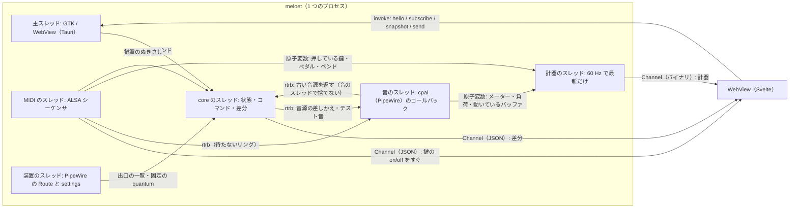
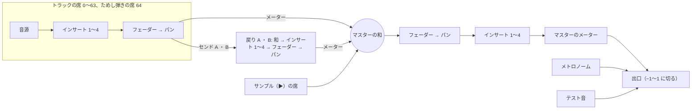

# meloet の骨組み

> 前の「ヤチヨさん」はオーナーさん（デザインと方向を決める人）のこと（2026-11-21 に呼び名を直した。前に書いた所は書きかえていない）。

この書類は、meloet の中の作りと、そう決めた理由をまとめたものです。
検証の結果は [`report.md`](report.md)、デザインの決まりは [`design/spec.html`](design/spec.html)（仕様書）と [`design/mock/`](design/mock/)（モック 37 枚）にあります。
モックと仕様書が食いちがったら、仕様書が正しい。

---

## 1. クレートと役目

報告書の 7-1 の分けかたに、状態の持ち主の `meloet-core` を 1 つ足しました。

| クレート | 役目 | 中に入れないもの |
|---|---|---|
| `crates/meloet-model` | 曲・トラック・音源の指定。純粋なデータと操作 | 入出力、スレッド |
| `crates/meloet-protocol` | Rust と画面の約束（型と版、計器のバイナリの並び）。TS の型もここから作る | Tauri |
| `crates/meloet-engine` | 音の流れ、音源の口、メーター、cpal の出口。音のスレッドはメモリ確保なし・鍵なし | 画面、プラグインの形式、鍵（Mutex） |
| `crates/meloet-midi` | 鍵盤の入力とぬきさし（Linux は ALSA シーケンサ） | 音 |
| `crates/meloet-devices` | 音の出入口の人の言葉の名前（Linux は PipeWire の Route）、PC 全体の quantum の固定を読む | 音の処理、設定の書きかえ |
| `crates/meloet-core` | 状態の持ち主。意図のコマンドを受けて状態を変え、rev つきの差分を出す。帯の決まり、状態行の知らせ、設定の保存 | Tauri、画面の見た目 |
| `crates/meloet-app` | Tauri の殻。コマンドと Channel の受けわたしだけ | 状態の持ち主になること |
| `ui/` | 画面（Svelte 5 ＋ TS）。`ui/src/bridge/` だけが Tauri を知る | Tauri の API の直接呼び出し |

あとで足すもの（今回は作らない）: `meloet-plugin`、`meloet-vst3`、`meloet-lv2`、`meloet-plughost`。プラグインは最初から別のプロセスで動かす（報告書の「v1 は同じプロセス」の案は使わない）。

**理由**: 報告書の 7-1 は `meloet-app` に状態を持たせず、`meloet-model` に入出力を持たせない。そうすると、曲・装置・帯をまとめて持ち、コマンドを受ける場所が要る。それが `meloet-core` です。画面なしで、約束と帯の決まりをテストできます。

`spikes/` はワークスペースに残しますが、`default-members` から外しています。ふだんの `cargo build` と `cargo test` は `crates/` だけを相手にします。

---

## 2. スレッドとプロセス



- 鍵の on/off は、MIDI のスレッドから直接、画面の Channel へ送る。core を通さない（鍵 → 画面を短くするため）。押している鍵の一覧は、計器のバイナリにも毎回入れるので、1 つ取りこぼしても次の計器で戻る。
- 鍵盤のぬきさしは core の状態を変え、差分として、すぐ送る。
- 音のスレッドは、メモリを取りにいかない、鍵を待たない。入ってくる物も出ていく物も、待たないリング（rtrb）と原子変数だけ。
- 第 2 回で足した道（図にはない）: core → 音のスレッドへ「曲のノートの列」（`Sequence`。古い列はリングで返す）と再生まわりの命令。音のスレッド → core へ「録った出来事」のリング（耳に届いていた位置と周つき）。音のスレッドが書く「区切りの輪」（`TransportClock`。512 こま、こまごとに seqlock、中身は原子変数だけ）を、計器のスレッドと core が鍵を待たずに読む。
- MIDI のスレッドと装置の見はり（PipeWire）は、core のスレッドが持ち主。止まったら core に知らせが来て、core が間をあけて起こしなおす（4-2）。

---

## 3. Rust と画面の約束（報告書 7-3）

### 3-1. 手順

1. **あいさつ**: 画面は起動したら `hello(protocolVersion)` を呼ぶ。版がちがえば止まる。
2. **先に聞く**: `subscribe(messages, telemetry)` で Channel を 2 本わたす。ここから先の差分は取りこぼさない。
3. **丸ごと取りにいく**: `snapshot()` で `{ rev, state }` を受けとる。2 の後に届いた差分のうち、`rev` が snapshot 以下の物は捨て、上の物を順に当てる。
4. **差分**: `{ rev, changes }`。`rev` は 1 ずつふえる。画面が持つ rev + 1 でない差分が来たら、画面は `snapshot()` を取りなおす。
5. **画面 → Rust は意図だけ**: `send(command)`。Rust が確かめて状態を変え、差分を出す。画面は自分で状態を決めない（テキストの入力中や、ドラッグ中の見た目だけは先に動かしてよい）。
6. **すぐ知らせること**: 鍵の on/off、ペダル、ベンド、モジュレーションは、届いた瞬間に messages の Channel で送る。
7. **計器**: telemetry の Channel でバイナリ。60 Hz で最新だけ。前と同じ中身なら送らない（何も鳴っていないときは止まる）。

8. **テイクの中身**（第 2 回）: 録り終わったテイクは中身が変わらない。状態にはクリップごとに「見せているテイクの id とノートの数」だけを入れ、中身は `take_notes(id)` でバイナリ（3-4）を取りにいく。画面は id ごとにためる。
   - **直したテイク**（第 3 回）: ノートを直す操作は、新しいテイク（新しい id）を作り、クリップのテイクの同じ場所（見せているテイクの場所）に入れかえる（テイクの数は変わらない。取り消すと前の id に戻る）。画面はノートを「テイクの id ＋ そのテイクの中の番号（始まりの順、0 から）」で指し、id が見せているテイクでなければ Rust は何もしない。クオンタイズしたテイクは「もとのテイク」（録った位置のテイク）の id と、ノートごとにもとのテイクの何番目から来たかを持つ。画面は `take_notes(もとの id)` で取って、そろえる前の位置を gray.7 の枠で描く。
9. **録っている最中のノート**（第 2 回）: messages の Channel で `liveNotes {seq, recording, notes}`。`seq` はアプリが動いているあいだ 1 ずつふえる。`(lap, index)` が同じノートは入れかえる（押したときは長さなし、離したときに長さつき）。画面は聞く準備のあと `live_notes()` で丸ごと取り、それ以下の `seq` を捨てる。番号が飛んだら丸ごと取りなおす。
   - **理由**: 10 分録るとノートは何千になる。区画を丸ごと入れかえる決まりのまま状態に入れると、差分のたびに全部を送ることになるため。

10. **プラグインのパラメータ**（第 5 回 区切り3、約束 18）: パラメータの欄がプラグインを見せるとき、状態（`params`）には「一覧の番号（`table`）と数」だけを入れる。名前 ・ グループ ・ 種類 ・ いまの値は `plugin_params(table)` で 1 回だけ取りにいき（JSON の `ParamTable`）、そのあと変わった値だけが messages の Channel で `paramValues {table, seq, values}` として届く（多くて 1 秒に 30、変わった物だけ、欄が見せている一覧の分だけ）。`seq` は一覧ごとに 1 ずつふえ、飛んだら一覧を取りなおす。えらびなおす ・ プラグインが一覧を変えた ・ 状態をまるごと戻した（取り消し）ときは、core が新しい `table` を配り、画面は取りなおす。画面の係は `ui/src/bridge/paramTable.ts`。
    - **理由**: Surge XT（VST3）は 2855 個。プラグインの窓でつまみを回すと値が続けて変わる。区画を丸ごと入れかえる決まりのまま状態に入れると、値が 1 つ変わるたび、行をえらぶたびに、2855 行を送りなおすことになる（テイクの中身と録っている最中のノートと同じ考え）。

messages の Channel は 1 本で、差分（`patch`）、すぐ知らせること（`event`）、録っている最中のノート（`liveNotes`）、プラグインのパラメータの値（`paramValues`）を、着いた順に運ぶ。

### 3-2. 状態（snapshot と差分の単位）

状態は、次の区画に分ける（第 2 回で `transport` と `arrange` を足した。窓の大きさが変わるたびに、えらんだ物まで送りなおさないため）。差分は、変わった区画を丸ごと入れかえる（区画の中の一部だけの差分は作らない）。区画が小さいうちはこれがいちばん素直で、まちがえにくい。

| 区画 | 中身 |
|---|---|
| `song` | 曲の名前、トラック（番号、名前、色の番号、音源の名前、音量 dB、録音待機、クリップ〔id、範囲、名前、見せているテイクの番号と数と id と位置、ノートの数〕）、取り消せる手とやりなおせる手の数、弾くと鳴る先のトラック、ループ（範囲のティックとオン・オフ）、帯札「ピアノロール ノート ○」の数、曲のファイルの様子（一度も保存していない・保存済み・変更あり）。（第 4 回 区切り3）トラックごとに パン（−100〜100）、センド A ・ B（dB。`null` は −∞）、インサートの 4 つの枠（エフェクトの種類か空き）、ミュート。`returns`（戻り A ・ B: フェーダー、パン、ミュート、インサート）と `master`（フェーダー、パン、インサート）。どれも手でだけ変わる値で、ドラッグの途中の値（プレビュー）は入らない |
| `timeline` | （約束 20、第 6 回）曲の頭のテンポと拍子、曲の頭からのだんだん、テンポの点（ティック、テンポ、だんだん）、拍子の旗（小節の番号、拍子）、マーカー（id、ティック、名前）、えらんでいる物（点はティック、旗は小節、マーカーは id で指す）、名前の枠がひらいているマーカー、アレンジの「テンポ ・ 拍子の変更」の行がひらいているか。テンポと拍子は、ここにだけある（`song` から移した）。画面のテンポの地図（`ui/src/time/tempoMap.ts`）はここから作る（21 章） |
| `params` | （第 4 回 区切り3）パラメータのパネルが見せるインサート（どのストリップの何番の枠か、エフェクトの種類、値のならび、えらんだ行）。インサートや行をえらぶのは手ではないので、そのたびに `song` を送りなおさないために分けた（`pianoRoll` と同じ考え）。（約束 18）見せる物は「最初から入っているエフェクト」か「プラグイン（インサートか、トラックの音源）」。プラグインは、居場所、窓の型（ひらける ・ まだひらけない ・ 持たない）、一覧の番号と数、えらんだ行、オートメーションに書いている行（第 6 回まで空）だけで、行そのものは入れない（3-1 の 10） |
| `windows` | （約束 18）ひらいているプラグインの窓の一覧（居場所、プラグインの名前、大きさ、画面より大きいか）。状態行の「窓 N」と、枠 ・ 音源の名前の「窓がひらいている印」は、画面がここから作る。窓がひらく ・ とじるのは手ではなく、ほかの区画に関わらないので分けた |
| `transport` | 止まっている・カウントイン・再生・録音、止まっている時の位置、メトロノーム、カウントインの小節と拍の数、再生と録音が使えるか、録っているあいだの物（録音の番号、トラック、始まり、何番のテイクになるか、まとまる先のクリップ、周）。動いている位置は計器で来る |
| `arrange` | えらんでいるクリップ、ピアノロールが見せるクリップ |
| `pianoRoll` | （第 3 回）ピアノロールが見せているテイクの id、選んだノートと CC の点（テイクの中の番号の範囲 `[start, end)` のならび）、グリッド、スケール（主音、メジャー・マイナー、固定）、クオンタイズのパネルの設定（グリッド、三連符、強さ、スウィング、そろえる所）、貼りつけられるノートの数。選択はよく変わるので、`song` を送りなおさないために分けた |
| `workspace` | 拡大率、いまの画面に入らない拡大率（`unfitScales`）、窓の大きさ、帯のひらき具合と高さ（`layout`）、右の欄、音の設定のダイアログ、出口えらび（流れ 2）、アレンジの上の案内、曲のダイアログ（保存していない・保存できない・こわれている。id、見出し、1 つ前があるか） |
| `keyboards` | 見えている鍵盤（名前、ALSA の番地）、いま使っている鍵盤、最後に抜けた鍵盤 |
| `outputs` | 出口の一覧（本物の名前、やさしい言いかえの種類、ささっているか、つながりの種類）、えらんだ出口、その出口の様子 |
| `inputs` | 歌の入口の一覧（今回は見せるだけ。使えない） |
| `audio` | 動いているか、サンプルレート、頼んだバッファ、動いているバッファ、PC 全体で固定された quantum、遅れの見積もり、音のしくみの名前、出口のデバイス名、MIDI の入口の名前 |
| `status` | 状態行の左の知らせ（文の種類と、うめこむ値） |

画面の文面は Rust に置かない。Rust は「文の種類（ID）とうめこむ値」だけを送り、画面が `ui/src/text/` の文に当てる。

### 3-3. 計器のバイナリ（版 3、リトルエンディアン）

| 位置 | 型 | 中身 |
|---|---|---|
| 0 | u8 | 種類 = 1（計器） |
| 1 | u8 | 版 = 3 |
| 2 | u16 | トラックの数 n |
| 4 | u32 | 通し番号 |
| 8 | u64 | Rust が送った時刻（CLOCK_MONOTONIC、ns） |
| 16 | u64 | 押している鍵 0〜63 のビット |
| 24 | u64 | 押している鍵 64〜127 のビット |
| 32 | u8 | 最後のベロシティ（0 はまだ無し） |
| 33 | u8 | サステイン（CC 64 の値） |
| 34 | u8 | モジュレーション（CC 1 の値） |
| 35 | u8 | 旗（bit0: 音が動いている、bit1: マスターが割れた、bit2: 再生の位置がある） |
| 36 | i16 | ピッチベンド（−8192〜8191） |
| 38 | u16 | 処理の負荷（千分率） |
| 40 | f32 × 2 | マスターの最大値 左・右（前に送ってからの最大。1.0 = 0 dBFS） |
| 48 | f64 | 送った時刻に耳に届いている曲の位置（ティック、小数。カウントイン中は負もある） |
| 56 | f64 | 1 µs あたりのティック（止まっているときは 0） |
| 64 | u8 | 状態（0 停止、1 カウントイン、2 再生、3 録音） |
| 65 | u8 | 0（あき） |
| 66 | u16 | カウントインの残りの拍（鳴っている拍もふくむ。外では 0） |
| 68 | u32 | 録音中のループの周（最初が 0） |
| 72 | f32 × 4 | 戻り A の最大値 左・右、戻り B の最大値 左・右（戻りの出口: インサート、フェーダー、パンの後。第 4 回 区切り3） |
| 88 | f32 × 2n | トラックごとの最大値 左・右（フェーダーとパンの後） |

画面の位置 = `tick + (Rust の今 − 送った時刻) × 1 µs あたりのティック`。bit2 が 0 の間（音がまだ動いていない）、48〜71 は 0 で、画面は `transport.position` を使う。止まっているときは、再生まわりの数字も再生の位置の線も `transport.position`（差分ですぐ届く）、動いているときは計器の位置（`ui/src/components/time.ts` の `shownTick`）。

### 3-4. テイクの中身のバイナリ（版 2、リトルエンディアン）

| 位置 | 型 | 中身 |
|---|---|---|
| 0 | u8 | 種類 = 2（テイク） |
| 1 | u8 | 版 = 2 |
| 2 | u16 | 0（あき） |
| 4 | u32 | テイクの id |
| 8 | u32 | 長さ（ティック） |
| 12 | u32 | ノートの数 n |
| 16 | u32 | コントロールの数 m |
| 20 | u32 | もとのテイクの id（0 はなし。id は 1 から） |
| 24 | 16 × n | ノート: 始まり u32、長さ u32、鍵 u8、ベロシティ u8、0 が 2 つ、もとのテイクの何番目のノートから来たか u32（0xFFFFFFFF はなし） |
| 24+16n | 8 × m | コントロール: ティック u32、種類 u8（0 CC、1 ピッチベンド）、CC の番号 u8（ベンドは 0）、値 i16 |

位置はテイクの 0 から数える。u32 のティックは、300 BPM でも約 20 日ぶんある。

並びは `meloet-protocol` の 1 か所で決め、Rust で書いて TS で読むテストで食いちがいを見はる。

---

- **曲の通し番号**（約束 9、第 3 回の続き）: テイクの id は曲ごとに 1 から配られる。`song.serial` は、core が `Doc` を外から入れかえるたび（新しい曲、ひらく、1 つ前をひらく、なおすためのファイルから戻す、戻さない）と、「なおすためのファイルから戻す」「戻さない」の手を取り消し・やりなおしでまたぐときに 1 ふえる。ふつうの取り消し・やりなおしではふえない。画面は通し番号が変わると、ためたテイクを全部手放し、取りにいっている途中の答えも捨てる（`TakeStore.clear`）。ピアノロールも、通し番号が変われば同じ id のテイクを取りなおす。テイクは（通し番号, id）で見分ける。

## 4. 音の流れ

- 出口は cpal の PipeWire。頼むバッファは 256。**動いている数は、コールバックが受けとったフレーム数から読む**。
- PC 全体の `clock.force-quantum` は、PipeWire の `settings` メタデータを**読むだけ**。0 でなく、動いている数が頼んだ数とちがうときに「PC 全体の設定で固定されている」と言う。
- 遅れの見積もり: 検証の計測（バッファ 256 で平均 13.2 ms、1024 で 53.2 ms、48 kHz）から、鍵 → 音 ≒ 2.5 × バッファ ÷ サンプルレート。動いている間は、実際に測った値（鍵を受けた時刻と、その音が DAC に届く予定の時刻の差）の平均を使う。
- 音源の口（`Instrument`）: 1 つのトラックが 1 つの音源を持つ。音源は「準備（音のスレッドの外）」「出来事（ノート、CC、ベンド）」「描く（ステレオのバッファ）」「止める」を持つ。差しかえは、core が音のスレッドの外で新しい音源を作り、リングで音のスレッドへ送る。音のスレッドは入れかえて、古い物をリングで返す（音のスレッドで捨てると、メモリを返す処理が走るため）。
- 今回の音源は「仮の音」（やわらかい合成の音）。次の回に、サンプルのピアノが同じ口に入る。プラグインも、別のプロセスとのやりとりを同じ口の向こうに隠す。
- メーターは、ブロックごとの最大値を原子変数に「前より大きければ書く」。計器のスレッドが読むときに 0 に戻す。トラック、戻り A ・ B、マスターにある（どこで測るかは 19-11）。
- ミキサーの音の道（インサート、フェーダー、パン、センド、戻り、マスター）は 19-11。
- 処理の負荷は、コールバックの中でかかった時間 ÷ そのブロックの長さ。
- 出口を変えるときは、古いストリームを止め、曲から音源を作りなおして新しいストリームを作る。今回は再生の位置などの「流れの中の状態」がないので、作りなおしで足りる。

### 4-1. 音のスレッドの見はり

- `meloet-engine` は `std::sync::Mutex` などの鍵を使わない。`clippy.toml` の `disallowed-types` と `disallowed-methods` で機械的に止める。
- メモリ確保は、テストのときに、数える割り当て器（global allocator）で見はる。音のスレッドの区間に入ったら旗を立て、その間に確保か解放があればテストを落とす。オフラインで曲を描くテストと、実際のストリームを 2 秒回すテスト（装置があるときだけ）の両方で。


### 4-2. 止まったときと、つなぎなおし（第 2 回）

- 出口のストリームのエラーは 3 つに分けて数える: xrun、ストリームが自分で終わった（PipeWire が消えた、出口がなくなった。1 本のストリームで 1 回）、そのほか。こちらから止めるときに cpal が出す `DeviceNotAvailable` は数えない。
- PipeWire が消えると、cpal は `StreamInvalidated` を 1 回出してコールバックが止まり（気づくまで 1.4〜37 ms）、装置の見はり（pipewire-rs）も core の error で終わる（0.6〜10 ms）。どちらも core に知らせる。ストリームを閉じると、エンジンは `Carrier` の Drop で戻る。戻らなかったときに備えて、エンジンを作りなおせる（`EngineHandle::rebuild`。MIDI のリングと区切りの輪も新しくなり、core が配りなおす）。
- MIDI のスレッドは、自分で止まるとき最後に `Stopped` を送り、sink を返す。core は同じ sink で起こしなおす。押していた鍵とペダルは、止まった時点で離したことにする。
- つなぎなおしの間隔: 0.5・1・2・4 秒、そのあとは 5 秒ごと。PipeWire と MIDI はあきらめない（ほかに取りもどす道がなく、1 回試すのは安い。最初は早いので、すぐ戻るデーモンならすぐ戻る）。ストリームだけが落ちたとき（PipeWire は動いている）は 4 回まで。そのあとは出口の一覧が変わるか人が操作するまで待つ（毎回すぐ落ちる出口を開いたり閉じたりし続けないため）。起動したときに PipeWire がないときも、同じ間隔で黙って試す（一度も動いていないので「止まりました」は出さない）。
- 録っている最中に音が止まったら、そのときの耳に届いていた最後の位置で録音を閉じ、録れた分をテイクに残して文を出す。鍵盤の入力が止まっても録音は止めない。
- 試験: 自分用の PipeWire と WirePlumber（`crates/meloet-engine/tests/private_pw/`）を立てて落とし、戻す（`--devices`）。ヤチヨさんの PipeWire にはさわらない。
---

## 5. 鍵盤

- ALSA シーケンサに `meloet` という名前で入り、System:Announce を購読する。起動したときに、すでにある鍵盤を全部数えてから、ぬきさしを待つ。
- 鍵盤とみなす物: 種類が HARDWARE で、読める（READ ＋ SUBS_READ）口を持つクライアント。1 つのクライアントからは、いちばん番号の小さい読める口だけを聞く（Keystation 49 MK3 の 2 つめの口「Transport」はボタン用で、ノートとまちがえるため）。
- 鍵盤の名前は、ALSA のクライアント名（例「Keystation 49 MK3」）。
- 試験のための仮想の鍵盤（`meloet-vkeys`）は、環境変数 `MELOET_ACCEPT_VIRTUAL=1` のときだけ鍵盤とみなす。`MELOET_VKEYS_NAME=名前[,名前…]` があれば、その名前（`meloet-vkeys --name`）の仮想の鍵盤だけを受ける（同じ PC でほかの試験や測定の仮想の鍵盤がまざらないように）。`MELOET_ONLY_VIRTUAL=1` では、本物の鍵盤を見ず、仮想の鍵盤だけを見る（鍵盤がささったまま「鍵盤がない」画面を撮るため）。
- 鍵盤がぬけたら、音のスレッドへ全部の音を止める知らせを送り、押している鍵とペダルの記録を消す（押したまま抜いたときに、音と光が残らないように）。
- 2 台以上つながっているときは、全部の鍵を聞く。名前は最後に弾いた鍵盤（鍵を押したときだけ数える。弾く前は最後にさした鍵盤）で、入力計では「+1」のように残りの台数をそえる（仕様書 3 章）。どの鍵盤の鍵かは MIDI の知らせについてくる。MIDI のスレッドは、画面へ知らせたあとで、鍵盤が前とちがうときだけ core に伝える。

---

## 6. 出口と入口の名前

- PipeWire の Device の Route（`EnumRoute` と `Route`）を読む。Route の `description` が本物の名前（「アナログヘッドフォン」など）、`available` がささっているか、`info` の `port.type` が型。
- 出口 1 つ = Sink のノード 1 つ ＋ そのデバイスの出力の Route 1 つ。Route を持たない Sink（Bluetooth など）は、ノードの説明を名前にする。
- 出口の ID は「デバイスの名前 ＋ Route の名前」（Route がなければノードの名前）。これを設定に保存する。
- **meloet は、デバイスの Route を切りかえない**（それは PC 全体の設定を変えることになるため）。えらんだ Route が、いまささっていなければ、その文面を出す。
- やさしい言いかえは、型がわかるときだけ（モックの 4 つ: ヘッドホン → 「ヘッドホンの穴」、HDMI → 「画面のスピーカー」、ライン出力 → 「うしろのスピーカーの穴」、うしろのマイク → 「うしろのマイクの穴」）。
- 装置の名前は、PipeWire の Device の `device.description` をそのまま出す（例「GB206 High Definition Audio Controller」。ヤチヨさんの決め）。えらべない出口の行と、名前が同じ出口が 2 つ以上ならぶときに使う。
- えらべない出口（`unusable`）は 2 種類。ノードはあるが、PC がそのデバイスで別の Route を使っている → 「PC が切りかえる」（`switchedByPc`）。ノードがない → 「PC の設定で止まっている」（`stoppedByPc`。同じデバイスにノードのある穴があっても）。
- ならべる順: えらべる出口が先（ささっている → わからない → ささっていない。ささっている中ではヘッドホンが先）、そのあとにえらべない出口。

---

## 7. 画面

- Svelte 5 ＋ TypeScript ＋ Vite。SvelteKit は使わない（1 枚の画面で足り、橋を薄く保てるため）。
- **数値**: `ui/src/design/tokens.ts` に、仕様書の表の名前のまま入れる（`color.gray.4`、`size.meter.slim`、`space.3` など）。仕様書の文の中にしかない部品の寸法（ボタンの高さ 24 など）は `part.*`、モックにしかない寸法は `mock.*` として、出どころを書いて入れる。部品はここから作った CSS の変数だけを使う。部品の中に色の 16 進数や px を直接書くと、テストが落ちる。
- **拡大率**: 100・125・150%。`tokens.ts` が率ごとの値を出す。`line.hair` は、どの率でも画面の物理 1px（`1px / devicePixelRatio`）。`line.mark`・`line.track` は表の値。文字の表の「太さ」の列は、その大きさで使ってよい太さの組と読む（text.s は 400・500・600、text.m は 400・500、text.l は 600。率では変わらない）。仕様書の文の中の寸法（part.*）は、率をかけて整数にならなければ四捨五入する。
- **文面**: `ui/src/text/ja.ts` の 1 か所。仕様書の文面は一字も変えない（テストで仕様書から抜いた文と照らし合わせる）。モックにだけある文は、モックの文のまま、出どころ（ボードの名前）をつけて入れる。
- **大きな面は WebGL（区画ごとに 1 枚、使いまわし）**: 部品は、描く場所に `use:glSlot={...}` をつけ、そのまわりの箱（同じ箱でもよい）に `use:glRegion={"名前"}` をつける。WebGL の係（`ui/src/gl/engine.ts`）は、区画の箱ごとに canvas を 1 枚入れる（箱の中、`pointer-events: none`）。canvas の広さは「その区画の slot のある所 ∩ 箱 ∩ 窓」で、はしは画面の画素に合わせる。区画の中の slot は、全部その 1 枚に、ページの順（あとの物が上）で描く。描くのは、四角の並びが前と変わった区画だけ。60 Hz で変わる物（メーター、録っているクリップ）は小さな区画に分け、変わらない大きな区画（アレンジの線やクリップ）に入れない。再生の位置の線のように動くだけの物は、描きなおさず HTML の線を CSS の transform で動かす。文字と小さな部品は HTML。Canvas 2D は使わない。
  - 理由: WebKitGTK（NVIDIA）では、面を 1 回出すたびに、画面のプロセスの主スレッドが「0.25 ms ＋ 3.9 ms × 百万画素」ほど止まり、鍵の知らせはその後ろで待つ（2026-11-15 の測定、RTX 5060 Ti、WebKitGTK 2.52.6）。16 本のメーターを slot ごとに出すと 4.4 ms、1 枚にまとめると 1.4 ms。アレンジの面くらいの大きさは 1036×576 で 3.3 ms、1676×856 で 6.5 ms。transform で動かすだけなら 0.35 ms。第 1 回に、窓いっぱいの面を 60 Hz で出して鍵 → 画面の p95 が 8〜12 ms になったのも同じ理由（`docs/measurements/`）。この式は、下に HTML のない面を 1 枚だけ出したときの数。本物の画面では、次の「CPU で描く WebKit」の決まりが先に効く。
  - **CPU で描く WebKit**（第 4 回にわかった事。`docs/measurements/2026-11-19-round4-mixer.md` の 6 ・ 7 章）: NVIDIA ＋ Ubuntu の WebKitGTK では、合成の層がなく、ページは CPU で描かれる。
    - canvas を出すと、その canvas ぜんたいが「よごれた四角」になる。WebKit は canvas を GPU から 2 回読みもどし（`readPixels`）、その四角の中の HTML（地、枠、文字）も描きなおして、ビットマップを画面のプロセスへ送る。だから重さは「出した canvas の数」と「四角の広さと、その下の HTML の多さ」で決まる。文字が多い所の上の canvas は高い。
    - 1 コマでよごれた所は、「y の帯 × x の区間」の四角に切られる。上下の端がそろっていない四角は、たがいの端で切りあって数がふえる（上下がずれた 3 つの数字とメーター 1 本で、10 個をこえる）。
    - **四角が 11 個以上か、四角の面積の合計が「ぜんぶを囲む四角」の 25 % 以上だと、WebKit は囲む四角 1 つをまるごと描きなおす**（WebKitGTK 2.52.6、`DrawingAreaCoordinatedGraphics.cpp` の `shouldPaintBoundsRect`）。上の帯と下のミキサーが同じコマでよごれると、囲む四角は窓のほとんどになり、主スレッドが 12〜16 ms ふさがる（1 つずつなら 5〜7 ms）。
    - 決めた形（2 つ）:
      1. **同じコマで変わる物は、1 枚の canvas の下に入れる**。`use:glSlot={{ kind: "cover" }}` は、何も描かず、区画の canvas をその箱までひろげる。上の帯では、位置 ・ 時間 ・ 処理の負荷 ・ マスターの dB の数字の箱とマスターのメーターが、`masterMeter` の 1 枚（1920 幅で 1437×36）の下にある。数字がいくつ変わっても、よごれた四角は 1 つ。
      2. **ミキサーのメーターを出すコマは、マスターの面も出す**（`ui/src/gl/budget.ts` の `SHOWN_WITH`）。ミキサーの面は広くて下にあるので、右上のマスターの面がいつも入っていれば、囲む四角が窓の幅になり、25 % の決まりにかからない。
    - **あとから 60 Hz で動く物を足す人が守る事**: (a) 上の帯に足すなら、その箱に `cover` をつける（`masterMeter` の区画の中）。(b) ほかの所に足すなら、同じコマで変わる近くの物と上下の端をそろえるか、同じ canvas の下に入れる。(c) 1 コマの四角は 10 個まで、面積の合計は囲む四角の 25 % 未満。足したら `tools/measure/webkit-damage.sh` で、四角の並びと「囲む四角 1 つ」になっていない事を見る。(d) canvas の下に文字をふやさない。(e) **毎コマ変わる物は、レイアウトを走らせない**: 位置や長さは `transform` だけで動かす（`top` ・ `left` ・ `width` を変えない。はしは `Math.round(px × dpr) / dpr` で画素に合わせる）。**字を毎コマ変えない**。どうしても毎コマ変わる字は、流れの外の箱（`position: absolute`、大きさは字によらない）に入れる。(f) 同じコマで小さな四角が何個も変わる所（ストリップごとのつまみと字）は、それを囲む箱の四角を先に 1 つ頼む（`askWhole`）。足したら `tools/measure/webkit-layout.sh` で、1 回のレイアウトが頼む四角の数と「one rectangle around all」になっていない事を見る（次の項）。
    - **レイアウトでためる Region**（第 6 回にわかった事。`docs/measurements/2026-11-20-round6-step2-3.md` の 3 章、`2026-11-20-round6-fix-redraw.md`）: 上の「11 個 ・ 25 %」より**前**に効く、WebKit のもう 1 つの決まり。
      - 1 回のスタイルの計算とレイアウト（`Document::updateLayout`、`resolveStyle`、`performLayout` の外がわの 1 つ）の間に頼まれた描きなおしの四角は、1 つの Region にためる。四角を足すたびに、その Region の **`gridSize()`（y の境目の数 × x の境目の数の合計）が 256 をこえたら、そこまでの四角を「ぜんぶを囲む四角」1 つにする**。その四角が見えている範囲の 75 % 以上なら、窓ぜんぶにする（出どころ: WebKit の枝 `webkitglib/2.52` の `Source/WebCore/rendering/RenderView.cpp` の `accumulateRepaintRect`（`maximumRepaintRegionGridSize = 16 * 16`、`dirtyEntireViewThreshold = 0.75f`）と `Source/WebCore/platform/graphics/Region.h` の `gridSize`（`m_spans.size() * m_segments.size()`）。確かさ A。この PC の WebKitGTK 2.52.6 が同じコードかは、gdb の呼び出しの列と、下の数え方が測りと合う事でしか確かめていない）。
      - 数え方: たがいに離れた、高さのちがう四角 N 個で 4N²（**9 個でこえる**）。同じ高さで横にならんだ四角は N 個で 4N（64 個まで）。同じコマに上の帯の数字（2〜4 個）もたまるので、縦にずれた小さな四角は 6〜7 個が限り。
      - こえると、囲む四角は**そのときまでにたまった物ぜんぶ**（上の帯の数字、アレンジの見出し、ミキサー）を囲むので、窓のほとんどになる。`cover` は、あとの決まり（11 個 ・ 25 %）にしか効かない。
      - たまる順: スタイルだけで決まる描きなおし（色や背景）→ レイアウトの中の字の箱 → レイアウトのあとの層（`transform` で動いた物、古い位置と新しい位置）。JavaScript が `getBoundingClientRect()` などでレイアウトを強制すると、そこまでの分は別の Region になる。
      - `position: absolute` の箱は自分の層を持ち、四角も別に頼む（フェーダーのつまみと、その中の線で 2 個、古い位置と新しい位置で 4 個）。
      - レイアウトそのもの: `top` や幅や字が変わると、その箱の親をたどって flex がレイアウトしなおされ、動かなかった兄弟の箱まで四角を頼む（ミキサーのストリップ 8 本で 376 個）。流れの外の箱（`position: absolute`）の中の字は、親には「位置の決まった子だけ」の軽いレイアウトしか頼まない（`contain: strict` や `overflow: hidden` ＋決まった大きさの「流れの中の箱」では軽くならなかった）。
      - **決めた形**（`ui/src/components/automation/coverIf.ts`、`autoState.svelte.ts`）:
        1. つまみと棒は `transform`（`mixer/Fader.svelte`、`SendBar.svelte`、`params/ParamRow.svelte`）。値の字は、流れの外の箱 `.live > .in`（外の箱は幅のない字 `\200b` で高さとベースラインを保つ。`mixer/Strip.svelte`、`PanKnob.svelte`、`SendBar.svelte`、`automation/LaneHead.svelte`、`params/ParamRow.svelte`）。
        2. **囲む箱の四角を先に頼む**（`askWhole`）: 帯が動かす物を囲む箱の `background-position` を、見た目の同じ 2 つの値の間で入れかえる。スタイルだけの描きなおしなので、いちばん先にたまり、中のつまみや字の四角はその中に入る（Region はふえない）。`transform` や `outline-color` や `box-shadow` の入れかえは、四角を頼まなかった（WebKitGTK 2.52.6 でためした）。
          - ミキサーのストリップ（`mixer/Strip.svelte`）: フェーダーと値の箱 `.gain-box` は、帯がそのストリップの何かを動かしている間、canvas の下に入れる（`coverIf`）。canvas の下に入れるのも、四角を頼むのも、箱いっぱいに `coverIf` が置く同じ空の箱（箱そのものに頼ませると、中の字のはみ出しまで入って canvas の外へ出る）。メーターとほぼ同じ高さなので、canvas は広がらない。パンの行 `.pan-box` とセンドの 2 行 `.sends-box` は canvas の下に入れず、動いた行の四角だけを頼む（`askIf`）。どの空の箱もストリップの幅いっぱいまで左右に出すので、となりとつながって、四角は半分ごとに 1 つになる。
          - アレンジの帯の見出し（`automation/LaneHead.svelte`）: いまの値の字の箱は `trackMeters` の canvas の下（`cover`）。字が変わるコマは canvas も出す（`cover` の `stamp`。`gl/engine.ts`）ので、字の四角は canvas の中に入り、再生の線の四角を切らない。見えていない見出しは、毎コマの値を読まない（`IntersectionObserver`）。
        3. **ストリップのつまみと字は、上の canvas を描くコマに見せる**（`coverIf` の印は `paint`。WebGL の係が、その箱の上の canvas の絵を組み立てるときに呼ぶので、そこで `showTrack`）。ミキサーの canvas は左右の半分を 1 コマおきに出す。出ない半分のつまみを同じコマで動かすと、四角が 11 個をこえて窓ぜんぶになる（16 本で 25 ms）。canvas が描かれないコマ（メーターの知らせが来なかったコマ）は次の番まで待ち、どの canvas も 3 コマ描かれなければ見せる（`MAX_WAIT_FRAMES`）。ほかの canvas は描かれているのに番が来ないトラックは、横に送った外なので、見えるまで待つ（64 本の曲で、見えないストリップを書きかえない）。位置は 2 つ持つ: いちばん新しい位置（`livePosition`。帯の見出し、パラメータの欄）と、ストリップに見せている位置（`shownPosition`）。どちらもトラックごとの数で読みなおすので、動いていないトラックを見せている所は読みなおさない。
        4. **パンとセンドは、1 回に片方ずつ**（`autoState` の `rowTurn`）: パンの行とセンドの行は canvas の外にあるので、同じコマに両方の四角を足すと、下の「広さ」に近づく。コマ 2 つごとに番を入れかえ、どのトラックも同じ番にする（そろえないと、行の四角がストリップごとにばらばらになって 11 個に近づく）。パンとセンドのつまみは 1 秒 15 回、フェーダーは 30 回。
        5. **ほかの変化と、レイアウトを分ける**（`automation/AutoClock.svelte` の `layoutNow`）: 位置を書く前と、書いた物が画面にのったあとに、`scrollTop` を読んでレイアウトをすませる。帯が動かした物の四角が、上の帯の数字と同じ Region に入らない（入ると、縦にならんだ帯の見出しが 7 つほどで、囲む四角が上の帯からアレンジの下までになる）。動いている間だけ。
      - **広さ**（7 章の 25 % の決まり）: 1920×1080 で、囲む四角は約 179 万 px、25 % は約 44.7 万 px。1 コマに描きなおすのは、マスターの面 5.2 万 ＋ 見出しのメーター 3 万 ＋ ミキサーの半分（幅 948 × 高さ 271 ＝ 25.7 万）＋ パンの行（948×24 ＝ 2.3 万）かセンドの 2 行（948×50 ＝ 4.7 万）で、多い時 38.4 万 px（21.5 %）。センドの行まで canvas の下に入れると 948×356 ＝ 33.7 万で、合計 42 万（23.5 %）になり、こえるコマが出た。
      - 測った数は `docs/measurements/2026-11-20-round6-fix-redraw.md`。
      - 残る天井: ぜんぶのメーターが止まっている（無音）と canvas が出ないので、動いた箱がそのまま四角になる。1 コマの四角は 8 個ほど（マスター、見出しのメーター、再生の線 4、ミキサーの半分、行）で、10 個まであと 2。パラメータの欄（canvas がない）で 2 行以上が同時に動く時は、まだ測っていない。64 本ぜんぶに帯 4 本が動く曲のミキサーは 1 秒 57〜59 コマ（測りの書類）。
    - **天井**: ミキサーの面は「ストリップの数 × メーターの高さ」の 1 つの四角。1920×1080 で、8 トラック（11 本、1110×264）のとき、四角の合計は囲む四角の 21 %。計算では、トラックが 10 本（13 本のストリップ）で 24 %、11 本で 26 %。トラックが 10 本をこえるか、ミキサーの帯を高くすると 25 % をこえ、ミキサーをひらいた再生は、また囲む四角になる（宿題。メーターを HTML の棒にしても、棒が 11 本で 11 個の決まりにかかる）。
    - **ミキサーのメーターは、いつも 30 Hz。左半分と右半分に分けて、1 コマに片方ずつ出す**（`ui/src/gl/budget.ts` の `regionHz`、`engine.ts` の `Tile`。トラックの数によらない: user:2026-11-20「メーターは 60Hz で見ることを求められないので、いっそのこと統一するために常に 30fps でいい」。第 5 回 区切り3 では 10 本をこえる時だけだった。アレンジのトラックのメーター、マスターのメーター、鍵、再生の線は 60 Hz のまま）。分けるのは 2 つまで（3 つにすると、1 つの部分が 30 Hz を下まわる）。左右は、見えている幅のまん中で分ける（slot のまん中がどちらにあるか。数で分けると、戻りとマスターのある右が広くなる）。
      - トラック 16 本（ストリップ 19 本）では、メーターの面が 1807×264 になり、上の帯の面と合わせて囲む四角の 27 % になる。30 Hz にしても、出すコマは毎回、囲む四角（1896×938、約 178 万 px）をまるごと描きなおし、1 コマが 18〜22 ms かかっていた（`docs/measurements/2026-11-20-round5-step3-app.md` の 7 章）。
      - 形: WebGL の文脈は区画に 1 つのまま。その canvas はページの外に置き、見えている slot を左から順に 2 つの組に分け、組ごとに「写しを見せるだけの canvas」（`bitmaprenderer`。WebGL の文脈ではないので、予算の数に入らない）を区画の箱に置く。1 コマに 1 組だけ WebGL で描き、`createImageBitmap(canvas, 0, 0, 幅, 高さ)` で写して `transferFromImageBitmap` で見せる（WebKitGTK 2.52.6 で、900×264 の写しは 0.9 ms、同じコマの中で届く）。どのメーターも 30 Hz（仕様書 3 章 第 8 版）で、ページは毎コマ、半分の四角（770×264 か 878×264）だけを描きなおす。組の間のすきま（左の組の最後のメーターから右の組の最初のメーターまで）は、どちらの面にも入らない。
      - スクロールや大きさが変わったコマ（`urgent`）は、置き場がずれないように 2 組とも同じコマで出す（そのコマだけは囲む四角になる）。`createImageBitmap` か `bitmaprenderer` がない所では、分けずに 33 ms に 1 回描く（前の形）。
      - 測った数（1920×1080、再生中、25 秒）: 16 本で busyMs 平均 12.2 → 6.1 ms、p95 21 → 7 ms、描きなおしは「囲む四角」151 回中 151 回 → 138 回中 0 回（1 回 28.6〜31.4 万 px）。10 本は変わらず 6.1 ms。
      - 残る天井: 半分の面が囲む四角の 25 % をこえる時（ミキサーの帯がとても高い時）。
    - 合成の層がある PC（Intel、AMD）では、canvas は GPU の層になり、この決まりは関係しない（`cover` と `SHOWN_WITH` は、面を少し広く ・ 多く出すだけ）。確かめてはいない。
  - 限り: WebKitGTK 2.52 では、WebGL の文脈は 1 ページ 16 個まで。17 個めで、いちばん古い文脈が失われ、戻らない。**捨てた canvas の文脈も、GC されるまで数に入る**（`loseContext()` を呼んでも同じ）。作って捨てる形のままだと、音の設定の「くわしく」を 40 回切りかえるだけで、生きている文脈が 15 個失われた。だから canvas は作ったら手放さず、`ui/src/gl/pool.ts` で次の区画に使いまわす（同じ 40 回で、作ったのは 7 個、失われたのは 0 個）。
  - 文脈は区画の箱が来たときに作る（第 3 回の直し）: `getContext("webgl2")` 1 回で、主スレッドが 50 ms か 200 ms 止まる（シェーダーのコンパイルとリンクは 1 ms、最初の描画は 1 ms 以下。2026-11-15、RTX 5060 Ti、WebKitGTK 2.52.6、`frame-profile.json` の `made`。`docs/measurements/2026-11-15-round3-fix-glcontext.md`）。だから区画は、slot が初めて入ったときではなく、`use:glRegion` の箱が来たとき（起動、帯をひらいたとき）に canvas を取り、箱があるうちは slot がなくても持つ（大きさ 0）。鍵・録り始め・ドラッグの瞬間には作らない。そのため、のびる物の区画の箱は、使っていない間もおく（`recordingClip` はアレンジのレーンいっぱいの `.rec-host`、`pianoRollLive` はノートの場所いっぱいの `.live-host`）。数の最大は下の表のとおりで変わらない（どちらも表で 1 と数えていた）。帯をひらくコマは、作る文脈の数だけ重くなる（1920×1080 で 360〜410 ms）。
  - 予算: 作ってよい文脈は 12 個（限りの 16 から 4 つ残す）。こえそうになったら、開発とテストでは落とし、本番では console に書く。区画の外の slot も同じ。区画を足すときは `ui/src/gl/budget.ts` の `REGIONS` に 1 行足す（表にない名前は型で通らない）。

  | 区画 | どこ | 不透明 | 変わる速さ | 文脈 |
  |---|---|---|---|---|
  | inputMeter | 入力計の鍵盤とベロシティの棒（間の文字の所は描かず、すける。箱は入力計ぜんたい） | いいえ | 鍵ごと | 1 |
  | masterMeter | 再生まわりのマスターのメーター。箱は再生まわりの帯ぜんたいで、面は位置の数字からマスターまで（数字の箱は cover。描くのはメーターだけで、ほかはすける） | いいえ | 〜60 Hz | 1 |
  | trackMeters | トラックの見出しのメーター（何本でも 1 枚） | いいえ | 〜60 Hz | 1 |
  | arrangeLanes | 小節の線とクリップ | いいえ | 曲、大きさ、スクロールが変わったとき | 1 |
  | overview | ちぢんだアレンジ（trackMeters と arrangeLanes の代わり。使いまわし） | いいえ | 同上 | 0〜1 |
  | settings | 音の設定のテスト音の横のメーターと、光る鍵盤（箱はスクロールする中身ぜんたい。「くわしく」をひらいて slot がなくなっても持つ） | いいえ | 〜60 Hz、鍵ごと | 0〜1 |
  | （第 2 回）recordingClip | 録っているクリップだけ | いいえ | 〜60 Hz | 1 |
  | （第 3 回）pianoRoll | ピアノロールの行の地、拍と小節の線、ノート、そろえる前の位置とドラッグのもとの位置の枠、ベロシティの帯 | いいえ | ノート・選択・見ている範囲が変わったとき | 1 |
  | （第 3 回）pianoRollKeys | ピアノロールの左の鍵盤の列（鳴っている音・弾いている鍵が光る） | はい | 鍵ごと、再生中は毎コマ（42 四角ほど） | 1 |
  | （第 3 回）pianoRollLive | ドラッグ中のノート、録音中にのびるノート（動いている物だけを囲む箱。ノートを動かすドラッグは箱を transform で動かすだけ） | いいえ | 〜60 Hz | 0〜1 |
  | （第 4 回）mixerMeters | ミキサーのメーター（トラック ・ 戻り A ・ B ・ マスターの縦の 2 本ずつを 1 枚に。箱は横にスクロールする箱で、送っても 1 枚のまま。この 1 枚の写しを左右 2 つの canvas に 1 コマずつ出す） | いいえ | 30 Hz | 0〜1 |
  | 再生の位置の線 | HTML（transform） | — | 60 Hz | 0 |

  最大は 10 個（第 4 回、19-5: 窓が高くてアレンジがトラックの行のまま、ピアノロールとミキサーをひらき、その上に音の設定）。内わけは inputMeter、masterMeter、trackMeters、arrangeLanes、recordingClip、pianoRoll、pianoRollKeys、pianoRollLive、mixerMeters、settings。予算まで、あと 2。不透明なのは pianoRollKeys だけなので、帯の組み合わせをどう渡り歩いても、作る文脈も 10 個（`ui/tests/gl.surface.test.ts` の「区画の数」）。
- **アレンジのトラックの行は、縦に送る**（仮の形、user:2026-11-20。`ui/src/components/Arrange.svelte` の「トラックの行を縦に送る」）:
  - 送るのは 2 つの箱の `scrollTop`: 見出しの列の `.heads-view`（`TrackHeads` を入れる）と、レーンの `.lanes-view`（中身は `.lanes`）。どちらも `overflow: hidden` で、`Arrange` が同じ数を書く。上の目盛 ・ マーカー ・ テンポの行は、箱の外なので動かない。送った位置は画面だけが持つ（曲にも取り消しにも入らない）。
  - ふつうのホイール（`deltaY`）で送る。Shift ＋ ホイールは横、Mod ＋ ホイールは拡大のまま。クリップのドラッグ中と囲んでえらぶ間は送らない。右はしに縦の棒（`mixer/VScrollbar.svelte` を使う。横の棒といっしょに `.lanes-box` に重ねる）。えらんだトラックが変わった時と、トラックが足された時は、その行と帯が見える所まで送る（`revealRange`）。
  - 行ぜんぶの高さは `rows.height` ＋「＋ トラック」の行（見出しの列のいちばん下にあるので、レーンの側も同じだけあける）。
  - **WebGL**: 区画も文脈もふやしていない。クリップの絵の印（`.fill`）や帯の印（`AutoLane`）は、行といっしょに箱ごと動く。区画の箱 `.lanes-wrap` は送らない（テンポの帯も同じ区画）ので、**中身を送る箱に `data-gl-clip` をつける**と、WebGL の係（`gl/engine.ts` の `measure` ・ `build` ・ `place`）は、その中の印を「箱が見せている所」で切る（面の広さも、描く四角も）。小節の線の印は、送らない `.lanes-view` そのもの。`trackMeters` の区画の箱は `.head` から `.heads-view` に移した（送った行のメーターが、上の 3 行にかぶらない）。
  - 送ったコマは、行の場所ぜんぶ（1896×836）を描きなおす（スクロールは、CPU で描く WebKit では描きなおし）。64 本 ・ 帯 4 本ずつで 1 コマ 18 ms、16 本で 13 ms（測りの書類）。
- **WebKitGTK の GC と 60 Hz の仕事**（第 3 回にわかった事）: JavaScriptCore は、ひまな時に Eden の GC（若い物だけ）をくり返し、そのとき生きている物を古い側に上げる。古い側は Full の GC でしか返さないが、1 ページのまま 60 Hz で動く meloet では Full がほぼ来ない（録音でも再生だけでも、10 分で Eden 7000 回こえ、Full 0 回。`docs/measurements/2026-11-15-round3-fix-memory.md`）。60 Hz の仕事が一瞬持つ物が、たまりつづける。決めた事: 毎コマの仕事は、変わる物（押している鍵、のびている先）の数に比例させ、たまった物の数に比例させない。たまった物から作る物（`LiveNotesBook.notesOf`、鍵の範囲）は、変わったときだけ作って同じ物を返す。60 Hz の計器で `$state` に同じ中身の新しい配列を入れない。これだけでは止まらないので、`meloet-app` が起動のいちばん初めに環境変数 `JSC_useGenerationalGC=0` を決める（`main.rs` の `JSC_OPTIONS`。外から決めてあればそちらが勝つ）。ウェブのプロセスはこの環境を受けつぎ、JSC はひまな時の GC を全部 Full で回す（1 秒に約 3 回、止まりはふだん 1〜3 ms）。ピアノロールをひらいたままの 10 分の録音で 347 → 410 MB、鍵 → 画面の線は変わらない（測定の文書の g）。曲が大きくなると Full 1 回が重くなるので、大きな曲で止まりを見なおす。
- **帯の決まりは Rust**: どの帯がひらいているか、高さ、入力計が 52 か 24 か、Esc でどれを閉じるかは、`meloet-core` の純粋な関数で決める（画面なしでテストできる）。画面は窓の大きさと拡大率を送り、返ってきた高さに率をかけて描く。画面の使える広さ（作業領域から窓の枠を引いた物）は、画面からは送らない。殻（`meloet-app`）だけが `Core::set_screen_space` で知らせる。
- **用語の説明**: マウスを 0.6 秒止めると出る。幅 248、内がわ 8、地 gray.10、文字 gray.0、角 1、影なし。形は「用語 — 説明」（用語は太字）。
- **キー**: 一文字のキーは、文字を打っている最中には効かない。Esc・Enter・Mod つきは効く。Esc は、文字の枠 → 用語の説明やメニュー → （ここから Rust の `Back`）ダイアログ → 右の欄 → いちばん新しい下の帯。

---

## 8. 設定の保存

`$MELOET_CONFIG_DIR`（試験用）、なければ `$XDG_CONFIG_HOME/meloet`、なければ `~/.config/meloet` の `settings.json`。

```json
{ "version": 1, "output": "<出口の id>", "output_name": "アナログヘッドフォン", "scale": 100, "metronome": false, "count_in_bars": 1 }
```

- えらんだ出口があれば、次からは出口えらびを出さない。
- メトロノームとカウントインの小節数は、曲ではなく設定（第 2 回）。欄がないとき・範囲の外は既定値（オフ、1 小節）。欄がふえても版は 1 のまま読める。
- `output_name` は、えらんだときの名前。覚えた出口が一覧にまったくないとき（USB の音の箱をぬいて起動した、など）に、状態行に出す名前がないので持っている。
- 書くときは一時ファイルに書いてから rename。読めない・こわれていたら既定値で始める。

## 8-1. 出口の様子

- Ready（ひらいて鳴らす）: 覚えた出口がいまあり、えらべて（ノードがあり、PC がその Route を使っている）、ささっている。
- NotPlugged（ひらかない）: 起動したとき、覚えた出口がない・ささっていない・えらべない。ささったら、そのまま鳴らす。
- Missing（とじる）: 動いている最中に、鳴らしていた出口が消えた・ぬけた・えらべなくなった。PC が別の Route に切りかえて、えらんでいないスピーカーから鳴るのをさけるため。もどったら、またひらく。
- テスト音で、えらんでいない出口をひらくのは、出口えらびか音の設定がひらいている間だけ。とじたら、えらんだ出口にもどる。
- 音がひらいていない間の鍵は、音のスレッドへ送らない（あとでまとめて鳴らないように）。画面には光る。

---

## 9. テストと見はり

- `scripts/check-all.sh` 1 つで、`cargo fmt --check`、`cargo clippy -D warnings`、`cargo test`、`npm run check`（svelte-check と tsc）、`npm test`（vitest）、`node licenses/check.mjs` が全部走る。
- 画面なしのテスト: 曲のデータ、約束（rev が飛んだら丸ごと取りなおす、を含む）、帯の決まり、状態行の知らせ、音の流れ（オフラインで描いて音とメーターを確かめる）、音のスレッドのメモリ確保。
- 装置が要るテスト（実際の鍵盤、PipeWire）は `#[ignore]` にして、`scripts/check-all.sh --devices` で走らせる。
- 見た目: `tools/design/shoot_ui.py`（偽物の状態をブラウザで撮り、モックと左右にならべる）と `tools/design/shoot_app.py`（本物のアプリを開発用の環境変数で動かして撮る）。撮った物は `docs/screenshots/`。
- 速さ: `tools/measure/latency.sh`（release でアプリと仮想の鍵盤を動かし、鍵 → 画面、鍵 → 音を測って `summary.md` にする。`--state stopped|playing|recording` で再生中・録音中も）。本物の鍵盤は `tools/measure/real-keys.sh`（ヤチヨさんが弾いて窓を閉じる）。結果は `docs/measurements/`。
- 和音と速い打鍵（第 3 回）: `latency.sh --pattern mixed` は、1 つずつの鍵、2〜4 音の和音（鍵どうし 0〜6 ms）、20〜150 ms あけた 2〜4 鍵の速い打鍵をまぜて弾く（`meloet-vkeys play --pattern spaced|fast|mixed --chord N --spread-ms N --fast-ms A-B`）。`summarize.py` は鍵 → 画面を、Rust が受けた押す鍵どうしの間で「間をあけた鍵」（前の鍵から 1 コマより後。線は 2 コマ）と「すぐあとの鍵」（1 コマ以内。線は 3 コマ）に分け、前の鍵からの間ごと（0〜16.7、16.7〜33.3、33.3〜150、150 ms〜）の表も出す。本物の鍵盤の記録も同じ形で読める。確かめは `python3 -I tools/measure/test_summarize.py`。
- 録った位置（第 2 回）: `tools/measure/record-timing.sh private`（自分用の PipeWire で quantum 64〜1024）と `live <出口の id>`（本物の出口）。計器から拍が DAC に届く時刻を出し、その時刻に名前つきの仮想の鍵盤で押して、テイクの位置と拍をくらべる。ループ中の録音は `crates/meloet-core/tests/record_loop_private.rs`。
- 長い録音（第 2 回）: `tools/measure/long-record.sh`（600 秒弾きつづけ、xrun、RSS、GC の目安を見る）。
- 保存の途中で落とす試験（第 2 回）: `crates/meloet-core/src/songfile/tests.rs`。子のプロセスに保存させ、いろいろな瞬間に SIGKILL して、ファイルが前のか新しいかのどちらかで読めることを 120 回確かめる。
- 画面のコマの時間（第 2 回）: `MELOET_MEASURE_DIR` があると、画面が `frame-profile.json`（WebGL のコマごとの仕事と、そのコマで主スレッドがふさがった時間）を書く。
- 曲をひらいて測る（第 3 回）: `MELOET_OPEN_SONG=<曲>` は、ページが読めたときに Mod O と同じ道で、PC の窓の代わりにその曲をひらく（殻の `devhooks.rs`）。試験用の曲は `tools/measure/make_song.py`（ノートの数、小節、テンポ、CC の点）。`latency.sh --piano-roll [--song]` と `long-record.sh --piano-roll` は、ピアノロールをひらいたまま測る。
- ピアノロールを自動で動かす（第 3 回）: `MELOET_MEASURE_DIR` と `MELOET_UI_SCRIPT=pr-scroll:100,pr-zoom:100,pr-drag:1000` があるときだけ、画面が `ui/src/dev/`（`import()` で読む）を動かし、Shift ＋ ホイール、Mod ＋ ホイール、ノートのドラッグ（押す・動かす 4 回・離す）を本物の DOM のできごととしてノートの場所に送る。段ごとの時刻と RSS の印を `ui-script.json` に書く。まとめて動かすのは `tools/measure/ui-script.sh`（RSS は `rss_watch.py`、表は `ui_script_summary.py`）。測らないときに読みこまれないことは `ui/tests/dev.surface.test.ts` が見はる。

---

## 10. 仕様書にない所で、仮に決めたこと

ここは、デザイン係やヤチヨさんの答えで変わりうる所です。決めたら `docs/progress.md` にも書く。

| 所 | 決めたこと | 理由 |
|---|---|---|
| 状態の持ち主 | `meloet-core` を足した | 7-1 の「app は状態を持たない」「model は入出力を持たない」を両方守るため |
| 鍵盤の口 | 1 台につき、いちばん番号の小さい読める口だけ | 2 つめの口がボタン用の鍵盤があるため |
| 2 台の鍵盤 | 全部聞く。名前は最後に弾いた物（鍵を押したときだけ数える） | 仕様書 3 章。「弾いた」の数えかただけ仕様書にない |
| 窓のいちばん小さい大きさ | 853×448 に拡大率をかける（125 % で 1067×560、150 % で 1280×672）。起動したときと率が変わったときに meloet-app が決めなおす | 仕様書 1 章（第 3 版）。150 % でも高さ 768 の画面に入る |
| 出口の Route | meloet は切りかえない | PC 全体の設定を変えないため |
| 遅れの見積もり | 2.5 × バッファ ÷ サンプルレート | 検証の 2 点の計測から |
| 鍵 → 画面の道 | 鍵の on/off は MIDI のスレッドから直接 Channel へ。core の状態の鍵（hub）を、差分の配りと同じ順を守るために使う | 実測で p95 約 1 ms に収まっている |
| WebGL の面 | 区画ごとに 1 枚の canvas、変わったときだけ描く。canvas は使いまわす | 7 章の理由 |
| 処理の負荷 | 前に送った値から 1% 未満の動きなら送らない | 無音でも負荷は少し動くので、そのままだと計器が止まらない |
| 状態行の「起きた事」の知らせ（帯をたたんだ、拡大率） | 「設定がひらいている」「出口が消えた／ささっていない」「鍵盤が抜けた」の下、「鍵盤をさがしている」より上に出す。次の人の操作（窓の大きさの変化は数えない）か、新しい知らせで消える | 人が何かしないと直らない知らせを先に。窓を動かしている最中に読めなくなると困るので、大きさの変化では消さない |
| 知らせが 2 つ重なったとき | 拡大率を上げて、窓が広がり、帯もたたまれたら、帯の知らせ（第 3 回から `bandFoldedScale`）だけを出す | 状態行は 1 文。見えていた物が消えたほうが、人には大事 |
| 1 つの操作で 2 つの帯がたたまれたとき（第 3 回） | 3 つ目の帯で 1 つ、そのあと高さが入りきらずにもう 1 つたたむときは、あとのほうの文（「入りきらない帯をひらいた」）を出す | 状態行は 1 文。仕様書の 4 つの場合（3 章）のどれかを、かならず言う |
| 拡大率を変えて窓が広がるとき | core は、殻が広げたあとの大きさで、すぐに帯を決める。殻は `set_min_size` のあと、中身がいちばん小さい大きさに足りなければ `set_size` もする | 広がる前の小さい窓で決めると、帯が一度ちぢんで見える。GTK が窓の枠を自分で描くとき（Wayland）、`set_min_size` だけでは枠のぶん足りない |
| 画面の使える広さ | いま窓がある画面の作業領域から、窓のまわりの物（外の大きさ − WebView の大きさ）を引く。わかる前は、どの率も入るとみなす。100 % はいつも入るとみなす | Wayland では作業領域が画面全体になり、枠には影も入るので、おおよその数。100 % は、いちばん小さい率なので、えらべないと困る |
| 窓のいちばん小さい大きさに足す枠のぶん | 殻は、GTK の窓の大きさ − WebView の大きさ（同じ並べなおしの回の数）を、`set_min_size` に足す。窓が出る前は 0 で始め、窓の大きさが変わるたびに見なおして、変わったら決めなおす | GTK が枠を自分で描くとき（Wayland）、いちばん小さい大きさは題の帯と影（この PC で 52×89）も数える。足さないと、中身が 853×448 より小さくなる。窓のマネージャが枠を描くときは 0 になる |

| 録音中に鳴らすもの（第 2 回） | 録音待機のトラックの前のテイクは鳴らさない。カウントインのあいだは曲を鳴らさない（クリックだけ） | 取りかえる物を聞かせない。はじめての人に、カウントインは合図だけのほうがわかりやすい |
| どこから再生・録音するか（第 2 回） | 再生は止めた位置から（ループがオンで外なら、ループの始まりから）。録音はループがオンならループの始まり、オフなら止めた位置から、カウントインのあと。再生中の録音は、描いている位置のまま、すぐ録音に変わる（音を戻さない）。止めた位置はそのまま残す。先頭へは 0。目盛を押すと、その小節の頭 | 仕様書にない。音が戻ると、はじめての人は「こわれた」と思う |
| カウントインの最後の半拍の鍵（第 2 回） | 拾う（テイクの頭を前へ広げる。0 より前へは広げない） | 早めに押した頭の音を落とさない。弾いたとおりの位置に残す |
| 録音中・カウントイン中の操作（第 2 回、第 4 回で変えた） | テンポ、拍子、ループ、位置、録音待機、消す、テイクの切りかえ、取り消し・やりなおし、保存・ひらく・新しい曲、音源のためし弾きは受けない（再生中は受ける）。**ミキサーは受ける**（第 4 回、棟梁の決め）: フェーダー、パン、センド、パラメータ（プレビューも手も）、戻りのミュート、エフェクトを入れる・外す、トラックのミュート。ソロも受ける | 受けないのは、録音の位置と周の数えかたが途中で変わらないように。ミキサーとミュートは、録る位置にも周にも関わらない。録りながら音量を直せないと、弾きにくい |
| ノートのない録音（第 2 回） | クリップも手も作らない | 仕様書の「ノートのない周はテイクにしない」に合わせた |
| テイクの切りかえ（第 2 回） | T・▸ は最後の次で最初へ、Shift T・◂ は最初の前で最後へ回る | 仕様書にない |
| ループのない周の線（第 2 回） | ループがオフのときは、範囲を覚えたまま、目盛にも見出しにも出さない | B-42 |
| メトロノームの音（第 2 回） | 小節の頭 1760 Hz、ほかの拍 1046.5 Hz、35 ms。マスターのメーターを測ったあとで出口に足す（第 5 回、19-11） | 仕様書にない。トラックのメーターにもマスターのメーターにも入れない |
| アレンジの横（第 2 回） | スクロールの位置はティックで持つ（拡大率を変えても同じ所）。画面の中の見た目なので Rust に送らない | 拡大率で見える所が変わらないように |
| 曲の名前とファイル（第 2 回） | 曲の名前は手（取り消しの対象）ではない。最初の保存で「はじめての曲 2」になっても、取り消しで戻らない。1 つ前の状態から開いた曲は、取り消しても「変更あり」のまま | 名前はファイルの名前と同じなので、取り消すとファイルと食いちがう |
| 保存まわりのダイアログの見出し（第 2 回） | 曲の名前（こわれたファイルのときはファイルの名前） | ヤチヨさんの決め |
| PC のファイルの窓（第 2 回） | GTK の `FileChooserNative`（殻が出す）。題は「ひらく」「場所をえらぶ」。文は殻の 1 か所の定数（画面の文面は ja.ts の 1 か所、の決まりの例外） | 依存を足さずにすむ。Windows と Mac は第 9 回 |
| 閉じるとき（第 2 回） | 殻は窓の閉じる要求をいつも止めて core に聞く。終わると決まってから web プロセスを止め、core を止める。順はいつも「保存 → web プロセスを止める → 終わる」 | 曲の安全を web プロセスに頼らない（宿題 2） |
| PC が終わるとき（第 2 回、第 3 回で変えた） | SIGTERM・SIGINT・SIGHUP と logind の `PrepareForShutdown(true)` で、なおすためのファイルを書いてから終わる（15 章） | ダイアログを待てない。この PC ではアプリの scope は SIGTERM から 5 秒で SIGKILL |

---

## 11. 時間の持ちかた（第 2 回）

- 曲の中の位置は、ティックの整数（`u64`）。**4 分音符 1 つ = 480 ティック**（`meloet_model::TICKS_PER_QUARTER`）。1 拍は拍子の下の数の音符なので、1 拍のティックは 4/4 で 480、6/8 で 240、2/2 で 960。
- 表示の「小節 . 拍 . ティック」の「ティック」は、拍の中を 480 に分けた数（仕様書 5 章「ティックは 1 拍を 480 に分けた細かい目盛り」）。4/4 なら中のティックそのまま、6/8 なら 2 倍、2/2 なら半分にして見せる。
- テンポは「1 分間の拍の数」（仕様書 5 章）。0.01 きざみの整数で持つ（`Tempo`、9600 = 96.00）。使える範囲はテンポ 30.00〜300.00、拍子の上 1〜12、下 2・4・8・16（ヤチヨさんの決め）。
- 秒との換算は、いまは曲の頭のテンポと拍子だけ（テンポ・拍子の変更は第 6 回）。
- 録った位置は、耳に届いていた位置（小数）を、いちばん近いティックの整数にまるめる。96.00 の 4/4 で 1 ティックは 1.30 ms なので、まるめの誤差は ±0.65 ms まで。

**理由**: 中の単位を 4 分音符にそろえると、拍子の下の数を変えても、ノートは音楽として同じ所に残る。あとで拍子の変更が入っても、位置の意味が変わらない。MIDI の書き出しも 4 分音符の分解能で書ける。表示だけを拍に直せば、仕様書の「1 拍を 480」とも合う。テンポを整数で持つのは、0.01 きざみの値が往復で変わらないようにするため。

## 12. 録音の位置（遅れの補正）

**決まり**: 録った鍵は「その鍵を押した瞬間に、耳に届いていた曲の位置」に置く（ヤチヨさんの決め。仕様書 5 章「遅れの補正 — 録った音を、遅れのぶんだけ前へ戻して置くこと」）。クオンタイズはしない。

- **時計**: 鍵の時刻は、MIDI のスレッドが ALSA のシーケンサから読んだ瞬間の CLOCK_MONOTONIC（`MidiIn.t_us`）。音の時刻は、cpal の `OutputCallbackInfo` の `playback`（PipeWire の `pw_time.now + delay`）。どちらも同じ時計。
- **耳に届いていた位置**: 音のスレッドは、ブロック（ループで飛ぶなら、その前後で分けた区切り）ごとに「最初のこまが DAC に届く時刻、こまの数、最初のこまの曲の位置、1 こまあたりのティック、状態、周」を、決まった大きさの輪にためる。鍵の時刻 t をふくむ区切りから、t のときの位置を出す。止める操作も、その操作の時刻に耳に届いていた位置で止める。画面の再生の位置の線も、同じ輪から「いま耳に届いている位置」を出す。
- **カウントイン**: カウントインの最後の半拍に押した鍵は拾う（早めに押した頭の音）。それより前は録らない（弾く前の準備の音）。
- **録っているあいだ**: 録音待機のトラックの前のテイクは鳴らさない（取りかえる物を聞かせない）。
- **入っていない遅れ**: PipeWire の `delay` には、グラフの遅れと ALSA の headroom が入るが、DAC・コーデック・USB の音の箱の中の遅れは入らない（調べ物。PipeWire 1.4 のソース、確かさ A）。その分だけ、録った位置は遅めに出る（人はエンジンが思うより遅く音を聞き、その分遅く押すため。2026-11-21 に向きを直した。`research/audio-input-and-latency.md` の 5 章）。鍵盤の中と USB MIDI の遅れ（鍵を押してから ALSA に届くまで）も入らない（これも遅めに出る）。どちらもソフトだけでは測れない（出口から入口への線でつなぐ測りかたが要る）。

**理由**: 区切りごとに位置と時刻を組にして持てば、バッファの大きさや PipeWire の遅れが変わっても、計算は同じ形で正しい。鍵が音のスレッドに着いた時刻ではなく、鍵を読んだ時刻で引くので、ブロックの境目のどこで鍵が来ても位置がぶれない。

## 13. 取り消しの形

- 曲（`Song`）を、取り消しの対象の `Doc` と、対象でない `Session` に分ける。
  - `Doc`: 名前、テンポ、拍子、トラック（→ クリップ → テイク。第 4 回からフェーダー、パン、センド、インサートも）、戻り A ・ B、マスター。
  - `Session`: 弾くと鳴る先、録音待機のトラック、ループのオン・オフ（ループの範囲は第 6 回から `Doc`。21-12）。
  - **理由**: 録音待機やループの範囲を変えたあとで取り消すと、それまで戻ってしまうのを防ぐため。
- 手（`History`）は、その手の前の `Doc` の写し（スナップショット）を持つ。`Doc` の中は トラック → クリップ → テイク が `Arc` なので、変えていない所は前の手と共有される。測った重さは、1000 手で 録音 約 965 KB、テイクの切りかえ 約 831 KB、テンポ 約 205 KB（8 トラック）。上限は今は設けない。
  - **理由**: 逆の操作を書く形より、写しのほうが「何度往復しても同じ所にもどる」をまちがえにくい。共有で軽いので、写しでも足りる。
- テイクは、一度できたら中身を変えない（画面はテイクの id でノートの絵をためておける）。クリップの中では `offset` でテイクの位置を決めるので、クリップをまとめても、テイクの中身は変わらない。
- 手になる操作: 録音 1 回（ループの周が何本でもまとめて 1 手）、テイクの切りかえ、クリップを消す、テンポ、拍子。何も変わらない操作は手にしない。
- **ミキサーの手**（第 4 回 区切り3）: フェーダー（`SetGain`）、パン（`SetPan`。マスターにもある）、センド（`SetSend`）、パラメータ（`SetParam`）、エフェクトを入れる（`AddEffect`）・外す（`RemoveEffect`）、戻りのミュート（`MuteReturn`）。ドラッグ 1 回が 1 手: 動かしている間の値は「プレビュー」として core が曲の外に持ち（`Play::mix_previews`）、音にだけかぶせる。離したとき（`commit`）に手になる。Esc（`CancelMixPreview`）、ほかの手、取り消し、曲の入れかえでプレビューは終わる。値が変わらない commit は手にしない。トラック ・ 戻り ・ マスターは `Arc` なので、1 本のフェーダーの手は、そのストリップだけを写す。録音中も受ける（10 章の表）。
- 保存の印は `Doc` の版の番号。保存した版と今の版がちがえば「保存していない変更がある」。取り消して保存した所に戻れば、変更はない。
- **録音を足す決まり**: 新しいテイクたちの範囲と重なる、同じトラックのクリップを全部集めて、1 つのクリップにまとめる（範囲は全部を合わせた物、テイクは前からの物のあとに新しい物、名前と id はいちばん前のクリップの物）。重ならなければ新しいクリップ（名前はトラックの名前。ヤチヨさんの決め）。端が触れるだけは重ならない。ノートが 1 つもない録音は、クリップも手も作らない。
- **ループ中の録音**（仕様書 3 章）: 周ごとに新しいテイク。周をまたいで押していた鍵は押した周に入れ、ループの終わりで切る。踏んだままのペダルは次の周の頭に書く（ベンドとモジュレーションが 0 でないままのときも同じ。棟梁の決め）。ノートのない周はテイクにしない。止めたときに見せるのは、ノートのある最後の周。最初の周だけは、録りはじめる直前に押した鍵の位置まで前へ広げる（0 より前へは広げない）。
- **鳴らしかた**: クリップの範囲の外は鳴らさない（第 3 回から、はしをつめたクリップも同じ。つめた頭の中で押されて範囲の中まで続くノートは鳴らさない。ペダル・モジュレーション・ベンドは、始まりより前の最後の値が 0 でなければ、クリップの始まりに置く。途中から再生を始めたときと同じ考え）。クリップの終わりで、ペダル・ベンド・モジュレーションが動いたままなら 0 に戻す。止めたとき、ループが折り返すとき、列を入れかえたときも、列が鳴らしている音を離し、列が動かした物を 0 に戻す。

- **一度配った id は二度と配らない**（第 3 回の続き）: 取り消しとやりなおしは `Doc` を丸ごと入れかえるが、`next_id` だけは今までにいちばん進んだ所より戻さない（`History` が覚えていて、入れかえと新しい手のたびに上げる）。
  - **理由**: 画面はテイクを id でためていて、手放したテイクも新しい 16 個はとっておく。core も「古い id の意図は何もしない」で守っている。取り消しのあとの新しい手が同じ id をもらうと、ちがう中身を描いたり、古い意図が新しいテイクに当たったりする（第 3 回から残っていた不具合）。
  - 保存するのも上げたあとの `next_id` なので、ひらいたあともかぶらない。取り消しで戻した曲は、`next_id` のほかは前と同じ（試験は `next_id` をのぞいて比べ、配った id の帳面で毎回見はる）。
  - 手の名前（`StepKind`）は、クリップの手では数を持つ（`MoveClips { count, copy }`、`DuplicateClips`、`PasteClips`、`DeleteClips { count, cut }`）。帯に出す名前の案は `StepKind` のコメント（帯の中身は第 6 回）。

## 14. 保存の形（第 2 回）

- **置き場所**: 曲は「曲のフォルダ」。`<音楽>/<曲の名前>/<曲の名前>.meloet`。`<音楽>` は `MELOET_SONGS_DIR`（試験用）→ `dirs::audio_dir()`（Linux は `user-dirs.dirs` の `XDG_MUSIC_DIR`。日本語の環境では「ミュージック」。Windows は `FOLDERID_Music`、macOS は `~/Music`）→ `~/Music` の順。最初の保存は聞かずにここへ置く（ヤチヨさんの決め）。同じ名前のフォルダがあれば（中身が何でも）「 2」「 3」…をつけ、曲の名前もそれに合わせる。フォルダの名前に使えない字（`/ \ : * ? " < > |` と制御文字）は `_`。あとで入る物（プラグインの状態、歌の音）は、このフォルダの下の `plugins/`、`audio/` に置く。
- **形**: UTF-8 の JSON を 1 行につめ、最後に改行。形を決めるのは `crates/meloet-core/src/songfile.rs`（model に serde を入れない）。

```json
{"format": "meloet-song", "version": 6, "app": "meloet 0.1.0",
 "song": {"name": "はじめての曲", "tempo": 9600, "meter": [4, 4], "tempoChanges": [], "nextId": 8,
   "tracks": [{"id": 1, "name": "ピアノ", "color": 1, "instrument": {"kind": "placeholder"}, "gainDb": 0.0,
     "clips": [{"id": 3, "name": "ピアノ", "start": 7680, "end": 15360, "active": 1,
                "takes": [{"take": 5, "offset": 0}, {"take": 6, "offset": 480}]}],
     "plugins": [], "automation": []}],
   "audio": []},
 "takes": [{"id": 5, "length": 7680, "notes": [[0, 30, 60, 100]],
            "controls": [[0, 64, 127], [240, "bend", -8192], [240, 1, 12]]}],
 "session": {"playTarget": 1, "armed": 1, "loop": {"start": 0, "end": 3840}, "loopOn": false}}
```

  - テイクは id ごとの表にし、クリップからは id と offset で指す。**理由**: テイクは変わらない物で、あとで同じテイクを 2 つのクリップから指すこともある。1 回だけ書けて、読むと 1 つの `Arc` を分けあう形に戻る。
  - ノートは `[始まり, 長さ, 鍵, 強さ]`。**理由**: 何千と並ぶので、欄の名前をくり返さない。
  - CC とベンドは 1 本の `controls`（CC は `[ティック, 番号, 値]`、ベンドは `[ティック, "bend", 値]`）。**理由**: 別の配列にすると、同じティックの CC とベンドの順が、読んだあとで変わる（往復で同じ曲に戻らない）。
  - テンポは 0.01 の整数、拍子は `[上, 下]`。model と同じ持ちかた。
  - あとで来る物の席（トラックごとの `plugins`・`automation`、曲の `audio`）は、いまは空の配列。読むときは、なくてもよい。知らない欄は読み飛ばす（新しい meloet が欄を足しても、同じ版なら古い meloet で開ける）。`version` がこの meloet より新しいファイルは読めない物として扱う。
  - **版 2**（第 3 回）: クオンタイズしたテイクを書けるようにした。版 1 のファイルも読める（版 1 には、この 2 つがないだけ）。書くのはいつも版 2。
    - テイクに `"origin": {"take": 8, "division": 16, "triplet": false, "strength": 75, "swing": 0, "align": "start"}`（もとのテイクの id と、最後にかけた設定）。もとのテイクは、どのクリップからも指されていなくても、テイクの表に入れる（そのテイクより前に書く）。
    - ノートは、もとのテイクから来た物だけ 5 つめに、もとのテイクの中の番号: `[始まり, 長さ, 鍵, 強さ, もとの番号]`。
    - 読めない物にする（足した分）: もとのテイクがない、もとのテイクがもとのテイクを持つ、もとの番号がもとのテイクのノートの数をこえる、もとのテイクを持たないテイクのノートにもとの番号がある、設定が範囲の外。
    - クリップの `offset` は符号つき（区切り3）。負なら、テイクの頭がクリップの始まりより前にしまわれている（はしをつめたとき）。まだ外に出していない版なので、版 2 のまま。版 1 のファイルの offset はいつも 0 以上。クリップの終わりの上限は `MAX_TICK`（i64::MAX / 2）で、こえるファイルは読めない物として扱う。
  - **版 3**（第 4 回）: 音源の名前、トラックのない曲、ミキサー。形は 19-4。
  - **版 4**（第 5 回）: プラグインと SF2。形は 20-6。
  - **版 5**（第 6 回）: テンポの点、拍子の旗、マーカー、ループの範囲（session から song へ）。形は 21-13。
  - 読めない物にする: `format` がちがう、版が新しい、model の決まりを破る（テンポ・拍子の範囲、id の重なり、クリップの重なり、ないテイクを指す、ノートの長さ 0 など）。録音待機や弾くと鳴る先が、ないトラックを指すときだけは、曲を捨てずに直す。
- **書きかた**（どの瞬間に落ちても `<名前>.meloet` は前のか新しいかのどちらかで、こわれていない）:
  1. 同じフォルダの一時ファイルに書いて `sync_all`。
  2. 今のファイルがあり、しかも曲として読めるときだけ、それを `.prev` の一時ファイルへコピーして `sync_all` し、`<名前>.meloet.prev` へ rename（これが仕様書の「自動で残してある 1 つ前の状態」）。
  3. 一時ファイルを `<名前>.meloet` へ rename。
  4. フォルダを `sync_all`（Unix）。しくじったら一時ファイルを消す。
  - **理由**: rename は同じフォルダの中では原子的。1 つ前は hard link でなくコピー（USB メモリの FAT・exFAT に hard link はない）。読めないファイルを `.prev` にしないのは、こわれたファイルの上に保存したときに良い `.prev` を押し出さないため。
  - 確かめ: 子のプロセスに保存させて 120 回 SIGKILL し、毎回 `<名前>.meloet` も `.prev` も読めて、保存した曲のどれかと一致した。電源が落ちたときは `sync_all` と rename の順だけが頼りで、試験はしていない（ソフトだけではできない）。
- **流れ**:
  - 新しい曲・ひらく・閉じる: 変更があれば「保存していない変更があります」（保存する / 保存しない / やめる）。保存して失敗したら「保存できない」へ。
  - 保存できない: 場所をえらぶ → フォルダの窓 → `<えらんだ所>/<名前>/<名前>.meloet` に保存し、待っていた事（閉じる・新しい曲・ひらく）に続く。
  - こわれている: `.prev` が読めれば「1 つ前を開く」。開いた曲は「変更あり」（次の保存で `<名前>.meloet` を書きなおす）。`.prev` がなければ仕様書の文の 1 文目と「やめる」だけ。
  - 録音中・カウントイン中は、保存・ひらく・新しい曲を受けない。閉じる要求は、録音を止めて、録れた分を曲に入れてから判断する。
  - 開いた・新しくしたとき: 手を空にし、位置を 0 にし、えらびを外し、エンジンへ全部送りなおす。
  - ダイアログの答えには、そのダイアログの id をつける（「保存しない → ファイルの窓 → こわれている」のようにダイアログが続けて入れかわるとき、前のダイアログへのおそい答えが次に当たらないように）。

## 15. なおすためのファイル（第 3 回、デザインの 48 番 7-B）

**決まり**: 保存していない変更を、なおすためのファイルに書いておく。次に起動したら、何もたずねずに戻した曲でひらき、アレンジの上に案内を出す（仕様書 3 章・6 章、モック F-Recover1〜3）。

- **書く時機は 2 つ**（ヤチヨさんの決め 2026-11-15）:
  - PC が終わるとき: SIGTERM・SIGINT・SIGHUP（殻の `webprocess.rs` が別のスレッドで core に書かせ、書き終わるのを 3 秒まで待ってから終わる）と、logind の `PrepareForShutdown(true)`（殻の `logind.rs`。起動したときに delay ロック `Inhibit("shutdown", "meloet", …, "delay")` を取り、知らせで書いてから放す。`false` で取りなおす。logind がない PC では、なしで動く）。
  - ふだん: 曲が変わってから 2 秒、手が止まったら（`state/recovery.rs` の `QUIET_US`）。録音中・カウントイン中は書かず、録った物が曲に入ってから。中身が前に書いた物と同じなら書かない。
  - **理由**: この PC（Ubuntu 26.04、GNOME 50）では、アプリの scope は SIGTERM から 5 秒で SIGKILL。GTK3 の Wayland はコンポジタが先に消えると `_exit(1)` するので、SIGTERM が届かないこともありうる（推論）。電源の長押しと停電では何も届かない。ほかのアプリ（GNOME Text Editor の 3 秒、Ardour、LibreOffice、Inkscape）も、みな、ふだんから書いている（meloet-research、2026-11-15）。
- **置き場所と形**: `$MELOET_STATE_DIR`（試験用）→ `$XDG_STATE_HOME/meloet` → `~/.local/state/meloet` の `recovery.json`。`{"format":"meloet-recovery","version":2,"writtenMs":…,"cause":"pcEnding|sudden","path":<もとの曲のファイル>|null,"song":<曲のファイルの形そのまま>}`。曲を最後に置くので、曲が読めなくても頭は読める。書きかたは 14 章と同じ（一時ファイル → sync_all → rename → フォルダの sync_all）。書くのは core の外のスレッド（`recovery::Writer`。Doc を写してわたすだけなので core は止まらない）。
- **消すとき**: 保存できたとき、ふつうに閉じたとき（閉じるダイアログの「保存しない」もふくむ。人が捨てるとえらんだため）、新しい曲・ひらいた曲に入れかわったとき。PC が終わるときは消さない。
- **戻すとき**: もとの曲（保存したことのない曲ならからっぽの新しい曲）を手の前の Doc にし、戻した Doc を取り消しの 1 手目（「なおすためのファイルから戻す」）として入れる。保存の印は手の前（ファイルと同じ形）なので、戻した直後は「変更あり」、帯札 1 / 1（モック F-Recover1・F-Recover2 の読み）。「戻さない」は 2 手目で、そのあとは「保存済み」の扱い（保存の印は 1 つなので、2 つ目の印を持つ）。手の前の Doc の `next_id` は戻した曲と大きいほうにそろえる（画面がテイクを id でためているため）。案内は、保存するか、戻さない・閉じるを押すまで出す。出口えらび（流れ 2）が出ているあいだは待つ（同じ場所に重なるため。棟梁の決め）。
- **読めないとき**: 最後に保存した曲（なければ新しい曲）でひらき、ファイルは `recovery-unreadable-<日時>.json` に名前をかえて残す（次の起動でまた出ないように）。「ファイルの場所をひらく」は `org.freedesktop.FileManager1.ShowItems`、だめなら `xdg-open`（殻の `pcwindow.rs`）。
- 確かめ: core のテスト 14 本、子のプロセスに書かせて 60 回 SIGKILL（毎回読めて、書いた曲のどれかと一致。33 回は書いている途中）。本物のアプリで SIGTERM から終わるまで 76〜119 ms（debug）、ノート 1 万個の曲を書くのは 4.6〜5.2 ms（debug）。本当に電源を切る試験はしていない。

## 16. ピアノロールと直したテイク（第 3 回）

- **直すと新しいテイク**: ノートを直す意図（書く、動かす、複製、長さ、消す、切り取り、ベロシティ、貼りつけ）は、見せているテイクを新しい id のテイクにして、クリップの `takes` の同じ場所に入れかえる（`meloet-model` の `notes.rs`）。テイクの数は増えない（「2/3」を直しても「2/3」）。取り消しは前の Doc に戻るので、前の id に戻る。テイクは一度できたら中身を変えない、の決まりはそのまま。
  - **理由**: 画面はテイクの中身を id でためている（3-1 の 8）。中身を変えずに id を変えれば、ためている物がまちがいにならない。テイクの場所を入れかえるだけなので、人から見たテイクの数は変わらない。
- **ノートの順と指しかた**: テイクのノートは「始まり → 鍵 → 前からの順」（安定ソート）。意図はテイクの id とその中の番号で指す。id がいま見せているテイクでなければ、Rust は何もしない（ドラッグを離した直後にキーを押したときなど、古い番号で別のノートを直さないため）。
- **ノートが動ける所**: クリップの範囲 [start, end) と鍵 0〜127。動かすのはまとまり全体が入る所で止める。長さはノートごとに 1 ティック以上・クリップの終わりまで。テイクの外に出るときは、新しいテイクの 0 と長さを広げ、offset と CC の位置を合わせる（縮めることはしない）。
- **クリップがないときに書く**（ヤチヨさんの決め 2026-11-15）: `AddNote { take: None }`。弾くと鳴る先のトラックに、小節の頭（前のクリップの終わりのほうが遅ければ、そこ）から 4 小節（次のクリップがあれば、その手前まで）のクリップを作り、そこに書く。作るのと書くのとで 1 手。
- **選択は core が持つ**（`PianoRollView.selectedNotes`、番号の範囲の列）。直したあとは直したノートを選ぶ。取り消し・やりなおしは、その手の前・あとの選択に戻す（取り消しの手と同じ長さの選択の列を `Play` が持つ）。見せるクリップかテイクが変わったら消す。
  - **理由**: 直すたびにテイクの id と番号が変わる。番号をつけなおせるのは、直した側の Rust だけ。状態行の「選択 3 ノート ・ D4 E4 F4」も Rust が出す。
- **ドラッグは画面だけが先に動き、離して 1 手**: ドラッグ中は画面がもとの位置に gray.7 の枠を残し、動かしているノートを小さな区画（`pianoRollLive`）で描く。Rust には何も送らない。離したときに意図を 1 つだけ送り、答えの新しいテイクが見えるまでドラッグの見た目を残す（ちらつかないように）。Esc はキーの順のいちばん前でドラッグをやめる（`view.svelte.ts` の `cancelDrag`）。
  - **理由**: 毎コマ曲を作りなおして送ると、取り消しの手がドラッグの長さだけ増え、テイクの id も毎コマ増える。1 回のドラッグが 1 手なら、取り消しも人の感じかたと合う。
- **画面のテイクのため場所**（`ui/src/bridge/take.ts` の `keepOnly`）: 状態の `song` が変わるたびに、いまのクリップが見せているテイクとその origin（もとのテイク）だけを残し、ほかは手放す。手放した物のうち新しい 16 個だけは小さくためておく（取り消しですぐ戻ることが多いので）。それより前の物は、要ればまた Rust から取る。1000 回入れかえても数が一定のテストがある。
  - **理由**: 取り消しで戻れるテイクは Rust の取り消しの履歴が持っている。画面が全部ためる必要はない。
- **取り消しの履歴のメモリ**（ヤチヨさんの決め 2026-11-18: 手の数に上限はつけない。変わっていない所を分けあう）: テイクのノートと CC の点、オートメーションの帯の点（21-5）は `ChunkedVec`（`crates/meloet-model/src/chunked.rs`）。中身を標準の `Arc<[T]>` のかたまりに切って持つ。切れ目は中身で決める（64 個より後で、要素のハッシュの下の位が決まった形になった所。平均 192 個、多くて 512 個）ので、同じ並びはリストのどこにあっても同じように切れる。直したテイクを作るときは、前のテイクのかたまりのうち中身が同じ物をそのまま使う（`ChunkedVec::sharing`。ハッシュが合っても中身を全部くらべてから使う）。書く・消すで後ろの番号がずれても、かたまりは見つかる。外から見たテイクは今までどおり変わらず、取り消しは前の Doc に戻るだけ。ノート 1 万個のテイクで、ノート 1 つを動かす 1 手は約 8.3 KB（前は約 240 KB。`crates/meloet-model/tests/note_memory.rs`、release、2026-11-18）。view を作るのも少し速くなった（`Clip::note_count` を二分探索に。ノートが start の順の決まりにたよる）。
  - **理由**: 前の形からの差分を持つ形は、取り消しの数がふえるほど読むのが重くなる。決まった番号で切る形は、番号のずれる手（書く・消す・並びの変わる移動）で後ろが全部写しになる。中身で切れば、標準の `Arc` だけで、どの手でも変わった所だけが新しくなる。
  - **例外**: ノートがテイクの 0 より前へ出る直しは、全部のノートの位置がずれるので、その手だけは丸ごと写しになる（`notes.rs` の `put_take`）。保存とテイクのバイナリ（3-4）は今までどおり丸ごと。
- **view の作りなおし**（第 2 回の宿題）: 測って、変えないことにした。16 トラック × 100 クリップ（うち 1 つがノート 1 万個）で、view を作るのが約 41 µs、2 つをくらべるのが約 4 µs。15 ms ごとでも 1 コアの約 0.3 %。
- **グリッド・音階・クオンタイズの設定**: 曲の `Session`（取り消しの外）に持ち、曲のファイルの session に保存する。欄がない・知らない値・範囲の外は、その設定だけ既定（1/16、三連符なし、C メジャー、固定オフ）にして、曲は捨てない。変えても「保存していない変更」にしない（ループの範囲と同じ扱い）。グリッドは 0（1 小節）・2・4・8・16・32（ヤチヨさんの決め）。
- **クオンタイズ**（`meloet-model` の `quantize.rs`。申し送り: 録った位置は変えず、直す操作として新しいテイクを作る）:
  - グリッド g は、division 0 が 1 小節（拍子から）、ほかは全音符 1920 ÷ division。三連符は 2/3。そろえる先は、曲の頭からの g の倍数のいちばん近い所（ちょうど半分は後ろへ）。奇数番目の倍数は、スウィング s % で g × s / 300 だけ後ろへ（100 % で 3 連のはね）。強さ p % で、もとの位置から (そろえる先 − もとの位置) × p / 100（ティックへ、0 から遠いほうへまるめる）。「はじまりと終わり」は終わりも同じ式で、長さが 1 ティックに足りなければ g。
  - もとの位置は、ノートにもとの番号があればもとのテイクのそのノート（「かけなおす」はいつも録った位置から。手で動かしたあとでも）、なければ今の位置（書いた・複製した・貼りつけたノート）。
  - 新しいテイクのもとのテイクは、今のテイクがもとのテイクを持っていればそれ、なければ今のテイク（そのときは全部のノートが自分の番号をもとの番号にする）。もとのテイクは、もとのテイクを持たない（いつも録った物）。
  - もとのテイクの 0 は、いつもそのテイクの 0 と同じ所（画面が同じ所から描くため。3-1 の 8）。直してテイクが前へ広がるときは、もとのテイクを同じだけずらした写し（新しい id）にする。**理由**: テイクの中のノートの位置は 0 以上なので、ノートがテイクの 0 より前へ出ると、テイクの 0 を前へ動かすしかない（区切り3 で offset を符号つきにしても同じ）。写しにすれば、もとのテイクの 0 をテイクの 0 にそろえる画面への約束（3-4 のバイナリ）を変えずにすむ。
  - ノートはクリップの中に止める（はじまりだけのときは長さをたもったまま入る所へ、はじまりと終わりのときは終わりをクリップの終わりで切る）。ノートごとに行き先がちがうので、「まとまりで止める」はしない（係の決め。棟梁に確かめてもらう所）。
  - 位置も長さも変わらないなら手にしない（状態行にも出さない）。ノートを指したときは、かけたノートを選ぶ。指さない（ぜんぶ）ときは選ばない。
  - 「もとの位置へ戻す」は、もとの番号を持つノートの始まりと長さだけをもとに戻す（鍵とベロシティは今のまま）。戻したあと、もとの番号を持つノートがぜんぶもとと同じなら、もとのテイクを外し、もとの番号も消す。
  - 直す操作（動かす、長さ、ベロシティ、消す、欄、CC の点）は、もとのテイクともとの番号を持ちこす。
- **CC の点**（`controls.rs`）: 点はテイクの `controls` の番号（ティックの順、同じティックは前からの順。足した点は同じティックのいちばんうしろ）。点はクリップの中。動かすときは、まとまりで止める。値は CC 0〜127、ベンド −8192〜8191、オン・オフの CC 64〜69 は 64 以上が 127、ほかは 0。選択はノートと同じく core が持ち、取り消しで戻る。ノートを直すと点の選択はそのまま（点の並びは変わらないため）、点を直すとノートの選択はそのまま。
- **欄の打ちこみ**（`notes.rs` の `set_notes_field`）: 長さ・ベロシティはぜんぶ同じ値、位置はいちばん早いノートを値へ、鍵はいちばん低いノートを値へ、ほかは間をたもつ。範囲の外は止める（位置と鍵は「動かす」と同じく、まとまりで止まる）。
- **スケール固定**: 書く道具（`AddNote`）だけに効く（仕様書 3 章が「書く道具で」と言うため）。メジャーは 0・2・4・5・7・9・11、マイナーは自然的短音階 0・2・3・5・7・8・10。動かす・↑↓ は固定に関係なく動く。
- **試聴**（書く道具で押した瞬間に鳴る、モック R3-PRMouse）: core → 音のスレッドのリングで `Audition`・`AuditionOff`。音のスレッドが最後に鳴らした 1 鍵を覚えて止める。キーボードの道を通らないので録音に入らない。
- **見ている範囲**は画面だけが持つ（`view.svelte.ts`。アレンジの横のスクロールと同じ）。横の拡大の段は √2 きざみ（ピアノロールは 4 分音符 1 つで 10〜320 px、アレンジは 1 小節で 8〜256 px、どちらも拡大率 100 % の px）。ひらいたときは、クリップが入るいちばん大きい段にして、クリップのはじまりまで送り、縦はノートが見える所。Mod ＋ ・ Mod − は、最後に押した所（`prView.focus`）がピアノロールならピアノロール、そうでなければアレンジ。全体図の「見えている範囲の枠」は、ピアノロールがひらいていればピアノロールで見えている範囲。
- **鳴っている音の光**: 画面が、見せているクリップのノートと耳に届いている位置から出す（Rust から送らない）。弾いている鍵は計器の押している鍵。


## 17. アレンジのクリップを動かす（第 3 回、区切り3）

- **意図**: `MoveClip { clip, ticks, track, copy }`（ドラッグ。画面がグリッド（ふだん 1 小節、Shift で吸いつかない）に合わせた量を送る）、`DuplicateClip { clip }`（Mod D、すぐうしろに）、`TrimClip { clip, edge, ticks }`（左右のはし 6px）。どれも 1 手。録音中・カウントイン中は受けない。再生中は受け、曲の列を送りなおす。
- **重ならない**: クリップは同じトラックで重ならない決まり（13 章）のまま。動かす・写す・複製で重なるときは何もしない（画面は「できない」のカーソル）。端が触れるだけは重ならない。曲の頭より前へは行かない（0 で止める）。はしをつめる・のばすのは、となりのクリップの手前と、1 ティック以上で止める。
- **写し**（Alt ＋ ドラッグ、Mod D）: 新しいクリップの id。テイクは同じ `Arc<Take>` を分けあう（テイクは変わらない物なので分けあってよい。片方のノートを直すと、そちらだけ新しいテイクになる）。保存の形も、テイクの表を 1 回だけ書いて id で指す（14 章）。
- **はしをつめる**: 始まりを動かすときは、全部のテイクの offset を同じだけ動かし、ノートは曲の中の同じ位置に残る。つめた所の中身は消えない（テイクはそのまま、範囲の外は鳴らさない・見せない）。のばすと戻る。テイクの中身より外へのばしてもよい（空いた所になる）。
- **曲の頭より前のテイクの 0**: 頭をつめたクリップを曲の頭まで動かすと、テイクの 0 が曲の 0 より前に来る。動かせる所はせまくしない（録音の前のすき間をつめて 1 小節めへ動かすのは、よくある操作のため）。ノートを直す処理は、そのクリップを、曲の頭より前にあるぶん（`lift`）だけ後ろへずらした写しで計算し、外から来る曲の位置には `lift` を足す（クオンタイズのグリッドは曲の頭からのまま）。
- 動かしたクリップ（写しなら写し）をえらび、ピアノロールもそれを見せる。つめたときは、えらびを変えない（画面は押した時にえらぶ）。

**第 3 回の続き（B-61 ・ 71）**
- **何個も選ぶ**: core が「選んだクリップの集まり」と「最後に押した 1 つ」（`selected_clip`）を持つ。押す・Shift ＋ 押す（`SelectClips` の `Add` か `Toggle` で 1 個）は、そのクリップをピアノロールに出し、そのトラックを選ぶ（＝弾くと鳴る先）。囲みと Mod A は、ピアノロールもトラックも変えない（Shift ＋ 囲みでちょうど 1 個を囲んだときは、約束の形では区別できないので「押した」と同じになる）。
- **まとめて動かす・複製・切り取り・貼りつけ**: どれも 1 手。まとまりは距離と行の差をたもち、曲の頭でまとめて止まる。まとまりの外のクリップ（写しのときは元のクリップも）と重なるなら何もせず、状態行で言う（B-71 の 3 つの文。Alt ＋ ドラッグの写しが重なるときは「複製できませんでした」）。トラックの外に出るなら、何もせず何も言わない（画面は「できない」のカーソル）。置いたクリップを選ぶ。録音中・カウントイン中は、コピーのほかは受けない。
- **貼りつけ**: Rust がクリップを覚える（行と距離ごと、テイクは `Arc` で分けあうだけ）。Mod V は選んだトラックの、再生の線がいる小節の頭へ（再生中は耳に届いている位置）。右クリックは押した所へ（寄せるのは画面）。曲を入れかえたら覚えた物を捨てる。
- **選択の取り消し**: クリップの選択も、ノートの選択と同じく、手の前とあとの物に戻す（消したクリップを取り消すと、選ばれて戻る）。ピアノロールが見せるクリップは、取り消しで動かさない（消えたときだけ外す）。
- **再生の位置**（B-61）: `Locate` は送られた tick のまま。吸いつきは画面（アレンジは目盛に見えている線、ピアノロールはグリッド、Shift で吸いつかない）。

## 18. ミュートとソロ、ベロシティ固定、名前をつけて保存（第 3 回の続き）

**ミュートとソロ**（design-notes B-70）
- ミュートはトラックの `muted`。曲に保存し、取り消せる 1 手（`StepKind::Mute`）。録音中・カウントイン中も受ける（第 4 回で変えた。録る位置と周に関わらないので。10 章の表）。ソロは `Session::soloed` で、保存しない・手にしない（聞くための切りかえ。録音中も受ける）。新しい曲・ひらく・戻すで消える。
- 鳴らすのは `!muted && (ソロのトラックがない || soloed)`（`Doc::plays` の 1 か所）。両方ならミュートが勝つ（ヤチヨさんの決め 2026-11-18）。
- エンジンへは、鳴らさないトラックの集まり（`EngineCommand::SetSilentTracks`、`TrackSet` は u64 が 4 つの `Copy`）を送る。音のスレッドはメモリを取らない。鳴らさなくなったら列の音を離し、ペダル・ホイール・ベンドを戻す（`lane.silence`）。戻ったら今の位置に合わせる（`seek_lane`）。弾いた音とためしの音は、この集まりを見ないので鳴る。`Engine::prepare` で空になる。
- core は `Model::handle` の最後に、前に送った集まりと比べて違えば送る（`Play::sync_silent`）。出口をひらいた時と曲を入れかえた時はいつも送る。だから取り消し・ひらく・戻すのあとも、エンジンは曲と合う。
- 曲のファイルは版 2 のまま `muted` を足した（偽の時は書かないので、ミュートのない曲は前と同じバイト）。知らない欄は読み飛ばす決まり（14 章）なので、前の meloet も読める。

**ベロシティ固定**（B-66）
- meloet の設定（`settings.json` の `velocity_fixed` と `fixed_velocity`。設定の版は 1 のまま、欄がなければオフと 100）。値は 1〜127 に入れる。
- core のスレッドが `Shared::fixed_velocity`（`AtomicU8`、0 はオフ）に書き、MIDI のスレッドが鍵を受けたいちばん最初（`Links::midi_sink`）に NoteOn のベロシティを置きかえる。NoteOff はそのまま。だから鳴る音・録ったテイク・入力計の読み値・画面の `Event::Note` がそろって同じ値になる。鍵 → 音でふえる仕事は原子変数を 1 つ読むだけ。
- 書く道具のノートと、ピアノロールの鍵盤のためしの音の強さは、画面が固定の値を送る。

**ためしの音**（B-62）
- `Audition { keys }` は 16 個までの和音（エンジンの `Chord` は `[u8; 16]` と長さ。メモリを取らない）。前の和音を離してから鳴らす。空なら止めるだけ。スケール固定の外の鍵も鳴らす（鍵盤の列とノートの試聴のため。書く道具は画面が音階の外を押させない）。止める時間をはかるのは画面。

**名前をつけて保存**（B-59）
- 殻が GTK の保存の窓（題「名前をつけて保存」は `pcwindow.rs` の定数、今の曲の名前が入っている、上書きの確認なし）を出す。返った道の親を置き場所、最後の部分（`.meloet` は外す）を名前にする。
- 最初の保存と同じ `save_new` で `<名前>/<名前>.meloet` を作る（使えない字は `_`、同じ名前は「 2」…で、曲の名前もそれになる）。書きかた・保存できないとき・なおすためのファイルを消すのは、ふつうの保存と同じ。そのあとの保存は新しいファイルへ。「保存できない」→ 場所をえらぶ、のときも打った名前を使う。窓でやめたら何もしない。録音中・カウントイン中は受けない。
- あとの回で曲のフォルダに `audio/`・`plugins/` が入ったら、名前をつけて保存はそれらも写す（`state/songs.rs` の `save()` にコメント）。

## 19. 第 4 回で決めたこと（バンドになる）

### 19-1. 音の素材の置き場所（ヤチヨさんの決め 2026-11-18）

- リポジトリには**作りかただけ**を置く（`tools/sounds/`）: 元の配布の URL と sha256、取り出す範囲（どの段、どの鍵、どのマイク）、間引き・長さの切りかた・形式の変換のスクリプト、帰属表示の文（`licenses/sounds.json`）。
- 作った**包み**（音色ごとのフォルダをまとめた 1 ファイル）は GitHub の Release に置く。`scripts/fetch-sounds.sh` が取ってきて sha256 で確かめ、`~/.cache/meloet/sounds/<包みの版>/` にほどく。包みがなくても、作りかたから同じ物を作れる。
- `cargo build` は、ネットにつながない（`build.rs` で取ってこない）。meloet は起動のとき、`MELOET_SOUNDS_DIR`（試験用・開発用）→ 実行ファイルのそばの `sounds/`（配る形。第 8 回）→ `~/.cache/meloet/sounds/<版>/` の順にさがす。見つからない音色は棚に出さない（仕様書「素材がなかった音色は、棚に出さない」）。
- **理由**: Git LFS は、無料の枠（転送量 月 10 GiB）が clone のたびに持ち主の分から減り、公開のリポジトリではすぐ止まる。リポジトリにそのまま入れると、ずっと重くなる（100 MB のファイルは push できない）。配布元から毎回取ると、配布元の負担になり、配布元の都合でこわれる。Release の添付は、1 ファイル 2 GiB 未満、合計と転送量の上限が書かれていない（`docs/research/effects-decoders-hosting.md`）。`build.rs` でネットにつなぐと、ネットなしで作る所（docs.rs、Nix、Debian）でこける。

### 19-2. 最初から入っているエフェクトは自分で書く

- EQ 4 バンド、コンプレッサー、リバーブ、ディレイ、コーラス、リミッターを、新しいクレート（19-6）に自分で書く。設計は公開の物: EQ は RBJ の式（W3C Note「Audio EQ Cookbook」）か Simper の SVF、コンプレッサーは Giannoulis ら（JAES 2012）の形、リバーブは FDN か Freeverb（パブリックドメイン）の形。GPL の部品のコード（synfx-dsp、nih-plug の plugins/ など）は写さない。
- **理由**: 借りられる部品（fundsp、freeverb など）は、どれも「パラメータをなめらかに変える」「デノーマルの守り」「音のスレッドで allocate しない」のどれかが足りず、足す手間が書く手間とほぼ同じ。ライセンスと音のスレッドの決まりを、自分で全部見はれる。
- 決まり: 処理の中でメモリを取らない（遅延の輪は作るときに最大の長さで取る）。パラメータは目標の値を受けとり、音のスレッドで 10〜30 ms かけてなめらかに近づける（プチッとしない）。デノーマルは、エフェクトと音色が自分で守る（くり返しの道とフィルタの中身で、1e-18 より小さい値を 0 にする。エンベロープは −80 dB で止める）。音のスレッドの入口で FTZ ・ DAZ を立てる形は、作ってから外した: Rust の文書は MXCSR の denormals-are-zero を変えることを「すぐに未定義の動き」と書く（`core::arch::x86_64::_mm_setcsr`。最適化がはじめの値を前提にするため。rust-lang/rust #123123 はまだ決まっていない）。守りだけで、デノーマルを入れる試験は通り、速さも変わらなかった（リバーブ 8.6 µs ／ 256 こま）。ブロックの出口に NaN ・ 無限が出たら、そのエフェクトの中身を 0 に戻して、そのブロックは無音にする（音のスレッドは止めない）。
- **リミッターは先読みしない**: 先読みは、マスターを通る全部の音を遅らせ、鍵 → 音が先読みの長さだけ遅れる（1 ms で 48 こま）。かわりに、上がるときはすぐ、もどるときはなめらかに下げる形にし、最後に上限で切る（上限をこえる物は出さない）。

### 19-3. エフェクトのパラメータ（仕様書にない 4 つ。ヤチヨさんの決め 2026-11-18）

名前は仕様書の決まり（日本語で何が変わるか、値は数と単位、世の中の呼び名は用語の説明に）に合わせた。リバーブとディレイは仕様書 3 章のとおり。

| エフェクト | 見出し | 名前 | 範囲 | はじめ | 世の中の呼び名 |
|---|---|---|---|---|---|
| EQ 4 バンド | 低い音 | 高さ | 20〜1000 Hz | 100 Hz | 周波数 |
| | | 上げ下げ | −18.0〜+18.0 dB | 0.0 dB | ゲイン |
| | 中の低い音 | 高さ | 100〜5000 Hz | 500 Hz | |
| | | 上げ下げ | −18.0〜+18.0 dB | 0.0 dB | |
| | | 幅 | 0.2〜4.0 oct | 1.0 oct | Q |
| | 中の高い音 | 高さ | 500〜16000 Hz | 3000 Hz | |
| | | 上げ下げ | −18.0〜+18.0 dB | 0.0 dB | |
| | | 幅 | 0.2〜4.0 oct | 1.0 oct | |
| | 高い音 | 高さ | 1000〜20000 Hz | 8000 Hz | |
| | | 上げ下げ | −18.0〜+18.0 dB | 0.0 dB | |
| コンプレッサー | — | おさえはじめ | −60.0〜0.0 dB | −18.0 dB | スレッショルド |
| | | おさえる強さ | 1.0〜20.0 : 1 | 4.0 : 1 | レシオ |
| | | おさえるまで | 0.1〜100.0 ms | 10.0 ms | アタック |
| | | もどるまで | 10〜1000 ms | 100 ms | リリース |
| | | 持ち上げ | 0.0〜24.0 dB | 0.0 dB | メイクアップゲイン |
| コーラス | — | ゆれの速さ | 0.05〜5.00 Hz | 0.80 Hz | レート |
| | | ゆれの深さ | 0〜100 % | 50 % | デプス |
| | | 広がり | 0〜100 % | 100 % | |
| | | ミックス | 0〜100 % | 50 % | |
| リミッター | — | 上限 | −12.0〜0.0 dB | −0.3 dB | シーリング |
| | | 持ち上げ | 0.0〜12.0 dB | 0.0 dB | ゲイン |
| | | もどるまで | 1〜1000 ms | 100 ms | リリース |

### 19-4. 曲のファイルの版 3

- トラック、音源（`{"kind": "builtin", "name": "grandPiano"}`）、ミキサー（パン、センド、インサート、戻り A ・ B、マスター）が入るので、版を 3 に上げる。まだ外に出していない版なので、第 4 回のあいだは版 3 のまま欄を足す（区切り1 で音源、区切り3 でミキサー）。
- 版 1 ・ 2 の曲は、戻り A にリバーブ、B にディレイ、マスターにリミッター（上限 −0.3 dB）を入れた新しい曲の形でひらく。前からあるトラックのセンドは −∞（保存したときと同じ響き。ヤチヨさんの決め 2026-11-18）。`{"kind": "placeholder"}` は「サイン波」（仕様書 3 章）。session の `armed` は読み飛ばす（録音待機は選んだトラック、12-A）。
- 知らない音源の名前は、曲を捨てずにサイン波にする（あとの meloet が音色を足しても、ノートと並びは残す）。
- **ミキサーの形**（区切り3）:

```json
{"song": {
   "tracks": [{"id": 1, "gainDb": -4.8, "pan": -20, "sends": {"a": -15.0, "b": null},
     "inserts": [{"effect": "compressor", "params": {"threshold": -18.0, "…": 0}}, null, null, null], "…": "…"}],
   "mixer": {
     "returns": {"a": {"gainDb": 0.0, "pan": 0, "inserts": [{"effect": "reverb", "params": {"decay": 2.4, "…": 0}}, null, null, null]},
                 "b": {"gainDb": 0.0, "pan": 0, "muted": true, "inserts": [{"effect": "delay", "params": {"…": 0}}, null, null, null]}},
     "master": {"gainDb": 0.0, "pan": 0, "inserts": [{"effect": "limiter", "params": {"ceiling": -0.3, "…": 0}}, null, null, null]}}}}
```

  - フェーダーとセンドは dB（`null` は −∞）、パンは −100〜100。インサートは枠の数だけならべ、空きは `null`。パラメータは表（19-3、`meloet_model::effects`）の**名前**で書く（表に足しても、順を変えても読めるように）。段のある物は段の名前、切りかえは `true` / `false`。`muted` は偽のとき書かない。
  - 読むとき: ない欄 ・ 読めない欄は、はじめの値（パンはまん中、センドは −∞、パラメータは表のはじめの値）。範囲の外は範囲に入れる。知らないエフェクトの枠は空き。`mixer` がない ・ 読めないときは、新しい曲の戻りとマスター。**マスターのパン**（モック F4-Mixer にある。区切り3 の 2 回目に足した）は、ない ・ 整数でないとき、まん中（ほかのマスターの値は残す）。

### 19-5. WebGL の予算（ミキサーの前に）

- まとめる前の最大は 11。ミキサーのメーターを 1 枚足すと、窓がとても高い（1676 以上でアレンジがトラックの行のまま、ピアノロールとミキサーをひらく）ときに 12 で、予算いっぱいになるところだった。
- 決めた形（区切り3 で入れた）: (1) 入力計の鍵盤とベロシティの棒を 1 つの区画 `inputMeter` に、(2) 音の設定のメーターと光る鍵盤を 1 つの区画 `settings` に、(3) ミキサーのメーターは、トラック ・ 戻り ・ マスターのストリップぜんぶで 1 枚（`mixerMeters`。横にスクロールしても 1 枚）。最大は 10 で、あと 2 残る。
- まとめた区画は、間に HTML の文字があるので不透明にしない（面は 2 つの slot を囲む四角で、slot の所だけをぬり、ほかはすける）。面の広さは、入力計で 349×32 と 64×4 の 2 枚から 1 枚（鍵盤の左から棒の右まで × 32）に、音の設定でメーターから鍵盤までの四角になる。
- ミキサーの縦のメーターは、横のメーターと同じ関数（`paintMeter` の `vertical`）で、目盛 ・ 落ちかた ・ 音割れの印（上はしに rec）を同じにする。戻り A ・ B のレベルは、計器の `returnPeaks` を `Levels` のマスターとトラックの間の 4 本に入れる（`ui/src/gl/levels.ts`）。
- **理由**: まとめる 2 組は、どちらも同じ箱の中のとなりどうしで、同じ瞬間（鍵、テスト音）に変わる。1 枚にすると、鍵のたびに出す面が 2 枚から 1 枚にへり、鍵 → 画面にもよい（7 章: 面を 1 回出すたびに主スレッドが止まる）。遠くにある区画どうし（トラックの見出しのメーターとミキサーのメーター）をまとめると、canvas が大きくなり、60 Hz で出す画素がふえるので、まとめない。

### 19-6. 音の部品の新しいクレート

- `crates/meloet-sound`: サンプルを鳴らす係、素材の読みこみ、シンセの音色、エレクトロキット、最初から入っているエフェクト。`meloet-engine` の `Instrument`（と区切り3 で足す `Effect`）を使う側。スレッドを持たない（読みこむスレッドは core が持つ）。
- **理由**: エンジンは「道（だれがどこへ流れるか）」と「時間」、音を作る物は別にすると、音のスレッドの見はり（割り当て器のテスト）を同じ形で両方にかけられ、エンジンが大きくなりすぎない。1 章の分けかたに 1 つ足す形。

### 19-7. サンプルを鳴らす係（測ってから決めた）

測った数は `docs/measurements/2026-11-18-round4-sample-load.md`（試作 `spikes/sample-load/`）。Salamander の 4 段 ＋ リリース音・共鳴・ペダル（281 本、音 1,860 秒）で、FLAC 16 bit から i16 にのせるのが 1 本のスレッドで 0.88 秒、8 本で 0.12 秒（キャッシュの外でも 0.16 秒、NVMe）。メモリは i16 341 MiB、f32 681 MiB。「音が消えた所で切る」は −60 dB で 2〜3 % しか減らない（素材がもう切ってある）。

- **メモリに全部のせる**。サンプルは i16 で持ち、鳴らすときに f32 にする。音のスレッドは配列を読むだけ（ファイルにも mmap にもさわらない）。
  - **理由**: 読む時間は短く、決め手はメモリだけ。少しずつ読む形（頭だけのせて、残りをディスクの係から流す）は、メモリが 20 分の 1 になるが、間にあわなかった声の扱い、オフラインで曲を描くときの別の道、声ごとのリングと起こしかたが要り、機械で見はりにくい。i16 の 341 MiB は RAM 8 GB の PC で 4 %。同じ音色のトラックが何本あっても、`Arc` で 1 つを分けあう。足りなくなったら、しっぽを −40 dB で切る（341 → 255 MiB）、段を 3 つに、共鳴を外す、の順で減らし、それでも足りなければ少しずつ読む形にする。
- **グランドピアノは 4 段**（v2 ・ v8 ・ v12 ・ v16。境は 1–34 ・ 35–64 ・ 65–96 ・ 97–127。サンプルを録ったときより強く鳴らさない選びかた）＋ リリース音 88 ＋ 共鳴 69 ＋ ペダル 4。段の数はヤチヨさんの耳で確かめて変える（5 段で +74 MiB）。
- **配る形は FLAC 16 bit**（4 段で 55 MiB）。Vorbis は 23 MiB 小さいが、音が変わり、読むのが 1.5 倍おそい。FLAC 16 bit はメモリの i16 と 1 ビットも変わらない。
- **頭の無音を切る**: メインの音は、ピークから −40 dB に届くまで中央 8.9 ms、最大 28.5 ms ある。そのまま鳴らすと、鍵 → 音にそのぶん足される。包みを作るときに、音が始まる少し前（2 ms）から切り、短くフェードインする。
- **読みこむのは core の外のスレッド**（2〜4 本。人が弾いている最中に 8 コアを使いきらない）。読みこんだ音色（`SampleBank`）は `Arc` でためておき、トラックの音源はそれを指す。曲で使っていない音色は、棚でえらぶ（ためし弾き・サンプルの ▶）まで読まない。読みこみ中は、仕様書 6 章の「（名前）を読みこんでいます…」。
- 気をつける所（いまは入れない）: メモリが足りずに OS がサンプルをスワップに出すと、音のスレッドがディスクを待つ。`mlock` で止められる（この PC の `ulimit -l` は unlimited。ほかの PC は確かめていない）。宿題にする。

### 19-8. 音の素材の包み（tools と鳴らす係の継ぎ目）

素材の中身は `docs/measurements/2026-11-18-round4-sources.md`、出どころは `tools/sounds/sources.json`。包みは `tools/sounds/` の道具が作り、`meloet-sound` のサンプルを鳴らす係が読む。

**包みの形**（1 つのフォルダ。配るときは tar にして sha256 をつける）:

```
meloet-sounds-<包みの版>/
  pack.json          {"format": "meloet-sounds", "version": 1, "pack": "2026.11.0",
                      "instruments": {"grandPiano": "grand-piano/instrument.json", …},
                      "credits": "credits.json"}
  credits.json       [{"id": "salamander-grand-piano", "title": …, "authors": […], "source": <URI>,
                       "license": "CC-BY-3.0", "licenseUrl": …, "changes": <英語の 1 文。NOTICE 用>}, …]
  licenses/<id>/     素材についてきたライセンスの文（licenses/sounds/ の写し）
  grand-piano/instrument.json, grand-piano/samples/*.flac
  …
```

**instrument.json**（版 1）: `{"format": "meloet-instrument", "version": 1, "kind": "grandPiano", "credits": ["salamander-grand-piano"], "gainDb": 0, "polyphony": 64, "sustainPedal": true, "regions": [ … ]}`。リージョンの欄（`sample`・`keyLo`・`keyHi`・`root` のほかは、ないときの値で）:

| 欄 | 意味 | ないとき |
|---|---|---|
| `sample` | instrument.json からの道。FLAC 16 bit、モノかステレオ、サンプルレートはファイルのまま（44.1 kHz も 48 kHz も） | — |
| `keyLo` `keyHi` `root` `tuneCents` | 鳴らす鍵の範囲、そのファイルが鳴っている高さの鍵（**鍵の番号 ＝ 鳴る高さ**。GM と同じ）、こまかい高さ | tune 0 |
| `velLo` `velHi` | ベロシティの範囲 | 1・127 |
| `trigger` | `attack`（押した）・`release`（離した。ハンマーや弦の音）・`pedalDown`・`pedalUp`（CC 64） | `attack` |
| `gainDb` | そのファイルの大きさ（包みを作るときにファイルをピーク −1 dBFS まで持ち上げて 16 bit にし、その分をここで下げる。弱い音の雑音を増やさないため） | 0 |
| `ampVeltrack` | SFZ の `amp_veltrack` と同じ意味（%） | 100 |
| `pitchKeytrack` | SFZ の `pitch_keytrack` と同じ（リリース音は 0） | 100 |
| `attackMs` `releaseMs` | 音量のエンベロープ | 0・楽器ごと |
| `rtDecayDbPerS` | リリースで鳴らす音を、押していた時間だけ小さくする（SFZ の `rt_decay`） | 0 |
| `loopStart` `loopEnd` | ループ（こま。交差のなめらかさは包みを作るときにファイルに焼きこんである）。押している間ここをくり返す | なし |
| `loopDecayDbPerS` | ループに入ってから小さくなる速さ（エレクトリックピアノの自然な減り） | 0 |
| `oneShot` | 離しても最後まで鳴らす（ドラム） | false |
| `rrIndex` `rrCount` | ラウンドロビン（同じ鍵・強さの別テイクを順に） | なし |
| `chokeGroup` `chokedBy` | 同時に鳴らさない組（ハイハット: 42 ・ 44 が 46 を止める） | なし |
| `pan` | −1〜1（ドラムで、まぜたあとのステレオでないファイルに） | 0 |

**読みかたの細かい所**（鳴らす係が実物に合わせて決め、棟梁が確かめた 2026-11-18）: `rrIndex` は 1 から `rrCount` まで（SFZ の seq_position と同じ）。`chokeGroup` は数 1 つ（0〜63）、`chokedBy` は数の配列。`loopEnd` は最後に鳴らすこまの次（`loopStart..loopEnd`、こまの数をこえない、8 こま以上）。ループは離したあとのリリースの間もくり返す（ファイルが `loopEnd` で終わっているため）。`releaseMs` がないときは 200 ms。リージョンの知らない欄はエラー（つづりのまちがいを見つけるため）、楽器のいちばん上の知らない欄は読み飛ばす。ベロシティの大きさは SFZ の `amp_veltrack` の式（https://sfzformat.com/opcodes/amp_veltrack 、sfizz の `velocityCurve`）。高さは 4 点の 3 次の補間（Catmull-Rom）。ボイスが足りないときは、だれも押さえていない音（離した音、oneShot、リリース音）のいちばん古い物から 3 ms でフェードしてゆずり、新しい音は待たずに鳴る。

**包みを作るときの決め**（棟梁の決め 2026-11-18。音はヤチヨさんの耳で確かめて直す）:
- どのファイルも、頭の無音を切る（ピークから −50 dB をこえる 2 ms 前から。1 ms のフェードイン）。鍵 → 音を遅らせないため（19-7）。
- グランドピアノ: 19-7 のとおり（4 段 ＋ リリース音 ＋ 共鳴 ＋ ペダル）。
- エレクトリックピアノ（Wurlitzer）: 42 ファイルがどれも音の途中で切れている（SFZ にするときにループが落ちた読み）。作者のもとの .gig（同じ作者、同じサイト、CC BY 4.0）からループ点を取る。取れなければ、包みを作るときに交差のループを作る。ループの間は `loopDecayDbPerS` で自然に小さくする。
- フィンガーベース（Black And Blue Basses、黒の指弾き）: 素材は鍵の番号より 1 オクターブ低く鳴るので、`root` を 1 オクターブずらして「鍵 ＝ 鳴る高さ」にする（範囲は B0〜E4）。どのファイルも 5.00 秒で切れているので、最後の 100 ms を短くフェードする（ベースを 5 秒より長くのばすことは少ない）。4 段 × テイク 4 から、段はそのまま、テイクは 2 つに。
- スタジオキット（Naked Drums ＋ VCSL のクラップ）: 鳴らすときに 16 本のマイクをまぜる作りなので、作者の GM の組み（直のマイク ＋ オーバーヘッド、作者の量とパン）を包みを作るときにステレオにまぜて焼きこむ。クローズ HH は Tight（作者の GM の当てかた）、タムはハイ 50 ＝ Tom1、ミッド 47 ＝ Tom3、ロー 45 ＝ Tom5。テイクは 10 から 4 つに。クラップは VCSL の Clap_rr1〜6（テイク 6）。
- ストリングス（VSCO 2 CE のヴァイオリン・ヴィオラ・チェロのセクションとソロのコントラバス）: ループがないので、包みを作るときに交差のループを作る（6〜17 秒の、音が落ちついた所から）。ベロシティは素材どおり 2 段。
- オルガン（VCSL のパイプオルガン）: Loud と Quiet は同じ音の強弱ではなく別の音栓なので、ベロシティで切りかえない。両方の包みを作ってヤチヨさんが聞き、1 つにする。ループを作る。
- 大きさのそろえかた: C4（ドラムはキック）を ベロシティ 100 で 1 つ鳴らしたピークが、およそ −12 dBFS（シンセの音色と同じ目安）になるように、楽器ごとの `gainDb` を決める。

### 19-9. トラックと席（区切り1）

- **トラックは id で指す**（約束 13）。番号（並びの順、1 から）は見せるだけ。足す・消す・並べかえで番号は変わるので、意図は id で送る。
- **録音待機は選んだトラック**（12-A）。`Session::armed` はなくした。録音中・カウントイン中は、選んだトラックを変えない（録る先と鳴る先がずれないように）。
- **エンジンの席はトラックの id ごと**（`crates/meloet-core/src/play/seats.rs`）。0〜63 がトラック、64 がためし弾きの席。トラックは曲にいる間、同じ席を持つ。新しいトラックは空いているいちばん小さい席。並べかえではエンジンに何も送らない。席の音源を作りなおすのは、その席の音源の種類が変わったとき、消したトラックが取り消しで戻ったとき、曲を入れかえたときだけ。
  - **理由**: 並べかえやほかのトラックを消すたびに音源やエフェクトを作りなおすと、鳴っている音やリバーブの響きが切れる。区切り3 でインサートのエフェクトが席に入る。
- **鍵盤は選んだトラックの席で鳴る**（`EngineCommand::SetPlayTarget`。選んだトラックが変わるたびと、出口をひらいたとき）。トラックがない曲では `ClearPlayTarget`。
- **ためし弾き**: newTrack は、ためし弾きの席に音源を入れ、鍵盤をそこへ向ける。Enter で、その音源を鳴ったまま新しいトラックの席へ移す（`MoveInstrument`。押したままの和音が切れず、音源を 2 回作らない）。replace は、トラックの席の音源をエンジンの中でわきに取っておき（`TryInstrument`）、ためしの音源を入れる。Enter でそのまま（`EndTrial { keep: true }`、曲には 1 手）、やめる・Esc・棚をとじる・曲を入れかえる・出口が変わる、で戻す（`keep: false`）。取っておくのがエンジンの中なのは、すぐやめたときに、返す輪をまだ通っていない音源を待たないため。ためし弾きの間は録音できない。
- **計器**: トラックのメーターは席ごとに読み、並びの順にならべて送る（約束 3-3 の形は同じ）。並び → 席の表は core のスレッドが書き、計器のスレッドが鍵（Mutex）で読む（音のスレッドではない）。
- **一度出したトラックの id は二度と出さない**（13 章と同じ考え）。新しいトラックの id は `max(next_id, いちばん大きいトラックの id + 1)`、トラックを消すときは `next_id` をその id より先へ進める（いちばん大きい id のトラックを消して足すと、同じ id がまた出る不具合があった。乱数の試験で見つけた）。
- 64 本まで（エンジンの席）。65 本目は足さない（状態行の文はない）。

### 19-10. 音色を core につなぐ（区切り2）

- **音色を作る所は 1 か所**（`crates/meloet-core/src/instruments.rs`）。サイン波、シンセリード ・ シンセベース ・ あたたかいパッド、エレクトロキットはいつも使える。サンプルの音色（グランドピアノ、エレクトリックピアノ、オルガン、フィンガーベース、スタジオキット、ストリングス）は、包みにあるときだけ。棚の `available` は使える物だけ。包みにない音色のトラック（包みを取っていない PC で前の曲をひらいた）は、サイン波で代わりに鳴らす（ノートを消さないため。画面の音源の名前はそのまま）。
- **包みの場所**（19-1）: `MELOET_SOUNDS_DIR` → 実行ファイルのそばの `sounds/` → `~/.cache/meloet/sounds/<版>/`（`<版>` は `tools/sounds/pack.json` の版をビルドのときに取りこむ。いまは空なので、3 つ目はさがさない）。`MELOET_SOUNDS_DIR` を決めたら、ほかはさがさない（試験がこの PC の包みをひろわないため）。ふだんの開発は `MELOET_SOUNDS_DIR=~/.cache/meloet/sounds/dev`（README）。
- **読みこみの係**（`crates/meloet-core/src/sounds.rs`）: core の外のスレッド 1 本。音色を 1 つずつ、`load_instrument` を 2〜4 本（コアの半分）で読む。包みがなければスレッドを作らない。読めた `Arc<SampleBank>` を core がためる。
  - 読みこみ中の席には、音を出さない音源を入れ、読めたらその音色の席を全部作りなおす（「待ち」の状態を別に持たず、1 つの道にするため）。ためし弾き中は `ShelfView.loading`。
  - 残す音色: 曲のトラックの音色、ためし弾き中の行、その 1 つ前の行（棚がひらいている間）、鳴っている ・ 待っているサンプル。ほかは手放す。最後の `Arc` は、返す輪で戻った音源を core のスレッドが捨てるときに消える（音のスレッドでは捨てない。試験で `Arc` の数を見ている）。
  - 読めなかった音色は棚から消し、そのトラックはサイン波で鳴らす（画面に出す文は仕様書にない）。
  - **読みこみ中のトラックで鍵を弾いたら、状態行に文**（ヤチヨさんの決め 2026-11-19。`StatusMessage::InstrumentLoading`、文は `msg.auditionLoading`）。決めるのは core: 弾くと鳴る先のトラックの音源が読みこみ中の間だけ、core が `wants_loading_key` を立て、MIDI のスレッドは最初の 1 つの鍵だけを `Input::KeyWhileLoading` で知らせる（`wants_sound` と同じ形。ふだんの鍵は core を通らないまま）。ピアノロールの鍵（`Command::Audition`）も同じ。読みおわるか、鳴る先が変わると消える。ためし弾き中は出さない（棚の行の下が言う）。
    - **理由**: 状態行のどの文を出すかの表は core の 1 か所（`Model::status`）にあり、画面は自分の状態行の文を持たない。約束に「読みこみ中」を足して画面が鍵と合わせる形だと、その表が 2 か所になる。いま弾いた鍵への答えなので、知らせ（次の操作で消える）より前に置く。
- **サンプルの ▶**: エンジンにサンプルの席（トラックでもためし弾きでもない）を 1 つ足し、`meloet_sound::phrases::PhrasePlayer`（音源を包んで、自分で数えたこまの位置でフレーズのノートを送る。出来事の表は `prepare` で作る）を入れる。マスターに足すだけで、トラックのメーター ・ 鍵 ・ 列 ・ ミュート ・ ソロ ・ 録音に関わらない。棚がひらいていて出口がひらいているときだけ鳴らす。4 秒 ＋ 余韻 2 秒で終わる。
- **音源を入れかえるときのフェード**: 入れかえられた古い音源は 10 ms まっすぐ下げながら新しい音源に重ね、そのあと返す輪で返す（`SwapInstrument`、`TryInstrument`、やめるときの `EndTrial`、サンプル）。プチッとしないため。
- **ドラム**: 書く先のトラックの音源がドラムのグループなら、書く道具にスケール固定を当てない（仕様書 3 章）。
- 起動の時間は、包みがあっても約 0.05 秒ふえるだけ（読みこみは起動のあと、裏で 0.28〜0.30 秒）。RSS はグランドピアノを読んだあと 555 MiB（前 212 MiB）。どちらも PC がこんでいたときの数で、静かな PC で測りなおす（区切り3 のあとの測定で）。

### 19-11. ミキサーの音の道（区切り3）



- **トラック**: 音源 → インサート 1〜4（上から順）→ フェーダー → パン → マスターの和。メーターはフェーダーとパンの後（マスターの和に入る音。パンをふるとメーターも片方に寄る）。
- **センドはフェーダーとパンの後で取る**。フェーダーの後は仕様書 3 章（「フェーダーを下げると、響きも下がる」）。パンの後は棟梁の決め: 聞こえている音をそのまま送るので、左にふった楽器の響きも左に寄る。
- **ミュート ・ ソロ**は、いままでと同じく「その席の列を鳴らさない」（18 章）。列が鳴らなければ送る音もないので、センドも黙る。席ごとに 1 回見るだけで、席の数の 2 乗の仕事はない。戻りはソロで黙らない。戻りのミュートは、core がその戻りのフェーダーを 0 として送る（その戻りだけが黙る。エフェクトは回しつづけるので、戻したときに響きが続いている）。
- **戻り A ・ B**: センドの和 → インサート 1〜4 → フェーダー → パン → マスターの和。メーターは戻りの出口（計器の 72〜87）。
- **マスターだけ、インサートをフェーダーとパンの後に置く**（棟梁の決め）。仕様書はマスターのリミッターを「音割れを防ぐ」ために置いているので、マスターのフェーダーを +6 dB に上げても上限をこえないように。マスターのメーターは出口の音（−1〜1 に切る前）。
- **ためし弾きの席**（64）もふつうのストリップを持つ。新しいトラックのためし弾きの間、core は「そのグループのトラックが足されたときのセンド」（`meloet_model::mixer::new_track_sends`）を送る（フェーダー 0 dB、パンまん中、インサートなし）。Enter では、手（新しい席にフェーダーとセンドを送る）を先に、`MoveInstrument` を後に送る。空の席は値をすぐ取るので、Enter の前と後で響きが変わらない。入れかえのためし弾きはトラックの席で鳴るので、そのトラックの道のまま。
- **サンプル（▶）の席**はマスターの和へ入るだけ（センドなし、ミュート ・ ソロに関わらない）。**メトロノーム**は、マスターのメーターを測ったあとで出口に足す（マスターのフェーダーとリミッターを通らない。メーターには曲の音だけが出る。ヤチヨさんが「メトロノームとカウントインがマスターのメーターに出る」と見つけた、2026-11-19。前はマスターの和へ入れていた）。**テスト音**はマスターのストリップの後に足す（棟梁への申し送り: 音の設定の「音が出るか」を、曲のマスターを下げていても確かめられるように、係が決めた）。
- **パンの法則**（前のコードになかったので決めた。`meloet_engine::pan_gains`）: バランス。まん中は左右とも 1.0、片方へふると反対がわだけを cos の 4 分の 1 周で 0 まで下げる。
  - **理由**: まん中で音量が変わらない（パンのなかった曲 ・ ためし弾きと同じ響き）。どちらのがわも 1.0 より大きくならない（パンで音割れしない）。ステレオの音色の左右をまぜない。−3 dB の法則（まん中で下がる）は、前の曲の音量を変えてしまう。
- **なめらかに**: フェーダー ・ パン ・ センドは、左右それぞれのゲインを音のスレッドで 20 ms（`RAMP_S`）まっすぐ近づける。こまを数えるので、ちょうど 20 ms で目標の値になる。音源のない席（新しいトラック、曲をひらいたところ）と、ストリームのないとき（`Engine::settle`）は、すぐその値にする。
- **エフェクトを入れる ・ 外す ・ 入れかえる**: core が音のスレッドの外で `meloet_sound::effects::create` で作り、値を `set_param` で入れ、`EngineHandle::set_effect` が `prepare` してからリングで送る。枠は、前の音（前のエフェクトを通した音、なければ素通しの音）から今の音へ 10 ms（`FADE_S`、音源の入れかえと同じ）重ねて移る。前のエフェクトは、重ねおわったら返す輪（エフェクト用。席の数 × 8 個ぶん）で返し、core のスレッドが捨てる。重ねている間にまた変わったら、前の前の物はすぐ返す。パラメータは `SetEffectParam` → `Effect::set_param`（エフェクトが自分でなめらかに近づく）。
- **インサートをとばす**（13-A ・ 86-1、第 5 回 区切り3）: `EngineCommand::SetBypass`。枠は、エフェクトを通した音と素通しの音を 10 ms（`FADE_S`）で入れかえる。**とばしている間もエフェクトは動かしたまま**（同じ入力を処理させて、出た音は捨てる）。
  - **理由**: 「とばす」は聞きくらべの道具なので、もどした瞬間にリバーブの響きやコンプレッサーのかかりが「ずっとかけていた時」と同じ所にあるほうがよい。止めると、もどした時に古い響きが出るか、`reset` して何もない所から始まる。戻りのミュートと同じ考え（エフェクトは回しつづける）。重さは、とばす前と同じ（減らない）。プラグインも同じ（とばしている間も係のプロセスへブロックを送る）。
  - 印は**枠の物**（エフェクトの物ではない）。空きの枠に印をつけておけば、あとから入ったエフェクトはとばされた形で入る（エンジンを作りなおした時、プラグインが読みこまれる前に印を送れる）。エフェクトの入れかえの重ねと、とばす重ねは、同時に走れる（素通しの音の入れ物を 1 組足した）。
  - とばしている枠の遅れ（レイテンシ）は、ストリップの遅れに数えない。
- **インサートを並べかえる**（86-2）: `EngineCommand::MoveEffect {from, to}`。枠を、エフェクトも印もそのまま回す（作りなおさない、返す輪も使わない）。同じエフェクトは 2 か所で同時に鳴らせないので、前の順と後の順をそのまま重ねることはできない。そこで **動く 1 つだけを 10 ms で道から外す → 外れている間に枠を回す（ほかのエフェクトの順は変わらないので、何も聞こえない）→ 新しい場所で 10 ms かけて道に戻す**。どちらの重ねも、まるごとの音どうしの間。エフェクトはその間も動かしたまま。
  - 動く枠がとばされている ・ 空いている、または、通りこす枠がどれも聞こえていない（空き ・ とばした枠）ときは、聞こえる順が変わらないので、すぐ回す。ストリームのないとき ・ 音源のない席も、すぐ。
  - 着くまでの間に来たパラメータ ・ とばす印は、着いた後の番号で届く（エンジンが読みかえる）。着く前にもう 1 回並べかえ ・ エフェクトの入れかえが来たら、先の並べかえをその場で終わらせる（外れかけた所から新しい場所で戻る）。
  - 宿題: 枠を回した瞬間、動いたエフェクトの入力は「前の場所の音」から「新しい場所の音」へ飛ぶ（そのとき出口は 0 なので、飛びそのものは聞こえない。リバーブのように覚えの長いエフェクトは、その飛びを響きの中に少し持ちこむ）。新しく入れたエフェクトが音の途中から始まるのと同じ種類で、それより小さい。
- **core の並べかえ**（第 6 回から `play/mixsync.rs` の `inserts_follow`、21-12）: `after_change` の最初に、ストリップごとに「エンジンに最後に伝えた物」と新しい曲の枠を `InsertId` でくらべ（`meloet_model::mixer::insert_moves`）、出た「回す」ごとに、伝えた物、とばす印、プラグインの帳面の場所、えらんでいる枠、棚がひらいている枠を同じように回してから、`EngineOp::MoveInsert` を送る。手をかけた時 ・ 取り消し ・ やりなおし ・ 履歴のとびが、この 1 つの道を通る。そのあとの `sync_mix` は同じ `InsertId` を同じ枠に見つけるので、エフェクトは作りなおされない。とばす印は `EngineOp::Bypass`（ストリップごとの「伝えた印」とくらべて、ちがう枠だけ）。
- **出口を変えた ・ サンプルレートが変わった**: 音源と同じ。`Engine::prepare` がどのエフェクトも `prepare` しなおす（響きは切れる。値は残る）。エンジンを作りなおしたとき（ストリームがエンジンを返さなかった）は、core のスレッドの帳面（`crates/meloet-core/src/mixbook.rs`）から送りなおす。
- **数でない物（NaN ・ 無限）**: エフェクトは自分で守る（19-2）。和の段でも守ることにした: トラック ・ 戻りの音がフェーダーの後で数でなければ、そのブロックは和（マスター、戻り）にもメーターにも入れない。出口でも、数でないこまは 0 にする。
  - **理由**: インサートのないトラックの音源が NaN を出すと、マスターの和が NaN になり、マスターのリミッターが「入力が数でない」と見て全部を黙らせる。1 本のトラックで曲ぜんぶが黙らないように。フェーダーをかけるループの中で見るので、ふえる仕事は 1 こまに比べ 1 つ。
- **core が送る物**（`crates/meloet-core/src/play/mixsync.rs`）: 曲の値に `mix_previews()` をかぶせた値と、「エンジンに最後に伝えた値」をストリップごとに比べ、ちがう所だけ送る（`EngineOp::Strip` ・ `Sends` ・ `Insert` ・ `Param`）。手、取り消し、やりなおし、曲の入れかえ、プレビュー、`CancelMixPreview` のどれでも同じ 1 つの道（入力のたびの最後と、`Doc` が変わったとき）。エフェクトを作りなおすのは、枠のエフェクトの種類が変わったときだけ（同じ種類なら値だけ送る。曲を入れかえても、同じ枠の同じ種類のエフェクトは使いつづける）。並べかえでは何も送らない（19-9）。消したトラックの席は `ClearSeat` でストリップごと空になり、エフェクトが返る。取り消しで戻ったら作りなおす。
  - ミキサーの命令は、音源の命令と同じく、ストリームがなくてもエンジンに届く（エンジンは 1 つを使いまわす）。起動のときの分は `Model::engine_seats` に入る。
  - トラックの列（ノート）を送りなおすのは、そのトラックのクリップが変わったときだけにした（前は、トラックの何が変わっても送りなおしていた。フェーダーを動かすたびに、鳴っているノートが切れてしまう）。
- **リバーブとディレイのミックスのはじめの値**（ヤチヨさんの決め 2026-11-18）: トラックかマスターのインサートに入れたときは 30 %、戻り A ・ B に入れたときは表のとおり 100 %（新しい曲の戻り A のリバーブ ・ B のディレイも 100 %）。決める所は `meloet_model::mixer::Insert::new_on` の 1 か所（`add_effect` が使う）。
- **見はり**: 音のスレッドでメモリを取らない ・ 捨てない試験に、ミキサーを足した。にせのエフェクトで道の決まりを 1 こまずつ確かめる `crates/meloet-engine/tests/mixer.rs` と、本物のエフェクトで 16 トラックにインサート 4 つ ・ 戻り ・ マスター ・ 入れる ・ 外す ・ パラメータ ・ ドラッグを回す `crates/meloet-sound/tests/mixer_rt.rs`。
- **重さ**（`docs/measurements/2026-11-18-round4-mixer-cpu.md`。PC はこんでいた）: 16 トラック（計算の音色）、256 こま 48 kHz で、ミキサーなし 平均 316 µs（ブロックの 5.9 %）、全トラックに EQ とコンプ ・ 戻りにリバーブとディレイ ・ マスターにリミッターで 平均 450 µs（8.4 %）。

## 20. 第 5 回で決めたこと（プラグインと SF2）

調べ物は `docs/research/plugin-formats.md`、`plugin-ipc.md`、`sf2-playback.md`。この PC で測った数は `docs/measurements/2026-11-19-round5-ipc.md`（試作 `spikes/plugins/ipcbench/`）。

### 20-1. プラグイン係のプロセスの分けかた（区切り0）

- **同じプラグイン（同じ形式の同じ ID）の物を、1 つのプロセス（`meloet-plughost`）にまとめる**。16 トラックの Surge XT は 1 つのプロセスに 16 個。DSP と窓は同じプロセス（LV2 の instance-access。`docs/report.md` 3-4）。
- **理由**:
  - メモリ: 16 トラック ×（Surge XT ＋ エフェクト 4）＝ 80 個を立てて PSS の合計が、1 つずつ 688 MB、同じプラグインでまとめて 385 MB、トラックごと 545 MB、全部まとめて 380 MB。まとめると「全部まとめる」とほぼ同じ軽さ。
  - リアルタイムの優先度: rtkit のはじめの値は 1 ユーザーでプロセス 15 ・ スレッド 25 まで（`plugin-ipc.md`）。子は親のリアルタイムを受けつがない。リアルタイムを取れない子は、PC が重いとブロックをこえる（測って、子 1 つで最大 3〜13.5 ms）。まとめれば、プロセスの数は「使っているプラグインの種類の数」になり、15 に入りやすい。
  - LV2 は、lilv で包みを読むだけで重い物がある（LSP の包みで 1 秒、約 119 MB）。1 つのプロセスで world を使いまわす。
  - 止まったときにまきこむのは、同じプラグインの全部。仕様書の「（名前）が止まりました…」は名前ごとの文なので、そのまま合う。
- この PC は `audio` グループの limits で、親も子も SCHED_FIFO が取れた。`audio` グループでない PC（rtkit だけ）は測っていない。
- あとで足せる形: 落ちたことのあるプラグインや人が決めたプラグインを「1 つずつ」のプロセスへ移す（Bitwig の「Individually」）。いまは作らない。

### 20-2. 音のやりとり（区切り0）

- **共有メモリ（memfd、`F_SEAL_SHRINK` ・ `F_SEAL_GROW`）と futex（共有メモリの上、`FUTEX_PRIVATE_FLAG` なし）。同じブロックの中で往復する**。音のスレッドが入力と出来事（MIDI、パラメータの変化、再生の位置）を書いて子を起こし、子が書きおわった印（ブロックの通し番号）を立てて起こしかえす。spin はしない。
- **理由**: 往復は親も子も SCHED_FIFO で p50 8〜13 µs、80 個を順にして p99 0.63〜0.74 ms（ブロック 5.33 ms の 12〜14 %）。1 ブロックおくらせる形は、プロセスをまたぐたびに 5.33 ms ずつ遅れが足され（音源 ＋ エフェクト 4 で 27 ms）、弾く人の返事がおそくなる。Carla と yabridge も同じブロックで往復する。futex と eventfd の差は測りのゆれの中で、futex は fd がいらず、共有メモリの番号と同じ場所で待てる。spin は子がリアルタイムでないと逆に悪くなった。
- **音のスレッドの決まりとの折りあい**: 音のスレッドがメモリを取らないのは今のまま（共有メモリと輪は、枠を作るときに core のスレッドで用意する）。**待つのは、子の返事を時間切れつきの futex で待つ所だけ**。これは鍵ではなく、ほかのスレッドが持つ物を待つのでもない。待つ長さは、ブロックの中の残りの時間から決めた上限をこえない。前のブロックの返事がまだなら、待たずにその枠をとばす。
- **止まったとき**: その枠は、そのブロックだけとばす（音源は音なし、エフェクトは前の音を素通し）。**2 ブロック続けて返事がなければ「止まった」**（仕様書）とし、その枠はもう待たない。見はり役のスレッドが pidfd で子の終わりを知り、返事のない子は `pidfd_send_signal` で止める。子が書いた長さや位置は信用せず、範囲を調べる。数でないこまは和の所で止める（19-11）。
- **「止まった」の読みかた（区切り1 で直した）**: しめきりに間に合わなかった枠は、そのブロックは音なし（エフェクトは素通し）にし、次のブロックでもう一度しめきりまで待つ。止まった物にするのは、だれもその頼み事を取らず、プラグイン係の「仕事が進んだ数」も 2 回のしめきりのあいだ動かないとき、または 1 本のスレッドが 5 秒（`HANG_MS`）より長く持っているとき（前は 1 ブロック半。重いパッチを読む Surge XT を止めていたので 2026-11-20 に変えた。20-14）。取られていないが進んだ数が動いているのは「手いっぱい」で、止めない。同じ plughost の枠は、ヘッダの印でいっしょに止まる。
  - **理由**: 16 トラックの Surge XT が同じ拍で鳴りはじめると、Surge XT は和音の頭のブロックに 1 個 5.2 ms かかり、16 個で 21 ms（4 ブロック）になった。これは CPU の限界で「おそいだけ」。前の読みかた（次のブロックの頭で返事がなければ止まった）では、元気な 16 個がぜんぶ止まった物にされた。音はそのブロックだけとぎれるが、止めてしまうと、もう一度読みこむまで鳴らない。
- **同じプロセスの中は同時に回す**: plughost の音のスレッドは「枠の数 ・ CPU の数の半分 ・ 4」のいちばん小さい数（この PC で 4 本）。枠ごとの席を、空いているスレッドが取る（待たない）。足したスレッドがリアルタイムを取れなければ、そのスレッドは終わり、少ない本数で回す。エンジンは、区切りごとにプラグインの音源を全部先に頼み（`Instrument::ask`）、トラックを順に回して、音が要る所で待つ。インサートはトラックの中で順。
  - 測り（`docs/measurements/2026-11-19-round5-plughost.md` の 2 回目、16 トラックの Surge XT ＋ コンプ、256 こま、ずらして弾く）: ブロックの p50 0.30〜0.36 ms、p99 1.7〜1.8 ms（直す前 0.9〜1.1 ・ 2.4〜2.7 ms）、返事なし 0。`PLUGIN_WAIT_SHARE` は 0.9 のまま。
- **遅れの和はエンジンが数える**: `Instrument::latency()` と `Effect::latency()` をトラックごとに毎ブロック足し、先に読むこま数にする（20-8）。core を通さないので、次のブロックから効く。
- 子の標準出力 ・ 標準エラーは、起動の前に `/dev/null` かログのファイルへつなぎかえる。やりとりには使わない（プラグインが勝手に書く）。
- 子の音のスレッドは、自分でリアルタイムの優先度をもらう（`RLIMIT_RTPRIO` があれば `sched_setscheduler`、なければ rtkit）。取れなかった事は、ログに残す（画面の文は仕様書にない）。

### 20-3. プラグインの状態を写す重さ（15-C、区切り0）

- 状態を 1 回とる時間は、Surge XT で 1.2 ms（最大 2.0 ms、50〜67 KB）、LSP と Zam は 0.1 ms より下。窓に入る前と出たあとに 1 回ずつとっても、画面は固まらない。とるのはプラグイン係の主スレッド（窓のスレッド）で、音のスレッドではない。
- 戻すと、Surge XT は次の `process` の中でパッチを読みなおし、その 1 ブロックが 1.6 ms（最大 2.0 ms、ブロックの 38 %）かかった。取り消しで状態を戻すときは、同じプロセスの中で 1 ブロックに 1 つずつ戻す。

### 20-4. スキャン（区切り0）

- **1 つの包み（VST3 の包み、LV2 の包み、CLAP のファイル）に 1 つの子のプロセス**で調べる。時間切れは包みごとに 30 秒（仕様書 Y13）。前の試作は LV2 のプラグインごとに子を起こし、LSP の TTL（1 秒強）を 194 回読みなおしていた（670 個で 243 秒のうち 224.5 秒）。
- VST3 の `moduleinfo.json`（この PC では LSP の 1 つ、音のクラスの 91 %）があれば、読みこまずにクラスの一覧がわかる。
- 結果は、場所 ・ 更新の時 ・ 大きさで覚え、2 回目からは変わった包みだけ調べる（仕様書 Y13）。
- スキャンの子は、調べたプラグインを 1 つずつ片づける。片づけないと速い（この PC の 309 の包みで 16.7 秒）が、子 1 つで最大 1.5 GB（LSP）になり、子を 4 つ同時に走らせると危ない。片づけると 38.1 秒、子 1 つで最大 0.33 GB。メモリを取った。
- 記録の版（`SCAN_CACHE_VERSION`）がちがう記録は捨てて、全部を調べなおす（版 2: VST3 ・ LV2 を読めるようになった）。


### 20-5. 同じプラグインの形式をまとめる鍵（区切り0）

- **曲の中で使う鍵は形式ごとの正確な物だけ**: `vst3:<Audio Module Class の cid>`、`lv2:<URI>`（、`clap:<id>`）。同じ Surge XT でも VST3 のつまみは 2855 個、LV2 は 775 個で、状態は形式をまたいで使えない。
- **棚で 1 行にまとめる鍵は見せるためだけ**: 「音源かエフェクトか」＋ 整えた名前 ＋ 整えた作った人。名前は小文字にして、形式の名と、うしろの「(Stereo)」などを外す。作った人は小文字にして、うしろの「VST3」「LV2」などを外す。名前と作った人の両方が一致したときだけまとめる。前方一致だけ、種類がちがう、ではまとめない（「Surge XT」と「Surge XT Effects」）。
- **理由**: どの形式にも、形式をまたぐ共通の ID がない。この PC の実物で、Surge XT と ZamComp は名前と作った人が 3 形式で同じ。LSP は名前（「LSP Compressor Stereo」と「Compressor Stereo」）も作った人（「LSP LV2」と「LSP VST3」）もちがう。まちがえてまとめると別の子が同じ行になるので、まとめそこなう（2 行になる）ほうを選ぶ。

### 20-6. 曲のファイルの版 4（区切り0）

- プラグインの状態、SF2 の音色、インサートをとばした印（13-A）が入るので、**版 4** にする。版 1〜3 も開ける（とばした印はなし、音源は今の名前）。
- トラックの音源は 3 つの形: 最初から入っている音色（今の名前の文字）、プラグイン（形式、20-5 の正確な鍵、名前、作った人、状態）、SF2（ファイルの名前、sha256、バンク、プログラム、音色の名前）。インサートは、最初から入っているエフェクトかプラグインと、とばした印。
- プラグインの状態は、曲の JSON の中に base64 で入れる（Surge XT で 50〜67 KB）。曲は 1 つのファイルのまま、こわれない書きかたと `.prev`（14 章）をそのまま使う。
- **見つからないプラグインや SF2 の欄は、読んだ形のまま持ちつづけ、保存でも書きもどす**（仕様書「曲の中の設定は消さずに残す」）。
- 版 4 の形（区切り2 の 1 回目）: 音源は `{"kind": "builtin" | "plugin" | "sf2", …}`。プラグインは鍵（`vst3:…` ・ `lv2:…` の文字。形式は鍵が言うので別に書かない）、名前、作った人、**場所**（6 章の「前はここにありました: （場所）」のため）、状態。SF2 はファイルの名前、sha256、バンク、プログラム、音色の名前。インサートは `{"effect": …}` か `{"plugin": …}` と `bypassed`（偽なら書かない）。プラグインと SF2 の中の知らない欄は `kept` に入れて保存で戻す。鍵のないプラグイン、ファイル名のない SF2、ありえないバンクやプログラムは、今までの「知らない音色」と同じくサイン波（曲は捨てない）。版 5 以上は「新しすぎる」。
- 約束の版 17 は**足すだけ**にした（古い欄は「最初から入っているもの」の写しとして残る）。画面が新しい欄へ移ったら、古い欄は版 18 で消す。棚の「あとから入れたもの」（SF2 のファイルとプラグインのまとめた行）は、何百行になってめったに変わらないので、`shelf` と分けた区画 `library` で送る。

### 20-7. SF2（区切り0）

- **読む所は自分で書く**（`tools/sounds/sf2.py` を Rust に写す。`meloet-sound` の中）。使う人が持ってくるファイルなので、こわれたファイルで落ちない作りにし、乱れたファイルの試験をする。えらんだプリセットが使うサンプルだけを読む。`soundfont` クレート（MIT）は予備の案。
- **鳴らす所は、サンプルを鳴らす係（`meloet-sound/src/sampler/`）を広げる**: 音量のエンベロープ 6 段（delay ・ attack ・ hold ・ decay ・ sustain ・ release。decay と release は dB でまっすぐ、幅 96 dB）、キーによる hold ・ decay、モジュレーションのエンベロープ、2 つの LFO、2 次の低域通過のフィルター、exclusiveClass、ループの 0 ・ 1 ・ 3。SF2 は読みこみのときに今の `Region` の形（足した欄つき）に変え、音のスレッドは SF2 を知らない。
- **理由**: FluidR3 の 189 のプリセットのうち 125 がフィルター、84 がモジュレーションのエンベロープ → フィルター、125 がサステインを使う（`sf2-playback.md`）。減衰 → サステインがないと、ピアノやギターのような減る音が鳴りつづける。`rustysynth`（MIT）は 1 本の完成したシンセで、モジュレーターを捨て、減衰の幅が 80 dB、ファイルをまるごとメモリに持つので入れない（読む参考にする）。`oxisynth` ・ `xsynth` ・ `fluidlite` は LGPL なので入れない。
- **FluidSynth に合わせる所**: initialAttenuation を 0.4 倍（定数 1 つで切りかえられる形）、強さ → フィルターのデフォルトのモジュレーターは入れない、減衰と release の幅 96 dB。**理由**: FluidR3 は Linux ではふつう FluidSynth で鳴らされる。FluidSynth は LGPL なので、ソースは動きを知るために読むだけで写さない。聞きくらべは、この PC の `/usr/bin/fluidsynth` を別のプロセスで動かして `-F` でファイルに書く（リンクも同梱もしない）。
- 一般のモジュレーター（FluidR3 では強さ → フィルターだけ）、sm24、SF3 は作らない。SF3 は「読めない」として状態行で言う（6 章の「…読めませんでした」）。
- 足したファイルは `$XDG_DATA_HOME/meloet/sf2/`（ふつうは `~/.local/share/meloet/sf2/`）に写す（仕様書「meloet の中にうつす」）。曲とファイルをつなぐ鍵はファイルの名前（仕様書「同じ名前の SF2 を足すと、つながる」）。同じ名前で中身のちがうファイルを足したら、新しいほうに入れかえる。 写すときに sha256 を数え、写しのとなりに覚え書き `<名前>.sf2.sha256`（hex と長さ）を置く（起動のたびに大きなファイルを数えなおさないため。長さが合わない ・ 覚え書きがない物は空のまま）。曲とのつなぎは名前 ・ バンク ・ プログラムで、sha256 は記録だけ（ちがっても鳴らす）。

### 20-8. プラグインの遅れ（レイテンシ）を合わせる（ヤチヨさんの決め 2026-11-19）

- **合わせる**。プラグインが知らせてくる遅れ（VST3 の `getLatencySamples`、LV2 の `lv2:latency` のポート）で、再生がほかのトラックとずれないようにする。弾いている音は、そのトラックのプラグインの遅れのぶんだけおそくなる。
- **合わせかた: 音を遅らせるのではなく、ノートを先に送る**。トラック t の遅れ L_t（音源とインサートの遅れの和）のぶん、そのトラックの再生のノートと CC を L_t こま先に読んで音源へ送る。トラックの音は、遅れのないトラックと同じ時にマスターの和へ届く。
- **理由**: meloet のトラックはいまどれも MIDI（歌のトラックは第 7 回）。音を遅らせる形（ふつうの DAW の形）だと、いちばん遅いトラックに全部を合わせるので、弾いているトラックの音も、ほかのトラックの遅れのぶんおそくなる。ノートを先に送れば、弾いた音がおそくなるのは自分のトラックの遅れだけで、遅らせる入れ物（ディレイの線）もいらない。
- マスターのインサートの遅れは、全部に同じだけかかるので、合わせずに「耳に届いている位置」（11 章の時計）に足す。録った位置の決まりは今のまま（耳に届いていた位置）。
- 戻り A ・ B のインサートの遅れは、響きが遅れるだけなので合わせない（第 5 回）。
- 再生を始めたところのノートは、先に送れないぶん遅れる（始めの L_t こまだけ）。遅れが変わったとき（VST3 の `kLatencyChanged` など）は、次のブロックから新しい L_t で読む。

### 20-9. CLAP（ヤチヨさんの決め 2026-11-19）

- **第 5 回は入れない**（VST3 と LV2 だけ）。見つもりは VST3 の 5〜7 割の重さ（`plugin-formats.md` 4 章）。この PC の CLAP の 20 個（Surge XT、Zam 系）は、どれも VST3 か LV2 の形もあるので、いまは失う物がない。
- 棚の形式の印、「＋数」、使う形式の順（曲で使っている形式 → 窓をひらける形式 → CLAP → VST3 → LV2）は、あとで CLAP を足せる形で作る。スキャンは `.clap` を見ない。

### 20-10. スキャンの係とプラグイン係のプロセスの係（区切り1、`crates/meloet-core/src/plugins/`）

- **スキャンの係**（`plugins/scanner.rs`、後ろのスレッド）: 包みごとに子 1 つ（`meloet-plughost scan`）。同時に走らせる子は CPU の数の半分、多くて 4（半分は画面とほかの仕事に残す。大きな包みはディスクから読むので、増やしても速くならない）。子は nice 19 で起こす。SCHED_IDLE にしなかったのは、30 秒は壁時計の時間なので、PC がいそがしいと遅いだけのプラグインを「30 秒たっても…」とまちがえるため。meloet の音のスレッドはリアルタイムなので、どちらでも前に出ない。
  - 時間切れは「最後の `Probing` から 30 秒」（最初の `Probing` までは起こした時から）。`Probing` のあと落ちた ・ だまったら、そのプラグインだけ止まった物にして、`--skip`（もう見つけた物も入れる）で同じ包みの続きを調べる。だまった子は kill して wait する。
  - 記録（`$XDG_CACHE_HOME/meloet/plugins/scan.json`）は、スキャン中 2 秒ごとと終わったときに書く。記録のファイルがなければ「はじめて」（全部を調べ、帯を出す）。あれば、変わった包みだけを帯なしで調べ、新しいプラグインがあったときだけ状態行。はじめてのスキャンの途中で終わると、次の起動は「2 回目」になる（残りは帯なしで調べる）。
  - **スキャンは、画面が core にあいさつしてきた（`subscribe`）あとで始める**（来なければ 10 秒で始める。`PluginOptions::wait_for_screen`）。前のスキャンの記録はすぐ読む。**子のプロセスは meloet 全体で 1 つずつ起こす**（`meloet_plugin::launch::spawn`。1 つ約 1 ms）。**理由**: VS Code の CodeLLDB 1.12.3 の下で、4 つのスレッドが同時に子を起こすと lldb-server が meloet を止めたまま回りつづけ、窓が出なかった。1 つずつにしたあとも、WebKit がライブラリを読みこむ時と子の終わりが重なると、LLDB が内部の止め所（`_dl_debug_state`）を一時停止として見せた（ヤチヨさんが見つけた、2026-11-19。gdb とデバッガなしでは起きない）。窓が先に出るので、はじめての起動にもよい。
  - スキャンは 1 つずつ。はじめてのスキャン中の「もう一度ためす」「場所を足す」は、前のスキャンが終わるまで待つ（同じ包みを 2 つのスキャンが同時に書かない）。「もう一度スキャン」は、止まった物をとばす（3 章 Y13）。
  - 包みまるごとの「もう一度ためす」は、1 個でも入ったか何も止まらなかったら「今度は入りました」。中の 1 個が止まると、その 1 個が新しい行になる。
- **プラグイン係のプロセスの係**（`plugins/hosts.rs` の `Hosts`）: 長生きのスレッド 1 本（`meloet-plugins`）が、子を起こす ・ 話す ・ 見はるを全部する（`PR_SET_PDEATHSIG` は起こしたスレッドが終わると効くため）。同じ `PluginKey` は 1 つのプロセスに 16 枠まで（17 個目は次のプロセス）。口はどれも答えをコールバックで返し、core のスレッドは待たない。
  - 見はり: 10 ms ごとに pidfd（子が終わった）と `PluginWatch::stopped()` を見る。止まっていたら `pidfd_send_signal(SIGKILL)` → wait → その子の全部の枠を止まった物にする。ソケットの返事が 5 秒（Load は 30 秒）来ないプロセスも止まった物にする。
  - 気づくまで（256 こまのブロック、試験のスレッドはリアルタイムでない、ほかの係のビルドが動いていたかもしれない）: kill 10 ms、segv 1〜2 ms、返事なし 11 ms。録音中に止まっても、録音は続き、止まったあとの鍵も録れる。
  - もう一度読みこむ: 新しいプロセスに入れ、最後にとった ・ 戻した状態と、そのあと動かしたパラメータを戻す。外す: エフェクトは枠を空に、音源はサイン波に（取り消せる 1 手）。録音中は音源を変えない（今の決まり）。
  - 外すときは、先にエンジンから `PluginSlot` を外して捨ててから `Hosts::unload`（逆だと、外した枠が「止まった」に見える）。
- **子は posix_spawn で起こす**（`pre_exec` を使わない。fd は子の標準入出力としてわたし、子が最初に別の番号へ移して、標準の 3 つには `/dev/null` かログをはる。nice と `PR_SET_PDEATHSIG` は子が自分で）。**理由**: 566 MB の meloet を fork して子を起こすと、はじめての起動が 0.6〜0.8 秒おそくなり（スキャンの子 300 回）、再生中にプラグインを入れる瞬間には、写しのページフォルトが親の音のスレッドに当たるおそれがある。直したあと、はじめての起動の最初のコマは 809〜823 ms（2 回目は 716〜762 ms）。`Command` はわたす fd の写しを持つので、spawn のあと捨てないと、子が落ちてもソケットが閉じて見えない。
- スキャンの子だけ `QT_QPA_PLATFORM=offscreen`（X の画面がない所でも Qt のプラグインが調べられる。窓を出す本番の子には決めない）。
- plughost の実行ファイルは meloet の実行ファイルのとなり。なければ、プラグインなしで動く（ログに 1 行）。`unsafe` は `meloet-plugin`（`ipc`、`launch.rs`）にまとめ、core には置かない。

### 20-11. 棚、プラグインと SF2 の音源、保存（区切り2、`crates/meloet-core/src/{catalog.rs,sf2store.rs,play/plugs.rs,plugins/housed.rs}`）

- **棚の「あとから入れたもの」**（`catalog.rs`）: スキャンの記録を 20-5 の `MergeKey` でまとめる。使う形式は「人がえらんだ（設定に覚える）→ 曲で使っている → 窓をひらける → VST3 → LV2」。棚がスキャンの記録を取りこむのは、起動のとき、スキャンが終わったとき、スキャン中に記録を書くとき（2 秒ごと）だけ（何百行を包みごとに送りなおさない）。お気に入り（SF2 の音色、プラグイン、エフェクト。エフェクトのはじめはリバーブとディレイ）は設定に。
- **SF2 を足す**（`sf2store.rs`）: PC の窓（`*.sf2`）か、窓に落とした最初の 1 つ。後ろのスレッドで `Sf2File::open` で確かめてから、一時ファイル → sync → rename → フォルダの sync で `$XDG_DATA_HOME/meloet/sf2/` に写す（同じ名前は入れかえ）。読めない物 ・ SF3 は足さない。録音中は受けない。
- **プラグインの読みこみは「チケット」**（`play/plugs.rs`）: 規則が場所（トラックの音源 ・ インサートの枠）ごとの帳面を持ち、`Effect::LoadPlugin` → 後ろで `Hosts::load_with`（読みこみと状態を 1 回で）→ `Input::PluginLoaded` ・ `PluginUnreadable` → `EngineOp::Plug`。もう一度読みこんだ物は同じ id なので、回数の番号で古い返りを見分ける。読みこみ中の席は無音。
- **外すのは、エンジンが返したとき**（`plugins/housed.rs`）: エンジンへ渡す物を包みに入れ、core のスレッドがそれを捨てたときに `Hosts::unload`（20-10 の順）。
- **保存**: 曲にプラグインがあるときだけ、全部の状態を並べて頼み、別のスレッド（`meloet-save`）が 3 秒まで待って書く。間に合わない物 ・ 止まった物は、曲が知っている状態。core のスレッドは止まらない。保存のあいだに曲を変えたら「変更あり」のまま（保存を始めた版を覚える）。**なおすためのファイルは、プラグインに聞かず、曲が最後に知っていた状態**（2 秒ごとに全部のプラグインへ聞くと重いので。窓で変えた所は 15-C の 1 手で曲に入る）。
- **見つからないとき**: 包みがない → 棚はサイン波だけ、トラックは「サイン波で代わり」。SF2 がない → サイン波、同じ名前の SF2 を足すとつながる、「曲から外す」は 1 手。プラグインがない → 音源はサイン波、エフェクトの枠は空のまま、曲の中の設定は残す。あとのスキャンで見つかれば自動で読みこむ。
- 本物の Surge XT（VST3）で、つまみを変えて保存し、新しい曲にしてからひらくと、同じ音に戻る（rms と高さで確かめた。`cargo test -p meloet-core --lib -- --ignored surge_xt_sounds`）。

### 20-12. 約束の版 18: 窓、プラグインのパラメータ、ミキサーの 86 の残り（区切り3 の 1 回目）

- **消した欄**（版 17 の「写し」）: `TrackView::instrument`、`TrackView` ・ `ReturnView` ・ `MasterView` の `inserts` と `InsertsView`、`ShelfView` の `favorites` ・ `selected` ・ `current` ・ `loading` ・ `sample` ・ `selected_effect` と `SampleView`。画面は `sound` ・ `slots` ・ `selected_sound` … だけを読む。意図（`ShelfSelect` ・ `PlaySample` ・ `ToggleFavorite` ・ `ShelfSelectEffect`）と状態行の文（`AuditionNewTrack` など）の「最初から入っているものだけ」の形は残っている（宿題）。
- **窓は居場所で指す**: 窓はプラグイン 1 つに多くて 1 つなので、番号を配らず、居場所（`Option<PluginSlotRef>`。`None` は棚のためし弾き中のプラグイン）で指す。「窓をひらく」「窓を前に出す」「一覧の 1 行」は、どれも同じ意図 `OpenPluginWindow`（ひらいていれば前に出す）。インサートを並べかえたら、core が窓の居場所もえらんだ枠も中身について行かせる。
- **状態行の「窓」の一覧をひらく ・ とじるのは画面だけ**: メニューと同じ番でとじる物（仕様書 3 章）で、ほかのメニューも画面だけが持っている。core は知らなくてよい。一覧をひらいている間の「プラグインの窓が N つひらいています」も、画面が `windows` から作る。
- **さがすのとグループをたたむのは画面だけ**: 名前は一覧（`ParamTable`）で画面に全部ある。2855 個の名前を 1 文字ごとに調べても軽い。最初から入っているエフェクトの欄と棚が、もうこの形（さがす文字とたたんだ見出しは画面が持ち、えらぶ子が変わるとはじめに戻す）。状態行の「パラメータをさがしています ・「cutoff」・ 24 個」も画面が作る（棚の状態行と同じ）。「40 個をこえる子はたたんで始める」は、画面が数から決める。
- **値は 0〜1**: プラグインのパラメータの値は、種類によらず範囲の中の 0.0〜1.0（VST3 の normalized。LV2 はプラグイン係が範囲で割る）。段階は n /（段の数 − 1）。値の文字（「523.25 Hz」）はプラグインが作った物を運ぶ。値も文字も「わからない」（`None`）がある（Surge XT の LV2 は `patch:Get` に答えない）。
- **プラグインのパラメータを動かす**: `SetPluginParam {slot, table, param, value, commit}`。`commit` は最初から入っているエフェクトと同じ（`false` は音だけ、`true` で 1 手、Esc は `CancelMixPreview`）。`false` でも、値と文字は `paramValues` で返る（ドラッグ中の行の文字をプラグインが作るため）。
- **値を打ちこむ**（86-6）: `TypeParam {param, text}`。文字のまま送り、最初から入っているエフェクトは core が数を読み、プラグインはプラグインが読む。はみ出したら端に合わせて `StatusMessage::ParamClamped`。
- **フェーダー ・ パン ・ センドのキー**（86-7）: 約束は足さない。キー 1 回ごとに `commit: false`、最後のキーを離して 1 秒たったら（フォーカスが外れたら）画面が同じ値を `commit: true` で送る。Home のセンドの値のために `TrackView::send_defaults` を足した。
- **出口がないマスター**（86-8）: 足さない。`outputs.chosen` が `null`、または `outputs.chosen_state` が `missing` のとき「出口なし ▸」。
- **15-C**（窓にいた間を 1 手）: 約束は足さない。`song.undo_count` が 1 ふえる。手の名前（「（プラグイン）の窓で変えた所」）は、履歴の帯（第 6 回）で要る。いまの状態行には、取り消した手の名前を言う文がない。
- **偽物**（`ui/src/bridge/fake.ts`）は、場面と意図を「最初から入っているもの」の欄（`instrument` ・ `inserts` ・ 棚の `selected` …）で書いたままで、約束の欄はそこから作る。その欄は約束から消えたので、偽物だけの型（`FakeState` ・ `FakeTrack` ・ `FakeShelf`）として持つ（宿題: 偽物を約束の欄だけで書きなおす）。

### 20-13. とばす ・ 並べかえ ・ 入れかえ ・ 打ちこみ（区切り3 の 2 回目の前半、core とエンジン）

- **手**: `StepKind::Bypass` ・ `MoveInsert` ・ `ReplaceEffect`。曲のファイルは版 4 のまま（とばした印はもう入っていて、並びは枠の順）。入れかえた新しいエフェクトは、とばさない形で入る（前の枠がとばされていても。取り消すと、前のエフェクトが前の設定と印ごと戻る）。同じ種類 ・ 同じ鍵のプラグインへの入れかえは手にしない。音の道は 19-11。
- **えらんでいる物**（`play/mixer.rs` の `Picked`）: 最初から入っているエフェクトの枠か、プラグイン（枠か、トラックの音源。鍵で覚える）。並べかえでは中身について行き、取り消し ・ やりなおし ・ 履歴のとびでも同じ道（第 6 回から `inserts_follow`）で戻る。プラグインは、いまは `table: None`（一覧と行は後半）。窓の種類は、スキャンの記録（`EditorKind`）から出す（X11 → ひらける、ほかの窓 → まだひらけない、なし → 持たない）。
- **棚の「入れかえる」**（`Mode::ReplaceEffect`）: 「空き ＋」と同じ道で、決めるときだけ `replace_effect`。枠が空になったら「新しいトラック」に戻る。録音中もひらく。
- **値を打ちこむ**（86-6、最初から入っているエフェクト）: 読むのは `meloet_model::effects::ParamSpec::read`。文字の頭の数（全角の数字と「−」も）を、そのパラメータの単位の数として読む。単位が別の大きさを言っていれば合わせる（秒のパラメータに「500 ms」、ms に「1.5 s」、Hz に「2 kHz」）。数で始まらなければ読めない（何も変えず `ParamRejected`）。はみ出したら端に合わせ、値が変わらなくても `ParamClamped` を言う。
- **状態行**: 入れた ・ 外した ・ 並べかえた ・ 入れかえた ・ とばした ・ もどした（86-9）を、どれも core の知らせ（次の操作で消える）として出す。ミキサーの帯をひらいた時のまとめ（`MixerPassesBy`）は `ToggleBand` でミキサーがひらいた時だけ。とばした枠が止まってもいるときは「止まった」のほうにだけ入れる。ミキサーをひらくために別の帯がたたまれたときは、たたんだ知らせのほうを出す（係の決め。棟梁に確かめてもらう所）。
- **止まった知らせと、見せてと頼んだ答え**（区切り3 の直し）: `PluginStopped` は、もう一度読みこむか外すまで言いつづける文で、ふつうの知らせより先（10 章「人が何かしないと直らない知らせを先に」）。ただし、人がいま「見せて」と頼んだ答えの 3 つ（ミキサーをひらいた時のまとめ `MixerPassesBy`、窓がひらいた `PluginWindowsOpen` ・ `PluginWindowLarge`）は、その上に 1 回出す。次の操作で止まった知らせに戻る。この 3 つが出ている間に別のプラグインが止まったら、止まったほうを出す（新しい知らせなので）。**理由**: ミキサーのまとめは止まった枠の名前を自分で言う文で（ヤチヨさんの決め 2026-11-19）、止まった知らせの下にあると「止まっています」の半分は一度も出ない。窓の文は、いま押した事の答え。ほかの知らせ（入れた、並べかえた、端に合わせた …）は、今までどおり止まった知らせの下（`state.rs` の `asked_to_see`）。
- **スキャンの記録を書く係**（20-10 の「スキャン中 2 秒ごと」）: 記録を書く頼みは、スキャンの仕事と同じ 1 本のスレッドの列に入っていたので、仕事（はじめてのスキャンは 1 つの長い仕事）が終わるまで待たされていた。書くのを別のスレッド（`meloet-scan-save`）にした。たまった頼みは、いちばん新しい物だけ書く（どれもファイルまるごとなので）。

**後半: 窓 ・ 15-C ・ プラグインのパラメータ（core。`crates/meloet-core/src/play/{windows.rs,params.rs,plugs.rs}`、`service.rs`）**

- **規則とプラグイン係の間**: 規則は `Effect::AskPlugin {ticket, ask}`（窓をひらく ・ 閉じる、一覧、値を決める、状態を聞く、文字を読む）を出し、core のスレッドが `Hosts` に頼む。答えと、プラグインが自分で言った事（窓がひらいた ・ 入った ・ 出た、つまみが動いた）は、hosts のスレッドから `Input::PluginSaid {ticket, said}` で戻る。規則は待たない。同じプラグインへの頼み事は、頼んだ順に答えが来る（hosts のスレッドは 1 本）。
- **窓はチケットで覚える**（`windows.rs`）: 窓は「読みこんだプラグイン」の物なので、居場所ではなくチケットで持ち、画面に出すときに居場所へ直す。並べかえ ・ ためし弾きからトラックになる時は、何もしなくても居場所がついて行く。プラグインがいなくなる ・ 止まる ・ 別のチケットで読みこみなおされると、入力のたびの見なおし（`sync_windows`）で窓の行が消える（知らせが来ないため）。頼んでいない窓の「ひらいた」は捨てる。
- **窓の型**は、読みこんだプラグインが自分で言った物（`PluginSaid::Editor`）。読みこむ前はスキャンの記録。
- **0.2 秒**は、意図を受けた時から数える（プラグイン係が聞いた返事を待たない。差は 1 ms ほどで、同じプロセスの別の窓で主スレッドがふさがっている時は、その待ちも「ひらくのに時間がかかる」に入れる）。core のスレッドは、規則の言う時刻（`Model::wake_at_us`）に起きて `Tick` を入れる。
- **15-C の「訪問」**: `WindowEntered` で状態を聞き（前）、`WindowLeft` ・ × ・ `ClosePluginWindow` で聞き（後）、バイトがちがえば `set_plugin_state(…, PluginChange::Window)` の 1 手。プラグインはもうその状態なので、手を当てる時は何も戻さない（帳面の `Plug::plugin` を先に新しくして `want_plug` が「同じ」と見るようにする）。取り消し ・ やりなおしは `Effect::SetPluginState`。ためし弾き中のプラグイン（曲にいない）は訪問にしない。
- **「最初のまま」（曲の状態が空）へ戻す**: 取り消しの先が空の状態だと、前半の形ではプラグインを読みこみなおしていた（窓も閉じる）。最初の変更の前（訪問の入口、欄の最初の値）にプラグインの状態を 1 回聞いて帳面に覚え（`Plug::base`）、空へ戻る時はそれを `SetPluginState` で戻す。聞けていなければ、前と同じく読みこみなおす。
- **答えが遅れて来る間の決まり**（乱数の試験 300 種 × 800 回で、曲とプラグインが同じ事を確かめた）:
  - 状態を戻したら（取り消し ・ やりなおし）、その前に聞いた答えは使わない。訪問は戻した後の状態から始めなおし（`visit_overtaken`）、欄の手の答えは「戻した回数」（`StateAsk::Param::puts`）で見分ける。
  - 欄がプラグインを変える前に、訪問を切る（`cut_visit`: 出口の状態を聞き、同じ時に次の訪問を始める）。これで「その時までの窓の分を 1 手、それから欄の 1 手」になる。欄の手ができたら、続いている訪問の「前」をその状態にする（`visit_goes_on_from`）。
  - 欄のドラッグは 1 つだけ。別のパラメータを動かす ・ 打ちこむ ・ 曲が変わると、前のドラッグは終わって値を戻す（最初から入っているエフェクトのプレビューと同じ）。ドラッグ中に来た「窓から出た」は、遅れて来た知らせとして、手にしない。
  - 訪問の途中でプロセスが止まると、状態を聞けない。訪問は待ち、「もう一度読みこむ」でプラグインが窓で変えた値つきで戻った時（`Hosts` が覚えている）に、そこで終わって 1 手になる。ドラッグの途中で止まったプラグインは、戻った時にドラッグの前の値を返す。
- **20-3 の「1 ブロックに 1 つずつ」**は `Hosts` の中（`space_states`）: 同じプロセスへの `set_state` は、いちばん長い 1 ブロック（1024 こま。48 kHz で 21 ms）あける。hosts のスレッドがその間だけ待つので、順番は変わらない。
- **一覧の番号**（`params.rs`）: えらんだプラグインがチケットで決まり、鳴っていれば一覧を頼む。答えが来た時に新しい番号の一覧になる（来るまでは前の一覧のまま。取り消しのたびに欄が空にならない）。古くなる時: えらびなおす、`ParamsChanged`、状態を戻した、もう一度読みこんだ。止まったプラグインの一覧は残る。グループは、名前の出てきた順に 1 つずつ（同じ名前が離れて出ても 1 つ）。
- **値の送り**: 変わった行に印をつけ、入力のたびに「前に送ってから 33.334 ms たっていれば」まとめて `Effect::ParamValues`。たっていなければ `wake_at_us` がその時刻を言う。窓で動いた値 ・ `SetPluginParam` の答え ・ 打ちこみの答えが同じ道を通る。一覧にない番号は読みとばす。
- **打ちこみ**は 2 回の頼み事: `ReadText` の答えが来てから、端に合わせた値を決めて状態を聞く。状態行の文（`ParamClamped` ・ `ParamRejected`）は答えと一緒に出る。プラグインが文字を言わないときは、0〜1 の数を小数 2 けたで。
- **`ClosePluginWindow`** は画面から送られない（ヤチヨさんの決め）。画面の偽物（`ui/src/bridge/fake.ts`）がまだ意図を受けているので約束には残し、core は「窓の × と同じ」（訪問を終わらせてから閉じる）にした。
- 本物の Surge XT（VST3）: 窓に入って出るだけなら手にならない（同じ状態を 2 回言う）。オシレーター A のオクターブを変えて出ると 1 手、取り消しで戻り、窓もプロセスもそのまま（`cargo test -p meloet-core --lib -- --ignored surge_xt_a_visit`、`DISPLAY` が要る）。Surge XT は段のあるパラメータを状態から戻すと段の少し内側（1 が 0.995）で返す。

### 20-14. プラグインの窓とパラメータ（区切り3 の 2 回目、`crates/meloet-plughost/src/{window.rs,control.rs,formats/}`、`crates/meloet-core/src/plugins/hosts.rs`）

- **窓は plughost の主スレッド**。上の窓（X11、Wayland では Xwayland の上）を plughost が自分で作り、その中にプラグインの窓を入れる（VST3 は `IPlugView::attached` に `kPlatformTypeX11EmbedWindowID`、LV2 は X11UI に `ui:parent`）。主スレッドは `poll` 1 つで、ソケット ・ 窓の X の接続 ・ VST3 の `IRunLoop` に頼まれた fd とタイマーを待ち、LV2 の `ui:idleInterface` を 16 ms ごとに呼ぶ。音のスレッド（`rt.rs`）は主スレッドを待たないので、窓が固まっても音は続く。
  - X の接続は x11rb を libxcb 経由で（`docs/report.md` 3-1: ファイルのソケットがない X にも入れる）。最初の窓のときに 1 回だけつなぐ。プラグインは自分の接続を持つ。
  - `IRunLoop` はプロセスに 1 つ（`formats/vst3/runloop.rs`）。プラグインはホストの文脈からも、view の枠（`IPlugFrame`）からも同じ物をもらう。
  - 窓の題はプラグインの名前だけ（core がわたす）。前に出すのは `_NET_ACTIVE_WINDOW`（「人が頼んだ」の印 2）と raise。
- **ひらき始めと、ひらき終えたは別**。`OpenEditor` の返事（`Opening`）は窓を作る前に書く。`EditorOpened` は、デスクトップが窓を画面に出したとき（自分の窓の MapNotify。0.5 秒来なければ、そこで知らせる）。core は `Opening` から 0.2 秒を数える。**理由**: 窓を作るのはプラグインの中で 10〜200 ms 止まる仕事で、その間、主スレッドは返事を書けない。
- **大きさ**: VST3 は `getSize` と `IPlugFrame::resizeView`（その中で `onSize` を呼ぶ）。`canResize` の view は、人が窓を引っぱったら `checkSizeConstraint` → `onSize`。LV2 は `ui:resize`、言ってこない物（Dragonfly）は、プラグインが中に作った窓の大きさに合わせる（`SubstructureNotify`）。LV2 の窓は人が大きさを変えられない形にした（min = max）。「画面より大きい」は、窓の左上があるモニタ（RandR）とくらべる。
- **窓に入った ・ 出た**: 自分の窓の FocusIn ・ FocusOut をきっかけに、X に「いまキーボードはどこ」を聞いて決める。プラグインが自分で出すメニューやダイアログ（同じ X のクライアントの別の窓）にいる間は「まだ中」。その間は 0.1 秒ごとに聞きなおす（そこからよそへ行っても、自分の窓には何も来ないため）。
- **閉じる**: 先にプラグインに窓を外させてから（`removed`、LV2 は `cleanup`）、上の窓をこわす。逆だと、プラグインの Xlib がエラーでプロセスごと終わる。人が × で閉じたときだけ `EditorClosed`（中にいたら、その前に `EditorLeft`）。meloet が閉じた ・ 外したときは何も知らせない。
- **パラメータの一覧**（`Params`）は、名前 ・ グループ ・ 型 ・ 段の文字 ・ はじめの値に、いまの値と文字もつけて 1 回で返す（Surge XT の VST3 2854 個で 33 ms）。値は 0〜1。
  - VST3: `kIsHidden` ・ `kIsReadOnly` ・ `kIsBypass` は出さない。`stepCount` 1 はオン ・ オフ、2〜128 は段（文字は `getParamStringByValue`）、ほかはなめらか。グループは `IUnitInfo` の木のいちばん上の段。**根の下に段が 1 つだけあって、その下に段がある木（JUCE の「Root」）は、その 1 つを根として読む**（そうしないと、全部が「Root」になる）。
  - LV2: control の入力ポートと `patch:writable`。`notOnGUI` と、ホストのスイッチ（`lv2:enabled` ・ `lv2:freeWheeling`）は出さない（窓からは書ける）。グループは `pg:group` を `pg:subGroupOf` でたどった、根のすぐ下の段。文字は scale point の名前か、数と `units:unit`。
  - **わからない値**: LV2 の `patch` のパラメータは、meloet が決めるか、プラグインが自分で言うまで `None`（Surge XT の LV2 は `patch:Get` に答えない）。状態には、わかっている値だけを入れる。
- **文字 → 値**（`ReadText`）: VST3 は `getParamValueByString`（単位つきと単位なしの両方をためす）。LV2 は scale point の名前、on ・ off、数。「はみ出した」は、LV2 は範囲から、VST3 は 0〜1 の外の答えか、打った数と両端の文字の数をくらべて決める（プラグインは、はみ出した数をだまって端に合わせるため）。
- **窓で動かした値**: VST3 は `IComponentHandler` の `beginEdit` ・ `performEdit` ・ `endEdit`。LV2 は窓の `write_function`（control のポート、`patch:Set`）と `ui:touch`。どれも次のブロックで音のスレッドへ行き（間引かない）、core への知らせは同じパラメータで 33 ms に 1 つまで（最後の値は、手を離す前に必ず知らせる）。知らせにはプラグインの文字をつける。
- **LV2 の窓と DSP の間**: 窓が送る、パラメータでないメッセージ（atom）と、DSP が出すメッセージ ・ control の出力は、バイトの輪 2 本で運ぶ。音のスレッドが輪に書くのは、窓がひらいている間だけ。メモリは取らない（見はりの試験に入れた）。
- **オートメーションが動かした値**は、meloet が「見ている」と言った枠だけ知らせる（`Request::Watch`、`Notice::ParamAutomated`。21-8）。
- **Hosts** は、頼み事のないときも 10 ms ごとに子のソケットを読む（前は、次の頼み事の返事を待つ間しか読まなかった）。窓の知らせは `HostNews` の `Window…`、パラメータの知らせは今までの `HostNews::Notice`。窓で動かした値は、もう一度読みこむときのために覚える。
- **打った文字を確かめる（VST3、区切り3 の直し）**: JUCE の VST3（Surge XT）の `getParamValueByString` は、どんな文字にも `kResultOk` を返し、読めない文字やはみ出した数を端（近いほうとは限らない。「3 dB」が −48 dB）にする。プラグインの答えをそのまま信じず、打った文字を先に自分で読む（`formats::judge_typed`）。
  - 数で始まり、単位がないか両端の文字（`getParamStringByValue(0)` ・ `(1)`）と同じ単位: 両端の数とくらべ、外なら近い端にして「はみ出した」。中ならプラグインの答え。
  - 数で始まり、単位が別（「2 kHz」）: プラグインの答え（今までどおり、端に行った時だけ両端の数とくらべる）。
  - 数で始まらない: プラグインの答えの値を文字に戻し、打った文字と同じ（大文字 ・ 小文字は見ない）ときだけ読めた事にする（段の名前「Hall」、「On」）。ほかは「読めない」。Surge XT が音名（「c4」）を読むのは、この形では通らない（「abc」も A♭ として 25.96 Hz に読むプラグインなので、見分けられない）。
  - LV2 は範囲を自分で知っているので、この道を通らない。
- **全角の数字**: `ReadText` は、どの型のプラグインにも、全角の数字 ・ 小数点 ・ ＋ ・ －（「−」も）を半角にしてからわたす（`formats::half_width`。最初から入っているエフェクトの `ParamSpec::read` と同じ字）。
- **コントローラの値を取りなおす（VST3、区切り3 の直し）**: JUCE の VST3 のコントローラは、値を自分で覚えていて、`setComponentState` のときにだけプロセッサの値を写す。Surge XT は状態（パッチ）を音のスレッドの次のブロックで読みこむので、`setState` のすぐあとの `setComponentState` は 1 つ前の値を写す（取り消しのたびに欄が 1 つ前）。窓の中でパッチを変えたときも、値の `performEdit` は来ず、`restartComponent(kParamTitlesChanged)` だけが来る。そこで、次の 3 つのあと、音のスレッドが 2 ブロック進んだら（音が止まっていれば 0.2 秒で）、コンポーネントの `getState` をコントローラの `setComponentState` にわたしなおす（`Vst3Controller::resync`）: 状態を戻した、`kParamTitlesChanged`、人が窓から出た。一覧の値が 1 つでも変わったら（`kParamTitlesChanged` のときは変わらなくても）`ParamsChanged` を知らせ、core が一覧を取りなおす。変わらなければ何も言わない（窓に入って出るだけでは一覧の番号は変わらない）。`setComponentState` の中からプラグインが言う `kParamValuesChanged` は、meloet が自分で頼んだ分なので聞かない。
  - 2 ブロック待つのは、窓で動かした値（次のブロックで音のスレッドへ行く）がコンポーネントに入ってから写すため。待たないと、行儀のよいプラグインのコントローラを古い値に戻してしまう。
  - 状態を戻した直後に core が頼む一覧は、まだ古い値（Surge XT）。2 ブロック後の `ParamsChanged` で正しい一覧になる（一覧の番号が 2 つ進む）。
- **スキャンと X の画面**: スキャンの子に `DISPLAY` があると、`lsp-plugins.vst3`（194 個）が 8 秒から 38 秒になる（窓の型を聞く `createView` のたびに X につなぐ）。はじめてのスキャン全体は 11 秒 → 40 秒。`DISPLAY` を外すと速いが、194 個とも窓の型が「なし」と記録されるので、外さない。区切り1 ・ 2 の 17.5〜19 秒は、`DISPLAY` のない所で測った数だった。
- **1 ブロックに長くかかるプラグインは「止まった」にしない（2026-11-20 の直し、20-2 の「1 本のスレッドが 1 ブロック半より長く持っているとき」を置きかえる）**: Surge XT は、パッチを音のコールバックの中で読む。ウェーブテーブルつきのパッチ（サードパーティ → A.Liv → Plucks → Taped Plucks）は、VST3 でも LV2 でも 1 ブロックに 112 ms かかった。前の決まりでは 8 ms（1 ブロック半）で「固まった」とされ、Hosts がプロセスごと止めていた（窓が消え、「…が止まりました」。プラグインが落ちたのではなく、meloet が止めていた）。
  - 1 本のスレッドが同じ頼み事を `HANG_MS`（5 秒、`crates/meloet-plugin/src/ipc/ends.rs`）持ちつづけたら「固まった」。それより短い間は「おそいだけ」で、その枠は音なし（エフェクトは素通し）のまま続き、返事が来た次のブロックから鳴る。
  - 1 ブロック半より長く持たれている頼み事は、エンジンはもう眠って待たない（返事が来たかを見るだけ）。待つと、その間じゅう、毎ブロックしめきりまで眠り、ほかのトラックまでおくれる。
  - プロセスが落ちた時は、今までどおり Hosts が pidfd で 10 ms のうちに知り、共有メモリの印でエンジンに伝える。だれも頼み事を取らず、進んだ数も動かない時の決まりは変えていない。
  - 本物の試験: `real_windows` の `surge_xt_{vst3,lv2}_patch_that_takes_many_blocks_to_read`（エンジンと同じしめきりでブロックを頼みながら、窓の矢印でそのパッチまで進む）。
- 測った数は `docs/measurements/2026-11-19-round5-windows.md`。

## 21. 第 6 回で決めたこと（テンポの地図、マーカー、オートメーション、履歴の帯）

調べ物は `docs/research/automation-vst3.md`、`automation-lv2.md`、`tempo-and-automation.md`（2026-11-20）。区切り0 で棟梁と meloet-hard で決めた。「測って決める」と書いた数は、区切り1 ・ 2 で測って決めなおす。画面に見える所で仕様書にない物は `design-notes.md` の A-19 ・ B-92。

いちばん大事な決まり: **録った鍵の位置は 1 ms もずれない。10 分録っても 1 こまもずれない。テンポが動いてもそれを守る**。そのために、位置はどこでも「区間の頭からの式」で出し、ブロックごとに足しあわせない。

### 21-1. テンポの地図（`crates/meloet-model/src/tempo_map.rs`、新しいファイル）

- **曲が持つ形**（`Doc` の中。`TempoChange` と `Doc::tempo_changes` は消して作りなおす）:

```rust
pub struct TempoPoint { pub tick: u64, pub tempo: Tempo, pub ramp: bool } // ramp: 次の点まで、だんだん
pub struct MeterChange { pub bar: u32, pub meter: Meter }                 // bar: 0 始まりの小節の番号。1 以上
pub struct Timeline {
    pub tempo: Tempo,                    // 曲の頭（いまの Doc::tempo）
    pub meter: Meter,                    // 曲の頭（いまの Doc::meter）
    pub head_ramp: bool,                 // 曲の頭から最初の点まで、だんだん
    pub tempo_points: Vec<TempoPoint>,   // tick の順。tick は 1 以上、同じ tick は 1 つ
    pub meter_changes: Vec<MeterChange>, // bar の順。同じ bar は 1 つ
}
// Doc { timeline: Arc<Timeline>, markers: Vec<Marker>, loop_range: Option<TickRange>, … }
```

  - 曲の頭のテンポと拍子は、点の列に入れずに別に持つ。**理由**: 仕様書の「変更の件数（曲の頭は数えない）」と同じ数えかたになり、いまの `doc.tempo` ・ `doc.meter` を読むコードの直しが小さい。
- **テンポの数の意味は 11 章のまま**: 「その所の拍子の 1 拍（下の数の音符）の、1 分間の数」。1 分のティック = テンポ × その拍子の 1 拍のティック。4/4 → 6/8 でテンポの数が同じなら、メトロノームの速さは続き、4 分音符で見た速さは半分になる（画面に見える事なので、ヤチヨさんに聞いている。B-92）。
- **だんだんはティックに対してまっすぐ**（調べ物: Ardour と同じ。仕様書の 5 小節目 104 → 9 小節目 120 で 7 小節目 112.00 は、この形でだけ合う）。最後の点の `ramp` は効かない（次の点がない）。
- **作った地図**（`TempoMap`。`Timeline` から作る、変えない物。エンジン ・ core ・ 計器のスレッドが同じ物を使う）: 「テンポの区間 ∩ 拍子の区間」の**かけら**の列。かけらは、頭のティック `tick0`、頭の時間 `sec0`、1 拍のティック `tpb`、頭のテンポ `a`（1 分の拍の数。だんだんの途中なら線の上の値）、傾き `s`（1 ティックあたりのテンポの増え。だんだんでなければ 0）を持つ。
- **式**（かけらの頭から u ティック、時間は分。秒は × 60）:
  - ティック → 時間: `t(u) = u / (tpb·a) · L(s·u/a)`、`L(x) = ln_1p(x) / x`、`L(0) = 1`
  - 時間 → ティック: `u(t) = a·tpb·t · E(s·tpb·t)`、`E(y) = exp_m1(y) / y`、`E(0) = 1`
  - その所のテンポ: `a + s·u`。プラグインとディレイに言う「4 分音符の 1 分の数」は `(a + s·u) · tpb / 480`。
  - 手計算: 104 → 120 を 7680 ティック（4/4 の 4 小節）で、全体は `ln(120/104)` 分 = 8.586 秒（調べ物の数と同じ）。
- **「テンポがほぼ同じかけらは、まっすぐの式に切りかえる」は、しきい値がいらない**。`ln_1p(x)/x` と `exp_m1(y)/y` の形にすれば、x や y がどんなに小さくても正しい（`ln_1p` と `exp_m1` は小さい数で桁を落とさない。割るだけ）。分けるのは、ちょうど 0 のときだけ。**理由**: しきい値の前後で式が変わると、そこに小さな段ができる。段のない形のほうが試験もしやすい。
- **かけらの頭の時間 `sec0`** は、地図を作るときに前から順に足す（f64）。数百かけらでも誤差は 1e-13 秒ほどで、1 こま（2e-5 秒）にとどかない。地図は作ったら変えないので、エンジンも core も同じ `sec0` を見る（ずれる相手がいない）。
- **0 より前**（カウントインと、録りはじめの直前の鍵）は、曲の頭のテンポと拍子がそのまま前へ続くものとする（だんだんは 0 より前へのばさない）。
- **入れる関数**（どれもメモリを取らない。かけらは二分さがし）:

```rust
impl TempoMap {
    pub fn new(timeline: &Timeline) -> TempoMap;
    pub fn seconds_at(&self, tick: f64) -> f64;
    pub fn tick_at(&self, seconds: f64) -> f64;
    pub fn tempo_at(&self, tick: f64) -> f64;        // 運びの数字（7 小節目で 112.00）
    pub fn next_click(&self, tick: f64) -> Beat;     // メトロノームの鳴る拍（22-2）。プラグインとディレイは tempo_at を読む
    pub fn meter_at(&self, tick: u64) -> MeterAt;    // 拍子、その小節の頭のティック、小節の番号
    pub fn tick_of_bar(&self, bar: u32) -> u64;
    pub fn bar_beat_tick(&self, tick: u64) -> BarBeatTick;
    pub fn next_beat(&self, tick: f64) -> Beat;      // 次の拍の頭と、1 拍目か
    /// from_seconds から数えて、tick に着く（か通りこす）最初のこま。
    pub fn frame_of(&self, tick: f64, from_seconds: f64, sample_rate: f64) -> u64;
}
```

  - `frame_of` は `ceil((seconds_at(tick) − from_seconds) · sample_rate − 1e-6)`。**1e-6 こまの守り**は、本当はちょうどこまの上にある位置（48 kHz で 96.00 の 1 拍 = 30000 こま など）が、f64 の最後の桁で 1 こま遅れないため。この守りがまちがえても、ずれは 1 こま（21 µs）で止まり、たまらない。
- **置き場所**: `meloet-model`。**`meloet-engine` が `meloet-model` に頼るようにする（新しい）**。報告書 7-1 の決まり（model に入出力とスレッドを入れない、engine に画面とプラグインの形式を入れない）は破らない。**理由**: 計算を 1 か所にする、がヤチヨさんの頼み。エンジンが自分の写しを持つと、2 つがずれる。
- **画面の TS**（`ui/src/time/tempoMap.ts`。Tauri を知らないので bridge の外）: 時間の表示、グリッドの時刻、運びのテンポ（60 Hz、差分なし）に同じ式がいる。Rust の試験が表（いくつかの地図 × ティックと秒と小節 ・ 拍）を `ui/src/time/tempoMap.table.json` に書き出し、TS の試験がその表と合うか見る（JS の `Math.log1p` ・ `Math.expm1` は最後の桁がちがうことがあるので、相対 1e-9 まで）。Rust の試験は「コミットしてある表が古くないか」も見る。
- **試験**:
  - 仕様書の例（7 小節目 112.00、全体 8.586 秒）。
  - テンポ一定の地図で、`frame_of` が、いまの整数の式（`engine.rs` の `frames_between`。試験の中に写して残す）と**全部同じ**: テンポ 30.00〜300.00 を全部 × 44.1 ・ 48 ・ 96 kHz × 10 分ぶんの拍。2 時間でも同じか見る。
  - だんだんの中: f64 で 100 万きざみに足しあわせた値と 1e-9 秒まで合う。`s` を 0 に近づけても（1e-3 〜 1e-300）なめらかにつながる。
  - 往復: どの整数のティック k でも `tick_at(seconds_at(k))` をまるめると k（かけらの境目の前後も、乱数の地図で）。
  - `frame_of` はティックが進めば戻らない。

### 21-2. 前のほうに拍子の変更を足したとき

- **ヤチヨさんのおすすめのとおり**: ノート ・ クリップ ・ オートメーションの点 ・ マーカー ・ テンポの点 ・ ループの範囲は**ティックのまま動かさない**。拍子の変更は小節の番号で持ち、いつも小節の頭にいる（前に拍子の変更を足すと、後ろの旗はティックで見ると動く。小節の番号は同じ）。
  - **理由**: 11 章「位置の意味が変わらない」の続き。録った鍵のティックは、何をしても書きかえない。
- **x/8 の拍の頭は、下の数の音符**（6/8 は 6 拍。いまのメトロノームと同じ）。
- **気をつける所（ちがう、ではなく足す事）**: 「テンポの点は拍の頭」は、**置くときと動かすときの吸いつきの決まり**で、いつも守られる形ではない。前に 7/8 や 1/16 の小節を足すと、後ろの小節の線がずれて、前からあるテンポの点は拍の途中に見える（表示は「12. 3. 240」）。式は、点がどこにあっても正しい。マーカーも同じ。点を拍の頭に合わせて動かすと、ノートとの間が変わるので、しない。
- 小節の番号 → ティックは、旗を前から順に足す整数の計算（`tick_of_bar`）。拍子の旗はいつも小節の頭なので、半端な小節はできない。
- **試験**: 前に旗を足す ・ 消す ・ 動かす前後で、ノート ・ クリップ ・ 点 ・ マーカーのティックが同じ。後ろの旗の小節の番号が同じ。

### 21-3. エンジンの位置（`crates/meloet-engine/src/{engine.rs,clock.rs}`）

- **錨（いかり）**: 再生を始めた所、ループで戻った所、位置を変えた所、カウントインが終わった所、地図が入れかわった所、サンプルレートが変わった所。`Transport` は「錨の時間 `anchor_sec`（地図の上の秒）」と「錨からのこま数 `frames`（整数）」を持つ。位置は、いつも `map.tick_at(anchor_sec + frames / sample_rate)`。**こま数を足すだけで、ティックは足さない**。いまの `pos`（ティック × scale の整数）と `step()` はなくなる。
- **ノート ・ 拍 ・ ループの終わりのこま**は `map.frame_of(tick, anchor_sec, sample_rate)`。錨から 1 回で出すので、何分たっても同じ答え。先に読むトラック（20-8）は「`frame_of(tick) ≤ frames + L_t`」で、こまの世界でくらべる（いまよりやさしくなる）。
- **地図のわたしかた**: core が `Box<TempoMap>` を作り、`Sequence` と同じく輪で送り、古い物は輪で返す（音のスレッドで捨てない）。地図には通し番号 `map_gen` をつける。入れかえた瞬間のティック（小数）を新しい地図の秒に直して、そこを錨にする（ティックは続く）。
- **ループ**: 終わりは `frame_of(loop_end)`。戻る所は、いまと同じく「ループの始まり、ちょうど」を新しい錨にする（1 周ごとに 1 こまより短い端数を捨てる。いまと同じ動き。本当の位置は区間に書くので、録った鍵はずれない）。
- **メトロノーム**: 次の拍は `map.next_beat`。1 拍目の強い音は、その拍子の区間の小節の頭から数える（拍子が変わったら、新しい拍子の 1 拍目）。
- **カウントイン**: 録りはじめる所（`record_from`）の**テンポと拍子で、テンポは一定**（だんだんの中でも、その点の値のまま）。地図には乗せず、「終わりのティック、1 秒のティック（一定）」のまっすぐな区間として持つ。拍の線は、その拍子の線を前へのばす。最後の半拍の鍵（12 章）のティックも、このまっすぐな式で出す。
- **`clock.rs` の区間（`Segment`）**: `sec0`（最初のこまの、地図の上の秒）と `map_gen` を足す。読むほうは `map.tick_at(sec0 + (t − start_us) / 1e6)`。`tick` と `ticks_per_frame`（最初のこまでの速さ）も残す。
  - **まっすぐの式（`tick + 経った時間 × 速さ`）を使うのは 3 つだけ**: カウントイン、止まっている区間、読む人の地図の `map_gen` が区間のとちがうとき（テンポを直した直後の 1〜2 ブロック）。
  - **理由**: 区間はブロックごとで、テンポの点では切れない。96 → 192 の点をまたぐ 256 こまの区間をまっすぐで読むと、4 ティック（3 ms）ずれる。だんだんの中でも、1024 こまのブロックで 0.8 ティックまでずれる（30 → 240 を 1 拍で、のような強い例）。
  - 計器のスレッドも地図を持つ（core が入れかえのたびに `Arc<TempoMap>` をわたす。音のスレッドではないので鍵でよい）。計器の「位置」と「1 µs あたりのティック」は、送る時刻の正しい値。画面は今までどおり 1 コマぶんだけまっすぐのばす（16 ms なので誤差は見えない）。計器のバイナリは変えない。
- **区切り（1 回の render の中の切れ目）にテンポの点と拍子の旗を足す**（だんだんの中は切らない）。まれな出来事なので重さはなく、プラグインとディレイが、点の所でちょうど新しいテンポを聞ける。
- **プラグインへ**（`PluginTransport`。形は変えない）: 区切りの頭の値。`tempo_bpm = tempo_at`、`position_quarters = tick / TICKS_PER_QUARTER`、`bar_start_quarters = その小節の頭 / TICKS_PER_QUARTER`（第 7 回の 22-2 で 1920 と 4 分音符のテンポに。前は `quarter_bpm_at` と 480）、拍子は上と下をそのまま（6/8 は 6 と 8）、`position_frames = round(seconds_at(tick) × サンプルレート)`（調べ物: 本当のこまの位置。いまのコメント「いまのテンポでの」は直す）。だんだんの中でも平均はとらない（調べ物: Ardour と同じ、Surge XT は頭の値から自分で進む）。
- **LV2 の `time:Position`**（いまは送っていない。第 6 回で足す）: 受ける口（`atom:supports time:Position`）のあるプラグインに、**毎ブロック、時刻 0 に 1 つ**（JUCE の LV2 の包みは毎ブロックの頭で位置を忘れ、そのブロックに来た物だけを使う）。欄は `frame`、`speed`、`bar`、`barBeat`、`beat`、`beatUnit`、`beatsPerBar`、`beatsPerMinute` を全部。区切りで分けて呼ぶときは、区切りの頭ごとに 1 つ。拍は **LV2 の仕様どおり `beatUnit` の音符で数える**（テンポの数の意味と同じ）。JUCE の LV2 の包みは `time:beat` と `beatsPerMinute` を 4 分音符の数として読むので、下の数が 4 でない拍子では、JUCE の LV2 のプラグイン（Surge XT の LV2 など）のテンポ合わせが 2 倍 ・ 半分にずれる（VST3 は 4 分音符で渡すので起きない）。**理由**: 仕様に合わせておけば、仕様どおりのプラグインは正しい。JUCE に合わせると、ほかのプラグインがずれる（**第 7 回の 22-2 で取り消した**: 4 分音符の数で送る）。control ポートの `lv2:designation time:beatsPerMinute` ・ `time:speed` には毎ブロック値を入れる（jalv ・ Ardour と同じ）。
- **最初から入っているディレイ**: `EffectContext::tempo_bpm` に区切りの頭の `tempo_at`（第 7 回から。前は `quarter_bpm_at`）。形は変えない。戻りとマスターは区切りで分けていないので、1 回の render（多くて 1024 こま）の頭の値。
- **試験**（`crates/meloet-engine/tests/`）: だんだんと拍子の変更のある地図で 10 分回し、ノートとメトロノームの鳴ったこまを `frame_of` の答えと 1 つずつくらべる（ブロックの大きさを 64 ・ 256 ・ 1024 ・ ばらばらに変えても同じこま）。ループ 1000 周。再生中に地図を入れかえてもティックがとばない。音のスレッドでメモリを取らない見はりに、地図の入れかえを足す。

- **入れた形（区切り1 の 2 回目、エンジンの係）**:
  - 地図は `Box` でなく `Arc<TempoMap>` で送る（`EngineCommand::SetTempoMap { map, map_gen }`。エンジンと読む人（core、計器のスレッド）が同じ 1 つを持ち、写しを作らない。古い物は輪で返す）。core は `EngineOp::Timeline { timeline: Arc<Timeline> }` を、`Doc` の地図が変わるたびに送り、殻の側（`service.rs`）で `TempoMap` を作る。
  - `map_gen` は `EngineHandle::set_tempo_map` が配る。作りなおしたエンジンでも番号は続きから。
  - 読む人の地図はエンジンの中に置けない（`crates/meloet-engine/clippy.toml` が Mutex を禁じる）。`TransportClock::heard_at(t_us, map, map_gen)` は地図と番号を引数でもらい、core が鍵つきで持つ（`Shared::tempo_map`）。
  - `PluginTransport` の空き欄を `bar`（小節の番号）にした（LV2 の `time:bar` は、拍子が変わる曲では小節の頭の位置から出せないため。大きさは同じ）。
  - LV2 の `time:beat` は「位置をいまの拍子の拍で数えた数」（4 分音符の位置 × 下の数 ÷ 4）。拍子が変わる曲での「通しの拍の数」は仕様があいまいなので。
  - **LV2 の control ポートの `time:beatsPerMinute` ・ `time:speed` は「ホストの物」**（パラメータの一覧に出さず、オートメーションにもしない）。毎ブロック meloet が書くので、人が動かしても戻るため。qmidiarp や gx_digital_delay の BPM のつまみは、欄に見えなくなる。
  - 地図を入れかえた瞬間の位置は、整数のティックから 1e-6 ティック以内なら、その整数にする（ちょうどそのこまの拍やノートが、f64 の最後の桁で「もう過ぎた」にならないため）。入れかえたこまに鳴るはずだった拍は、そのこまで鳴らす（前のコードは落としていた）。
  - サンプルレートが変わったとき、0 より前の位置は 0 にする。
  - 確かめた数: だんだんと拍子の変更のある地図で 10 分 × 5 通り（ブロック 64 ・ 256 ・ 1024 ・ ばらばら 1〜2048、44.1 ・ 48 kHz）、ノート 31970 とメトロノーム 6810 の鳴ったこまが `frame_of` と全部同じ。ループ 1000 周も同じ。録った鍵は式から最大 1.6e-10 ティック（10 分め、1500 周めもふくむ）。16 トラックのブロックの重さは前と同じ（452.9 µs）。本物の Surge XT の LV2 で、テンポに合わせたステップシーケンサーのくり返しが 75 ・ 90 ・ 100 ・ 150 で合う。

### 21-4. 録った鍵の位置

- 決まりは 12 章のまま。**こま → ティックは地図の式**: `stamp()` は、鍵の時刻をふくむ区間を見つけ、`map.tick_at(sec0 + (t − start_us) / 1e6)`。テンポの点をまたぐ区間でも、だんだんの中でも同じ式。
- 音のスレッドは自分の地図と区間の `map_gen` をくらべ、ちがえばまっすぐの式（21-3）。
- 止める操作の位置（core の `heard_at`）も同じ道。
- **試験**: 作り物の時計で、テンポの点の前後 ・ だんだんの中 ・ 拍子の旗の前後 ・ ループの折り返しの前後に鍵を置き、出たティックを式の答えとくらべる（誤差 0.01 ティックまで）。10 分めの鍵も同じ。`tools/measure/record-timing.sh` を、だんだんのある曲でも回す。
- **見つけた事（前からある。B-92）**: ティックにまるめる誤差は、おそいテンポで 1 ms をこえる。30.00 の 4/4 は 1 ティック 4.17 ms（± 2.08 ms）、30.00 の x/16 は 16.7 ms。96.00 の 4/4 は ± 0.65 ms（11 章のとおり）。

### 21-5. オートメーションの形（`crates/meloet-model/src/automation.rs`、新しいファイル）

```rust
pub struct InsertId(pub u32);            // 枠に入れた物の番号。next_id から配る
pub enum AutoTarget {
    Volume, Pan, Send(Bus), Mute,
    Instrument { param: u32 },                    // プラグインの音源。プラグインの自分の番号
    Insert { insert: InsertId, param: u32 },      // 最初から入っている物は表の番号、プラグインは自分の番号
}
pub struct AutoPoint { pub tick: u64, pub value: f32 }   // value: つまみの位置 0〜1
pub struct LaneId(pub u32);
pub struct Lane {
    pub id: LaneId,             // 点が変わるたびに新しい番号（テイクと同じ考え）
    pub target: AutoTarget,
    pub step: bool,             // 階段（段階、オン ・ オフ、ミュート）
    pub points: ChunkedVec<AutoPoint>, // tick の順。同じ tick は 1 つ
    pub resting: bool,          // 休み
}
// Track { automation: Vec<Arc<Lane>>, … }  足した順
```

- **何を動かすかの鍵**: トラックは `TrackId`。インサートは**枠の番号ではなく、入れた物の番号 `InsertId`**（`Insert` に足す。入れたときに配り、並べかえても同じ、入れかえたら新しい番号）。パラメータは、最初から入っている物は表の番号（ファイルでは名前）、プラグインは自分の番号（いまの `SetPluginParam` と同じ）。
  - **理由**: 枠の番号は並べかえで変わる。入れた物の番号なら、帯はだまってついて行く。
  - エフェクトを外す ・ 入れかえる、音源を入れかえると、そのパラメータの帯は**同じ 1 手で消える**（取り消すと戻る）。model の `remove_effect` ・ `replace_effect` ・ `set_instrument` ・ `RemoveMissing` が守り、「どの帯にも相手がいる」を `Doc` の試験で見はる。見つからないプラグインの帯は、読んだまま持つ。
- **値は、どれも「人が見ているつまみの位置」0〜1**。線はその位置でまっすぐ、横はティックでまっすぐ（帯は横がティックなので、見えている線と同じ）。
  - 音量とセンド: 仕様書 2 章「メーターとフェーダーの目盛」の長さ（+6 = 1.0、0 dB = 0.8、−60 = 0。位置 0 は −∞）。
  - パン: `(pan + 100) / 200`。プラグイン: そのまま。
  - 最初から入っているエフェクト: パラメータの欄の棒の位置。この式はいま TS にだけある（`ui/src/components/params/paramRows.ts` の `fractionOf` ・ `valueAt`、`ui/src/components/mixer/scale.ts` の `dbToFrac` ・ `fracToDb`）。**model に同じ式を置き**（`ParamSpec::position` ・ `value_at`、`Gain::position` ・ `from_position`）、Rust の表で TS をためす（21-1 と同じやりかた）。
  - 階段: 段階は n /（段の数 − 1）、オン ・ オフとミュートは 0 と 1。値は「その位置か前の、いちばん近い点」。
  - 最初の点より前は最初の点の値、最後の点より後は最後の点の値。
- **いまの値（手で置いた値）は、今までの場所にそのまま持つ**（`Channel` のフェーダー、`Insert` の値、プラグインの状態 …）。
  - 帯があって休みでない → 鳴るのは帯の値（**止まっていても**、再生の線の所の値）。
  - 休み → 手で置いた値（仕様書「値は手で置いた所のまま」）。
  - 点が 1 つもない帯 → 手で置いた値（平らな線）。
  - **理由**: 「休み」のために値の置き場を足さなくてよい。手で動かす意図（`SetGain` など）は、今までどおり同じ場所を書く。
- **とびは、1 ティックちがいの 2 点**（同じティックに 2 点は置かない）。**理由**: 「同じティックの点は 1 つ」にすると、順番と指しかた（番号の範囲）があいまいにならない。音は 20 ms でなめらかにするので、1 ティック（約 1 ms）の坂は聞こえない。
- **「● 書く」は曲に入れない**（取り消しの外、保存しない、止めるとオフ）。core の `Play` が持つ。**「休み」は曲に入れる**（仕様書: 取り消せる 1 手、保存する）。帯のたたみは `Session`（取り消しの外。保存するかは B-92）。
- **点の選択は core が持つ**（16 章のノートと同じ。直すと `LaneId` が変わるので）。意図は `LaneId` と番号の範囲で指し、古い `LaneId` の意図は何もしない。
- **戻り A ・ B とマスターの帯は作らない**。形は `Track` にだけ置く。
- **手**: `StepKind::{AddLane, DeleteLane, AddAutoPoint, MoveAutoPoints, DeleteAutoPoints, WriteAutomation, RestLane, RestoreLane}`（どれも `track` と `target` つき。数のある物は `count`）。
- **曲のファイル（版 5）**: トラックに `"automation": [{ "target": {…}, "step": false, "resting": false, "points": [[tick, value], …] }]`、インサートに `"id"`。`LaneId` は書かない（読むときに配る）。
- **点の多い帯**（書いた帯）: 帯の点はノートと同じ `ChunkedVec`（16 章）。はじめは手ごとに点の列を写していたが、本物のアプリで音量を 10 分書いた（手 282、帯の点 25002）ところ、履歴の写しの和が 353 万点 = 53.9 MiB になった（`docs/measurements/2026-11-20-round6-step2-3.md` 4 章）ので変えた（棟梁の決め 2026-11-20）。点を変える手（書く、押して書く、点を足す ・ 動かす ・ 消す）はどれも `with_points` を通り、新しい帯は前の帯のかたまりのうち中身が同じ物を分けあう（`ChunkedVec::sharing`）。帯を足す ・ 消す、休ませる ・ もどすは点にさわらない（`Arc<Lane>` ごと、またはかたまりごと分けあう）。`AutoPoint` の `Eq` は「帯の値は NaN にならない」（`clamp_value`、`check_lanes`、曲のファイルの読みこみ）にたよる。`Hash` は tick と値のビットで、0.0 と −0.0 だけ同じにそろえる（`==` で等しいので）。測った数（`crates/meloet-model/tests/lane_memory.rs`、debug と release で同じ、2026-11-20）: 点 25000 の帯に 2 秒ぶん（90 点）を書く 1 手で、前の帯と分けあわない量は、まん中で 12.2 KB、終わりで 6.8 KB（写すと 400 KB）。点 1 つを足す 15.7 KB、動かす 10.0 KB、消す 7.1 KB。10 分書いた形（手 282、1 手 89 点、帯が 25098 点にのびる）で、履歴が持つ量は 1.34 MB（1 手 4.7 KB）。手ごとに写すと 56.4 MB（53.8 MiB）なので、約 1/42。1 手の量は帯の長さに少しだけ比例する（かたまりの一覧が 1 かたまり 32 バイト）。
- **試験**: 線の上の値（まっすぐ、階段、端）、Rust の表で TS、並べかえ ・ 入れかえ ・ 外す ・ 取り消しで「どの帯にも相手がいる」（乱数の試験）、版 5 の往復。

### 21-6. 先に読む量は枠ごとにちがう

- **ヤチヨさんの計算は、1 つをのぞいて合っている**。
  - 音源のパラメータ: `L_t`（音源とインサートの遅れの和）。ノートと同じだけ先。
  - k 番めのインサートのパラメータ: 「その枠と、それより後ろの枠の遅れの和」。その枠に入ってくる音が、曲の位置よりそれだけ先の音だから。ふつうの DAW（音を遅らせる形）がパラメータを「枠に入る音の位置」で読むのと同じになる。
  - フェーダー ・ パン ・ センド: 先に読まない。
- **ちがう所: ミュートは先に読む（`L_t` だけ）**。meloet のミュートは「その席の列（ノート）を鳴らさない」（18 章、19-11）で、効く場所は出口ではなく**音源の入口**。ノートは `L_t` 先に送っているので、ミュートも同じだけ先の位置で読まないと、切りかわりが `L_t` 遅れて聞こえる。エンジンでは、列を読む位置（`lane_pos`）で階段を見るだけ。
- **とばした枠**: 遅れは和に入れない（19-11 のまま）。とばしている枠のパラメータは、音が捨てられるので、後ろの枠の和だけで読む（自分の遅れは足さない）。もどした次のブロックから、ふつうの和。
- 遅れが変わったら次のブロックから新しい和（20-8 と同じ）。ループの中では、先に読む位置もループの中で回す（列と同じ）。再生の始めの `L` こまは、先に読めない（20-8 と同じ）。
- **試験**: 遅れ 100 こまのにせのエフェクトを 2 つならべ、「パラメータの階段が、入ってくる音のちょうどその位置に当たる」を 1 こまずつ見る。ミュートの階段が、遅れのあるトラックで出口の正しい位置に当たる。

### 21-7. どのくらい細かく動かすか

- **エンジンの持ちかた**: core がトラックごとに「休みでない帯の点」を 1 つの箱（`AutoSet`）にして輪で送り、古い箱は輪で返す（`Sequence` と同じ道。音のスレッドでメモリを取らない）。インサートのパラメータの帯は枠といっしょに持ち、`MoveEffect` で枠といっしょに回る。「人が押している」帯は `HoldLane {track, target, on}` で止める（21-9）。
- **区切りは、オートメーションのために細かくしない**。区切りは全トラックで 1 つなので、細かくすると、プラグインの音源の往復（20-2）がその回数だけふえる。足す切れ目は、ミュートの階段と、21-3 のテンポの点 ・ 拍子の旗だけ。
- **音量 ・ パン ・ センド**: 区切りの中を 32 こまごとに分け、その先の位置の正しい値（地図の式 → 線 → ゲイン）を出し、そこまでゲインでまっすぐ（いまの `Ramp`。16 か 32 かは測って決める）。32 こまごとのティックは、区切りごとに 1 回作る表（先に取った 33 個）を、先に読まない帯ぜんぶで使う。
  - **とび**は、速さの上限で丸める: 1 歩で動けるのは「端から端まで 20 ms」の速さまで（19-11 の `RAMP_S`）。1 ティックの坂も、階段も、書きはじめと離した所も、20 ms の坂になる。
- **最初から入っているエフェクト**: 帯のある枠だけ、その枠の `process` を 64 こまごとに分け、頭で `set_param`（同じプロセスの中なので、分けても往復はふえない）。エフェクトが自分で 30 ms かけて近づく（`Effect` の約束）ので、音は線より少し遅れて追う。**宿題**: この遅れを測り、気になれば、そのぶん先に読む。
- **VST3**: 点をブロックの中の位置つきで（`ToPlugin::Param {frame, id, value}` はもう位置を持ち、`com.rs` の入れ物は 1 パラメータ 16 点 ・ 1 ブロック 128 パラメータ。あふれたら最後の点を上書きして、終わりの値を守る）。
  - なめらかな線: 区切りの**最後のこま**に、そのこまの値の点を 1 つ（JUCE は最後の点だけ使う。点の間を読むプラグインにも合う）。線の折れ目が区切りの中にあれば、そのこまにも点。とびは 2 点。
  - 値が前に送った値と同じなら送らない。錨が変わったとき（再生の始め、ループ、位置を変えた）と、プラグインの状態を戻したあとは、「前に送った値」を忘れて送りなおす。
  - **「ブロックは分けない」は、言いなおす**: エンジンはいまも、ノート ・ 拍 ・ ループの終わりで区切りを分け、区切りごとにプラグインを 1 回呼んでいる（`engine.rs` の `frames_to_next_point` が、次の拍、カウントインの終わり、ループの終わり、どれかのトラックの次のノート ・ CC で切り、`render` の `while` が区切りごとに `set_transport` と `ask` をする。戻り A ・ B とマスターのインサートは、1 回の render をまとめて回すので分けていない）。オートメーションの点のためには分けない、が決め。
- **LV2**: 親からの形は VST3 と同じ（位置つきの点）。変えるのは plughost の中だけ。
  - control のポート: 点のあるブロックだけ `run` を分ける。1 回は 32 こま以上（数は測って決める）、分けた 1 回の値は、そのまん中のこまの線の値。`bufsz:coarseBlockLength`（と、決まった長さを求める物）は分けず、ブロックのまん中の値を 1 つ。
  - `patch:Set`: 時刻つきで、同じパラメータは 1 ブロックに最後の 1 つ（いまのまま。JUCE は時刻を見ない）。
- **数の上限**: プラグインへの輪は 1 枠 256 個（`hosts.rs` の `to_plugin_events`）。オートメーションの点は 1 区切り 1 プラグインに 128 個まで。あふれたら、途中の点を先に捨てて各パラメータの最後の点を残し、それでも入らない帯は次の区切りへ回す（毎回ちがう帯から始めて、同じ帯が待ちつづけないように）。
- **試験**: 見はりの試験（音のスレッドでメモリを取らない）に、帯 200 本 ・ 点 1 万個 ・ 箱の入れかえを足す。にせのプラグインで、点の位置と値、あふれたときに最後の値が残ること。フェーダーの線と出た音のゲインを 1 こまずつくらべる（とびの所は 20 ms の坂）。重さを 16 トラック × 帯 8 本で測る。

### 21-8. 画面への値

- **最初から入っている物（音量、パン、センド、ミュート、エフェクトのパラメータ）は、画面が自分で出す**: 帯の点 ＋ 計器の位置 → 線の上の値 → つまみ。差分でも計器でも値は流さない。
- **点は、状態に入れずに、テイクと同じく `LaneId` で取りにいく**（バイナリ。3-4 と同じ考え）。`song` には、トラックごとに帯の見出しだけ（何を、`LaneId`、点の数、階段か、休みか）。画面は、いまある帯の点だけためる（`keepOnly` と同じ形）。ミキサーが見せているトラックの音量 ・ パン ・ センド ・ ミュートの帯は、帯をたたんでいても取る。
  - **理由**: 書いた帯は点が何千にもなる。`song` は手のたびに丸ごと送る区画なので、点を入れると重い。
- **プラグインの値の文字は `paramValues`（33 ms に 1 つ）**: オートメーションが動かした値も、plughost が今の道（値が変わった知らせ）で返す。ただし**パラメータの欄が見せているプラグインだけ**（core が「見ている」と伝える。帯 100 本ぶんを毎回送らないため）。
  - **形（2026-11-20、本物のアプリで字が動かなかったので作った。それまでは決めだけで、道がなかった）**:
    - core は、パラメータの欄が見せているプラグインが鳴っている間だけ、そのプラグインに `PluginAsk::Watch { on: true }` を言う（`play/params.rs` の `sync_panel`。欄が別の物を見せた ・ プラグインが止まったら `on: false`）。`Hosts::watch` がプラグイン係に `Request::Watch { slot, on }` を送り、もう一度読みこむ（`reload`）ときのために覚える。
    - plughost の音のスレッドは、見られている枠だけ、エンジンから来たパラメータの点（＝ オートメーション。人が窓でつかんでいるパラメータの点は 21-10 で先に捨てている）を枠ごとの輪（`rt.rs` の `Moved`、512 個、あふれたら新しい物を捨てる）に入れる。席の鍵は取らない（主スレッドが席を持つと、音のスレッドはその枠のブロックを 1 回見送るため）。主スレッドは 33 ms ごとに輪を空にして、パラメータごとに最後の値だけを、プラグインの文字（`Controller::text`）つきで `Notice::ParamAutomated { slot, id, value, text }` にする。
    - `ParamChanged` は使わない。あれは「人が窓で動かした」で、core が休み ・ 書く（21-10）にするため。`ParamAutomated` は core で `PluginSaid::Param` になり、今までの `paramValues` の道（33 ms に 1 つ）に入る。もう一度読みこむときの値（`Hosts` の `params`）にも入れない（帯が送りなおす）。
    - プラグイン係とのやりとりの版（`WIRE_VERSION`）は 3 → 4。meloet と `meloet-plughost` はいつも同じ版から作るので、古い版との話し合いはしない（あいさつで版がちがえば、その子を使わない。今までどおり）。
    - **`params.selected.automated`**: 欄が見せているプラグインのパラメータのうち、そのトラックに帯がある物（休みの帯も入る。画面の印と同じ）を、一覧の順で（`play/params.rs` の `automated_rows`）。約束の形は変えていない（版 18 からある席）。
- **帯のパラメータの名前（2026-11-20）**: 帯の見出し ・ 状態行 ・ 履歴の行の「プラグインのパラメータの名前」は、core が**帯のあるパラメータの分だけ**覚える（`play/automation.rs` の `LaneNames`。鍵はプラグインの鍵とパラメータの番号）。
  - 入口は 2 つ。欄が同じ鍵のプラグインの表を持っていれば、そこから。持っていなければ、その鍵の鳴っているプラグイン 1 つに一覧を 1 回だけ頼む（`PluginAsk::Params { ask: NAMES_ASK }`。欄の頼み事は 1 から数えるので、答えは番号で見分ける）。答えから帯のあるパラメータの名前だけ取り、一覧は捨てる。一覧にないパラメータは「名前なし」と覚え、もう頼まない。
  - **理由**: 前は欄が**いま見せている**プラグインの表しか見なかったので、欄が別の物を見せていると null だった。全部のプラグインの表を持つと、Surge XT 16 本で 4.5 万行になる。鍵をプラグインの鍵にしたのは、同じ鍵のプラグインはパラメータの名前が同じで、16 本あっても頼むのは 1 回で済むから。曲が変わっても、帯が消えても忘れない（履歴の行が、消えた帯の名前を出せる）。
  - 見出しと状態行は、毎回この表から作るので、名前が届いた次の差分で `song` が出なおす。履歴の行（`history_rows`）は、行を作るときにこの表を見る（`play/history.rs`）。
- **プラグインの自分の窓**: VST3 は主スレッドで `setParamNormalized`。いまの輪（`to_controller`、1024 個）には、**1 ブロックにパラメータごと最後の値 1 つ**だけ入れる（調べ物のとおり）。LV2 は `port_event`。
- 運びのテンポと拍子の数字も、画面が地図（TS）と計器の位置から出す。
- 書いている所の rec の枠は、core が `automation` の区画で「書いている帯と、書きはじめのティック」を言い、画面が再生の線まで描く。
- **試験**: TS の線の値を Rust の表で。動いているフェーダーを足したら、`tools/measure/webkit-damage.sh`（CLAUDE.md の決まり）と、差分がふえないこと。
  - **core から本物のプラグインまで**（`crates/meloet-core/src/service/window_tests.rs`）: `lanes_move_the_parameters_of_plugins_through_the_core`（にせの音源 `sine` とにせのエフェクト `gain`。いつも走る）と、`surge_xt_and_zamcomp_{vst3,lv2}_follow_their_lanes_through_the_core`（本物、`--ignored`、X の画面が要る）。音源とインサートに帯をつけ、止まったまま再生の線を動かす ・ 再生する、の両方で、プラグインの値が線のとおりかを見る。欄が見せているプラグインの値と文字が 1 秒に約 30 回届くこと、帯の名前が出ることも見る。ストリームのない core は帯と運びをエンジンに送らない（`service.rs`）ので、試験がストリームの代わりに、core の作った帯（`send_automation`）とテンポの地図と Play ・ Locate をエンジンに渡す。`housed.rs` の包みが `set_param_at` ・ `takes_points` を渡さないと落ちる（確かめた）。

### 21-9. 書いた点の置き場所（`crates/meloet-core/src/play/automation.rs`、新しいファイル）

- **決まり**: 「● 書く」で書いた値は「動かした瞬間に耳に届いていた位置」に置く（鍵と同じ）。
- **エンジンでは記録せず、core が時刻から置く**（ヤチヨさんのおすすめは「エンジンが自分の位置で記録する」だったが、次の理由で変えた）: 動かした時刻（CLOCK_MONOTONIC）を、core が `TransportClock` と地図で、耳に届いていた位置にする。
  - ミキサーとパラメータの欄: core が意図を受けとった時刻。
  - プラグインの窓: plughost が `performEdit`（LV2 は窓からの書きこみ）の所でつけた時刻を、知らせにつけて運ぶ。
  - **理由 1**: エンジンの「自分の位置」は、いま作っているこまの位置で、耳より出口の遅れのぶん（10〜20 ms 以上）先にある。そのうえ、値がエンジンに着くのは次のブロック。エンジンで正しく置くには、けっきょく動かした時刻と `TransportClock` がいる。それなら core で足りる。
  - **理由 2**: 鍵と同じ式（21-4）を 1 つ使うだけ。音のスレッドから core への新しい輪がいらない。
  - **理由 3**: 手にするのは core。
  - 輪は 512 区間（256 こまで 2.7 秒）覚えている。core は入力のたびにすぐ直すので足りる。古すぎて見つからない値は捨てる。
- **書いている間**: core は帯を `HoldLane` で止め、値は今までの「音だけ変える」道（プレビュー）で鳴らす。値と位置の組は core がためる（音のスレッドではないので、ためてよい）。
- **離したとき（1 手、`WriteAutomation`）**: 書いた範囲 [最初の位置, 最後の位置] の前の点を消し、書いた点を入れる。両はしはとび: 最初の位置の 1 ティック前に前の線の値、最後の位置の 1 ティック後に前の線の値（仕様書「離すと、線のとおりに戻る」）。
- **ループをまたいだとき**: 周ごとに範囲を分け、古い周から順に同じ決まりで入れる（重なった所は新しい周が勝つ）。それでも 1 手。
- **間引き**: 離したときに 1 回。位置（0〜1）のたての差で Ramer–Douglas–Peucker、許す差は 0.005（つまみの長さの 0.5 %。仮の数、測って決める）。階段の帯は、値が変わった所だけ残す。取る細かさは、ミキサーが 1 コマに 1 つ（いまの決まり）、プラグインの窓が 33 ms に 1 つ（いまの知らせ。Ardour は 30 ms）。
- **止めたとき**: そこまでを 1 手にして、「書く」をオフにする。押したままの残りの動きは曲に入れず、離すと線の値に戻る（仮。B-92）。
- **試験**: 作り物の時計で「時刻 t に動かした値が、t に耳に届いていた位置に入る」（出口の遅れを変えても同じ。テンポの点をまたいでも）。間引きの前後の線の差が許す差の中。ループをまたぐ。書いて取り消すと前の `LaneId` に戻る。

### 21-10. 15-C と書く ・ 休み（`play/windows.rs`、`crates/meloet-plughost/src/`）

- **窓にいた間の 1 手にするのは、人の手が来たときだけ**: plughost が「人の手の回数」を数え（VST3 は `performEdit`、LV2 は窓からの書きこみ、どちらもプリセットを読んだ知らせ `kParamValuesChanged` ・ `kParamTitlesChanged`）、「窓から出た」で core に言う。手が 0 回なら、状態のバイトがちがっていても手にしない。**理由**: オートメーションが値を動かすと、バイトはいつもちがう。
- 手が来たときの 1 手に入る状態には、その瞬間のオートメーションの値もまざる。害はない（休みでない帯は、次のブロックで自分の値を送りなおす）。**そのために**: プラグインの状態を戻した（取り消し、やりなおし、履歴のとび、もう一度読みこむ）あと、エンジンは、そのプラグインの帯の「前に送った値」を忘れて送りなおす（21-7）。
- **窓の中で、帯のあるパラメータを手で動かした**:
  - plughost は、さわっている間（VST3 は `beginEdit` 〜 `endEdit`。LV2 の control は `ui:touch`、なければ最後の書きこみから 0.5 秒。`patch` は 0.5 秒。数は調べ物の案、仮）、そのパラメータへのオートメーションの点を**自分で捨てる**。core の返事を待たないので、手とオートメーションがけんかしない。
  - 「書く」がオフ、または止まっている → **休み**。core は知らせを受けたらすぐエンジンでその帯を止め（曲の外の「仮の休み」。ミキサーのプレビューと同じ考え）、**窓から出たときの 1 手に、休みもいっしょに入れる**（2 手に分けない）。
  - 「書く」がオンで再生中 → **書く**。さわりはじめから離すまでが 1 手（`WriteAutomation`、21-9）。これは窓の 1 手とは別で、すぐ手になる。この動きは「人の手の回数」に数えない（窓から出たときに、もう 1 手できないように）。
- パラメータの欄のドラッグ（`SetPluginParam`、`SetParam`）は、21-11 のミキサーと同じ。
- **試験**: 20-13 の乱数の試験（曲とプラグインが同じ事）に、帯 ・ 書く ・ 休みを足す。窓にいる間に帯が値を動かしても手が 0。手で動かすと、休み ＋ 窓の 1 手が 1 つ、取り消すと両方戻る。

### 21-11. ミキサーのドラッグと書く（`play/mixer.rs`、`ui/src/components/mixer/mixDrag.ts`）

いまの「音だけ変える（`commit: false`）→ 離して決める（`commit: true`）→ Esc は `CancelMixPreview`」に乗せる。**約束は足さない**（core が、帯があるか、書くがオンか、動いているかで決める）。

| 帯 | 書く | 最初の `commit: false` | `commit: true` | Esc |
|---|---|---|---|---|
| ない | — | 今のまま | 今のまま（`SetGain` など 1 手） | 今のまま |
| ある ・ 休みでない | オフ、または止まっている | 帯を止めて、プレビュー | **値 ＋ 休みを 1 手**（`SetGain {…, rested: true}`） | 帯を動かしなおす。手なし |
| ある ・ 休みでない | オンで動いている | 帯を止めて、プレビュー。値と位置をためる | **書いた点を 1 手**（`WriteAutomation`）。手で置いた値は変えない | ためた物を捨てる。手なし |
| ある ・ 休み | — | 今のまま | 今のまま（1 手） | 今のまま |

- 「もどす」は `RestoreLane`（1 手）。休みになった帯は、「書く」の待ちも外れる（仕様書: 休みのときは、ボタンが「もどす」になる）。
- 値を打ちこむ（`TypeParam`、フェーダーの数字）は「離す」がないので、書くがオンでも**休み**にする。
- キーで動かす（86-7。キーごとに `commit: false`、1 秒後に `commit: true`）は、ドラッグと同じ表。
- **試験**: 表の行ごとに、手の数と取り消しのあとの曲。

### 21-12. 履歴の帯（`meloet-model/src/history.rs`、`play.rs`、`play/mixsync.rs`）

- **N 手とぶ**: `History::jump(&mut doc, to)` が、中で入れかえを N 回して（`Arc` の入れかえだけ）、`Doc` を 1 回で変える。core は**そのあとで 1 回だけ**:
  - エンジンへの送り: `sync_mix` は、もう「エンジンに最後に伝えた値」との差だけを送る形なので、そのまま 1 回。列は、クリップが変わったトラックだけ。地図も 1 回。
  - **インサートの並べかえは、枠の番号ではなく `InsertId` で合わせる**: 伝えた物と新しい曲で、同じ `InsertId` が別の枠にいれば「回す」、いなければ作る ・ 返す。いまの `insert_moved`（手 1 つごとに帳面を回す）は、N 手とびでは使えない。`InsertId` で合わせれば、1 手の取り消しも N 手とびも同じ 1 つの道になる。窓、えらんでいる枠、棚がひらいている枠も `InsertId` で覚えなおす。
  - プラグインの状態: とぶ前と後の両方にいるプラグインで、バイトがちがう物だけ 1 回 `SetPluginState`。訪問の切りかた（`visit_overtaken`）も 1 回。「1 ブロックに 1 つずつ」（20-3）は `Hosts` の中のまま。
  - 選択: とんだ先の手の選択（いまの「手と同じ長さの選択の列」から 1 つ）。
- **手ごとの文の中身**: `StepKind` に足りない数や名前を足す。名前（トラック、クリップ、プラグイン、マーカー）は、**その手の前と後の `Doc`** から core が出す（`History` は手ごとに前の `Doc` を持ち、後の `Doc` は次の手の「前」か、いまの曲）。画面には「文の種類と、うめこむ値」（3-2 の決まり）。
- **行は取りにいく**: `history` の区画は数だけ（手の数、いまの番号、いちばん新しい手の番号）。行は `history_rows(from, to)` で見えている所だけ取る。新しい手はいつも最後に入り、その後ろを消すだけなので、画面は「最後の行から後ろ」だけ取りなおす。取り消し ・ やりなおし ・ とびでは、行は変わらず、いまの番号だけ動く。**理由**: 1000 手の行を、手のたびに丸ごと送らない（矢印キーでノートを動かすと 1 秒に 30 手）。
- **ループの範囲は `Doc` へ（手 `SetLoop`）、オン ・ オフは `Session` のまま**。「ここから次のマーカーまでをループに」は、範囲の 1 手 ＋ オン（手でない）。ループをオンにしたとき範囲がなくて作る（`play.rs` の `DEFAULT_LOOP_BARS`）のも、範囲の 1 手になる。
- **ソロは手にしない**（`Session` のまま。ヤチヨさんのおすすめ）。仕様書の「手の名前」の「ソロ」は B-92 で戻す。
- **「曲の終わり」**: いちばん後ろのクリップの終わりを小節の頭へ切り上げた所。マーカーより前なら、マーカーから 4 小節。
- **試験**: 乱数の手の列で、「1 手ずつ N 回戻す」と「N 手とぶ」のあと、曲、エンジンに伝えた値、プラグインの状態が同じ。とびでは `SetPluginState` がプラグインごとに多くて 1 回、エフェクトを作りなおす数が 0（並べかえだけのとき）。

- **入れた形（区切り3 の 2 回目、core の係）**:
  - `History::jump(&mut doc, to)` は、`to` 手が済んだ形になるまで中で入れかえ（`next_id` の決まりは 1 手のときと同じ `swap` の道）、とんだ手の数を返す。core の `undo` ・ `redo` ・ `history_jump` は 1 つの道（`play/history.rs` の `travel`）を通る。
  - 5000 手の曲で、`history_rows` の 100 行は 6〜8 µs、500 手とぶのはエンジンへの送りまで 75 µs（中央。1 手ずつ 500 回は約 10 ms。PC はこんでいた）。
  - **同じ枠 ・ 同じ種類で `InsertId` だけちがうエフェクトは、とびでも作りなおさず使いつづける**（19-11 の「曲を入れかえても同じ枠の同じ種類は使いつづける」に合わせた。値は差だけ送るので、鳴る音は同じ）。
  - オートメーションの箱は、席ごとに多くて 2 回（プラグインの状態を戻した席には、21-10 の送りなおしがもう 1 回来る）。
  - プラグインのパラメータの手の名前（「（パラメータ）を変える」）は、手ができた時の一覧の名前を、core が手の番号で覚える（`StepKind` は名前を持てない）。曲のファイルには入らないので、曲をひらきなおすと名前なしになる。
  - 状態行: 取り消し ・ やりなおし ・ とびで 6 章の文。やりなおす手がないときは「やりなおせる手がありません。」（仮、`builder:2026-11-20`）。
  - 本物の Surge XT（VST3）で、15-C の手をまたいで 2〜7 手とんでも、とんだ先の行の状態に戻る（約 35〜37 ms）。プロセスと窓はそのまま。

### 21-13. 約束（版 20）と曲のファイル（版 5）

- **曲のファイル 版 5**（`songfile.rs`。こわれない書きかたと `.prev` は 14 章のまま。なおすためのファイルも同じ形）:
  - `tempoPoints: [{tick, tempo, ramp}]`、`headRamp`、`meterChanges: [{bar, meter: [上, 下]}]`（`tempo` ・ `meter` は曲の頭のまま）
  - `markers: [{id, tick, name}]`
  - `loop`（範囲）を取り消しの対象の側へ移す。`loop_on` は今の場所のまま
  - トラックの `automation`（21-5）、インサートの `id`
  - **版 1〜4 を読むとき**: `tempo_changes` は使われていなかった席なので、空のはず。空でなければ、テンポはテンポの点に、拍子は、小節の頭にある物だけ旗にする（ほかは捨てる）。`loop` は今の場所から読む。インサートの `id` は配る。帯とマーカーはなし。
  - 版 5 は、第 6 回の中で形が増えても版を上げず、1 つにまとめる。区切りの途中で書いた版 5 の曲は、第 6 回の終わりの版 5 で読めなくてよい、と決めておく。
- **約束 版 20** は、下の「区切り1 の 1 回目の案」。

- **入れた形（区切り1 の 2 回目、core の係）**:
  - `Doc` は `timeline: Arc<Timeline>`、`markers: Arc<Vec<Marker>>`（手ごとに `Doc` を写すので、名前の文字列を写さないため `Arc`）、`loop_range`。`doc.tempo` ・ `doc.meter` ・ `TempoChange` ・ `Session::loop_range` はなくなった。手は `crates/meloet-model/src/timeline.rs`、意図は `crates/meloet-core/src/play/timeline.rs`。
  - `StepKind` に 14（テンポの点を足す ・ 動かす ・ 値 ・ だんだん ・ 消す、拍子の旗を足す ・ 動かす ・ 値 ・ 消す、マーカーを足す ・ 名前 ・ 動かす ・ 消す、ループの範囲）。曲の頭の値は今までの `Tempo` ・ `Meter`。
  - 版 5 の形: `song` に `headRamp`、`tempoPoints: [{tick, tempo（0.01 の整数）, ramp}]`、`meterChanges: [{bar（0 から）, meter: [上, 下]}]`、`markers: [{id, tick, name}]`、`loop: {start, end} | null`。`session` から `loop` を外した。読めない物: 点のティック 0 ・ 順が逆 ・ 同じティック ・ 範囲の外、旗の小節 0 ・ 順が逆 ・ 同じ小節、マーカーの id の重なり、空のループ。
  - **クオンタイズのグリッドは、拍子の区間の頭から数える**（小節ごとではない）。旗のない曲は前と同じ答えで、3/4 の曲の 2 分音符のグリッドのような今の動きを変えないため。次の旗をこえる段は、その旗の小節の頭。
  - **だんだんの中に足した点は、だんだんを受けつぐ**（画面は線の上の値を送るので、受けつがないと後ろ半分の線が変わる）。
  - **取り消しでループの範囲がなくなったら、ループをオフにする**。範囲のないときに L を押すと「範囲の 1 手 ＋ オン」。
  - **マーカーを足して、ひらいた枠で名前を打つまでを 1 手**（`History::amend`。K で足して、枠がひらいたまま、ほかの手も取り消しもない間だけ）。
  - カウントインの拍の数は、録りはじめる所の拍子。

### 21-14. 鍵盤のつまみを受けるだけのパラメータ（91-3、区切り0、`crates/meloet-plughost/src/formats/{vst3.rs,mod.rs,lv2.rs}`、`crates/meloet-core/src/play/params.rs`）

- VST3 では、パラメータの一覧を作るたびに、コントローラの `IMidiMapping` に「MIDI の入口 0 の、16 チャンネル × 130 個のコントローラ（CC 0〜127、アフタータッチ、ピッチベンド）は、どのパラメータにつながっているか」を聞く。つながっていて、しかもオートメーションに書けない物（`kCanAutomate` がない物）を「鍵盤のつまみを受けるだけ」とする。名前が「MIDI CC 数|数」の形の物も同じに扱う（`IMidiMapping` のないプラグインと LV2 のため）。
  - **理由**: 名前だけにたよると JUCE でないプラグインに当たらない。`IMidiMapping` は、音のパラメータに CC をつないだだけの物（CC 7 → 音量など）も指すので、オートメーションに書ける物はふつうに出す（この PC には、そういうプラグインがなく、本物では確かめていない）。
- Surge XT（VST3）では、どちらの見分けかたでも同じ 2080 個（`MIDI CC 0|0` 〜 `MIDI CC 15|129`）が見つかり、残りは 774 個。Surge XT の LV2 は 775 個で 0。LSP と ZamComp は 0。聞くのにかかるのは 0.87 ms（debug。一覧を作る残りは 8.2 ms）。
- 見分けた行は plughost が `ParamInfo::midi_cc` を立て、core が `ParamTable::keyboard_knobs` に分ける（`groups` にも `SelectedPlugin::count` にも入れない）。core の表では、ふつうの行と同じにえらべて動かせる（さがして出した行のため）。

### 21-15. 約束の版 20 と 21（区切り1 の 1 回目で決めた形と、区切り2 ・ 3 の 1 回目で決めた形）

`timeline` の区画、テンポと拍子とマーカーの意図、その状態行の文は、区切り1 の 1 回目で決めて入れた（`crates/meloet-protocol/src/timeline.rs`、`lib.rs`）。`lanes` ・ `automation` ・ `history` と、その意図 ・ 文は、区切り2 ・ 3 の 1 回目で**約束 版 21** として入れた（`crates/meloet-protocol/src/{automation.rs,history.rs,lib.rs}`）。core は区画を出すだけ（帯は空、履歴は数と行が正しい）で、意図は何もしない腕。

**状態の区画**

| 区画 | 入れる物 |
|---|---|
| `song` | （版 21）トラックに `lanes: [{ target, name, laneId, points（数）, step, resting }]`（足した順。`name` は帯の見出し ・ 文の「何を」: `volume` ・ `pan` ・ `send {bus}` ・ `mute` ・ `builtin {effect, param}` ・ `plugin {plugin, param?}`）、インサートに `id`（`InsertId`）。ループの範囲は今のまま（手になるだけ）。（入れた）`tempoBpm` ・ `meterNum` ・ `meterDen` ・ `tempoChanges` は消して `timeline` へ |
| `timeline`（入れた） | 曲の頭の `tempoBpm` ・ `meterNum` ・ `meterDen`、`headRamp`、`tempoPoints: [{tick, tempoBpm, ramp}]`（tick の順、1 以上）、`meterChanges: [{bar, meterNum, meterDen}]`（bar は 0 から数える小節の番号、1 以上）、`markers: [{id, tick, name}]`（tick の順、同じ tick は id の順）、`selected`（えらんでいる物。テンポの点 ・ 旗 ・ マーカーを通して 1 つまで: `{kind: "tempoPoint", tick}` ・ `{kind: "meterChange", bar}` ・ `{kind: "marker", id}`）、`renaming`（名前の枠がひらいているマーカーの id）、`open`（アレンジの「テンポ ・ 拍子の変更」の行がひらいているか）。画面の地図（`ui/src/time/tempoMap.ts`）はここから作る |
| `automation`（版 21。手でない物） | `folded: LaneRef[]`（たたんだ帯）、`armed: LaneRef[]`（「● 書く」がオン）、`writing: [{lane, fromTick}]`（書いている最中と書きはじめ）、`held: LaneRef[]`（仮の休み。プラグインの窓で動かしている間、21-10）、`selected: {laneId, points: IndexRange[]} \| null`（えらんだ点、1 つの帯だけ）。`LaneRef` は `{track, target}`。どの列にもない帯は、ひらいていて、書かず、書いていない |
| `history`（版 21） | `total`（手の数）、`redo`（やりなおせる数）、`current`（いまここの行、`total − redo`。手がないか全部取り消すと 0）、`newest`（行 `total` の手の番号、なければ 0）。行は入れない。画面がためた行は `index` と `step` で決まり、`newest` が変われば最後の行だけ、`total` より後ろは消える |
| `transport` | 変えない（テンポと拍子の数字は、画面が `timeline` と計器の位置から出す） |
| `params` | プラグインの「オートメーションに書いている行」（版 18 からある空の席 `automated`）を使う。席は変えない |

**取りにいく物**（invoke。差分ではない）:

- `lane(laneId)` → 点のバイナリ、版 1、リトルエンディアン（`LanePoints`、読むのは `ui/src/bridge/lane.ts`。Rust で書いた `ui/tests/fixtures/lane-v1.bin` を TS で読む試験）。頭 16 バイト: `u8` 型 = 3、`u8` 版 = 1、`u8` 旗（1 = 階段）、`u8` 0、`u32` laneId、`u32` 点の数、4 バイト 0。点ごとに 16 バイト: `u64` ティック、`f32` 値（0〜1）、4 バイト 0。長さが数と合わなければ読まない。今の `laneId` でなければ答えなし。画面はテイクと同じに、いま曲にある帯と新しい 16 個だけためる（`LaneStore.keepOnly`）。
  - **案から変えた所**: 頭に `laneId` と階段の旗を入れ、点を 16 バイトにそろえた。**理由**: 答えだけで、どの帯の、どの線の形の点かが分かる（取りにいく間に帯が変わっても取りちがえない）。点の頭を 8 バイトの区切りにそろえた（`u64` の位置がそろう）。
- `history_rows(from, to)` → 行 `from..=to`（あるだけ、古い順）: `{index（1 から）, step（手の番号、0 でない）, name: StepName, what: StepWhat, place: StepPlace | null}`。`name` は手の名前の種類（仕様書 3 章「手の名前」と B-92 の仮。`SetParam {effect, param}`、`SetPluginParam {plugin, param?}`、`PluginWindow {plugin}` だけ値を持つ）、`what` は「何を」のうめこむ値（ノートの数、クリップの数、テイク、トラック、ストリップ、場所、名前、テンポ ・ 拍子の前と後、ループの小節、dB の前と後、パン、センド、エフェクト、音色、帯と点の数、外した数）、`place` は右の列（アレンジ ・ ピアノロール ・ ミキサー ・ トラック ・ プラグインの窓）。文は画面（`ui/src/components/history/stepText.ts`、`ja.ts`）。
  - 手の名前は `StepName::every_kind()` の 1 か所。Rust は「どの `StepKind` も `StepName` になる」、TS は「どの `StepName` にも `ja.ts` の名前がある」を見はり、1 つでもなければ落ちる。

**意図**

- テンポと拍子（入れた）: `SetTimelineOpen {open}`、`AddTempoPoint {tick, bpm}`、`MoveTempoPoint {tick, toTick, bpm}`（ドラッグ 1 回で位置と値の両方。値を打ったときは `toTick = tick`）、`SetTempoRamp {tick, on}`、`AddMeterChange {bar, num, den}`、`MoveMeterChange {bar, toBar}`、`SetMeterChange {bar, num, den}`、`SelectTimeline {target?}`、`DeleteTimeline {target}`（`target` は `selected` と同じ形。マーカーもこれでえらぶ ・ 消す）。再生まわりの `SetTempo` ・ `SetMeter` は、再生の線がいる所で効いている点 ・ 旗（だんだんの中なら始めの点、なければ曲の頭）を変える
- マーカー（入れた）: `AddMarker {name}`（再生の線の所、core がいちばん近い拍の頭へ）、`OpenMarkerName {id}`、`RenameMarker {id, name}`、`CloseMarkerName`、`MoveMarker {id, tick}`、`GoToMarker {id}`（押した: えらんで、そこへ行く）、`StepMarker {forward}`（Alt → ・ ←）、`LoopFromMarker {id}`
- **テンポの点と旗の指しかた: 番号でも id でもなく、点はティック、旗は小節の番号**。同じ所に点は 1 つ、旗は 1 つなので、それが名前になる。ティック 0 ・ 小節 0 は曲の頭（いつもあり、えらべて値を変えられ、動かせず消せない。`index` なしの形はいらなくなった）。そこに何もなければ、意図は何もしない（16 章の「古い id の意図は何もしない」と同じ考え）。
  - **理由**: 番号は、取り消しや別の点の出し入れでずれて、直前に送った意図がとなりの点に当たる。id は、`Timeline`（21-1）と曲のファイルの点に id の欄を足すことになり、地図を作る物（エンジン ・ 計器も持つ）に、えらぶためだけの欄が入る。ティックと小節なら、古い意図は「人がねらった所にいま居る点」に当たるか、何もしないかのどちらかで、別の所の点には当たらない。
  - 点を動かすと名前（ティック）も変わる。core は動かした点をえらびなおし、画面は離したあとの `selected` を読む。
- **テンポの数は、どこでも f64 の BPM（0.01 のきざみに乗った数）**: 区画（`tempoBpm`）、意図（`bpm`）、状態行（`tempoBpm`）。**理由**: いまの約束（`SetTempo {bpm}`、`NewSong {tempoBpm}`）と答えの表（`tempoMap.table.json`）がこの形で、画面の地図は f64 のまま式に入れる。Rust の `Tempo::bpm()`（0.01 の整数 ÷ 100）と、JSON を読んだ JS の数は、同じ f64 になる。0.01 の整数にするのは core の中（`Tempo::from_bpm`）だけ。
- **拍に吸いつくのは、画面と core の両方**: 画面はドラッグ中の見た目のために地図（`nextBeat`）で吸いつけてから送り、core は同じ決まり（いちばん近い拍の頭、まん中なら後ろ）でもう一度吸いつける。K のマーカーは位置を送らない（再生中の「耳に届いている位置」は core が持つ）。
- **マーカーの名前「マーカー 4」は画面が作って送る**（`AddMarker {name}`。文面は `ui/src/text/ja.ts` の `marker.newName`。数は、いまのマーカーの数 + 1）。**理由**: 画面の文面を Rust に置かない（3-2）。
- **名前の枠は core が持つ**（`renaming`）。足した直後にひらくのは core にしか分からないので、2 回押す ・ F2 ・ 右クリックも同じ道（`OpenMarkerName`）にそろえた。打っている途中の文字は画面だけの物。
- オートメーション: `AddLane {track, target}`、`DeleteLane {track, target}`、`FoldLane {track, target, folded}`、`AddAutoPoint {lane, tick, value?}`（`value` なしは線の上の値）、`MoveAutoPoints {lane, points, dTick, dValue}`、`DeleteAutoPoints {lane, points}`、`SelectAutoPoints {lane, points}`、`SetLaneWrite {track, target, on}`、`RestoreLane {track, target}`
- 履歴: `HistoryJump {index, step}`（`step` は手の番号。古ければ何もしない。カウントイン ・ 録音中は取り消しと同じに何もしない）
- ループ: 今の意図のまま（手になる）。ミキサーとパラメータの意図は変えない（21-11）
- 状態行の文（入れた）: `TempoRampSelected {bar, beat, tempoBpm, toBar, toBeat, toTempoBpm}` ・ `MarkerAdded {name}`（仕様書 6 章）、`TempoPointSelected {bar, beat, tempoBpm}` ・ `MeterChangeSelected {bar, meterNum, meterDen}` ・ `TempoPointSet {bar, beat, tempoBpm}` ・ `MeterChangeSet {bar, meterNum, meterDen}`（B-92 の仮）。`bar` と `beat` は見せる数（1 から）で、1 小節目の 1 拍目は曲の頭。最後の点の「だんだん」は効かないので、`TempoPointSelected` で言う
- 状態行の文（版 21）: `Undone {name, what}` ・ `Redone {name, what}`（Mod Z ・ Mod Shift Z も手の名前を言う。`what` が `none` ならかっこなし）、`HistoryJumped {index, name, steps, forward}`（`forward` は「やりなおしました」、B-92 の仮）、`NothingToUndo`、`AutomationWriting {track, target}`、`AutomationRested {track, target}`、`AutomationRestored {track, target}`（仕様書 6 章）、`AutomationMoving {tracks}`（モック F6-MixerAuto の文。`MixerPassesBy` のときは言わない）。`target` は `LaneName`

`target` は `{kind: "volume" | "pan" | "send" | "mute" | "instrument" | "insert", bus?, insert?, param?}`（`insert` は `InsertView.id`、`param` は最初から入っている物は表の番号、プラグインは `ParamRow.id`）。点の意図の `points` は帯の中の番号（ティックの順、0 から）の列、えらんだ点は番号の範囲。

**model の手（版 21 で足した物）**: 21-5 の 8 つに加えて `RemoveInstrument {track}`（止まったプラグインの音源を「外す」。名前の種類だけ置いた。いまの core は `SetInstrument` の手で入れている〔`play/tracks.rs`〕ので、2 回目で切りかえる）。`SetNotesField` に `field`（始め ・ 鍵 ・ 長さ ・ ベロシティ。手の名前を分けるため）。

---

## 22. 第 7 回で決めたこと（1920 のティック、4 分音符のテンポ、歌と音のファイル、書き出し）

調べ物は `docs/research/audio-input-and-latency.md`、`audio-files-and-export.md`、`stretch-and-pitch.md`、`drop-and-tempo-x8.md`（2026-11-21）。区切り0 で棟梁と meloet-hard で決めた（2026-11-21。meloet-hard が下書きし、棟梁が読んで決めた。棟梁の決めは 22-14）。デザインの第 10 版の仕様書とモックは、書いた時点で読めていない。仕様書の文や見た目に頼る所は【第 10 版で確かめる】、棟梁かオーナーさんが決める所は【棟梁が決める】【オーナーさんに聞く】の印をつけた。「測って決める」と書いた数は、その区切りで測って決めなおす。

いちばん大事な決まりは 21 章と同じで、声にも広げる: **録った歌は、歌った瞬間に耳に届いていた位置に置く。10 分録っても 1 こまもずれない。音のスレッドは、メモリを取りにいかない、鍵を待たない、ファイルにさわらない**。

### 22-1. ティックを 1920 に（32-B）

- **決め**: `meloet_model::TICKS_PER_QUARTER` を 1920 にする。`DISPLAY_TICKS_PER_BEAT` は消す。表示の「ティック」は、その拍の中のティックそのまま（かけ算も割り算もしない）で、いつも 4 けたに 0 でうめる（「5. 2. 0960」）。拍は今までどおり拍子の下の数の音符なので、4/4 は 0〜1919、6/8 は 0〜0959、x/16 は 0〜0479、2/2 は 0〜3839。
  - **理由**: 表示のための換算（6/8 で 2 倍、2/2 で半分）がなくなり、見える数と中の数が同じになる。1920 は 3 連も 64 分も割りきれる（64 分の 3 連で 80）。
  - 【第 10 版で確かめる】2/2 の 0〜3839 でよいか（仕様書が「1 拍 0〜1919」と言い切っていないか）。位置の枠の幅、6 章の文。
- **まるめの誤差**（11 章 ・ 21-4 の続き）: 1 ティックは `60 ÷ (テンポ × 1920)` 秒。テンポ 30.00 で 1.04 ms（± 0.52 ms）、96.00 で 0.33 ms（± 0.16 ms）。22-2 でテンポが拍子によらなくなるので、**どの拍子でも ± 0.52 ms 以内**。B-92 の「x/8 で 1 ms をこえるまるめ」は消える（区切り1 で測って確かめる）。
- **変える所**（`grep -w 480` で数えた行の数。2026-11-21、`foundation` の `5022d22`）:

| 場所 | 本体 | 試験 | おもな所 |
|---|---|---|---|
| `crates/meloet-model` | 5 行（`time.rs` 3、`tempo_map.rs` 2） | 72 行 ・ 11 ファイル（`notes/tests.rs` 25、`quantize/tests.rs` 9、`tests/tempo_map.rs` 9 …） | 定数、表示の式（`bar_beat_tick`）、グリッド（`roll.rs` は定数から作るので式はそのまま） |
| `crates/meloet-protocol` | 1 行（`lib.rs` の説明） | 8 行（`tests.rs`） | 形は変わらない。数の意味だけ |
| `crates/meloet-engine` | 3 行（`engine.rs` の `record_beat: 480` と `let quarter = 480.0`、`transport.rs` の説明） | 33 行 ・ 4 ファイル | **`engine.rs` の `TICKS_PER_S_PER_BPM = 8.0`（480 ÷ 60。32.0 になる）は 480 と書いていない** |
| `crates/meloet-sound` | 0（`synth/dsp.rs` の 480 はティックでない） | 17 行 ・ 7 ファイル | **ほとんどはこま数（48 kHz の 10 ms）のはず**。1 つずつ見て、ティックだけ直す |
| `crates/meloet-plughost` | 0（`window.rs` ・ `control.rs` の 480 は窓の高さ） | 2 行（`tests/engine.rs`） | `formats/lv2.rs` の拍の計算（22-2） |
| `crates/meloet-core` | 0 | 60 行 ・ 12 ファイル（`play/timeline/tests.rs` 19、`songfile/tests.rs` 13、`play/roll_tests.rs` 12 …） | `songfile.rs`（版 6）、`recovery.rs` |
| `ui/src` | 11 行（`time/tempoMap.ts` 3、`time/bars.ts` 2、`components/time.ts` 2、`pianoroll/audition.ts` 2、`pianoroll/view.svelte.ts` 1、`text/ja.ts` 1） | `bridge/fake.ts` 7、`time/tempoMap.table.json` 約 11 | **`time/bars.ts` の `const WHOLE = 1920`（全音符。7680 になる）は 480 と書いていない**。`design/tokens.ts` の 480 は幅なので変えない |
| `ui/tests` | — | 127 行 ・ 36 ファイル | |
| `tools/measure` | 7 行 ・ 5 ファイル（`make_song.py` 3、`tempo_map.py`、`long_record_ticks.py`、`auto-write.py`、`plugin_stop_summary.py`） | — | `make_song.py` の `LENGTHS = [120, 240, 480, 960]` |

  - 480 から作った数（120 ・ 240 ・ 960 ・ 1920 ・ 3840 ・ 7680）は、同じ grep で model 241 行、protocol 54、engine 85、sound 48、core 157、`ui/src` 73、`ui/tests` 366、`tools` 43（テンポの 120 や画面の幅 1920 もまざった、上の限りの数）。**grep では直しきれない**。
- **直しかたは 2 歩**:
  1. **数に名前をつける**（定数は 480 のまま）: 試験と道具と画面の中のティックの数を、定数から作る式に書きかえる（Rust の試験は `q(1)` ・ `q(4) + 240` のような小さな関数、TS は `TICKS_PER_QUARTER`、Python は `TICKS_PER_QUARTER`）。答えは変わらないので、試験がぜんぶ通ることで書きまちがいが見える。コミット。
  2. **定数を 1920 にする**。落ちた試験が、まだ数のまま残っていた所。
  - **理由**: 500 行をこえる数を 1 回で 4 倍にすると、こま数や px の 480 をまちがえて直しても、直しわすれても、気づけない。
- **32 ビット以下でティックを持つ所と、あふれるか**（読んで数えた）:

| 所 | 型 | 4 倍のあと | 判定 |
|---|---|---|---|
| テイクのバイナリ（`meloet-protocol/src/take.rs` の `TakeNote.start` ・ `length`、`TakeControl.tick`、`TakeNotes.length`。画面は `bridge/take.ts` の `Uint32Array`） | `u32`、**テイクの頭から**のティック | 2³² ÷ 1920 = 4 分音符 223 万個。テンポ 300.00 で 124 時間、120 で 310 時間 | あふれない（1 本のテイクが 124 時間をこえたら、core の `u32::try_from` が `None` を返し、そのテイクは画面に出ない。前は 497 時間） |
| `BarBeatTick.tick`（`time.rs`）、`Segment.ticks_per_beat`（`clock.rs`） | `u32` | 1 拍の中の数（多くて 7680） | あふれない |
| 曲の中の位置（ノート、クリップ、帯の点 `LanePoint.tick`、マーカー、計器の `tick`） | `u64` ・ `i64` ・ `f64` | `MAX_TICK` は `i64::MAX / 2` のまま。`f64` と JSON と JS の数は 2⁵³ まで整数（4 分音符 4.7 兆個） | あふれない |
| `f32` でティックを持つ所 | — | 見つからなかった（`f32` は帯の値 ・ 音 ・ px だけ。WebGL の頂点は px で、`gl/batch.ts` の口まで見た） | なし |

  - テイクのバイナリ（`TAKE_VERSION` 2）と帯の点のバイナリ（`LANE_VERSION` 1）は、ならびが同じなので版を上げない。数の意味が変わった事は、約束の版（22-12）で見分ける（画面はテイクをメモリにしか持たない）。

### 22-2. テンポはいつも 4 分音符の数（22-B）

- **決め**: `Tempo` は「1 分間の 4 分音符の数」（0.01 きざみの整数は同じ）。拍子が何でも、同じ数なら 4 分音符の速さは同じ。
  - 範囲 30.00〜300.00 は数のまま【第 10 版で確かめる】。
- **地図の式**（21-1 の式の `tpb` が、定数 `Q = 1920` になるだけ）:
  - ティック → 時間: `t(u) = u / (Q·a) · L(s·u/a)`、`L(x) = ln_1p(x) / x`
  - 時間 → ティック: `u(t) = a·Q·t · E(s·Q·t)`、`E(y) = exp_m1(y) / y`
  - だんだんは今までどおりティックにまっすぐ。ティックは 4 分音符を分けた物なので、「4 分音符にまっすぐ」と同じ意味になり、拍子の旗をまたいでも線は折れない（前は 4/4 → 6/8 の旗で、4 分音符で見た速さが半分になった）。
  - 仕様書の例（104 → 120 を 4/4 の 4 小節、7 小節目 112.00、全体 8.586 秒）は同じ答え。
  - かけらは「テンポの区間 ∩ 拍子の区間」のまま（小節と拍をさがすのに使う）。かけらの `tpb` は時間の式から外し、拍を数える所だけで使う。
  - **`quarter_bpm_at` は消す**（`tempo_at` と同じ答えになる。プラグインもディレイも `tempo_at` を読む）。
- **答えの表**（`ui/src/time/tempoMap.table.json`）: `crates/meloet-model/tests/tempo_map.rs` が書き出すしくみはそのまま。地図に 6/8 ・ 9/8 ・ 12/8 ・ 5/8 ・ 7/8 ・ 2/2 と、だんだんの中の拍子の旗を足して作りなおす。表に「鳴る拍」（下）の列を足す。TS の式（`tempoMap.ts`）も同じ直し。
- **試験**: 21-1 の試験をぜんぶ（テンポ一定で `frame_of` が整数の式と同じ、だんだんの足しあわせ、往復）。足す物: 6/8 のテンポ 120.00 で 1 小節が 1.5 秒、拍子の旗の前後で `tempo_at` が変わらない。
- **メトロノーム**（「鳴る拍」）: 拍子の下が 8 で上が 6 ・ 9 ・ 12 のときは付点 4 分ごと（8 分 3 つ、2880 ティック）。そのほか（5/8 ・ 7/8 は 8 分ごと、x/4 ・ x/2 ・ x/16 も）は今までどおり下の数の音符ごと。強い音は小節の頭。
  - 形: `TempoMap::next_click(tick) -> Beat` を足し、エンジンのメトロノームはこれを読む。`next_beat`（拍。吸いつきと表示が使う）は変えない。
  - 3/8、6/16 ・ 12/16 は「今までどおり」に入れた【第 10 版で確かめる】。
- **カウントイン**: 長さは今までどおり「録りはじめる所の拍子の N 小節」、テンポは録りはじめる所の値で一定（21-3）。**四角の数は「鳴る数」**（6/8 は 2、5/8 は 5、4/4 は 4）。計器の `count_in_beats_left` は鳴る拍で数える（`Segment.ticks_per_beat` は鳴る拍の長さを入れる）。
  - **理由**: 四角は音といっしょに光る。音が 2 回で四角が 6 つだと、光らない四角が残るか、音なしで光る。
  - 仕様書にない所なので、仮の形として B に（頼みの 3）。最後の半拍の鍵（12 章）の「半拍」は、今までどおり下の数の音符の半分。
- **プラグインへのテンポ**: `drop-and-tempo-x8.md` の 7-3 の表のとおりにする。**21-3 の「LV2 の拍は仕様どおり `beatUnit` の音符で数える」は、ここで取り消す**。
  - VST3: `tempo` = 4 分音符の数、`projectTimeMusic` ・ `barPositionMusic` = 4 分音符の数、拍子は本当の数（今と同じ）。
  - LV2 `time:Position`: `beatsPerMinute` = 4 分音符の数、`beat` = 4 分音符で数えた位置（VST3 の `projectTimeMusic` と同じ値）、`beatUnit` ・ `beatsPerBar` = 本当の拍子（6/8 なら 8 と 6）、`barBeat` = 小節の中を `beatUnit` の音符で数えた数。control ポートの `time:beatsPerMinute` も 4 分音符の数。
  - **LV2 の仕様どおりでない所**: 下の数が 4 でない拍子のとき、`beatsPerMinute` と `beat` は仕様の文では `beatUnit` の音符の数（6/8 で 4 分音符 120 なら 240）。meloet は 120 を送る。同じ 1 つの知らせの中で `beat` は 4 分音符、`barBeat` は `beatUnit` の音符と、単位がまざる。
  - **理由**: JUCE の LV2 の包み（Surge XT）は `beatsPerMinute` と `beat` を割らずに 4 分音符として使い、Ardour の既定も 4 分音符の数（調べ物、A）。仕様の文のとおりに読むプラグインは見つかっていない。21-3 で分かっていた「x/8 で Surge XT の LV2 が 2 倍 ・ 半分にずれる」が消える。
  - 確かめ: 第 6 回と同じく、本物の Surge XT の LV2 と VST3 で、6/8 のテンポに合わせたくり返しの周期を測る。
- 最初から入っているディレイの `EffectContext::tempo_bpm` は `tempo_at`。値の意味は前から 4 分音符なので変わらない。

### 22-3. 曲のファイルの版 6

- **決め: 版 1〜5 は読めなくする**（棟梁の向きのとおり）。`songfile.rs` の版 1〜5 を読む所と、その試験、`tempo_changes` の読みかえを消す。版 5 までのファイルは「読めない物」として、いまの読めないファイルの道（14 章）を通す。
  - **理由**: 曲はまだ誰も作っていない（オーナーさんの OK）。4 倍するだけでは直らない（x/8 と x/2 の曲はテンポの数の意味も変わる）ので、読みかえを書くと試験の組み合わせが増える。消すほうが小さい。
  - **反対の理由をさがした結果**: (a) オーナーさんの PC に前の版の `recovery.json` が残っていると、次の起動で 1 回だけ「読めなかった」の案内が出る（15 章の道。害はないが、報告で伝える）。(b) `docs/screenshots` と測りに使った曲は `make_song.py` で作りなおせる。(c) 版 5 の曲を `.prev` にする道は、もともと「読めるファイルだけ `.prev` にする」なので、前の版のファイルは `.prev` を押し出さない。止める理由にはならない。
  - **版 6 からは、読めるままにする**（第 8 回で配るので、ここから先の版は捨てない）。第 7 回の中では、形がふえても版 6 のまま 1 つにまとめる（21-13 と同じ。区切りの途中の版 6 の曲は、終わりの版 6 で読めなくてよい）。
- **版 6 の中身**: 区切り1 では版 5 と同じ形で、ティックが 1920、テンポが 4 分音符。区切り2 でトラックの種類と入口、区切り3 で音の表と歌のクリップ（22-10）、区切り4 でのび縮みと高さを足す。
- **なおすためのファイル**（15 章）: `recovery.rs` の版を 2 に。中の `song` が版 6 の形になるため。版 1 は読めない物の道（名前をかえて残す）。
- **道具と試験の曲**: `tools/measure/make_song.py` はいつも版 6 を書く（`--tracks` なしの版 1 の形もやめる）。`tempo_map.py` ・ `long_record_ticks.py` ・ `auto-write.py` ・ `plugin_stop_summary.py` の 480。コミットしてある試験の曲があれば作りなおす。
- **`CLAUDE.md` の直し**（棟梁が書く）: 「曲の中の位置はティック（4 分音符 = 1920）」「テンポはいつも 4 分音符の数」「曲のファイルは版つきの JSON（いまは版 6。版 5 までは読めない）」。骨組みの `meloet-protocol` の版の数も。

### 22-4. 曲のフォルダ（26-A）

- **形**: `<音楽>/はじめての曲/はじめての曲.meloet` と、そのとなりの `音/`（14 章の置き場所のまま。14 章に `audio/` と書いた所は `音/` に読みかえる。フォルダの名前は【第 10 版で確かめる】）。プラグインの状態は曲のファイルの中（版 4 から base64）なので、`plugins/` は作らない。
- **曲は音のファイルを名前で指す**: 曲の「音の表」は `音/` の中のファイルの名前だけを持つ（道は持たない）。フォルダごと動かしても写しても、そのまま開ける。
- **作業の場所**: `$MELOET_STATE_DIR` → `$XDG_STATE_HOME/meloet` → `~/.local/state/meloet` の下の `work/音/`（なおすためのファイルと同じ親）。**録った音も、入れた音の写しも、保存してある曲でも、まずここに書く**。
- **音のファイルをさがす所は 2 つ**: 曲のフォルダの `音/`、なければ作業の場所。どちらにもなければ「見つからない」（F7-AudioMissing）。
- **保存のとき**（14 章の手順の前に足す）:
  1. 保存する `Doc` が指す音のうち、まだ `音/` にない物を作業の場所から移す。同じファイルシステムなら rename。ちがえば `音/` の一時ファイルに写して `sync_all` → rename → もとを消す。
  2. `音/` のフォルダを `sync_all`。
  3. そのあと、14 章のとおり `.meloet` を書く（一時ファイル → `.prev` → rename → フォルダの `sync_all`）。
  - **理由**: どの瞬間に落ちても、(a) 前の `.meloet` と `.prev` が指す音は `音/` にある（meloet は `音/` のファイルを自分では消さない）、(b) 新しい音は 2 つの場所のどちらかに丸ごとある、(c) なおすためのファイルも名前で指すので、さがす所が 2 つなら読める。
  - 取り消しの履歴だけが指す音（録って、取り消した歌）は、移さずに作業の場所に残す。保存のあとでやりなおしても、さがす所が 2 つなので鳴る。
- **くらべた案**: 保存してある曲では `音/` にじかに録る。保存が速い（移す物がない）かわりに、取り消した録音や「保存しない」で閉じた録音が `音/` に残り、「この回に作って、どこからも指されていないファイル」を閉じるときに消す決まりが要る。人のフォルダの中を自動で消す決まりは持ちたくないので、とらない。
  - とった案の弱い所: 曲が別のファイルシステム（USB メモリなど）にあると、録ったあとの最初の保存で写す時間がかかる（48 kHz ・ 24 ビット ・ ステレオの 10 分で 173 MB）。進みを状態行に出す【第 10 版で確かめる】。
- **名前をつけて保存**: 新しいフォルダを作り、保存する `Doc` が指す音を `音/` へ**写す**（もとの曲のフォルダはさわらない。作業の場所にある物は上と同じく移す）。そのあと `.meloet` を書く。もとのフォルダにある、指されていない音は写さない。
- **なおすためのファイル**（15 章）: 形は同じ（`song` が名前で指す）。作業の場所は「なおすためのファイルを消すとき」と同じ時に空にする（保存できてふつうに閉じたとき、「保存しない」で閉じたとき、新しい曲 ・ ひらいた曲に入れかわったとき）。PC が終わるときは消さない。起動のとき、なおすためのファイルも録りかけの書きつけ（22-7）もないのに作業の場所に物があれば、消す（どこからも指されていない）。
- **取り消しのために残す音**: 曲をひらいている間は、どの音のファイルも消さない（取り消しの履歴は名前で指しているだけ）。
- **閉じたときの片づけ**: 作業の場所だけ（上）。`音/` に残った「どこからも指されていない音」は、人が頼んだとき（区切り3 の「使っていない音の片づけ」）にだけ片づける。そのとき `.meloet` と `.prev` と、ひらいている `Doc` と履歴が指す物は残す。消すのか、ごみ箱か、文は【第 10 版で確かめる】。
- **ファイルの名前**: 録った音は `<トラックの名前> <音の id>.wav`（id は二度と配らないので、かぶらない）。入れた音はもとの名前のまま写し（中身は変えない。mp3 は mp3 のまま）、同じ名前でちがう中身があれば「 2」をつける。【第 10 版で確かめる】
- **meloet を 2 つ同時に動かしたとき**は、なおすためのファイルと同じく、作業の場所を取りあう（今の 15 章の限りと同じ）。あとの宿題。

### 22-5. 音の入口と出口の時刻

調べ物（`audio-input-and-latency.md`、cpal 0.18.2 と PipeWire 1.6.2 のソース、確かさ A）: 入口の流れは出口と別のスレッド（`pw_in`）と別の接続で立つ。cpal は両方に同じ `node.group = cpal-<pid>` をつけるので、同じ driver の同じコマで動き、`capture = now − delay`、`playback = now + delay` の `now` は同じ `CLOCK_MONOTONIC`。鍵の時刻（`MidiIn.t_us`）とも同じ時計。

- **入口をひらく形**: `crates/meloet-engine/src/input.rs` を足す（`output.rs` と同じ形。`Host` を作りなおしてから `build_input_stream`、`play()`）。サンプルレートは出口と同じ数を頼み、チャンネルの数は装置の数（`default_input_config()`）。形は F32。一覧は `direction() == Input` だけ（出口のモニターをまぜない）。
- **入口のコールバックも「音のスレッド」**: メモリを取らない、鍵を待たない。同じ見はり（数える割り当て器）に入れる。する事は、`capture` の時刻とこま数とサンプルを、前もって取った輪（rtrb）に入れるだけ。輪は 2 本: モニターのための輪（→ 出口のコールバック）と、録るための輪（→ ディスクの係。22-7）。入口と出口のコールバックは順の約束がないので、モニターは輪を通って 1 ブロックほど遅れる（区切り2 で測る）。
  - 1 回の呼び出しのこま数は毎回同じとは限らない（0 もありうる）。輪は、長さの変わる書きこみを受ける。
- **入口をひらいている間**: 入口をえらんだ歌のトラックが 1 本でもある間（入力計がいつも動くように）。この間、GNOME のマイクの印がつく。● がついた時だけにするかは【第 10 版で確かめる】（入力計がいつ動くと書いてあるか）。
- **そろえかた**: 何もしない（PipeWire が同じ driver にする）。入口と出口が別の装置でも、PipeWire が driver のこまに合わせて渡す。meloet は PipeWire の設定を書かない（`node.latency` を頼むだけ。今の出口と同じ）。
- **ずれの見はり**:
  - 録る位置は、**頭を 1 回だけ時刻から決め、あとはこまを数える**（22-6）。ブロックごとに時刻から置くと、装置の時計と `CLOCK_MONOTONIC` の差（測った数 +6.5〜6.9 ppm、10 分で 3.9 ms）がそのまま入る。
  - 見はる物は「入口のこまが抜けていないか」: 録っている間、入口の `capture` の進み（`capture(n) − capture(0)`）と、受けとったこまの数 ÷ サンプルレートをくらべる。半ブロックより大きく開いたら、入口が抜けた（xrun）と見て、開いた分だけ音なしを入れて後ろの位置を守り、数えて、状態行に知らせる。ppm のずれは 10 分で 4 ms なので、くらべる窓は 10 秒ごとに取りなおす。しきい値は区切り2 で測って決める（装置が別のときに 1 回のこま数がゆれる分を見る）。
- **PC が言う遅れ**: cpal の時刻にもう入っている（入口は `callback − capture`、出口は `playback − callback`）。画面には、この 2 つの平均を「PC が言う遅れ」として出せる。
- **「遅れを測る」の数 `X`**: PipeWire が知らない外の遅れの合計（DAC ・ ADC ・ USB の箱。`X = D_in_ext + D_out_ext`）。出口から入口へ回したカチッという音で、`X = c − p`（`p` = 出したこまの `playback` の時刻、`c` = 返ってきたこまの `capture` の時刻）。cpal の時刻どうしの差なので、ほかの引き算はいらない。
  - 測りかた: 短い音を 5 回（頼みのとおり）。出した波との相関のいちばん高い所を、放物線でこまより細かく読む。5 回の中央値を出し、ばらつきが 1 こまをこえたら「もう一度」。作りかたは自分で書く（Ardour と jack_delay の測りは GPL なので写さない）。文と見た目は【第 10 版で確かめる】。
  - **しまう所**: `settings.json`（PC につく。曲には入れない）。**鍵は（出口の id、入口の id、サンプルレート）**。値は `X` のマイクロ秒と、測った日時。
  - quantum は鍵に入れない。**理由**: `X` は外の箱の遅れで、quantum では変わらないはず。変わるなら cpal の時刻の約束のずれ（22-6 の確かめ）で、それは測った数ではなく式で直す。
  - 鍵に合う数がなければ `X = 0`（今までと同じ動き）で、設定に「まだ測っていない」と出す。手で足す数（33-A の「遅れの合わせ」）は `X` に足す【第 10 版で確かめる: 範囲と向き】。
- **鍵（MIDI）には、まだ `X` を使わない**（棟梁の決め、22-14）。鍵に要るのは出口の分 `D_out_ext` だけだが、音を回す測りでは合計しか出ない。案: (a) 使わない（今のまま）、(b) 半分（`X ÷ 2`。jack_delay の案内と同じ）を引く。(a) をすすめる。**理由**: 半分は当て推量で、鍵盤から ALSA までの遅れも分からないまま。第 2〜6 回の鍵の測りと数が変わらない。

### 22-6. 録った歌の位置

- **式**（鍵と同じ「耳に届いていた位置」。`heard_at` は 21-3 の `TransportClock`）:
  - 録りはじめのブロックの最初のこまの時刻を `c0`（`capture`）とする。ファイルの 0 番めのこまが耳に届いていた時の、地図の上の秒は **`S0 = heard_at(c0 − X)` の秒**（区間の `sec0 + (t − start_us) ÷ 10⁶`）。
  - ファイルの k 番めのこまは `S0 + k ÷ サンプルレート`。**時刻を使うのは頭だけ**。あとはこまを数える（エンジンの位置も「錨の秒 ＋ こま数」なので、同じ装置の時計で進み、10 分たってもずれない）。
  - クリップの頭のティック `T` は、録りはじめの位置より後ろのいちばん近い整数のティック。テイクが「`T` に当たるファイルのこま」`first_frame = round((seconds_at(T) − S0) × サンプルレート)` を持つ（22-10）。**ずれは半こま（48 kHz で 10 µs）まで**。ティックにまるめる誤差（± 0.52 ms）は、歌には入らない。
  - `c0` 1 つの時刻には `now` のゆれ（数十 µs）が入る。**頭の 32 ブロックまでの `capture(n) − それまでのこま数 ÷ サンプルレート` の中央値**を `c0` に使う（位置を決めるのは止めたときなので、間に合う）。
- **鍵の式との関係**: 鍵は `heard_at(t_key)` を出来事ごとに。歌は `heard_at(c0 − X)` を頭に 1 回。同じ輪、同じ地図、同じ時計。`X = 0` なら、同じ瞬間の鍵と歌は同じ位置になる。
- **ループ中の録音**: ファイルは 1 本のまま書きつづけ、周ごとのテイクは同じファイルの別の所を指す。周の境目は、エンジンが言う境目（ループの終わりのこま）を、頭で決めた「ファイルのこま ↔ エンジンのこま」の差で写す。そのために、区間（`Segment`）とエンジンの知らせ（録りはじめ、周、止め）に「流れの頭からのこまの通し番号」を足す。
- **止めたとき**: 鍵と同じく、止める操作の時刻に耳に届いていた位置で切る。
- **録りはじめの前**: ファイルは、カウントインの最後の半拍の頭から書く（12 章の鍵の決まりと同じ長さ）。クリップは録りはじめの位置から。早く歌いだした頭は、クリップの左のはしを広げると出てくる（仮の形。B に）。
- **`capture` が最初のこまか最後のこまか**（cpal も PipeWire も文書で決めていない。差は 1 ブロック、256 こまで 5.3 ms）と、非同期のつなぎの 1 コマが `delay` に入っているか:
  - **確かめかた**: 自分用の PipeWire（`crates/meloet-engine/tests/private_pw/`）で、出口のモニターを入口にする（cpal は sink を入口にえらぶと `stream.capture.sink` をつける）。カチッという音を決まったこまに出し、返ってきたこまとくらべて `X_sw = c − p` を出す。外の遅れがないので 0 のはず。quantum 64 ・ 128 ・ 256 ・ 512 ・ 1024 で回す。
  - 0 なら式はそのまま。quantum に比例するずれ（1 ブロック分など）が出たら、そのぶんを**式の中の決まった直し**として入れ、この試験で見はる（`--devices`）。比例しないずれが残ったら、止まって棟梁に報告。
  - 同じ仕掛けで「歌の `record-timing.sh`」を作る: 決まった位置に音を出して録り、置かれた位置とくらべる。合格の線は 1 こま以内（区切り2 で測って決める）。
- 本物のマイクとヘッドホンでの `X` は、オーナーさんに 1 回ためしてもらう（出口と入口を線でつなぐ手順を書いて頼む）。

### 22-7. 録る流れ

- **道**: 入口のコールバック →（輪。前もって 4 秒ぶん。48 kHz ・ ステレオで 1.5 MB）→ **ディスクに書く係**（ふつうの優先度のスレッド 1 本。core が録りはじめる前に起こし、ファイルもそこで作る）→ `work/音/<名前>.wav`。
  - 輪がいっぱい（ディスクが止まった）なら、コールバックは待たずにそのブロックを捨てて数える。書く係は、捨てた数だけ音なしを書いて位置を守り、状態行に知らせる。
  - 何本もの歌のトラックを同時に録るときも、入口の流れは 1 本（装置のチャンネルぜんぶ）。書く係が、トラックがえらんだチャンネルごとのファイルに分ける。
- **形は wav**（自分で書く。頭は 44 バイトほどで、部品を足さない）。
  - 16 ビット ・ 24 ビットは整数、**32 ビットは小数（IEEE float）**。**理由**: PipeWire から来るのが F32 なので、32 ビット小数は受けとった物そのまま（まるめも、音割れの切りすてもない）。32 ビット整数は 24 ビットの AD では得がない。
  - 16 ビットのときは三角形のディザー（TPDF、± 1 LSB）。24 と 32 にはかけない。
  - はじめの形は【第 10 版で確かめる】（なければ 24 ビットをすすめる）。
- **途中で終わっても読める形**:
  - 頭を最初に書く。長さの 2 つの欄は `0xFFFFFFFF`（「流れているので長さは分からない」の印。symphonia 0.6.1 はこれをファイルの終わりまでと読む: `symphonia-format-riff-0.6.1/src/wave/chunks.rs` 613〜615 行、`wave/mod.rs` 91 行）。
  - 輪から来た分をすぐ `write` し、1 秒ごとに `fdatasync`。SIGKILL やアプリが落ちたときは `write` した所まで残る（なくなるのは輪の中の 0.1 秒ほど）。電源が落ちたときは最後の `fdatasync` まで（1 秒以内）。
  - ふつうに止めたら、本当の長さを頭に書いて `sync_all`。
  - **録りかけの書きつけ**（`work/rec.json`。録りはじめに 14 章の書きかたで書き、録音が曲に入ったら消す）: ファイルの名前、トラックの id、サンプルレート、形、録りはじめのティックと、分かっていれば `S0`。次の起動でこれがあれば、頭の長さを本当のファイルの長さに直し（半端なこまは切る）、案内を出して、歌のクリップとして入れる【第 10 版で確かめる: 案内の文と、位置が分からないときの置き場所】。`S0` を書く前に終わったときは、録りはじめのティックに置く（ずれうる、と案内で言う）。
- **4 GB の限り**（wav の長さの欄は 32 ビット。48 kHz ・ 24 ビット ・ ステレオで 4 時間 8 分、96 kHz ・ 32 ビット ・ ステレオで 93 分）: 限りの手前で録音を止めて、録れた分を残す（4-2 の「音が止まったとき」と同じ道）。文は B に。RF64 は symphonia 0.6.1 が読まないので使わない。
- **波形のピーク**は、書く係が書きながら作る（22-9）。
- 試験: 10 分録って、輪のあふれ 0、書く係の遅れ（輪のいちばん深い所）、メモリ、終わりの位置。録っている途中で SIGKILL して、次の起動で残っているか。音のスレッドのメモリ 0。

### 22-8. 歌のクリップを鳴らす流れ

- **音のスレッドはファイルを読まない**。**ディスクから先読みする係**（ふつうの優先度のスレッド 1 本）が、歌のトラックごとの輪（rtrb、2 秒ぶん。1 秒を切ったら足す）に、**鳴る順にならべた、そのトラックの音**を入れる。エンジンは 1 ブロックごとに、要るこま数を輪から取るだけ。
  - クリップの間は音なし、クリップの音量とフェードは係がかけてから入れる（音のスレッドの仕事を「写す」だけにする。重ねない決まり〔82〕があるので、1 トラックに 1 本の流れで足りる）。
  - 【区切り3 の 1 回目で決める（棟梁）】再生中にクリップの音量 ・ フェードを変えると、先読みした 2 秒は前の値のまま。世代を上げて入れなおすと、そのトラックが数十 ms とぎれる。案: 音量はエンジンが 20 ms でなめらかにかける（係は音とクリップの区切りを入れる）。フェードは世代を上げる。
  - こまの数えかたはエンジンと同じ関数（`TempoMap::frame_of`、同じ錨）。係は地図（`Arc<TempoMap>`）と錨をもらう。
- **ループ**: 係がループの範囲を知っていて、折り返しを先にならべる（終わり → 始まり、とつなげて輪に入れる）。エンジンは折り返しで何もしない。1 周ごとに 1 こまより短い端数を捨てる決まり（21-3）も、係が同じ式でなぞる。
- **位置のとび**（位置を変えた、止めてから再生、ループのオン ・ オフ、地図やクリップが変わった）: エンジンが「世代」の番号を上げ、係は新しい位置から入れなおす。古い世代の中身は捨てる。**止まっている間は、いまの位置からの 2 秒をいつも入れておく**ので、再生の頭は待たない。再生中のとびは、係が追いつくまでそのトラックだけ音なし（数十 ms の見こみ。入ってきたら 10 ms でなめらかに）。
- **間に合わなかったとき**: 輪が空なら、そのトラックは音なしにして、足りなかったこまを数える。係は同じ数だけ先へとんでから入れる（位置はずれない）。数は計器に出し、測りで見る。
- **プラグインの遅れ**（20-8 の先に読むトラック）: 係は、そのトラックの先読みのこま数だけ先の音を入れる（エンジンが世代といっしょに言う）。
- **何本まで間に合うかの見こみ**: 48 kHz ・ ステレオの 24 ビットで 1 本 288 KB/秒、16 本で 4.6 MB/秒（F32 で 6.1 MB/秒）。SSD の 1 % ほど。輪は 16 本で 12 MB。再生の頭の 2 秒ぶんは 12 MB の読み。**64 本でも間に合う見こみ**（18 MB/秒）。区切り3 で、16 本の長い wav と、ほかの係のビルド中（ディスクが遅いとき）で測る。
- **鳴らすファイルは、いつも「エンジンのサンプルレートの PCM」**:
  - `音/` の wav がエンジンと同じサンプルレートなら、そのまま読む。
  - mp3 ・ ogg ・ flac と、サンプルレートのちがう wav は、**読むときに全部**ほどいて（symphonia 0.6.1。`mp3` ・ `ogg` ・ `vorbis` の feature を足す。どれも MPL-2.0 で、ファイルは書きかえない）、rubato 5.1.0（MIT OR Apache-2.0。比が決まっているので `Fft`、`process_all_into_buffer`）でエンジンのサンプルレートにし、F32 の wav として**しまっておく所**（`$XDG_CACHE_HOME/meloet/audio/`）に置く。作っている間は、先にクリップを置いて「読みこんでいます 40 %」（鳴らさない）。
  - しまっておく所の鍵は、音の表の `uid`（22-10）とサンプルレート。消えても作りなおせる。出口の装置が変わってサンプルレートが変わったら、作りなおす。
  - **理由**: 鳴らす道が 1 つになり、音のスレッドにも先読みの係にも、ほどく仕事やサンプルレートの変換を持ちこまない。長い mp3 を全部メモリに持たない。
  - mp3 の頭の無音（LAME ・ ffmpeg のタグがない mp3 は約 25 ms 残る。調べ物）は、区切り3 で LAME と ffmpeg の mp3 を読んで測る。opus は読まない。
- **のび縮みと音の高さ**（区切り4）: **Signalsmith Stretch（MIT）で、あとから作ってしまっておく**。
  - 作る係（別のスレッド）が、クリップ 1 つ分の音を作り、しまっておく所に F32 の wav で置く。先読みの係は、できていればそれを読む。
  - **作っている間は、もとの音で鳴らす**（速さも高さも変えない音）。できたら世代を上げて入れかえる（10 ms 重ねる）。進みは「音を作っています 34 %」。
  - **だんだんのテンポについていく形**: 出るこま j の時刻 → いまの地図でティック → テイクの「この音のテンポ」（22-10 の `sync`）でファイルのこま `p(j)`。ブロックごとに、入る長さ `p(j1) − p(j0)`、出る長さ `j1 − j0` を `process()` にわたす。端数は足しあわせた位置で持つ（ブロックごとにまるめた数を足さない。21 章と同じ考え）。
  - **何もしなくてよいクリップは、作らない**: クリップの端から端まで `p` がまっすぐ（比が 1）で、高さも 0 なら、もとのファイルをそのまま鳴らす。録った歌は、地図を変えないかぎり 1 ビットも変わらない。
  - 鍵（しまっておく所）: 音の `uid`、ファイルの中の範囲、`sync`、クリップにかかる地図のかけら、半音、セント、声の感じ、サンプルレート、部品の版。地図の点をドラッグしている間は作らず、離して少し待ってから。再生の位置に近いクリップから作る。作りかけはやめられる。
  - 声の感じを保つ: `setFormantFactor(1.0, true)`（調べ物の読み。聞いて確かめる）。聞きくらべは `target/listen/round7-stretch/`。
  - 包みかた: Rust の包み `signalsmith-stretch` 0.1.3 は、本体の古いコミット（`c598726`）を取りこんだままなので使わない。**ヘッダ（書きかえない）と、小さな C の口を `cc` で作る自分の薄い包み**。置き場所は新しいクレート `crates/meloet-stretch`（C++ のビルドと unsafe をここに閉じこめる）（新しいクレートにする。棟梁の決め、22-14）。meloet のビルドに C++ のコンパイラが要るようになる（いまの `cc` と `bindgen` は、`cargo tree -i` で見たかぎり libspa の C と Tauri の道具だけ）。`NOTICE` と `node licenses/check.mjs`。
  - その場で鳴らす形は、今回は作らない（作者が音のスレッドで安全とは言っていない。重さの数もない）。
  - しまっておく所の大きさの上限と、古い物から消す決まりは、区切り4 で測って決める。
  - 「この音のテンポ」をさがす: 区切り4 で決める。向きは、まずファイルの長さから「1 ・ 2 ・ 4 ・ 8 小節でテンポ 60〜180 に入る数」を出し、人が直せる形にする（歌には拍がないので、部品でさがしても当たらない。調べ物）。`stratum-dsp`（MIT OR Apache-2.0）は、足りなければ。

### 22-9. 波形

- **ピーク**: チャンネルごとの最小と最大（i16 ずつ）。**5 段**: 256 ・ 1024 ・ 4096 ・ 16384 ・ 65536 こまに 1 つ（4 倍ずつ）。48 kHz ・ ステレオの 10 分で、いちばん細かい段が 0.9 MB、5 段で 1.2 MB。
  - 256 こま（5.3 ms）より細かくは持たない。それより拡大したら、同じピークを横にのばす（仮。足りなければ区切り3 で 64 こまの段を足す）。
- **いつ作る**: 録った音は、書く係が書きながら（録っている間の波形もこれで出す）。入れた音は、読むときに全部ほどく所（22-8）か、wav ならいちど読んで。しまってある物が見つからなければ作りなおす。
- **どこにしまう**: `$XDG_CACHE_HOME/meloet/peaks/<uid>.peaks`（頭に型と版）。曲のフォルダには置かない。**理由**: 作りなおせる物で、曲のフォルダは「曲と `音/`」だけにしておく（はじめての人が見て分かる）。
- **画面へ**: テイクのノートと同じ形の、バイナリの答え（`peaks` の invoke。リトルエンディアン、先頭に型 4 と版 1、音の id、段、最初の番号、数、チャンネルの数、あとは i16 のならび）。音のファイルは中身が変わらないので、画面は（音の id、段）でためておける。ためる数に上限をつける（テイクの `keepOnly` と同じ考え）。
- **描く所**: アレンジの `arrangeLanes` の区画の中。**区画も文脈もふやさない**（最大 10、予算 12 のまま）。録っているクリップの波形は `recordingClip` の区画（60 Hz の小さな区画。今と同じ）。
  - **形: クリップ 1 つに四角 1 つ。ピークはテクスチャ**（同じ文脈の中の 2 つめのシェーダー。フラグメントシェーダーが x からピークを読んで、最小〜最大の間をぬる）。テクスチャの形（RG8 か RG16F）と、長い音を何行かに折る形は区切り3 で測って決める。
  - **理由**: 横に送るコマの仕事が、見えているクリップの数だけになる（7 章「毎コマの仕事は、たまった物の数に比例させない」）。px の列ごとに四角を作る形（今のシェーダーのまま）は、1900 列 × 16 本で 3 万個の四角を、送るコマごとに作りなおす。
  - クリップの音量を変えたときは、テクスチャはそのまま、シェーダーの倍率だけ変える。のび縮みしたクリップは、もとのピークを横にのばして見せる（作った音のピークは作らない。仮）。
  - 足したら `tools/measure/webkit-damage.sh` と `webkit-layout.sh`。`arrangeLanes` の面は変わったときだけ出すので、止まっている画面の重さはふえないはず（測る）。
- 波形がモノの 1 本かチャンネルごとか、色、音量の線との重なりは【第 10 版で確かめる】。

### 22-10. 歌のクリップのデータ（`meloet-model`）

入出力もスレッドも入れない。model が持つのは、名前と数だけ。

```rust
pub enum TrackKind { Keys, Vocal }                    // 23-A。歌のトラックは音源を持たず、入口（チャンネル、モノかステレオ）を持つ

/// 音のファイル 1 つ。Doc の「音の表」に Arc で持つ。中身を変えない。
pub struct AudioSource {
    pub id: AudioId,          // 曲の中の番号（next_id から。二度と配らない）
    pub uid: [u8; 16],        // meloet が配る。しまっておく所（ピーク、作った音）の鍵
    pub file: String,         // 「音/」の中の名前
    pub frames: u64, pub sample_rate: u32, pub channels: u8,
    pub sha256: Option<[u8; 32]>, // 入れた音だけ。「さがす…」で同じ中身か見る
}

/// この音が、どのテンポで鳴らされた物か。テイクの 0 ティックからの、テンポの点の列。
pub struct SourceTempo { pub tempo: Tempo, pub head_ramp: bool, pub points: Vec<TempoPoint> }

/// 歌のテイク。一度できたら変えない（鍵盤のテイクと同じ決まり）。
pub struct AudioTake {
    pub id: TakeId,
    pub source: Arc<AudioSource>,
    pub first_frame: u64,     // テイクの 0 ティックに当たる、ファイルのこま（22-6）
    pub frames: u64,          // そこからの長さ
    pub sync: Option<SourceTempo>, // 録った歌は録ったときの地図。入れた音は None（「—」）か、人が決めた 1 つのテンポ
}

/// 歌のクリップだけが持つ物。どれを変えても 1 手。
pub struct AudioShape {
    pub fade_in: u64, pub fade_out: u64, // ティック。形は 1 つ
    pub gain: Gain,                      // クリップの音量（dB。ミキサーの型）
    pub follow: bool,                    // 曲のテンポについていく（録った歌はオン、入れた音はオフ）
    pub semitones: i8, pub cents: i8,    // −12〜+12、−50〜+50
    pub keep_formant: bool,              // 声の感じを保つ（はじめオン）
}
```

- **クリップは今の形のまま**（頭と終わりのティック、テイクの列、えらんでいるテイク、テイクごとの符号つきの `offset`）。テイクの列が「鍵盤のテイク」か「歌のテイク」かの 2 通りになり、歌のクリップは `AudioShape` を持つ。
  - **理由**: 動かす ・ 長さを変える ・ 写す ・ 消す（17 章の `arrange.rs`）、テイクの切りかえ、ループ録音の「周ごとのテイク」、重ねない決まりが、歌でもそのまま使える。
- **「この音のテンポ」を 1 つの数でなく点の列で持つ理由**: だんだんの中で録った歌は、録ったときの地図ごと覚えていないと、「ついていく」の比が 1 にならない（地図を変えていないのに、のび縮みがかかってしまう）。入れた音は点のない 1 つのテンポ。画面の「この音のテンポ」は頭の数（だんだんの中で録った歌の見せかたは【第 10 版で確かめる】）。
- **もとのファイルは変えない**。切る ・ 動かす ・ 長さを変える ・ フェード ・ 音量 ・ のび縮み ・ 高さは、どれもクリップの数を変えるだけ。
- **手**（16 章。どれも 1 手、ドラッグ 1 回が 1 手）:
  - 録音: R の 1 回が 1 手（鍵盤と歌を同時に録っても 1 手。今の「録音 1 回 = 1 手」の続き）。
  - **切る（S）**: クリップ 2 つにする。歌は、同じテイク（同じ `Arc`）を指す 2 つのクリップで、テイクは作らない。フェードは外がわに残す（左のクリップに入り、右のクリップに出）。鍵盤のクリップは、切り目にかかるノートを左で短くするので、**左だけ新しい id のテイク**（「ノートを直すと新しい id のテイク」の決まり）。何本切っても 1 手（`SplitClips { count }`）。
  - 動かす ・ 長さを変える ・ 写す ・ 消す: 今の手のまま。
  - フェード、クリップの音量、ついていく、この音のテンポ、半音 ・ セント、声の感じ: それぞれの手。「この音のテンポ」を変えると、`sync` のちがう新しい id のテイクを同じ場所に入れる（テイクは変えない決まり）。
  - 音のファイルを入れる: いくつ落としても 1 手（`ImportAudio { count }`）。
  - 「曲から外す」は 1 手。「さがす…」は手にしない（曲は変わらない。見つけたファイルを、同じ名前で作業の場所へ写すだけ）。
  - 新しい手には名前と「（何を）」が要る（`StepName::every_kind()` の試験が落ちる）。文は【第 10 版で確かめる】。
- **録音待機**（24-C）: `Session` の録音待機は「鍵盤のトラック 1 本（えらんだ物）＋ 歌のトラックの集まり」。モニターのオン ・ オフも `Session`（取り消しの対象にしない）。
- 曲のファイル（版 6）: `song.audio: [{id, uid, file, frames, rate, channels, sha256?}]`、テイクの表に歌のテイク（`{id, audio, firstFrame, frames, sync?}`）、クリップに `shape`。くわしい形は、区切り3 の 1 回目（約束の形）でいっしょに決める。

### 22-11. 書き出し

- **形: 書き出しのための、2 つめのエンジン**。`Doc` の写し（`Arc`）から、曲をひらくときと同じ道で、もう 1 つエンジンを作り、書き出しのスレッド（ふつうの優先度）が `render` を休まず呼ぶ。出口の流れにはつながない（聞こえない）。弾くほうのエンジンは、何も変わらずに動きつづける。
  - 書き出しのエンジンは、自分の再生まわり、地図、帯（オートメーション）、音源の実体を持つ。サンプルの音色は `Arc` のサンプルを分けあうので、メモリはほとんどふえない。
  - 歌のクリップは、書き出しのスレッドが自分でファイルを読む（輪も先読みの係もいらない。口を 1 つにして、中身を「輪から取る」と「じかに読む」の 2 通りにする）。**のび縮みの音が作りかけなら、できるまで待つ**（書き出しでは「もとの音」を使わない）。
  - テンポの地図 ・ オートメーション ・ のび縮みは、再生と同じコード（同じ `frame_of`、同じ区切り、同じブロックの大きさ）でたどる。**理由**: 「書き出したファイルと、出口で録った音が同じ」を、別の道を書かずに守る。
  - 音のスレッドの見はり（メモリを取らない）は、書き出しのエンジンでも同じ試験で回る。
- **プラグイン: 書き出しのための、別のプラグイン係のプロセス**（プラグインの種類ごとに 1 つ、の決まりは同じ。弾くほうのプロセスとは別に起こす）。
  - 書き出しの前に、弾くほうのプラグインの状態を写し（保存のときと同じ道）、書き出しのプロセスに読ませる。
  - **くらべた案**: 弾くほうと同じプロセスに 2 つめの実体を作る。メモリは少ないが、書き出しの重い仕事が、同じプロセスのリアルタイムのスレッド（4 本）を取りあい、弾いた音がとぎれる。プラグインが落ちると両方止まる。とらない。
  - とった案の重さ: 書き出しの間だけメモリが倍（16 個の Surge XT で約 290 MB）、起こすのに数秒。子は `meloet_plugin::launch::spawn` で 1 つずつ（今の決まり）。
- **同じ速さで回るか**: 回る。エンジンが 1 ブロック頼み、子が返すまで**待つ**。次のブロックは、その返事のあと。
  - 書き出しの枠は、しめきり（ブロックの長さ × 0.9）を使わない。**遅れたブロックを音なしにしない**。見はりは `HANG_MS`（5 秒）だけで、こえたら書き出しを「できなかった」にして、途中のファイルを消す。1 ブロックだけ音なし、にはしない（回すたびに結果が変わるため）。
  - 書き出しの子は、リアルタイムの優先度を取らない。
  - VST3: `setProcessing(false)` → `setActive(false)` → `setupProcessing(kOffline)` → `setActive(true)` → `setProcessing(true)`。毎ブロックの `ProcessData::processMode` も `kOffline`（JUCE の包みは 2 か所を見る。調べ物、A）。書き出しのプロセスは最初から `kOffline` で作るので、途中の切りかえはない。
  - LV2: `lv2:freeWheeling` のポートに毎ブロック 1。worker は、その場で動かしてすぐ返す（仕様の SHOULD）。いまの `formats/lv2.rs` の worker の作りは、区切り5 で読んでから。
  - ブロックの大きさは、弾くほうと同じ（`setupProcessing` の `maxSamplesPerBlock` をこえない）。
- **回せないときは実時間で**: 同じ書き出しのエンジンを、ブロックごとに時計に合わせて待たせながら回す（道は同じ。聞こえないのも同じ）。
  - 速く回してこわれるプラグインを、機械で見分ける方法は、どの DAW にもない（調べ物）。分かるのは LV2 の `lv2:isLive` だけ（この PC に 0 件）。**`isLive` のプラグインがあれば実時間**。そのほかは、人がえらぶ所（「くわしく」の中の行）が要る【第 10 版で確かめる: 仕様書の「回せないプラグイン」が何を指すか】。
- **頭と尾**: プラグインの遅れは、エンジンの先読み（20-8）でトラックの間はそろっている。マスターのインサートの遅れのぶんは、頭を捨てる。尾は、範囲の終わりのあと、音が −90 dBFS より小さいブロックが 0.5 秒つづくまで、最大 10 秒（しきい値は仮。【第 10 版で確かめる】）。
- **サンプルレートとビット**: エンジンのサンプルレートで作り、ちがう数がえらばれていたら、最後に rubato で変える。**理由**: 聞いていた音と同じ道で作る（サンプルレートを変えてエンジンを立てると、音源ものび縮みの音も作りなおしになる）。16 ビットにするときだけ TPDF のディザーを最後に 1 回。
- **トラックごと**: 1 本ずつソロにして、本数ぶん回す（戻りとマスターも通る）。何を通すかは【第 10 版で確かめる】。
- **ファイル**: 作業の場所の一時ファイルに書き、終わったら人がえらんだ所へ移す。「やめる」と失敗では消す。
  - wav: 録る係と同じ自分の書きかた（`hound` は入れない）。
  - flac: `flacenc` 0.5.1（Apache-2.0、純 Rust、8〜24 ビット）。32 ビットは wav だけ。
  - **mp3**【オーナーさんに聞く】: LGPL でない書く部品は `rusty_mp3` 1.1.0（Apache-2.0）だけ。2026-07 に出たばかりで、音の良さの測りがなく、作りの来歴も確かめにくい（調べ物）。案: (a) 今回は mp3 を出さない（仕様書で許されている）、(b) `rusty_mp3` を、読みもどしの試験と聞きくらべをしてから入れる。**オーナーさんの答え（2026-11-21）: (a)**。形の一覧に mp3 を出さない。
- **書き出す前のたしかめ**（頼みの 7。「いちばん大きい所 −0.6 dB」）: いちばん大きい所は、回してみないと分からない。決め: ダイアログをひらいた時に一時ファイルへ書きはじめ、できた所までの数を見せ、「書き出す」でその一時ファイルを使う（22-14）。
- 書き出しの間の曲の変更は、書き出しに入らない（`Doc` の写しで回っている）。
- 確かめ: 書き出したファイルと、同じ所を再生して出口で録った音をくらべる（テンポの変化 ・ 帯 ・ のび縮み ・ プラグインも入れて。`pw-record` の抜けに気をつける）。速く回した物と実時間で回した物が同じか。実時間の何倍か。書き出し中の鍵 → DAC。

### 22-12. 約束の版

| 物 | いま | 上げる時 |
|---|---|---|
| 約束（`PROTOCOL_VERSION`） | 21 | **区切り1 で 22**（形は同じだが、ティックとテンポの意味が変わる。古い画面と新しい core が話さないように）。区切り2 の 1 回目で 23（トラックの種類、入口の一覧、録音待機の集まり、モニター、音の設定の奥、遅れを測る）。区切り3 の 1 回目で 24（歌のクリップ、音の表、ピークの答え、落とした位置、見つからない音、曲のフォルダ）。区切り4 で 25（のび縮み ・ 高さ ・ 作っている進み。形が区切り3 の 1 回目で決まるなら 24 にまとめる）。区切り5 の 1 回目で 26（書き出し） |
| 計器のバイナリ | — | 区切り2（マイクの計）。先頭の版を 1 つ上げる |
| テイクのバイナリ（`TAKE_VERSION`） | 2 | 上げない（ならびは同じ。22-1） |
| 帯の点のバイナリ（`LANE_VERSION`） | 1 | 上げない |
| ピークのバイナリ | なし | 区切り3 で版 1（型 4） |
| プラグイン係とのやりとり（`WIRE_VERSION`） | 4 | 区切り1 では上げない（`PluginTransport` の形も、`tempo_bpm` の意味〔前から 4 分音符〕も同じ。変わるのは plughost の中の LV2 の拍の計算だけ）。**区切り5 で 5**（書き出しの印、しめきりなしで待つ、`kOffline`、`freeWheeling`） |
| 曲のファイル | 5 | 区切り1 で 6。第 7 回の間は 6 のまま（22-3） |
| なおすためのファイル | 1 | 区切り1 で 2 |
| 設定（`settings.json`） | 1 | 上げない（欄を足すだけ。ない欄は既定の値で読む今の作り） |

- 約束が変わる区切り 2 ・ 3 ・ 5 は、いつもどおり 2 回に分ける（1 回目: 約束の形と TS の型と偽物の場面 → コミット → 2 回目: core と画面を同時に）。区切り1 は形が変わらないので、下の切り分け。

### 22-13. 区切り1 の切り分けの案

| 順 | だれ | 何を | さわる所 |
|---|---|---|---|
| 0 | 棟梁 | 22 章を決めてコミット。B に仮の形（カウントインの四角、2/2 の表示）。第 10 版が読めたら 6 章と 5 章の文を `ja.ts` に入れる所を決める | `docs/` |
| 1 | meloet-impl 2 人（同時、作業ツリー） | **数に名前をつける**（22-1 の 1 歩め。定数は 480 のまま、答えは変えない） | ア: `crates/` の試験。イ: `ui/` と `tools/` |
| 2 | meloet-hard 1 人 | **model**: 定数 1920、`DISPLAY_TICKS_PER_BEAT` を消す、テンポの意味と地図の式、`quarter_bpm_at` を消す、`next_click`、表示 4 けた、答えの表の作りなおし | `crates/meloet-model`、`ui/src/time/tempoMap.table.json` |
| 3 | meloet-hard 1 人 ・ meloet-impl 1 人（同時、作業ツリー） | ウ（hard）: エンジン（`TICKS_PER_S_PER_BPM`、メトロノーム、カウントイン、`PluginTransport`）、plughost の LV2、core（`songfile.rs` 版 6 と前の版を読む所を消す、`recovery.rs` 版 2）、約束 22、`tools/measure`。エ（impl）: 画面（`tempoMap.ts`、`bars.ts` の `WHOLE`、`time.ts`、4 けたの表示と位置の枠、カウントインの四角、`fake.ts`、文） | ウ: `crates/`（model のほか）、`tools/`。エ: `ui/` |
| 4 | meloet-hard 1 人 | 測る: `record-timing.sh`（テンポの変更とだんだんの中、6/8 も）、`long-record.sh`、鍵 → DAC、鍵 → 画面、Surge XT の LV2 ・ VST3 の 6/8。第 6 回の数とくらべる | `docs/measurements/` |

- **継ぎ目（棟梁が先に置く物）**:
  - この章（表示の決まり、鳴る拍の決まり、カウントインの四角、LV2 の欄の表）。
  - 順 2 のあとの model と答えの表のコミット。順 3 の 2 人は、これを同じ出発点にする（依頼文の `git reset -q --hard`）。
  - 順 3 の前に、エンジンの口の変わる所を依頼文に書く（`count_in_beats` は鳴る拍の数、`Segment.ticks_per_beat` は鳴る拍の長さ）。計器のバイナリは変えないので、画面はエンジンを待たない。
  - 仕様書の文（6 章「ティックは 0〜1919 なので」など）は、第 10 版が読めるまでエの仕事から外す。
- 順 1 を 2 人に分けるのは、`crates/` と `ui/` ・ `tools/` が、たがいのファイルにさわらないため。順 2 を 1 人にするのは、ほかの全部が model の上に乗るため。
- 順 3 のウが大きければ、エンジン ＋ plughost と、core ＋ 約束 ＋ 道具の 2 回に分ける（同時にはしない。core はエンジンの口に乗る）。

### 22-14. オーナーさんに聞く事と、第 10 版で確かめる事

- **オーナーさんに聞いた**（答えは 2026-11-21。design-notes C-11）: 1 は (a) 出さない、2 ・ 3 ・ 4 は OK。
  1. mp3 の書き出し: 今回は出さない（すすめ）か、`rusty_mp3` を試験つきで入れるか（22-11）。
  2. 前の版の曲が読めなくなる事の伝え: オーナーさんの PC に前の `recovery.json` があると、起動で 1 回だけ案内が出る（22-3）。
  3. 本物のマイクとヘッドホンでの「遅れを測る」と、Nautilus からのドラッグを、1 回ずつためしてもらう（手順はその区切りで書く）。
  4. のび縮みの部品（Signalsmith Stretch、MIT）で、meloet のビルドに C++ のコンパイラが要るようになる事（22-8）。声の良さは、聞きくらべを作ってから聞いてもらう。
- **棟梁の決め**（2026-11-21）:
  - 鍵（MIDI）には `X` を使わない（22-5 の (a)）。半分は当て推量で、第 2〜6 回の鍵の数を変えないため。
  - のび縮みは新しいクレート `crates/meloet-stretch`（C++ のビルドと unsafe をここに閉じこめる）。
  - 書き出す前のたしかめ（頼みの 7）: **書き出しのダイアログをひらいたら、えらんでいる範囲を作業の場所の一時ファイルへ書きはじめる**（22-11 の書き出しのエンジン）。いちばん大きい所と音割れは、できた所までの数で見せ、「書き出す」を押したらその一時ファイルを使う（範囲を変えたら作りなおす。サンプルレートとビットは最後の変換なので作りなおさない）。理由: 仕様書は「書き出す前」に見せる。前もって回すぶんを捨てずに使えば、2 回回さずにすむ。ダイアログをとじたら一時ファイルを消し、書き出しのプラグイン係も止める。見せかた（作っている間の文）は【第 10 版で確かめる】。仮の形として B に。
  - 歌のトラックをえらんでいるとき（頼みの 1）: 鍵盤は、最後にえらんでいた鍵盤のトラックで鳴りつづけ、「弾くと鳴る先」もそのトラックを出す。鍵盤のトラックが 1 本もなければ鳴らない（「弾くと鳴る先」は「—」）。仮の形として B に。
  - 22-6 の「ファイルはカウントインの最後の半拍から書く」は、そのまま仮の形として B に。
- **第 10 版で確かめる**: 2/2 の表示と位置の枠の幅 ・ テンポの範囲 ・ 3/8 と x/16 のメトロノーム（22-1、22-2）、`音/` の名前 ・ 録った音と入れた音のファイルの名前 ・ 使っていない音の片づけの形 ・ 長い保存の進み（22-4）、入力計がいつ動くか ・ 「遅れを測る」の文と見た目 ・ 「遅れの合わせ」の範囲と向き（22-5）、録る形のはじめの値 ・ 録りかけを戻す案内（22-7）、波形の見た目（22-9）、フェードの形 ・ 音量の範囲 ・ 新しい手の名前 ・ だんだんの中で録った歌の「この音のテンポ」（22-10）、回せないプラグインの意味 ・ 尾のしきい値 ・ トラックごとの中身（22-11）。
