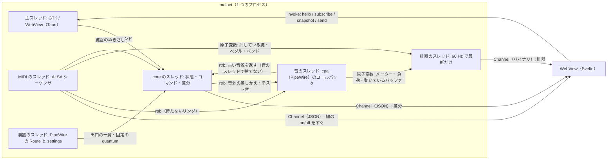

# meloet の骨組み

この書類は、meloet の中の作りと、そう決めた理由をまとめたものです。
検証の結果は [`report.md`](report.md)、デザインの決まりは [`design/spec.html`](design/spec.html)（仕様書）と [`design/mock/`](design/mock/)（モック 37 枚）にあります。
モックと仕様書が食いちがったら、仕様書が正しい。

---

## 1. クレートと役目

報告書の 7-1 の分けかたに、状態の持ち主の `meloet-core` を 1 つ足しました。

| クレート | 役目 | 中に入れないもの |
|---|---|---|
| `crates/meloet-model` | 曲・トラック・音源の指定。純粋なデータと操作 | 入出力、スレッド |
| `crates/meloet-protocol` | Rust と画面の約束（型と版、計器のバイナリの並び）。TS の型もここから作る | Tauri |
| `crates/meloet-engine` | 音の流れ、音源の口、メーター、cpal の出口。音のスレッドはメモリ確保なし・鍵なし | 画面、プラグインの形式、鍵（Mutex） |
| `crates/meloet-midi` | 鍵盤の入力とぬきさし（Linux は ALSA シーケンサ） | 音 |
| `crates/meloet-devices` | 音の出入口の人の言葉の名前（Linux は PipeWire の Route）、PC 全体の quantum の固定を読む | 音の処理、設定の書きかえ |
| `crates/meloet-core` | 状態の持ち主。意図のコマンドを受けて状態を変え、rev つきの差分を出す。帯の決まり、状態行の知らせ、設定の保存 | Tauri、画面の見た目 |
| `crates/meloet-app` | Tauri の殻。コマンドと Channel の受けわたしだけ | 状態の持ち主になること |
| `ui/` | 画面（Svelte 5 ＋ TS）。`ui/src/bridge/` だけが Tauri を知る | Tauri の API の直接呼び出し |

あとで足すもの（今回は作らない）: `meloet-plugin`、`meloet-vst3`、`meloet-lv2`、`meloet-plughost`。プラグインは最初から別のプロセスで動かす（報告書の「v1 は同じプロセス」の案は使わない）。

**理由**: 報告書の 7-1 は `meloet-app` に状態を持たせず、`meloet-model` に入出力を持たせない。そうすると、曲・装置・帯をまとめて持ち、コマンドを受ける場所が要る。それが `meloet-core` です。画面なしで、約束と帯の決まりをテストできます。

`spikes/` はワークスペースに残しますが、`default-members` から外しています。ふだんの `cargo build` と `cargo test` は `crates/` だけを相手にします。

---

## 2. スレッドとプロセス



- 鍵の on/off は、MIDI のスレッドから直接、画面の Channel へ送る。core を通さない（鍵 → 画面を短くするため）。押している鍵の一覧は、計器のバイナリにも毎回入れるので、1 つ取りこぼしても次の計器で戻る。
- 鍵盤のぬきさしは core の状態を変え、差分として、すぐ送る。
- 音のスレッドは、メモリを取りにいかない、鍵を待たない。入ってくる物も出ていく物も、待たないリング（rtrb）と原子変数だけ。
- 第 2 回で足した道（図にはない）: core → 音のスレッドへ「曲のノートの列」（`Sequence`。古い列はリングで返す）と再生まわりの命令。音のスレッド → core へ「録った出来事」のリング（耳に届いていた位置と周つき）。音のスレッドが書く「区切りの輪」（`TransportClock`。512 こま、こまごとに seqlock、中身は原子変数だけ）を、計器のスレッドと core が鍵を待たずに読む。
- MIDI のスレッドと装置の見はり（PipeWire）は、core のスレッドが持ち主。止まったら core に知らせが来て、core が間をあけて起こしなおす（4-2）。

---

## 3. Rust と画面の約束（報告書 7-3）

### 3-1. 手順

1. **あいさつ**: 画面は起動したら `hello(protocolVersion)` を呼ぶ。版がちがえば止まる。
2. **先に聞く**: `subscribe(messages, telemetry)` で Channel を 2 本わたす。ここから先の差分は取りこぼさない。
3. **丸ごと取りにいく**: `snapshot()` で `{ rev, state }` を受けとる。2 の後に届いた差分のうち、`rev` が snapshot 以下の物は捨て、上の物を順に当てる。
4. **差分**: `{ rev, changes }`。`rev` は 1 ずつふえる。画面が持つ rev + 1 でない差分が来たら、画面は `snapshot()` を取りなおす。
5. **画面 → Rust は意図だけ**: `send(command)`。Rust が確かめて状態を変え、差分を出す。画面は自分で状態を決めない（テキストの入力中や、ドラッグ中の見た目だけは先に動かしてよい）。
6. **すぐ知らせること**: 鍵の on/off、ペダル、ベンド、モジュレーションは、届いた瞬間に messages の Channel で送る。
7. **計器**: telemetry の Channel でバイナリ。60 Hz で最新だけ。前と同じ中身なら送らない（何も鳴っていないときは止まる）。

8. **テイクの中身**（第 2 回）: 録り終わったテイクは中身が変わらない。状態にはクリップごとに「見せているテイクの id とノートの数」だけを入れ、中身は `take_notes(id)` でバイナリ（3-4）を取りにいく。画面は id ごとにためる。
9. **録っている最中のノート**（第 2 回）: messages の Channel で `liveNotes {seq, recording, notes}`。`seq` はアプリが動いているあいだ 1 ずつふえる。`(lap, index)` が同じノートは入れかえる（押したときは長さなし、離したときに長さつき）。画面は聞く準備のあと `live_notes()` で丸ごと取り、それ以下の `seq` を捨てる。番号が飛んだら丸ごと取りなおす。
   - **理由**: 10 分録るとノートは何千になる。区画を丸ごと入れかえる決まりのまま状態に入れると、差分のたびに全部を送ることになるため。

messages の Channel は 1 本で、差分（`patch`）、すぐ知らせること（`event`）、録っている最中のノート（`liveNotes`）を、着いた順に運ぶ。

### 3-2. 状態（snapshot と差分の単位）

状態は、次の区画に分ける（第 2 回で `transport` と `arrange` を足した。窓の大きさが変わるたびに、えらんだ物まで送りなおさないため）。差分は、変わった区画を丸ごと入れかえる（区画の中の一部だけの差分は作らない）。区画が小さいうちはこれがいちばん素直で、まちがえにくい。

| 区画 | 中身 |
|---|---|
| `song` | 曲の名前、テンポ、拍子、テンポ・拍子の変更の件数、トラック（番号、名前、色の番号、音源の名前、音量 dB、録音待機、クリップ〔id、範囲、名前、見せているテイクの番号と数と id と位置、ノートの数〕）、取り消せる手とやりなおせる手の数、弾くと鳴る先のトラック、ループ（範囲のティックとオン・オフ）、帯札「ピアノロール ノート ○」の数、曲のファイルの様子（一度も保存していない・保存済み・変更あり） |
| `transport` | 止まっている・カウントイン・再生・録音、止まっている時の位置、メトロノーム、カウントインの小節と拍の数、再生と録音が使えるか、録っているあいだの物（録音の番号、トラック、始まり、何番のテイクになるか、まとまる先のクリップ、周）。動いている位置は計器で来る |
| `arrange` | えらんでいるクリップ、ピアノロールが見せるクリップ |
| `workspace` | 拡大率、いまの画面に入らない拡大率（`unfitScales`）、窓の大きさ、帯のひらき具合と高さ（`layout`）、右の欄、音の設定のダイアログ、出口えらび（流れ 2）、アレンジの上の案内、曲のダイアログ（保存していない・保存できない・こわれている。id、見出し、1 つ前があるか） |
| `keyboards` | 見えている鍵盤（名前、ALSA の番地）、いま使っている鍵盤、最後に抜けた鍵盤 |
| `outputs` | 出口の一覧（本物の名前、やさしい言いかえの種類、ささっているか、つながりの種類）、えらんだ出口、その出口の様子 |
| `inputs` | 歌の入口の一覧（今回は見せるだけ。使えない） |
| `audio` | 動いているか、サンプルレート、頼んだバッファ、動いているバッファ、PC 全体で固定された quantum、遅れの見積もり、音のしくみの名前、出口のデバイス名、MIDI の入口の名前 |
| `status` | 状態行の左の知らせ（文の種類と、うめこむ値） |

画面の文面は Rust に置かない。Rust は「文の種類（ID）とうめこむ値」だけを送り、画面が `ui/src/text/` の文に当てる。

### 3-3. 計器のバイナリ（版 2、リトルエンディアン）

| 位置 | 型 | 中身 |
|---|---|---|
| 0 | u8 | 種類 = 1（計器） |
| 1 | u8 | 版 = 2 |
| 2 | u16 | トラックの数 n |
| 4 | u32 | 通し番号 |
| 8 | u64 | Rust が送った時刻（CLOCK_MONOTONIC、ns） |
| 16 | u64 | 押している鍵 0〜63 のビット |
| 24 | u64 | 押している鍵 64〜127 のビット |
| 32 | u8 | 最後のベロシティ（0 はまだ無し） |
| 33 | u8 | サステイン（CC 64 の値） |
| 34 | u8 | モジュレーション（CC 1 の値） |
| 35 | u8 | 旗（bit0: 音が動いている、bit1: マスターが割れた、bit2: 再生の位置がある） |
| 36 | i16 | ピッチベンド（−8192〜8191） |
| 38 | u16 | 処理の負荷（千分率） |
| 40 | f32 × 2 | マスターの最大値 左・右（前に送ってからの最大。1.0 = 0 dBFS） |
| 48 | f64 | 送った時刻に耳に届いている曲の位置（ティック、小数。カウントイン中は負もある） |
| 56 | f64 | 1 µs あたりのティック（止まっているときは 0） |
| 64 | u8 | 状態（0 停止、1 カウントイン、2 再生、3 録音） |
| 65 | u8 | 0（あき） |
| 66 | u16 | カウントインの残りの拍（鳴っている拍もふくむ。外では 0） |
| 68 | u32 | 録音中のループの周（最初が 0） |
| 72 | f32 × 2n | トラックごとの最大値 左・右 |

画面の位置 = `tick + (Rust の今 − 送った時刻) × 1 µs あたりのティック`。bit2 が 0 の間（音がまだ動いていない）、48〜71 は 0 で、画面は `transport.position` を使う。止まっているときは、再生まわりの数字も再生の位置の線も `transport.position`（差分ですぐ届く）、動いているときは計器の位置（`ui/src/components/time.ts` の `shownTick`）。

### 3-4. テイクの中身のバイナリ（版 1、リトルエンディアン）

| 位置 | 型 | 中身 |
|---|---|---|
| 0 | u8 | 種類 = 2（テイク） |
| 1 | u8 | 版 = 1 |
| 2 | u16 | 0（あき） |
| 4 | u32 | テイクの id |
| 8 | u32 | 長さ（ティック） |
| 12 | u32 | ノートの数 n |
| 16 | u32 | コントロールの数 m |
| 20 | 12 × n | ノート: 始まり u32、長さ u32、鍵 u8、ベロシティ u8、0 が 2 つ |
| 20+12n | 8 × m | コントロール: ティック u32、種類 u8（0 CC、1 ピッチベンド）、CC の番号 u8（ベンドは 0）、値 i16 |

位置はテイクの 0 から数える。u32 のティックは、300 BPM でも約 20 日ぶんある。

並びは `meloet-protocol` の 1 か所で決め、Rust で書いて TS で読むテストで食いちがいを見はる。

---

## 4. 音の流れ

- 出口は cpal の PipeWire。頼むバッファは 256。**動いている数は、コールバックが受けとったフレーム数から読む**。
- PC 全体の `clock.force-quantum` は、PipeWire の `settings` メタデータを**読むだけ**。0 でなく、動いている数が頼んだ数とちがうときに「PC 全体の設定で固定されている」と言う。
- 遅れの見積もり: 検証の計測（バッファ 256 で平均 13.2 ms、1024 で 53.2 ms、48 kHz）から、鍵 → 音 ≒ 2.5 × バッファ ÷ サンプルレート。動いている間は、実際に測った値（鍵を受けた時刻と、その音が DAC に届く予定の時刻の差）の平均を使う。
- 音源の口（`Instrument`）: 1 つのトラックが 1 つの音源を持つ。音源は「準備（音のスレッドの外）」「出来事（ノート、CC、ベンド）」「描く（ステレオのバッファ）」「止める」を持つ。差しかえは、core が音のスレッドの外で新しい音源を作り、リングで音のスレッドへ送る。音のスレッドは入れかえて、古い物をリングで返す（音のスレッドで捨てると、メモリを返す処理が走るため）。
- 今回の音源は「仮の音」（やわらかい合成の音）。次の回に、サンプルのピアノが同じ口に入る。プラグインも、別のプロセスとのやりとりを同じ口の向こうに隠す。
- メーターは、ブロックごとの最大値を原子変数に「前より大きければ書く」。計器のスレッドが読むときに 0 に戻す。
- 処理の負荷は、コールバックの中でかかった時間 ÷ そのブロックの長さ。
- 出口を変えるときは、古いストリームを止め、曲から音源を作りなおして新しいストリームを作る。今回は再生の位置などの「流れの中の状態」がないので、作りなおしで足りる。

### 4-1. 音のスレッドの見はり

- `meloet-engine` は `std::sync::Mutex` などの鍵を使わない。`clippy.toml` の `disallowed-types` と `disallowed-methods` で機械的に止める。
- メモリ確保は、テストのときに、数える割り当て器（global allocator）で見はる。音のスレッドの区間に入ったら旗を立て、その間に確保か解放があればテストを落とす。オフラインで曲を描くテストと、実際のストリームを 2 秒回すテスト（装置があるときだけ）の両方で。


### 4-2. 止まったときと、つなぎなおし（第 2 回）

- 出口のストリームのエラーは 3 つに分けて数える: xrun、ストリームが自分で終わった（PipeWire が消えた、出口がなくなった。1 本のストリームで 1 回）、そのほか。こちらから止めるときに cpal が出す `DeviceNotAvailable` は数えない。
- PipeWire が消えると、cpal は `StreamInvalidated` を 1 回出してコールバックが止まり（気づくまで 1.4〜37 ms）、装置の見はり（pipewire-rs）も core の error で終わる（0.6〜10 ms）。どちらも core に知らせる。ストリームを閉じると、エンジンは `Carrier` の Drop で戻る。戻らなかったときに備えて、エンジンを作りなおせる（`EngineHandle::rebuild`。MIDI のリングと区切りの輪も新しくなり、core が配りなおす）。
- MIDI のスレッドは、自分で止まるとき最後に `Stopped` を送り、sink を返す。core は同じ sink で起こしなおす。押していた鍵とペダルは、止まった時点で離したことにする。
- つなぎなおしの間隔: 0.5・1・2・4 秒、そのあとは 5 秒ごと。PipeWire と MIDI はあきらめない（ほかに取りもどす道がなく、1 回試すのは安い。最初は早いので、すぐ戻るデーモンならすぐ戻る）。ストリームだけが落ちたとき（PipeWire は動いている）は 4 回まで。そのあとは出口の一覧が変わるか人が操作するまで待つ（毎回すぐ落ちる出口を開いたり閉じたりし続けないため）。起動したときに PipeWire がないときも、同じ間隔で黙って試す（一度も動いていないので「止まりました」は出さない）。
- 録っている最中に音が止まったら、そのときの耳に届いていた最後の位置で録音を閉じ、録れた分をテイクに残して文を出す。鍵盤の入力が止まっても録音は止めない。
- 試験: 自分用の PipeWire と WirePlumber（`crates/meloet-engine/tests/private_pw/`）を立てて落とし、戻す（`--devices`）。ヤチヨさんの PipeWire にはさわらない。
---

## 5. 鍵盤

- ALSA シーケンサに `meloet` という名前で入り、System:Announce を購読する。起動したときに、すでにある鍵盤を全部数えてから、ぬきさしを待つ。
- 鍵盤とみなす物: 種類が HARDWARE で、読める（READ ＋ SUBS_READ）口を持つクライアント。1 つのクライアントからは、いちばん番号の小さい読める口だけを聞く（Keystation 49 MK3 の 2 つめの口「Transport」はボタン用で、ノートとまちがえるため）。
- 鍵盤の名前は、ALSA のクライアント名（例「Keystation 49 MK3」）。
- 試験のための仮想の鍵盤（`meloet-vkeys`）は、環境変数 `MELOET_ACCEPT_VIRTUAL=1` のときだけ鍵盤とみなす。`MELOET_VKEYS_NAME=名前[,名前…]` があれば、その名前（`meloet-vkeys --name`）の仮想の鍵盤だけを受ける（同じ PC でほかの試験や測定の仮想の鍵盤がまざらないように）。`MELOET_ONLY_VIRTUAL=1` では、本物の鍵盤を見ず、仮想の鍵盤だけを見る（鍵盤がささったまま「鍵盤がない」画面を撮るため）。
- 鍵盤がぬけたら、音のスレッドへ全部の音を止める知らせを送り、押している鍵とペダルの記録を消す（押したまま抜いたときに、音と光が残らないように）。
- 2 台以上つながっているときは、全部の鍵を聞く。名前は最後に弾いた鍵盤（鍵を押したときだけ数える。弾く前は最後にさした鍵盤）で、入力計では「+1」のように残りの台数をそえる（仕様書 3 章）。どの鍵盤の鍵かは MIDI の知らせについてくる。MIDI のスレッドは、画面へ知らせたあとで、鍵盤が前とちがうときだけ core に伝える。

---

## 6. 出口と入口の名前

- PipeWire の Device の Route（`EnumRoute` と `Route`）を読む。Route の `description` が本物の名前（「アナログヘッドフォン」など）、`available` がささっているか、`info` の `port.type` が型。
- 出口 1 つ = Sink のノード 1 つ ＋ そのデバイスの出力の Route 1 つ。Route を持たない Sink（Bluetooth など）は、ノードの説明を名前にする。
- 出口の ID は「デバイスの名前 ＋ Route の名前」（Route がなければノードの名前）。これを設定に保存する。
- **meloet は、デバイスの Route を切りかえない**（それは PC 全体の設定を変えることになるため）。えらんだ Route が、いまささっていなければ、その文面を出す。
- やさしい言いかえは、型がわかるときだけ（モックの 4 つ: ヘッドホン → 「ヘッドホンの穴」、HDMI → 「画面のスピーカー」、ライン出力 → 「うしろのスピーカーの穴」、うしろのマイク → 「うしろのマイクの穴」）。
- 装置の名前は、PipeWire の Device の `device.description` をそのまま出す（例「GB206 High Definition Audio Controller」。ヤチヨさんの決め）。えらべない出口の行と、名前が同じ出口が 2 つ以上ならぶときに使う。
- えらべない出口（`unusable`）は 2 種類。ノードはあるが、PC がそのデバイスで別の Route を使っている → 「PC が切りかえる」（`switchedByPc`）。ノードがない → 「PC の設定で止まっている」（`stoppedByPc`。同じデバイスにノードのある穴があっても）。
- ならべる順: えらべる出口が先（ささっている → わからない → ささっていない。ささっている中ではヘッドホンが先）、そのあとにえらべない出口。

---

## 7. 画面

- Svelte 5 ＋ TypeScript ＋ Vite。SvelteKit は使わない（1 枚の画面で足り、橋を薄く保てるため）。
- **数値**: `ui/src/design/tokens.ts` に、仕様書の表の名前のまま入れる（`color.gray.4`、`size.meter.slim`、`space.3` など）。仕様書の文の中にしかない部品の寸法（ボタンの高さ 24 など）は `part.*`、モックにしかない寸法は `mock.*` として、出どころを書いて入れる。部品はここから作った CSS の変数だけを使う。部品の中に色の 16 進数や px を直接書くと、テストが落ちる。
- **拡大率**: 100・125・150%。`tokens.ts` が率ごとの値を出す。`line.hair` は、どの率でも画面の物理 1px（`1px / devicePixelRatio`）。`line.mark`・`line.track` は表の値。文字の表の「太さ」の列は、その大きさで使ってよい太さの組と読む（text.s は 400・500・600、text.m は 400・500、text.l は 600。率では変わらない）。仕様書の文の中の寸法（part.*）は、率をかけて整数にならなければ四捨五入する。
- **文面**: `ui/src/text/ja.ts` の 1 か所。仕様書の文面は一字も変えない（テストで仕様書から抜いた文と照らし合わせる）。モックにだけある文は、モックの文のまま、出どころ（ボードの名前）をつけて入れる。
- **大きな面は WebGL（区画ごとに 1 枚、使いまわし）**: 部品は、描く場所に `use:glSlot={...}` をつけ、そのまわりの箱（同じ箱でもよい）に `use:glRegion={"名前"}` をつける。WebGL の係（`ui/src/gl/engine.ts`）は、区画の箱ごとに canvas を 1 枚入れる（箱の中、`pointer-events: none`）。canvas の広さは「その区画の slot のある所 ∩ 箱 ∩ 窓」で、はしは画面の画素に合わせる。区画の中の slot は、全部その 1 枚に、ページの順（あとの物が上）で描く。描くのは、四角の並びが前と変わった区画だけ。60 Hz で変わる物（メーター、録っているクリップ）は小さな区画に分け、変わらない大きな区画（アレンジの線やクリップ）に入れない。再生の位置の線のように動くだけの物は、描きなおさず HTML の線を CSS の transform で動かす。文字と小さな部品は HTML。Canvas 2D は使わない。
  - 理由: WebKitGTK（NVIDIA）では、面を 1 回出すたびに、画面のプロセスの主スレッドが「0.25 ms ＋ 3.9 ms × 百万画素」ほど止まり、鍵の知らせはその後ろで待つ（2026-11-15 の測定、RTX 5060 Ti、WebKitGTK 2.52.6）。16 本のメーターを slot ごとに出すと 4.4 ms、1 枚にまとめると 1.4 ms。アレンジの面くらいの大きさは 1036×576 で 3.3 ms、1676×856 で 6.5 ms。transform で動かすだけなら 0.35 ms。第 1 回に、窓いっぱいの面を 60 Hz で出して鍵 → 画面の p95 が 8〜12 ms になったのも同じ理由（`docs/measurements/`）。
  - 限り: WebKitGTK 2.52 では、WebGL の文脈は 1 ページ 16 個まで。17 個めで、いちばん古い文脈が失われ、戻らない。**捨てた canvas の文脈も、GC されるまで数に入る**（`loseContext()` を呼んでも同じ）。作って捨てる形のままだと、音の設定の「くわしく」を 40 回切りかえるだけで、生きている文脈が 15 個失われた。だから canvas は作ったら手放さず、`ui/src/gl/pool.ts` で次の区画に使いまわす（同じ 40 回で、作ったのは 7 個、失われたのは 0 個）。
  - 予算: 作ってよい文脈は 12 個（限りの 16 から 4 つ残す）。こえそうになったら、開発とテストでは落とし、本番では console に書く。区画の外の slot も同じ。区画を足すときは `ui/src/gl/budget.ts` の `REGIONS` に 1 行足す（表にない名前は型で通らない）。

  | 区画 | どこ | 不透明 | 変わる速さ | 文脈 |
  |---|---|---|---|---|
  | inputKeys | 入力計の鍵盤 | はい | 鍵ごと | 1 |
  | inputVelocity | ベロシティの棒 | はい | 鍵ごと | 1 |
  | masterMeter | 再生まわりのマスター | いいえ | 〜60 Hz | 1 |
  | trackMeters | トラックの見出しのメーター（何本でも 1 枚） | いいえ | 〜60 Hz | 1 |
  | arrangeLanes | 小節の線とクリップ | いいえ | 曲、大きさ、スクロールが変わったとき | 1 |
  | overview | ちぢんだアレンジ（trackMeters と arrangeLanes の代わり。使いまわし） | いいえ | 同上 | 0〜1 |
  | settingsMeter | 音の設定のテスト音の横 | いいえ | 〜60 Hz | 1 |
  | settingsKeys | 音の設定の光る鍵盤 | はい | 鍵ごと | 1 |
  | （第 2 回）recordingClip | 録っているクリップだけ | いいえ | 〜60 Hz | 1 |
  | （予定）pianoRoll | ピアノロールのノート | いいえ | 曲が変わったとき | 1 |
  | （予定）mixerMeters | ミキサーのメーター（1 枚） | いいえ | 〜60 Hz | 1 |
  | 再生の位置の線 | HTML（transform） | — | 60 Hz | 0 |

  いまの最大は 7 個（音の設定をひらいたとき）。予定を全部足しても 11 個。
- **帯の決まりは Rust**: どの帯がひらいているか、高さ、入力計が 52 か 24 か、Esc でどれを閉じるかは、`meloet-core` の純粋な関数で決める（画面なしでテストできる）。画面は窓の大きさと拡大率を送り、返ってきた高さに率をかけて描く。画面の使える広さ（作業領域から窓の枠を引いた物）は、画面からは送らない。殻（`meloet-app`）だけが `Core::set_screen_space` で知らせる。
- **用語の説明**: マウスを 0.6 秒止めると出る。幅 248、内がわ 8、地 gray.10、文字 gray.0、角 1、影なし。形は「用語 — 説明」（用語は太字）。
- **キー**: 一文字のキーは、文字を打っている最中には効かない。Esc・Enter・Mod つきは効く。Esc は、文字の枠 → 用語の説明やメニュー → （ここから Rust の `Back`）ダイアログ → 右の欄 → いちばん新しい下の帯。

---

## 8. 設定の保存

`$MELOET_CONFIG_DIR`（試験用）、なければ `$XDG_CONFIG_HOME/meloet`、なければ `~/.config/meloet` の `settings.json`。

```json
{ "version": 1, "output": "<出口の id>", "output_name": "アナログヘッドフォン", "scale": 100, "metronome": false, "count_in_bars": 1 }
```

- えらんだ出口があれば、次からは出口えらびを出さない。
- メトロノームとカウントインの小節数は、曲ではなく設定（第 2 回）。欄がないとき・範囲の外は既定値（オフ、1 小節）。欄がふえても版は 1 のまま読める。
- `output_name` は、えらんだときの名前。覚えた出口が一覧にまったくないとき（USB の音の箱をぬいて起動した、など）に、状態行に出す名前がないので持っている。
- 書くときは一時ファイルに書いてから rename。読めない・こわれていたら既定値で始める。

## 8-1. 出口の様子

- Ready（ひらいて鳴らす）: 覚えた出口がいまあり、えらべて（ノードがあり、PC がその Route を使っている）、ささっている。
- NotPlugged（ひらかない）: 起動したとき、覚えた出口がない・ささっていない・えらべない。ささったら、そのまま鳴らす。
- Missing（とじる）: 動いている最中に、鳴らしていた出口が消えた・ぬけた・えらべなくなった。PC が別の Route に切りかえて、えらんでいないスピーカーから鳴るのをさけるため。もどったら、またひらく。
- テスト音で、えらんでいない出口をひらくのは、出口えらびか音の設定がひらいている間だけ。とじたら、えらんだ出口にもどる。
- 音がひらいていない間の鍵は、音のスレッドへ送らない（あとでまとめて鳴らないように）。画面には光る。

---

## 9. テストと見はり

- `scripts/check-all.sh` 1 つで、`cargo fmt --check`、`cargo clippy -D warnings`、`cargo test`、`npm run check`（svelte-check と tsc）、`npm test`（vitest）、`node licenses/check.mjs` が全部走る。
- 画面なしのテスト: 曲のデータ、約束（rev が飛んだら丸ごと取りなおす、を含む）、帯の決まり、状態行の知らせ、音の流れ（オフラインで描いて音とメーターを確かめる）、音のスレッドのメモリ確保。
- 装置が要るテスト（実際の鍵盤、PipeWire）は `#[ignore]` にして、`scripts/check-all.sh --devices` で走らせる。
- 見た目: `tools/design/shoot_ui.py`（偽物の状態をブラウザで撮り、モックと左右にならべる）と `tools/design/shoot_app.py`（本物のアプリを開発用の環境変数で動かして撮る）。撮った物は `docs/screenshots/`。
- 速さ: `tools/measure/latency.sh`（release でアプリと仮想の鍵盤を動かし、鍵 → 画面、鍵 → 音を測って `summary.md` にする。`--state stopped|playing|recording` で再生中・録音中も）。本物の鍵盤は `tools/measure/real-keys.sh`（ヤチヨさんが弾いて窓を閉じる）。結果は `docs/measurements/`。
- 録った位置（第 2 回）: `tools/measure/record-timing.sh private`（自分用の PipeWire で quantum 64〜1024）と `live <出口の id>`（本物の出口）。計器から拍が DAC に届く時刻を出し、その時刻に名前つきの仮想の鍵盤で押して、テイクの位置と拍をくらべる。ループ中の録音は `crates/meloet-core/tests/record_loop_private.rs`。
- 長い録音（第 2 回）: `tools/measure/long-record.sh`（600 秒弾きつづけ、xrun、RSS、GC の目安を見る）。
- 保存の途中で落とす試験（第 2 回）: `crates/meloet-core/src/songfile/tests.rs`。子のプロセスに保存させ、いろいろな瞬間に SIGKILL して、ファイルが前のか新しいかのどちらかで読めることを 120 回確かめる。
- 画面のコマの時間（第 2 回）: `MELOET_MEASURE_DIR` があると、画面が `frame-profile.json`（WebGL のコマごとの仕事と、そのコマで主スレッドがふさがった時間）を書く。

---

## 10. 仕様書にない所で、仮に決めたこと

ここは、デザイン係やヤチヨさんの答えで変わりうる所です。決めたら `docs/progress.md` にも書く。

| 所 | 決めたこと | 理由 |
|---|---|---|
| 状態の持ち主 | `meloet-core` を足した | 7-1 の「app は状態を持たない」「model は入出力を持たない」を両方守るため |
| 鍵盤の口 | 1 台につき、いちばん番号の小さい読める口だけ | 2 つめの口がボタン用の鍵盤があるため |
| 2 台の鍵盤 | 全部聞く。名前は最後に弾いた物（鍵を押したときだけ数える） | 仕様書 3 章。「弾いた」の数えかただけ仕様書にない |
| 窓のいちばん小さい大きさ | 853×448 に拡大率をかける（125 % で 1067×560、150 % で 1280×672）。起動したときと率が変わったときに meloet-app が決めなおす | 仕様書 1 章（第 3 版）。150 % でも高さ 768 の画面に入る |
| 出口の Route | meloet は切りかえない | PC 全体の設定を変えないため |
| 遅れの見積もり | 2.5 × バッファ ÷ サンプルレート | 検証の 2 点の計測から |
| 鍵 → 画面の道 | 鍵の on/off は MIDI のスレッドから直接 Channel へ。core の状態の鍵（hub）を、差分の配りと同じ順を守るために使う | 実測で p95 約 1 ms に収まっている |
| WebGL の面 | 区画ごとに 1 枚の canvas、変わったときだけ描く。canvas は使いまわす | 7 章の理由 |
| 処理の負荷 | 前に送った値から 1% 未満の動きなら送らない | 無音でも負荷は少し動くので、そのままだと計器が止まらない |
| 状態行の「起きた事」の知らせ（帯をたたんだ、拡大率） | 「設定がひらいている」「出口が消えた／ささっていない」「鍵盤が抜けた」の下、「鍵盤をさがしている」より上に出す。次の人の操作（窓の大きさの変化は数えない）か、新しい知らせで消える | 人が何かしないと直らない知らせを先に。窓を動かしている最中に読めなくなると困るので、大きさの変化では消さない |
| 知らせが 2 つ重なったとき | 拡大率を上げて、窓が広がり、帯もたたまれたら、帯の知らせ（`bandFoldedWindowLow`）だけを出す | 状態行は 1 文。見えていた物が消えたほうが、人には大事 |
| 3 つ目の帯をひらいて、いちばん古い帯がたたまれたとき | 文は出さない。そのあと高さが入りきらずにもう 1 つたたむときは「入りきらない帯をひらいた」を出す。拡大率を上げて帯がたたまれたときは「帯が自動でたたまれた」を出す | 仕様書に文がない（問い B-37 の仮の形） |
| 拡大率を変えて窓が広がるとき | core は、殻が広げたあとの大きさで、すぐに帯を決める。殻は `set_min_size` のあと、中身がいちばん小さい大きさに足りなければ `set_size` もする | 広がる前の小さい窓で決めると、帯が一度ちぢんで見える。GTK が窓の枠を自分で描くとき（Wayland）、`set_min_size` だけでは枠のぶん足りない |
| 画面の使える広さ | いま窓がある画面の作業領域から、窓のまわりの物（外の大きさ − WebView の大きさ）を引く。わかる前は、どの率も入るとみなす。100 % はいつも入るとみなす | Wayland では作業領域が画面全体になり、枠には影も入るので、おおよその数。100 % は、いちばん小さい率なので、えらべないと困る |
| 窓のいちばん小さい大きさに足す枠のぶん | 殻は、GTK の窓の大きさ − WebView の大きさ（同じ並べなおしの回の数）を、`set_min_size` に足す。窓が出る前は 0 で始め、窓の大きさが変わるたびに見なおして、変わったら決めなおす | GTK が枠を自分で描くとき（Wayland）、いちばん小さい大きさは題の帯と影（この PC で 52×89）も数える。足さないと、中身が 853×448 より小さくなる。窓のマネージャが枠を描くときは 0 になる |

| 録音中に鳴らすもの（第 2 回） | 録音待機のトラックの前のテイクは鳴らさない。カウントインのあいだは曲を鳴らさない（クリックだけ） | 取りかえる物を聞かせない。はじめての人に、カウントインは合図だけのほうがわかりやすい |
| どこから再生・録音するか（第 2 回） | 再生は止めた位置から（ループがオンで外なら、ループの始まりから）。録音はループがオンならループの始まり、オフなら止めた位置から、カウントインのあと。再生中の録音は、描いている位置のまま、すぐ録音に変わる（音を戻さない）。止めた位置はそのまま残す。先頭へは 0。目盛を押すと、その小節の頭 | 仕様書にない。音が戻ると、はじめての人は「こわれた」と思う |
| カウントインの最後の半拍の鍵（第 2 回） | 拾う（テイクの頭を前へ広げる。0 より前へは広げない） | 早めに押した頭の音を落とさない。弾いたとおりの位置に残す |
| 録音中・カウントイン中の操作（第 2 回） | テンポ、拍子、ループ、位置、録音待機、消す、テイクの切りかえ、取り消し・やりなおし、保存・ひらく・新しい曲は受けない（再生中は受ける） | 録音の位置と周の数えかたが途中で変わらないように |
| ノートのない録音（第 2 回） | クリップも手も作らない | 仕様書の「ノートのない周はテイクにしない」に合わせた |
| テイクの切りかえ（第 2 回） | T・▸ は最後の次で最初へ、Shift T・◂ は最初の前で最後へ回る | 仕様書にない |
| ループのない周の線（第 2 回） | ループがオフのときは、範囲を覚えたまま、目盛にも見出しにも出さない | B-42 |
| メトロノームの音（第 2 回） | 小節の頭 1760 Hz、ほかの拍 1046.5 Hz、35 ms。マスターにだけ足す | 仕様書にない。トラックのメーターに入れない |
| アレンジの横（第 2 回） | スクロールの位置はティックで持つ（拡大率を変えても同じ所）。画面の中の見た目なので Rust に送らない | 拡大率で見える所が変わらないように |
| 曲の名前とファイル（第 2 回） | 曲の名前は手（取り消しの対象）ではない。最初の保存で「はじめての曲 2」になっても、取り消しで戻らない。1 つ前の状態から開いた曲は、取り消しても「変更あり」のまま | 名前はファイルの名前と同じなので、取り消すとファイルと食いちがう |
| 保存まわりのダイアログの見出し（第 2 回） | 曲の名前（こわれたファイルのときはファイルの名前） | ヤチヨさんの決め |
| PC のファイルの窓（第 2 回） | GTK の `FileChooserNative`（殻が出す）。題は「ひらく」「場所をえらぶ」。文は殻の 1 か所の定数（画面の文面は ja.ts の 1 か所、の決まりの例外） | 依存を足さずにすむ。Windows と Mac は第 9 回 |
| 閉じるとき（第 2 回） | 殻は窓の閉じる要求をいつも止めて core に聞く。終わると決まってから web プロセスを止め、core を止める。順はいつも「保存 → web プロセスを止める → 終わる」 | 曲の安全を web プロセスに頼らない（宿題 2） |
| PC が終わるとき（第 2 回） | SIGTERM・SIGINT・SIGHUP は、ダイアログを待たずにふつうに終わる（保存していない変更は残らない） | ダイアログを待てない。なおすためのファイルは B-48 |

---

## 11. 時間の持ちかた（第 2 回）

- 曲の中の位置は、ティックの整数（`u64`）。**4 分音符 1 つ = 480 ティック**（`meloet_model::TICKS_PER_QUARTER`）。1 拍は拍子の下の数の音符なので、1 拍のティックは 4/4 で 480、6/8 で 240、2/2 で 960。
- 表示の「小節 . 拍 . ティック」の「ティック」は、拍の中を 480 に分けた数（仕様書 5 章「ティックは 1 拍を 480 に分けた細かい目盛り」）。4/4 なら中のティックそのまま、6/8 なら 2 倍、2/2 なら半分にして見せる。
- テンポは「1 分間の拍の数」（仕様書 5 章）。0.01 きざみの整数で持つ（`Tempo`、9600 = 96.00）。使える範囲はテンポ 30.00〜300.00、拍子の上 1〜12、下 2・4・8・16（ヤチヨさんの決め）。
- 秒との換算は、いまは曲の頭のテンポと拍子だけ（テンポ・拍子の変更は第 6 回）。
- 録った位置は、耳に届いていた位置（小数）を、いちばん近いティックの整数にまるめる。96.00 の 4/4 で 1 ティックは 1.30 ms なので、まるめの誤差は ±0.65 ms まで。

**理由**: 中の単位を 4 分音符にそろえると、拍子の下の数を変えても、ノートは音楽として同じ所に残る。あとで拍子の変更が入っても、位置の意味が変わらない。MIDI の書き出しも 4 分音符の分解能で書ける。表示だけを拍に直せば、仕様書の「1 拍を 480」とも合う。テンポを整数で持つのは、0.01 きざみの値が往復で変わらないようにするため。

## 12. 録音の位置（遅れの補正）

**決まり**: 録った鍵は「その鍵を押した瞬間に、耳に届いていた曲の位置」に置く（ヤチヨさんの決め。仕様書 5 章「遅れの補正 — 録った音を、遅れのぶんだけ前へ戻して置くこと」）。クオンタイズはしない。

- **時計**: 鍵の時刻は、MIDI のスレッドが ALSA のシーケンサから読んだ瞬間の CLOCK_MONOTONIC（`MidiIn.t_us`）。音の時刻は、cpal の `OutputCallbackInfo` の `playback`（PipeWire の `pw_time.now + delay`）。どちらも同じ時計。
- **耳に届いていた位置**: 音のスレッドは、ブロック（ループで飛ぶなら、その前後で分けた区切り）ごとに「最初のこまが DAC に届く時刻、こまの数、最初のこまの曲の位置、1 こまあたりのティック、状態、周」を、決まった大きさの輪にためる。鍵の時刻 t をふくむ区切りから、t のときの位置を出す。止める操作も、その操作の時刻に耳に届いていた位置で止める。画面の再生の位置の線も、同じ輪から「いま耳に届いている位置」を出す。
- **カウントイン**: カウントインの最後の半拍に押した鍵は拾う（早めに押した頭の音）。それより前は録らない（弾く前の準備の音）。
- **録っているあいだ**: 録音待機のトラックの前のテイクは鳴らさない（取りかえる物を聞かせない）。
- **入っていない遅れ**: PipeWire の `delay` には、グラフの遅れと ALSA の headroom が入るが、DAC・コーデック・USB の音の箱の中の遅れは入らない（調べ物。PipeWire 1.4 のソース、確かさ A）。その分だけ、録った位置は早めに出る。鍵盤の中と USB MIDI の遅れ（鍵を押してから ALSA に届くまで）も入らない。どちらもソフトだけでは測れない（出口から入口への線でつなぐ測りかたが要る）。

**理由**: 区切りごとに位置と時刻を組にして持てば、バッファの大きさや PipeWire の遅れが変わっても、計算は同じ形で正しい。鍵が音のスレッドに着いた時刻ではなく、鍵を読んだ時刻で引くので、ブロックの境目のどこで鍵が来ても位置がぶれない。

## 13. 取り消しの形

- 曲（`Song`）を、取り消しの対象の `Doc` と、対象でない `Session` に分ける。
  - `Doc`: 名前、テンポ、拍子、トラック（→ クリップ → テイク）。
  - `Session`: 弾くと鳴る先、録音待機のトラック、ループの範囲とオン・オフ。
  - **理由**: 録音待機やループの範囲を変えたあとで取り消すと、それまで戻ってしまうのを防ぐため。
- 手（`History`）は、その手の前の `Doc` の写し（スナップショット）を持つ。`Doc` の中は トラック → クリップ → テイク が `Arc` なので、変えていない所は前の手と共有される。測った重さは、1000 手で 録音 約 965 KB、テイクの切りかえ 約 831 KB、テンポ 約 205 KB（8 トラック）。上限は今は設けない。
  - **理由**: 逆の操作を書く形より、写しのほうが「何度往復しても同じ所にもどる」をまちがえにくい。共有で軽いので、写しでも足りる。
- テイクは、一度できたら中身を変えない（画面はテイクの id でノートの絵をためておける）。クリップの中では `offset` でテイクの位置を決めるので、クリップをまとめても、テイクの中身は変わらない。
- 手になる操作: 録音 1 回（ループの周が何本でもまとめて 1 手）、テイクの切りかえ、クリップを消す、テンポ、拍子。何も変わらない操作は手にしない。
- 保存の印は `Doc` の版の番号。保存した版と今の版がちがえば「保存していない変更がある」。取り消して保存した所に戻れば、変更はない。
- **録音を足す決まり**: 新しいテイクたちの範囲と重なる、同じトラックのクリップを全部集めて、1 つのクリップにまとめる（範囲は全部を合わせた物、テイクは前からの物のあとに新しい物、名前と id はいちばん前のクリップの物）。重ならなければ新しいクリップ（名前はトラックの名前。ヤチヨさんの決め）。端が触れるだけは重ならない。ノートが 1 つもない録音は、クリップも手も作らない。
- **ループ中の録音**（仕様書 3 章）: 周ごとに新しいテイク。周をまたいで押していた鍵は押した周に入れ、ループの終わりで切る。踏んだままのペダルは次の周の頭に書く（ベンドとモジュレーションが 0 でないままのときも同じ。棟梁の決め）。ノートのない周はテイクにしない。止めたときに見せるのは、ノートのある最後の周。最初の周だけは、録りはじめる直前に押した鍵の位置まで前へ広げる（0 より前へは広げない）。
- **鳴らしかた**: クリップの範囲の外は鳴らさない。クリップの終わりで、ペダル・ベンド・モジュレーションが動いたままなら 0 に戻す。止めたとき、ループが折り返すとき、列を入れかえたときも、列が鳴らしている音を離し、列が動かした物を 0 に戻す。

## 14. 保存の形（第 2 回）

- **置き場所**: 曲は「曲のフォルダ」。`<音楽>/<曲の名前>/<曲の名前>.meloet`。`<音楽>` は `MELOET_SONGS_DIR`（試験用）→ `dirs::audio_dir()`（Linux は `user-dirs.dirs` の `XDG_MUSIC_DIR`。日本語の環境では「ミュージック」。Windows は `FOLDERID_Music`、macOS は `~/Music`）→ `~/Music` の順。最初の保存は聞かずにここへ置く（ヤチヨさんの決め）。同じ名前のフォルダがあれば（中身が何でも）「 2」「 3」…をつけ、曲の名前もそれに合わせる。フォルダの名前に使えない字（`/ \ : * ? " < > |` と制御文字）は `_`。あとで入る物（プラグインの状態、歌の音）は、このフォルダの下の `plugins/`、`audio/` に置く。
- **形**: UTF-8 の JSON を 1 行につめ、最後に改行。形を決めるのは `crates/meloet-core/src/songfile.rs`（model に serde を入れない）。

```json
{"format": "meloet-song", "version": 1, "app": "meloet 0.1.0",
 "song": {"name": "はじめての曲", "tempo": 9600, "meter": [4, 4], "tempoChanges": [], "nextId": 8,
   "tracks": [{"id": 1, "name": "ピアノ", "color": 1, "instrument": {"kind": "placeholder"}, "gainDb": 0.0,
     "clips": [{"id": 3, "name": "ピアノ", "start": 7680, "end": 15360, "active": 1,
                "takes": [{"take": 5, "offset": 0}, {"take": 6, "offset": 480}]}],
     "plugins": [], "automation": []}],
   "audio": []},
 "takes": [{"id": 5, "length": 7680, "notes": [[0, 30, 60, 100]],
            "controls": [[0, 64, 127], [240, "bend", -8192], [240, 1, 12]]}],
 "session": {"playTarget": 1, "armed": 1, "loop": {"start": 0, "end": 3840}, "loopOn": false}}
```

  - テイクは id ごとの表にし、クリップからは id と offset で指す。**理由**: テイクは変わらない物で、あとで同じテイクを 2 つのクリップから指すこともある。1 回だけ書けて、読むと 1 つの `Arc` を分けあう形に戻る。
  - ノートは `[始まり, 長さ, 鍵, 強さ]`。**理由**: 何千と並ぶので、欄の名前をくり返さない。
  - CC とベンドは 1 本の `controls`（CC は `[ティック, 番号, 値]`、ベンドは `[ティック, "bend", 値]`）。**理由**: 別の配列にすると、同じティックの CC とベンドの順が、読んだあとで変わる（往復で同じ曲に戻らない）。
  - テンポは 0.01 の整数、拍子は `[上, 下]`。model と同じ持ちかた。
  - あとで来る物の席（トラックごとの `plugins`・`automation`、曲の `audio`）は、いまは空の配列。読むときは、なくてもよい。知らない欄は読み飛ばす（新しい meloet が欄を足しても、同じ版なら古い meloet で開ける）。`version` がこの meloet より新しいファイルは読めない物として扱う。
  - 読めない物にする: `format` がちがう、版が新しい、model の決まりを破る（テンポ・拍子の範囲、id の重なり、クリップの重なり、ないテイクを指す、ノートの長さ 0 など）。録音待機や弾くと鳴る先が、ないトラックを指すときだけは、曲を捨てずに直す。
- **書きかた**（どの瞬間に落ちても `<名前>.meloet` は前のか新しいかのどちらかで、こわれていない）:
  1. 同じフォルダの一時ファイルに書いて `sync_all`。
  2. 今のファイルがあり、しかも曲として読めるときだけ、それを `.prev` の一時ファイルへコピーして `sync_all` し、`<名前>.meloet.prev` へ rename（これが仕様書の「自動で残してある 1 つ前の状態」）。
  3. 一時ファイルを `<名前>.meloet` へ rename。
  4. フォルダを `sync_all`（Unix）。しくじったら一時ファイルを消す。
  - **理由**: rename は同じフォルダの中では原子的。1 つ前は hard link でなくコピー（USB メモリの FAT・exFAT に hard link はない）。読めないファイルを `.prev` にしないのは、こわれたファイルの上に保存したときに良い `.prev` を押し出さないため。
  - 確かめ: 子のプロセスに保存させて 120 回 SIGKILL し、毎回 `<名前>.meloet` も `.prev` も読めて、保存した曲のどれかと一致した。電源が落ちたときは `sync_all` と rename の順だけが頼りで、試験はしていない（ソフトだけではできない）。
- **流れ**:
  - 新しい曲・ひらく・閉じる: 変更があれば「保存していない変更があります」（保存する / 保存しない / やめる）。保存して失敗したら「保存できない」へ。
  - 保存できない: 場所をえらぶ → フォルダの窓 → `<えらんだ所>/<名前>/<名前>.meloet` に保存し、待っていた事（閉じる・新しい曲・ひらく）に続く。
  - こわれている: `.prev` が読めれば「1 つ前を開く」。開いた曲は「変更あり」（次の保存で `<名前>.meloet` を書きなおす）。`.prev` がなければ仕様書の文の 1 文目と「やめる」だけ。
  - 録音中・カウントイン中は、保存・ひらく・新しい曲を受けない。閉じる要求は、録音を止めて、録れた分を曲に入れてから判断する。
  - 開いた・新しくしたとき: 手を空にし、位置を 0 にし、えらびを外し、エンジンへ全部送りなおす。
  - ダイアログの答えには、そのダイアログの id をつける（「保存しない → ファイルの窓 → こわれている」のようにダイアログが続けて入れかわるとき、前のダイアログへのおそい答えが次に当たらないように）。

