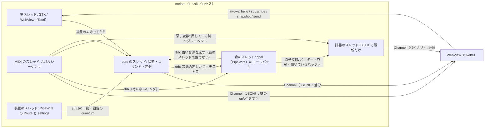

# meloet の骨組み

この書類は、meloet の中の作りと、そう決めた理由をまとめたものです。
検証の結果は [`report.md`](report.md)、デザインの決まりは [`design/spec.html`](design/spec.html)（仕様書）と [`design/mock/`](design/mock/)（モック 37 枚）にあります。
モックと仕様書が食いちがったら、仕様書が正しい。

---

## 1. クレートと役目

報告書の 7-1 の分けかたに、状態の持ち主の `meloet-core` を 1 つ足しました。

| クレート | 役目 | 中に入れないもの |
|---|---|---|
| `crates/meloet-model` | 曲・トラック・音源の指定。純粋なデータと操作 | 入出力、スレッド |
| `crates/meloet-protocol` | Rust と画面の約束（型と版、計器のバイナリの並び）。TS の型もここから作る | Tauri |
| `crates/meloet-engine` | 音の流れ、音源の口、メーター、cpal の出口。音のスレッドはメモリ確保なし・鍵なし | 画面、プラグインの形式、鍵（Mutex） |
| `crates/meloet-midi` | 鍵盤の入力とぬきさし（Linux は ALSA シーケンサ） | 音 |
| `crates/meloet-devices` | 音の出入口の人の言葉の名前（Linux は PipeWire の Route）、PC 全体の quantum の固定を読む | 音の処理、設定の書きかえ |
| `crates/meloet-core` | 状態の持ち主。意図のコマンドを受けて状態を変え、rev つきの差分を出す。帯の決まり、状態行の知らせ、設定の保存 | Tauri、画面の見た目 |
| `crates/meloet-app` | Tauri の殻。コマンドと Channel の受けわたしだけ | 状態の持ち主になること |
| `ui/` | 画面（Svelte 5 ＋ TS）。`ui/src/bridge/` だけが Tauri を知る | Tauri の API の直接呼び出し |

あとで足すもの（今回は作らない）: `meloet-plugin`、`meloet-vst3`、`meloet-lv2`、`meloet-plughost`。プラグインは最初から別のプロセスで動かす（報告書の「v1 は同じプロセス」の案は使わない）。

**理由**: 報告書の 7-1 は `meloet-app` に状態を持たせず、`meloet-model` に入出力を持たせない。そうすると、曲・装置・帯をまとめて持ち、コマンドを受ける場所が要る。それが `meloet-core` です。画面なしで、約束と帯の決まりをテストできます。

`spikes/` はワークスペースに残しますが、`default-members` から外しています。ふだんの `cargo build` と `cargo test` は `crates/` だけを相手にします。

---

## 2. スレッドとプロセス



- 鍵の on/off は、MIDI のスレッドから直接、画面の Channel へ送る。core を通さない（鍵 → 画面を短くするため）。押している鍵の一覧は、計器のバイナリにも毎回入れるので、1 つ取りこぼしても次の計器で戻る。
- 鍵盤のぬきさしは core の状態を変え、差分として、すぐ送る。
- 音のスレッドは、メモリを取りにいかない、鍵を待たない。入ってくる物も出ていく物も、待たないリング（rtrb）と原子変数だけ。

---

## 3. Rust と画面の約束（報告書 7-3）

### 3-1. 手順

1. **あいさつ**: 画面は起動したら `hello(protocolVersion)` を呼ぶ。版がちがえば止まる。
2. **先に聞く**: `subscribe(messages, telemetry)` で Channel を 2 本わたす。ここから先の差分は取りこぼさない。
3. **丸ごと取りにいく**: `snapshot()` で `{ rev, state }` を受けとる。2 の後に届いた差分のうち、`rev` が snapshot 以下の物は捨て、上の物を順に当てる。
4. **差分**: `{ rev, changes }`。`rev` は 1 ずつふえる。画面が持つ rev + 1 でない差分が来たら、画面は `snapshot()` を取りなおす。
5. **画面 → Rust は意図だけ**: `send(command)`。Rust が確かめて状態を変え、差分を出す。画面は自分で状態を決めない（テキストの入力中や、ドラッグ中の見た目だけは先に動かしてよい）。
6. **すぐ知らせること**: 鍵の on/off、ペダル、ベンド、モジュレーションは、届いた瞬間に messages の Channel で送る。
7. **計器**: telemetry の Channel でバイナリ。60 Hz で最新だけ。前と同じ中身なら送らない（何も鳴っていないときは止まる）。

messages の Channel は 1 本で、差分（`patch`）とすぐ知らせること（`event`）の両方を、着いた順に運ぶ。

### 3-2. 状態（snapshot と差分の単位）

状態は、次の区画に分ける。差分は、変わった区画を丸ごと入れかえる（区画の中の一部だけの差分は作らない）。区画が小さいうちはこれがいちばん素直で、まちがえにくい。

| 区画 | 中身 |
|---|---|
| `song` | 曲の名前、テンポ、拍子、テンポ・拍子の変更の件数、トラック（番号、名前、色の番号、音源の名前、音量 dB）、取り消しの手の数、弾くと鳴る先のトラック |
| `workspace` | 拡大率、窓の大きさ、帯のひらき具合と高さ（`layout`）、右の欄、音の設定のダイアログ、出口えらび（流れ 2）、アレンジの上の案内 |
| `keyboards` | 見えている鍵盤（名前、ALSA の番地）、いま使っている鍵盤、最後に抜けた鍵盤 |
| `outputs` | 出口の一覧（本物の名前、やさしい言いかえの種類、ささっているか、つながりの種類）、えらんだ出口、その出口の様子 |
| `inputs` | 歌の入口の一覧（今回は見せるだけ。使えない） |
| `audio` | 動いているか、サンプルレート、頼んだバッファ、動いているバッファ、PC 全体で固定された quantum、遅れの見積もり、音のしくみの名前、出口のデバイス名、MIDI の入口の名前 |
| `status` | 状態行の左の知らせ（文の種類と、うめこむ値） |

画面の文面は Rust に置かない。Rust は「文の種類（ID）とうめこむ値」だけを送り、画面が `ui/src/text/` の文に当てる。

### 3-3. 計器のバイナリ（版 1、リトルエンディアン）

| 位置 | 型 | 中身 |
|---|---|---|
| 0 | u8 | 種類 = 1（計器） |
| 1 | u8 | 版 = 1 |
| 2 | u16 | トラックの数 n |
| 4 | u32 | 通し番号 |
| 8 | u64 | Rust が送った時刻（CLOCK_MONOTONIC、ns） |
| 16 | u64 | 押している鍵 0〜63 のビット |
| 24 | u64 | 押している鍵 64〜127 のビット |
| 32 | u8 | 最後のベロシティ（0 はまだ無し） |
| 33 | u8 | サステイン（CC 64 の値） |
| 34 | u8 | モジュレーション（CC 1 の値） |
| 35 | u8 | 旗（bit0: 音が動いている、bit1: マスターが割れた） |
| 36 | i16 | ピッチベンド（−8192〜8191） |
| 38 | u16 | 処理の負荷（千分率） |
| 40 | f32 × 2 | マスターの最大値 左・右（前に送ってからの最大。1.0 = 0 dBFS） |
| 48 | f32 × 2n | トラックごとの最大値 左・右 |

並びは `meloet-protocol` の 1 か所で決め、Rust で書いて TS で読むテストで食いちがいを見はる。

---

## 4. 音の流れ

- 出口は cpal の PipeWire。頼むバッファは 256。**動いている数は、コールバックが受けとったフレーム数から読む**。
- PC 全体の `clock.force-quantum` は、PipeWire の `settings` メタデータを**読むだけ**。0 でなく、動いている数が頼んだ数とちがうときに「PC 全体の設定で固定されている」と言う。
- 遅れの見積もり: 検証の計測（バッファ 256 で平均 13.2 ms、1024 で 53.2 ms、48 kHz）から、鍵 → 音 ≒ 2.5 × バッファ ÷ サンプルレート。動いている間は、実際に測った値（鍵を受けた時刻と、その音が DAC に届く予定の時刻の差）の平均を使う。
- 音源の口（`Instrument`）: 1 つのトラックが 1 つの音源を持つ。音源は「準備（音のスレッドの外）」「出来事（ノート、CC、ベンド）」「描く（ステレオのバッファ）」「止める」を持つ。差しかえは、core が音のスレッドの外で新しい音源を作り、リングで音のスレッドへ送る。音のスレッドは入れかえて、古い物をリングで返す（音のスレッドで捨てると、メモリを返す処理が走るため）。
- 今回の音源は「仮の音」（やわらかい合成の音）。次の回に、サンプルのピアノが同じ口に入る。プラグインも、別のプロセスとのやりとりを同じ口の向こうに隠す。
- メーターは、ブロックごとの最大値を原子変数に「前より大きければ書く」。計器のスレッドが読むときに 0 に戻す。
- 処理の負荷は、コールバックの中でかかった時間 ÷ そのブロックの長さ。
- 出口を変えるときは、古いストリームを止め、曲から音源を作りなおして新しいストリームを作る。今回は再生の位置などの「流れの中の状態」がないので、作りなおしで足りる。

### 4-1. 音のスレッドの見はり

- `meloet-engine` は `std::sync::Mutex` などの鍵を使わない。`clippy.toml` の `disallowed-types` と `disallowed-methods` で機械的に止める。
- メモリ確保は、テストのときに、数える割り当て器（global allocator）で見はる。音のスレッドの区間に入ったら旗を立て、その間に確保か解放があればテストを落とす。オフラインで曲を描くテストと、実際のストリームを 2 秒回すテスト（装置があるときだけ）の両方で。

---

## 5. 鍵盤

- ALSA シーケンサに `meloet` という名前で入り、System:Announce を購読する。起動したときに、すでにある鍵盤を全部数えてから、ぬきさしを待つ。
- 鍵盤とみなす物: 種類が HARDWARE で、読める（READ ＋ SUBS_READ）口を持つクライアント。1 つのクライアントからは、いちばん番号の小さい読める口だけを聞く（Keystation 49 MK3 の 2 つめの口「Transport」はボタン用で、ノートとまちがえるため）。
- 鍵盤の名前は、ALSA のクライアント名（例「Keystation 49 MK3」）。
- 試験のための仮想の鍵盤（`meloet-vkeys`）は、環境変数 `MELOET_ACCEPT_VIRTUAL=1` のときだけ鍵盤とみなす。`MELOET_ONLY_VIRTUAL=1` では、本物の鍵盤を見ず、仮想の鍵盤だけを見る（鍵盤がささったまま「鍵盤がない」画面を撮るため）。
- 鍵盤がぬけたら、音のスレッドへ全部の音を止める知らせを送り、押している鍵とペダルの記録を消す（押したまま抜いたときに、音と光が残らないように）。
- 2 台以上つながっているときは、全部の鍵を聞く。名前は最後に弾いた鍵盤（鍵を押したときだけ数える。弾く前は最後にさした鍵盤）で、入力計では「+1」のように残りの台数をそえる（仕様書 3 章）。どの鍵盤の鍵かは MIDI の知らせについてくる。MIDI のスレッドは、画面へ知らせたあとで、鍵盤が前とちがうときだけ core に伝える。

---

## 6. 出口と入口の名前

- PipeWire の Device の Route（`EnumRoute` と `Route`）を読む。Route の `description` が本物の名前（「アナログヘッドフォン」など）、`available` がささっているか、`info` の `port.type` が型。
- 出口 1 つ = Sink のノード 1 つ ＋ そのデバイスの出力の Route 1 つ。Route を持たない Sink（Bluetooth など）は、ノードの説明を名前にする。
- 出口の ID は「デバイスの名前 ＋ Route の名前」（Route がなければノードの名前）。これを設定に保存する。
- **meloet は、デバイスの Route を切りかえない**（それは PC 全体の設定を変えることになるため）。えらんだ Route が、いまささっていなければ、その文面を出す。
- やさしい言いかえは、型がわかるときだけ（モックの 4 つ: ヘッドホン → 「ヘッドホンの穴」、HDMI → 「画面のスピーカー」、ライン出力 → 「うしろのスピーカーの穴」、うしろのマイク → 「うしろのマイクの穴」）。
- 装置の名前は、PipeWire の Device の `device.description` をそのまま出す（例「GB206 High Definition Audio Controller」。ヤチヨさんの決め）。えらべない出口の行と、名前が同じ出口が 2 つ以上ならぶときに使う。
- えらべない出口（`unusable`）は 2 種類。ノードはあるが、PC がそのデバイスで別の Route を使っている → 「PC が切りかえる」（`switchedByPc`）。ノードがない → 「PC の設定で止まっている」（`stoppedByPc`。同じデバイスにノードのある穴があっても）。
- ならべる順: えらべる出口が先（ささっている → わからない → ささっていない。ささっている中ではヘッドホンが先）、そのあとにえらべない出口。

---

## 7. 画面

- Svelte 5 ＋ TypeScript ＋ Vite。SvelteKit は使わない（1 枚の画面で足り、橋を薄く保てるため）。
- **数値**: `ui/src/design/tokens.ts` に、仕様書の表の名前のまま入れる（`color.gray.4`、`size.meter.slim`、`space.3` など）。仕様書の文の中にしかない部品の寸法（ボタンの高さ 24 など）は `part.*`、モックにしかない寸法は `mock.*` として、出どころを書いて入れる。部品はここから作った CSS の変数だけを使う。部品の中に色の 16 進数や px を直接書くと、テストが落ちる。
- **拡大率**: 100・125・150%。`tokens.ts` が率ごとの値を出す。`line.hair` は、どの率でも画面の物理 1px（`1px / devicePixelRatio`）。`line.mark`・`line.track` は表の値。文字の表の「太さ」の列は、その大きさで使ってよい太さの組と読む（text.s は 400・500・600、text.m は 400・500、text.l は 600。率では変わらない）。仕様書の文の中の寸法（part.*）は、率をかけて整数にならなければ四捨五入する。
- **文面**: `ui/src/text/ja.ts` の 1 か所。仕様書の文面は一字も変えない（テストで仕様書から抜いた文と照らし合わせる）。モックにだけある文は、モックの文のまま、出どころ（ボードの名前）をつけて入れる。
- **大きな面は WebGL**: 部品は「ここに描いて」という箱を置き（`use:glSlot`）、WebGL の係（`ui/src/gl/engine.ts`）が、その箱の中に、箱と同じ大きさの canvas を 1 枚ずつ入れる（箱の中身の上、`pointer-events: none`、はしは画面の画素に合わせる）。窓いっぱいの面は置かない。重なりとスクロールの切りぬきは、canvas が箱の中にあるので HTML のまま決まる。面は、その面の四角の並びが前と変わったときだけ描く（鍵の on/off なら鍵盤の面だけ、計器ならメーターの面だけ。小節の線は、箱の大きさか中身が変わったときだけ）。中を全部ぬる面（鍵盤、ベロシティの棒）は不透明。今回描くもの: 入力計の鍵盤、ベロシティの棒、トラックとマスターのメーター、アレンジの小節の線、ちぢんだアレンジの枠。文字と小さな部品は HTML。Canvas 2D は使わない。
  - 理由: WebKitGTK（NVIDIA）では、WebGL の面を 1 回出すたびに、画面のプロセスの主スレッドが、面の広さに合わせて止まる（窓いっぱいで約 8 ms、350×32 で 0.3 ms ほど。1 枚ごとの決まった分もある）。鍵の Event はその後ろで待つので、窓いっぱいの面を 60 Hz で出すと、鍵 → 画面の p95 が 8〜12 ms になった。小さな面を、変わったときだけ出す形で、p95 は Rust → JS 0.5 ms 以下、Rust → rAF 約 1 ms（`docs/measurements/`）。
  - 限り: この WebKitGTK（2.52）では、WebGL の文脈は 1 ページに 16 個まで。17 個めを作ると、いちばん古い文脈が失われ（`webglcontextlost`。戻らない）、その面は消える。いまは 5 個（鍵盤、ベロシティ、マスター、トラック 1 本、小節の線）、音の設定をひらくと 7 個。トラックやミキサーでメーターがふえる前に、メーターをまとめる（1 つの帯やトラックの見出しの列に 1 枚の面を置き、その中の slot をまとめて描く。面は、メーターのある所だけをおおう細さにする）。
- **帯の決まりは Rust**: どの帯がひらいているか、高さ、入力計が 52 か 24 か、Esc でどれを閉じるかは、`meloet-core` の純粋な関数で決める（画面なしでテストできる）。画面は窓の大きさと拡大率を送り、返ってきた高さに率をかけて描く。
- **用語の説明**: マウスを 0.6 秒止めると出る。幅 248、内がわ 8、地 gray.10、文字 gray.0、角 1、影なし。形は「用語 — 説明」（用語は太字）。
- **キー**: 一文字のキーは、文字を打っている最中には効かない。Esc・Enter・Mod つきは効く。Esc は、文字の枠 → 用語の説明やメニュー → （ここから Rust の `Back`）ダイアログ → 右の欄 → いちばん新しい下の帯。

---

## 8. 設定の保存

`$MELOET_CONFIG_DIR`（試験用）、なければ `$XDG_CONFIG_HOME/meloet`、なければ `~/.config/meloet` の `settings.json`。

```json
{ "version": 1, "output": "<出口の id>", "output_name": "アナログヘッドフォン", "scale": 100 }
```

- えらんだ出口があれば、次からは出口えらびを出さない。
- `output_name` は、えらんだときの名前。覚えた出口が一覧にまったくないとき（USB の音の箱をぬいて起動した、など）に、状態行に出す名前がないので持っている。
- 書くときは一時ファイルに書いてから rename。読めない・こわれていたら既定値で始める。

## 8-1. 出口の様子

- Ready（ひらいて鳴らす）: 覚えた出口がいまあり、えらべて（ノードがあり、PC がその Route を使っている）、ささっている。
- NotPlugged（ひらかない）: 起動したとき、覚えた出口がない・ささっていない・えらべない。ささったら、そのまま鳴らす。
- Missing（とじる）: 動いている最中に、鳴らしていた出口が消えた・ぬけた・えらべなくなった。PC が別の Route に切りかえて、えらんでいないスピーカーから鳴るのをさけるため。もどったら、またひらく。
- テスト音で、えらんでいない出口をひらくのは、出口えらびか音の設定がひらいている間だけ。とじたら、えらんだ出口にもどる。
- 音がひらいていない間の鍵は、音のスレッドへ送らない（あとでまとめて鳴らないように）。画面には光る。

---

## 9. テストと見はり

- `scripts/check-all.sh` 1 つで、`cargo fmt --check`、`cargo clippy -D warnings`、`cargo test`、`npm run check`（svelte-check と tsc）、`npm test`（vitest）、`node licenses/check.mjs` が全部走る。
- 画面なしのテスト: 曲のデータ、約束（rev が飛んだら丸ごと取りなおす、を含む）、帯の決まり、状態行の知らせ、音の流れ（オフラインで描いて音とメーターを確かめる）、音のスレッドのメモリ確保。
- 装置が要るテスト（実際の鍵盤、PipeWire）は `#[ignore]` にして、`scripts/check-all.sh --devices` で走らせる。
- 見た目: `tools/design/shoot_ui.py`（偽物の状態をブラウザで撮り、モックと左右にならべる）と `tools/design/shoot_app.py`（本物のアプリを開発用の環境変数で動かして撮る）。撮った物は `docs/screenshots/`。
- 速さ: `tools/measure/latency.sh`（release でアプリと仮想の鍵盤を動かし、鍵 → 画面、鍵 → 音を測って `summary.md` にする）。結果は `docs/measurements/`。

---

## 10. 仕様書にない所で、仮に決めたこと

ここは、デザイン係やヤチヨさんの答えで変わりうる所です。決めたら `docs/progress.md` にも書く。

| 所 | 決めたこと | 理由 |
|---|---|---|
| 状態の持ち主 | `meloet-core` を足した | 7-1 の「app は状態を持たない」「model は入出力を持たない」を両方守るため |
| 鍵盤の口 | 1 台につき、いちばん番号の小さい読める口だけ | 2 つめの口がボタン用の鍵盤があるため |
| 2 台の鍵盤 | 全部聞く。名前は最後に弾いた物（鍵を押したときだけ数える） | 仕様書 3 章。「弾いた」の数えかただけ仕様書にない |
| 窓のいちばん小さい大きさ | 853×533 に拡大率をかける（150 % で 1280×800）。起動したときと率が変わったときに meloet-app が決めなおす | 仕様書の「100 % のときの px で」を、帯の決まりの 960 と同じ読みにした |
| ピアノロールとミキサーが両方入る低めの窓の余り | ピアノロールにわたす。ミキサーは 516 | 仕様書は、どちらも「残りぜんぶ」と書いている |
| 出口の Route | meloet は切りかえない | PC 全体の設定を変えないため |
| 遅れの見積もり | 2.5 × バッファ ÷ サンプルレート | 検証の 2 点の計測から |
| 鍵 → 画面の道 | 鍵の on/off は MIDI のスレッドから直接 Channel へ。core の状態の鍵（hub）を、差分の配りと同じ順を守るために使う | 実測で p95 約 1 ms に収まっている |
| WebGL の面 | slot ごとに小さな canvas、変わったときだけ描く | 7 章の理由 |
| 処理の負荷 | 前に送った値から 1% 未満の動きなら送らない | 無音でも負荷は少し動くので、そのままだと計器が止まらない |
