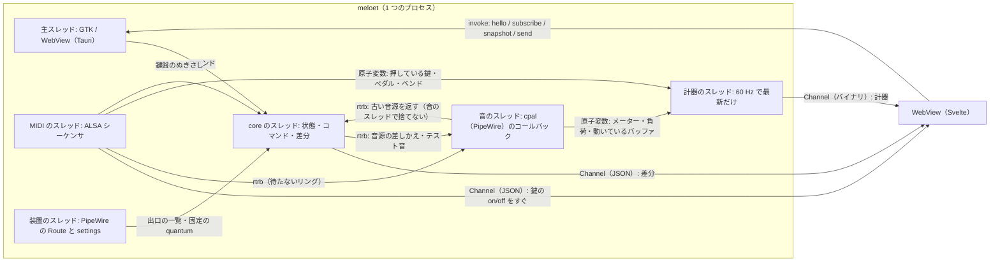
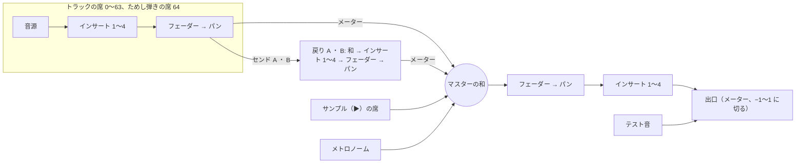

# meloet の骨組み

この書類は、meloet の中の作りと、そう決めた理由をまとめたものです。
検証の結果は [`report.md`](report.md)、デザインの決まりは [`design/spec.html`](design/spec.html)（仕様書）と [`design/mock/`](design/mock/)（モック 37 枚）にあります。
モックと仕様書が食いちがったら、仕様書が正しい。

---

## 1. クレートと役目

報告書の 7-1 の分けかたに、状態の持ち主の `meloet-core` を 1 つ足しました。

| クレート | 役目 | 中に入れないもの |
|---|---|---|
| `crates/meloet-model` | 曲・トラック・音源の指定。純粋なデータと操作 | 入出力、スレッド |
| `crates/meloet-protocol` | Rust と画面の約束（型と版、計器のバイナリの並び）。TS の型もここから作る | Tauri |
| `crates/meloet-engine` | 音の流れ、音源の口、メーター、cpal の出口。音のスレッドはメモリ確保なし・鍵なし | 画面、プラグインの形式、鍵（Mutex） |
| `crates/meloet-midi` | 鍵盤の入力とぬきさし（Linux は ALSA シーケンサ） | 音 |
| `crates/meloet-devices` | 音の出入口の人の言葉の名前（Linux は PipeWire の Route）、PC 全体の quantum の固定を読む | 音の処理、設定の書きかえ |
| `crates/meloet-core` | 状態の持ち主。意図のコマンドを受けて状態を変え、rev つきの差分を出す。帯の決まり、状態行の知らせ、設定の保存 | Tauri、画面の見た目 |
| `crates/meloet-app` | Tauri の殻。コマンドと Channel の受けわたしだけ | 状態の持ち主になること |
| `ui/` | 画面（Svelte 5 ＋ TS）。`ui/src/bridge/` だけが Tauri を知る | Tauri の API の直接呼び出し |

あとで足すもの（今回は作らない）: `meloet-plugin`、`meloet-vst3`、`meloet-lv2`、`meloet-plughost`。プラグインは最初から別のプロセスで動かす（報告書の「v1 は同じプロセス」の案は使わない）。

**理由**: 報告書の 7-1 は `meloet-app` に状態を持たせず、`meloet-model` に入出力を持たせない。そうすると、曲・装置・帯をまとめて持ち、コマンドを受ける場所が要る。それが `meloet-core` です。画面なしで、約束と帯の決まりをテストできます。

`spikes/` はワークスペースに残しますが、`default-members` から外しています。ふだんの `cargo build` と `cargo test` は `crates/` だけを相手にします。

---

## 2. スレッドとプロセス



- 鍵の on/off は、MIDI のスレッドから直接、画面の Channel へ送る。core を通さない（鍵 → 画面を短くするため）。押している鍵の一覧は、計器のバイナリにも毎回入れるので、1 つ取りこぼしても次の計器で戻る。
- 鍵盤のぬきさしは core の状態を変え、差分として、すぐ送る。
- 音のスレッドは、メモリを取りにいかない、鍵を待たない。入ってくる物も出ていく物も、待たないリング（rtrb）と原子変数だけ。
- 第 2 回で足した道（図にはない）: core → 音のスレッドへ「曲のノートの列」（`Sequence`。古い列はリングで返す）と再生まわりの命令。音のスレッド → core へ「録った出来事」のリング（耳に届いていた位置と周つき）。音のスレッドが書く「区切りの輪」（`TransportClock`。512 こま、こまごとに seqlock、中身は原子変数だけ）を、計器のスレッドと core が鍵を待たずに読む。
- MIDI のスレッドと装置の見はり（PipeWire）は、core のスレッドが持ち主。止まったら core に知らせが来て、core が間をあけて起こしなおす（4-2）。

---

## 3. Rust と画面の約束（報告書 7-3）

### 3-1. 手順

1. **あいさつ**: 画面は起動したら `hello(protocolVersion)` を呼ぶ。版がちがえば止まる。
2. **先に聞く**: `subscribe(messages, telemetry)` で Channel を 2 本わたす。ここから先の差分は取りこぼさない。
3. **丸ごと取りにいく**: `snapshot()` で `{ rev, state }` を受けとる。2 の後に届いた差分のうち、`rev` が snapshot 以下の物は捨て、上の物を順に当てる。
4. **差分**: `{ rev, changes }`。`rev` は 1 ずつふえる。画面が持つ rev + 1 でない差分が来たら、画面は `snapshot()` を取りなおす。
5. **画面 → Rust は意図だけ**: `send(command)`。Rust が確かめて状態を変え、差分を出す。画面は自分で状態を決めない（テキストの入力中や、ドラッグ中の見た目だけは先に動かしてよい）。
6. **すぐ知らせること**: 鍵の on/off、ペダル、ベンド、モジュレーションは、届いた瞬間に messages の Channel で送る。
7. **計器**: telemetry の Channel でバイナリ。60 Hz で最新だけ。前と同じ中身なら送らない（何も鳴っていないときは止まる）。

8. **テイクの中身**（第 2 回）: 録り終わったテイクは中身が変わらない。状態にはクリップごとに「見せているテイクの id とノートの数」だけを入れ、中身は `take_notes(id)` でバイナリ（3-4）を取りにいく。画面は id ごとにためる。
   - **直したテイク**（第 3 回）: ノートを直す操作は、新しいテイク（新しい id）を作り、クリップのテイクの同じ場所（見せているテイクの場所）に入れかえる（テイクの数は変わらない。取り消すと前の id に戻る）。画面はノートを「テイクの id ＋ そのテイクの中の番号（始まりの順、0 から）」で指し、id が見せているテイクでなければ Rust は何もしない。クオンタイズしたテイクは「もとのテイク」（録った位置のテイク）の id と、ノートごとにもとのテイクの何番目から来たかを持つ。画面は `take_notes(もとの id)` で取って、そろえる前の位置を gray.7 の枠で描く。
9. **録っている最中のノート**（第 2 回）: messages の Channel で `liveNotes {seq, recording, notes}`。`seq` はアプリが動いているあいだ 1 ずつふえる。`(lap, index)` が同じノートは入れかえる（押したときは長さなし、離したときに長さつき）。画面は聞く準備のあと `live_notes()` で丸ごと取り、それ以下の `seq` を捨てる。番号が飛んだら丸ごと取りなおす。
   - **理由**: 10 分録るとノートは何千になる。区画を丸ごと入れかえる決まりのまま状態に入れると、差分のたびに全部を送ることになるため。

messages の Channel は 1 本で、差分（`patch`）、すぐ知らせること（`event`）、録っている最中のノート（`liveNotes`）を、着いた順に運ぶ。

### 3-2. 状態（snapshot と差分の単位）

状態は、次の区画に分ける（第 2 回で `transport` と `arrange` を足した。窓の大きさが変わるたびに、えらんだ物まで送りなおさないため）。差分は、変わった区画を丸ごと入れかえる（区画の中の一部だけの差分は作らない）。区画が小さいうちはこれがいちばん素直で、まちがえにくい。

| 区画 | 中身 |
|---|---|
| `song` | 曲の名前、テンポ、拍子、テンポ・拍子の変更の件数、トラック（番号、名前、色の番号、音源の名前、音量 dB、録音待機、クリップ〔id、範囲、名前、見せているテイクの番号と数と id と位置、ノートの数〕）、取り消せる手とやりなおせる手の数、弾くと鳴る先のトラック、ループ（範囲のティックとオン・オフ）、帯札「ピアノロール ノート ○」の数、曲のファイルの様子（一度も保存していない・保存済み・変更あり）。（第 4 回 区切り3）トラックごとに パン（−100〜100）、センド A ・ B（dB。`null` は −∞）、インサートの 4 つの枠（エフェクトの種類か空き）、ミュート。`returns`（戻り A ・ B: フェーダー、パン、ミュート、インサート）と `master`（フェーダー、パン、インサート）。どれも手でだけ変わる値で、ドラッグの途中の値（プレビュー）は入らない |
| `params` | （第 4 回 区切り3）パラメータのパネルが見せるインサート（どのストリップの何番の枠か、エフェクトの種類、値のならび、えらんだ行）。インサートや行をえらぶのは手ではないので、そのたびに `song` を送りなおさないために分けた（`pianoRoll` と同じ考え） |
| `transport` | 止まっている・カウントイン・再生・録音、止まっている時の位置、メトロノーム、カウントインの小節と拍の数、再生と録音が使えるか、録っているあいだの物（録音の番号、トラック、始まり、何番のテイクになるか、まとまる先のクリップ、周）。動いている位置は計器で来る |
| `arrange` | えらんでいるクリップ、ピアノロールが見せるクリップ |
| `pianoRoll` | （第 3 回）ピアノロールが見せているテイクの id、選んだノートと CC の点（テイクの中の番号の範囲 `[start, end)` のならび）、グリッド、スケール（主音、メジャー・マイナー、固定）、クオンタイズのパネルの設定（グリッド、三連符、強さ、スウィング、そろえる所）、貼りつけられるノートの数。選択はよく変わるので、`song` を送りなおさないために分けた |
| `workspace` | 拡大率、いまの画面に入らない拡大率（`unfitScales`）、窓の大きさ、帯のひらき具合と高さ（`layout`）、右の欄、音の設定のダイアログ、出口えらび（流れ 2）、アレンジの上の案内、曲のダイアログ（保存していない・保存できない・こわれている。id、見出し、1 つ前があるか） |
| `keyboards` | 見えている鍵盤（名前、ALSA の番地）、いま使っている鍵盤、最後に抜けた鍵盤 |
| `outputs` | 出口の一覧（本物の名前、やさしい言いかえの種類、ささっているか、つながりの種類）、えらんだ出口、その出口の様子 |
| `inputs` | 歌の入口の一覧（今回は見せるだけ。使えない） |
| `audio` | 動いているか、サンプルレート、頼んだバッファ、動いているバッファ、PC 全体で固定された quantum、遅れの見積もり、音のしくみの名前、出口のデバイス名、MIDI の入口の名前 |
| `status` | 状態行の左の知らせ（文の種類と、うめこむ値） |

画面の文面は Rust に置かない。Rust は「文の種類（ID）とうめこむ値」だけを送り、画面が `ui/src/text/` の文に当てる。

### 3-3. 計器のバイナリ（版 3、リトルエンディアン）

| 位置 | 型 | 中身 |
|---|---|---|
| 0 | u8 | 種類 = 1（計器） |
| 1 | u8 | 版 = 3 |
| 2 | u16 | トラックの数 n |
| 4 | u32 | 通し番号 |
| 8 | u64 | Rust が送った時刻（CLOCK_MONOTONIC、ns） |
| 16 | u64 | 押している鍵 0〜63 のビット |
| 24 | u64 | 押している鍵 64〜127 のビット |
| 32 | u8 | 最後のベロシティ（0 はまだ無し） |
| 33 | u8 | サステイン（CC 64 の値） |
| 34 | u8 | モジュレーション（CC 1 の値） |
| 35 | u8 | 旗（bit0: 音が動いている、bit1: マスターが割れた、bit2: 再生の位置がある） |
| 36 | i16 | ピッチベンド（−8192〜8191） |
| 38 | u16 | 処理の負荷（千分率） |
| 40 | f32 × 2 | マスターの最大値 左・右（前に送ってからの最大。1.0 = 0 dBFS） |
| 48 | f64 | 送った時刻に耳に届いている曲の位置（ティック、小数。カウントイン中は負もある） |
| 56 | f64 | 1 µs あたりのティック（止まっているときは 0） |
| 64 | u8 | 状態（0 停止、1 カウントイン、2 再生、3 録音） |
| 65 | u8 | 0（あき） |
| 66 | u16 | カウントインの残りの拍（鳴っている拍もふくむ。外では 0） |
| 68 | u32 | 録音中のループの周（最初が 0） |
| 72 | f32 × 4 | 戻り A の最大値 左・右、戻り B の最大値 左・右（戻りの出口: インサート、フェーダー、パンの後。第 4 回 区切り3） |
| 88 | f32 × 2n | トラックごとの最大値 左・右（フェーダーとパンの後） |

画面の位置 = `tick + (Rust の今 − 送った時刻) × 1 µs あたりのティック`。bit2 が 0 の間（音がまだ動いていない）、48〜71 は 0 で、画面は `transport.position` を使う。止まっているときは、再生まわりの数字も再生の位置の線も `transport.position`（差分ですぐ届く）、動いているときは計器の位置（`ui/src/components/time.ts` の `shownTick`）。

### 3-4. テイクの中身のバイナリ（版 2、リトルエンディアン）

| 位置 | 型 | 中身 |
|---|---|---|
| 0 | u8 | 種類 = 2（テイク） |
| 1 | u8 | 版 = 2 |
| 2 | u16 | 0（あき） |
| 4 | u32 | テイクの id |
| 8 | u32 | 長さ（ティック） |
| 12 | u32 | ノートの数 n |
| 16 | u32 | コントロールの数 m |
| 20 | u32 | もとのテイクの id（0 はなし。id は 1 から） |
| 24 | 16 × n | ノート: 始まり u32、長さ u32、鍵 u8、ベロシティ u8、0 が 2 つ、もとのテイクの何番目のノートから来たか u32（0xFFFFFFFF はなし） |
| 24+16n | 8 × m | コントロール: ティック u32、種類 u8（0 CC、1 ピッチベンド）、CC の番号 u8（ベンドは 0）、値 i16 |

位置はテイクの 0 から数える。u32 のティックは、300 BPM でも約 20 日ぶんある。

並びは `meloet-protocol` の 1 か所で決め、Rust で書いて TS で読むテストで食いちがいを見はる。

---

- **曲の通し番号**（約束 9、第 3 回の続き）: テイクの id は曲ごとに 1 から配られる。`song.serial` は、core が `Doc` を外から入れかえるたび（新しい曲、ひらく、1 つ前をひらく、なおすためのファイルから戻す、戻さない）と、「なおすためのファイルから戻す」「戻さない」の手を取り消し・やりなおしでまたぐときに 1 ふえる。ふつうの取り消し・やりなおしではふえない。画面は通し番号が変わると、ためたテイクを全部手放し、取りにいっている途中の答えも捨てる（`TakeStore.clear`）。ピアノロールも、通し番号が変われば同じ id のテイクを取りなおす。テイクは（通し番号, id）で見分ける。

## 4. 音の流れ

- 出口は cpal の PipeWire。頼むバッファは 256。**動いている数は、コールバックが受けとったフレーム数から読む**。
- PC 全体の `clock.force-quantum` は、PipeWire の `settings` メタデータを**読むだけ**。0 でなく、動いている数が頼んだ数とちがうときに「PC 全体の設定で固定されている」と言う。
- 遅れの見積もり: 検証の計測（バッファ 256 で平均 13.2 ms、1024 で 53.2 ms、48 kHz）から、鍵 → 音 ≒ 2.5 × バッファ ÷ サンプルレート。動いている間は、実際に測った値（鍵を受けた時刻と、その音が DAC に届く予定の時刻の差）の平均を使う。
- 音源の口（`Instrument`）: 1 つのトラックが 1 つの音源を持つ。音源は「準備（音のスレッドの外）」「出来事（ノート、CC、ベンド）」「描く（ステレオのバッファ）」「止める」を持つ。差しかえは、core が音のスレッドの外で新しい音源を作り、リングで音のスレッドへ送る。音のスレッドは入れかえて、古い物をリングで返す（音のスレッドで捨てると、メモリを返す処理が走るため）。
- 今回の音源は「仮の音」（やわらかい合成の音）。次の回に、サンプルのピアノが同じ口に入る。プラグインも、別のプロセスとのやりとりを同じ口の向こうに隠す。
- メーターは、ブロックごとの最大値を原子変数に「前より大きければ書く」。計器のスレッドが読むときに 0 に戻す。トラック、戻り A ・ B、マスターにある（どこで測るかは 19-11）。
- ミキサーの音の道（インサート、フェーダー、パン、センド、戻り、マスター）は 19-11。
- 処理の負荷は、コールバックの中でかかった時間 ÷ そのブロックの長さ。
- 出口を変えるときは、古いストリームを止め、曲から音源を作りなおして新しいストリームを作る。今回は再生の位置などの「流れの中の状態」がないので、作りなおしで足りる。

### 4-1. 音のスレッドの見はり

- `meloet-engine` は `std::sync::Mutex` などの鍵を使わない。`clippy.toml` の `disallowed-types` と `disallowed-methods` で機械的に止める。
- メモリ確保は、テストのときに、数える割り当て器（global allocator）で見はる。音のスレッドの区間に入ったら旗を立て、その間に確保か解放があればテストを落とす。オフラインで曲を描くテストと、実際のストリームを 2 秒回すテスト（装置があるときだけ）の両方で。


### 4-2. 止まったときと、つなぎなおし（第 2 回）

- 出口のストリームのエラーは 3 つに分けて数える: xrun、ストリームが自分で終わった（PipeWire が消えた、出口がなくなった。1 本のストリームで 1 回）、そのほか。こちらから止めるときに cpal が出す `DeviceNotAvailable` は数えない。
- PipeWire が消えると、cpal は `StreamInvalidated` を 1 回出してコールバックが止まり（気づくまで 1.4〜37 ms）、装置の見はり（pipewire-rs）も core の error で終わる（0.6〜10 ms）。どちらも core に知らせる。ストリームを閉じると、エンジンは `Carrier` の Drop で戻る。戻らなかったときに備えて、エンジンを作りなおせる（`EngineHandle::rebuild`。MIDI のリングと区切りの輪も新しくなり、core が配りなおす）。
- MIDI のスレッドは、自分で止まるとき最後に `Stopped` を送り、sink を返す。core は同じ sink で起こしなおす。押していた鍵とペダルは、止まった時点で離したことにする。
- つなぎなおしの間隔: 0.5・1・2・4 秒、そのあとは 5 秒ごと。PipeWire と MIDI はあきらめない（ほかに取りもどす道がなく、1 回試すのは安い。最初は早いので、すぐ戻るデーモンならすぐ戻る）。ストリームだけが落ちたとき（PipeWire は動いている）は 4 回まで。そのあとは出口の一覧が変わるか人が操作するまで待つ（毎回すぐ落ちる出口を開いたり閉じたりし続けないため）。起動したときに PipeWire がないときも、同じ間隔で黙って試す（一度も動いていないので「止まりました」は出さない）。
- 録っている最中に音が止まったら、そのときの耳に届いていた最後の位置で録音を閉じ、録れた分をテイクに残して文を出す。鍵盤の入力が止まっても録音は止めない。
- 試験: 自分用の PipeWire と WirePlumber（`crates/meloet-engine/tests/private_pw/`）を立てて落とし、戻す（`--devices`）。ヤチヨさんの PipeWire にはさわらない。
---

## 5. 鍵盤

- ALSA シーケンサに `meloet` という名前で入り、System:Announce を購読する。起動したときに、すでにある鍵盤を全部数えてから、ぬきさしを待つ。
- 鍵盤とみなす物: 種類が HARDWARE で、読める（READ ＋ SUBS_READ）口を持つクライアント。1 つのクライアントからは、いちばん番号の小さい読める口だけを聞く（Keystation 49 MK3 の 2 つめの口「Transport」はボタン用で、ノートとまちがえるため）。
- 鍵盤の名前は、ALSA のクライアント名（例「Keystation 49 MK3」）。
- 試験のための仮想の鍵盤（`meloet-vkeys`）は、環境変数 `MELOET_ACCEPT_VIRTUAL=1` のときだけ鍵盤とみなす。`MELOET_VKEYS_NAME=名前[,名前…]` があれば、その名前（`meloet-vkeys --name`）の仮想の鍵盤だけを受ける（同じ PC でほかの試験や測定の仮想の鍵盤がまざらないように）。`MELOET_ONLY_VIRTUAL=1` では、本物の鍵盤を見ず、仮想の鍵盤だけを見る（鍵盤がささったまま「鍵盤がない」画面を撮るため）。
- 鍵盤がぬけたら、音のスレッドへ全部の音を止める知らせを送り、押している鍵とペダルの記録を消す（押したまま抜いたときに、音と光が残らないように）。
- 2 台以上つながっているときは、全部の鍵を聞く。名前は最後に弾いた鍵盤（鍵を押したときだけ数える。弾く前は最後にさした鍵盤）で、入力計では「+1」のように残りの台数をそえる（仕様書 3 章）。どの鍵盤の鍵かは MIDI の知らせについてくる。MIDI のスレッドは、画面へ知らせたあとで、鍵盤が前とちがうときだけ core に伝える。

---

## 6. 出口と入口の名前

- PipeWire の Device の Route（`EnumRoute` と `Route`）を読む。Route の `description` が本物の名前（「アナログヘッドフォン」など）、`available` がささっているか、`info` の `port.type` が型。
- 出口 1 つ = Sink のノード 1 つ ＋ そのデバイスの出力の Route 1 つ。Route を持たない Sink（Bluetooth など）は、ノードの説明を名前にする。
- 出口の ID は「デバイスの名前 ＋ Route の名前」（Route がなければノードの名前）。これを設定に保存する。
- **meloet は、デバイスの Route を切りかえない**（それは PC 全体の設定を変えることになるため）。えらんだ Route が、いまささっていなければ、その文面を出す。
- やさしい言いかえは、型がわかるときだけ（モックの 4 つ: ヘッドホン → 「ヘッドホンの穴」、HDMI → 「画面のスピーカー」、ライン出力 → 「うしろのスピーカーの穴」、うしろのマイク → 「うしろのマイクの穴」）。
- 装置の名前は、PipeWire の Device の `device.description` をそのまま出す（例「GB206 High Definition Audio Controller」。ヤチヨさんの決め）。えらべない出口の行と、名前が同じ出口が 2 つ以上ならぶときに使う。
- えらべない出口（`unusable`）は 2 種類。ノードはあるが、PC がそのデバイスで別の Route を使っている → 「PC が切りかえる」（`switchedByPc`）。ノードがない → 「PC の設定で止まっている」（`stoppedByPc`。同じデバイスにノードのある穴があっても）。
- ならべる順: えらべる出口が先（ささっている → わからない → ささっていない。ささっている中ではヘッドホンが先）、そのあとにえらべない出口。

---

## 7. 画面

- Svelte 5 ＋ TypeScript ＋ Vite。SvelteKit は使わない（1 枚の画面で足り、橋を薄く保てるため）。
- **数値**: `ui/src/design/tokens.ts` に、仕様書の表の名前のまま入れる（`color.gray.4`、`size.meter.slim`、`space.3` など）。仕様書の文の中にしかない部品の寸法（ボタンの高さ 24 など）は `part.*`、モックにしかない寸法は `mock.*` として、出どころを書いて入れる。部品はここから作った CSS の変数だけを使う。部品の中に色の 16 進数や px を直接書くと、テストが落ちる。
- **拡大率**: 100・125・150%。`tokens.ts` が率ごとの値を出す。`line.hair` は、どの率でも画面の物理 1px（`1px / devicePixelRatio`）。`line.mark`・`line.track` は表の値。文字の表の「太さ」の列は、その大きさで使ってよい太さの組と読む（text.s は 400・500・600、text.m は 400・500、text.l は 600。率では変わらない）。仕様書の文の中の寸法（part.*）は、率をかけて整数にならなければ四捨五入する。
- **文面**: `ui/src/text/ja.ts` の 1 か所。仕様書の文面は一字も変えない（テストで仕様書から抜いた文と照らし合わせる）。モックにだけある文は、モックの文のまま、出どころ（ボードの名前）をつけて入れる。
- **大きな面は WebGL（区画ごとに 1 枚、使いまわし）**: 部品は、描く場所に `use:glSlot={...}` をつけ、そのまわりの箱（同じ箱でもよい）に `use:glRegion={"名前"}` をつける。WebGL の係（`ui/src/gl/engine.ts`）は、区画の箱ごとに canvas を 1 枚入れる（箱の中、`pointer-events: none`）。canvas の広さは「その区画の slot のある所 ∩ 箱 ∩ 窓」で、はしは画面の画素に合わせる。区画の中の slot は、全部その 1 枚に、ページの順（あとの物が上）で描く。描くのは、四角の並びが前と変わった区画だけ。60 Hz で変わる物（メーター、録っているクリップ）は小さな区画に分け、変わらない大きな区画（アレンジの線やクリップ）に入れない。再生の位置の線のように動くだけの物は、描きなおさず HTML の線を CSS の transform で動かす。文字と小さな部品は HTML。Canvas 2D は使わない。
  - 理由: WebKitGTK（NVIDIA）では、面を 1 回出すたびに、画面のプロセスの主スレッドが「0.25 ms ＋ 3.9 ms × 百万画素」ほど止まり、鍵の知らせはその後ろで待つ（2026-11-15 の測定、RTX 5060 Ti、WebKitGTK 2.52.6）。16 本のメーターを slot ごとに出すと 4.4 ms、1 枚にまとめると 1.4 ms。アレンジの面くらいの大きさは 1036×576 で 3.3 ms、1676×856 で 6.5 ms。transform で動かすだけなら 0.35 ms。第 1 回に、窓いっぱいの面を 60 Hz で出して鍵 → 画面の p95 が 8〜12 ms になったのも同じ理由（`docs/measurements/`）。この式は、下に HTML のない面を 1 枚だけ出したときの数。本物の画面では、次の「CPU で描く WebKit」の決まりが先に効く。
  - **CPU で描く WebKit**（第 4 回にわかった事。`docs/measurements/2026-11-19-round4-mixer.md` の 6 ・ 7 章）: NVIDIA ＋ Ubuntu の WebKitGTK では、合成の層がなく、ページは CPU で描かれる。
    - canvas を出すと、その canvas ぜんたいが「よごれた四角」になる。WebKit は canvas を GPU から 2 回読みもどし（`readPixels`）、その四角の中の HTML（地、枠、文字）も描きなおして、ビットマップを画面のプロセスへ送る。だから重さは「出した canvas の数」と「四角の広さと、その下の HTML の多さ」で決まる。文字が多い所の上の canvas は高い。
    - 1 コマでよごれた所は、「y の帯 × x の区間」の四角に切られる。上下の端がそろっていない四角は、たがいの端で切りあって数がふえる（上下がずれた 3 つの数字とメーター 1 本で、10 個をこえる）。
    - **四角が 11 個以上か、四角の面積の合計が「ぜんぶを囲む四角」の 25 % 以上だと、WebKit は囲む四角 1 つをまるごと描きなおす**（WebKitGTK 2.52.6、`DrawingAreaCoordinatedGraphics.cpp` の `shouldPaintBoundsRect`）。上の帯と下のミキサーが同じコマでよごれると、囲む四角は窓のほとんどになり、主スレッドが 12〜16 ms ふさがる（1 つずつなら 5〜7 ms）。
    - 決めた形（2 つ）:
      1. **同じコマで変わる物は、1 枚の canvas の下に入れる**。`use:glSlot={{ kind: "cover" }}` は、何も描かず、区画の canvas をその箱までひろげる。上の帯では、位置 ・ 時間 ・ 処理の負荷 ・ マスターの dB の数字の箱とマスターのメーターが、`masterMeter` の 1 枚（1920 幅で 1437×36）の下にある。数字がいくつ変わっても、よごれた四角は 1 つ。
      2. **ミキサーのメーターを出すコマは、マスターの面も出す**（`ui/src/gl/budget.ts` の `SHOWN_WITH`）。ミキサーの面は広くて下にあるので、右上のマスターの面がいつも入っていれば、囲む四角が窓の幅になり、25 % の決まりにかからない。
    - **あとから 60 Hz で動く物を足す人が守る事**: (a) 上の帯に足すなら、その箱に `cover` をつける（`masterMeter` の区画の中）。(b) ほかの所に足すなら、同じコマで変わる近くの物と上下の端をそろえるか、同じ canvas の下に入れる。(c) 1 コマの四角は 10 個まで、面積の合計は囲む四角の 25 % 未満。足したら `tools/measure/webkit-damage.sh` で、四角の並びと「囲む四角 1 つ」になっていない事を見る。(d) canvas の下に文字をふやさない。
    - **天井**: ミキサーの面は「ストリップの数 × メーターの高さ」の 1 つの四角。1920×1080 で、8 トラック（11 本、1110×264）のとき、四角の合計は囲む四角の 21 %。計算では、トラックが 10 本（13 本のストリップ）で 24 %、11 本で 26 %。トラックが 10 本をこえるか、ミキサーの帯を高くすると 25 % をこえ、ミキサーをひらいた再生は、また囲む四角になる（宿題。メーターを HTML の棒にしても、棒が 11 本で 11 個の決まりにかかる）。
    - 合成の層がある PC（Intel、AMD）では、canvas は GPU の層になり、この決まりは関係しない（`cover` と `SHOWN_WITH` は、面を少し広く ・ 多く出すだけ）。確かめてはいない。
  - 限り: WebKitGTK 2.52 では、WebGL の文脈は 1 ページ 16 個まで。17 個めで、いちばん古い文脈が失われ、戻らない。**捨てた canvas の文脈も、GC されるまで数に入る**（`loseContext()` を呼んでも同じ）。作って捨てる形のままだと、音の設定の「くわしく」を 40 回切りかえるだけで、生きている文脈が 15 個失われた。だから canvas は作ったら手放さず、`ui/src/gl/pool.ts` で次の区画に使いまわす（同じ 40 回で、作ったのは 7 個、失われたのは 0 個）。
  - 文脈は区画の箱が来たときに作る（第 3 回の直し）: `getContext("webgl2")` 1 回で、主スレッドが 50 ms か 200 ms 止まる（シェーダーのコンパイルとリンクは 1 ms、最初の描画は 1 ms 以下。2026-11-15、RTX 5060 Ti、WebKitGTK 2.52.6、`frame-profile.json` の `made`。`docs/measurements/2026-11-15-round3-fix-glcontext.md`）。だから区画は、slot が初めて入ったときではなく、`use:glRegion` の箱が来たとき（起動、帯をひらいたとき）に canvas を取り、箱があるうちは slot がなくても持つ（大きさ 0）。鍵・録り始め・ドラッグの瞬間には作らない。そのため、のびる物の区画の箱は、使っていない間もおく（`recordingClip` はアレンジのレーンいっぱいの `.rec-host`、`pianoRollLive` はノートの場所いっぱいの `.live-host`）。数の最大は下の表のとおりで変わらない（どちらも表で 1 と数えていた）。帯をひらくコマは、作る文脈の数だけ重くなる（1920×1080 で 360〜410 ms）。
  - 予算: 作ってよい文脈は 12 個（限りの 16 から 4 つ残す）。こえそうになったら、開発とテストでは落とし、本番では console に書く。区画の外の slot も同じ。区画を足すときは `ui/src/gl/budget.ts` の `REGIONS` に 1 行足す（表にない名前は型で通らない）。

  | 区画 | どこ | 不透明 | 変わる速さ | 文脈 |
  |---|---|---|---|---|
  | inputMeter | 入力計の鍵盤とベロシティの棒（間の文字の所は描かず、すける。箱は入力計ぜんたい） | いいえ | 鍵ごと | 1 |
  | masterMeter | 再生まわりのマスターのメーター。箱は再生まわりの帯ぜんたいで、面は位置の数字からマスターまで（数字の箱は cover。描くのはメーターだけで、ほかはすける） | いいえ | 〜60 Hz | 1 |
  | trackMeters | トラックの見出しのメーター（何本でも 1 枚） | いいえ | 〜60 Hz | 1 |
  | arrangeLanes | 小節の線とクリップ | いいえ | 曲、大きさ、スクロールが変わったとき | 1 |
  | overview | ちぢんだアレンジ（trackMeters と arrangeLanes の代わり。使いまわし） | いいえ | 同上 | 0〜1 |
  | settings | 音の設定のテスト音の横のメーターと、光る鍵盤（箱はスクロールする中身ぜんたい。「くわしく」をひらいて slot がなくなっても持つ） | いいえ | 〜60 Hz、鍵ごと | 0〜1 |
  | （第 2 回）recordingClip | 録っているクリップだけ | いいえ | 〜60 Hz | 1 |
  | （第 3 回）pianoRoll | ピアノロールの行の地、拍と小節の線、ノート、そろえる前の位置とドラッグのもとの位置の枠、ベロシティの帯 | いいえ | ノート・選択・見ている範囲が変わったとき | 1 |
  | （第 3 回）pianoRollKeys | ピアノロールの左の鍵盤の列（鳴っている音・弾いている鍵が光る） | はい | 鍵ごと、再生中は毎コマ（42 四角ほど） | 1 |
  | （第 3 回）pianoRollLive | ドラッグ中のノート、録音中にのびるノート（動いている物だけを囲む箱。ノートを動かすドラッグは箱を transform で動かすだけ） | いいえ | 〜60 Hz | 0〜1 |
  | （第 4 回）mixerMeters | ミキサーのメーター（トラック ・ 戻り A ・ B ・ マスターの縦の 2 本ずつを 1 枚に。箱は横にスクロールする箱で、送っても 1 枚のまま） | いいえ | 〜60 Hz | 0〜1 |
  | 再生の位置の線 | HTML（transform） | — | 60 Hz | 0 |

  最大は 10 個（第 4 回、19-5: 窓が高くてアレンジがトラックの行のまま、ピアノロールとミキサーをひらき、その上に音の設定）。内わけは inputMeter、masterMeter、trackMeters、arrangeLanes、recordingClip、pianoRoll、pianoRollKeys、pianoRollLive、mixerMeters、settings。予算まで、あと 2。不透明なのは pianoRollKeys だけなので、帯の組み合わせをどう渡り歩いても、作る文脈も 10 個（`ui/tests/gl.surface.test.ts` の「区画の数」）。
- **WebKitGTK の GC と 60 Hz の仕事**（第 3 回にわかった事）: JavaScriptCore は、ひまな時に Eden の GC（若い物だけ）をくり返し、そのとき生きている物を古い側に上げる。古い側は Full の GC でしか返さないが、1 ページのまま 60 Hz で動く meloet では Full がほぼ来ない（録音でも再生だけでも、10 分で Eden 7000 回こえ、Full 0 回。`docs/measurements/2026-11-15-round3-fix-memory.md`）。60 Hz の仕事が一瞬持つ物が、たまりつづける。決めた事: 毎コマの仕事は、変わる物（押している鍵、のびている先）の数に比例させ、たまった物の数に比例させない。たまった物から作る物（`LiveNotesBook.notesOf`、鍵の範囲）は、変わったときだけ作って同じ物を返す。60 Hz の計器で `$state` に同じ中身の新しい配列を入れない。これだけでは止まらないので、`meloet-app` が起動のいちばん初めに環境変数 `JSC_useGenerationalGC=0` を決める（`main.rs` の `JSC_OPTIONS`。外から決めてあればそちらが勝つ）。ウェブのプロセスはこの環境を受けつぎ、JSC はひまな時の GC を全部 Full で回す（1 秒に約 3 回、止まりはふだん 1〜3 ms）。ピアノロールをひらいたままの 10 分の録音で 347 → 410 MB、鍵 → 画面の線は変わらない（測定の文書の g）。曲が大きくなると Full 1 回が重くなるので、大きな曲で止まりを見なおす。
- **帯の決まりは Rust**: どの帯がひらいているか、高さ、入力計が 52 か 24 か、Esc でどれを閉じるかは、`meloet-core` の純粋な関数で決める（画面なしでテストできる）。画面は窓の大きさと拡大率を送り、返ってきた高さに率をかけて描く。画面の使える広さ（作業領域から窓の枠を引いた物）は、画面からは送らない。殻（`meloet-app`）だけが `Core::set_screen_space` で知らせる。
- **用語の説明**: マウスを 0.6 秒止めると出る。幅 248、内がわ 8、地 gray.10、文字 gray.0、角 1、影なし。形は「用語 — 説明」（用語は太字）。
- **キー**: 一文字のキーは、文字を打っている最中には効かない。Esc・Enter・Mod つきは効く。Esc は、文字の枠 → 用語の説明やメニュー → （ここから Rust の `Back`）ダイアログ → 右の欄 → いちばん新しい下の帯。

---

## 8. 設定の保存

`$MELOET_CONFIG_DIR`（試験用）、なければ `$XDG_CONFIG_HOME/meloet`、なければ `~/.config/meloet` の `settings.json`。

```json
{ "version": 1, "output": "<出口の id>", "output_name": "アナログヘッドフォン", "scale": 100, "metronome": false, "count_in_bars": 1 }
```

- えらんだ出口があれば、次からは出口えらびを出さない。
- メトロノームとカウントインの小節数は、曲ではなく設定（第 2 回）。欄がないとき・範囲の外は既定値（オフ、1 小節）。欄がふえても版は 1 のまま読める。
- `output_name` は、えらんだときの名前。覚えた出口が一覧にまったくないとき（USB の音の箱をぬいて起動した、など）に、状態行に出す名前がないので持っている。
- 書くときは一時ファイルに書いてから rename。読めない・こわれていたら既定値で始める。

## 8-1. 出口の様子

- Ready（ひらいて鳴らす）: 覚えた出口がいまあり、えらべて（ノードがあり、PC がその Route を使っている）、ささっている。
- NotPlugged（ひらかない）: 起動したとき、覚えた出口がない・ささっていない・えらべない。ささったら、そのまま鳴らす。
- Missing（とじる）: 動いている最中に、鳴らしていた出口が消えた・ぬけた・えらべなくなった。PC が別の Route に切りかえて、えらんでいないスピーカーから鳴るのをさけるため。もどったら、またひらく。
- テスト音で、えらんでいない出口をひらくのは、出口えらびか音の設定がひらいている間だけ。とじたら、えらんだ出口にもどる。
- 音がひらいていない間の鍵は、音のスレッドへ送らない（あとでまとめて鳴らないように）。画面には光る。

---

## 9. テストと見はり

- `scripts/check-all.sh` 1 つで、`cargo fmt --check`、`cargo clippy -D warnings`、`cargo test`、`npm run check`（svelte-check と tsc）、`npm test`（vitest）、`node licenses/check.mjs` が全部走る。
- 画面なしのテスト: 曲のデータ、約束（rev が飛んだら丸ごと取りなおす、を含む）、帯の決まり、状態行の知らせ、音の流れ（オフラインで描いて音とメーターを確かめる）、音のスレッドのメモリ確保。
- 装置が要るテスト（実際の鍵盤、PipeWire）は `#[ignore]` にして、`scripts/check-all.sh --devices` で走らせる。
- 見た目: `tools/design/shoot_ui.py`（偽物の状態をブラウザで撮り、モックと左右にならべる）と `tools/design/shoot_app.py`（本物のアプリを開発用の環境変数で動かして撮る）。撮った物は `docs/screenshots/`。
- 速さ: `tools/measure/latency.sh`（release でアプリと仮想の鍵盤を動かし、鍵 → 画面、鍵 → 音を測って `summary.md` にする。`--state stopped|playing|recording` で再生中・録音中も）。本物の鍵盤は `tools/measure/real-keys.sh`（ヤチヨさんが弾いて窓を閉じる）。結果は `docs/measurements/`。
- 和音と速い打鍵（第 3 回）: `latency.sh --pattern mixed` は、1 つずつの鍵、2〜4 音の和音（鍵どうし 0〜6 ms）、20〜150 ms あけた 2〜4 鍵の速い打鍵をまぜて弾く（`meloet-vkeys play --pattern spaced|fast|mixed --chord N --spread-ms N --fast-ms A-B`）。`summarize.py` は鍵 → 画面を、Rust が受けた押す鍵どうしの間で「間をあけた鍵」（前の鍵から 1 コマより後。線は 2 コマ）と「すぐあとの鍵」（1 コマ以内。線は 3 コマ）に分け、前の鍵からの間ごと（0〜16.7、16.7〜33.3、33.3〜150、150 ms〜）の表も出す。本物の鍵盤の記録も同じ形で読める。確かめは `python3 -I tools/measure/test_summarize.py`。
- 録った位置（第 2 回）: `tools/measure/record-timing.sh private`（自分用の PipeWire で quantum 64〜1024）と `live <出口の id>`（本物の出口）。計器から拍が DAC に届く時刻を出し、その時刻に名前つきの仮想の鍵盤で押して、テイクの位置と拍をくらべる。ループ中の録音は `crates/meloet-core/tests/record_loop_private.rs`。
- 長い録音（第 2 回）: `tools/measure/long-record.sh`（600 秒弾きつづけ、xrun、RSS、GC の目安を見る）。
- 保存の途中で落とす試験（第 2 回）: `crates/meloet-core/src/songfile/tests.rs`。子のプロセスに保存させ、いろいろな瞬間に SIGKILL して、ファイルが前のか新しいかのどちらかで読めることを 120 回確かめる。
- 画面のコマの時間（第 2 回）: `MELOET_MEASURE_DIR` があると、画面が `frame-profile.json`（WebGL のコマごとの仕事と、そのコマで主スレッドがふさがった時間）を書く。
- 曲をひらいて測る（第 3 回）: `MELOET_OPEN_SONG=<曲>` は、ページが読めたときに Mod O と同じ道で、PC の窓の代わりにその曲をひらく（殻の `devhooks.rs`）。試験用の曲は `tools/measure/make_song.py`（ノートの数、小節、テンポ、CC の点）。`latency.sh --piano-roll [--song]` と `long-record.sh --piano-roll` は、ピアノロールをひらいたまま測る。
- ピアノロールを自動で動かす（第 3 回）: `MELOET_MEASURE_DIR` と `MELOET_UI_SCRIPT=pr-scroll:100,pr-zoom:100,pr-drag:1000` があるときだけ、画面が `ui/src/dev/`（`import()` で読む）を動かし、Shift ＋ ホイール、Mod ＋ ホイール、ノートのドラッグ（押す・動かす 4 回・離す）を本物の DOM のできごととしてノートの場所に送る。段ごとの時刻と RSS の印を `ui-script.json` に書く。まとめて動かすのは `tools/measure/ui-script.sh`（RSS は `rss_watch.py`、表は `ui_script_summary.py`）。測らないときに読みこまれないことは `ui/tests/dev.surface.test.ts` が見はる。

---

## 10. 仕様書にない所で、仮に決めたこと

ここは、デザイン係やヤチヨさんの答えで変わりうる所です。決めたら `docs/progress.md` にも書く。

| 所 | 決めたこと | 理由 |
|---|---|---|
| 状態の持ち主 | `meloet-core` を足した | 7-1 の「app は状態を持たない」「model は入出力を持たない」を両方守るため |
| 鍵盤の口 | 1 台につき、いちばん番号の小さい読める口だけ | 2 つめの口がボタン用の鍵盤があるため |
| 2 台の鍵盤 | 全部聞く。名前は最後に弾いた物（鍵を押したときだけ数える） | 仕様書 3 章。「弾いた」の数えかただけ仕様書にない |
| 窓のいちばん小さい大きさ | 853×448 に拡大率をかける（125 % で 1067×560、150 % で 1280×672）。起動したときと率が変わったときに meloet-app が決めなおす | 仕様書 1 章（第 3 版）。150 % でも高さ 768 の画面に入る |
| 出口の Route | meloet は切りかえない | PC 全体の設定を変えないため |
| 遅れの見積もり | 2.5 × バッファ ÷ サンプルレート | 検証の 2 点の計測から |
| 鍵 → 画面の道 | 鍵の on/off は MIDI のスレッドから直接 Channel へ。core の状態の鍵（hub）を、差分の配りと同じ順を守るために使う | 実測で p95 約 1 ms に収まっている |
| WebGL の面 | 区画ごとに 1 枚の canvas、変わったときだけ描く。canvas は使いまわす | 7 章の理由 |
| 処理の負荷 | 前に送った値から 1% 未満の動きなら送らない | 無音でも負荷は少し動くので、そのままだと計器が止まらない |
| 状態行の「起きた事」の知らせ（帯をたたんだ、拡大率） | 「設定がひらいている」「出口が消えた／ささっていない」「鍵盤が抜けた」の下、「鍵盤をさがしている」より上に出す。次の人の操作（窓の大きさの変化は数えない）か、新しい知らせで消える | 人が何かしないと直らない知らせを先に。窓を動かしている最中に読めなくなると困るので、大きさの変化では消さない |
| 知らせが 2 つ重なったとき | 拡大率を上げて、窓が広がり、帯もたたまれたら、帯の知らせ（第 3 回から `bandFoldedScale`）だけを出す | 状態行は 1 文。見えていた物が消えたほうが、人には大事 |
| 1 つの操作で 2 つの帯がたたまれたとき（第 3 回） | 3 つ目の帯で 1 つ、そのあと高さが入りきらずにもう 1 つたたむときは、あとのほうの文（「入りきらない帯をひらいた」）を出す | 状態行は 1 文。仕様書の 4 つの場合（3 章）のどれかを、かならず言う |
| 拡大率を変えて窓が広がるとき | core は、殻が広げたあとの大きさで、すぐに帯を決める。殻は `set_min_size` のあと、中身がいちばん小さい大きさに足りなければ `set_size` もする | 広がる前の小さい窓で決めると、帯が一度ちぢんで見える。GTK が窓の枠を自分で描くとき（Wayland）、`set_min_size` だけでは枠のぶん足りない |
| 画面の使える広さ | いま窓がある画面の作業領域から、窓のまわりの物（外の大きさ − WebView の大きさ）を引く。わかる前は、どの率も入るとみなす。100 % はいつも入るとみなす | Wayland では作業領域が画面全体になり、枠には影も入るので、おおよその数。100 % は、いちばん小さい率なので、えらべないと困る |
| 窓のいちばん小さい大きさに足す枠のぶん | 殻は、GTK の窓の大きさ − WebView の大きさ（同じ並べなおしの回の数）を、`set_min_size` に足す。窓が出る前は 0 で始め、窓の大きさが変わるたびに見なおして、変わったら決めなおす | GTK が枠を自分で描くとき（Wayland）、いちばん小さい大きさは題の帯と影（この PC で 52×89）も数える。足さないと、中身が 853×448 より小さくなる。窓のマネージャが枠を描くときは 0 になる |

| 録音中に鳴らすもの（第 2 回） | 録音待機のトラックの前のテイクは鳴らさない。カウントインのあいだは曲を鳴らさない（クリックだけ） | 取りかえる物を聞かせない。はじめての人に、カウントインは合図だけのほうがわかりやすい |
| どこから再生・録音するか（第 2 回） | 再生は止めた位置から（ループがオンで外なら、ループの始まりから）。録音はループがオンならループの始まり、オフなら止めた位置から、カウントインのあと。再生中の録音は、描いている位置のまま、すぐ録音に変わる（音を戻さない）。止めた位置はそのまま残す。先頭へは 0。目盛を押すと、その小節の頭 | 仕様書にない。音が戻ると、はじめての人は「こわれた」と思う |
| カウントインの最後の半拍の鍵（第 2 回） | 拾う（テイクの頭を前へ広げる。0 より前へは広げない） | 早めに押した頭の音を落とさない。弾いたとおりの位置に残す |
| 録音中・カウントイン中の操作（第 2 回、第 4 回で変えた） | テンポ、拍子、ループ、位置、録音待機、消す、テイクの切りかえ、取り消し・やりなおし、保存・ひらく・新しい曲、音源のためし弾きは受けない（再生中は受ける）。**ミキサーは受ける**（第 4 回、棟梁の決め）: フェーダー、パン、センド、パラメータ（プレビューも手も）、戻りのミュート、エフェクトを入れる・外す、トラックのミュート。ソロも受ける | 受けないのは、録音の位置と周の数えかたが途中で変わらないように。ミキサーとミュートは、録る位置にも周にも関わらない。録りながら音量を直せないと、弾きにくい |
| ノートのない録音（第 2 回） | クリップも手も作らない | 仕様書の「ノートのない周はテイクにしない」に合わせた |
| テイクの切りかえ（第 2 回） | T・▸ は最後の次で最初へ、Shift T・◂ は最初の前で最後へ回る | 仕様書にない |
| ループのない周の線（第 2 回） | ループがオフのときは、範囲を覚えたまま、目盛にも見出しにも出さない | B-42 |
| メトロノームの音（第 2 回） | 小節の頭 1760 Hz、ほかの拍 1046.5 Hz、35 ms。マスターにだけ足す | 仕様書にない。トラックのメーターに入れない |
| アレンジの横（第 2 回） | スクロールの位置はティックで持つ（拡大率を変えても同じ所）。画面の中の見た目なので Rust に送らない | 拡大率で見える所が変わらないように |
| 曲の名前とファイル（第 2 回） | 曲の名前は手（取り消しの対象）ではない。最初の保存で「はじめての曲 2」になっても、取り消しで戻らない。1 つ前の状態から開いた曲は、取り消しても「変更あり」のまま | 名前はファイルの名前と同じなので、取り消すとファイルと食いちがう |
| 保存まわりのダイアログの見出し（第 2 回） | 曲の名前（こわれたファイルのときはファイルの名前） | ヤチヨさんの決め |
| PC のファイルの窓（第 2 回） | GTK の `FileChooserNative`（殻が出す）。題は「ひらく」「場所をえらぶ」。文は殻の 1 か所の定数（画面の文面は ja.ts の 1 か所、の決まりの例外） | 依存を足さずにすむ。Windows と Mac は第 9 回 |
| 閉じるとき（第 2 回） | 殻は窓の閉じる要求をいつも止めて core に聞く。終わると決まってから web プロセスを止め、core を止める。順はいつも「保存 → web プロセスを止める → 終わる」 | 曲の安全を web プロセスに頼らない（宿題 2） |
| PC が終わるとき（第 2 回、第 3 回で変えた） | SIGTERM・SIGINT・SIGHUP と logind の `PrepareForShutdown(true)` で、なおすためのファイルを書いてから終わる（15 章） | ダイアログを待てない。この PC ではアプリの scope は SIGTERM から 5 秒で SIGKILL |

---

## 11. 時間の持ちかた（第 2 回）

- 曲の中の位置は、ティックの整数（`u64`）。**4 分音符 1 つ = 480 ティック**（`meloet_model::TICKS_PER_QUARTER`）。1 拍は拍子の下の数の音符なので、1 拍のティックは 4/4 で 480、6/8 で 240、2/2 で 960。
- 表示の「小節 . 拍 . ティック」の「ティック」は、拍の中を 480 に分けた数（仕様書 5 章「ティックは 1 拍を 480 に分けた細かい目盛り」）。4/4 なら中のティックそのまま、6/8 なら 2 倍、2/2 なら半分にして見せる。
- テンポは「1 分間の拍の数」（仕様書 5 章）。0.01 きざみの整数で持つ（`Tempo`、9600 = 96.00）。使える範囲はテンポ 30.00〜300.00、拍子の上 1〜12、下 2・4・8・16（ヤチヨさんの決め）。
- 秒との換算は、いまは曲の頭のテンポと拍子だけ（テンポ・拍子の変更は第 6 回）。
- 録った位置は、耳に届いていた位置（小数）を、いちばん近いティックの整数にまるめる。96.00 の 4/4 で 1 ティックは 1.30 ms なので、まるめの誤差は ±0.65 ms まで。

**理由**: 中の単位を 4 分音符にそろえると、拍子の下の数を変えても、ノートは音楽として同じ所に残る。あとで拍子の変更が入っても、位置の意味が変わらない。MIDI の書き出しも 4 分音符の分解能で書ける。表示だけを拍に直せば、仕様書の「1 拍を 480」とも合う。テンポを整数で持つのは、0.01 きざみの値が往復で変わらないようにするため。

## 12. 録音の位置（遅れの補正）

**決まり**: 録った鍵は「その鍵を押した瞬間に、耳に届いていた曲の位置」に置く（ヤチヨさんの決め。仕様書 5 章「遅れの補正 — 録った音を、遅れのぶんだけ前へ戻して置くこと」）。クオンタイズはしない。

- **時計**: 鍵の時刻は、MIDI のスレッドが ALSA のシーケンサから読んだ瞬間の CLOCK_MONOTONIC（`MidiIn.t_us`）。音の時刻は、cpal の `OutputCallbackInfo` の `playback`（PipeWire の `pw_time.now + delay`）。どちらも同じ時計。
- **耳に届いていた位置**: 音のスレッドは、ブロック（ループで飛ぶなら、その前後で分けた区切り）ごとに「最初のこまが DAC に届く時刻、こまの数、最初のこまの曲の位置、1 こまあたりのティック、状態、周」を、決まった大きさの輪にためる。鍵の時刻 t をふくむ区切りから、t のときの位置を出す。止める操作も、その操作の時刻に耳に届いていた位置で止める。画面の再生の位置の線も、同じ輪から「いま耳に届いている位置」を出す。
- **カウントイン**: カウントインの最後の半拍に押した鍵は拾う（早めに押した頭の音）。それより前は録らない（弾く前の準備の音）。
- **録っているあいだ**: 録音待機のトラックの前のテイクは鳴らさない（取りかえる物を聞かせない）。
- **入っていない遅れ**: PipeWire の `delay` には、グラフの遅れと ALSA の headroom が入るが、DAC・コーデック・USB の音の箱の中の遅れは入らない（調べ物。PipeWire 1.4 のソース、確かさ A）。その分だけ、録った位置は早めに出る。鍵盤の中と USB MIDI の遅れ（鍵を押してから ALSA に届くまで）も入らない。どちらもソフトだけでは測れない（出口から入口への線でつなぐ測りかたが要る）。

**理由**: 区切りごとに位置と時刻を組にして持てば、バッファの大きさや PipeWire の遅れが変わっても、計算は同じ形で正しい。鍵が音のスレッドに着いた時刻ではなく、鍵を読んだ時刻で引くので、ブロックの境目のどこで鍵が来ても位置がぶれない。

## 13. 取り消しの形

- 曲（`Song`）を、取り消しの対象の `Doc` と、対象でない `Session` に分ける。
  - `Doc`: 名前、テンポ、拍子、トラック（→ クリップ → テイク。第 4 回からフェーダー、パン、センド、インサートも）、戻り A ・ B、マスター。
  - `Session`: 弾くと鳴る先、録音待機のトラック、ループの範囲とオン・オフ。
  - **理由**: 録音待機やループの範囲を変えたあとで取り消すと、それまで戻ってしまうのを防ぐため。
- 手（`History`）は、その手の前の `Doc` の写し（スナップショット）を持つ。`Doc` の中は トラック → クリップ → テイク が `Arc` なので、変えていない所は前の手と共有される。測った重さは、1000 手で 録音 約 965 KB、テイクの切りかえ 約 831 KB、テンポ 約 205 KB（8 トラック）。上限は今は設けない。
  - **理由**: 逆の操作を書く形より、写しのほうが「何度往復しても同じ所にもどる」をまちがえにくい。共有で軽いので、写しでも足りる。
- テイクは、一度できたら中身を変えない（画面はテイクの id でノートの絵をためておける）。クリップの中では `offset` でテイクの位置を決めるので、クリップをまとめても、テイクの中身は変わらない。
- 手になる操作: 録音 1 回（ループの周が何本でもまとめて 1 手）、テイクの切りかえ、クリップを消す、テンポ、拍子。何も変わらない操作は手にしない。
- **ミキサーの手**（第 4 回 区切り3）: フェーダー（`SetGain`）、パン（`SetPan`。マスターにもある）、センド（`SetSend`）、パラメータ（`SetParam`）、エフェクトを入れる（`AddEffect`）・外す（`RemoveEffect`）、戻りのミュート（`MuteReturn`）。ドラッグ 1 回が 1 手: 動かしている間の値は「プレビュー」として core が曲の外に持ち（`Play::mix_previews`）、音にだけかぶせる。離したとき（`commit`）に手になる。Esc（`CancelMixPreview`）、ほかの手、取り消し、曲の入れかえでプレビューは終わる。値が変わらない commit は手にしない。トラック ・ 戻り ・ マスターは `Arc` なので、1 本のフェーダーの手は、そのストリップだけを写す。録音中も受ける（10 章の表）。
- 保存の印は `Doc` の版の番号。保存した版と今の版がちがえば「保存していない変更がある」。取り消して保存した所に戻れば、変更はない。
- **録音を足す決まり**: 新しいテイクたちの範囲と重なる、同じトラックのクリップを全部集めて、1 つのクリップにまとめる（範囲は全部を合わせた物、テイクは前からの物のあとに新しい物、名前と id はいちばん前のクリップの物）。重ならなければ新しいクリップ（名前はトラックの名前。ヤチヨさんの決め）。端が触れるだけは重ならない。ノートが 1 つもない録音は、クリップも手も作らない。
- **ループ中の録音**（仕様書 3 章）: 周ごとに新しいテイク。周をまたいで押していた鍵は押した周に入れ、ループの終わりで切る。踏んだままのペダルは次の周の頭に書く（ベンドとモジュレーションが 0 でないままのときも同じ。棟梁の決め）。ノートのない周はテイクにしない。止めたときに見せるのは、ノートのある最後の周。最初の周だけは、録りはじめる直前に押した鍵の位置まで前へ広げる（0 より前へは広げない）。
- **鳴らしかた**: クリップの範囲の外は鳴らさない（第 3 回から、はしをつめたクリップも同じ。つめた頭の中で押されて範囲の中まで続くノートは鳴らさない。ペダル・モジュレーション・ベンドは、始まりより前の最後の値が 0 でなければ、クリップの始まりに置く。途中から再生を始めたときと同じ考え）。クリップの終わりで、ペダル・ベンド・モジュレーションが動いたままなら 0 に戻す。止めたとき、ループが折り返すとき、列を入れかえたときも、列が鳴らしている音を離し、列が動かした物を 0 に戻す。

- **一度配った id は二度と配らない**（第 3 回の続き）: 取り消しとやりなおしは `Doc` を丸ごと入れかえるが、`next_id` だけは今までにいちばん進んだ所より戻さない（`History` が覚えていて、入れかえと新しい手のたびに上げる）。
  - **理由**: 画面はテイクを id でためていて、手放したテイクも新しい 16 個はとっておく。core も「古い id の意図は何もしない」で守っている。取り消しのあとの新しい手が同じ id をもらうと、ちがう中身を描いたり、古い意図が新しいテイクに当たったりする（第 3 回から残っていた不具合）。
  - 保存するのも上げたあとの `next_id` なので、ひらいたあともかぶらない。取り消しで戻した曲は、`next_id` のほかは前と同じ（試験は `next_id` をのぞいて比べ、配った id の帳面で毎回見はる）。
  - 手の名前（`StepKind`）は、クリップの手では数を持つ（`MoveClips { count, copy }`、`DuplicateClips`、`PasteClips`、`DeleteClips { count, cut }`）。帯に出す名前の案は `StepKind` のコメント（帯の中身は第 6 回）。

## 14. 保存の形（第 2 回）

- **置き場所**: 曲は「曲のフォルダ」。`<音楽>/<曲の名前>/<曲の名前>.meloet`。`<音楽>` は `MELOET_SONGS_DIR`（試験用）→ `dirs::audio_dir()`（Linux は `user-dirs.dirs` の `XDG_MUSIC_DIR`。日本語の環境では「ミュージック」。Windows は `FOLDERID_Music`、macOS は `~/Music`）→ `~/Music` の順。最初の保存は聞かずにここへ置く（ヤチヨさんの決め）。同じ名前のフォルダがあれば（中身が何でも）「 2」「 3」…をつけ、曲の名前もそれに合わせる。フォルダの名前に使えない字（`/ \ : * ? " < > |` と制御文字）は `_`。あとで入る物（プラグインの状態、歌の音）は、このフォルダの下の `plugins/`、`audio/` に置く。
- **形**: UTF-8 の JSON を 1 行につめ、最後に改行。形を決めるのは `crates/meloet-core/src/songfile.rs`（model に serde を入れない）。

```json
{"format": "meloet-song", "version": 2, "app": "meloet 0.1.0",
 "song": {"name": "はじめての曲", "tempo": 9600, "meter": [4, 4], "tempoChanges": [], "nextId": 8,
   "tracks": [{"id": 1, "name": "ピアノ", "color": 1, "instrument": {"kind": "placeholder"}, "gainDb": 0.0,
     "clips": [{"id": 3, "name": "ピアノ", "start": 7680, "end": 15360, "active": 1,
                "takes": [{"take": 5, "offset": 0}, {"take": 6, "offset": 480}]}],
     "plugins": [], "automation": []}],
   "audio": []},
 "takes": [{"id": 5, "length": 7680, "notes": [[0, 30, 60, 100]],
            "controls": [[0, 64, 127], [240, "bend", -8192], [240, 1, 12]]}],
 "session": {"playTarget": 1, "armed": 1, "loop": {"start": 0, "end": 3840}, "loopOn": false}}
```

  - テイクは id ごとの表にし、クリップからは id と offset で指す。**理由**: テイクは変わらない物で、あとで同じテイクを 2 つのクリップから指すこともある。1 回だけ書けて、読むと 1 つの `Arc` を分けあう形に戻る。
  - ノートは `[始まり, 長さ, 鍵, 強さ]`。**理由**: 何千と並ぶので、欄の名前をくり返さない。
  - CC とベンドは 1 本の `controls`（CC は `[ティック, 番号, 値]`、ベンドは `[ティック, "bend", 値]`）。**理由**: 別の配列にすると、同じティックの CC とベンドの順が、読んだあとで変わる（往復で同じ曲に戻らない）。
  - テンポは 0.01 の整数、拍子は `[上, 下]`。model と同じ持ちかた。
  - あとで来る物の席（トラックごとの `plugins`・`automation`、曲の `audio`）は、いまは空の配列。読むときは、なくてもよい。知らない欄は読み飛ばす（新しい meloet が欄を足しても、同じ版なら古い meloet で開ける）。`version` がこの meloet より新しいファイルは読めない物として扱う。
  - **版 2**（第 3 回）: クオンタイズしたテイクを書けるようにした。版 1 のファイルも読める（版 1 には、この 2 つがないだけ）。書くのはいつも版 2。
    - テイクに `"origin": {"take": 8, "division": 16, "triplet": false, "strength": 75, "swing": 0, "align": "start"}`（もとのテイクの id と、最後にかけた設定）。もとのテイクは、どのクリップからも指されていなくても、テイクの表に入れる（そのテイクより前に書く）。
    - ノートは、もとのテイクから来た物だけ 5 つめに、もとのテイクの中の番号: `[始まり, 長さ, 鍵, 強さ, もとの番号]`。
    - 読めない物にする（足した分）: もとのテイクがない、もとのテイクがもとのテイクを持つ、もとの番号がもとのテイクのノートの数をこえる、もとのテイクを持たないテイクのノートにもとの番号がある、設定が範囲の外。
    - クリップの `offset` は符号つき（区切り3）。負なら、テイクの頭がクリップの始まりより前にしまわれている（はしをつめたとき）。まだ外に出していない版なので、版 2 のまま。版 1 のファイルの offset はいつも 0 以上。クリップの終わりの上限は `MAX_TICK`（i64::MAX / 2）で、こえるファイルは読めない物として扱う。
  - **版 3**（第 4 回）: 音源の名前、トラックのない曲、ミキサー。形は 19-4。
  - 読めない物にする: `format` がちがう、版が新しい、model の決まりを破る（テンポ・拍子の範囲、id の重なり、クリップの重なり、ないテイクを指す、ノートの長さ 0 など）。録音待機や弾くと鳴る先が、ないトラックを指すときだけは、曲を捨てずに直す。
- **書きかた**（どの瞬間に落ちても `<名前>.meloet` は前のか新しいかのどちらかで、こわれていない）:
  1. 同じフォルダの一時ファイルに書いて `sync_all`。
  2. 今のファイルがあり、しかも曲として読めるときだけ、それを `.prev` の一時ファイルへコピーして `sync_all` し、`<名前>.meloet.prev` へ rename（これが仕様書の「自動で残してある 1 つ前の状態」）。
  3. 一時ファイルを `<名前>.meloet` へ rename。
  4. フォルダを `sync_all`（Unix）。しくじったら一時ファイルを消す。
  - **理由**: rename は同じフォルダの中では原子的。1 つ前は hard link でなくコピー（USB メモリの FAT・exFAT に hard link はない）。読めないファイルを `.prev` にしないのは、こわれたファイルの上に保存したときに良い `.prev` を押し出さないため。
  - 確かめ: 子のプロセスに保存させて 120 回 SIGKILL し、毎回 `<名前>.meloet` も `.prev` も読めて、保存した曲のどれかと一致した。電源が落ちたときは `sync_all` と rename の順だけが頼りで、試験はしていない（ソフトだけではできない）。
- **流れ**:
  - 新しい曲・ひらく・閉じる: 変更があれば「保存していない変更があります」（保存する / 保存しない / やめる）。保存して失敗したら「保存できない」へ。
  - 保存できない: 場所をえらぶ → フォルダの窓 → `<えらんだ所>/<名前>/<名前>.meloet` に保存し、待っていた事（閉じる・新しい曲・ひらく）に続く。
  - こわれている: `.prev` が読めれば「1 つ前を開く」。開いた曲は「変更あり」（次の保存で `<名前>.meloet` を書きなおす）。`.prev` がなければ仕様書の文の 1 文目と「やめる」だけ。
  - 録音中・カウントイン中は、保存・ひらく・新しい曲を受けない。閉じる要求は、録音を止めて、録れた分を曲に入れてから判断する。
  - 開いた・新しくしたとき: 手を空にし、位置を 0 にし、えらびを外し、エンジンへ全部送りなおす。
  - ダイアログの答えには、そのダイアログの id をつける（「保存しない → ファイルの窓 → こわれている」のようにダイアログが続けて入れかわるとき、前のダイアログへのおそい答えが次に当たらないように）。

## 15. なおすためのファイル（第 3 回、デザインの 48 番 7-B）

**決まり**: 保存していない変更を、なおすためのファイルに書いておく。次に起動したら、何もたずねずに戻した曲でひらき、アレンジの上に案内を出す（仕様書 3 章・6 章、モック F-Recover1〜3）。

- **書く時機は 2 つ**（ヤチヨさんの決め 2026-11-15）:
  - PC が終わるとき: SIGTERM・SIGINT・SIGHUP（殻の `webprocess.rs` が別のスレッドで core に書かせ、書き終わるのを 3 秒まで待ってから終わる）と、logind の `PrepareForShutdown(true)`（殻の `logind.rs`。起動したときに delay ロック `Inhibit("shutdown", "meloet", …, "delay")` を取り、知らせで書いてから放す。`false` で取りなおす。logind がない PC では、なしで動く）。
  - ふだん: 曲が変わってから 2 秒、手が止まったら（`state/recovery.rs` の `QUIET_US`）。録音中・カウントイン中は書かず、録った物が曲に入ってから。中身が前に書いた物と同じなら書かない。
  - **理由**: この PC（Ubuntu 26.04、GNOME 50）では、アプリの scope は SIGTERM から 5 秒で SIGKILL。GTK3 の Wayland はコンポジタが先に消えると `_exit(1)` するので、SIGTERM が届かないこともありうる（推論）。電源の長押しと停電では何も届かない。ほかのアプリ（GNOME Text Editor の 3 秒、Ardour、LibreOffice、Inkscape）も、みな、ふだんから書いている（meloet-research、2026-11-15）。
- **置き場所と形**: `$MELOET_STATE_DIR`（試験用）→ `$XDG_STATE_HOME/meloet` → `~/.local/state/meloet` の `recovery.json`。`{"format":"meloet-recovery","version":1,"writtenMs":…,"cause":"pcEnding|sudden","path":<もとの曲のファイル>|null,"song":<曲のファイルの形そのまま>}`。曲を最後に置くので、曲が読めなくても頭は読める。書きかたは 14 章と同じ（一時ファイル → sync_all → rename → フォルダの sync_all）。書くのは core の外のスレッド（`recovery::Writer`。Doc を写してわたすだけなので core は止まらない）。
- **消すとき**: 保存できたとき、ふつうに閉じたとき（閉じるダイアログの「保存しない」もふくむ。人が捨てるとえらんだため）、新しい曲・ひらいた曲に入れかわったとき。PC が終わるときは消さない。
- **戻すとき**: もとの曲（保存したことのない曲ならからっぽの新しい曲）を手の前の Doc にし、戻した Doc を取り消しの 1 手目（「なおすためのファイルから戻す」）として入れる。保存の印は手の前（ファイルと同じ形）なので、戻した直後は「変更あり」、帯札 1 / 1（モック F-Recover1・F-Recover2 の読み）。「戻さない」は 2 手目で、そのあとは「保存済み」の扱い（保存の印は 1 つなので、2 つ目の印を持つ）。手の前の Doc の `next_id` は戻した曲と大きいほうにそろえる（画面がテイクを id でためているため）。案内は、保存するか、戻さない・閉じるを押すまで出す。出口えらび（流れ 2）が出ているあいだは待つ（同じ場所に重なるため。棟梁の決め）。
- **読めないとき**: 最後に保存した曲（なければ新しい曲）でひらき、ファイルは `recovery-unreadable-<日時>.json` に名前をかえて残す（次の起動でまた出ないように）。「ファイルの場所をひらく」は `org.freedesktop.FileManager1.ShowItems`、だめなら `xdg-open`（殻の `pcwindow.rs`）。
- 確かめ: core のテスト 14 本、子のプロセスに書かせて 60 回 SIGKILL（毎回読めて、書いた曲のどれかと一致。33 回は書いている途中）。本物のアプリで SIGTERM から終わるまで 76〜119 ms（debug）、ノート 1 万個の曲を書くのは 4.6〜5.2 ms（debug）。本当に電源を切る試験はしていない。

## 16. ピアノロールと直したテイク（第 3 回）

- **直すと新しいテイク**: ノートを直す意図（書く、動かす、複製、長さ、消す、切り取り、ベロシティ、貼りつけ）は、見せているテイクを新しい id のテイクにして、クリップの `takes` の同じ場所に入れかえる（`meloet-model` の `notes.rs`）。テイクの数は増えない（「2/3」を直しても「2/3」）。取り消しは前の Doc に戻るので、前の id に戻る。テイクは一度できたら中身を変えない、の決まりはそのまま。
  - **理由**: 画面はテイクの中身を id でためている（3-1 の 8）。中身を変えずに id を変えれば、ためている物がまちがいにならない。テイクの場所を入れかえるだけなので、人から見たテイクの数は変わらない。
- **ノートの順と指しかた**: テイクのノートは「始まり → 鍵 → 前からの順」（安定ソート）。意図はテイクの id とその中の番号で指す。id がいま見せているテイクでなければ、Rust は何もしない（ドラッグを離した直後にキーを押したときなど、古い番号で別のノートを直さないため）。
- **ノートが動ける所**: クリップの範囲 [start, end) と鍵 0〜127。動かすのはまとまり全体が入る所で止める。長さはノートごとに 1 ティック以上・クリップの終わりまで。テイクの外に出るときは、新しいテイクの 0 と長さを広げ、offset と CC の位置を合わせる（縮めることはしない）。
- **クリップがないときに書く**（ヤチヨさんの決め 2026-11-15）: `AddNote { take: None }`。弾くと鳴る先のトラックに、小節の頭（前のクリップの終わりのほうが遅ければ、そこ）から 4 小節（次のクリップがあれば、その手前まで）のクリップを作り、そこに書く。作るのと書くのとで 1 手。
- **選択は core が持つ**（`PianoRollView.selectedNotes`、番号の範囲の列）。直したあとは直したノートを選ぶ。取り消し・やりなおしは、その手の前・あとの選択に戻す（取り消しの手と同じ長さの選択の列を `Play` が持つ）。見せるクリップかテイクが変わったら消す。
  - **理由**: 直すたびにテイクの id と番号が変わる。番号をつけなおせるのは、直した側の Rust だけ。状態行の「選択 3 ノート ・ D4 E4 F4」も Rust が出す。
- **ドラッグは画面だけが先に動き、離して 1 手**: ドラッグ中は画面がもとの位置に gray.7 の枠を残し、動かしているノートを小さな区画（`pianoRollLive`）で描く。Rust には何も送らない。離したときに意図を 1 つだけ送り、答えの新しいテイクが見えるまでドラッグの見た目を残す（ちらつかないように）。Esc はキーの順のいちばん前でドラッグをやめる（`view.svelte.ts` の `cancelDrag`）。
  - **理由**: 毎コマ曲を作りなおして送ると、取り消しの手がドラッグの長さだけ増え、テイクの id も毎コマ増える。1 回のドラッグが 1 手なら、取り消しも人の感じかたと合う。
- **画面のテイクのため場所**（`ui/src/bridge/take.ts` の `keepOnly`）: 状態の `song` が変わるたびに、いまのクリップが見せているテイクとその origin（もとのテイク）だけを残し、ほかは手放す。手放した物のうち新しい 16 個だけは小さくためておく（取り消しですぐ戻ることが多いので）。それより前の物は、要ればまた Rust から取る。1000 回入れかえても数が一定のテストがある。
  - **理由**: 取り消しで戻れるテイクは Rust の取り消しの履歴が持っている。画面が全部ためる必要はない。
- **取り消しの履歴のメモリ**（ヤチヨさんの決め 2026-11-18: 手の数に上限はつけない。変わっていない所を分けあう）: テイクのノートと CC の点は `ChunkedVec`（`crates/meloet-model/src/chunked.rs`）。中身を標準の `Arc<[T]>` のかたまりに切って持つ。切れ目は中身で決める（64 個より後で、要素のハッシュの下の位が決まった形になった所。平均 192 個、多くて 512 個）ので、同じ並びはリストのどこにあっても同じように切れる。直したテイクを作るときは、前のテイクのかたまりのうち中身が同じ物をそのまま使う（`ChunkedVec::sharing`。ハッシュが合っても中身を全部くらべてから使う）。書く・消すで後ろの番号がずれても、かたまりは見つかる。外から見たテイクは今までどおり変わらず、取り消しは前の Doc に戻るだけ。ノート 1 万個のテイクで、ノート 1 つを動かす 1 手は約 8.3 KB（前は約 240 KB。`crates/meloet-model/tests/note_memory.rs`、release、2026-11-18）。view を作るのも少し速くなった（`Clip::note_count` を二分探索に。ノートが start の順の決まりにたよる）。
  - **理由**: 前の形からの差分を持つ形は、取り消しの数がふえるほど読むのが重くなる。決まった番号で切る形は、番号のずれる手（書く・消す・並びの変わる移動）で後ろが全部写しになる。中身で切れば、標準の `Arc` だけで、どの手でも変わった所だけが新しくなる。
  - **例外**: ノートがテイクの 0 より前へ出る直しは、全部のノートの位置がずれるので、その手だけは丸ごと写しになる（`notes.rs` の `put_take`）。保存とテイクのバイナリ（3-4）は今までどおり丸ごと。
- **view の作りなおし**（第 2 回の宿題）: 測って、変えないことにした。16 トラック × 100 クリップ（うち 1 つがノート 1 万個）で、view を作るのが約 41 µs、2 つをくらべるのが約 4 µs。15 ms ごとでも 1 コアの約 0.3 %。
- **グリッド・音階・クオンタイズの設定**: 曲の `Session`（取り消しの外）に持ち、曲のファイルの session に保存する。欄がない・知らない値・範囲の外は、その設定だけ既定（1/16、三連符なし、C メジャー、固定オフ）にして、曲は捨てない。変えても「保存していない変更」にしない（ループの範囲と同じ扱い）。グリッドは 0（1 小節）・2・4・8・16・32（ヤチヨさんの決め）。
- **クオンタイズ**（`meloet-model` の `quantize.rs`。申し送り: 録った位置は変えず、直す操作として新しいテイクを作る）:
  - グリッド g は、division 0 が 1 小節（拍子から）、ほかは全音符 1920 ÷ division。三連符は 2/3。そろえる先は、曲の頭からの g の倍数のいちばん近い所（ちょうど半分は後ろへ）。奇数番目の倍数は、スウィング s % で g × s / 300 だけ後ろへ（100 % で 3 連のはね）。強さ p % で、もとの位置から (そろえる先 − もとの位置) × p / 100（ティックへ、0 から遠いほうへまるめる）。「はじまりと終わり」は終わりも同じ式で、長さが 1 ティックに足りなければ g。
  - もとの位置は、ノートにもとの番号があればもとのテイクのそのノート（「かけなおす」はいつも録った位置から。手で動かしたあとでも）、なければ今の位置（書いた・複製した・貼りつけたノート）。
  - 新しいテイクのもとのテイクは、今のテイクがもとのテイクを持っていればそれ、なければ今のテイク（そのときは全部のノートが自分の番号をもとの番号にする）。もとのテイクは、もとのテイクを持たない（いつも録った物）。
  - もとのテイクの 0 は、いつもそのテイクの 0 と同じ所（画面が同じ所から描くため。3-1 の 8）。直してテイクが前へ広がるときは、もとのテイクを同じだけずらした写し（新しい id）にする。**理由**: テイクの中のノートの位置は 0 以上なので、ノートがテイクの 0 より前へ出ると、テイクの 0 を前へ動かすしかない（区切り3 で offset を符号つきにしても同じ）。写しにすれば、もとのテイクの 0 をテイクの 0 にそろえる画面への約束（3-4 のバイナリ）を変えずにすむ。
  - ノートはクリップの中に止める（はじまりだけのときは長さをたもったまま入る所へ、はじまりと終わりのときは終わりをクリップの終わりで切る）。ノートごとに行き先がちがうので、「まとまりで止める」はしない（係の決め。棟梁に確かめてもらう所）。
  - 位置も長さも変わらないなら手にしない（状態行にも出さない）。ノートを指したときは、かけたノートを選ぶ。指さない（ぜんぶ）ときは選ばない。
  - 「もとの位置へ戻す」は、もとの番号を持つノートの始まりと長さだけをもとに戻す（鍵とベロシティは今のまま）。戻したあと、もとの番号を持つノートがぜんぶもとと同じなら、もとのテイクを外し、もとの番号も消す。
  - 直す操作（動かす、長さ、ベロシティ、消す、欄、CC の点）は、もとのテイクともとの番号を持ちこす。
- **CC の点**（`controls.rs`）: 点はテイクの `controls` の番号（ティックの順、同じティックは前からの順。足した点は同じティックのいちばんうしろ）。点はクリップの中。動かすときは、まとまりで止める。値は CC 0〜127、ベンド −8192〜8191、オン・オフの CC 64〜69 は 64 以上が 127、ほかは 0。選択はノートと同じく core が持ち、取り消しで戻る。ノートを直すと点の選択はそのまま（点の並びは変わらないため）、点を直すとノートの選択はそのまま。
- **欄の打ちこみ**（`notes.rs` の `set_notes_field`）: 長さ・ベロシティはぜんぶ同じ値、位置はいちばん早いノートを値へ、鍵はいちばん低いノートを値へ、ほかは間をたもつ。範囲の外は止める（位置と鍵は「動かす」と同じく、まとまりで止まる）。
- **スケール固定**: 書く道具（`AddNote`）だけに効く（仕様書 3 章が「書く道具で」と言うため）。メジャーは 0・2・4・5・7・9・11、マイナーは自然的短音階 0・2・3・5・7・8・10。動かす・↑↓ は固定に関係なく動く。
- **試聴**（書く道具で押した瞬間に鳴る、モック R3-PRMouse）: core → 音のスレッドのリングで `Audition`・`AuditionOff`。音のスレッドが最後に鳴らした 1 鍵を覚えて止める。キーボードの道を通らないので録音に入らない。
- **見ている範囲**は画面だけが持つ（`view.svelte.ts`。アレンジの横のスクロールと同じ）。横の拡大の段は √2 きざみ（ピアノロールは 4 分音符 1 つで 10〜320 px、アレンジは 1 小節で 8〜256 px、どちらも拡大率 100 % の px）。ひらいたときは、クリップが入るいちばん大きい段にして、クリップのはじまりまで送り、縦はノートが見える所。Mod ＋ ・ Mod − は、最後に押した所（`prView.focus`）がピアノロールならピアノロール、そうでなければアレンジ。全体図の「見えている範囲の枠」は、ピアノロールがひらいていればピアノロールで見えている範囲。
- **鳴っている音の光**: 画面が、見せているクリップのノートと耳に届いている位置から出す（Rust から送らない）。弾いている鍵は計器の押している鍵。


## 17. アレンジのクリップを動かす（第 3 回、区切り3）

- **意図**: `MoveClip { clip, ticks, track, copy }`（ドラッグ。画面がグリッド（ふだん 1 小節、Shift で吸いつかない）に合わせた量を送る）、`DuplicateClip { clip }`（Mod D、すぐうしろに）、`TrimClip { clip, edge, ticks }`（左右のはし 6px）。どれも 1 手。録音中・カウントイン中は受けない。再生中は受け、曲の列を送りなおす。
- **重ならない**: クリップは同じトラックで重ならない決まり（13 章）のまま。動かす・写す・複製で重なるときは何もしない（画面は「できない」のカーソル）。端が触れるだけは重ならない。曲の頭より前へは行かない（0 で止める）。はしをつめる・のばすのは、となりのクリップの手前と、1 ティック以上で止める。
- **写し**（Alt ＋ ドラッグ、Mod D）: 新しいクリップの id。テイクは同じ `Arc<Take>` を分けあう（テイクは変わらない物なので分けあってよい。片方のノートを直すと、そちらだけ新しいテイクになる）。保存の形も、テイクの表を 1 回だけ書いて id で指す（14 章）。
- **はしをつめる**: 始まりを動かすときは、全部のテイクの offset を同じだけ動かし、ノートは曲の中の同じ位置に残る。つめた所の中身は消えない（テイクはそのまま、範囲の外は鳴らさない・見せない）。のばすと戻る。テイクの中身より外へのばしてもよい（空いた所になる）。
- **曲の頭より前のテイクの 0**: 頭をつめたクリップを曲の頭まで動かすと、テイクの 0 が曲の 0 より前に来る。動かせる所はせまくしない（録音の前のすき間をつめて 1 小節めへ動かすのは、よくある操作のため）。ノートを直す処理は、そのクリップを、曲の頭より前にあるぶん（`lift`）だけ後ろへずらした写しで計算し、外から来る曲の位置には `lift` を足す（クオンタイズのグリッドは曲の頭からのまま）。
- 動かしたクリップ（写しなら写し）をえらび、ピアノロールもそれを見せる。つめたときは、えらびを変えない（画面は押した時にえらぶ）。

**第 3 回の続き（B-61 ・ 71）**
- **何個も選ぶ**: core が「選んだクリップの集まり」と「最後に押した 1 つ」（`selected_clip`）を持つ。押す・Shift ＋ 押す（`SelectClips` の `Add` か `Toggle` で 1 個）は、そのクリップをピアノロールに出し、そのトラックを選ぶ（＝弾くと鳴る先）。囲みと Mod A は、ピアノロールもトラックも変えない（Shift ＋ 囲みでちょうど 1 個を囲んだときは、約束の形では区別できないので「押した」と同じになる）。
- **まとめて動かす・複製・切り取り・貼りつけ**: どれも 1 手。まとまりは距離と行の差をたもち、曲の頭でまとめて止まる。まとまりの外のクリップ（写しのときは元のクリップも）と重なるなら何もせず、状態行で言う（B-71 の 3 つの文。Alt ＋ ドラッグの写しが重なるときは「複製できませんでした」）。トラックの外に出るなら、何もせず何も言わない（画面は「できない」のカーソル）。置いたクリップを選ぶ。録音中・カウントイン中は、コピーのほかは受けない。
- **貼りつけ**: Rust がクリップを覚える（行と距離ごと、テイクは `Arc` で分けあうだけ）。Mod V は選んだトラックの、再生の線がいる小節の頭へ（再生中は耳に届いている位置）。右クリックは押した所へ（寄せるのは画面）。曲を入れかえたら覚えた物を捨てる。
- **選択の取り消し**: クリップの選択も、ノートの選択と同じく、手の前とあとの物に戻す（消したクリップを取り消すと、選ばれて戻る）。ピアノロールが見せるクリップは、取り消しで動かさない（消えたときだけ外す）。
- **再生の位置**（B-61）: `Locate` は送られた tick のまま。吸いつきは画面（アレンジは目盛に見えている線、ピアノロールはグリッド、Shift で吸いつかない）。

## 18. ミュートとソロ、ベロシティ固定、名前をつけて保存（第 3 回の続き）

**ミュートとソロ**（design-notes B-70）
- ミュートはトラックの `muted`。曲に保存し、取り消せる 1 手（`StepKind::Mute`）。録音中・カウントイン中も受ける（第 4 回で変えた。録る位置と周に関わらないので。10 章の表）。ソロは `Session::soloed` で、保存しない・手にしない（聞くための切りかえ。録音中も受ける）。新しい曲・ひらく・戻すで消える。
- 鳴らすのは `!muted && (ソロのトラックがない || soloed)`（`Doc::plays` の 1 か所）。両方ならミュートが勝つ（ヤチヨさんの決め 2026-11-18）。
- エンジンへは、鳴らさないトラックの集まり（`EngineCommand::SetSilentTracks`、`TrackSet` は u64 が 4 つの `Copy`）を送る。音のスレッドはメモリを取らない。鳴らさなくなったら列の音を離し、ペダル・ホイール・ベンドを戻す（`lane.silence`）。戻ったら今の位置に合わせる（`seek_lane`）。弾いた音とためしの音は、この集まりを見ないので鳴る。`Engine::prepare` で空になる。
- core は `Model::handle` の最後に、前に送った集まりと比べて違えば送る（`Play::sync_silent`）。出口をひらいた時と曲を入れかえた時はいつも送る。だから取り消し・ひらく・戻すのあとも、エンジンは曲と合う。
- 曲のファイルは版 2 のまま `muted` を足した（偽の時は書かないので、ミュートのない曲は前と同じバイト）。知らない欄は読み飛ばす決まり（14 章）なので、前の meloet も読める。

**ベロシティ固定**（B-66）
- meloet の設定（`settings.json` の `velocity_fixed` と `fixed_velocity`。設定の版は 1 のまま、欄がなければオフと 100）。値は 1〜127 に入れる。
- core のスレッドが `Shared::fixed_velocity`（`AtomicU8`、0 はオフ）に書き、MIDI のスレッドが鍵を受けたいちばん最初（`Links::midi_sink`）に NoteOn のベロシティを置きかえる。NoteOff はそのまま。だから鳴る音・録ったテイク・入力計の読み値・画面の `Event::Note` がそろって同じ値になる。鍵 → 音でふえる仕事は原子変数を 1 つ読むだけ。
- 書く道具のノートと、ピアノロールの鍵盤のためしの音の強さは、画面が固定の値を送る。

**ためしの音**（B-62）
- `Audition { keys }` は 16 個までの和音（エンジンの `Chord` は `[u8; 16]` と長さ。メモリを取らない）。前の和音を離してから鳴らす。空なら止めるだけ。スケール固定の外の鍵も鳴らす（鍵盤の列とノートの試聴のため。書く道具は画面が音階の外を押させない）。止める時間をはかるのは画面。

**名前をつけて保存**（B-59）
- 殻が GTK の保存の窓（題「名前をつけて保存」は `pcwindow.rs` の定数、今の曲の名前が入っている、上書きの確認なし）を出す。返った道の親を置き場所、最後の部分（`.meloet` は外す）を名前にする。
- 最初の保存と同じ `save_new` で `<名前>/<名前>.meloet` を作る（使えない字は `_`、同じ名前は「 2」…で、曲の名前もそれになる）。書きかた・保存できないとき・なおすためのファイルを消すのは、ふつうの保存と同じ。そのあとの保存は新しいファイルへ。「保存できない」→ 場所をえらぶ、のときも打った名前を使う。窓でやめたら何もしない。録音中・カウントイン中は受けない。
- あとの回で曲のフォルダに `audio/`・`plugins/` が入ったら、名前をつけて保存はそれらも写す（`state/songs.rs` の `save()` にコメント）。

## 19. 第 4 回で決めたこと（バンドになる）

### 19-1. 音の素材の置き場所（ヤチヨさんの決め 2026-11-18）

- リポジトリには**作りかただけ**を置く（`tools/sounds/`）: 元の配布の URL と sha256、取り出す範囲（どの段、どの鍵、どのマイク）、間引き・長さの切りかた・形式の変換のスクリプト、帰属表示の文（`licenses/sounds.json`）。
- 作った**包み**（音色ごとのフォルダをまとめた 1 ファイル）は GitHub の Release に置く。`scripts/fetch-sounds.sh` が取ってきて sha256 で確かめ、`~/.cache/meloet/sounds/<包みの版>/` にほどく。包みがなくても、作りかたから同じ物を作れる。
- `cargo build` は、ネットにつながない（`build.rs` で取ってこない）。meloet は起動のとき、`MELOET_SOUNDS_DIR`（試験用・開発用）→ 実行ファイルのそばの `sounds/`（配る形。第 8 回）→ `~/.cache/meloet/sounds/<版>/` の順にさがす。見つからない音色は棚に出さない（仕様書「素材がなかった音色は、棚に出さない」）。
- **理由**: Git LFS は、無料の枠（転送量 月 10 GiB）が clone のたびに持ち主の分から減り、公開のリポジトリではすぐ止まる。リポジトリにそのまま入れると、ずっと重くなる（100 MB のファイルは push できない）。配布元から毎回取ると、配布元の負担になり、配布元の都合でこわれる。Release の添付は、1 ファイル 2 GiB 未満、合計と転送量の上限が書かれていない（`docs/research/effects-decoders-hosting.md`）。`build.rs` でネットにつなぐと、ネットなしで作る所（docs.rs、Nix、Debian）でこける。

### 19-2. 最初から入っているエフェクトは自分で書く

- EQ 4 バンド、コンプレッサー、リバーブ、ディレイ、コーラス、リミッターを、新しいクレート（19-6）に自分で書く。設計は公開の物: EQ は RBJ の式（W3C Note「Audio EQ Cookbook」）か Simper の SVF、コンプレッサーは Giannoulis ら（JAES 2012）の形、リバーブは FDN か Freeverb（パブリックドメイン）の形。GPL の部品のコード（synfx-dsp、nih-plug の plugins/ など）は写さない。
- **理由**: 借りられる部品（fundsp、freeverb など）は、どれも「パラメータをなめらかに変える」「デノーマルの守り」「音のスレッドで allocate しない」のどれかが足りず、足す手間が書く手間とほぼ同じ。ライセンスと音のスレッドの決まりを、自分で全部見はれる。
- 決まり: 処理の中でメモリを取らない（遅延の輪は作るときに最大の長さで取る）。パラメータは目標の値を受けとり、音のスレッドで 10〜30 ms かけてなめらかに近づける（プチッとしない）。デノーマルは、エフェクトと音色が自分で守る（くり返しの道とフィルタの中身で、1e-18 より小さい値を 0 にする。エンベロープは −80 dB で止める）。音のスレッドの入口で FTZ ・ DAZ を立てる形は、作ってから外した: Rust の文書は MXCSR の denormals-are-zero を変えることを「すぐに未定義の動き」と書く（`core::arch::x86_64::_mm_setcsr`。最適化がはじめの値を前提にするため。rust-lang/rust #123123 はまだ決まっていない）。守りだけで、デノーマルを入れる試験は通り、速さも変わらなかった（リバーブ 8.6 µs ／ 256 こま）。ブロックの出口に NaN ・ 無限が出たら、そのエフェクトの中身を 0 に戻して、そのブロックは無音にする（音のスレッドは止めない）。
- **リミッターは先読みしない**: 先読みは、マスターを通る全部の音を遅らせ、鍵 → 音が先読みの長さだけ遅れる（1 ms で 48 こま）。かわりに、上がるときはすぐ、もどるときはなめらかに下げる形にし、最後に上限で切る（上限をこえる物は出さない）。

### 19-3. エフェクトのパラメータ（仕様書にない 4 つ。ヤチヨさんの決め 2026-11-18）

名前は仕様書の決まり（日本語で何が変わるか、値は数と単位、世の中の呼び名は用語の説明に）に合わせた。リバーブとディレイは仕様書 3 章のとおり。

| エフェクト | 見出し | 名前 | 範囲 | はじめ | 世の中の呼び名 |
|---|---|---|---|---|---|
| EQ 4 バンド | 低い音 | 高さ | 20〜1000 Hz | 100 Hz | 周波数 |
| | | 上げ下げ | −18.0〜+18.0 dB | 0.0 dB | ゲイン |
| | 中の低い音 | 高さ | 100〜5000 Hz | 500 Hz | |
| | | 上げ下げ | −18.0〜+18.0 dB | 0.0 dB | |
| | | 幅 | 0.2〜4.0 oct | 1.0 oct | Q |
| | 中の高い音 | 高さ | 500〜16000 Hz | 3000 Hz | |
| | | 上げ下げ | −18.0〜+18.0 dB | 0.0 dB | |
| | | 幅 | 0.2〜4.0 oct | 1.0 oct | |
| | 高い音 | 高さ | 1000〜20000 Hz | 8000 Hz | |
| | | 上げ下げ | −18.0〜+18.0 dB | 0.0 dB | |
| コンプレッサー | — | おさえはじめ | −60.0〜0.0 dB | −18.0 dB | スレッショルド |
| | | おさえる強さ | 1.0〜20.0 : 1 | 4.0 : 1 | レシオ |
| | | おさえるまで | 0.1〜100.0 ms | 10.0 ms | アタック |
| | | もどるまで | 10〜1000 ms | 100 ms | リリース |
| | | 持ち上げ | 0.0〜24.0 dB | 0.0 dB | メイクアップゲイン |
| コーラス | — | ゆれの速さ | 0.05〜5.00 Hz | 0.80 Hz | レート |
| | | ゆれの深さ | 0〜100 % | 50 % | デプス |
| | | 広がり | 0〜100 % | 100 % | |
| | | ミックス | 0〜100 % | 50 % | |
| リミッター | — | 上限 | −12.0〜0.0 dB | −0.3 dB | シーリング |
| | | 持ち上げ | 0.0〜12.0 dB | 0.0 dB | ゲイン |
| | | もどるまで | 1〜1000 ms | 100 ms | リリース |

### 19-4. 曲のファイルの版 3

- トラック、音源（`{"kind": "builtin", "name": "grandPiano"}`）、ミキサー（パン、センド、インサート、戻り A ・ B、マスター）が入るので、版を 3 に上げる。まだ外に出していない版なので、第 4 回のあいだは版 3 のまま欄を足す（区切り1 で音源、区切り3 でミキサー）。
- 版 1 ・ 2 の曲は、戻り A にリバーブ、B にディレイ、マスターにリミッター（上限 −0.3 dB）を入れた新しい曲の形でひらく。前からあるトラックのセンドは −∞（保存したときと同じ響き。ヤチヨさんの決め 2026-11-18）。`{"kind": "placeholder"}` は「サイン波」（仕様書 3 章）。session の `armed` は読み飛ばす（録音待機は選んだトラック、12-A）。
- 知らない音源の名前は、曲を捨てずにサイン波にする（あとの meloet が音色を足しても、ノートと並びは残す）。
- **ミキサーの形**（区切り3）:

```json
{"song": {
   "tracks": [{"id": 1, "gainDb": -4.8, "pan": -20, "sends": {"a": -15.0, "b": null},
     "inserts": [{"effect": "compressor", "params": {"threshold": -18.0, "…": 0}}, null, null, null], "…": "…"}],
   "mixer": {
     "returns": {"a": {"gainDb": 0.0, "pan": 0, "inserts": [{"effect": "reverb", "params": {"decay": 2.4, "…": 0}}, null, null, null]},
                 "b": {"gainDb": 0.0, "pan": 0, "muted": true, "inserts": [{"effect": "delay", "params": {"…": 0}}, null, null, null]}},
     "master": {"gainDb": 0.0, "pan": 0, "inserts": [{"effect": "limiter", "params": {"ceiling": -0.3, "…": 0}}, null, null, null]}}}}
```

  - フェーダーとセンドは dB（`null` は −∞）、パンは −100〜100。インサートは枠の数だけならべ、空きは `null`。パラメータは表（19-3、`meloet_model::effects`）の**名前**で書く（表に足しても、順を変えても読めるように）。段のある物は段の名前、切りかえは `true` / `false`。`muted` は偽のとき書かない。
  - 読むとき: ない欄 ・ 読めない欄は、はじめの値（パンはまん中、センドは −∞、パラメータは表のはじめの値）。範囲の外は範囲に入れる。知らないエフェクトの枠は空き。`mixer` がない ・ 読めないときは、新しい曲の戻りとマスター。**マスターのパン**（モック F4-Mixer にある。区切り3 の 2 回目に足した）は、ない ・ 整数でないとき、まん中（ほかのマスターの値は残す）。

### 19-5. WebGL の予算（ミキサーの前に）

- まとめる前の最大は 11。ミキサーのメーターを 1 枚足すと、窓がとても高い（1676 以上でアレンジがトラックの行のまま、ピアノロールとミキサーをひらく）ときに 12 で、予算いっぱいになるところだった。
- 決めた形（区切り3 で入れた）: (1) 入力計の鍵盤とベロシティの棒を 1 つの区画 `inputMeter` に、(2) 音の設定のメーターと光る鍵盤を 1 つの区画 `settings` に、(3) ミキサーのメーターは、トラック ・ 戻り ・ マスターのストリップぜんぶで 1 枚（`mixerMeters`。横にスクロールしても 1 枚）。最大は 10 で、あと 2 残る。
- まとめた区画は、間に HTML の文字があるので不透明にしない（面は 2 つの slot を囲む四角で、slot の所だけをぬり、ほかはすける）。面の広さは、入力計で 349×32 と 64×4 の 2 枚から 1 枚（鍵盤の左から棒の右まで × 32）に、音の設定でメーターから鍵盤までの四角になる。
- ミキサーの縦のメーターは、横のメーターと同じ関数（`paintMeter` の `vertical`）で、目盛 ・ 落ちかた ・ 音割れの印（上はしに rec）を同じにする。戻り A ・ B のレベルは、計器の `returnPeaks` を `Levels` のマスターとトラックの間の 4 本に入れる（`ui/src/gl/levels.ts`）。
- **理由**: まとめる 2 組は、どちらも同じ箱の中のとなりどうしで、同じ瞬間（鍵、テスト音）に変わる。1 枚にすると、鍵のたびに出す面が 2 枚から 1 枚にへり、鍵 → 画面にもよい（7 章: 面を 1 回出すたびに主スレッドが止まる）。遠くにある区画どうし（トラックの見出しのメーターとミキサーのメーター）をまとめると、canvas が大きくなり、60 Hz で出す画素がふえるので、まとめない。

### 19-6. 音の部品の新しいクレート

- `crates/meloet-sound`: サンプルを鳴らす係、素材の読みこみ、シンセの音色、エレクトロキット、最初から入っているエフェクト。`meloet-engine` の `Instrument`（と区切り3 で足す `Effect`）を使う側。スレッドを持たない（読みこむスレッドは core が持つ）。
- **理由**: エンジンは「道（だれがどこへ流れるか）」と「時間」、音を作る物は別にすると、音のスレッドの見はり（割り当て器のテスト）を同じ形で両方にかけられ、エンジンが大きくなりすぎない。1 章の分けかたに 1 つ足す形。

### 19-7. サンプルを鳴らす係（測ってから決めた）

測った数は `docs/measurements/2026-11-18-round4-sample-load.md`（試作 `spikes/sample-load/`）。Salamander の 4 段 ＋ リリース音・共鳴・ペダル（281 本、音 1,860 秒）で、FLAC 16 bit から i16 にのせるのが 1 本のスレッドで 0.88 秒、8 本で 0.12 秒（キャッシュの外でも 0.16 秒、NVMe）。メモリは i16 341 MiB、f32 681 MiB。「音が消えた所で切る」は −60 dB で 2〜3 % しか減らない（素材がもう切ってある）。

- **メモリに全部のせる**。サンプルは i16 で持ち、鳴らすときに f32 にする。音のスレッドは配列を読むだけ（ファイルにも mmap にもさわらない）。
  - **理由**: 読む時間は短く、決め手はメモリだけ。少しずつ読む形（頭だけのせて、残りをディスクの係から流す）は、メモリが 20 分の 1 になるが、間にあわなかった声の扱い、オフラインで曲を描くときの別の道、声ごとのリングと起こしかたが要り、機械で見はりにくい。i16 の 341 MiB は RAM 8 GB の PC で 4 %。同じ音色のトラックが何本あっても、`Arc` で 1 つを分けあう。足りなくなったら、しっぽを −40 dB で切る（341 → 255 MiB）、段を 3 つに、共鳴を外す、の順で減らし、それでも足りなければ少しずつ読む形にする。
- **グランドピアノは 4 段**（v2 ・ v8 ・ v12 ・ v16。境は 1–34 ・ 35–64 ・ 65–96 ・ 97–127。サンプルを録ったときより強く鳴らさない選びかた）＋ リリース音 88 ＋ 共鳴 69 ＋ ペダル 4。段の数はヤチヨさんの耳で確かめて変える（5 段で +74 MiB）。
- **配る形は FLAC 16 bit**（4 段で 55 MiB）。Vorbis は 23 MiB 小さいが、音が変わり、読むのが 1.5 倍おそい。FLAC 16 bit はメモリの i16 と 1 ビットも変わらない。
- **頭の無音を切る**: メインの音は、ピークから −40 dB に届くまで中央 8.9 ms、最大 28.5 ms ある。そのまま鳴らすと、鍵 → 音にそのぶん足される。包みを作るときに、音が始まる少し前（2 ms）から切り、短くフェードインする。
- **読みこむのは core の外のスレッド**（2〜4 本。人が弾いている最中に 8 コアを使いきらない）。読みこんだ音色（`SampleBank`）は `Arc` でためておき、トラックの音源はそれを指す。曲で使っていない音色は、棚でえらぶ（ためし弾き・サンプルの ▶）まで読まない。読みこみ中は、仕様書 6 章の「（名前）を読みこんでいます…」。
- 気をつける所（いまは入れない）: メモリが足りずに OS がサンプルをスワップに出すと、音のスレッドがディスクを待つ。`mlock` で止められる（この PC の `ulimit -l` は unlimited。ほかの PC は確かめていない）。宿題にする。

### 19-8. 音の素材の包み（tools と鳴らす係の継ぎ目）

素材の中身は `docs/measurements/2026-11-18-round4-sources.md`、出どころは `tools/sounds/sources.json`。包みは `tools/sounds/` の道具が作り、`meloet-sound` のサンプルを鳴らす係が読む。

**包みの形**（1 つのフォルダ。配るときは tar にして sha256 をつける）:

```
meloet-sounds-<包みの版>/
  pack.json          {"format": "meloet-sounds", "version": 1, "pack": "2026.11.0",
                      "instruments": {"grandPiano": "grand-piano/instrument.json", …},
                      "credits": "credits.json"}
  credits.json       [{"id": "salamander-grand-piano", "title": …, "authors": […], "source": <URI>,
                       "license": "CC-BY-3.0", "licenseUrl": …, "changes": <英語の 1 文。NOTICE 用>}, …]
  licenses/<id>/     素材についてきたライセンスの文（licenses/sounds/ の写し）
  grand-piano/instrument.json, grand-piano/samples/*.flac
  …
```

**instrument.json**（版 1）: `{"format": "meloet-instrument", "version": 1, "kind": "grandPiano", "credits": ["salamander-grand-piano"], "gainDb": 0, "polyphony": 64, "sustainPedal": true, "regions": [ … ]}`。リージョンの欄（`sample`・`keyLo`・`keyHi`・`root` のほかは、ないときの値で）:

| 欄 | 意味 | ないとき |
|---|---|---|
| `sample` | instrument.json からの道。FLAC 16 bit、モノかステレオ、サンプルレートはファイルのまま（44.1 kHz も 48 kHz も） | — |
| `keyLo` `keyHi` `root` `tuneCents` | 鳴らす鍵の範囲、そのファイルが鳴っている高さの鍵（**鍵の番号 ＝ 鳴る高さ**。GM と同じ）、こまかい高さ | tune 0 |
| `velLo` `velHi` | ベロシティの範囲 | 1・127 |
| `trigger` | `attack`（押した）・`release`（離した。ハンマーや弦の音）・`pedalDown`・`pedalUp`（CC 64） | `attack` |
| `gainDb` | そのファイルの大きさ（包みを作るときにファイルをピーク −1 dBFS まで持ち上げて 16 bit にし、その分をここで下げる。弱い音の雑音を増やさないため） | 0 |
| `ampVeltrack` | SFZ の `amp_veltrack` と同じ意味（%） | 100 |
| `pitchKeytrack` | SFZ の `pitch_keytrack` と同じ（リリース音は 0） | 100 |
| `attackMs` `releaseMs` | 音量のエンベロープ | 0・楽器ごと |
| `rtDecayDbPerS` | リリースで鳴らす音を、押していた時間だけ小さくする（SFZ の `rt_decay`） | 0 |
| `loopStart` `loopEnd` | ループ（こま。交差のなめらかさは包みを作るときにファイルに焼きこんである）。押している間ここをくり返す | なし |
| `loopDecayDbPerS` | ループに入ってから小さくなる速さ（エレクトリックピアノの自然な減り） | 0 |
| `oneShot` | 離しても最後まで鳴らす（ドラム） | false |
| `rrIndex` `rrCount` | ラウンドロビン（同じ鍵・強さの別テイクを順に） | なし |
| `chokeGroup` `chokedBy` | 同時に鳴らさない組（ハイハット: 42 ・ 44 が 46 を止める） | なし |
| `pan` | −1〜1（ドラムで、まぜたあとのステレオでないファイルに） | 0 |

**読みかたの細かい所**（鳴らす係が実物に合わせて決め、棟梁が確かめた 2026-11-18）: `rrIndex` は 1 から `rrCount` まで（SFZ の seq_position と同じ）。`chokeGroup` は数 1 つ（0〜63）、`chokedBy` は数の配列。`loopEnd` は最後に鳴らすこまの次（`loopStart..loopEnd`、こまの数をこえない、8 こま以上）。ループは離したあとのリリースの間もくり返す（ファイルが `loopEnd` で終わっているため）。`releaseMs` がないときは 200 ms。リージョンの知らない欄はエラー（つづりのまちがいを見つけるため）、楽器のいちばん上の知らない欄は読み飛ばす。ベロシティの大きさは SFZ の `amp_veltrack` の式（https://sfzformat.com/opcodes/amp_veltrack 、sfizz の `velocityCurve`）。高さは 4 点の 3 次の補間（Catmull-Rom）。ボイスが足りないときは、だれも押さえていない音（離した音、oneShot、リリース音）のいちばん古い物から 3 ms でフェードしてゆずり、新しい音は待たずに鳴る。

**包みを作るときの決め**（棟梁の決め 2026-11-18。音はヤチヨさんの耳で確かめて直す）:
- どのファイルも、頭の無音を切る（ピークから −50 dB をこえる 2 ms 前から。1 ms のフェードイン）。鍵 → 音を遅らせないため（19-7）。
- グランドピアノ: 19-7 のとおり（4 段 ＋ リリース音 ＋ 共鳴 ＋ ペダル）。
- エレクトリックピアノ（Wurlitzer）: 42 ファイルがどれも音の途中で切れている（SFZ にするときにループが落ちた読み）。作者のもとの .gig（同じ作者、同じサイト、CC BY 4.0）からループ点を取る。取れなければ、包みを作るときに交差のループを作る。ループの間は `loopDecayDbPerS` で自然に小さくする。
- フィンガーベース（Black And Blue Basses、黒の指弾き）: 素材は鍵の番号より 1 オクターブ低く鳴るので、`root` を 1 オクターブずらして「鍵 ＝ 鳴る高さ」にする（範囲は B0〜E4）。どのファイルも 5.00 秒で切れているので、最後の 100 ms を短くフェードする（ベースを 5 秒より長くのばすことは少ない）。4 段 × テイク 4 から、段はそのまま、テイクは 2 つに。
- スタジオキット（Naked Drums ＋ VCSL のクラップ）: 鳴らすときに 16 本のマイクをまぜる作りなので、作者の GM の組み（直のマイク ＋ オーバーヘッド、作者の量とパン）を包みを作るときにステレオにまぜて焼きこむ。クローズ HH は Tight（作者の GM の当てかた）、タムはハイ 50 ＝ Tom1、ミッド 47 ＝ Tom3、ロー 45 ＝ Tom5。テイクは 10 から 4 つに。クラップは VCSL の Clap_rr1〜6（テイク 6）。
- ストリングス（VSCO 2 CE のヴァイオリン・ヴィオラ・チェロのセクションとソロのコントラバス）: ループがないので、包みを作るときに交差のループを作る（6〜17 秒の、音が落ちついた所から）。ベロシティは素材どおり 2 段。
- オルガン（VCSL のパイプオルガン）: Loud と Quiet は同じ音の強弱ではなく別の音栓なので、ベロシティで切りかえない。両方の包みを作ってヤチヨさんが聞き、1 つにする。ループを作る。
- 大きさのそろえかた: C4（ドラムはキック）を ベロシティ 100 で 1 つ鳴らしたピークが、およそ −12 dBFS（シンセの音色と同じ目安）になるように、楽器ごとの `gainDb` を決める。

### 19-9. トラックと席（区切り1）

- **トラックは id で指す**（約束 13）。番号（並びの順、1 から）は見せるだけ。足す・消す・並べかえで番号は変わるので、意図は id で送る。
- **録音待機は選んだトラック**（12-A）。`Session::armed` はなくした。録音中・カウントイン中は、選んだトラックを変えない（録る先と鳴る先がずれないように）。
- **エンジンの席はトラックの id ごと**（`crates/meloet-core/src/play/seats.rs`）。0〜63 がトラック、64 がためし弾きの席。トラックは曲にいる間、同じ席を持つ。新しいトラックは空いているいちばん小さい席。並べかえではエンジンに何も送らない。席の音源を作りなおすのは、その席の音源の種類が変わったとき、消したトラックが取り消しで戻ったとき、曲を入れかえたときだけ。
  - **理由**: 並べかえやほかのトラックを消すたびに音源やエフェクトを作りなおすと、鳴っている音やリバーブの響きが切れる。区切り3 でインサートのエフェクトが席に入る。
- **鍵盤は選んだトラックの席で鳴る**（`EngineCommand::SetPlayTarget`。選んだトラックが変わるたびと、出口をひらいたとき）。トラックがない曲では `ClearPlayTarget`。
- **ためし弾き**: newTrack は、ためし弾きの席に音源を入れ、鍵盤をそこへ向ける。Enter で、その音源を鳴ったまま新しいトラックの席へ移す（`MoveInstrument`。押したままの和音が切れず、音源を 2 回作らない）。replace は、トラックの席の音源をエンジンの中でわきに取っておき（`TryInstrument`）、ためしの音源を入れる。Enter でそのまま（`EndTrial { keep: true }`、曲には 1 手）、やめる・Esc・棚をとじる・曲を入れかえる・出口が変わる、で戻す（`keep: false`）。取っておくのがエンジンの中なのは、すぐやめたときに、返す輪をまだ通っていない音源を待たないため。ためし弾きの間は録音できない。
- **計器**: トラックのメーターは席ごとに読み、並びの順にならべて送る（約束 3-3 の形は同じ）。並び → 席の表は core のスレッドが書き、計器のスレッドが鍵（Mutex）で読む（音のスレッドではない）。
- **一度出したトラックの id は二度と出さない**（13 章と同じ考え）。新しいトラックの id は `max(next_id, いちばん大きいトラックの id + 1)`、トラックを消すときは `next_id` をその id より先へ進める（いちばん大きい id のトラックを消して足すと、同じ id がまた出る不具合があった。乱数の試験で見つけた）。
- 64 本まで（エンジンの席）。65 本目は足さない（状態行の文はない）。

### 19-10. 音色を core につなぐ（区切り2）

- **音色を作る所は 1 か所**（`crates/meloet-core/src/instruments.rs`）。サイン波、シンセリード ・ シンセベース ・ あたたかいパッド、エレクトロキットはいつも使える。サンプルの音色（グランドピアノ、エレクトリックピアノ、オルガン、フィンガーベース、スタジオキット、ストリングス）は、包みにあるときだけ。棚の `available` は使える物だけ。包みにない音色のトラック（包みを取っていない PC で前の曲をひらいた）は、サイン波で代わりに鳴らす（ノートを消さないため。画面の音源の名前はそのまま）。
- **包みの場所**（19-1）: `MELOET_SOUNDS_DIR` → 実行ファイルのそばの `sounds/` → `~/.cache/meloet/sounds/<版>/`（`<版>` は `tools/sounds/pack.json` の版をビルドのときに取りこむ。いまは空なので、3 つ目はさがさない）。`MELOET_SOUNDS_DIR` を決めたら、ほかはさがさない（試験がこの PC の包みをひろわないため）。ふだんの開発は `MELOET_SOUNDS_DIR=~/.cache/meloet/sounds/dev`（README）。
- **読みこみの係**（`crates/meloet-core/src/sounds.rs`）: core の外のスレッド 1 本。音色を 1 つずつ、`load_instrument` を 2〜4 本（コアの半分）で読む。包みがなければスレッドを作らない。読めた `Arc<SampleBank>` を core がためる。
  - 読みこみ中の席には、音を出さない音源を入れ、読めたらその音色の席を全部作りなおす（「待ち」の状態を別に持たず、1 つの道にするため）。ためし弾き中は `ShelfView.loading`。
  - 残す音色: 曲のトラックの音色、ためし弾き中の行、その 1 つ前の行（棚がひらいている間）、鳴っている ・ 待っているサンプル。ほかは手放す。最後の `Arc` は、返す輪で戻った音源を core のスレッドが捨てるときに消える（音のスレッドでは捨てない。試験で `Arc` の数を見ている）。
  - 読めなかった音色は棚から消し、そのトラックはサイン波で鳴らす（画面に出す文は仕様書にない）。
  - **読みこみ中のトラックで鍵を弾いたら、状態行に文**（ヤチヨさんの決め 2026-11-19。`StatusMessage::InstrumentLoading`、文は `msg.auditionLoading`）。決めるのは core: 弾くと鳴る先のトラックの音源が読みこみ中の間だけ、core が `wants_loading_key` を立て、MIDI のスレッドは最初の 1 つの鍵だけを `Input::KeyWhileLoading` で知らせる（`wants_sound` と同じ形。ふだんの鍵は core を通らないまま）。ピアノロールの鍵（`Command::Audition`）も同じ。読みおわるか、鳴る先が変わると消える。ためし弾き中は出さない（棚の行の下が言う）。
    - **理由**: 状態行のどの文を出すかの表は core の 1 か所（`Model::status`）にあり、画面は自分の状態行の文を持たない。約束に「読みこみ中」を足して画面が鍵と合わせる形だと、その表が 2 か所になる。いま弾いた鍵への答えなので、知らせ（次の操作で消える）より前に置く。
- **サンプルの ▶**: エンジンにサンプルの席（トラックでもためし弾きでもない）を 1 つ足し、`meloet_sound::phrases::PhrasePlayer`（音源を包んで、自分で数えたこまの位置でフレーズのノートを送る。出来事の表は `prepare` で作る）を入れる。マスターに足すだけで、トラックのメーター ・ 鍵 ・ 列 ・ ミュート ・ ソロ ・ 録音に関わらない。棚がひらいていて出口がひらいているときだけ鳴らす。4 秒 ＋ 余韻 2 秒で終わる。
- **音源を入れかえるときのフェード**: 入れかえられた古い音源は 10 ms まっすぐ下げながら新しい音源に重ね、そのあと返す輪で返す（`SwapInstrument`、`TryInstrument`、やめるときの `EndTrial`、サンプル）。プチッとしないため。
- **ドラム**: 書く先のトラックの音源がドラムのグループなら、書く道具にスケール固定を当てない（仕様書 3 章）。
- 起動の時間は、包みがあっても約 0.05 秒ふえるだけ（読みこみは起動のあと、裏で 0.28〜0.30 秒）。RSS はグランドピアノを読んだあと 555 MiB（前 212 MiB）。どちらも PC がこんでいたときの数で、静かな PC で測りなおす（区切り3 のあとの測定で）。

### 19-11. ミキサーの音の道（区切り3）



- **トラック**: 音源 → インサート 1〜4（上から順）→ フェーダー → パン → マスターの和。メーターはフェーダーとパンの後（マスターの和に入る音。パンをふるとメーターも片方に寄る）。
- **センドはフェーダーとパンの後で取る**。フェーダーの後は仕様書 3 章（「フェーダーを下げると、響きも下がる」）。パンの後は棟梁の決め: 聞こえている音をそのまま送るので、左にふった楽器の響きも左に寄る。
- **ミュート ・ ソロ**は、いままでと同じく「その席の列を鳴らさない」（18 章）。列が鳴らなければ送る音もないので、センドも黙る。席ごとに 1 回見るだけで、席の数の 2 乗の仕事はない。戻りはソロで黙らない。戻りのミュートは、core がその戻りのフェーダーを 0 として送る（その戻りだけが黙る。エフェクトは回しつづけるので、戻したときに響きが続いている）。
- **戻り A ・ B**: センドの和 → インサート 1〜4 → フェーダー → パン → マスターの和。メーターは戻りの出口（計器の 72〜87）。
- **マスターだけ、インサートをフェーダーとパンの後に置く**（棟梁の決め）。仕様書はマスターのリミッターを「音割れを防ぐ」ために置いているので、マスターのフェーダーを +6 dB に上げても上限をこえないように。マスターのメーターは出口の音（−1〜1 に切る前）。
- **ためし弾きの席**（64）もふつうのストリップを持つ。新しいトラックのためし弾きの間、core は「そのグループのトラックが足されたときのセンド」（`meloet_model::mixer::new_track_sends`）を送る（フェーダー 0 dB、パンまん中、インサートなし）。Enter では、手（新しい席にフェーダーとセンドを送る）を先に、`MoveInstrument` を後に送る。空の席は値をすぐ取るので、Enter の前と後で響きが変わらない。入れかえのためし弾きはトラックの席で鳴るので、そのトラックの道のまま。
- **サンプル（▶）の席**はマスターの和へ入るだけ（センドなし、ミュート ・ ソロに関わらない）。**メトロノーム**もマスターの和へ（前と同じ。マスターのフェーダーとリミッターを通る）。**テスト音**はマスターのストリップの後に足す（棟梁への申し送り: 音の設定の「音が出るか」を、曲のマスターを下げていても確かめられるように、係が決めた）。
- **パンの法則**（前のコードになかったので決めた。`meloet_engine::pan_gains`）: バランス。まん中は左右とも 1.0、片方へふると反対がわだけを cos の 4 分の 1 周で 0 まで下げる。
  - **理由**: まん中で音量が変わらない（パンのなかった曲 ・ ためし弾きと同じ響き）。どちらのがわも 1.0 より大きくならない（パンで音割れしない）。ステレオの音色の左右をまぜない。−3 dB の法則（まん中で下がる）は、前の曲の音量を変えてしまう。
- **なめらかに**: フェーダー ・ パン ・ センドは、左右それぞれのゲインを音のスレッドで 20 ms（`RAMP_S`）まっすぐ近づける。こまを数えるので、ちょうど 20 ms で目標の値になる。音源のない席（新しいトラック、曲をひらいたところ）と、ストリームのないとき（`Engine::settle`）は、すぐその値にする。
- **エフェクトを入れる ・ 外す ・ 入れかえる**: core が音のスレッドの外で `meloet_sound::effects::create` で作り、値を `set_param` で入れ、`EngineHandle::set_effect` が `prepare` してからリングで送る。枠は、前の音（前のエフェクトを通した音、なければ素通しの音）から今の音へ 10 ms（`FADE_S`、音源の入れかえと同じ）重ねて移る。前のエフェクトは、重ねおわったら返す輪（エフェクト用。席の数 × 8 個ぶん）で返し、core のスレッドが捨てる。重ねている間にまた変わったら、前の前の物はすぐ返す。パラメータは `SetEffectParam` → `Effect::set_param`（エフェクトが自分でなめらかに近づく）。
- **出口を変えた ・ サンプルレートが変わった**: 音源と同じ。`Engine::prepare` がどのエフェクトも `prepare` しなおす（響きは切れる。値は残る）。エンジンを作りなおしたとき（ストリームがエンジンを返さなかった）は、core のスレッドの帳面（`crates/meloet-core/src/mixbook.rs`）から送りなおす。
- **数でない物（NaN ・ 無限）**: エフェクトは自分で守る（19-2）。和の段でも守ることにした: トラック ・ 戻りの音がフェーダーの後で数でなければ、そのブロックは和（マスター、戻り）にもメーターにも入れない。出口でも、数でないこまは 0 にする。
  - **理由**: インサートのないトラックの音源が NaN を出すと、マスターの和が NaN になり、マスターのリミッターが「入力が数でない」と見て全部を黙らせる。1 本のトラックで曲ぜんぶが黙らないように。フェーダーをかけるループの中で見るので、ふえる仕事は 1 こまに比べ 1 つ。
- **core が送る物**（`crates/meloet-core/src/play/mixsync.rs`）: 曲の値に `mix_previews()` をかぶせた値と、「エンジンに最後に伝えた値」をストリップごとに比べ、ちがう所だけ送る（`EngineOp::Strip` ・ `Sends` ・ `Insert` ・ `Param`）。手、取り消し、やりなおし、曲の入れかえ、プレビュー、`CancelMixPreview` のどれでも同じ 1 つの道（入力のたびの最後と、`Doc` が変わったとき）。エフェクトを作りなおすのは、枠のエフェクトの種類が変わったときだけ（同じ種類なら値だけ送る。曲を入れかえても、同じ枠の同じ種類のエフェクトは使いつづける）。並べかえでは何も送らない（19-9）。消したトラックの席は `ClearSeat` でストリップごと空になり、エフェクトが返る。取り消しで戻ったら作りなおす。
  - ミキサーの命令は、音源の命令と同じく、ストリームがなくてもエンジンに届く（エンジンは 1 つを使いまわす）。起動のときの分は `Model::engine_seats` に入る。
  - トラックの列（ノート）を送りなおすのは、そのトラックのクリップが変わったときだけにした（前は、トラックの何が変わっても送りなおしていた。フェーダーを動かすたびに、鳴っているノートが切れてしまう）。
- **リバーブとディレイのミックスのはじめの値**（ヤチヨさんの決め 2026-11-18）: トラックかマスターのインサートに入れたときは 30 %、戻り A ・ B に入れたときは表のとおり 100 %（新しい曲の戻り A のリバーブ ・ B のディレイも 100 %）。決める所は `meloet_model::mixer::Insert::new_on` の 1 か所（`add_effect` が使う）。
- **見はり**: 音のスレッドでメモリを取らない ・ 捨てない試験に、ミキサーを足した。にせのエフェクトで道の決まりを 1 こまずつ確かめる `crates/meloet-engine/tests/mixer.rs` と、本物のエフェクトで 16 トラックにインサート 4 つ ・ 戻り ・ マスター ・ 入れる ・ 外す ・ パラメータ ・ ドラッグを回す `crates/meloet-sound/tests/mixer_rt.rs`。
- **重さ**（`docs/measurements/2026-11-18-round4-mixer-cpu.md`。PC はこんでいた）: 16 トラック（計算の音色）、256 こま 48 kHz で、ミキサーなし 平均 316 µs（ブロックの 5.9 %）、全トラックに EQ とコンプ ・ 戻りにリバーブとディレイ ・ マスターにリミッターで 平均 450 µs（8.4 %）。

## 20. 第 5 回で決めたこと（プラグインと SF2）

調べ物は `docs/research/plugin-formats.md`、`plugin-ipc.md`、`sf2-playback.md`。この PC で測った数は `docs/measurements/2026-11-19-round5-ipc.md`（試作 `spikes/plugins/ipcbench/`）。

### 20-1. プラグイン係のプロセスの分けかた（区切り0）

- **同じプラグイン（同じ形式の同じ ID）の物を、1 つのプロセス（`meloet-plughost`）にまとめる**。16 トラックの Surge XT は 1 つのプロセスに 16 個。DSP と窓は同じプロセス（LV2 の instance-access。`docs/report.md` 3-4）。
- **理由**:
  - メモリ: 16 トラック ×（Surge XT ＋ エフェクト 4）＝ 80 個を立てて PSS の合計が、1 つずつ 688 MB、同じプラグインでまとめて 385 MB、トラックごと 545 MB、全部まとめて 380 MB。まとめると「全部まとめる」とほぼ同じ軽さ。
  - リアルタイムの優先度: rtkit のはじめの値は 1 ユーザーでプロセス 15 ・ スレッド 25 まで（`plugin-ipc.md`）。子は親のリアルタイムを受けつがない。リアルタイムを取れない子は、PC が重いとブロックをこえる（測って、子 1 つで最大 3〜13.5 ms）。まとめれば、プロセスの数は「使っているプラグインの種類の数」になり、15 に入りやすい。
  - LV2 は、lilv で包みを読むだけで重い物がある（LSP の包みで 1 秒、約 119 MB）。1 つのプロセスで world を使いまわす。
  - 止まったときにまきこむのは、同じプラグインの全部。仕様書の「（名前）が止まりました…」は名前ごとの文なので、そのまま合う。
- この PC は `audio` グループの limits で、親も子も SCHED_FIFO が取れた。`audio` グループでない PC（rtkit だけ）は測っていない。
- あとで足せる形: 落ちたことのあるプラグインや人が決めたプラグインを「1 つずつ」のプロセスへ移す（Bitwig の「Individually」）。いまは作らない。

### 20-2. 音のやりとり（区切り0）

- **共有メモリ（memfd、`F_SEAL_SHRINK` ・ `F_SEAL_GROW`）と futex（共有メモリの上、`FUTEX_PRIVATE_FLAG` なし）。同じブロックの中で往復する**。音のスレッドが入力と出来事（MIDI、パラメータの変化、再生の位置）を書いて子を起こし、子が書きおわった印（ブロックの通し番号）を立てて起こしかえす。spin はしない。
- **理由**: 往復は親も子も SCHED_FIFO で p50 8〜13 µs、80 個を順にして p99 0.63〜0.74 ms（ブロック 5.33 ms の 12〜14 %）。1 ブロックおくらせる形は、プロセスをまたぐたびに 5.33 ms ずつ遅れが足され（音源 ＋ エフェクト 4 で 27 ms）、弾く人の返事がおそくなる。Carla と yabridge も同じブロックで往復する。futex と eventfd の差は測りのゆれの中で、futex は fd がいらず、共有メモリの番号と同じ場所で待てる。spin は子がリアルタイムでないと逆に悪くなった。
- **音のスレッドの決まりとの折りあい**: 音のスレッドがメモリを取らないのは今のまま（共有メモリと輪は、枠を作るときに core のスレッドで用意する）。**待つのは、子の返事を時間切れつきの futex で待つ所だけ**。これは鍵ではなく、ほかのスレッドが持つ物を待つのでもない。待つ長さは、ブロックの中の残りの時間から決めた上限をこえない。前のブロックの返事がまだなら、待たずにその枠をとばす。
- **止まったとき**: その枠は、そのブロックだけとばす（音源は音なし、エフェクトは前の音を素通し）。**2 ブロック続けて返事がなければ「止まった」**（仕様書）とし、その枠はもう待たない。見はり役のスレッドが pidfd で子の終わりを知り、返事のない子は `pidfd_send_signal` で止める。子が書いた長さや位置は信用せず、範囲を調べる。数でないこまは和の所で止める（19-11）。
- 子の標準出力 ・ 標準エラーは、起動の前に `/dev/null` かログのファイルへつなぎかえる。やりとりには使わない（プラグインが勝手に書く）。
- 子の音のスレッドは、自分でリアルタイムの優先度をもらう（`RLIMIT_RTPRIO` があれば `sched_setscheduler`、なければ rtkit）。取れなかった事は、ログに残す（画面の文は仕様書にない）。

### 20-3. プラグインの状態を写す重さ（15-C、区切り0）

- 状態を 1 回とる時間は、Surge XT で 1.2 ms（最大 2.0 ms、50〜67 KB）、LSP と Zam は 0.1 ms より下。窓に入る前と出たあとに 1 回ずつとっても、画面は固まらない。とるのはプラグイン係の主スレッド（窓のスレッド）で、音のスレッドではない。
- 戻すと、Surge XT は次の `process` の中でパッチを読みなおし、その 1 ブロックが 1.6 ms（最大 2.0 ms、ブロックの 38 %）かかった。取り消しで状態を戻すときは、同じプロセスの中で 1 ブロックに 1 つずつ戻す。

### 20-4. スキャン（区切り0）

- **1 つの包み（VST3 の包み、LV2 の包み、CLAP のファイル）に 1 つの子のプロセス**で調べる。時間切れは包みごとに 30 秒（仕様書 Y13）。前の試作は LV2 のプラグインごとに子を起こし、LSP の TTL（1 秒強）を 194 回読みなおしていた（670 個で 243 秒のうち 224.5 秒）。
- VST3 の `moduleinfo.json`（この PC では LSP の 1 つ、音のクラスの 91 %）があれば、読みこまずにクラスの一覧がわかる。
- 結果は、場所 ・ 更新の時 ・ 大きさで覚え、2 回目からは変わった包みだけ調べる（仕様書 Y13）。

### 20-5. 同じプラグインの形式をまとめる鍵（区切り0）

- **曲の中で使う鍵は形式ごとの正確な物だけ**: `vst3:<Audio Module Class の cid>`、`lv2:<URI>`（、`clap:<id>`）。同じ Surge XT でも VST3 のつまみは 2855 個、LV2 は 775 個で、状態は形式をまたいで使えない。
- **棚で 1 行にまとめる鍵は見せるためだけ**: 「音源かエフェクトか」＋ 整えた名前 ＋ 整えた作った人。名前は小文字にして、形式の名と、うしろの「(Stereo)」などを外す。作った人は小文字にして、うしろの「VST3」「LV2」などを外す。名前と作った人の両方が一致したときだけまとめる。前方一致だけ、種類がちがう、ではまとめない（「Surge XT」と「Surge XT Effects」）。
- **理由**: どの形式にも、形式をまたぐ共通の ID がない。この PC の実物で、Surge XT と ZamComp は名前と作った人が 3 形式で同じ。LSP は名前（「LSP Compressor Stereo」と「Compressor Stereo」）も作った人（「LSP LV2」と「LSP VST3」）もちがう。まちがえてまとめると別の子が同じ行になるので、まとめそこなう（2 行になる）ほうを選ぶ。

### 20-6. 曲のファイルの版 4（区切り0）

- プラグインの状態、SF2 の音色、インサートをとばした印（13-A）が入るので、**版 4** にする。版 1〜3 も開ける（とばした印はなし、音源は今の名前）。
- トラックの音源は 3 つの形: 最初から入っている音色（今の名前の文字）、プラグイン（形式、20-5 の正確な鍵、名前、作った人、状態）、SF2（ファイルの名前、sha256、バンク、プログラム、音色の名前）。インサートは、最初から入っているエフェクトかプラグインと、とばした印。
- プラグインの状態は、曲の JSON の中に base64 で入れる（Surge XT で 50〜67 KB）。曲は 1 つのファイルのまま、こわれない書きかたと `.prev`（14 章）をそのまま使う。
- **見つからないプラグインや SF2 の欄は、読んだ形のまま持ちつづけ、保存でも書きもどす**（仕様書「曲の中の設定は消さずに残す」）。

### 20-7. SF2（区切り0）

- **読む所は自分で書く**（`tools/sounds/sf2.py` を Rust に写す。`meloet-sound` の中）。使う人が持ってくるファイルなので、こわれたファイルで落ちない作りにし、乱れたファイルの試験をする。えらんだプリセットが使うサンプルだけを読む。`soundfont` クレート（MIT）は予備の案。
- **鳴らす所は、サンプルを鳴らす係（`meloet-sound/src/sampler/`）を広げる**: 音量のエンベロープ 6 段（delay ・ attack ・ hold ・ decay ・ sustain ・ release。decay と release は dB でまっすぐ、幅 96 dB）、キーによる hold ・ decay、モジュレーションのエンベロープ、2 つの LFO、2 次の低域通過のフィルター、exclusiveClass、ループの 0 ・ 1 ・ 3。SF2 は読みこみのときに今の `Region` の形（足した欄つき）に変え、音のスレッドは SF2 を知らない。
- **理由**: FluidR3 の 189 のプリセットのうち 125 がフィルター、84 がモジュレーションのエンベロープ → フィルター、125 がサステインを使う（`sf2-playback.md`）。減衰 → サステインがないと、ピアノやギターのような減る音が鳴りつづける。`rustysynth`（MIT）は 1 本の完成したシンセで、モジュレーターを捨て、減衰の幅が 80 dB、ファイルをまるごとメモリに持つので入れない（読む参考にする）。`oxisynth` ・ `xsynth` ・ `fluidlite` は LGPL なので入れない。
- **FluidSynth に合わせる所**: initialAttenuation を 0.4 倍（定数 1 つで切りかえられる形）、強さ → フィルターのデフォルトのモジュレーターは入れない、減衰と release の幅 96 dB。**理由**: FluidR3 は Linux ではふつう FluidSynth で鳴らされる。FluidSynth は LGPL なので、ソースは動きを知るために読むだけで写さない。聞きくらべは、この PC の `/usr/bin/fluidsynth` を別のプロセスで動かして `-F` でファイルに書く（リンクも同梱もしない）。
- 一般のモジュレーター（FluidR3 では強さ → フィルターだけ）、sm24、SF3 は作らない。SF3 は「読めない」として状態行で言う（6 章の「…読めませんでした」）。
- 足したファイルは `$XDG_DATA_HOME/meloet/sf2/`（ふつうは `~/.local/share/meloet/sf2/`）に写す（仕様書「meloet の中にうつす」）。曲とファイルをつなぐ鍵はファイルの名前（仕様書「同じ名前の SF2 を足すと、つながる」）。同じ名前で中身のちがうファイルを足したら、新しいほうに入れかえる。
