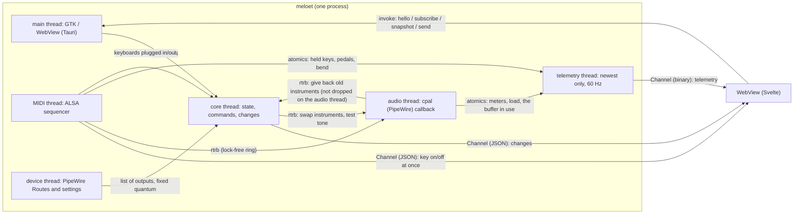

# The structure of meloet

This document explains how meloet is built inside and why it was built that way: what the code does now, the reasons, and where in the code it is.

- The section numbers (`3-2`, `19-7`, `22-18 A1`, `23-10`, …) and their order are the same as in the old Japanese document, because comments in the code point to them by number ("architecture 23-10", "chapter 20"). Some numbers appear twice; they are kept as they were.
- Chapters 1–18 describe the frame of the app. Chapters 19–23 record what was decided in each round of work, with the round in brackets.
- The full Japanese text, with every measurement and the step-by-step story of each round, is in [`history/architecture.ja.md`](history/architecture.ja.md). Measurements are in `docs/history/measurements/`, research notes in `docs/history/research/`.
- The design rules are the spec ([`spec/`](spec/), one file per chapter) and the mocks ([`design/mock/`](design/mock/)). When a mock and the spec disagree, the spec is right. The first study is in [`history/report.md`](history/report.md).

---

## 1. Crates and their jobs

The split follows section 7-1 of the report, with one crate added: `meloet-core`, the owner of the state.

| Crate | Job | What it must not hold |
|---|---|---|
| `crates/meloet-model` | Song, tracks, instrument choice. Pure data and operations | I/O, threads |
| `crates/meloet-protocol` | The contract between Rust and the screen (types, version, the byte layout of the telemetry). The TS types are made from here | Tauri |
| `crates/meloet-engine` | The sound flow, the instrument interface, meters, the cpal output. The audio thread takes no memory and no locks | The screen, plugin formats, locks (Mutex) |
| `crates/meloet-midi` | Keyboard input and plugging in/out (on Linux, the ALSA sequencer) | Sound |
| `crates/meloet-devices` | Human names of the audio outputs and inputs (on Linux, PipeWire Routes); reads the quantum the PC has fixed | Sound processing, changing settings |
| `crates/meloet-core` | Owner of the state. Takes intent commands, changes the state, sends changes with a `rev`. Band rules, status line notices, saved settings | Tauri, how the screen looks |
| `crates/meloet-app` | The Tauri shell. Only passes commands and Channels | Owning state |
| `ui/` | The screen (Svelte 5 + TS). Only `ui/src/bridge/` knows Tauri | Calling the Tauri API directly |

Crates added later: `meloet-sound` (samplers, SF2, built-in effects and synths; 19-6), `meloet-plugin` (keys, shared memory and the wire to plugin hosts) and `meloet-plughost` (the plugin host process, with VST3 and LV2 in `formats/`; chapter 20), and `meloet-stretch` (time stretch and pitch; 22-8, 22-19). There are no separate `meloet-vst3` or `meloet-lv2` crates. Plugins have run in another process from the start (the report's idea of "v1 in the same process" was not used).

**Why**: report 7-1 gives `meloet-app` no state and `meloet-model` no I/O. Then some place must hold the song, the devices and the bands together and take the commands. That is `meloet-core`. It lets us test the contract and the band rules with no screen.

`spikes/` stays in the workspace but is left out of `default-members`. A plain `cargo build` or `cargo test` only works on `crates/`.

---

## 2. Threads and processes



- Key on/off goes from the MIDI thread straight to the screen's Channel, not through the core (to keep key → screen short). The held keys are also in every telemetry message, so if one message is lost, the next one puts it right.
- Plugging a keyboard in or out changes the core state and is sent at once as a change.
- The audio thread takes no memory and waits on no lock. Everything in and out goes through lock-free rings (rtrb) and atomics.
- Paths added in round 2 (not in the picture): core → audio thread, the song's note list (`Sequence`; the old list comes back through a ring) and transport commands. Audio thread → core, a ring of recorded events (with the position the listener was hearing, and the loop pass). The audio thread writes a ring of segments (`TransportClock`: 512 slots, a seqlock per slot, only atomics inside) that the telemetry thread and the core read without waiting on a lock.
- The core thread owns the MIDI thread and the PipeWire watcher. When one stops, the core is told and starts it again after a pause (4-2).
- Plugin hosts are separate processes (chapter 20).

---

## 3. The contract between Rust and the screen (report 7-3)

### 3-1. Steps

1. **Hello**: when the screen starts, it calls `hello(protocolVersion)`. If the versions differ, it stops.
2. **Listen first**: `subscribe(messages, telemetry)` hands over two Channels. From here on, no change is missed.
3. **Fetch the whole state**: `snapshot()` returns `{ rev, state }`. Of the changes that came after step 2, those with `rev` ≤ the snapshot's are dropped; the rest are applied in order.
4. **Changes**: `{ rev, changes }`. `rev` goes up by 1. If a change comes whose `rev` is not the screen's `rev` + 1, the screen fetches `snapshot()` again.
5. **Screen → Rust is intents only**: `send(command)`. Rust checks it, changes the state and sends the changes. The screen does not decide state itself (only text being typed and the look during a drag may move first).
6. **Things told at once**: key on/off, pedals, bend and modulation are sent on the messages Channel the moment they arrive.
7. **Telemetry**: binary on the telemetry Channel, 60 Hz, newest only. If the content is the same as last time, nothing is sent (when nothing sounds, it stops).
8. **The content of a take** (round 2): a finished take never changes. The state holds, per clip, only the id and note count of the take it shows. The content is fetched as binary with `take_notes(id)` (3-4). The screen caches it by id.
   - **Edited takes** (round 3): an edit to notes makes a new take (new id) and puts it in the same place in the clip's takes (the place of the shown take). The number of takes does not change; undo goes back to the old id. The screen points to a note by "take id + its index in that take (in order of start, from 0)". If the id is not the shown take, Rust does nothing. A quantized take holds the id of its origin take (the take as recorded) and, for each note, which note of the origin it came from. The screen fetches `take_notes(origin id)` and draws the positions before quantizing as gray.7 outlines.
9. **Notes being recorded** (round 2): on the messages Channel as `liveNotes {seq, recording, notes}`. `seq` goes up by 1 for as long as the app runs. A note with the same `(lap, index)` replaces the old one (no length when pressed, a length when let go). After listening, the screen fetches all of them with `live_notes()` and drops messages with a lower `seq`. If a number is skipped, it fetches everything again.
   - **Why**: ten minutes of recording makes thousands of notes. Under the rule that a section is replaced whole, putting them in the state would send all of them with every change.
10. **Plugin parameters** (round 5, contract 18): when the params panel shows a plugin, the state (`params`) holds only "the table number (`table`) and the count". Names, groups, kinds and current values are fetched once with `plugin_params(table)` (JSON `ParamTable`). After that only changed values come on the messages Channel as `paramValues {table, seq, values}` (at most 30 a second, only changed ones, only for the table the panel shows). `seq` goes up by 1 per table; if one is skipped, the table is fetched again. When the choice changes, the plugin changes its list, or the whole state is put back (undo), the core hands out a new `table` and the screen fetches again. The screen side is `ui/src/bridge/paramTable.ts`.
    - **Why**: Surge XT (VST3) has 2855 parameters, and turning a knob in a plugin window changes values all the time. Under the whole-section rule, every value change and every row choice would send 2855 rows again (the same idea as take content and live notes).

There is one messages Channel. It carries changes (`patch`), things told at once (`event`), notes being recorded (`liveNotes`) and plugin parameter values (`paramValues`), in the order they happen.

### 3-2. The state (units of snapshot and change)

The state is split into sections. A change replaces a changed section whole (no partial changes inside a section). While sections are small, this is the simplest and hardest to get wrong. Sections are split so that something that changes often does not send a large section again.

| Section | Content |
|---|---|
| `song` | Song name; tracks (number, name, color index, instrument name, gain dB, clips [id, range, name, shown take's index, count, id and position, note count]); counts of undo and redo steps; where the keys sound; loop (range in ticks, on/off); the count for the band tab 「ピアノロール ノート ○」; the song file's state (never saved, saved, changed). (Round 4) per track: pan (−100…100), sends A and B (dB; `null` is −∞), four insert slots (an effect kind or empty), mute. `returns` (returns A and B: fader, pan, mute, inserts) and `master` (fader, pan, inserts). All of these change only by hand; the value during a drag (preview) is not in it. Track kinds, inputs, ● and monitor of vocal tracks, `keysTarget`, audio clips: 22-15, 22-17 |
| `timeline` | (Contract 20, round 6) the tempo and time signature at the song's start and the ramp from the start, tempo points (tick, tempo, ramp), time signature flags (bar number, signature), markers (id, tick, name), what is selected (a point by tick, a flag by bar, a marker by id), the marker whose name box is open, whether the arrange's 「テンポ ・ 拍子の変更」 row is open. Tempo and time signature live only here (moved from `song`). The screen's tempo map (`ui/src/time/tempoMap.ts`) is made from it (chapter 21) |
| `automation` | (Contract 21) what of the automation lanes is not an undo step: folded, armed, being written, held, selected points (21-15) |
| `history` | (Round 6) the rows of the undo history band (21-12) |
| `transport` | Stopped, count-in, playing or recording; the position when stopped; metronome; count-in bars and beats; whether play and record can be used; while recording: recording number, track, start, which take it will be, the clip it joins, the loop pass. The moving position comes in the telemetry |
| `arrange` | The selected clips, the clip the piano roll shows |
| `pianoRoll` | (Round 3) the take id the piano roll shows, the selected notes and control points (lists of index ranges `[start, end)` in the take), grid, musical scale (root, major/minor, lock), the quantize panel's settings (grid, triplet, strength, swing, what to align), the count of notes that can be pasted. Selection changes often, so it is apart from `song` |
| `workspace` | Scale, scales that do not fit the screen now (`unfitScales`), window size, which bands are open and their heights (`layout`), the right panel, the sound settings dialog, the output chooser (flow 2), the hint above the arrange, the song dialogs (unsaved, cannot save, broken: id, heading, whether a previous version exists) |
| `shelf`, `library` | (Rounds 4–5) the shelf: its mode, the instruments and effects to choose; `library` is the list of SF2 files and plugins the shelf shows (20-11) |
| `params` | (Round 4) the insert the params panel shows (which strip and slot, effect kind, values, selected row). Choosing an insert or row is not an undo step, so it is apart from `song` (the same idea as `pianoRoll`). (Contract 18) what it shows is a built-in effect or a plugin (an insert, or a track's instrument). For a plugin: where it is, the window kind (can open, cannot open yet, has none), the table number and count, the selected row, and the rows written by automation — not the rows themselves (3-1, item 10) |
| `plugins` | (Round 5) the plugin scan, what it could not read, where it looks. Apart because the count changes with every bundle during a scan |
| `windows` | (Contract 18) the open plugin windows (where, plugin name, size, whether larger than the screen). The status line's 「窓 N」 and the window marks on slots and instrument names are made from it. Windows opening and closing is not an undo step and touches nothing else, so it is apart |
| `keyboards` | The keyboards seen (name, ALSA address), the one in use, the last one pulled out |
| `outputs` | The outputs (real name, kind of easy name, plugged in or not, kind of link), the chosen output and its state |
| `inputs` | The audio inputs (22-15) |
| `audio` | Running or not, sample rate, buffer asked for, buffer in use, the quantum fixed for the whole PC, latency estimate, the name of the sound system, the output device name, the MIDI input name. Later: buffer and sample rate choices, record format, latency (22-15) |
| `audioWork` | (Round 7) audio being made ready, with a percent (apart so a percent does not send the song again) |
| `export` | (Round 7) export (22-11, 22-20) |
| `sounds` | (Round 8) the sound pack as this PC has it, and its fetch (23-7) |
| `status` | The notice on the left of the status line (kind of text and the values to put in) |

The screen's wording is not kept in Rust. Rust sends only "the kind of text (ID) and the values to put in", and the screen matches it to the text in `ui/src/text/`.

The full list of sections is `AppState` in `crates/meloet-protocol/src/lib.rs`.

### 3-3. The telemetry binary (version 4, little-endian)

| Offset | Type | Content |
|---|---|---|
| 0 | u8 | kind = 1 (telemetry) |
| 1 | u8 | version = 4 |
| 2 | u16 | number of tracks n |
| 4 | u32 | serial number |
| 8 | u64 | the time Rust sent it (CLOCK_MONOTONIC, ns) |
| 16 | u64 | bits of held keys 0–63 |
| 24 | u64 | bits of held keys 64–127 |
| 32 | u8 | last velocity (0 = none yet) |
| 33 | u8 | sustain (value of CC 64) |
| 34 | u8 | modulation (value of CC 1) |
| 35 | u8 | flags (bit0: sound is running, bit1: master clipped, bit2: there is a play position) |
| 36 | i16 | pitch bend (−8192…8191) |
| 38 | u16 | processing load (per mille) |
| 40 | f32 × 2 | master peak left, right (max since the last send; 1.0 = 0 dBFS) |
| 48 | f64 | song position the listener hears at the send time (ticks, with fraction; can be negative during a count-in) |
| 56 | f64 | ticks per µs (0 when stopped) |
| 64 | u8 | state (0 stopped, 1 count-in, 2 playing, 3 recording) |
| 65 | u8 | 0 (spare) |
| 66 | u16 | count-in beats left (the one sounding included; 0 outside a count-in) |
| 68 | u32 | loop pass while recording (first is 0) |
| 72 | f32 × 4 | return A peak left, right; return B peak left, right (after inserts, fader and pan; round 4) |
| 88 | u16 | number of mic meters m (round 7; 0 while no input is open) |
| 90 | u16 | 0 (spare) |
| 92 | f32 × 2n | per-track peak left, right (after fader and pan) |
| 92 + 8n | 16 × m | mic meters (one per vocal track, in track order): track id u32; input peak left, right f32 × 2 (before the fader; mono has the same value in both); flags u8 (bit0: reached 0 dB, bit1: stereo); three 0 bytes |

Screen position = `tick + (Rust's now − send time) × ticks per µs`. While bit2 is 0 (sound not running yet), bytes 48–71 are 0 and the screen uses `transport.position`. When stopped, the transport's numbers and the play line use `transport.position` (it comes at once as a change); when moving, the telemetry position (`shownTick` in `ui/src/components/time.ts`). The layout is fixed in one place, `crates/meloet-protocol/src/telemetry.rs`.

### 3-4. The take content binary (version 2, little-endian)

| Offset | Type | Content |
|---|---|---|
| 0 | u8 | kind = 2 (take) |
| 1 | u8 | version = 2 |
| 2 | u16 | 0 (spare) |
| 4 | u32 | take id |
| 8 | u32 | length (ticks) |
| 12 | u32 | number of notes n |
| 16 | u32 | number of controls m |
| 20 | u32 | origin take id (0 = none; ids start at 1) |
| 24 | 16 × n | notes: start u32, length u32, key u8, velocity u8, two 0 bytes, index of the origin note it came from u32 (0xFFFFFFFF = none) |
| 24 + 16n | 8 × m | controls: tick u32, kind u8 (0 CC, 1 pitch bend), CC number u8 (0 for bend), value i16 |

Positions count from the take's 0. With 1920 ticks to a quarter note, u32 ticks last 124 hours at 300 BPM (22-1).

The layout is fixed in one place in `meloet-protocol` (`take.rs`), and a test that writes in Rust and reads in TS watches for differences.

---

- **The song serial** (contract 9, end of round 3): take ids are handed out from 1 per song. `song.serial` goes up by 1 each time the core replaces the `Doc` from outside (new song, open, open the previous version, restore from the recovery file, do not restore), and when undo/redo crosses the "restore from the recovery file" or "do not restore" steps. Normal undo/redo does not change it. When the serial changes, the screen lets go of all cached takes and drops answers still on the way (`TakeStore.clear`). The piano roll also fetches a take with the same id again. Takes are known by (serial, id).

## 4. Sound flow

- The output is cpal's PipeWire host. **The buffer in use is read from the frame count the callback receives.** The buffer and sample rate asked for are settings (22-16; at first it was always 256).
- The PC-wide `clock.force-quantum` is **only read** from PipeWire's `settings` metadata. When it is not 0 and the buffer in use differs from the one asked for, the screen says "fixed by the PC-wide setting".
- Latency estimate: from the first study's measurements (mean 13.2 ms with buffer 256, 53.2 ms with 1024, 48 kHz), key → sound ≈ 2.5 × buffer ÷ sample rate. While running, the measured value is used (the mean of the time between receiving a key and the time its sound is due at the DAC). Latency numbers shown in the sound settings: 22-15.
- The instrument interface (`Instrument`): each track has one instrument. An instrument has "prepare (off the audio thread)", "events (notes, CC, bend)", "render (a stereo buffer)" and "stop". To swap, the core makes the new instrument off the audio thread and sends it through a ring. The audio thread swaps and sends the old one back through a ring (dropping it on the audio thread would run code that frees memory).
- The first instrument was a placeholder (a soft synth tone). Superseded by 19-7 and 19-10: sample instruments, built-in synths, SF2 and plugins all sit behind the same interface (plugins hide the talk with another process behind it).
- Meters: per block, the peak is written to an atomic only if larger than before. The telemetry thread sets it back to 0 when reading. There are meters for tracks, returns A and B, and the master (where they measure: 19-11).
- The mixer's sound path (inserts, fader, pan, sends, returns, master): 19-11.
- Processing load = time spent in the callback ÷ the length of that block.
- To change output, the old stream is stopped, instruments are made again from the song, and a new stream is made.

### 4-1. Watching the audio thread

- `meloet-engine` (and `meloet-sound`) use no locks such as `std::sync::Mutex`. `disallowed-types` and `disallowed-methods` in `clippy.toml` stop them by machine.
- Memory use is watched in tests by a counting global allocator. When the audio thread section starts, a flag is set; any allocation or free while it is set fails the test. This runs both in offline render tests and in a test that runs a real stream for 2 seconds (only when a device exists).

### 4-2. When things stop, and connecting again (round 2)

- Output stream errors are counted in three kinds: xrun; the stream ended by itself (PipeWire gone, output gone; once per stream); other. The `DeviceNotAvailable` that cpal gives when we stop the stream ourselves is not counted.
- When PipeWire goes away, cpal gives `StreamInvalidated` once and the callback stops (1.4–37 ms to notice), and the device watcher (pipewire-rs) ends with a core error (0.6–10 ms). Both tell the core. When the stream is closed, the engine comes back through `Carrier`'s Drop. In case it does not, the engine can be made again (`EngineHandle::rebuild`; the MIDI ring and the segment ring are new too, and the core hands them out again).
- The MIDI thread, when it stops by itself, sends `Stopped` last and gives back its sink. The core starts it again with the same sink. Held keys and pedals are taken as let go at the moment it stopped.
- Wait between tries: 0.5, 1, 2, 4 seconds, then every 5 seconds. For PipeWire and MIDI it never gives up (there is no other way back, and one try is cheap; the early tries are fast, so a daemon that comes back quickly is found quickly). When only the stream fell (PipeWire still running), up to 4 tries; after that it waits until the output list changes or the person does something (so it does not keep opening and closing an output that falls every time). If PipeWire is missing at start, it tries quietly at the same pace (it never ran, so 「止まりました」 is not shown).
- If the sound stops while recording, the recording is closed at the last position the listener heard, what was recorded is kept as a take, and a notice is shown. If keyboard input stops, recording does not stop.
- Tests: start a private PipeWire and WirePlumber (`crates/meloet-engine/tests/private_pw/`), kill it, and bring it back (`--devices`). The owner's PipeWire is never touched.

---

## 5. Keyboards

- meloet joins the ALSA sequencer with the name `meloet` and subscribes to System:Announce. At start it counts all keyboards already there, then waits for plug in/out.
- What counts as a keyboard: a client of type HARDWARE with a readable port (READ + SUBS_READ). From one client, only the readable port with the lowest number is heard (the second port of the Keystation 49 MK3, "Transport", is for buttons and could be taken for notes).
- The keyboard's name is the ALSA client name (e.g. 「Keystation 49 MK3」).
- The virtual keyboard for tests (`meloet-vkeys`) counts as a keyboard only with `MELOET_ACCEPT_VIRTUAL=1`. With `MELOET_VKEYS_NAME=name[,name…]`, only virtual keyboards of those names (`meloet-vkeys --name`) are taken (so other tests' virtual keyboards on the same PC do not mix in). With `MELOET_ONLY_VIRTUAL=1`, real keyboards are ignored and only virtual ones are seen (to take pictures of the "no keyboard" screen with a keyboard plugged in).
- When a keyboard is pulled out, a "stop all sound" message goes to the audio thread and the record of held keys and pedals is cleared (so sound and lights do not stay after pulling it out with a key held).
- With two or more keyboards, all keys are heard. The name shown is the keyboard played last (counted only on key presses; before any playing, the one plugged in last), and the input meter adds the count of the others like 「+1」 (spec chapter 3). Which keyboard a key came from comes with the MIDI message. The MIDI thread tells the core only when the keyboard differs from before, after telling the screen.

---

## 6. Names of outputs and inputs

- meloet reads the Routes of PipeWire Devices (`EnumRoute` and `Route`). A Route's `description` is the real name (「アナログヘッドフォン」 etc.), `available` is whether something is plugged in, and `port.type` in `info` is the kind.
- One output = one Sink node + one output Route of its device. A Sink with no Route (Bluetooth etc.) uses the node's description as its name.
- An output's ID is "device name + Route name" (the node name if there is no Route). This is saved in the settings.
- **meloet does not switch a device's Route** (that would change a PC-wide setting). If the chosen Route is not plugged in now, the text for that is shown.
- Easy names are used only when the kind is known (the four in the mocks: headphones → 「ヘッドホンの穴」, HDMI → 「画面のスピーカー」, line out → 「うしろのスピーカーの穴」, rear mic → 「うしろのマイクの穴」).
- The device name is the PipeWire Device's `device.description` as it is (e.g. 「GB206 High Definition Audio Controller」; the owner's decision). It is used on rows of outputs that cannot be chosen, and when two or more outputs have the same name.
- Outputs that cannot be chosen (`unusable`) are of two kinds. The node exists but the PC uses another Route on that device → 「PC が切りかえる」 (`switchedByPc`). There is no node → 「PC の設定で止まっている」 (`stoppedByPc`, even if another jack on the same device has a node).
- Order: outputs that can be chosen first (plugged in → unknown → not plugged in; among plugged in, headphones first), then those that cannot.

---

## 7. The screen

- Svelte 5 + TypeScript + Vite. No SvelteKit (one screen is enough, and the bridge stays thin).
- **Values**: `ui/src/design/tokens.ts` holds them under the spec's table names (`color.gray.4`, `size.meter.slim`, `space.3`, …). Part sizes that are only in the spec's text (a button's height 24, etc.) are `part.*`; sizes only in the mocks are `mock.*`, with their source. Parts use only the CSS variables made from here. A hex color or px written directly in a part fails a test.
- **Scale**: 100, 125, 150 %. `tokens.ts` gives the values per scale. `line.hair` is one physical screen pixel at every scale (`1px / devicePixelRatio`). `line.mark` and `line.track` are the table's values. The "weight" column of the text table is read as the set of weights allowed at that size (text.s 400, 500, 600; text.m 400, 500; text.l 600; not changed by scale). Sizes in the spec's text (part.*) are rounded when the scale does not give a whole number.
- **Wording**: one place, `ui/src/text/ja.ts`. The spec's wording is never changed by even one character (a test checks it against text taken from the spec). Text only in a mock is used as in the mock, with its source (the board name).
- **Large surfaces are WebGL (one per region, reused)**: a part puts `use:glSlot={...}` where it draws, and a box around it (it can be the same box) gets `use:glRegion={"name"}`. The WebGL manager (`ui/src/gl/engine.ts`) puts one canvas in each region box (inside the box, `pointer-events: none`). The canvas covers "where the region's slots are ∩ the box ∩ the window", with edges on screen pixels. All slots in a region are drawn on that one canvas, in page order (later on top). Only regions whose list of rectangles changed are drawn. Things that change at 60 Hz (meters, the clip being recorded) are in small regions, not in large regions that do not change (the arrange's lines and clips). Things that only move, like the play line, are not redrawn: an HTML line is moved with CSS `transform`. Text and small parts are HTML. Canvas 2D is not used.
  - Why: on WebKitGTK (NVIDIA), each surface put on screen blocks the web process's main thread for about "0.25 ms + 3.9 ms × megapixels", and key messages wait behind it (2026-11-15, RTX 5060 Ti, WebKitGTK 2.52.6). 16 meters as one surface each took 4.4 ms; on one surface, 1.4 ms. Moving with `transform` only: 0.35 ms. In round 1, a full-window surface at 60 Hz made key → screen p95 8–12 ms for this reason. This formula is for one surface with no HTML under it; in the real screen, the rules of "WebKit that paints on the CPU" below come first.
  - **WebKit's drawing path (2026-11-22)**: WebKitGTK `2.52.6-0ubuntu0.26.04.2` started drawing through the compositing path (ThreadedCompositor, Skia), where the rules below do not work as written. **meloet sets `WEBKIT_DISABLE_COMPOSITING_MODE=1` at the very start** (`JSC_OPTIONS` in `crates/meloet-app/src/main.rs`; a value set from outside wins) and so paints on the CPU. Why: on the compositing path, key → drawn p50 was 8–10 ms longer in every case, and with the mixer open while playing, "within 2 frames" fell to 92.5–95 %. The cost: scrolling and zooming the arrange take 20–24 ms a frame (see 23-13). Details: `docs/history/measurements/2026-11-22-round8-quiet.md`, `2026-11-22-round8-webkit-2.52.6-2.md`.
  - **WebKit that paints on the CPU** (found in round 4; `docs/history/measurements/2026-11-19-round4-mixer.md`, chapters 6–7): with NVIDIA + Ubuntu WebKitGTK on this path, there are no compositing layers and the page is painted on the CPU.
    - When a canvas is shown, the whole canvas becomes a "dirty rectangle". WebKit reads the canvas back from the GPU twice (`readPixels`), paints the HTML inside that rectangle again (background, borders, text), and sends the bitmap to the UI process. So the cost depends on "how many canvases" and "how large the rectangles are and how much HTML is under them". A canvas over a lot of text is expensive.
    - What got dirty in one frame is cut into rectangles of "a y band × an x range". Rectangles whose top and bottom edges do not line up cut each other and grow in number (three numbers and one meter with uneven edges go over 10).
    - **If there are 11 or more rectangles, or their total area is 25 % or more of the rectangle around them all, WebKit repaints that one bounding rectangle whole** (WebKitGTK 2.52.6, `shouldPaintBoundsRect` in `DrawingAreaCoordinatedGraphics.cpp`). If the top band and the mixer at the bottom get dirty in the same frame, the bounding rectangle is most of the window and the main thread is busy for 12–16 ms (5–7 ms each alone).
    - The two rules decided:
      1. **Things that change in the same frame go under one canvas.** `use:glSlot={{ kind: "cover" }}` draws nothing but stretches the region's canvas over that box. In the top band, the boxes of position, time, load and master dB and the master meter are under the one `masterMeter` canvas (1437×36 at 1920 width). However many numbers change, it is one dirty rectangle.
      2. **A frame that shows the mixer meters also shows the master surface** (`SHOWN_WITH` in `ui/src/gl/budget.ts`). The mixer surface is wide and low, so with the top-right master surface always in, the bounding rectangle is the window's width and the 25 % rule does not trigger.
    - **Rules for anyone who adds something that moves at 60 Hz**: (a) in the top band, give its box `cover` (inside the `masterMeter` region). (b) elsewhere, line up its top and bottom edges with nearby things that change in the same frame, or put it under the same canvas. (c) at most 10 rectangles a frame, and total area under 25 % of the bounding rectangle. Check with `tools/measure/webkit-damage.sh` that the rectangles are as expected and not "one rectangle around all". (d) do not add text under a canvas. (e) **things that change every frame must not run layout**: move position and length with `transform` only (do not change `top`, `left`, `width`; snap edges with `Math.round(px × dpr) / dpr`). **Do not change text every frame.** Text that must change every frame goes in an out-of-flow box (`position: absolute`, with a size that does not depend on the text). (f) where many small rectangles change in one frame (knobs and text per strip), first ask for one rectangle around them all (`askWhole`). Check with `tools/measure/webkit-layout.sh` how many rectangles one layout asks for, and that it is not "one rectangle around all" (next item).
    - **The Region collected during layout** (found in round 6; `docs/history/measurements/2026-11-20-round6-step2-3.md` chapter 3, `2026-11-20-round6-fix-redraw.md`): another WebKit rule that works **before** the "11 / 25 %" rule above.
      - Repaint rectangles asked for during one style recalculation and layout (one outer `Document::updateLayout`, `resolveStyle`, `performLayout`) are collected in one Region. Each time a rectangle is added, **if the Region's `gridSize()` (number of y edges × number of x edges) goes over 256, everything so far becomes one bounding rectangle**. If that rectangle is 75 % or more of the visible area, the whole window is repainted. (Source: WebKit branch `webkitglib/2.52`, `Source/WebCore/rendering/RenderView.cpp` `accumulateRepaintRect` with `maximumRepaintRegionGridSize = 16 * 16` and `dirtyEntireViewThreshold = 0.75f`, and `Source/WebCore/platform/graphics/Region.h` `gridSize`. Confidence A for the source; that this PC's build runs the same code is only checked by gdb call stacks and by the counts matching the measurements.)
      - Counting: N separate rectangles of different heights give 4N² (**over at 9**). N rectangles side by side at the same height give 4N (up to 64). The top band's numbers (2–4) are in the same frame, so 6–7 small rectangles at different heights are the limit.
      - When it goes over, the bounding rectangle wraps **everything collected so far** (top band numbers, arrange lane headings, mixer), so it is most of the window. `cover` only helps with the later rule (11 / 25 %).
      - Order of collection: repaints from style only (color, background) → text boxes during layout → layers after layout (things moved by `transform`, old and new place). When JavaScript forces layout with `getBoundingClientRect()` etc., what came before goes into a separate Region.
      - A `position: absolute` box has its own layer and asks for its own rectangles (a fader handle and the line in it: 2; old and new place: 4).
      - Layout itself: when `top`, a width or text changes, flex layout runs again up the box's parents, and sibling boxes that did not move also ask for rectangles (376 for 8 mixer strips). Text in an out-of-flow box (`position: absolute`) asks its parent only for a light "positioned children only" layout (`contain: strict`, or `overflow: hidden` with a fixed size on an in-flow box, did not make it light).
      - **The shape decided** (`ui/src/components/automation/coverIf.ts`, `autoState.svelte.ts`):
        1. Handles and bars move by `transform` (`mixer/Fader.svelte`, `SendBar.svelte`, `params/ParamRow.svelte`). Value text is in an out-of-flow box `.live > .in` (the outer box keeps height and baseline with a zero-width character `\200b`; `mixer/Strip.svelte`, `PanKnob.svelte`, `SendBar.svelte`, `automation/LaneHead.svelte`, `params/ParamRow.svelte`).
        2. **Ask first for the rectangle of the box around them** (`askWhole`): switch the `background-position` of the box around what a lane moves between two values that look the same. It is a style-only repaint, so it is collected first, and the handles and text inside fall into it (the Region does not grow). Switching `transform`, `outline-color` or `box-shadow` did not ask for a rectangle (tried on WebKitGTK 2.52.6).
           - Mixer strip (`mixer/Strip.svelte`): while a lane moves anything of that strip, the fader and the value box `.gain-box` go under the canvas (`coverIf`). Both going under the canvas and asking for the rectangle are done by the same empty box that `coverIf` places over the whole box (if the box itself asked, the text that sticks out would be included and go outside the canvas). It is about as tall as the meter, so the canvas does not grow. The pan row `.pan-box` and the two send rows `.sends-box` do not go under the canvas; only the moved row asks for its rectangle (`askIf`). Every empty box reaches the full width of the strip, so neighbors join and there is one rectangle per half.
           - Arrange lane headings (`automation/LaneHead.svelte`): the current value's text box is under the `trackMeters` canvas (`cover`). In a frame where the text changes, the canvas is shown too (`cover`'s `stamp`; `gl/engine.ts`), so the text's rectangle is inside the canvas and does not cut the play line's rectangle. Headings not in view do not read the per-frame value (`IntersectionObserver`).
        3. **Strip handles and text are shown in the frame that draws the canvas above them** (`coverIf`'s mark is `paint`; the WebGL manager calls it while building that canvas's picture, and `showTrack` runs there). The mixer canvas shows its left and right halves on alternate frames. Moving the handles of the half not shown in the same frame goes over 11 rectangles and repaints the whole window (25 ms with 16 tracks). In a frame where no canvas is drawn (no meter message came), it waits for its turn; if no canvas has been drawn for 3 frames, it shows anyway (`MAX_WAIT_FRAMES`). A track whose turn never comes while other canvases are drawn is scrolled out of view, so it waits until seen (in a 64-track song, hidden strips are not rewritten). Two positions are kept: the newest (`livePosition`; lane headings, params panel) and the one shown on the strip (`shownPosition`). Both are re-read by a per-track counter, so places showing a track that did not move are not re-read.
        4. **Pan and sends take turns** (`rowTurn` in `autoState`): the pan row and the send rows are outside the canvas, so adding both in the same frame approaches the "area" limit below. The turn switches every 2 frames, the same for every track (otherwise row rectangles go out of step per strip and approach 11). Pan and send handles move 15 times a second, faders 30.
        5. **Keep layout apart from other changes** (`layoutNow` in `automation/AutoClock.svelte`): before writing positions, and after what was written is on screen, read `scrollTop` to finish layout. Then the rectangles of what lanes moved do not go into the same Region as the top band's numbers (if they did, about 7 lane headings in a column would make the bounding rectangle reach from the top band to the bottom of the arrange). Only while moving.
      - **Area** (the 25 % rule): at 1920×1080 the bounding rectangle is about 1.79 M px; 25 % is about 447 k px. Per frame: master 52 k + heading meters 30 k + half the mixer (948 × 271 = 257 k) + the pan row (23 k) or the two send rows (47 k), at most 384 k px (21.5 %). Putting the send rows under the canvas as well (948 × 356 = 337 k) made 420 k (23.5 %), and some frames went over.
      - Left over: when all meters are still (silence), no canvas is shown, so moved boxes become rectangles as they are. About 8 per frame (master, heading meters, play line 4, half the mixer, a row), 2 away from 10. The params panel (no canvas) with 2 or more rows moving at once is not measured yet. A song with 64 tracks and 4 lanes each moving runs the mixer at 57–59 frames a second.
    - **Ceiling**: the mixer surface is one rectangle of "number of strips × meter height". At 1920×1080 with 8 tracks (11 strips, 1110×264), the total is 21 % of the bounding rectangle. By calculation, 10 tracks (13 strips) give 24 %, 11 tracks 26 %. Over 10 tracks, or with a taller mixer band, it goes over 25 %. This is handled by splitting the mixer meters in halves (next item).
    - **Mixer meters always run at 30 Hz, split into a left and a right half, one half per frame** (`regionHz` in `ui/src/gl/budget.ts`, `Tile` in `engine.ts`; for any number of tracks — the owner: meters need not be seen at 60 Hz, so always 30). Arrange track meters, the master meter, keys and the play line stay at 60 Hz. At most 2 parts (with 3, a part falls below 30 Hz). The split is at the middle of the visible width (which side a slot's middle is on), not by count (the right side, with returns and master, would be wider).
      - With 16 tracks (19 strips) the meter surface was 1807×264, 27 % together with the top band, and every frame repainted the whole bounding rectangle (18–22 ms a frame).
      - Shape: one WebGL context per region as before. That canvas sits off the page; the visible slots are split from the left into 2 groups, and each group gets a "show a copy only" canvas (`bitmaprenderer`; not a WebGL context, so not counted in the budget) in the region box. Each frame, one group is drawn with WebGL, copied with `createImageBitmap(canvas, 0, 0, w, h)` and shown with `transferFromImageBitmap` (a 900×264 copy took 0.9 ms and arrives in the same frame on WebKitGTK 2.52.6). The page repaints only half a rectangle each frame (770×264 or 878×264). The gap between the groups is in neither surface.
      - In a frame where scrolling or size changed (`urgent`), both groups are shown in the same frame so they do not get out of place (only that frame repaints the bounding rectangle). Where `createImageBitmap` or `bitmaprenderer` is missing, it is not split and draws once every 33 ms.
      - Result (1920×1080, playing, 25 s): with 16 tracks busyMs mean 12.2 → 6.1 ms, p95 21 → 7 ms; bounding-rectangle repaints 151 of 151 → 0 of 138. Details: `docs/history/measurements/2026-11-20-round5-step3-app.md` chapter 7.
      - Left over: when half the surface is over 25 % of the bounding rectangle (a very tall mixer band).
    - On PCs with compositing layers (Intel, AMD), a canvas becomes a GPU layer and these rules do not matter (`cover` and `SHOWN_WITH` only make surfaces a little larger or more frequent). Not checked.
  - Limit: WebKitGTK 2.52 allows 16 WebGL contexts per page. At the 17th, the oldest is lost and does not come back. **Contexts of thrown-away canvases count until GC** (even after `loseContext()`). With "make and throw away", switching 「くわしく」 in the sound settings 40 times lost 15 live contexts. So a canvas, once made, is never let go: `ui/src/gl/pool.ts` reuses it for the next region (the same 40 times made 7 and lost 0).
  - Contexts are made when the region box arrives (fixed in round 3): one `getContext("webgl2")` blocks the main thread for 50 or 200 ms (shader compile and link 1 ms, first draw under 1 ms; `docs/history/measurements/2026-11-15-round3-fix-glcontext.md`). So a region takes its canvas when its `use:glRegion` box arrives (start-up, opening a band), not when a slot first comes in, and keeps it while the box exists even with no slot (size 0). Nothing is made at the moment of a key, the start of recording or a drag. So boxes of regions that grow are kept even when unused (`recordingClip` is `.rec-host` over the whole arrange lane area, `pianoRollLive` is `.live-host` over the whole note area). The frame that opens a band is heavier by the contexts it makes (360–410 ms at 1920×1080).
  - Budget: 12 contexts may be made (4 below the limit of 16). Going over fails in development and tests and writes to the console in release. Slots outside a region too. To add a region, add one line to `REGIONS` in `ui/src/gl/budget.ts` (a name not in it does not type-check).

  | Region | Where | Opaque | How often it changes | Contexts |
  |---|---|---|---|---|
  | inputMeter | the input meter's keys and velocity bar (the text part between is not drawn and shows through; the box is the whole input meter) | no | per key | 1 |
  | masterMeter | the transport's master meter. The box is the whole transport band; the surface runs from the position numbers to the master (the number boxes are `cover`; only the meter is drawn, the rest shows through) | no | ~60 Hz | 1 |
  | trackMeters | meters in the track heads (one surface for any number) | no | ~60 Hz | 1 |
  | arrangeLanes | bar lines and clips | no | when the song, size or scroll changes | 1 |
  | overview | the shrunk arrange (instead of trackMeters and arrangeLanes; reused) | no | as above | 0–1 |
  | settings | the meter next to the test tone and the lit keyboard in the sound settings (the box is the whole scrolling content; kept when 「くわしく」 is opened and the slots go) | no | ~60 Hz, per key | 0–1 |
  | (round 2) recordingClip | only the clip being recorded | no | ~60 Hz | 1 |
  | (round 3) pianoRoll | the piano roll's row background, beat and bar lines, notes, outlines of positions before quantizing and of the drag's starting place, the velocity lane | no | when notes, selection or view change | 1 |
  | (round 3) pianoRollKeys | the keyboard column on the left of the piano roll (sounding notes and played keys light up) | yes | per key; every frame while playing (about 42 rectangles) | 1 |
  | (round 3) pianoRollLive | notes being dragged, notes growing while recording (a box around only what moves; dragging notes only moves the box by `transform`) | no | ~60 Hz | 0–1 |
  | (round 4) mixerMeters | mixer meters (two vertical bars each for tracks, returns A and B, master, on one surface; the box scrolls sideways and stays one surface; its copy is shown on two canvases, left and right, one per frame) | no | 30 Hz | 0–1 |
  | play line | HTML (`transform`) | — | 60 Hz | 0 |

  The most is 10 (round 4, 19-5: a tall window with the arrange in track rows, piano roll and mixer open, and the sound settings over them): inputMeter, masterMeter, trackMeters, arrangeLanes, recordingClip, pianoRoll, pianoRollKeys, pianoRollLive, mixerMeters, settings. 2 left before the budget. Only pianoRollKeys is opaque, so however the bands are combined, at most 10 contexts are made (「区画の数」 in `ui/tests/gl.surface.test.ts`).
- **The arrange's track rows scroll up and down** (a provisional shape, the owner 2026-11-20; 「トラックの行を縦に送る」 in `ui/src/components/Arrange.svelte`):
  - What scrolls is the `scrollTop` of two boxes: the head column `.heads-view` (holding `TrackHeads`) and the lanes `.lanes-view` (content `.lanes`). Both are `overflow: hidden`; `Arrange` writes the same number to both. The ruler, markers and tempo rows above are outside the boxes and do not move. The scroll position is kept only by the screen (not in the song, not in undo).
  - A plain wheel (`deltaY`) scrolls. Shift + wheel is sideways and Mod + wheel is zoom, as before. No scrolling during a clip drag or a box selection. A vertical scroll bar on the right edge (`mixer/VScrollbar.svelte`, laid over `.lanes-box` with the horizontal one). When the selected track changes or a track is added, it scrolls until that row and its lanes are in view (`revealRange`).
  - The full height of the rows is `rows.height` + the 「＋ トラック」 row (it is at the bottom of the head column, so the lane side leaves the same room).
  - **WebGL**: no new regions or contexts. Clip marks (`.fill`) and lane marks (`AutoLane`) move with the rows in their box. The region box `.lanes-wrap` does not scroll (the tempo lane is in the same region), so **the box whose content scrolls gets `data-gl-clip`**, and the WebGL manager (`measure`, `build`, `place` in `gl/engine.ts`) cuts the marks inside it to "what the box shows" (both the surface size and the drawn rectangles). The bar line mark is on `.lanes-view`, which does not scroll. The `trackMeters` region box moved from `.head` to `.heads-view` (so meters of scrolled rows do not cover the three rows above).
  - A scrolled frame repaints the whole row area (1896×836) (scrolling is a repaint on CPU-painting WebKit). 64 tracks with 4 lanes each: 18 ms a frame; 16 tracks: 13 ms. Sideways scrolling of the arrange: 23-13.
- **WebKitGTK GC and work at 60 Hz** (found in round 3): JavaScriptCore runs Eden GC (young objects only) again and again when idle and moves the objects still alive to the old side. The old side is freed only by a Full GC, but meloet, one page running at 60 Hz, almost never gets one (10 minutes of recording or playing: over 7000 Eden, 0 Full; `docs/history/measurements/2026-11-15-round3-fix-memory.md`). What 60 Hz work holds for a moment keeps piling up. Decided: per-frame work is in proportion to what changes (held keys, growing ends), not to what has piled up. Things made from piled-up data (`LiveNotesBook.notesOf`, key ranges) are made only when something changes and the same object is returned otherwise. The 60 Hz telemetry does not put a new array with the same content into `$state`. That alone does not stop it, so `meloet-app` sets `JSC_useGenerationalGC=0` at the very start (`JSC_OPTIONS` in `main.rs`; a value set from outside wins). The web process inherits it, and JSC runs every idle GC as Full (about 3 a second, usually 1–3 ms pauses). 10 minutes of recording with the piano roll open: 347 → 410 MB, key → screen unchanged. A bigger song makes one Full GC heavier, so pauses should be checked again with big songs. (Memory of the CPU path: 23-12, 23-15.)
- **Band rules are in Rust**: which bands are open, their heights, whether the input meter is 52 or 24, and which band Esc closes are decided by pure functions in `meloet-core` (testable with no screen; `layout.rs`). The screen sends the window size and the scale, and draws the returned heights times the scale. The usable screen area (the work area minus the window frame) is not sent from the screen; only the shell (`meloet-app`) tells it through `Core::set_screen_space`.
- **Term tips**: shown when the mouse stays still for 0.6 s. Width 248, padding 8, background gray.10, text gray.0, corner 1, no shadow. Shape 「用語 — 説明」 (the term in bold).
- **Keys**: single-letter keys do not work while text is being typed. Esc, Enter and keys with Mod do. Esc order: text box → term tip or menu → (from here on Rust's `Back`) dialog → right panel → the newest lower band.

---

## 8. Saved settings

`settings.json` in `$MELOET_CONFIG_DIR` (for tests), else `$XDG_CONFIG_HOME/meloet`, else `~/.config/meloet`.

```json
{ "version": 1, "output": "<output id>", "output_name": "アナログヘッドフォン", "scale": 100, "metronome": false, "count_in_bars": 1 }
```

- If an output has been chosen, the output chooser is not shown from then on.
- Metronome and count-in bars are settings, not part of the song (round 2). A missing field or a value out of range gives the default (off, 1 bar). New fields can be added and version 1 still reads.
- `output_name` is the name when it was chosen. It is kept because, when the remembered output is not in the list at all (started with a USB audio box pulled out, etc.), the status line has no other name to show.
- Written to a temp file and then renamed. If it cannot be read or is broken, start with the defaults.
- Fields added later (still version 1): `velocity_fixed`, `fixed_velocity` (18), shelf favorites and plugin places (20-11), `plugin_formats`, `input`, `buffer`, `sample_rate`, `record_bits`, `manual_latency_us`, `measured_latency` (22-16), and others. The full list is `OnDisk` in `crates/meloet-core/src/settings.rs`.

## 8-1. Output states

- Ready (open and play): the remembered output exists now, can be chosen (a node exists and the PC uses that Route), and is plugged in.
- NotPlugged (do not open): at start, the remembered output is missing, not plugged in, or cannot be chosen. When it is plugged in, it plays.
- Missing (close): while running, the output in use went away, was pulled out, or can no longer be chosen. This avoids sound coming from a speaker that was not chosen when the PC switches Routes. When it comes back, it opens again.
- The test tone opens an output that is not the chosen one only while the output chooser or sound settings are open. When they close, it goes back to the chosen output.
- Keys while no sound is open are not sent to the audio thread (so they do not all sound later at once). They still light up on the screen.

---

## 9. Tests and watchers

- `scripts/check-all.sh` runs everything: `cargo fmt --check`, `cargo clippy -D warnings`, `cargo test`, `npm run check` (svelte-check and tsc), `npm test` (vitest), `node licenses/check.mjs`.
- Tests with no screen: song data, the contract (including "fetch everything again when `rev` skips"), band rules, status line notices, the sound flow (render offline and check sound and meters), memory use on the audio thread.
- Tests that need devices (a real keyboard, PipeWire) are `#[ignore]` and run with `scripts/check-all.sh --devices`.
- Looks: `tools/design/shoot_ui.py` (takes a fake state in a browser and puts it next to the mock) and `tools/design/shoot_app.py` (runs the real app with development env variables and takes pictures). Pictures go to `docs/screenshots/`.
- Speed: `tools/measure/latency.sh` (runs the app in release with a virtual keyboard, measures key → screen and key → sound into `summary.md`; `--state stopped|playing|recording`). Real keyboard: `tools/measure/real-keys.sh` (the owner plays and closes the window). Results go to `docs/measurements/` (older ones: `docs/history/measurements/`).
- Chords and fast notes (round 3): `latency.sh --pattern mixed` mixes single keys, 2–4 note chords (0–6 ms between keys) and fast runs of 2–4 keys 20–150 ms apart (`meloet-vkeys play --pattern spaced|fast|mixed --chord N --spread-ms N --fast-ms A-B`). `summarize.py` splits key → screen by the gap between presses as Rust received them: "spaced keys" (more than 1 frame after the previous; the line is 2 frames) and "following keys" (within 1 frame; the line is 3 frames), with a table per gap (0–16.7, 16.7–33.3, 33.3–150, 150 ms–). Real keyboard logs read the same way. Check with `python3 -I tools/measure/test_summarize.py`.
- Recorded position (round 2): `tools/measure/record-timing.sh private` (a private PipeWire, quantum 64–1024) and `live <output id>` (a real output). It works out from the telemetry the time a beat reaches the DAC, presses a named virtual key at that time, and compares the take's position with the beat. Recording in a loop: `crates/meloet-core/tests/record_loop_private.rs`.
- Long recording (round 2): `tools/measure/long-record.sh` (plays for 600 s; watches xruns, RSS and GC).
- Killing in the middle of a save (round 2): `crates/meloet-core/src/songfile/tests.rs`. A child process saves and is SIGKILLed at many moments; 120 times it checks that the file reads as either the old or the new one.
- Screen frame time (round 2): with `MELOET_MEASURE_DIR`, the screen writes `frame-profile.json` (WebGL work per frame and how long the main thread was busy in that frame).
- Measuring with a song open (round 3): `MELOET_OPEN_SONG=<song>` opens that song when the page is ready, through the same path as Mod O, instead of the PC file window (the shell's `devhooks.rs`). Test songs: `tools/measure/make_song.py` (notes, bars, tempo, control points). `latency.sh --piano-roll [--song]` and `long-record.sh --piano-roll` measure with the piano roll open.
- Driving the piano roll automatically (round 3): only with `MELOET_MEASURE_DIR` and `MELOET_UI_SCRIPT=pr-scroll:100,pr-zoom:100,pr-drag:1000`, the screen runs `ui/src/dev/` (loaded with `import()`) and sends Shift + wheel, Mod + wheel and note drags (press, 4 moves, let go) to the note area as real DOM events. It writes the time of each step and RSS marks to `ui-script.json`. Run it all with `tools/measure/ui-script.sh` (RSS: `rss_watch.py`, table: `ui_script_summary.py`). `ui/tests/dev.surface.test.ts` checks that it is not loaded when not measuring. These development hooks are only in builds made with `dev-hooks` (23-4, 23-11).

---

## 10. Decisions made where the spec says nothing

These may change with answers from the designer or the owner. Decisions are also written in `docs/progress.md`.

| Where | Decision | Why |
|---|---|---|
| Owner of the state | Added `meloet-core` | To keep both rules of 7-1: "app holds no state" and "model has no I/O" |
| Keyboard ports | Only the readable port with the lowest number, per keyboard | Some keyboards use the second port for buttons |
| Two keyboards | Hear all. The name is the one played last (counted only on key presses) | Spec chapter 3. Only how "played" is counted is not in the spec |
| Smallest window size | 853×448 times the scale (1067×560 at 125 %, 1280×672 at 150 %). `meloet-app` sets it again at start and when the scale changes | Spec chapter 1 (3rd edition). Even 150 % fits a screen 768 high |
| Output Route | meloet does not switch it | Not to change a PC-wide setting |
| Latency estimate | 2.5 × buffer ÷ sample rate | From two measurements in the first study |
| Key → screen path | Key on/off goes from the MIDI thread straight to the Channel. The lock on the core's state (hub) is used to keep the same order as the sending of changes | Measured p95 about 1 ms |
| WebGL surfaces | One canvas per region, drawn only when changed. Canvases are reused | Chapter 7 |
| Processing load | Not sent if it moved less than 1 % from the last sent value | Load moves a little even in silence; otherwise the telemetry would never stop |
| Status line notices of "what happened" (a band folded, scale) | Shown below 「設定がひらいている」, 「出口が消えた／ささっていない」 and 「鍵盤が抜けた」, above 「鍵盤をさがしている」. Cleared by the person's next action (window size changes do not count) or by a new notice | Notices that need the person to act come first. Changing size does not clear it, so it can still be read while moving the window |
| Two notices at once | When raising the scale widens the window and also folds a band, only the band notice (`bandFoldedScale` from round 3) is shown | The status line is one sentence. Something that was visible going away matters more |
| Two bands folded by one action (round 3) | When a third band folds one, and then another is folded because the height does not fit, the later text (「入りきらない帯をひらいた」) is shown | The status line is one sentence, and it must always say one of the spec's four cases (chapter 3) |
| Window grows with the scale | The core decides the bands at once with the size after the shell has grown the window. After `set_min_size`, the shell also calls `set_size` if the content is smaller than the minimum | Deciding on the small window before it grows makes bands shrink once. When GTK draws the window frame itself (Wayland), `set_min_size` alone is short by the frame |
| Usable screen area | The work area of the screen the window is on, minus what is around the content (outer size − WebView size). Before it is known, every scale is taken to fit. 100 % always fits | On Wayland the work area is the whole screen and the frame includes shadows, so it is rough. 100 % is the smallest scale and must be choosable |
| Frame added to the smallest window size | The shell adds GTK window size − WebView size (measured in the same layout pass) to `set_min_size`. Starts at 0 before the window shows, checked again on every size change and set again when it changes | When GTK draws the frame (Wayland), the minimum includes the title bar and shadow (52×89 on this PC). Without it, the content gets smaller than 853×448. When the window manager draws the frame, it is 0 |
| What sounds while recording (round 2) | The earlier takes of the track being recorded do not sound. During the count-in the song does not sound (clicks only) | Do not play what is being replaced. For a beginner, a count-in that is only a signal is easier |
| Where play and record start (round 2) | Play from the stop position (if the loop is on and the position is outside it, from the loop start). Record from the loop start if the loop is on, else from the stop position, after the count-in. Record while playing switches to recording at once at the drawn position (the sound does not jump back). The stop position stays. Home goes to 0. Clicking the ruler goes to the start of that bar | Not in the spec. If the sound jumps back, a beginner thinks it is broken |
| Keys in the last half beat of the count-in (round 2) | Taken (the take's start is moved earlier; not before 0) | Do not lose the first note played a little early. Keep it where it was played |
| Actions during recording and count-in (round 2, changed in round 4) | Not taken: tempo, time signature, loop, position, record arm, delete, switch take, undo/redo, save/open/new song, trying out an instrument (all taken while playing). **The mixer is taken** (round 4): fader, pan, send, parameters (preview and step), return mute, adding/removing effects, track mute. Solo too | What is not taken would change the recording position or how passes are counted. The mixer and mute touch neither. Not being able to fix volume while recording makes playing hard |
| A recording with no notes (round 2) | Makes no clip and no step | Matches the spec's "a pass with no notes is not a take" |
| Switching takes (round 2) | T and ▸ go from the last to the first; Shift T and ◂ from the first to the last | Not in the spec |
| Loop lines when the loop is off (round 2) | The range is kept but not shown on the ruler or the heads | B-42 |
| Metronome sound (round 2) | 1760 Hz on the bar, 1046.5 Hz on other beats, 35 ms. Added to the output after the master meter is measured (round 5, 19-11) | Not in the spec. Not in the track meters or the master meter |
| Arrange sideways (round 2) | The scroll position is kept in ticks (the same place after zooming). It is how the screen looks, so it is not sent to Rust | So zooming does not change what is in view |
| Song name and file (round 2) | The song name is not an undo step. Even if the first save makes 「はじめての曲 2」, undo does not change it back. A song opened from the previous version stays "changed" after undo | The name is the file name; undoing it would not match the file |
| Heading of the save dialogs (round 2) | The song name (the file name for a broken file) | The owner's decision |
| The PC file window (round 2) | GTK's `FileChooserNative` (shown by the shell). Titles 「ひらく」, 「場所をえらぶ」. The text is a constant in one place in the shell (an exception to "all wording in ja.ts") | No new dependency. Windows and Mac: round 9 |
| Closing (round 2) | The shell always stops the window's close request and asks the core. Only when it is decided to end does it stop the web process, then the core. The order is always "save → stop the web process → end" | The song's safety does not depend on the web process |
| When the PC shuts down (round 2, changed in round 3) | On SIGTERM, SIGINT, SIGHUP and logind's `PrepareForShutdown(true)`, write the recovery file and end (chapter 15) | There is no time for a dialog. On this PC the app's scope gets SIGKILL 5 s after SIGTERM |

---

## 11. Keeping time (round 2)

Superseded by 22-1 and 22-2: there are now **1920 ticks to a quarter note**, the displayed tick is the tick inside the beat with no conversion (always 4 digits), and the tempo is always **quarter notes per minute**, whatever the time signature. What still holds from the first shape:

- A position in the song is a whole number of ticks (`u64`; `meloet_model::TICKS_PER_QUARTER`). One beat is the note of the time signature's lower number, so a beat is 1920 ticks in 4/4, 960 in 6/8 and 3840 in 2/2.
- The tempo is held as a whole number in steps of 0.01 (`Tempo`; 9600 = 96.00). Range: tempo 30.00–300.00; time signature upper 1–12, lower 2, 4, 8, 16 (the owner's decision). Tempo and time signature changes: chapter 21 (the tempo map).
- A recorded position is the heard position (a fraction) rounded to the nearest tick. The rounding error is at most ± 0.52 ms at any time signature (22-1).

**Why**: with the inner unit tied to the quarter note, changing the time signature's lower number leaves notes in the same musical place, and the meaning of a position does not change when time signature changes are added. MIDI export can use quarter-note resolution. The tempo is a whole number so values in steps of 0.01 do not change on a round trip.

## 12. Recorded position (latency correction)

**Rule**: a recorded key is placed at "the song position the listener was hearing at the moment the key was pressed" (the owner's decision; spec chapter 5, 「遅れの補正」). No quantizing.

- **Clocks**: a key's time is CLOCK_MONOTONIC at the moment the MIDI thread read it from the ALSA sequencer (`MidiIn.t_us`). The sound's time is `playback` in cpal's `OutputCallbackInfo` (PipeWire's `pw_time.now + delay`). Both are the same clock.
- **The position the listener was hearing**: per block (split before and after a loop jump), the audio thread puts "the time the first frame reaches the DAC, the number of frames, the song position of the first frame, ticks per frame, state, pass" in a ring of fixed size. From the segment that holds the key's time t, the position at t is worked out. A stop is also made at the position heard at the time of the stop action. The screen's play line also gets "the position heard now" from the same ring. With tempo changes: 21-3, 21-4; after an output falls: 22-26.
- **Count-in**: keys in the last half beat of the count-in are taken (a first note played early). Keys before that are not recorded (getting ready).
- **While recording**: the earlier takes of the track being recorded do not sound (do not play what is being replaced).
- **Latency not included**: PipeWire's `delay` includes the graph's latency and ALSA's headroom, but not the latency inside the DAC, codec or USB audio box (research of the PipeWire 1.4 source, confidence A). By that much, recorded positions come out late (the person hears the sound later than the engine thinks and presses that much later; the direction was corrected on 2026-11-21, `docs/history/research/audio-input-and-latency.md` chapter 5). The latency inside the keyboard and USB MIDI (from pressing to reaching ALSA) is not included either (also late). Neither can be measured by software alone (it needs a cable from an output to an input). The latency settings for vocal recording: 22-5, 22-6.

**Why**: keeping position and time as a pair per segment keeps the calculation the same and correct when the buffer size or PipeWire's latency changes. Since the time the key was read is used, not the time it reached the audio thread, the position does not shift wherever in a block the key arrives.

## 13. The shape of undo

- The song (`Song`) is split into `Doc`, which undo covers, and `Session`, which it does not.
  - `Doc`: name, tempo and time signature (`timeline`, chapter 21), tracks (→ clips → takes; from round 4 also fader, pan, sends, inserts; from round 6 automation lanes), returns A and B, master, markers, the loop range (moved here in round 6), the audio table (22-10).
  - `Session`: the selected track (`play_target`), loop on/off, piano roll settings, solo, folded lanes, and for vocal tracks ● and monitor (`armed_vocals`, `monitored`, 22-10). The record arm is the selected track (19-9); the old `Session::armed` is gone.
  - **Why**: so that undoing does not also undo a change of record arm.
- A step (`History`) holds a copy (snapshot) of the `Doc` before that step. Inside `Doc`, tracks → clips → takes are `Arc`, so unchanged parts are shared with the step before. Measured: 1000 steps of recording about 965 KB, take switching about 831 KB, tempo about 205 KB (8 tracks). No limit for now (see also 16, "memory of the undo history").
  - **Why**: copies make "any number of round trips comes back to the same place" harder to get wrong than writing reverse operations. Sharing makes them light enough.
- A take never changes once made (the screen can cache note pictures by take id). Inside a clip, `offset` sets the take's place, so joining clips does not change take content.
- Actions that make a step: one recording (one step however many loop passes), switching takes, deleting a clip, tempo, time signature. An action that changes nothing makes no step. Others are named in `StepKind` (`crates/meloet-model/src/history.rs`).
- **Mixer steps** (round 4): fader (`SetGain`), pan (`SetPan`; the master has one too), send (`SetSend`), parameter (`SetParam`), adding (`AddEffect`) and removing (`RemoveEffect`) an effect, return mute (`MuteReturn`). One drag is one step: values while moving are a "preview" the core keeps outside the song (`Play::mix_previews`) and lays only over the sound. Letting go (`commit`) makes the step. Esc (`CancelMixPreview`), another step, undo, or replacing the song ends the preview. A commit that changes no value makes no step. Tracks, returns and master are `Arc`, so a step for one fader copies only that strip. Taken while recording too (the table in chapter 10).
- The save mark is the `Doc`'s version number. If the saved version and the current one differ, there are unsaved changes. Undoing back to the saved place means no changes.
- **Rule for adding a recording**: all clips on the same track that overlap the range of the new takes are joined into one clip (the range covers them all; takes are the old ones followed by the new; name and id from the earliest clip). If nothing overlaps, a new clip (named after the track; the owner's decision). Edges only touching do not overlap. A recording with no notes makes no clip and no step.
- **Recording in a loop** (spec chapter 3): a new take per pass. A key held across a pass boundary goes into the pass where it was pressed and is cut at the loop end. A pedal still held is written at the start of the next pass (the same for bend and modulation not at 0). A pass with no notes is not a take. When stopped, the last pass with notes is shown. Only the first pass is extended earlier to a key pressed just before recording started (not before 0).
- **How clips play**: nothing outside a clip's range sounds (also for trimmed clips from round 3: a note pressed in the trimmed head and lasting into the range does not sound; pedal, modulation and bend take the last value before the start, placed at the clip start if it is not 0 — the same idea as starting playback in the middle). At the clip end, pedal, bend and modulation still active go back to 0. On stop, loop wrap and list replacement too, the list lets go of the notes it is sounding and puts back what it moved to 0.
- **An id handed out is never handed out again** (end of round 3): undo and redo replace the `Doc` whole, but `next_id` never goes back below the highest it has ever been (`History` remembers it and raises it on every replacement and every new step).
  - **Why**: the screen caches takes by id, and keeps the newest 16 of the ones it let go. The core also relies on "an intent with an old id does nothing". If a new step after an undo got the same id, the screen would draw different content, or an old intent would hit the new take.
  - The saved `next_id` is the raised one, so ids do not collide after opening either. A song put back by undo is the same as before except for `next_id` (tests compare everything but `next_id`, and check a ledger of handed-out ids every time).
  - Step names (`StepKind`) carry counts for clip steps (`MoveClips { count, copy }`, `DuplicateClips`, `PasteClips`, `DeleteClips { count, cut }`). The names shown in the history band: 21-12.

## 14. The save format (round 2)

- **Where**: a song is a "song folder": `<music>/<song name>/<song name>.meloet`. `<music>` is `MELOET_SONGS_DIR` (for tests) → `dirs::audio_dir()` (on Linux `XDG_MUSIC_DIR` from `user-dirs.dirs`, 「ミュージック」 on a Japanese desktop; Windows `FOLDERID_Music`; macOS `~/Music`) → `~/Music`. The first save goes here without asking (the owner's decision). If a folder of the same name exists (whatever is in it), 「 2」, 「 3」, … is added and the song name follows. Characters not allowed in folder names (`/ \ : * ? " < > |` and control characters) become `_`. Superseded in part by 22-4: recorded and imported audio goes in the folder `音/` next to the song file; plugin state is inside the song file (base64, from version 4), so there is no `plugins/` folder.
- **Shape**: UTF-8 JSON on one line, with a newline at the end. The shape is fixed in `crates/meloet-core/src/songfile.rs` (no serde in the model).

An example in the current version 6 (shortened; fields that are empty or default are left out when written):

```json
{"format": "meloet-song", "version": 6, "app": "meloet 0.1.0",
 "song": {"name": "はじめての曲", "tempo": 9600, "meter": [4, 4], "nextId": 8,
   "tracks": [{"id": 1, "name": "ピアノ", "color": 1, "instrument": {"kind": "builtin", "name": "grandPiano"}, "gainDb": 0.0,
     "clips": [{"id": 3, "name": "ピアノ", "start": 30720, "end": 61440, "active": 1,
                "takes": [{"take": 5, "offset": 0}, {"take": 6, "offset": 1920}]}],
     "plugins": [], "automation": []}],
   "audio": []},
 "takes": [{"id": 5, "length": 30720, "notes": [[0, 120, 60, 100]],
            "controls": [[0, 64, 127], [960, "bend", -8192], [960, 1, 12]]}],
 "session": {"playTarget": 1, "loopOn": false}}
```

  - Takes are a table by id; clips point to them by id and offset. **Why**: takes do not change, and one take may be pointed to by two clips. It is written once and reads back into one shared `Arc`.
  - A note is `[start, length, key, velocity]`. **Why**: there are thousands, so field names are not repeated.
  - CC and bend are one `controls` list (CC `[tick, number, value]`, bend `[tick, "bend", value]`). **Why**: in separate arrays, the order of a CC and a bend at the same tick would change after reading (a round trip would not give the same song).
  - The tempo is a whole number in 0.01 steps (quarter notes per minute); the time signature is `[upper, lower]`. The same as the model.
  - Unknown fields are skipped (a newer meloet can add fields, and an older one of the same version still opens it). A file with a `version` newer than this meloet does not read.
  - Quantized takes (from version 2): a take has `"origin": {"take": 8, "division": 16, "triplet": false, "strength": 75, "swing": 0, "align": "start"}` (the origin take's id and the last settings used). The origin take is written in the take table even if no clip points to it (before the take that uses it). Notes that came from the origin have a 5th item, their index in the origin: `[start, length, key, velocity, origin index]`. Does not read (in addition): a missing origin take; an origin take that has an origin; an origin index past the origin's note count; an origin index on a note of a take with no origin; settings out of range.
  - A clip's `offset` is signed. Negative means the take's head is tucked before the clip start (after trimming). A clip end above `MAX_TICK` (`i64::MAX / 2`) does not read.
  - Versions: 3 (round 4) instrument names, songs with no tracks, the mixer (19-4); 4 (round 5) plugins and SF2 (20-6); 5 (round 6) tempo points, time signature flags, markers, the loop range moved from session to song (21-13); 6 (round 7) 1920 ticks and quarter-note tempo, track kinds and inputs, the audio table and audio clips, stretch and pitch (22-3, 22-10). **Since 22-3, only version 6 reads; versions 1–5 take the "does not read" path.** From version 6 on, versions are kept readable.
  - Does not read: a different `format`, a newer version, a break of a model rule (tempo or time signature out of range, repeated ids, overlapping clips, a take that does not exist, a note of length 0, etc.). Only when the record arm or the selected track points to a missing track is the song fixed instead of thrown away.
- **How it is written** (whatever moment it crashes, `<name>.meloet` is either the old or the new one, not broken):
  1. Write a temp file in the same folder and `sync_all`.
  2. Only if the current file exists and reads as a song, copy it to a `.prev` temp file, `sync_all`, and rename to `<name>.meloet.prev` (this is the spec's 「自動で残してある 1 つ前の状態」).
  3. Rename the temp file to `<name>.meloet`.
  4. `sync_all` the folder (Unix). On failure, remove the temp file.
  - **Why**: rename is atomic inside one folder. The previous version is a copy, not a hard link (FAT and exFAT USB sticks have no hard links). An unreadable file is not made `.prev`, so saving over a broken file does not push out a good `.prev`.
  - Checked: a child process saves and is SIGKILLed 120 times; each time both `<name>.meloet` and `.prev` read and match one of the saved songs. For a power cut, only the order of `sync_all` and rename helps; it is not tested (software alone cannot).
- **Flow**:
  - New song, open, close: if there are changes, 「保存していない変更があります」 (save / don't save / cancel). If saving fails, go to 「保存できない」.
  - Cannot save: choose a place → folder window → save to `<chosen>/<name>/<name>.meloet`, then go on with what was waiting (close, new song, open).
  - Broken: if `.prev` reads, 「1 つ前を開く」. The opened song is "changed" (the next save rewrites `<name>.meloet`). If there is no `.prev`, only the spec's first sentence and 「やめる」.
  - During recording and count-in, save, open and new song are not taken. A close request stops recording, puts what was recorded into the song, and then decides.
  - After opening or a new song: clear the steps, position to 0, clear selections, send everything to the engine again.
  - Answers to a dialog carry that dialog's id (when dialogs replace each other in a row, like "don't save → file window → broken", a late answer to the earlier dialog must not hit the next one).

## 15. The recovery file (round 3, design no. 48, 7-B)

**Rule**: unsaved changes are written to a recovery file. At the next start, the song is opened restored without asking, and a hint is shown above the arrange (spec chapters 3 and 6, mocks F-Recover1–3).

- **Written at two times** (the owner's decision):
  - When the PC shuts down: SIGTERM, SIGINT, SIGHUP (the shell's `webprocess.rs` has the core write it on another thread and waits up to 3 s for it to finish before ending), and logind's `PrepareForShutdown(true)` (the shell's `logind.rs`: at start it takes a delay lock `Inhibit("shutdown", "meloet", …, "delay")`, writes on the signal and then lets the lock go; takes it again on `false`. On a PC without logind, it runs without).
  - Normally: 2 seconds after the song changed, once the hands stop (`QUIET_US` in `state/recovery.rs`). Not during recording or count-in; after what was recorded is in the song. Not written if the content is the same as last written.
  - **Why**: on this PC (Ubuntu 26.04, GNOME 50) an app's scope gets SIGKILL 5 s after SIGTERM. GTK3 on Wayland calls `_exit(1)` if the compositor goes first, so SIGTERM may never come (a guess). A long press of the power button or a power cut sends nothing. Other apps (GNOME Text Editor every 3 s, Ardour, LibreOffice, Inkscape) all write as they go.
- **Place and shape**: `recovery.json` in `$MELOET_STATE_DIR` (for tests) → `$XDG_STATE_HOME/meloet` → `~/.local/state/meloet`. `{"format":"meloet-recovery","version":2,"writtenMs":…,"cause":"pcEnding|sudden","path":<the original song file>|null,"song":<the song file's shape as it is>}`. The song is last, so the head reads even if the song does not. Written the same way as chapter 14 (temp file → sync_all → rename → folder sync_all). Written by a thread outside the core (`recovery::Writer`; the core only copies the Doc and hands it over, so it is not blocked). Version 2 holds a version 6 song (22-3); version 1 takes the "cannot read" path.
- **Removed when**: a save succeeds; the app closes normally (including 「保存しない」 in the close dialog, since the person chose to throw it away); the song is replaced by a new or opened song. Not removed when the PC shuts down.
- **Restoring**: the original song (an empty new song if it was never saved) becomes the Doc before the steps, and the restored Doc goes in as the first undo step (「なおすためのファイルから戻す」). The save mark is before the steps (same as the file), so right after restoring it is "changed", band tab 1 / 1 (how mocks F-Recover1 and F-Recover2 read). 「戻さない」 is a second step, after which it counts as "saved" (there is one save mark, so a second mark is kept). The `next_id` of the Doc before the steps is set to the larger of it and the restored song's (the screen caches takes by id). The hint stays until the person saves or presses 「戻さない」 or close. While the output chooser (flow 2) is up, the hint waits (they would be in the same place).
- **When it cannot be read**: open the last saved song (or a new song), and rename the file to `recovery-unreadable-<date>.json` (so it does not come up again at the next start). 「ファイルの場所をひらく」 uses `org.freedesktop.FileManager1.ShowItems`, else `xdg-open` (the shell's `pcwindow.rs`).
- Checked: core tests; a child process writes and is SIGKILLed 60 times (each time it reads and matches one of the written songs; 33 times it was in the middle of writing). In the real app, SIGTERM to end takes 76–119 ms (debug); writing a song of 10,000 notes takes 4.6–5.2 ms (debug). A real power-off test has not been done.

## 16. The piano roll and edited takes (round 3)

- **An edit makes a new take**: intents that edit notes (draw, move, duplicate, length, delete, cut, velocity, paste) turn the shown take into a new take with a new id and put it in the same place in the clip's `takes` (`notes.rs` in `meloet-model`). The number of takes does not grow (editing 「2/3」 is still 「2/3」). Undo goes back to the earlier Doc, so to the earlier id. "A take never changes once made" still holds.
  - **Why**: the screen caches take content by id (3-1, item 8). Changing the id without changing content keeps the cache correct. Only the take in that place is replaced, so the number of takes the person sees does not change.
- **Note order and how notes are pointed to**: a take's notes are ordered "start → key → earlier first" (stable sort). An intent points by take id and index in that take. If the id is not the shown take, Rust does nothing (so an old index does not edit another note, e.g. when a key is pressed right after letting go of a drag).
- **Where a note can move**: within the clip range [start, end) and keys 0–127. A move stops where the whole group still fits. Length is at least 1 tick per note and up to the clip end. When a note goes outside the take, the new take's 0 and length are widened, and offset and control positions are adjusted (never shrunk).
- **Drawing with no clip** (the owner's decision): `AddNote { take: None }`. On the track where keys sound, a clip is made from the start of the bar (or from the end of the previous clip if later) for 4 bars (up to the next clip if there is one), and the note is written there. Making and writing is one step.
- **The core owns the selection** (`PianoRollView.selectedNotes`, a list of index ranges). After an edit, the edited notes are selected. Undo and redo put back the selection before or after that step (`Play` keeps a list of selections as long as the undo steps). It is cleared when the shown clip or take changes.
  - **Why**: each edit changes the take id and indices. Only Rust, which made the edit, can renumber. The status line's 「選択 3 ノート ・ D4 E4 F4」 also comes from Rust.
- **A drag moves only the screen first; letting go is one step**: during a drag, the screen leaves a gray.7 outline at the starting place and draws the moving notes in a small region (`pianoRollLive`). Nothing is sent to Rust. On letting go, one intent is sent, and the drag's look stays until the answer's new take is visible (so it does not flicker). Esc stops the drag, first in the key order (`cancelDrag` in `view.svelte.ts`).
  - **Why**: rebuilding and sending the song every frame would add undo steps for the length of the drag and new take ids every frame. One drag = one step matches how the person feels undo.
- **The screen's take cache** (`keepOnly` in `ui/src/bridge/take.ts`): each time the `song` state changes, only the takes the current clips show and their origins are kept; others are let go. Of those let go, only the newest 16 are kept in a small cache (undo often goes straight back). Older ones are fetched from Rust again when needed. A test switches 1000 times and checks the count stays the same.
  - **Why**: the takes undo can go back to are held by Rust's undo history. The screen need not keep them all.
- **Memory of the undo history** (the owner's decision: no limit on the number of steps; share what did not change): take notes, control points and automation lane points (21-5) are `ChunkedVec` (`crates/meloet-model/src/chunked.rs`). The content is cut into chunks of plain `Arc<[T]>`. Cut points are chosen by content (after 64 items, where the low bits of an item's hash have a set pattern; 192 on average, at most 512), so the same run is cut the same way wherever it is in the list. When an edited take is made, chunks of the previous take with the same content are reused (`ChunkedVec::sharing`; even when hashes match, the full content is compared first). Chunks are still found when later indices shift after a draw or delete. From outside, takes still never change, and undo just goes back to the earlier Doc. In a take of 10,000 notes, one step moving one note is about 8.3 KB (it was about 240 KB; `crates/meloet-model/tests/note_memory.rs`, release). Making views also got a little faster (`Clip::note_count` by binary search; this relies on notes being in start order).
  - **Why**: a shape that keeps differences from the previous one gets slower to read the more steps there are. A shape cut at fixed indices copies everything after an edit that shifts indices (draw, delete, a move that changes order). Cutting by content uses only standard `Arc`, and only the changed part is new for any edit.
  - **Exception**: an edit that moves a note before the take's 0 shifts every note's position, so only that step is a whole copy (`put_take` in `notes.rs`). Saving and the take binary (3-4) are whole as before.
- **Rebuilding views** (left from round 2): measured and left as it is. With 16 tracks × 100 clips (one with 10,000 notes), making a view takes about 41 µs and comparing two about 4 µs. Even every 15 ms, about 0.3 % of one core.
- **Grid, musical scale and quantize settings**: kept in the song's `Session` (outside undo) and saved in the song file's session. A missing field, an unknown value or a value out of range gives the default for that setting only (1/16, no triplet, C major, lock off); the song is not thrown away. Changing them is not an "unsaved change" (like the loop range was then). Grids: 0 (1 bar), 2, 4, 8, 16, 32 (the owner's decision).
- **Quantize** (`quantize.rs` in `meloet-model`; the recorded position is not changed — quantizing is an edit that makes a new take):
  - Grid g: division 0 is 1 bar (from the time signature); otherwise a whole note (4 quarter notes, 7680 ticks) ÷ division (`roll.rs`). A triplet is 2/3 of that. The target is the nearest multiple of g from the song's start (exactly half goes later). Odd multiples move later by g × s / 300 for swing s % (100 % is a triplet swing). With strength p %, the note moves from its origin position by (target − origin) × p / 100 (to ticks, rounded away from 0). "Start and end" uses the same formula for the end; if the length is less than 1 tick, it is g.
  - The origin position is that note in the origin take if the note has an origin index ("quantize again" always starts from the recorded position, even after a hand move); otherwise the current position (drawn, duplicated or pasted notes).
  - The new take's origin is the current take's origin if it has one; otherwise the current take (then every note uses its own index as origin index). An origin take never has an origin (it is always recorded material).
  - An origin take's 0 is always at the same place as the take's 0 (the screen draws both from the same place; 3-1, item 8). When an edit widens a take earlier, the origin take is copied shifted by the same amount (new id). **Why**: note positions inside a take are 0 or more, so when a note moves before the take's 0, the take's 0 must move earlier (a signed offset does not change this). A copy keeps the promise to the screen that the origin's 0 lines up with the take's 0 (the binary of 3-4) unchanged.
  - Notes stay inside the clip (start only: moved to where it fits keeping its length; start and end: the end is cut at the clip end). Each note has its own target, so there is no "stop as a group".
  - If no position or length changes, no step (and nothing in the status line). When notes are given, the quantized notes are selected. When none are given (all), nothing is selected.
  - 「もとの位置へ戻す」 puts back only start and length of notes with an origin index (key and velocity stay). If after that every note with an origin index matches its origin, the origin take is removed and the origin indices cleared.
  - Edits (move, length, velocity, delete, fields, control points) carry over the origin take and origin indices.
- **Control points** (`controls.rs`): a point is an index in the take's `controls` (in tick order; at the same tick, earlier first; an added point goes last at its tick). Points stay inside the clip and move as a group. Values: CC 0–127, bend −8192…8191; on/off CCs 64–69 become 127 at 64 or more, else 0. The selection is owned by the core like notes and comes back with undo. Editing notes keeps the point selection (the point order does not change), and editing points keeps the note selection.
- **Typing in fields** (`set_notes_field` in `notes.rs`): length and velocity set all to the same value; position moves the earliest note to the value; key moves the lowest note to the value; the others keep their distance. Out of range stops (position and key stop as a group, like a move).
- **Scale lock**: works only for the draw tool (`AddNote`) (spec chapter 3 says "with the draw tool"). Major is 0, 2, 4, 5, 7, 9, 11; minor is natural minor 0, 2, 3, 5, 7, 8, 10. Move and ↑↓ ignore the lock.
- **Audition** (sounds the moment the draw tool presses; mock R3-PRMouse): core → audio thread ring with `Audition` and `AuditionOff`. The audio thread remembers the last key it sounded and stops it. It does not go through the keyboard path, so it is not recorded. (Chords: 18.)
- **The view range** is kept only by the screen (`view.svelte.ts`; like the arrange's sideways scroll). Horizontal zoom steps are √2 apart (piano roll: 10–320 px per quarter note; arrange: 8–256 px per bar; both in px at 100 % scale). On opening, the largest step that fits the clip is used, scrolled to the clip start, and vertically to where the notes are. Mod + and Mod − act on the piano roll if the last place clicked (`prView.focus`) was the piano roll, else on the arrange. The overview's "visible range" frame shows the piano roll's visible range when the piano roll is open.
- **Lit sounding notes**: the screen works them out from the shown clip's notes and the heard position (not sent from Rust). Played keys come from the held keys in the telemetry.

## 17. Moving clips in the arrange (round 3, step 3)

- **Intents**: `MoveClip { clip, ticks, track, copy }` (a drag; the screen sends an amount snapped to the grid — normally 1 bar, no snapping with Shift), `DuplicateClip { clip }` (Mod D, right after it), `TrimClip { clip, edge, ticks }` (the left or right 6 px edge). Each is one step. Not taken during recording or count-in. Taken while playing, and the song's list is sent again.
- **No overlap**: clips on the same track still must not overlap (chapter 13). If a move, copy or duplicate would overlap, nothing happens (the screen shows a "not allowed" cursor). Edges only touching do not overlap. A clip cannot go before the song start (stops at 0). Trimming and extending stop before the neighbor clip, and at 1 tick or more.
- **Copy** (Alt + drag, Mod D): a new clip id. Takes share the same `Arc<Take>` (takes do not change, so sharing is safe; editing notes in one makes a new take only there). The save format also writes the take table once and points by id (chapter 14).
- **Trimming**: moving the start moves every take's offset by the same amount, so notes stay at the same place in the song. The trimmed part is not deleted (the takes stay; outside the range they do not sound and are not shown). Extending brings it back. A clip may be extended past its take content (empty space).
- **A take's 0 before the song start**: moving a head-trimmed clip to the song start puts the take's 0 before the song's 0. The allowed area is not narrowed (trimming the gap before a recording and moving it to bar 1 is common). Note edits work on a copy of that clip shifted later by the amount before the song start (`lift`), and `lift` is added to song positions coming from outside (the quantize grid still counts from the song start).
- The moved clip (or the copy) is selected and the piano roll shows it. Trimming does not change the selection (the screen selects on press).

**End of round 3 (B-61, 71)**
- **Selecting many**: the core holds "the set of selected clips" and "the last one clicked" (`selected_clip`). Click and Shift + click (`SelectClips` with `Add` or `Toggle` for one) show that clip in the piano roll and select its track (= where keys sound). Box selection and Mod A change neither the piano roll nor the track (Shift + a box around exactly one clip cannot be told apart in the contract and acts like a click).
- **Moving, duplicating, cutting and pasting many**: each is one step. The group keeps its distances and row differences and stops together at the song start. If it would overlap a clip outside the group (for a copy, the originals too), nothing happens and the status line says so (the three texts of B-71; for an overlapping Alt + drag copy, 「複製できませんでした」). If it would go outside the tracks, nothing happens and nothing is said (the screen shows a "not allowed" cursor). The placed clips are selected. During recording and count-in, only copy is taken.
- **Paste**: Rust remembers the clips (with rows and distances; takes are only shared by `Arc`). Mod V pastes on the selected track at the start of the bar where the play line is (while playing, the heard position). Right-click pastes where clicked (the screen snaps). Replacing the song drops what was remembered.
- **Undoing selection**: clip selection, like note selection, goes back to the one before or after the step (undoing a delete brings the clips back selected). The clip the piano roll shows is not moved by undo (only removed when it disappears).
- **Play position** (B-61): `Locate` uses the sent tick as it is. Snapping is done by the screen (the arrange to visible ruler lines, the piano roll to the grid, no snapping with Shift).

## 18. Mute and solo, fixed velocity, save as (end of round 3)

**Mute and solo** (`docs/history/design-notes.ja.md` B-70)
- Mute is a track's `muted`. Saved in the song, one undo step (`StepKind::Mute`). Taken during recording and count-in too (changed in round 4: it touches neither the recording position nor the passes; the table in chapter 10). Solo is `Session::soloed`: not saved, not a step (a switch for listening; taken while recording). Cleared by new song, open and restore.
- What plays is `!muted && (no track is soloed || soloed)` (one place, `Doc::plays`). If both, mute wins (the owner's decision).
- The engine gets the set of tracks that must not sound (`EngineCommand::SetSilentTracks`; `TrackSet` is a `Copy` of four u64). The audio thread takes no memory. When a track stops sounding, its list lets go of notes and puts back pedal, wheel and bend (`lane.silence`). When it sounds again, it is moved to the current position (`seek_lane`). Played notes and auditions do not look at this set, so they sound. `Engine::prepare` empties it.
- At the end of `Model::handle`, the core compares with the set it sent last and sends it if different (`sync_silent`). It is always sent when the output opens and when the song is replaced. So after undo, open or restore, the engine matches the song.
- `muted` is written only when true, so a song with no mutes has the same bytes as before. Older readers skip it as an unknown field (chapter 14).

**Fixed velocity** (B-66)
- A meloet setting (`velocity_fixed` and `fixed_velocity` in `settings.json`; settings stay version 1; missing means off and 100). The value is kept in 1–127.
- The core thread writes `Shared::fixed_velocity` (`AtomicU8`, 0 = off), and the MIDI thread replaces a NoteOn's velocity at the very first place a key is received (`Links::midi_sink`). NoteOff is left as it is. So the sound, the recorded take, the input meter's reading and the screen's `Event::Note` all show the same value. The extra work on key → sound is reading one atomic.
- Notes from the draw tool and the auditions of the piano roll keyboard get the fixed value from the screen.

**Audition** (B-62)
- `Audition { keys }` is a chord of up to 16 keys (the engine's `Chord` is `[u8; 16]` and a length; no memory taken). The earlier chord is let go before sounding. Empty only stops. Keys outside a scale lock also sound (for the keyboard column and note audition; the draw tool cannot press outside the scale). How long it sounds is timed by the screen.

**Save as** (B-59)
- The shell shows GTK's save window (title 「名前をつけて保存」 is a constant in `pcwindow.rs`; the current song name is filled in; no overwrite check). The parent of the returned path is the place, and the last part (without `.meloet`) is the name.
- The same `save_new` as the first save makes `<name>/<name>.meloet` (characters not allowed become `_`; the same name gets 「 2」…, and so does the song name). How it is written, "cannot save", and removing the recovery file are as for a normal save. Later saves go to the new file. In 「保存できない」 → choose a place, the typed name is used too. Cancelling the window does nothing. Not taken during recording or count-in.
- Superseded in part by 22-4: save as also copies the audio the saved `Doc` points to into the new folder's `音/` (the old folder is not touched).
