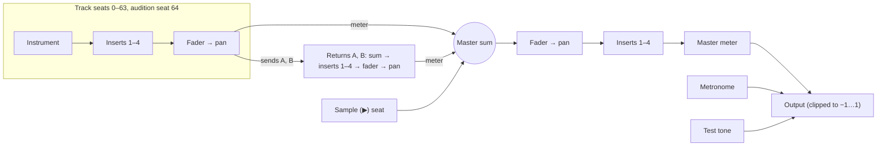

## 19. Sound, effects, sampler and mixer (round 4)

### 19-1. Where the sound material lives

> Superseded by 23-1 and 23-9: the sound pack is one tar per sound plus a catalog, stored in `$XDG_DATA_HOME/meloet/sounds/` and fetched by meloet itself; `scripts/fetch-sounds.sh` is gone. The reasons below still hold.

- The repository holds only **how to build** the sounds (`tools/sounds/`: source URLs and sha256, what to take, the scripts, the attribution text in `licenses/sounds.json`). The built sound pack goes on a GitHub Release. `cargo build` never uses the network. Sounds that are not found are not shown on the shelf (spec: 「素材がなかった音色は、棚に出さない」).
- **Why not elsewhere**: Git LFS takes the owner's free transfer quota on every clone and soon stops on a public repository. In the repository itself it stays heavy for ever (and files of 100 MB cannot be pushed). Fetching from the original sites loads them and breaks when they change. Release assets allow up to 2 GiB per file with no stated total limit (`docs/history/research/effects-decoders-hosting.md`). A download in `build.rs` breaks offline builds (docs.rs, Nix, Debian).

### 19-2. The built-in effects are our own code

- 4-band EQ, compressor, reverb, delay, chorus and limiter live in `crates/meloet-sound/src/effects/`, built from public designs (RBJ "Audio EQ Cookbook" or Simper's SVF, Giannoulis et al. JAES 2012, FDN or Freeverb). No code is copied from GPL parts (synfx-dsp, nih-plug's `plugins/`).
- **Why**: the borrowable crates (fundsp, freeverb, …) each lack smoothing, denormal guards, or no-allocation on the audio thread; adding those costs as much as writing the effect, and we keep full control of licenses and audio-thread rules.
- Rules: no allocation while processing (delay lines are allocated at full length up front). Parameters move to their target over 10–30 ms on the audio thread. Each effect and instrument guards denormals itself (values below 1e-18 in feedback and filter state become 0; envelopes stop at −80 dB). If a block ends with NaN or infinity, the effect resets to 0 and that block is silent; the audio thread goes on.
- **FTZ/DAZ is not set**: the Rust docs call changing MXCSR denormals-are-zero immediate undefined behaviour (`core::arch::x86_64::_mm_setcsr`; rust-lang/rust #123123 is open). The guards alone pass the denormal tests at the same speed.
- **The limiter does not look ahead**: look-ahead would delay everything through the master, and so key → sound. It attacks at once, releases smoothly and finally clips at the ceiling.

### 19-3. Effect parameters (four effects not in the spec; the owner's decision)

Names follow the spec's naming rules; reverb and delay are as in spec chapter 3 (`docs/spec/3-bands.md`). Code: `meloet_model::effects`.

| Effect | Heading | Name | Range | Default | Common name |
|---|---|---|---|---|---|
| 4-band EQ | 低い音 | 高さ | 20–1000 Hz | 100 Hz | frequency |
| | | 上げ下げ | −18.0–+18.0 dB | 0.0 dB | gain |
| | 中の低い音 | 高さ | 100–5000 Hz | 500 Hz | |
| | | 上げ下げ | −18.0–+18.0 dB | 0.0 dB | |
| | | 幅 | 0.2–4.0 oct | 1.0 oct | Q |
| | 中の高い音 | 高さ | 500–16000 Hz | 3000 Hz | |
| | | 上げ下げ | −18.0–+18.0 dB | 0.0 dB | |
| | | 幅 | 0.2–4.0 oct | 1.0 oct | |
| | 高い音 | 高さ | 1000–20000 Hz | 8000 Hz | |
| | | 上げ下げ | −18.0–+18.0 dB | 0.0 dB | |
| Compressor | — | おさえはじめ | −60.0–0.0 dB | −18.0 dB | threshold |
| | | おさえる強さ | 1.0–20.0 : 1 | 4.0 : 1 | ratio |
| | | おさえるまで | 0.1–100.0 ms | 10.0 ms | attack |
| | | もどるまで | 10–1000 ms | 100 ms | release |
| | | 持ち上げ | 0.0–24.0 dB | 0.0 dB | makeup gain |
| Chorus | — | ゆれの速さ | 0.05–5.00 Hz | 0.80 Hz | rate |
| | | ゆれの深さ | 0–100 % | 50 % | depth |
| | | 広がり | 0–100 % | 100 % | |
| | | ミックス | 0–100 % | 50 % | |
| Limiter | — | 上限 | −12.0–0.0 dB | −0.3 dB | ceiling |
| | | 持ち上げ | 0.0–12.0 dB | 0.0 dB | gain |
| | | もどるまで | 1–1000 ms | 100 ms | release |

### 19-4. Song file version 3: the mixer

> Superseded by 20-6, 21-13 and 22-3: the file is now version 6, and versions 1–5 can no longer be read. The mixer shape and reading rules below are still those of version 6.

```json
{"song": {
   "tracks": [{"id": 1, "gainDb": -4.8, "pan": -20, "sends": {"a": -15.0, "b": null},
     "inserts": [{"effect": "compressor", "params": {"threshold": -18.0, "…": 0}}, null, null, null], "…": "…"}],
   "mixer": {
     "returns": {"a": {"gainDb": 0.0, "pan": 0, "inserts": [{"effect": "reverb", "params": {"decay": 2.4, "…": 0}}, null, null, null]},
                 "b": {"gainDb": 0.0, "pan": 0, "muted": true, "inserts": [{"effect": "delay", "params": {"…": 0}}, null, null, null]}},
     "master": {"gainDb": 0.0, "pan": 0, "inserts": [{"effect": "limiter", "params": {"ceiling": -0.3, "…": 0}}, null, null, null]}}}}
```

- Faders and sends in dB (`null` = −∞), pan −100…100. One entry per insert slot, `null` when empty. Parameters are written by **name** (so the table can grow or be reordered); steps by step name, switches as `true`/`false`. `muted` only when true.
- Reading: missing or unreadable fields take defaults; out-of-range values are clamped; an unknown effect leaves its slot empty; no readable `mixer` gives a new song's returns and master; a bad master pan becomes centre. An unknown instrument name becomes the sine stand-in (the song is kept).

### 19-5. WebGL budget before the mixer

- One more context for the mixer meters would have filled the budget of 12. So: the input meter's keys and velocity bar share area `inputMeter`; the sound settings' meter and keys share `settings`; all mixer strip meters are one canvas `mixerMeters` (even when scrolled). Today's count: chapter 7.
- A merged area is not opaque (HTML text sits between its slots): it paints only the slots and is clear elsewhere.
- Vertical mixer meters use the same `paintMeter` (with `vertical`) as horizontal ones. Return A/B levels come from `returnPeaks` and sit in `Levels` between master and tracks (`ui/src/gl/levels.ts`).
- **Why**: each merged pair are neighbours that change at the same moment, so one canvas means one surface shown per key instead of two (chapter 7: each one blocks the main thread). Far-apart areas are not merged: a bigger canvas sends more pixels at 60 Hz.

### 19-6. The `meloet-sound` crate

- Sampler, material loading, synth sounds, electro kit and built-in effects. It implements the engine's `Instrument` and `Effect` and owns no threads (core owns the loading thread).
- **Why**: the engine keeps routing and time; sound makers live apart, and the same audio-thread allocator watch runs on both.

### 19-7. The sampler

Numbers: `docs/history/measurements/2026-11-18-round4-sample-load.md` (spike `spikes/sample-load/`). Today's memory picture: 23-12.

- **All samples are kept in memory as i16** and turned into f32 while playing; the audio thread only reads arrays (no files, no mmap). **Why**: loading is fast (the grand piano, 281 FLAC files, in 0.12 s on 8 threads); memory (341 MiB) is the only cost. Streaming would need late-voice handling, a separate offline-render path and per-voice rings, which are hard to watch by machine. Tracks with the same sound share one `Arc`. If memory runs short: 3 layers, then no resonance, and only then streaming. Cutting sample tails was rejected by the owner after listening (only −50 dB sounds right, saving 28 MiB).
- **Grand piano**: 4 velocity layers (v2, v8, v12, v16; split 1–34, 35–64, 65–96, 97–127, never louder than recorded) + 88 release + 69 resonance + 4 pedal samples. A 5th layer costs +74 MiB.
- **The pack is FLAC 16-bit**: bit-exact with the i16 in memory. Vorbis is smaller but changes the sound and loads 1.5× slower.
- **Leading silence is cut** when the pack is built (19-8); it would add straight to key → sound (median 8.9 ms on the piano).
- **Loading is off the core thread** on 2–4 threads (not every core while someone plays). Unused sounds load only when chosen on the shelf. While loading: 「（名前）を読みこんでいます…」 (spec chapter 6).
- Open issue: if the OS swaps samples out, the audio thread waits on the disk. `mlock` would prevent it; not done for samples.

### 19-8. The sound pack format (tools ↔ sampler)

> Superseded in part by 23-1 and 23-9: shipped packs are one tar per sound plus `common-<version>.tar` and `catalog.json`. The folder below is what `tools/sounds/build.py` makes for development (`target/sounds/dev`), and each sound's tar holds the same `instrument.json` and `samples/`.

```
meloet-sounds-<pack version>/
  pack.json          {"format": "meloet-sounds", "version": 1, "pack": "…",
                      "instruments": {"grandPiano": "grand-piano/instrument.json", …}, "credits": "credits.json"}
  credits.json       [{"id", "title", "authors", "source", "license", "licenseUrl", "changes" (one English sentence for NOTICE)}, …]
  licenses/<id>/     license texts that came with the material
  grand-piano/instrument.json, grand-piano/samples/*.flac
```

**instrument.json** (version 1): `{"format": "meloet-instrument", "version": 1, "kind", "credits", "gainDb", "polyphony", "sustainPedal", "regions": [ … ]}`. Region fields (`crates/meloet-sound/src/sampler/bank.rs`):

| Field | Meaning | Default |
|---|---|---|
| `sample` | Path to a FLAC 16-bit file, mono or stereo, any sample rate | required |
| `keyLo` `keyHi` `root` `tuneCents` | Key range; the key the file sounds at (**key number = pitch heard**); fine tune | required; 0 |
| `velLo` `velHi` | Velocity range | 1, 127 |
| `trigger` | `attack`, `release`, `pedalDown`, `pedalUp` (CC 64) | `attack` |
| `gainDb` | File level (files are raised to −1 dBFS before 16-bit, lowered here, so quiet samples gain no noise) | 0 |
| `ampVeltrack`, `pitchKeytrack` | As in SFZ (%) | 100 |
| `attackMs` `releaseMs` | Volume envelope | 0, 200 ms |
| `rtDecayDbPerS` | Release sample quieter the longer the key was held (SFZ `rt_decay`) | 0 |
| `loopStart` `loopEnd` | Loop in frames, crossfade baked in; `loopEnd` is one past the last frame, at least 8 frames; also loops during release | none |
| `loopDecayDbPerS` | Fade while looping | 0 |
| `oneShot` | Plays to the end after key up | false |
| `rrIndex` `rrCount` | Round robin, 1…`rrCount` (SFZ `seq_position`) | none |
| `chokeGroup` (0–63) `chokedBy` (array) | Sounds that cannot ring together (hi-hats) | none |
| `pan` | −1…1 | 0 |

- An unknown region field is an error (catches typos); unknown top-level fields are skipped. Velocity → level follows SFZ `amp_veltrack`; pitch uses Catmull-Rom interpolation. When voices run out, the oldest voice nobody holds fades over 3 ms and the new note plays at once.
- Building the pack: every file starts 2 ms before it first passes −50 dB from peak, with a 1 ms fade-in. Each sound's `gainDb` makes C4 (kick for drums) at velocity 100 peak near −12 dBFS, as the synth sounds do. Per-sound handling (missing loops made by crossfade, the finger bass's octave shift of `root`, the drum kit's 16 mics mixed to stereo, round-robin counts) lives in `tools/sounds/build.py`; sources in `tools/sounds/sources.json` and `docs/history/measurements/2026-11-18-round4-sources.md`.

### 19-9. Tracks and engine seats

- **Tracks are pointed to by id**; the number shown is only order.
- **The record-armed track is the selected track** (spec 12-A). It cannot change during recording or count-in.
- **Engine seats are per track id** (`crates/meloet-core/src/play/seats.rs`): 0–63 are tracks (`MAX_TRACKS`), 64 is the audition seat (`AUDITION_SEAT`). A track keeps its seat; a new one takes the lowest free seat; reordering sends nothing. A seat is rebuilt only when its instrument kind changes, an undo brings back a deleted track, or the song is replaced. **Why**: rebuilding on reorder or delete would cut notes and reverb tails.
- **The keyboard plays into the selected track's seat** (`EngineCommand::SetPlayTarget`; `ClearPlayTarget` when there are no tracks).
- **Audition**: for a new track the instrument goes into the audition seat; Enter moves it, still sounding, to the new seat (`MoveInstrument`: held chords survive, nothing is built twice). For replace, the engine sets the track's instrument aside (`TryInstrument`); Enter keeps the new one (`EndTrial { keep: true }`, one undo step); cancel, Esc, closing the shelf, replacing the song or an output change restore it (`keep: false`). Setting aside happens inside the engine so a quick cancel never waits for the return ring. No recording during audition.
- **Meters**: read per seat, sent in track order. The core thread writes the order → seat table; the meter thread reads it under a `Mutex` (not the audio thread).
- **A track id is never reused**: new id = `max(next_id, highest id + 1)`, and deleting moves `next_id` past the deleted id.
- At most 64 tracks; the 65th is not added (the spec has no text for it).

### 19-10. Sounds in core

> Pack locations and the loading thread setup are superseded by 23-1 and 23-9. `MELOET_SOUNDS_DIR` exists only in dev-hooks builds (23-11).

- **Sounds are made in one place** (`crates/meloet-core/src/instruments.rs`). Sine, synth lead, synth bass, warm pad and electro kit always exist; sample sounds only when present. A track whose sound is missing plays the sine stand-in and keeps its name, so no notes are lost.
- **Loading** (`crates/meloet-core/src/sounds.rs`, `play/sounds.rs`): one thread outside core, one sound at a time, 2–4 threads inside `load_instrument`. A loading seat gets a silent instrument and is rebuilt when the sound is ready (one path, no separate waiting state). Kept sounds: the song's, the audition row, the previous row while the shelf is open, and sample ▶ sounds. The last `Arc` is dropped on the core thread, never on the audio thread (tests count them). A sound that fails to load leaves the shelf and its tracks play sine.
- **A key on a track whose sound is loading** shows a status line text (the owner's decision; `StatusMessage::InstrumentLoading`). While loading, core sets `wants_loading_key` and the MIDI thread reports only the first key (`Input::KeyWhileLoading`); piano roll keys (`Command::Audition`) too. Not during audition (the shelf row says it). **Why**: the status line table lives in one place in core (`Model::status`); the screen has no status texts of its own.
- **The sample ▶**: one extra engine seat holding a `meloet_sound::phrases::PhrasePlayer` (it sends the phrase's notes at frame positions it counts itself). It feeds only the master sum and has nothing to do with meters, keys, lanes, mute, solo or recording. It plays only while the shelf and output are open; 4 s + 2 s tail.
- **Replacing an instrument fades**: the old one ramps down over 10 ms on top of the new one, then returns through the return ring (`SwapInstrument`, `TryInstrument`, `EndTrial`, sample).
- **Drums**: when the target track's instrument is in the drums group, the draw tool does not apply scale lock (spec chapter 3).

### 19-11. The mixer signal path



- **Track**: instrument → inserts → fader → pan → master sum; the meter is after the pan.
- **Sends are post-fader** (spec: 「フェーダーを下げると、響きも下がる」) **and post-pan** (the send carries what you hear; a reverb of a left-panned part leans left).
- **Mute and solo** stop the seat's lane (chapter 18), so sends go quiet too, at one check per seat. Returns ignore solo. A muted return is sent as fader 0; its effects keep running, so the tail is there when unmuted.
- **Returns A/B**: sends → inserts → fader → pan → master sum; meters at the return output.
- **Only the master puts its inserts after fader and pan**, so the limiter still holds the ceiling when the master fader is at +6 dB. The master meter shows the output before clipping.
- **Audition seat**: a normal strip. During new-track audition core sends the sends a new track of that group gets (`meloet_model::mixer::new_track_sends`). On Enter the step is sent before `MoveInstrument`; an empty seat takes values at once, so nothing changes across Enter.
- **Sample seat**: master sum only. **Metronome**: added after the master meter (skips master fader and limiter; the meter shows only the song). **Test tone**: added after the master strip, so 「音が出るか」 works with the master down.
- **Pan law** (`meloet_engine::pan_gains`): balance; centre is 1.0 both sides, panning lowers only the far side along a quarter cosine. **Why**: no level change at centre (older songs sound the same), no side above 1.0, stereo sides never mixed. A −3 dB law would change older songs.
- **Smoothing**: fader, pan and send gains ramp linearly over exactly 20 ms (`RAMP_S`, `crates/meloet-engine/src/mixer.rs`). Seats with no instrument and an engine with no stream (`Engine::settle`) jump at once.
- **Adding, removing, replacing effects**: core builds them off the audio thread (`meloet_sound::effects::create`, `set_param`); `EngineHandle::set_effect` calls `prepare` and sends them through the ring. The slot crossfades old → new over 10 ms (`FADE_S`). The old effect goes back through the effects return ring (seats × 8) and core drops it. Parameters: `SetEffectParam` → `Effect::set_param` (the effect smooths).
- **Bypass** (spec 13-A, 86-1): `EngineCommand::SetBypass`, a 10 ms swap between processed and dry. **The effect keeps running while bypassed.** **Why**: bypass is for comparing, so on return the reverb tail and compressor state are where they would be had it stayed on. Plugins too (blocks still go to the plugin host). The mark belongs to the slot, so an effect that arrives later (engine rebuilt, plugin loading) starts bypassed. A bypassed slot's latency is not counted.
- **Reordering inserts** (86-2): `EngineCommand::MoveEffect {from, to}` rotates slots with their effects and marks (no rebuild). One effect cannot sound in two places, so **the moving effect fades out over 10 ms, the slots rotate while it is out, and it fades back in at its new place**. If the move cannot change what is heard (moving slot empty or bypassed, or every slot passed is silent), it rotates at once. Values arriving during the move use the new index; a new move or replace finishes the old one on the spot.
  - Open issue: at the rotation the moved effect's input jumps; its output is 0 then, but long-memory effects (reverb) carry a little of the jump into the tail.
- **Core side of reordering** (`inserts_follow` in `play/mixsync.rs`, 21-12): at the start of `after_change`, each strip compares "what the engine was last told" with the song by `InsertId` (`meloet_model::mixer::insert_moves`), rotates its own records (told values, bypass marks, plugin ledger places, selected slot, shelf slot) and sends `EngineOp::MoveInsert`. Steps, undo, redo and history jumps all use this path; `sync_mix` then finds the same ids in place, so nothing is rebuilt.
- **What core sends** (`play/mixsync.rs`): song values with `mix_previews()` on top, compared per strip with what the engine was last told; only differences go out (`EngineOp::Strip`, `Sends`, `Insert`, `Param`, `Bypass`). Every change (step, undo, redo, song replace, preview, `CancelMixPreview`) takes this one path. An effect is rebuilt only when its kind in a slot changes (also kept across song replacement). A deleted track's seat is emptied with `ClearSeat`. Mixer commands reach the engine even with no stream. A track's lane is resent only when its clips change (resending on every change cut notes when a fader moved).
- **Output or sample rate change**: `Engine::prepare` re-prepares every effect (tails cut, values kept). If the engine was rebuilt, core resends from its ledger (`crates/meloet-core/src/mixbook.rs`).
- **NaN and infinity at the sums**: a track or return that is not a number after its fader is left out of the sums and meters for that block, and the output zeroes non-number frames. **Why**: otherwise one NaN instrument makes the master sum NaN and the limiter silences the whole song. One extra check per frame.
- **Default mix of reverb and delay** (the owner's decision): 30 % on track or master inserts, 100 % on returns. One place: `meloet_model::mixer::Insert::new_on`.
- **Watches**: `crates/meloet-engine/tests/mixer.rs` (routing, frame by frame, fake effects) and `crates/meloet-sound/tests/mixer_rt.rs` (no allocation with real effects on 16 tracks while editing).
- **Cost**: 16 synth tracks with EQ + compressor each, reverb, delay and limiter: 450 µs per 256-frame block at 48 kHz (8.4 %) against 316 µs without the mixer (busy PC; `docs/history/measurements/2026-11-18-round4-mixer-cpu.md`).

## 20. Plugins and SF2 (round 5)

Research: `docs/history/research/plugin-formats.md`, `plugin-ipc.md`, `sf2-playback.md`. Measurements: `docs/history/measurements/2026-11-19-round5-ipc.md` (spike `spikes/plugins/ipcbench/`).

### 20-1. One plugin host process per plugin

- **Instances with the same key (format + ID) share one `meloet-plughost` process.** DSP and window live in the same process (LV2 instance-access; `docs/history/report.md` 3-4).
- **Why**: memory (80 instances: 688 MB PSS one per process, 385 MB grouped by plugin, 380 MB all in one); real-time limits (rtkit allows 15 processes and 25 threads per user by default, and children do not inherit real-time; grouping makes the count the number of plugin kinds); heavy LV2 bundles are read once per world (an LSP bundle: 1 s, 119 MB); and a crash takes down one plugin's instances, which matches the spec's per-name 「（名前）が止まりました…」.
- meloet's own audio thread priority: 23-10. More busy instances than audio threads in one process: 23-14.
- Possible later: a separate process for a plugin that crashed or that the user picks. Not built.

### 20-2. Audio between processes

- **Shared memory (memfd sealed with `F_SEAL_SHRINK`/`F_SEAL_GROW`) and futexes in it (no `FUTEX_PRIVATE_FLAG`), round-tripping inside the same block.** The audio thread writes input and events (MIDI, parameter changes, position) and wakes the child; the child marks the block serial as done and wakes it back. No spinning.
- **Why**: with both sides SCHED_FIFO a round trip is p50 8–13 µs and 80 in a row p99 under 0.75 ms. Delaying a block per process would add 5.33 ms per crossing (27 ms for an instrument with 4 effect plugins). Carla and yabridge do the same. Futex vs eventfd was within noise; a futex needs no fd. Spinning was worse without real-time.
- **Audio-thread rules**: still no allocation (memory and rings are made on the core thread). **The only wait is a futex wait with a timeout** for the child's answer: not a lock, not something another thread holds, and never longer than a limit taken from the time left in the block. If the previous block's answer is missing, the slot is skipped without waiting.
- **Missed deadline**: that block is silent (instrument) or dry (effect); the next block waits again. A slot is **stopped** only when nobody took the request and the host's progress counter did not move across two deadlines (and no host thread is inside a plugin, 23-14), or one thread held the request longer than `HANG_MS` (5 s, `crates/meloet-plugin/src/ipc/ends.rs`, 20-14). Progress still moving means "busy", not stopped. All slots of one host stop together through a mark in the shared header. **Why**: 16 Surge XTs starting a chord together take 4 blocks; that is only slow, and a stopped plugin stays silent until reloaded.
- A watcher learns of a child's exit by pidfd and kills an unresponsive child with `pidfd_send_signal`. Lengths and positions written by the child are range-checked. Non-number frames stop at the sums (19-11).
- **Instances in one process run in parallel** on `min(slots, CPUs / 2, 4)` audio threads that take slots without waiting; a thread that cannot get real-time ends. The engine first asks every plugin instrument in a slice (`Instrument::ask`), then runs tracks in order and waits only where the sound is needed. `PLUGIN_WAIT_SHARE` is 0.9. (16 Surge XT + compressor: block p99 1.7–1.8 ms; `docs/history/measurements/2026-11-19-round5-plughost.md`.)
- **The engine sums latencies** (`Instrument::latency()`, `Effect::latency()`) per track every block for read-ahead (20-8), without core.
- Children's stdout and stderr go to `/dev/null` or a log before start and are never used to talk.
- A child's audio threads get real-time themselves (`sched_setscheduler` with `RLIMIT_RTPRIO`, else rtkit); failure is logged only.

### 20-3. Cost of copying plugin state (15-C)

- Getting state takes 1.2 ms on Surge XT (50–67 KB), under 0.1 ms on LSP and Zam, on the plugin host's main thread; a visit takes it twice without freezing anything.
- Restoring: Surge XT reloads its patch in the next `process` (up to 38 % of a block). So restores to one process are spaced one block apart (`space_states`, 20-13).

### 20-4. Scanning

- **One child process per bundle**, 30 s timeout per bundle (spec Y13). VST3 `moduleinfo.json` gives the class list without loading the module.
- Results are remembered by path, modified time and size; later scans look only at changed bundles.
- The scan child unloads each plugin after probing: slower (38 s vs 17 s for 309 bundles) but at most 0.33 GB per child instead of 1.5 GB (LSP). Memory won. (With an X display it is slower still: 20-14.)
- A cache with another `SCAN_CACHE_VERSION` (now 2, `crates/meloet-plugin/src/scan.rs`) is dropped and everything is rescanned.

### 20-5. Keys for one plugin in several formats

- **The key stored in songs is exact per format**: `vst3:<Audio Module Class cid>` or `lv2:<URI>`. Parameters and state differ between formats (Surge XT: 2855 VST3 vs 775 LV2 parameters).
- **The shelf merges rows by a display-only key** (`MergeKey`, `crates/meloet-plugin/src/key.rs`): instrument-or-effect + name + vendor, lower-cased, with format names and tails like "(Stereo)", "VST3", "LV2" removed. Both name and vendor must match; prefixes or different kinds never merge ("Surge XT" vs "Surge XT Effects").
- **Why**: no format has a cross-format ID, and real plugins disagree (LSP's names and vendors differ by format). A wrong merge mixes different plugins, so failing to merge (two rows) is the safer error.

### 20-6. Song file version 4

> The file is now version 6 (22-3; versions 1–5 cannot be read) and the protocol version 27. The shapes below are still those of version 6.

- A track's instrument: `{"kind": "builtin" | "plugin" | "sf2", …}`. Plugin: key (it names the format), name, vendor, **path** (for 「前はここにありました: （場所）」, spec chapter 6) and state. SF2: file name, sha256, bank, program, sound name. An insert: `{"effect": …}` or `{"plugin": …}`, plus `bypassed` when true.
- Plugin state is base64 inside the song JSON (Surge XT: 50–67 KB); the song stays one file with the safe write and `.prev` (chapter 14).
- **Entries for plugins and SF2s that are not found are kept as read and written back** (spec 「曲の中の設定は消さずに残す」); unknown fields inside them go into `kept`. A plugin without a key, an SF2 without a file name, or an impossible bank/program becomes the sine stand-in.
- The shelf's 「あとから入れたもの」 (hundreds of rows, rarely changing) is sent in its own protocol section `library`, apart from `shelf`.

### 20-7. SF2

- **Our own reader** (`crates/meloet-sound/src/sf2/`, ported from `tools/sounds/sf2.py`): user files must never crash us, so damaged files are tested. Only the chosen preset's samples are read.
- **Playback extends the sampler**: 6-stage volume envelope (decay and release linear in dB over 96 dB), key-scaled hold and decay, mod envelope, two LFOs, 2-pole low-pass, exclusiveClass, loop modes 0/1/3. SF2 data becomes `Region`s at load; the audio thread never sees SF2.
- **Why**: most FluidR3 presets use the filter, mod envelope and sustain; without decay → sustain, pianos ring for ever. `rustysynth` (MIT) drops modulators, has an 80 dB range and keeps the whole file in memory (reference only). `oxisynth`, `xsynth`, `fluidlite` are LGPL.
- **Matching FluidSynth** (how FluidR3 is usually heard on Linux): initialAttenuation × 0.4 (one constant), no default velocity → filter modulator, 96 dB range. FluidSynth (LGPL) source is only read; comparisons run `/usr/bin/fluidsynth -F` as a separate process.
- Not built: general modulators, sm24, SF3 (reported as 「…読めませんでした」).
- Added files are copied to `$XDG_DATA_HOME/meloet/sf2/` (spec 「meloet の中にうつす」). Songs link to files by **name**, bank and program (spec 「同じ名前の SF2 を足すと、つながる」); a new file with the same name replaces the old. sha256 is computed on copy and kept in `<name>.sf2.sha256` (hex and length) so big files are not hashed on every start; it is only recorded (a mismatch still plays).

### 20-8. Plugin latency compensation (the owner's decision)

- **Notes are sent early instead of delaying audio**: track t with latency L_t (instrument + inserts, as reported by VST3 `getLatencySamples` or the LV2 `lv2:latency` port) reads its notes and CCs L_t frames ahead, so its audio reaches the master sum in time.
- **Why**: delaying audio (the usual DAW way) aligns everything to the slowest track, so the track being played would also be late by the others' latency. Early notes make live playing late only by its own track, with no delay lines. (Audio clips are read ahead the same way: 22-8.)
- Master insert latency is the same for everything: not compensated, but added to the position at the ear (chapter 11). Return insert latency only delays tails: not compensated.
- The first L_t frames after play starts cannot be early. A latency change applies from the next block.

### 20-9. CLAP (the owner's decision)

- **Not supported**; VST3 and LV2 only. Every CLAP plugin on this PC also exists as VST3 or LV2. The shelf's format mark, 「＋数」 and format order leave room for CLAP; the scan ignores `.clap`.

### 20-10. Scanner and plugin host manager (`crates/meloet-core/src/plugins/`)

- **Scanner** (`scanner.rs`): one `meloet-plughost scan` child per bundle, at most half the CPUs and 4 at once, at nice 19. Not SCHED_IDLE: the 30 s timeout is wall-clock and a busy PC would make slow plugins look hung.
  - Timeout: 30 s since the last `Probing`. If the child dies or goes silent after `Probing`, only that plugin is marked stopped and the rest of the bundle is scanned with `--skip`.
  - The cache (`$XDG_CACHE_HOME/meloet/plugins/scan.json`) is written every 2 s and at the end by its own thread `meloet-scan-save` (newest request only). No cache = first scan (everything, with the band); otherwise changed bundles only, without the band, and the status line speaks only about new plugins.
  - **The scan starts after the screen's hello (`subscribe`)**, or after 10 s (`PluginOptions::wait_for_screen`). **Child processes are started one at a time, app-wide** (`meloet_plugin::launch::spawn`). **Why**: under VS Code's CodeLLDB, concurrent spawns left meloet stopped with no window, and spawns overlapping WebKit's library loading showed as pauses; the window also comes up sooner.
  - One scan at a time; 「もう一度ためす」 and 「場所を足す」 wait for the running scan. 「もう一度スキャン」 skips stopped plugins (spec Y13). Retrying a bundle says 「今度は入りました」 if anything got in or nothing stopped.
- **Plugin host manager** (`Hosts`, `hosts.rs`): one long-lived thread `meloet-plugins` spawns, talks to and watches every child (`PR_SET_PDEATHSIG` fires when the spawning thread ends). Up to 16 slots of one `PluginKey` per process; the 17th opens a new process. Calls answer by callback; the core thread never waits.
  - Every 10 ms it checks pidfds and `PluginWatch::stopped()`; a stopped host gets `SIGKILL` → wait → all its slots stopped. No socket answer in 5 s (30 s for Load) also means stopped. Detection takes about 1–11 ms. Recording goes on when a plugin stops.
  - Reload: a new process, restoring the last known state plus parameters moved since. Remove: the effect slot empties, the instrument becomes sine (one undo step).
  - Removal order: take the `PluginSlot` out of the engine and drop it first, then `Hosts::unload` (the other order makes the slot look stopped).
- **Children start with posix_spawn, not `pre_exec`**: fds are passed as stdio and moved by the child, which also sets nice and `PR_SET_PDEATHSIG` itself. **Why**: forking a large meloet slowed first start by 0.6–0.8 s and could cause copy-on-write faults on the audio thread when a plugin is added during playback. The fd copies held by `Command` must be dropped after spawn, or a crashed child's socket never looks closed.
- Only scan children get `QT_QPA_PLATFORM=offscreen`.
- `meloet-plughost` sits next to the meloet executable; without it meloet runs with no plugins. `unsafe` stays in `meloet-plugin` (`ipc`, `launch.rs`), not core.

### 20-11. Shelf, plugin and SF2 instruments, saving (`crates/meloet-core/src/{catalog.rs,sf2store.rs,play/plugs.rs,plugins/housed.rs}`)

- **The shelf's 「あとから入れたもの」** (`catalog.rs`): scan results merged by `MergeKey`. Format used: the user's choice (kept in settings) → used in the song → can open a window → VST3 → LV2. The shelf re-reads the scan cache only at start, at scan end, and on the 2 s cache writes. Favourites live in settings (reverb and delay by default).
- **Adding an SF2** (`sf2store.rs`): from the PC file window or the first file dropped. A background thread checks it (`Sf2File::open`), then copies it with temp file → sync → rename → folder sync. Unreadable files and SF3 are refused; not accepted while recording.
- **Plugin loading by ticket** (`play/plugs.rs`): a ledger per place (track instrument, insert slot). `Effect::LoadPlugin` → `Hosts::load_with` (load + state in one go) → `Input::PluginLoaded` / `PluginUnreadable` → `EngineOp::Plug`. A load counter tells stale answers apart. A seat is silent while loading.
- **Unload when the engine gives the slot back** (`plugins/housed.rs`): dropping the wrapper on the core thread calls `Hosts::unload`.
- **Saving**: only if the song has plugins, all states are requested and the thread `meloet-save` waits up to 3 s, then writes; late or stopped plugins keep the state the song knows. The core thread never stops. A change during the save leaves the song "changed". **The recovery file never asks plugins**; it uses the last known state (window changes reach the song as 15-C steps).
- **Missing things**: no pack → sine stand-in. No SF2 → sine; adding one with the same name links it; 「曲から外す」 is one step. No plugin → instrument sine, effect slot empty, settings kept; a later scan that finds it loads it automatically.
- Real-plugin test: `cargo test -p meloet-core --lib -- --ignored surge_xt_sounds` (Surge XT VST3 saves and reopens with the same sound).

### 20-12. Protocol version 18: windows, plugin parameters, the rest of design item 86

> The protocol is now version 27 (`crates/meloet-protocol/src/lib.rs`, 22-12, 23-7). The rules below still hold.

- Version 18 removed the builtin-only copies (`TrackView::instrument`, the old `inserts`/`InsertsView`, `ShelfView`'s `favorites`, `selected`, `current`, `loading`, `sample`, `selected_effect`, `SampleView`). Open: the builtin-only intents (`ShelfSelect`, `PlaySample`, `ToggleFavorite`, `ShelfSelectEffect`) and status texts (`AuditionNewTrack`, …) are still in the protocol.
- **A window is pointed to by its place** (`Option<PluginSlotRef>`; `None` = the plugin on audition): one plugin has at most one window. Opening, bringing to front and the list row are all `OpenPluginWindow`. Reordering moves the window's place and the selection with the content.
- **Screen-only**: opening and closing the status line's window list (it closes with menus, spec chapter 3), its 「プラグインの窓が N つひらいています」, parameter search, folding groups (all names are in `ParamTable`), the search status text, and starting folded above 40 items.
- **Values are 0–1** for every plugin parameter (VST3 normalized; the host scales LV2 by range); steps are n / (steps − 1). Value text comes from the plugin. Value and text may be unknown (`None`).
- **Moving a parameter**: `SetPluginParam {slot, table, param, value, commit}`, with `commit` as for built-in effects (`false` sound only, `true` one step, Esc `CancelMixPreview`). Even `false` returns value and text in `paramValues` (the plugin writes the dragged row's text).
- **Typing** (86-6): `TypeParam {param, text}`; core reads numbers for built-in effects, the plugin for plugins. Clamped input says `StatusMessage::ParamClamped`.
- **Keys on faders, pan, sends** (86-7): each press sends `commit: false`; one second after the last key is released (or focus leaves) the screen sends `commit: true`. `TrackView::send_defaults` serves Home on sends.
- **Master with no output** (86-8): 「出口なし ▸」 when `outputs.chosen` is `null` or `outputs.chosen_state` is `missing`.
- **15-C** (a window visit = one step) needs no protocol change: `song.undo_count` goes up by one.
- Open issue: `ui/src/bridge/fake.ts` still builds scenes from builtin-only fields with its own types (`FakeState`, `FakeTrack`, `FakeShelf`); it should use protocol fields only.

### 20-13. Bypass, reorder, replace, typing; windows and parameters in core

- **Steps**: `StepKind::Bypass`, `MoveInsert`, `ReplaceEffect`. A replaced-in effect starts unbypassed; undo brings back the old effect with its settings and mark. Replacing with the same kind or plugin key is not a step.
- **What is picked** (`Picked`, `play/mixer.rs`): a built-in effect slot or a plugin (by key); it follows reorders, undo, redo and history jumps (`inserts_follow`). Window kind comes from the scan cache (`EditorKind`).
- **The shelf's 「入れかえる」** (`Mode::ReplaceEffect`): the 「空き ＋」 path ending in `replace_effect`; works while recording.
- **Typing for built-in effects**: `meloet_model::effects::ParamSpec::read` reads the leading number (full-width digits and 「−」 too) in the parameter's unit, converting 「500 ms」, 「1.5 s」, 「2 kHz」. No leading number → `ParamRejected`, no change. Out of range → clamped and `ParamClamped`, even when the value is unchanged.
- **Status line**: add, remove, reorder, replace, bypass, restore (86-9) are core notices. `MixerPassesBy` shows only when `ToggleBand` opens the mixer; a slot both bypassed and stopped is listed as stopped.
- **Stopped notices vs. "show me" answers**: `PluginStopped` stays until reload or removal and ranks above ordinary notices (chapter 10). But `MixerPassesBy`, `PluginWindowsOpen` and `PluginWindowLarge` — answers to what the user just asked to see — show once above it (`asked_to_see` in `state.rs`); a newly stopped plugin still wins. **Why**: the mixer summary names stopped slots itself (the owner's decision) and would otherwise never be seen.
- **Rules ↔ plugin host** (`play/{windows.rs,params.rs,plugs.rs}`, `service.rs`): rules emit `Effect::AskPlugin {ticket, ask}`; answers and the plugin's own news return as `Input::PluginSaid {ticket, said}`. Rules never wait; answers to one plugin come in order (one hosts thread).
- **Windows are kept by ticket** (`windows.rs`) and turned into places when shown, so reorders and audition → track need nothing. `sync_windows` drops rows of plugins that went away, stopped or reloaded. Unrequested "opened" news is ignored. Window kind: from the loaded plugin (`PluginSaid::Editor`), before that from the scan cache.
- **The 0.2 s** for 「ひらくのに時間がかかる」 counts from the intent; core wakes at `Model::wake_at_us` and feeds a `Tick`.
- **A 15-C visit**: state is asked on `WindowEntered` and again on `WindowLeft`, × or `ClosePluginWindow`; different bytes make one step `set_plugin_state(…, PluginChange::Window)`. The plugin already has that state, so the ledger (`Plug::plugin`) is updated first and nothing is restored. Undo/redo use `Effect::SetPluginState`. Plugins on audition make no visits.
- **Undo to "as first loaded"**: before the first change, the plugin's state is asked once and kept (`Plug::base`), and restored when the song state goes back to empty; if unknown, the plugin is reloaded.
- **Late answers** (a random test, 300 seeds × 800 actions, checks that song and plugin agree): answers asked before a restore are not used (`visit_overtaken`; panel steps matched by `StateAsk::Param::puts`). Before the panel changes the plugin, the visit is cut (`cut_visit`), giving "window step, then panel step"; the ongoing visit continues from the new state (`visit_goes_on_from`). One panel drag at a time; others end it and restore its value. A visit interrupted by a stopped process ends as one step when 「もう一度読みこむ」 brings the plugin back with its window changes (`Hosts` remembers them).
- **Spacing restores** (20-3) lives in `Hosts::space_states`: `set_state` to one process waits one longest block (1024 frames) between calls, keeping order.
- **Parameter lists** (`params.rs`): requested for the picked, sounding plugin; the new list replaces the old only on arrival (no empty panel on undo). Stale after re-picking, `ParamsChanged`, a restore, or a reload. Groups follow first appearance of their names.
- **Values out**: changed rows are sent together as `Effect::ParamValues` at most every 33.334 ms (`wake_at_us` names the next time). Window moves, `SetPluginParam` answers and typing share the path.
- **Typing for plugins**: `ReadText`, then the clamped value is set and state asked; the status text comes with the answer. With no text from the plugin, the 0–1 value with two decimals is shown.
- **`ClosePluginWindow`** is not sent by the screen (the owner's decision); it stays for the fake, and core treats it like the window's ×.
- Real-plugin test: `cargo test -p meloet-core --lib -- --ignored surge_xt_a_visit` (needs `DISPLAY`). Surge XT returns restored stepped values just inside the step (1 → 0.995).

### 20-14. Windows and parameters in the plugin host (`crates/meloet-plughost/src/{window.rs,control.rs,formats/}`, `crates/meloet-core/src/plugins/hosts.rs`)

- **Windows live on the plughost main thread**, which makes its own X11 top window (Xwayland under Wayland) and embeds the plugin view (VST3 `IPlugView::attached` with `kPlatformTypeX11EmbedWindowID`; LV2 X11UI with `ui:parent`). One `poll` waits on the socket, the X connection, and VST3 `IRunLoop` fds and timers; LV2 `ui:idleInterface` runs every 16 ms. Audio threads (`rt.rs`) never wait on it, so a frozen window does not stop sound.
  - X via x11rb over libxcb (`docs/history/report.md` 3-1), connected at the first window. One `IRunLoop` per process (`formats/vst3/runloop.rs`). Title = plugin name; front via `_NET_ACTIVE_WINDOW` (source 2) and raise.
- **`Opening` and `EditorOpened` are separate**: `Opening` is written before the window is made; `EditorOpened` on our MapNotify (or after 0.5 s). **Why**: making the view blocks in the plugin for 10–200 ms.
- **Size**: VST3 `getSize`, `IPlugFrame::resizeView`, and `checkSizeConstraint` → `onSize` for resizable views. LV2 `ui:resize`, or follow the plugin's child window (`SubstructureNotify`, e.g. Dragonfly); LV2 windows are not user-resizable. "Larger than the screen" uses the monitor (RandR) of the window's top-left.
- **Enter and leave**: on FocusIn/FocusOut, X is asked where focus is. Menus and dialogs of the same X client count as inside, re-checked every 0.1 s.
- **Closing**: the plugin detaches first (`removed`; LV2 `cleanup`), then the top window is destroyed (the other order crashes the process in Xlib). `EditorClosed` only when the user presses × (after `EditorLeft` if inside).
- **Parameter list** (`Params`): names, groups, types, step texts, defaults, current values and texts in one reply (2854 Surge XT parameters in 33 ms).
  - VST3: hidden, read-only and bypass parameters are left out; `stepCount` 1 = switch, 2–128 = steps, else continuous. Groups = top level of the `IUnitInfo` tree, except that **a single unit under the root with its own children (JUCE's "Root") is read as the root**.
  - LV2: control input ports and `patch:writable`, without `notOnGUI` and host switches (`lv2:enabled`, `lv2:freeWheeling`). Groups = the level under the root via `pg:subGroupOf`. Text from scale points or number + `units:unit`.
  - LV2 `patch` values stay `None` until set or reported (Surge XT's LV2 ignores `patch:Get`). State includes only known values.
- **Text → value** (`ReadText`): VST3 `getParamValueByString` (with and without the unit); LV2 by scale points, on/off, numbers and the known range.
- **Checking typed text for VST3** (`formats::judge_typed`): JUCE's VST3 (Surge XT) accepts any text and silently moves bad input to an end (「3 dB」 became −48 dB), so meloet reads the text first. A number with no unit or the ends' unit is compared with the numbers in `getParamStringByValue(0)` and `(1)`: outside → nearest end, "clamped"; inside → the plugin's value. A number with another unit (「2 kHz」) → the plugin's value. Text without a number counts only if the plugin's value turned back into text equals it, ignoring case (「Hall」, 「On」); else unreadable. LV2 skips this.
- **Full-width input** is turned to ASCII for every plugin first (`formats::half_width`, the same characters as `ParamSpec::read`).
- **Values moved in the window**: VST3 `beginEdit`/`performEdit`/`endEdit`; LV2 `write_function` (control ports, `patch:Set`) and `ui:touch`. They reach the audio thread next block, unthinned; core hears at most one per parameter per 33 ms, always including the last value, with the plugin's text. Automation-moved values are reported only for watched slots (`Request::Watch`, `Notice::ParamAutomated`; 21-8).
- **LV2 window ↔ DSP**: atom messages and control outputs travel in two byte rings; the audio thread writes only while the window is open, without allocation.
- **Hosts** reads each child's socket every 10 ms even with nothing pending (`HostNews::Window…`, `HostNews::Notice`) and remembers window-moved values for reloads.
- **Re-syncing the VST3 controller** (`Vst3Controller::resync`): JUCE controllers copy processor values only in `setComponentState`, and Surge XT loads state in the next audio block, so the panel lagged one undo behind; patch changes in the window send only `restartComponent(kParamTitlesChanged)`. After a restore, `kParamTitlesChanged`, or the user leaving the window, once the audio thread has gone 2 blocks further (0.2 s when stopped), the component's `getState` is fed again to the controller. If listed values changed (always for `kParamTitlesChanged`), `ParamsChanged` makes core fetch the list again. Waiting 2 blocks lets window-moved values reach the component first. `kParamValuesChanged` raised inside our own `setComponentState` is ignored.
- **Scanning with an X display** is slower (LSP's 194 VST3 plugins: 8 s → 38 s, as each `createView` connects to X) but `DISPLAY` is kept: without it every one is recorded as having no window.
- **A plugin that takes many blocks is slow, not stopped**: Surge XT loads wavetable patches inside the audio callback (112 ms in one block). The old 1.5-block rule made meloet kill healthy processes. Now: hung = one thread held a request for `HANG_MS` (5 s); until then the slot is silent or dry and plays again after the answer. A request held over 1.5 blocks is no longer slept on (the engine only checks it), so other tracks are not delayed. Crashes are still found by pidfd within 10 ms. Extended by 23-14. Real tests: `real_windows`, `surge_xt_{vst3,lv2}_patch_that_takes_many_blocks_to_read`.
- Measurements: `docs/history/measurements/2026-11-19-round5-windows.md`.
