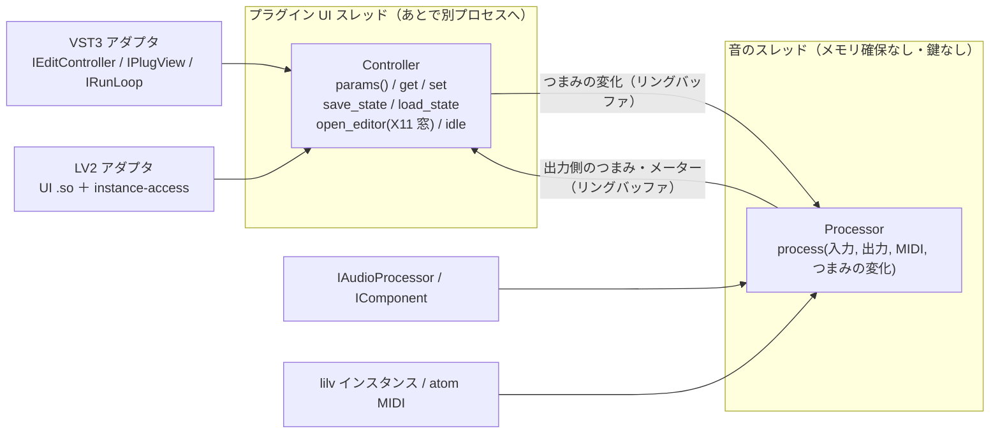
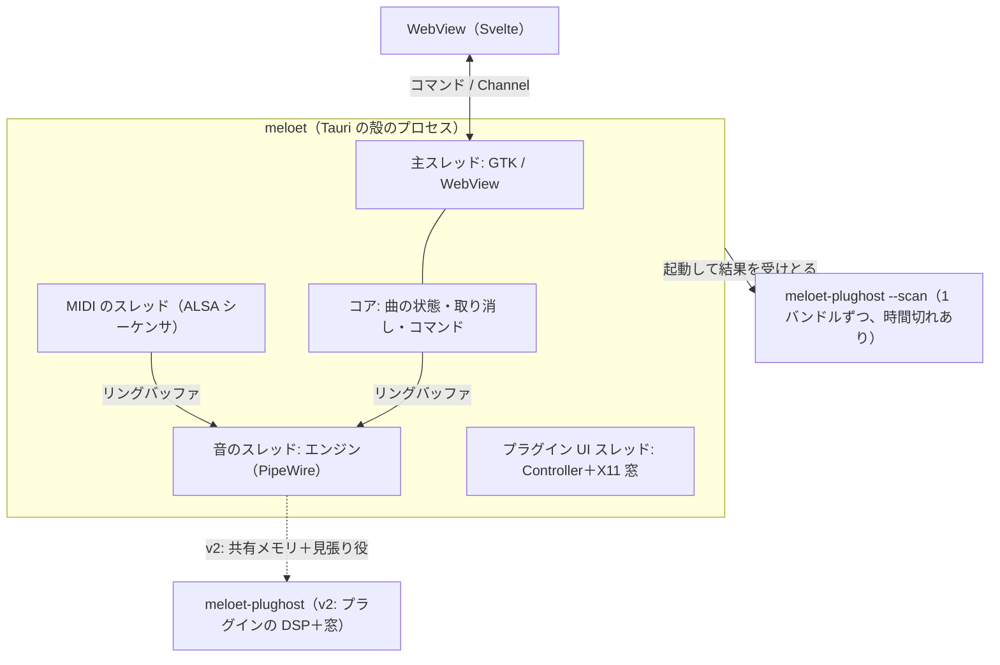

# meloet 土台の検証 報告書

2026-11-14 ・ 試作コード: このリポジトリの `spikes/` ・ 途中のメモ: [`notes-interim.md`](notes-interim.md)

各文の末尾の [A] [B] [C] は確かさです。A＝一次情報か自分の計測、B＝一次情報を引いた二次情報、C＝推論か記憶。根拠の一覧は最後にあります。

---

## 0. 結論

| 賭け | 合否 | ひとことで |
|---|---|---|
| 1 画面の速さ | **不合格** | このPCの WebKitGTK は 144 Hz の画面でも **60 Hz に固定**。1 フレーム 6.95 ms の基準には、どの設定でも 0%。60 Hz を基準にすれば、WebGL は全部の設定で合格。 |
| 2 VST3 | **合格** | Surge XT・LSP で、スキャン（別プロセス）、音、つまみ、状態、窓の開け閉めが全部通った。落ちたプラグインからも本体は生きのこる。 |
| 3 LV2 | **合格（1 つ穴あり）** | 4 つとも音・窓・状態が通った。窓は 4 つとも X11UI で開いた。**Surge XT の LV2 版だけ、つまみの読み書きが未確認**（つまみが control ポートではなく atom メッセージの作りのため）。 |
| 4 鍵盤の返事 | **合格（条件つき）** | 鍵 → 画面は、Rust が受けてから描画まで p95 で約 1 ms。表示までの見積もりは 100% が 2 フレーム以内。鍵 → 音は、バッファ 256 で平均 13.5 ms、とぎれ 0 回。ただし**このPCは PipeWire が quantum 1024 に固定**されていて、そのままだと鍵 → 音は約 53 ms。 |

いちばん大きな発見は 3 つです。

1. **NVIDIA の Linux では、WebKitGTK の画面の速さは 60 Hz が上限。** NVIDIA のドライバが、古い形の vblank の問い合わせに対応していないためです。描画を軽くしても変わりません。[A]
2. **起動したときの状態の取りこぼし。** Rust が先に送ったお知らせを、画面が聞きのがしました（鍵盤が見えない）。「画面は写し」の約束には、**つないだら最初に丸ごと取りにいく**手順が必要です。[A]
3. **プラグインは行儀が悪い前提で囲う。** 650 個の LV2 のうち 4 個がスキャン中に落ち、1 個は標準出力に勝手に書きました。窓が DSP を直接さわる作り（`instance-access`）も多いです。[A]

---

## 1. 環境

| 項目 | 値 |
|---|---|
| OS | Ubuntu 26.04.1 LTS（Ubuntu Studio のパッケージ群）、カーネル 7.0.0-43 |
| GPU | NVIDIA GeForce RTX 5060 Ti、オープン版カーネルモジュール 595.99.02（ほかに AMD Raphael 内蔵。画面は 2 枚とも NVIDIA 側） |
| 画面 | 2560×1440 が 2 枚、143.87 / 143.91 Hz（1 フレーム ≒ 6.95 ms） |
| デスクトップ | GNOME 50.1、Wayland、Xwayland あり |
| WebKitGTK | 2.52.6-0ubuntu0.26.04.1（webkit2gtk-4.1）。Ubuntu の `disable-nvidia-dmabuf.patch` 入り |
| 音 | PipeWire 1.6.2。`clock.force-quantum = 1024` が設定されていた。出口は Ryzen HD Audio（ALC897、アナログヘッドフォン）。 |
| 鍵盤 | M-Audio Keystation 49 MK3（USB MIDI。ALSA シーケンサに「USB MIDI」「Transport」の 2 つの口） |
| ツール | Rust 1.100.0、Node.js 26.13.1、tauri 2.12.5、svelte 5.57.3、vite 8.3.8、cpal 0.18.2、vst3 0.3.0、livi 0.9.0 |

記録は `spikes/s1-render/results/env.txt`。[A]

### 計測環境の都合（本番のユーザーには関係しないこと）

わたし（エージェント）は `meloet-agent` という別ユーザーで動いていて、画面と音はヤチヨさんのユーザーのものでした。そのために起きたことと、回避のしかたです。数字を読みまちがえないために書いておきます。

| 起きたこと | 回避 |
|---|---|
| 画面と音に入れない | ACL と `xhost` で一時的に入口をあけてもらった |
| 起動のたびに 30 秒止まる（自分の portal が起動に失敗し、GTK が D-Bus を待つ） | 起動ごとに `dbus-run-session` で新しい D-Bus を用意（31.7 秒 → 1.8 秒） |
| cpal が PipeWire を見つけない（`PIPEWIRE_REMOTE` を見ないため） | `PIPEWIRE_RUNTIME_DIR=/run/user/1000` |
| x11rb の純 Rust の接続が X に入れない（ファイルのソケットしか試さないため） | libxcb 経由の接続（抽象ソケットにつながる） |

[A]

---

## 2. 賭け1 画面の速さ

試作：`spikes/s1-render`。Tauri ＋ Svelte で、ピアノロール（ノート 1 万個、200 小節、49 鍵）を Canvas 2D と WebGL で描きます。横スクロール（毎秒 2 小節）と拡大縮小（1 小節 ⇔ 全体、8 秒周期）を自動で動かします。帯の高さや色は仕様書のとおりです。メーターありのときは、ミキサー 9 本（8 本＋マスター）と入力計（49 鍵、ベロシティ、ペダル、ベンド、モジュレーション）を、Svelte の状態として毎フレーム書きかえます。1 回 10 秒（その前に 1.5 秒の空回し）。

### 2-1. 数字（1920×1080、何もつけない設定）

| 描き方 | メーター | フレームの間隔 平均 / p95 / 最大 | 描く仕事 平均 / p95 | 1 回の書きかえ（144 Hz）以内 | p95 が 60 Hz の 1 フレーム以内 |
|---|---|---|---|---|---|
| Canvas 2D | なし | 17.6 / 27 / 33 ms | 6.1 / 22 ms | **0 %** | いいえ |
| Canvas 2D | あり | 17.0 / 24 / 26 ms | 4.8 / 16 ms | **0 %** | いいえ |
| WebGL | なし | 16.1 / 17 / 17 ms | 0.43 / 1 ms | **0 %** | はい |
| WebGL | あり | 16.1 / 17 / 17 ms | 0.59 / 1 ms | **0 %** | はい |

全部の組み合わせ（環境変数 11 通り × 窓 2 つ × 描き方 2 つ × メーター 2 通り＝88 回、ほかに大きさを変え続ける試験 11 回）は `spikes/s1-render/results/summary.md`。[A]

- 「メーターあり」のほうが Canvas 2D が速いのは、ミキサーの帯のぶんピアノロールの面積が小さくなるためです。[A]
- 1280×800 でも傾向は同じです（Canvas 2D・メーターなしで p95 22〜23 ms）。[A]

### 2-2. 環境変数のくらべ

| 設定 | 結果 |
|---|---|
| 公式の 3 つ（`WEBKIT_DISABLE_DMABUF_RENDERER`、`__NV_DISABLE_EXPLICIT_SYNC`、`WEBKIT_DISABLE_COMPOSITING_MODE`）の全組み合わせ 8 通り | **数字はどれもほぼ同じ**。Ubuntu のパッチで DMABuf は最初から切れているので、変わる余地がない。 [A] |
| `WEBKIT_FORCE_DMABUF_RENDERER=1`（DMABuf を強制的に戻す） | **起動直後に落ちる**（`Error 71 (Protocol error)`）。公式ページの症状そのもの。 [A] |
| 上に `__NV_DISABLE_EXPLICIT_SYNC=1` を足す | 動く。**Canvas 2D の描く仕事が平均 6.1 → 1.9 ms に縮み**、1920×1080 でも 60 Hz 基準で合格。ただし**大きさを変えるとちらつく**（目視）。 [A] |
| `GDK_BACKEND=x11` | Wayland と同じ数字。DMABuf を強制すると固まる。 [A] |

### 2-3. まっ白・ちらつき・落ちる

- 大きさを 120 ms ごとに 8 秒間変え続けても、`FORCE_DMABUF` 単独（起動で落ちる）のほかは、全部生きのこりました。[A]
- 目視（ヤチヨさん）：①何もつけない ②`NV_DISABLE_EXPLICIT_SYNC` ③`COMPOSITING_MODE` を切る ④X11 は、ふつうに見えました。**⑤DMABuf を戻した設定だけ、大きさを変えるとちらつきました**。まっ白・まっ黒のままの窓はありませんでした。[A]

### 2-4. 60 Hz に固定される理由

1. WebKit は、DRM の `drmWaitVBlank` で画面の書きかえの合図を取ろうとする（`DisplayVBlankMonitorDRM.cpp`）。[A]
2. NVIDIA（`/dev/dri/card1`）は `DRM_IOCTL_WAIT_VBLANK` に **ENOTSUP** を返す（`spikes/s1-render/tools/vblank_probe.py` で直接確認）。[A]
3. 失敗すると、WebKit は**固定 60 Hz のタイマー**（`DisplayVBlankMonitorTimer`）に切りかえる。journal にも `Failed to create DRM vblank monitor, falling back to timer` と出る。[A]

- journal のメッセージは「許可されていない操作（EPERM）」と言っていますが、本当の原因は ENOTSUP です。WebKit 側の表示の誤りと見ています。`drmWaitVBlank()` は -1 を返して errno を立てるので、`strerror(-ret)` だといつも EPERM と表示されます。[A]（ioctl の結果）／[C]（解釈）
- WebKit の `PreferPageRenderingUpdatesNear60FPS` は最初からオンでしたが、切っても変わりませんでした。[A]
- ENOTSUP は装置の返事で、ユーザーの権限とは関係しません。**ヤチヨさん本人のユーザーでも、root（sudo）でも、同じ ENOTSUP** でした。[A]
- 同じソースの DRM 側の道は、すでに `gdk_monitor_get_refresh_rate()` で画面の周期を読んでいます。タイマーの道がそれを使わず 60 に決め打ちしているだけなので、WebKitGTK に直してもらえる余地はあります。[A]（ソース）／[C]（直る見こみ）

### 2-5. 逃げ道の候補：Rust から画面の周期で合図を送る

WebKit は、IPC のメッセージが届くたびに描画を走らせます（賭け4 で発見）。そこで、Rust から 143.87 Hz で合図を送り、ページはその合図で描く方式を試しました。

| 設定 | WebKit の描画の間隔 p50 / p95 | 1 回の書きかえ以内 |
|---|---|---|
| 何もつけない、WebGL | 9 / 10 ms | 21〜49 % |
| 何もつけない、Canvas 2D | 6〜7 / 14〜15 ms | 83〜90 % |
| DMABuf を戻す | 17 / 18 ms（描いても画面は 60 Hz） | 0 % |

**95% には届きませんでした**。また、rAF の間隔は「WebKit が描画した回数」で、「画面に出た回数」そのものではありません。[A]

### 2-6. つまずいた所

- WebKitGTK の `performance.now()` は 1 ms 刻みです。COOP/COEP を足しても細かくなりませんでした。フレームの抜けは見分けられますが、描く仕事の p95 は 1 ms の粗さをふくみます。[A]
- WebGL のレンダラ名は `Apple GPU` と出ます（公式ページのとおり）。GPU で描いているかを JS からは判定できません。[A]

---

## 3. 賭け2 VST3

試作：`spikes/plugins`（`pk-core` 境界、`pk-vst3`、`pk-lv2`、試験プログラム `pk-probe`）。

### 3-1. 結果

| 項目 | Surge XT 1.3.4（音源） | LSP Compressor Stereo 1.2.27（エフェクト） |
|---|---|---|
| スキャン（別プロセス） | 通った。音源・入出力 2ch | 通った。バンドルに 190 クラス |
| 読みこみ | 144 ms | 57 ms |
| ノートを送って音が出る | RMS 0.14（前半） | RMS 0.20（220 Hz のサイン波を通して） |
| つまみ | 2855 個。書く・読みなおすが一致 | 48 個。段階のあるつまみは丸められる（0.25 → 0） |
| 状態を保存して別のインスタンスに戻す | 51 KB。つまみ 40/40 一致。音の形の相関 0.993（同じ状態どうし）、対照とは −0.01 | 525 B。**サンプル単位で完全一致** |
| 窓（X11 の別窓） | 1597×995。開く 80〜110 ms、閉じる 10 ms。3 回くりかえして安定。画素 2850 色 | 944×548。開く 113〜164 ms |

[A]

- Surge の音がサンプル単位で一致しないのは、中で乱数を使っているためです。「同じ状態を 2 つの新しいインスタンスに戻したものどうし」と「戻さないもの」を比べて判定しました。[A]
- Surge は JUCE 製で、部品とつまみ係のあいだのやりとりに IMessage を使います。ホストに `IMessage`・`IAttributeList` の作り手を入れて動きました。[A]

### 3-2. 動いている最中に止める（下調べ）

プラグインを子プロセスで回し、親（エンジン役）は自分の時計で 5.3 ms（256 サンプル）ごとに回ります。子との音のやりとりはパイプです（本番は共有メモリを想定）。

| 壊れ方 | 気づいた方法 | 気づくまで | 親 |
|---|---|---|---|
| kill（外から強制終了） | パイプが閉じた | 3.2 ms | 生きのこり、51 ブロック回りつづけた |
| segv（処理の途中で不正なメモリに触る） | 見張り役（2 ブロック返事なし） | 10.8 ms | 同上 |
| hang（返ってこない） | 見張り役 | 10.8 ms | 同上 |

[A]（VST3 の Surge と LV2 の synthv1 の両方で同じ）

- segv でも「パイプが閉じる」より先に見張り役が気づきました。落ちたプロセスがコアダンプを書くあいだ（約 1 秒）、パイプが開いたままになるためです。**時間で見張る仕組みが必須**です。[A]

### 3-3. `vst3-host` クレートを読んだ判断：依存に入れない

- 別プロセスで動かすとき、**音のバッファを JSON（base64）にして stdin/stdout で送っています**。256 サンプル（5.3 ms）ごとに間に合わせる音の道には向きません。さらに、プラグインが標準出力に書くと通信がこわれます（LV2 の Dragonfly が実際に書いていました）。[A]（ソース・実測）／[C]（向かないという判断）
- Linux の窓は Xvfb の上でしか試していない、と本人の文書にあります。[A]
- 0.11.1 で、5 か月に 17 回出ていて、egui・midir・cpal を抱えています。[A]
- 使ったもの：`IRunLoop`（fd とタイマー）の回しかた、COM の実装の形。[C]

### 3-4. プラグインの窓：Tauri と同じプロセスか、別プロセスか

| | 同じプロセス | 別プロセス（プラグイン係のプロセス） |
|---|---|---|
| 窓の型 | Tauri の窓は Wayland の窓。X11 の子窓は**埋めこめない**。どちらにしても別の窓になる [A] | 同じ |
| 窓の動かし方 | GTK の主スレッドで `IRunLoop` と X11 を回すか、プラグイン用の UI スレッドを別に立てる（試作は GTK なしのスレッドで動いた）[A] | プラグイン係が自分で回す。素直 |
| プラグインの窓が固まったら | 主スレッドで回すと、meloet の画面ごと固まる [C] | meloet の画面は無事 [C] |
| 落ちたら | 全部落ちる | プラグイン係だけ落ちる |
| `instance-access`（Surge・synthv1 の LV2 は必須） | 問題なし | 窓は DSP と同じプロセスでなければならない。**別プロセスにするなら、DSP ごと移す** [A] |
| 窓の重なり | Wayland と X11 をまたぐので、親子関係（transient）を付けられない | 同じ |
| 標準出力 | プラグインが書いても害は小さい | 通信に使ってはいけない [A] |

**わたしの見立て**：素直なのは**別プロセス（DSP と窓を一緒に）**です。窓は X11 の別窓にしかならないので、同じプロセスにする得がほとんどありません。ただ、最初の版では同じプロセスでも動かせます。そのときは、窓とつまみ係を **GTK と別の「プラグイン UI スレッド」**にのせておけば、あとで別プロセスへ移すときに境界がそのまま使えます。[C]

---

## 4. 賭け3 LV2

### 4-1. 読む部品

| 部品 | ライセンス | えらんだか |
|---|---|---|
| `livi` 0.9.0（Rust） | MIT | **使う**。起動・処理・つまみ・状態・worker |
| `lilv` 0.26.2（C、システム） | ISC | 使う（livi が使う） |
| `suil` 0.10.24（C、システム） | ISC | 使わなかった。X11UI は自前で読めた。Qt5/Gtk の UI を埋めるときの候補 |
| `yeli`（純 Rust のホスト） | LGPL-2.1+ | **使わない**（静的リンクになるため） |
| `lv2-host-minimal` | GPL-3.0 | **使わない** |

[A]（ライセンスは crates.io とパッケージの copyright）。UI の `.so` を読み、`ui:parent`・`instance-access`・URID・options（`param:sampleRate` をふくむ）を渡し、`idleInterface` で回す部分は自分で書きました。

### 4-2. 結果

| 項目 | Surge XT（LV2） | synthv1 1.3.2 | Dragonfly Hall Reverb 3.2.10 | LSP Compressor Stereo 1.2.27 |
|---|---|---|---|---|
| 種類 | 音源 | 音源 | エフェクト | エフェクト |
| 音 | RMS 0.14 | RMS 0.38 | RMS 0.16 | RMS 0.20 |
| つまみ（control ポート） | **ユーザーのつまみは 0 個**（ホスト用の 2 つだけ）→ 未確認 | 145 個、一致 | 18 個、一致 | 48 個、一致 |
| 状態を戻す | 67 KB を保存・復元はできた。つまみを動かせないので、音が戻るかは**未確認** | 40/40 一致。波形の相関 0.9985 | 18/18 一致。**サンプル単位で完全一致** | 40/40 一致。完全一致 |
| 窓 | X11UI、1597×995、開く 80〜110 ms | X11UI（中身は Qt6）、1142×511、開く 23〜33 ms | X11UI、920×345 | X11UI、944×548、開く 200 ms |

[A]

- Surge の LV2 版は、つまみを atom の patch メッセージで受けとる作りです。読み書きするには、ホストに `patch:Set`・`patch:Get` の送受信が要ります。今回は作っていません。[A]（TTL）／[C]（必要な作業）
- 状態を比べるときは、**まっさらなインスタンスどうし**で比べました。鳴らしたあとのインスタンスにはリバーブの尾やコンプの効き具合が残っていて、同じ条件になりません（最初はそれでまちがった結果を出しかけました）。[A]

### 4-3. 窓の型

**4 つの相手**（TTL から）：

| プラグイン | 窓の型 | 窓に必要な機能 |
|---|---|---|
| Surge XT | X11UI | `instance-access`（必須）、`idleInterface`、`resize`、`ui:parent` |
| synthv1 | X11UI ＋ Qt6UI ＋ kx 外部窓 | `instance-access`（必須） |
| Dragonfly（4 種） | X11UI | `options`（必須）、`idleInterface`、`showInterface`、`noUserResize` |
| LSP（194 個） | X11UI | `urid:map`（必須）、`instance-access` は任意 |

**このPCの LV2 全体**（643 個、スキャン結果から）：X11UI 340 個、窓なし 252 個、外部窓だけ 47 個、X11UI と外部窓の両方 3 個、Qt5UI だけ 1 個。[A]

**提案（最初の版）**：**X11UI だけ**を面倒見ます。4 つの相手と、窓を持つプラグインの 87% がこれで開きます。窓がないプラグインは、つまみの一覧から作る汎用の画面で受けます。外部窓（47 個）は次の候補です。Gtk・Qt を埋めこむ型（suil が要る）は後回しにします。[C]

つまずいた所：
- **Dragonfly は大きさを知らせてこない**（`noUserResize`）ので、窓が途中で切れていました。ヤチヨさんの目視で発見し、プラグインが作った子窓の大きさを X11 に直接たずねる形で直しました。[A]
- Dragonfly の UI は、サンプルレートをもらえないと標準出力に警告を書きます。その警告が、わたしの試験の JSON にまざりました。[A]

### 4-4. スキャン

- VST3 20 バンドル＋LV2 650 個＋わざと落ちる偽 VST3 1 個を、1 個ずつ子プロセスで調べ、**258 秒**。本体は最後まで生きていました。[A]
- 最初の作り（子プロセスが毎回、全部の TTL を読みなおす）だと、1 個 1.4 秒かかり、10 分の時間切れで止まりました。**TTL は 1 回だけ子プロセスで読み、プラグインごとの子は自分のバンドルだけを読む**形に変えました。[A]
- 子プロセスの中で落ちたもの：偽 VST3（想定どおり）、**padthv1、ZynAddSubFX の Chorus・Distortion・Echo（SIGSEGV）**、ほか 3 個は読みこみ時のエラー。わたしの最小限のホストで起動したときの結果なので、プラグイン側の不具合とは言いきれません。[A]（結果）／[C]（原因）
- LSP の VST3 バンドル 1 つ（190 クラス）は、調べるのに 8 秒かかります。本番は「場所・更新日時・大きさ」で結果をとっておく必要があります。[A]

### 4-5. 音源・エフェクトとして同じに扱う境界

試作の境界は `spikes/plugins/core/src/lib.rs` の `Plugin` トレイトです。本番では、スレッドごとに 2 つに分けることを提案します。

- 外に見せるのは `Kind`（音源／エフェクト。プラグイン自身の情報から決め、名前からは決めない）、`PluginInfo`、つまみ（いつも 0〜1）、状態のバイト列、窓（X11 の窓番号）だけです。COM のポインタや lilv の型は外に出しません。[A]
- 状態は、VST3 は「部品＋つまみ係」の 2 つのストリームをまとめたもの、LV2 は lilv の状態（TTL 文字列）です。形式ごとに中身はちがいますが、外からは同じバイト列として扱えます。[A]

---

## 5. 賭け4 鍵盤の返事の速さ

試作：`spikes/s4-latency`（Tauri アプリ＋仮想の鍵盤 `vkeys`）。

### 5-1. さしたこと・ぬいたことに気づく

ALSA シーケンサのお知らせポート（System:Announce）を購読しました。midir には抜きさしを知らせる仕組みがないので、`alsa` クレートで直接使っています。

| できごと | Rust が気づいてから画面まで |
|---|---|
| さした（3 回） | 0.2〜0.6 ms |
| ぬいた（3 回） | 0.5 ms 以内 |

- さしたとき、シーケンサのポートは udev のお知らせより **約 14 ms 早く**出ました。気づくには、シーケンサのほうが向いています。[A]
- ケーブルが物理的にささった瞬間の時刻は、ソフトからは取れません。上の数字は「カーネルが装置を認識してから」です。[A]
- **起動時の取りこぼし**：起動時からつながっている鍵盤が画面に出ませんでした（ヤチヨさんが発見）。画面が聞く準備をする前に、Rust がお知らせを送っていたためです。「聞く準備 → 今の状態を丸ごと取りにいく」の順に直したら出るようになりました（ヤチヨさんが確認）。[A]

### 5-2. 鍵 → 画面

Rust が鍵を受けた時刻（`CLOCK_MONOTONIC`）と、JS の時刻を合わせました（往復のいちばん速い 1 回から時刻差を出す。往復は 1 ms 未満。JS の時計は 1 ms 刻み）。メーターなどを 60 Hz で流し続けながら、仮想の鍵盤で 120 回押しました。

| 送り方 | Rust → JS の処理 p50 / p95 | Rust → 描画（rAF）p50 / p95 / 最大 | 表示まで（見積もり）2 フレーム以内 |
|---|---|---|---|
| Events（`emit`、JSON） | −0.03 / 0.43 ms | 0.18 / 0.83 / 7.8 ms | 100 % |
| Channel（JSON） | 0.21 / 0.67 ms | 0.39 / 1.21 / 3.0 ms | 100 % |
| Channel（バイナリ） | 0.06 / 0.66 ms | 0.27 / 1.13 / 15.8 ms | 100 % |
| 毎フレーム取りにいく（独自プロトコル） | 6.8 / 14.2 ms | 12.4 / 29.2 / 31.9 ms | 70 % |
| **本物の鍵 117 回**（Channel バイナリ、バッファ 256） | 0.02 / 0.41 ms | 0.28 / 0.84 / 5.2 ms | 100 % |

[A]（見積もりの部分は C）

- **WebKit は、IPC のメッセージが届くと、60 Hz のタイマーを待たずにすぐ描画します**。だから送る方式は速く、取りにいく方式は次の区切りまで待ちます。[A]
- 「表示まで」は、描画の時刻に 60 Hz の 1 フレーム（16.7 ms）を足した**見積もり**です。画面に光が出た瞬間は測れていません（カメラが要ります）。合格の判定は、この見積もりにもとづきます。[C]
- JS の時刻差の誤差は ±0.5 ms ほどです（Events で小さな負の値が出るのはそのため）。[A]

**合否：合格**（2 フレーム以内が 100%。ただし見積もり）。

### 5-3. 鍵 → 音

音は cpal（PipeWire）で鳴らす仮のサイン波です。cpal の PipeWire 側は、`pw_stream_get_time_n` と同じ `CLOCK_MONOTONIC` で時刻を渡すので、「Rust が鍵を受けた時刻」と「その音の最初のサンプルが DAC に届く予定の時刻」を引き算できます。

| 条件 | Rust → 音のコールバック 平均 / p95 | Rust → DAC（予定）平均 / p95 / 最大 | 遅れたコールバック |
|---|---|---|---|
| PipeWire の既定（quantum 1024 固定） | 10.5 / 20.3 ms | **53.2 / 63.0 / 64.0 ms** | 0 / 2364 |
| quantum 256（計測のあいだだけ変更） | 2.6 / 5.0 ms | **13.2 / 15.6 / 16.0 ms** | 0 / 9452 |
| 本物の鍵、quantum 256 | 2.8 / 5.2 ms | **13.5 / 15.8 / 16.0 ms** | 0 / 11328 |

[A]

- **バッファ 256 でとぎれは出ませんでした**。アプリ側の「遅れたコールバック」は 0 回、PipeWire の `pw-top` でもアプリのノードの ERR は 0 でした。出力装置のドライバに ERR が 1 回ありました。quantum を切りかえた瞬間のものと見ていますが、断定はできません。[A]／[C]
- 本物の鍵の試験で、ヤチヨさんの耳では「光った・鳴った・自然」でした。[A]
- 鍵盤の中（鍵の読みとり）と USB の遅れは、ソフトからは測れません。ALSA のカーネル時刻を取ろうとしましたが、取れませんでした（未計測）。USB MIDI は 1 ms 単位で送られるので、足しても 1〜2 ms の見こみです。[C]
- 音の立ち上がりに約 2 ms のフェードイン（プチ音よけ）を入れています。[A]

### 5-4. 「スピーカー」「ヘッドホン」の名前

| 取りかた | 取れた名前 | 人の言葉か |
|---|---|---|
| cpal の ALSA・JACK | 「HD-Audio Generic, ALC897 Analog」「JACK Output」 | いいえ。`device_type` は全部 Unknown |
| cpal の PipeWire | 「Ryzen HD Audio Controller アナログステレオ」 | いいえ。`device_type` は全部 Unknown |
| **PipeWire の装置の Route（経路）** | 「**アナログヘッドフォン**」「**ライン出力**」「HDMI / DisplayPort 2」「リアマイクロフォン」、さらに `available`（ジャックに何かささっているか） | **はい（日本語で）** |

[A]

→ 人の言葉の名前は、cpal ではなく **PipeWire の Route を読む小さな層**が要ります（`pipewire` クレートは cpal が使っているものと同じ）。

### 5-5. Rust から画面への送り方の重さ（入力計＋メーター 18 本＋再生位置を毎フレーム）

| 送り方 | 頻度 | 届くまで p50 / p95 | Rust の CPU | WebKit の CPU | JS の処理（10 秒の合計） |
|---|---|---|---|---|---|
| Events（JSON） | 60 Hz | 0.22 / 0.68 ms | 4.5 % | 8.8 % | 36 ms |
| Channel（JSON） | 60 Hz | 0.33 / 0.78 ms | 4.4 % | 8.6 % | 28 ms |
| Channel（バイナリ、120 B） | 60 Hz | 0.24 / 0.70 ms | 4.4 % | 8.7 % | 39 ms |
| 取りにいく | rAF ごと | 8.5 / 16.0 ms（データの古さ） | 6.8 % | 16.2 % | 41 ms |
| Events（JSON） | 144 Hz | −0.30 / 0.46 ms | 8.1 % | 16.6 % | 19 ms |
| Channel（JSON） | 144 Hz | 0.43 / 0.44 ms | 8.0 % | 16.4 % | 55 ms |
| Channel（バイナリ） | 144 Hz | 0.18 / 0.53 ms | 8.1 % | 16.6 % | 25 ms |

CPU は 1 コアに対する割合です。[A]

- この量では、**送る方式どうしの差はほぼありません**。取りにいく方式は、遅れが大きいうえに WebKit の CPU も倍です。[A]
- Events は Tauri の権限（`core:event:default`）が要ります。最初は権限がなくて 0 件でした。[A]
- 公式の文書は、Events を「少量向け、高い頻度には向かない」、Channel を「速く、順番どおりに届く、ストリーム向け」としています。[A]

**推し：Channel**。公式の向き不向きに合っていて、バイナリも JSON も同じ道で送れるからです。

### 5-6. PipeWire の quantum

- このPCは `clock.force-quantum = 1024` で、アプリが 256 を頼んでも 1024 で動きます。Ubuntu Studio の設定ファイルには見当たらず、どこで決まったかは未確認です。[A]／[C]
- 初心者向けの DAW としては、「バッファ 256」と画面に出しているのに実際は 1024、という状態は困ります。本番は、**実際に動いているフレーム数をコールバックから読んで画面に出し**、ずれていたら知らせるべきです（試作でも `framesPerCallback` として取れています）。[A]／[C]

---

## 6. だめだった賭けの逃げ道

### 賭け1 画面の速さ（不合格）

| 案 | あきらめる物 | 手間 | 危うさ |
|---|---|---|---|
| **A. Linux＋NVIDIA では 60 Hz を受け入れる。** 合格の基準を「WebKit の 1 フレーム（16.7 ms）」に置きかえる。重い面（ピアノロール、メーター）は WebGL で描く | 144 Hz の画面での、なめらかさ | 小さい（WebGL で合格は確認ずみ） | 低い |
| **B. 殻を Chromium 系に替える**（Tauri 3 の CEF ランタイム。いまは alpha） | 配布物の大きさ（Chromium 一式）、alpha の不安定さ。「殻だけ取りかえる」設計が前提 | 中くらい（橋の層が薄ければ） | 中くらい（alpha）。Chromium は Wayland の frame callback で画面の周期に合わせるはず [C]、未計測 |
| **C. 重い面だけ、ネイティブの GPU 描画（wgpu など）にする** | 「画面は Web の標準だけ」という決まり。Wayland で WebKitGTK の中に別の面を重ねるのはむずかしい | 大きい | 高い |
| （参考）Rust から 144 Hz で合図 | — | 小さい | 測ったら 21〜90% で、足りない |

**わたしの推し：A を今すぐ、B を「出口」として準備。** 理由：
1. 60 Hz なら、今の作り（WebGL）で余裕をもって合格しています（描く仕事は 1 ms 未満）。
2. 60 Hz の画面を使っている人には、もともと関係のない問題です。
3. 一方で、144 Hz の画面を使う人に「なめらかさ」で負けるのは確かです。そのために、橋の層を薄く保ち、Tauri の CEF ランタイムが安定したら測りなおせる形にしておきます。
4. あわせて、WebKitGTK にこの件を伝える価値はあります。タイマーの道が `gdk_monitor_get_refresh_rate()` を使うだけで直る形に見えます（[C]）。

あわせて、**Canvas 2D は大きな面には使わない**決まりを提案します。Ubuntu のパッチのせいで NVIDIA では CPU で描かれ、1 万ノートで 20 ms を超えます。DMABuf を強制すると速くなりますが、ちらつくので出荷の既定にはできません。

### 賭け3 の穴（Surge XT LV2 のつまみ）

| 案 | あきらめる物 | 推し |
|---|---|---|
| **A. LV2 の `patch:Set`/`patch:Get`（atom）を実装する** | 手間（atom の読み書きと URID の管理） | **推し**。LV2 の新しめのプラグインはこの形が増えている [C] |
| B. 同じプラグインに VST3 版があれば、そちらを優先して見せる | LV2 版を選んだ人の自由 | 当面のしのぎ |
| C. control ポートのつまみだけ扱う | Surge の LV2 版などのつまみ | 推さない |

### 賭け4 の条件（quantum 1024 の固定）

| 案 | あきらめる物 | 推し |
|---|---|---|
| **A. 実際のフレーム数を表示し、ずれていたら案内する**（「PC 全体の設定で 1024 に固定されています」） | 自動では直らない | **推し**。PC 全体の設定を、アプリが黙って変えるべきではない |
| B. アプリが `pw-metadata` で force-quantum を変える | ほかのアプリの音にも効く（行儀が悪い） | 推さない |
| C. ストリームのプロパティで低い遅れを頼む（`node.latency` など） | force-quantum が立っていると効かない見こみ [C] | A と組み合わせる |

---

## 7. 本番の骨組みの提案

### 7-1. クレートの分けかた

| クレート | 役目 | 中に入れないもの |
|---|---|---|
| `meloet-model` | 曲・トラック・ノート・取り消し。純粋なデータと操作 | 入出力、スレッド |
| `meloet-protocol` | Rust と画面の約束（型と版）。TS の型もここから作る | Tauri |
| `meloet-engine` | 音の流れ、トランスポート、メーター。音のスレッドはメモリ確保なし・鍵なし | 画面、プラグインの形式 |
| `meloet-midi` | 入力と抜きさし（Linux は ALSA シーケンサ。ほかは各 OS の API） | 音 |
| `meloet-devices` | 音の出入口の「人の言葉の名前」（Linux は PipeWire の Route） | 音の処理 |
| `meloet-plugin` | 形式に関係ない境界（Controller / Processor、情報、状態） | unsafe |
| `meloet-vst3`、`meloet-lv2` | 形式ごとのアダプタ。unsafe はここだけ | 境界の外への生ポインタ |
| `meloet-plughost`（実行ファイル） | スキャン用の子プロセス。あとでプラグイン係のプロセスにもなる | 画面 |
| `meloet-app`（Tauri） | 殻。コマンドと Channel の受けわたしだけ | 状態の持ち主になること |
| `ui/`（Svelte＋TS） | 画面。`ui/src/bridge/` だけが Tauri を知る | Tauri の API の直接呼び出し |

### 7-2. プロセスの分けかた

- **v1**：プラグインは同じプロセスで動かしますが、DSP は音のスレッド、つまみ係と窓は**専用のプラグイン UI スレッド**（GTK の主スレッドとは別）に置きます。スキャンだけは最初から別プロセスにします（実際に 4 個が落ちたため）。
- **v2**：プラグインごと（または信頼度ごと）に `meloet-plughost` へ移します。DSP と窓は同じプロセスに置きます（`instance-access` のため）。音は共有メモリと eventfd でやりとりし、エンジンは 2 ブロック返事がなければその枠をとばします（仕様書の「音はこの枠をとばして流しています」）。
- プラグイン係のプロセスでは、**標準出力・標準エラーを通信に使いません**（プラグインが勝手に書くため）。

### 7-3. Rust と画面のあいだの約束

1. **あいさつ**：画面は起動したら `hello { protocolVersion }` を送り、**先にお知らせを聞く準備をしてから** `snapshot()` で状態を丸ごと受けとる（版番号 `rev` つき）。起動時の取りこぼしの教訓です。
2. **画面 → Rust**：「意図」のコマンドだけを送る（例：`SetFader { track, db }`、`OpenBand { band }`）。Rust が確かめて状態を変え、新しい `rev` を返す。画面は自分で状態を決めない（ドラッグ中の見た目だけは先に動かしてよいが、最後は Rust からの差分に合わせる）。
3. **Rust → 画面：差分**：`Channel` で `{ rev, patch }` を送る。`rev` が 1 つ飛んだら、画面は `snapshot()` を取りなおす。
4. **Rust → 画面：計器**（入力計・メーター・再生位置）：`Channel` のバイナリで、決まった並び（リトルエンディアン、先頭に型と版）。画面の周期に合わせて「最新だけ」を送る。測った重さは、60 Hz で Rust 4.4%、WebKit 8.7%。
5. **Rust → 画面：すぐ知らせること**（鍵の on/off、鍵盤のぬきさし、プラグインが止まった）：届いた瞬間に `Channel` で送る。測った遅れは p95 で約 1 ms。
6. **画面の橋**：`ui/src/bridge/` だけが `@tauri-apps/api` を読む。外に見せるのは `connect(onSnapshot, onPatch, onTelemetry, onEvent)` と `send(command)` だけ。殻を取りかえるときは、ここだけを書きかえる。
7. **権限**：Tauri の権限ファイルは、使う物だけ（今回は `core:event:default` が要った）。

---

## 8. 測れなかったこと・限界

- 画面に光が出た瞬間（鍵 → 画面の最後の区間）は、ソフトでは測れていません。見積もりです。カメラ（240 fps 以上）があれば測れます。
- 鍵盤の中と USB の遅れ、カーネルの時刻は未計測です。
- JS の時計が 1 ms 刻みなので、描く仕事の細かい分布は粗いです。
- プラグインの音は RMS と波形の比べっこで確かめました。プラグインの音を耳で聞いての確認はしていません（サイン波の試験は耳で確認ずみ）。
- 計測は別ユーザーで動かした環境です（1 章）。portal の待ちなど、本番で起きないことは回避して測りました。

---

## 9. 使った部品とライセンス

機械で見はる仕組み：`node licenses/check.mjs`（Rust は `cargo deny check licenses` と `deny.toml` の許可リスト、npm は `licenses/npm-inventory.json`、システムとプラグインは `licenses/system.json`）。最終の実行結果は**すべて OK** でした。

### 主な部品（直接使ったもの）

| 部品 | 版 | ライセンス | 種類 |
|---|---|---|---|
| tauri / tauri-build | 2.12.5 / 2.7.4 | Apache-2.0 OR MIT | Rust |
| cpal | 0.18.2（pipewire, jack） | Apache-2.0 | Rust |
| alsa | 0.11.0 | Apache-2.0 OR MIT | Rust |
| udev | 0.9.3 | MIT | Rust |
| rtrb | 0.4.1 | MIT OR Apache-2.0 | Rust |
| vst3 | 0.3.0 | MIT OR Apache-2.0 | Rust |
| livi / lilv / lilv-sys | 0.9.0 / 0.3.1 / 0.3.0 | MIT | Rust |
| lv2_raw | 0.3.2 | ISC | Rust |
| libloading | 0.9.1 | ISC | Rust |
| x11rb | 0.14.0 | MIT OR Apache-2.0 | Rust |
| webkit2gtk / glib（Rust 側） | 2.0.2 / 0.18.5 | MIT | Rust |
| raw-window-handle、serde、serde_json、libc | — | MIT OR Apache-2.0 など | Rust |
| svelte / vite / @sveltejs/vite-plugin-svelte | 5.57.3 / 8.3.8 / 7.3.1 | MIT | npm |
| @tauri-apps/api / cli | 2.12.4 | Apache-2.0 OR MIT | npm |
| typescript | 6.0.3 | Apache-2.0 | npm |
| WebKitGTK、GTK3、GLib、alsa-lib、libpipewire、libjack、libudev | システム | LGPL-2.1+ など（動的に使う） | システム |
| lilv、serd、sord、sratom、zix | システム | ISC | システム |
| VST 3 SDK（バインディングの元） | 3.8 | MIT | — |

Rust のクレートは全部で 493 個（Windows・macOS 用もふくむ）。数は MIT OR Apache-2.0 が 226、MIT が 119、ほかに Zlib、Unicode-3.0、BSD-3-Clause、ISC。**MPL-2.0 が 7 個**（`cssparser`、`selectors`、`dtoa-short`、`option-ext` など。Tauri が間接的に使う）。MPL-2.0 はファイル単位のコピーレフトで、GPL・AGPL ではありません。ただし、そのファイルを書きかえたら公開が必要です。一覧は `licenses/rust-inventory.json`。npm は 43 個で全部許可リストの中です（`licenses/npm-inventory.json`）。

### 試験の相手（出荷しない・リンクしない）

Surge XT 1.3.4（GPL-3.0）、LSP Plugins 1.2.27（LGPL-3.0+）、synthv1 1.3.2（GPL-2.0+）、Dragonfly Reverb 3.2.10（GPL-3.0+）。ユーザーが自分で入れたプラグインを実行時に読むだけです。

### 使わないと決めたもの

`vst3-host`（理由は 3-3）、`yeli`（LGPL-2.1+ を静的リンク）、`lv2-host-minimal`（GPL-3.0）、`midir`（抜きさしを知らせない。Linux 以外では候補）。

---

## 10. 根拠と確かさ

| 根拠 | 確かさ |
|---|---|
| 自分の計測（`spikes/*/results/`）、ioctl の検査、strace、journal、ヤチヨさんの目と耳 | A |
| WebKitGTK 2.52.6 のソース（WebKit の GitHub、タグ `webkitgtk-2.52.6`） | A |
| Ubuntu の `disable-nvidia-dmabuf.patch`（Launchpad の git） | A |
| Tauri 公式「Linux Graphics Issues」「Prerequisites」「Calling the Frontend」「Calling Rust」 | A |
| 入れた版のソース：tauri 2.12.5、tauri-utils 2.10.2、cpal 0.18.2、vst3 0.3.0、com-scrape-types 0.1.1、livi 0.9.0、lilv 0.3.1、alsa 0.11.0、x11rb 0.14.0、vst3-host 0.11.1 | A |
| Steinberg VST3 開発者ポータル（ライセンス、IRunLoop、プラットフォームの型） | A |
| LV2 の TTL（`/usr/lib/lv2/*`）、パッケージの copyright ファイル、crates.io の登録情報 | A |
| LV2 UI の仕様（lv2plug.in）、kx 外部窓（kx.studio） | A |
| 純 Rust の LV2 ホストが見つからないこと | B（crates.io の検索。網羅の保証はない） |
| 設計の判断、逃げ道の見立て、CEF なら画面の周期で回る見こみ | C（推論） |

一次情報が見つからなかったもの：`__NV_DISABLE_EXPLICIT_SYNC` が 595 系のドライバと WebKitGTK 2.52 で効くという公式の記述（Tauri の文書は「よく効く」とだけ書いている）。
